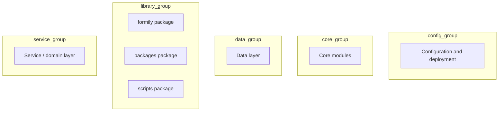

# Architecture report: alibaba/designable

> Automated static analysis. **Observed** = directly seen in files/imports/AST; **Inferred** = interpretation from that evidence. Repository code was not executed.

## 1. Repository at a glance

| Item | Value |
| --- | --- |
| Repository | alibaba/designable |
| Description | 🧩 Make everything designable 🧩  |
| Language | TypeScript |
| Stars | 3522 |
| Licence | MIT |
| Analysed commit / branch | 3e961de947011df6ac5cd092c1084140494f5fc2 / main |
| Framework(s) | React |
| Files analysed | 800 |
| Components | 7 |

## 2. Architecture in one minute

alibaba/designable - 🧩 Make everything designable 🧩 . This repository was analysed statically from 800 file(s) (0 Python). Detected technologies (observed from imports/manifests): GitHub Actions, React, Jest, TypeScript, webpack. Files are grouped into 7 component(s): Configuration and deployment, Core modules, Data layer, formily package, packages package, scripts package, Service / domain layer. Findings below distinguish observed facts from inferred interpretation.

## 3. High-level block diagram

## 4. Main components

### Configuration and deployment (`config`)

- **Kind:** config
- **Status:** Observed
- **Confidence:** 0.85
- **Responsibility:** Groups 29 file(s) under configuration and deployment (observed from repository paths and static analysis).
- **Paths:** `formily/antd/package.json`, `formily/antd/tsconfig.build.json`, `formily/antd/tsconfig.json`, `formily/next/package.json`, `formily/next/tsconfig.build.json`, `formily/next/tsconfig.json`, `formily/setters/package.json`, `formily/setters/tsconfig.build.json`, `formily/setters/tsconfig.json`, `formily/transformer/package.json`, `formily/transformer/tsconfig.build.json`, `formily/transformer/tsconfig.json`, `lerna.json`, `package.json`, `packages/core/package.json`, `packages/core/tsconfig.build.json`, `packages/core/tsconfig.json`, `packages/react-sandbox/package.json`, `packages/react-sandbox/tsconfig.build.json`, `packages/react-sandbox/tsconfig.json`, `packages/react-settings-form/package.json`, `packages/react-settings-form/tsconfig.build.json`, `packages/react-settings-form/tsconfig.json`, `packages/react/package.json`, `packages/react/tsconfig.build.json`, `packages/react/tsconfig.json`, `packages/shared/package.json`, `packages/shared/tsconfig.build.json`, `packages/shared/tsconfig.json`
- **Evidence:** [formily/antd/package.json](https://github.com/alibaba/designable/blob/3e961de947011df6ac5cd092c1084140494f5fc2/formily/antd/package.json); [formily/antd/tsconfig.build.json](https://github.com/alibaba/designable/blob/3e961de947011df6ac5cd092c1084140494f5fc2/formily/antd/tsconfig.build.json); [formily/antd/tsconfig.json](https://github.com/alibaba/designable/blob/3e961de947011df6ac5cd092c1084140494f5fc2/formily/antd/tsconfig.json); [formily/next/package.json](https://github.com/alibaba/designable/blob/3e961de947011df6ac5cd092c1084140494f5fc2/formily/next/package.json); [formily/next/tsconfig.build.json](https://github.com/alibaba/designable/blob/3e961de947011df6ac5cd092c1084140494f5fc2/formily/next/tsconfig.build.json); [formily/next/tsconfig.json](https://github.com/alibaba/designable/blob/3e961de947011df6ac5cd092c1084140494f5fc2/formily/next/tsconfig.json); [formily/setters/package.json](https://github.com/alibaba/designable/blob/3e961de947011df6ac5cd092c1084140494f5fc2/formily/setters/package.json); [formily/setters/tsconfig.build.json](https://github.com/alibaba/designable/blob/3e961de947011df6ac5cd092c1084140494f5fc2/formily/setters/tsconfig.build.json)

### Core modules (`core`)

- **Kind:** core
- **Status:** Observed
- **Confidence:** 0.85
- **Responsibility:** Groups 1 file(s) under core modules (observed from repository paths and static analysis).
- **Paths:** `jest.config.js`
- **Evidence:** [jest.config.js](https://github.com/alibaba/designable/blob/3e961de947011df6ac5cd092c1084140494f5fc2/jest.config.js)

### Data layer (`data_layer`)

- **Kind:** data
- **Status:** Observed
- **Confidence:** 0.85
- **Responsibility:** Groups 18 file(s) under data layer (observed from repository paths and static analysis).
- **Paths:** `packages/core/src/models/Cursor.ts`, `packages/core/src/models/Engine.ts`, `packages/core/src/models/History.ts`, `packages/core/src/models/Hover.ts`, `packages/core/src/models/Keyboard.ts`, `packages/core/src/models/MoveHelper.ts`, `packages/core/src/models/Operation.ts`, `packages/core/src/models/Screen.ts`, `packages/core/src/models/Selection.ts`, `packages/core/src/models/Shortcut.ts`, `packages/core/src/models/SnapLine.ts`, `packages/core/src/models/SpaceBlock.ts`, `packages/core/src/models/TransformHelper.ts`, `packages/core/src/models/TreeNode.ts`, `packages/core/src/models/Viewport.ts`, `packages/core/src/models/Workbench.ts`, `packages/core/src/models/Workspace.ts`, `packages/core/src/models/index.ts`
- **Evidence:** [packages/core/src/models/Cursor.ts](https://github.com/alibaba/designable/blob/3e961de947011df6ac5cd092c1084140494f5fc2/packages/core/src/models/Cursor.ts); [packages/core/src/models/Engine.ts](https://github.com/alibaba/designable/blob/3e961de947011df6ac5cd092c1084140494f5fc2/packages/core/src/models/Engine.ts); [packages/core/src/models/History.ts](https://github.com/alibaba/designable/blob/3e961de947011df6ac5cd092c1084140494f5fc2/packages/core/src/models/History.ts); [packages/core/src/models/Hover.ts](https://github.com/alibaba/designable/blob/3e961de947011df6ac5cd092c1084140494f5fc2/packages/core/src/models/Hover.ts); [packages/core/src/models/Keyboard.ts](https://github.com/alibaba/designable/blob/3e961de947011df6ac5cd092c1084140494f5fc2/packages/core/src/models/Keyboard.ts); [packages/core/src/models/MoveHelper.ts](https://github.com/alibaba/designable/blob/3e961de947011df6ac5cd092c1084140494f5fc2/packages/core/src/models/MoveHelper.ts); [packages/core/src/models/Operation.ts](https://github.com/alibaba/designable/blob/3e961de947011df6ac5cd092c1084140494f5fc2/packages/core/src/models/Operation.ts); [packages/core/src/models/Screen.ts](https://github.com/alibaba/designable/blob/3e961de947011df6ac5cd092c1084140494f5fc2/packages/core/src/models/Screen.ts)

### formily package (`formily`)

- **Kind:** library
- **Status:** Observed
- **Confidence:** 0.85
- **Responsibility:** Groups 302 file(s) under formily package (observed from repository paths and static analysis).
- **Paths:** `formily/antd/.umirc.js`, `formily/antd/copy.ts`, `formily/antd/playground/main.tsx`, `formily/antd/playground/webpack.base.ts`, `formily/antd/playground/webpack.dev.ts`, `formily/antd/playground/webpack.prod.ts`, `formily/antd/playground/widgets/ActionsWidget.tsx`, `formily/antd/playground/widgets/LogoWidget.tsx`, `formily/antd/playground/widgets/MarkupSchemaWidget.tsx`, `formily/antd/playground/widgets/PreviewWidget.tsx`, `formily/antd/playground/widgets/SchemaEditorWidget.tsx`, `formily/antd/playground/widgets/index.ts`, `formily/antd/src/common/Container/index.tsx`, `formily/antd/src/common/FormItemSwitcher/index.tsx`, `formily/antd/src/common/LoadTemplate/index.tsx`, `formily/antd/src/components/ArrayBase/index.ts`, `formily/antd/src/components/ArrayCards/index.ts`, `formily/antd/src/components/ArrayCards/preview.tsx`, `formily/antd/src/components/ArrayTable/index.ts`, `formily/antd/src/components/ArrayTable/preview.tsx`, `formily/antd/src/components/Card/index.ts`, `formily/antd/src/components/Card/preview.tsx`, `formily/antd/src/components/Cascader/index.ts`, `formily/antd/src/components/Cascader/preview.tsx`, `formily/antd/src/components/Checkbox/index.ts`, `formily/antd/src/components/Checkbox/preview.tsx`, `formily/antd/src/components/DatePicker/index.ts`, `formily/antd/src/components/DatePicker/preview.tsx`, `formily/antd/src/components/Field/index.ts`, `formily/antd/src/components/Field/preview.tsx`, `formily/antd/src/components/Field/shared.ts`, `formily/antd/src/components/Form/index.tsx`, `formily/antd/src/components/Form/preview.tsx`, `formily/antd/src/components/FormCollapse/index.ts`, `formily/antd/src/components/FormCollapse/preview.tsx`, `formily/antd/src/components/FormGrid/index.ts`, `formily/antd/src/components/FormGrid/preview.tsx`, `formily/antd/src/components/FormLayout/index.ts`, `formily/antd/src/components/FormLayout/preview.ts`, `formily/antd/src/components/FormTab/index.ts`, `formily/antd/src/components/FormTab/preview.tsx`, `formily/antd/src/components/Input/index.ts`, `formily/antd/src/components/Input/preview.ts`, `formily/antd/src/components/NumberPicker/index.ts`, `formily/antd/src/components/NumberPicker/preview.ts`, `formily/antd/src/components/Object/index.ts`, `formily/antd/src/components/Object/preview.tsx`, `formily/antd/src/components/Password/index.ts`, `formily/antd/src/components/Password/preview.tsx`, `formily/antd/src/components/Radio/index.ts`, `formily/antd/src/components/Radio/preview.tsx`, `formily/antd/src/components/Rate/index.ts`, `formily/antd/src/components/Rate/preview.tsx`, `formily/antd/src/components/Select/index.ts`, `formily/antd/src/components/Select/preview.tsx`, `formily/antd/src/components/Slider/index.ts`, `formily/antd/src/components/Slider/preview.tsx`, `formily/antd/src/components/Space/index.ts`, `formily/antd/src/components/Space/preview.tsx`, `formily/antd/src/components/Switch/index.ts`, `formily/antd/src/components/Switch/preview.tsx`, `formily/antd/src/components/Text/index.ts`, `formily/antd/src/components/Text/preview.tsx`, `formily/antd/src/components/TimePicker/index.ts`, `formily/antd/src/components/TimePicker/preview.tsx`, `formily/antd/src/components/Transfer/index.ts`, `formily/antd/src/components/Transfer/preview.tsx`, `formily/antd/src/components/TreeSelect/index.ts`, `formily/antd/src/components/TreeSelect/preview.tsx`, `formily/antd/src/components/Upload/index.ts`, `formily/antd/src/components/Upload/preview.tsx`, `formily/antd/src/components/index.ts`, `formily/antd/src/hooks/index.ts`, `formily/antd/src/hooks/useDropTemplate.ts`, `formily/antd/src/index.ts`, `formily/antd/src/locales/ArrayBase.ts`, `formily/antd/src/locales/ArrayCards.ts`, `formily/antd/src/locales/ArrayTable.ts`, `formily/antd/src/locales/Card.ts`, `formily/antd/src/locales/Cascader.ts`, `formily/antd/src/locales/Checkbox.ts`, `formily/antd/src/locales/Component.ts`, `formily/antd/src/locales/DatePicker.ts`, `formily/antd/src/locales/Field.ts`, `formily/antd/src/locales/Form.ts`, `formily/antd/src/locales/FormCollapse.ts`, `formily/antd/src/locales/FormGrid.ts`, `formily/antd/src/locales/FormLayout.ts`, `formily/antd/src/locales/FormTab.ts`, `formily/antd/src/locales/Input.ts`, `formily/antd/src/locales/NumberPicker.ts`, `formily/antd/src/locales/Object.ts`, `formily/antd/src/locales/Password.ts`, `formily/antd/src/locales/Radio.ts`, `formily/antd/src/locales/Rate.ts`, `formily/antd/src/locales/Select.ts`, `formily/antd/src/locales/Slider.ts`, `formily/antd/src/locales/Space.ts`, `formily/antd/src/locales/Switch.ts`, `formily/antd/src/locales/Text.ts`, `formily/antd/src/locales/TextArea.ts`, `formily/antd/src/locales/TimePicker.ts`, `formily/antd/src/locales/Transfer.ts`, `formily/antd/src/locales/TreeSelect.ts`, `formily/antd/src/locales/Upload.ts`, `formily/antd/src/locales/Void.ts`, `formily/antd/src/locales/all.ts`, `formily/antd/src/locales/index.ts`, `formily/antd/src/schemas/ArrayCards.ts`, `formily/antd/src/schemas/ArrayTable.ts`, `formily/antd/src/schemas/CSSStyle.ts`, `formily/antd/src/schemas/Card.ts`, `formily/antd/src/schemas/Cascader.ts`, `formily/antd/src/schemas/Checkbox.ts`, `formily/antd/src/schemas/DatePicker.ts`, `formily/antd/src/schemas/Form.ts`, `formily/antd/src/schemas/FormCollapse.ts`, `formily/antd/src/schemas/FormGrid.ts`, `formily/antd/src/schemas/FormItem.ts`, `formily/antd/src/schemas/FormLayout.ts`, `formily/antd/src/schemas/FormTab.ts`, `formily/antd/src/schemas/Input.ts`, `formily/antd/src/schemas/NumberPicker.ts`, `formily/antd/src/schemas/Password.ts`, `formily/antd/src/schemas/Radio.ts`, `formily/antd/src/schemas/Rate.ts`, `formily/antd/src/schemas/Select.ts`, `formily/antd/src/schemas/Slider.ts`, `formily/antd/src/schemas/Space.ts`, `formily/antd/src/schemas/Switch.ts`, `formily/antd/src/schemas/Text.ts`, `formily/antd/src/schemas/TimePicker.ts`, `formily/antd/src/schemas/Transfer.ts`, `formily/antd/src/schemas/TreeSelect.ts`, `formily/antd/src/schemas/Upload.ts`, `formily/antd/src/schemas/all.ts`, `formily/antd/src/schemas/index.ts`, `formily/antd/src/shared.ts`, `formily/next/.umirc.js`, `formily/next/copy.ts`, `formily/next/playground/main.tsx`, `formily/next/playground/webpack.base.ts`, `formily/next/playground/webpack.dev.ts`, `formily/next/playground/webpack.prod.ts`, `formily/next/playground/widgets/ActionsWidget.tsx`, `formily/next/playground/widgets/LogoWidget.tsx`, `formily/next/playground/widgets/MarkupSchemaWidget.tsx`, `formily/next/playground/widgets/PreviewWidget.tsx`, `formily/next/playground/widgets/SchemaEditorWidget.tsx`, `formily/next/playground/widgets/index.ts`, `formily/next/src/common/Container/index.tsx`, `formily/next/src/common/FormItemSwitcher/index.tsx`, `formily/next/src/common/LoadTemplate/index.tsx`, `formily/next/src/components/ArrayBase/index.ts`, `formily/next/src/components/ArrayCards/index.ts`, `formily/next/src/components/ArrayCards/preview.tsx`, `formily/next/src/components/ArrayTable/index.ts`, `formily/next/src/components/ArrayTable/preview.tsx`, `formily/next/src/components/Card/index.ts`, `formily/next/src/components/Card/preview.tsx`, `formily/next/src/components/Cascader/index.ts`, `formily/next/src/components/Cascader/preview.tsx`, `formily/next/src/components/Checkbox/index.ts`, `formily/next/src/components/Checkbox/preview.tsx`, `formily/next/src/components/DatePicker/index.ts`, `formily/next/src/components/DatePicker/preview.tsx`, `formily/next/src/components/Field/index.ts`, `formily/next/src/components/Field/preview.tsx`, `formily/next/src/components/Field/shared.ts`, `formily/next/src/components/Form/index.tsx`, `formily/next/src/components/Form/preview.tsx`, `formily/next/src/components/FormCollapse/index.ts`, `formily/next/src/components/FormCollapse/preview.tsx`, `formily/next/src/components/FormGrid/index.ts`, `formily/next/src/components/FormGrid/preview.tsx`, `formily/next/src/components/FormLayout/index.ts`, `formily/next/src/components/FormLayout/preview.ts`, `formily/next/src/components/FormTab/index.ts`, `formily/next/src/components/FormTab/preview.tsx`, `formily/next/src/components/Input/index.ts`, `formily/next/src/components/Input/preview.ts`, `formily/next/src/components/NumberPicker/index.ts`, `formily/next/src/components/NumberPicker/preview.ts`, `formily/next/src/components/Object/index.ts`, `formily/next/src/components/Object/preview.tsx`, `formily/next/src/components/Password/index.ts`, `formily/next/src/components/Password/preview.tsx`, `formily/next/src/components/Radio/index.ts`, `formily/next/src/components/Radio/preview.tsx`, `formily/next/src/components/Range/index.ts`, `formily/next/src/components/Range/preview.tsx`, `formily/next/src/components/Rating/index.ts`, `formily/next/src/components/Rating/preview.tsx`, `formily/next/src/components/Select/index.ts`, `formily/next/src/components/Select/preview.tsx`, `formily/next/src/components/Space/index.ts`, `formily/next/src/components/Space/preview.tsx`, `formily/next/src/components/Switch/index.ts`, `formily/next/src/components/Switch/preview.tsx`, `formily/next/src/components/Text/index.ts`, `formily/next/src/components/Text/preview.tsx`, `formily/next/src/components/TimePicker/index.ts`, `formily/next/src/components/TimePicker/preview.tsx`, `formily/next/src/components/Transfer/index.ts`, `formily/next/src/components/Transfer/preview.tsx`, `formily/next/src/components/TreeSelect/index.ts`, `formily/next/src/components/TreeSelect/preview.tsx`, `formily/next/src/components/Upload/index.ts`, `formily/next/src/components/Upload/preview.tsx`, `formily/next/src/components/index.ts`, `formily/next/src/hooks/index.ts`, `formily/next/src/hooks/useDropTemplate.ts`, `formily/next/src/index.ts`, `formily/next/src/locales/ArrayBase.ts`, `formily/next/src/locales/ArrayCards.ts`, `formily/next/src/locales/ArrayTable.ts`, `formily/next/src/locales/Card.ts`, `formily/next/src/locales/Cascader.ts`, `formily/next/src/locales/Checkbox.ts`, `formily/next/src/locales/Component.ts`, `formily/next/src/locales/DatePicker.ts`, `formily/next/src/locales/Field.ts`, `formily/next/src/locales/Form.ts`, `formily/next/src/locales/FormCollapse.ts`, `formily/next/src/locales/FormGrid.ts`, `formily/next/src/locales/FormLayout.ts`, `formily/next/src/locales/FormTab.ts`, `formily/next/src/locales/Input.ts`, `formily/next/src/locales/NumberPicker.ts`, `formily/next/src/locales/Object.ts`, `formily/next/src/locales/Password.ts`, `formily/next/src/locales/Radio.ts`, `formily/next/src/locales/Range.ts`, `formily/next/src/locales/Rating.ts`, `formily/next/src/locales/Select.ts`, `formily/next/src/locales/Space.ts`, `formily/next/src/locales/Switch.ts`, `formily/next/src/locales/Text.ts`, `formily/next/src/locales/TextArea.ts`, `formily/next/src/locales/TimePicker.ts`, `formily/next/src/locales/Transfer.ts`, `formily/next/src/locales/TreeSelect.ts`, `formily/next/src/locales/Upload.ts`, `formily/next/src/locales/Void.ts`, `formily/next/src/locales/all.ts`, `formily/next/src/locales/index.ts`, `formily/next/src/locales/types.ts`, `formily/next/src/schemas/ArrayCards.ts`, `formily/next/src/schemas/ArrayTable.ts`, `formily/next/src/schemas/CSSStyle.ts`, `formily/next/src/schemas/Card.ts`, `formily/next/src/schemas/Cascader.ts`, `formily/next/src/schemas/Checkbox.ts`, `formily/next/src/schemas/DatePicker.ts`, `formily/next/src/schemas/Form.ts`, `formily/next/src/schemas/FormCollapse.ts`, `formily/next/src/schemas/FormGrid.ts`, `formily/next/src/schemas/FormItem.ts`, `formily/next/src/schemas/FormLayout.ts`, `formily/next/src/schemas/FormTab.ts`, `formily/next/src/schemas/Input.ts`, `formily/next/src/schemas/NumberPicker.ts`, `formily/next/src/schemas/Password.ts`, `formily/next/src/schemas/Radio.ts`, `formily/next/src/schemas/Range.ts`, `formily/next/src/schemas/Rating.ts`, `formily/next/src/schemas/Select.ts`, `formily/next/src/schemas/Space.ts`, `formily/next/src/schemas/Switch.ts`, `formily/next/src/schemas/Text.ts`, `formily/next/src/schemas/TimePicker.ts`, `formily/next/src/schemas/Transfer.ts`, `formily/next/src/schemas/TreeSelect.ts`, `formily/next/src/schemas/Upload.ts`, `formily/next/src/schemas/all.ts`, `formily/next/src/schemas/index.ts`, `formily/next/src/shared.ts`, `formily/setters/.umirc.js`, `formily/setters/copy.ts`, `formily/setters/src/components/DataSourceSetter/DataSettingPanel.tsx`, `formily/setters/src/components/DataSourceSetter/Header.tsx`, `formily/setters/src/components/DataSourceSetter/Title.tsx`, `formily/setters/src/components/DataSourceSetter/TreePanel.tsx`, `formily/setters/src/components/DataSourceSetter/index.tsx`, `formily/setters/src/components/DataSourceSetter/shared.ts`, `formily/setters/src/components/DataSourceSetter/types.ts`, `formily/setters/src/components/ReactionsSetter/FieldPropertySetter.tsx`, `formily/setters/src/components/ReactionsSetter/PathSelector.tsx`, `formily/setters/src/components/ReactionsSetter/declarations.ts`, `formily/setters/src/components/ReactionsSetter/helpers.ts`, `formily/setters/src/components/ReactionsSetter/index.tsx`, `formily/setters/src/components/ReactionsSetter/properties.ts`, `formily/setters/src/components/ReactionsSetter/types.ts`, `formily/setters/src/components/ValidatorSetter/index.tsx`, `formily/setters/src/components/index.ts`, `formily/setters/src/index.ts`, `formily/setters/src/locales/en-US.ts`, `formily/setters/src/locales/index.ts`, `formily/setters/src/locales/ko-KR.ts`, `formily/setters/src/locales/zh-CN.ts`, `formily/transformer/rollup.config.js`, `formily/transformer/src/index.ts`
- **Evidence:** [formily/antd/.umirc.js](https://github.com/alibaba/designable/blob/3e961de947011df6ac5cd092c1084140494f5fc2/formily/antd/.umirc.js); [formily/antd/copy.ts](https://github.com/alibaba/designable/blob/3e961de947011df6ac5cd092c1084140494f5fc2/formily/antd/copy.ts); [formily/antd/playground/main.tsx](https://github.com/alibaba/designable/blob/3e961de947011df6ac5cd092c1084140494f5fc2/formily/antd/playground/main.tsx); [formily/antd/playground/webpack.base.ts](https://github.com/alibaba/designable/blob/3e961de947011df6ac5cd092c1084140494f5fc2/formily/antd/playground/webpack.base.ts); [formily/antd/playground/webpack.dev.ts](https://github.com/alibaba/designable/blob/3e961de947011df6ac5cd092c1084140494f5fc2/formily/antd/playground/webpack.dev.ts); [formily/antd/playground/webpack.prod.ts](https://github.com/alibaba/designable/blob/3e961de947011df6ac5cd092c1084140494f5fc2/formily/antd/playground/webpack.prod.ts); [formily/antd/playground/widgets/ActionsWidget.tsx](https://github.com/alibaba/designable/blob/3e961de947011df6ac5cd092c1084140494f5fc2/formily/antd/playground/widgets/ActionsWidget.tsx); [formily/antd/playground/widgets/LogoWidget.tsx](https://github.com/alibaba/designable/blob/3e961de947011df6ac5cd092c1084140494f5fc2/formily/antd/playground/widgets/LogoWidget.tsx)

### packages package (`packages`)

- **Kind:** library
- **Status:** Observed
- **Confidence:** 0.85
- **Responsibility:** Groups 205 file(s) under packages package (observed from repository paths and static analysis).
- **Paths:** `packages/react-sandbox/rollup.config.js`, `packages/react-sandbox/src/index.ts`, `packages/react-settings-form/copy.ts`, `packages/react-settings-form/rollup.config.js`, `packages/react-settings-form/src/SchemaField.tsx`, `packages/react-settings-form/src/SettingsForm.tsx`, `packages/react-settings-form/src/components/BackgroundStyleSetter/index.tsx`, `packages/react-settings-form/src/components/BorderRadiusStyleSetter/index.tsx`, `packages/react-settings-form/src/components/BorderStyleSetter/index.tsx`, `packages/react-settings-form/src/components/BoxShadowStyleSetter/index.tsx`, `packages/react-settings-form/src/components/BoxStyleSetter/index.tsx`, `packages/react-settings-form/src/components/CollapseItem/index.tsx`, `packages/react-settings-form/src/components/ColorInput/index.tsx`, `packages/react-settings-form/src/components/CornerInput/index.tsx`, `packages/react-settings-form/src/components/DisplayStyleSetter/index.tsx`, `packages/react-settings-form/src/components/DrawerSetter/index.tsx`, `packages/react-settings-form/src/components/FlexStyleSetter/index.tsx`, `packages/react-settings-form/src/components/FoldItem/index.tsx`, `packages/react-settings-form/src/components/FontStyleSetter/index.tsx`, `packages/react-settings-form/src/components/ImageInput/index.tsx`, `packages/react-settings-form/src/components/InputItems/index.tsx`, `packages/react-settings-form/src/components/MonacoInput/config.ts`, `packages/react-settings-form/src/components/MonacoInput/format.ts`, `packages/react-settings-form/src/components/MonacoInput/index.tsx`, `packages/react-settings-form/src/components/MonacoInput/themes/chrome.ts`, `packages/react-settings-form/src/components/MonacoInput/themes/monokai.ts`, `packages/react-settings-form/src/components/PolyInput/index.tsx`, `packages/react-settings-form/src/components/PositionInput/index.tsx`, `packages/react-settings-form/src/components/SizeInput/index.tsx`, `packages/react-settings-form/src/components/ValueInput/index.tsx`, `packages/react-settings-form/src/components/index.ts`, `packages/react-settings-form/src/effects/index.ts`, `packages/react-settings-form/src/effects/useLocales.tsx`, `packages/react-settings-form/src/effects/useSnapshot.tsx`, `packages/react-settings-form/src/index.ts`, `packages/react-settings-form/src/locales/en-US.ts`, `packages/react-settings-form/src/locales/index.ts`, `packages/react-settings-form/src/locales/ko-KR.ts`, `packages/react-settings-form/src/locales/zh-CN.ts`, `packages/react-settings-form/src/registry.ts`, `packages/react-settings-form/src/shared/context.ts`, `packages/react-settings-form/src/shared/loadScript.ts`, `packages/react-settings-form/src/types.ts`, `packages/react/copy.ts`, `packages/react/rollup.config.js`, `packages/react/src/containers/Designer.tsx`, `packages/react/src/containers/Layout.tsx`, `packages/react/src/containers/Simulator.tsx`, `packages/react/src/containers/Viewport.tsx`, `packages/react/src/containers/Workbench.tsx`, `packages/react/src/containers/Workspace.tsx`, `packages/react/src/containers/index.ts`, `packages/react/src/context.ts`, `packages/react/src/hooks/index.ts`, `packages/react/src/hooks/useComponents.ts`, `packages/react/src/hooks/useCursor.ts`, `packages/react/src/hooks/useDesigner.ts`, `packages/react/src/hooks/useHistory.ts`, `packages/react/src/hooks/useHover.ts`, `packages/react/src/hooks/useLayout.ts`, `packages/react/src/hooks/useMoveHelper.ts`, `packages/react/src/hooks/useNodeIdProps.ts`, `packages/react/src/hooks/useOperation.ts`, `packages/react/src/hooks/useOutline.ts`, `packages/react/src/hooks/usePosition.ts`, `packages/react/src/hooks/usePrefix.ts`, `packages/react/src/hooks/useRegistry.ts`, `packages/react/src/hooks/useScreen.ts`, `packages/react/src/hooks/useSelected.ts`, `packages/react/src/hooks/useSelectedNode.ts`, `packages/react/src/hooks/useSelection.ts`, `packages/react/src/hooks/useTheme.ts`, `packages/react/src/hooks/useTransformHelper.ts`, `packages/react/src/hooks/useTree.ts`, `packages/react/src/hooks/useTreeNode.ts`, `packages/react/src/hooks/useValidNodeOffsetRect.ts`, `packages/react/src/hooks/useViewport.ts`, `packages/react/src/hooks/useWorkbench.ts`, `packages/react/src/hooks/useWorkspace.ts`, `packages/react/src/icons/actions.tsx`, `packages/react/src/icons/add.tsx`, `packages/react/src/icons/animations.tsx`, `packages/react/src/icons/boolean.tsx`, `packages/react/src/icons/clone.tsx`, `packages/react/src/icons/close.tsx`, `packages/react/src/icons/code.tsx`, `packages/react/src/icons/command.tsx`, `packages/react/src/icons/component.tsx`, `packages/react/src/icons/container.tsx`, `packages/react/src/icons/corner.tsx`, `packages/react/src/icons/delete.tsx`, `packages/react/src/icons/design.tsx`, `packages/react/src/icons/display.tsx`, `packages/react/src/icons/dragmove.tsx`, `packages/react/src/icons/expand.tsx`, `packages/react/src/icons/expression.tsx`, `packages/react/src/icons/eyes.tsx`, `packages/react/src/icons/flex.tsx`, `packages/react/src/icons/flip.tsx`, `packages/react/src/icons/focus.tsx`, `packages/react/src/icons/font.tsx`, `packages/react/src/icons/formula.tsx`, `packages/react/src/icons/freemove.tsx`, `packages/react/src/icons/help.tsx`, `packages/react/src/icons/hidden.tsx`, `packages/react/src/icons/history.tsx`, `packages/react/src/icons/image.tsx`, `packages/react/src/icons/index.ts`, `packages/react/src/icons/json.tsx`, `packages/react/src/icons/logo.tsx`, `packages/react/src/icons/menu.tsx`, `packages/react/src/icons/mobile.tsx`, `packages/react/src/icons/move.tsx`, `packages/react/src/icons/number.tsx`, `packages/react/src/icons/outline.tsx`, `packages/react/src/icons/page.tsx`, `packages/react/src/icons/pc.tsx`, `packages/react/src/icons/play.tsx`, `packages/react/src/icons/position.tsx`, `packages/react/src/icons/pushpin.tsx`, `packages/react/src/icons/recover.tsx`, `packages/react/src/icons/redo.tsx`, `packages/react/src/icons/remove.tsx`, `packages/react/src/icons/responsive.tsx`, `packages/react/src/icons/return.tsx`, `packages/react/src/icons/selection.tsx`, `packages/react/src/icons/setting.tsx`, `packages/react/src/icons/shadow.tsx`, `packages/react/src/icons/shift.tsx`, `packages/react/src/icons/text.tsx`, `packages/react/src/icons/undo.tsx`, `packages/react/src/icons/upload.tsx`, `packages/react/src/index.ts`, `packages/react/src/locales/global.ts`, `packages/react/src/locales/icons.ts`, `packages/react/src/locales/index.ts`, `packages/react/src/locales/operations.ts`, `packages/react/src/locales/panels.ts`, `packages/react/src/panels/CompositePanel.tsx`, `packages/react/src/panels/SettingsPanel.tsx`, `packages/react/src/panels/StudioPanel.tsx`, `packages/react/src/panels/ToolbarPanel.tsx`, `packages/react/src/panels/ViewPanel.tsx`, `packages/react/src/panels/ViewportPanel.tsx`, `packages/react/src/panels/WorkspacePanel.tsx`, `packages/react/src/panels/index.ts`, `packages/react/src/simulators/MobileSimulator/body.tsx`, `packages/react/src/simulators/MobileSimulator/index.tsx`, `packages/react/src/simulators/PCSimulator/index.tsx`, `packages/react/src/simulators/ResponsiveSimulator/handle.tsx`, `packages/react/src/simulators/ResponsiveSimulator/index.tsx`, `packages/react/src/simulators/index.tsx`, `packages/react/src/types.ts`, `packages/react/src/widgets/AuxToolWidget/Copy.tsx`, `packages/react/src/widgets/AuxToolWidget/Cover.tsx`, `packages/react/src/widgets/AuxToolWidget/DashedBox.tsx`, `packages/react/src/widgets/AuxToolWidget/Delete.tsx`, `packages/react/src/widgets/AuxToolWidget/DragHandler.tsx`, `packages/react/src/widgets/AuxToolWidget/FreeSelection.tsx`, `packages/react/src/widgets/AuxToolWidget/Helpers.tsx`, `packages/react/src/widgets/AuxToolWidget/Insertion.tsx`, `packages/react/src/widgets/AuxToolWidget/ResizeHandler.tsx`, `packages/react/src/widgets/AuxToolWidget/Selection.tsx`, `packages/react/src/widgets/AuxToolWidget/Selector.tsx`, `packages/react/src/widgets/AuxToolWidget/SnapLine.tsx`, `packages/react/src/widgets/AuxToolWidget/SpaceBlock.tsx`, `packages/react/src/widgets/AuxToolWidget/TranslateHandler.tsx`, `packages/react/src/widgets/AuxToolWidget/index.tsx`, `packages/react/src/widgets/ComponentTreeWidget/index.tsx`, `packages/react/src/widgets/DesignerToolsWidget/index.tsx`, `packages/react/src/widgets/DroppableWidget/index.tsx`, `packages/react/src/widgets/EmptyWidget/index.tsx`, `packages/react/src/widgets/GhostWidget/index.tsx`, `packages/react/src/widgets/HistoryWidget/index.tsx`, `packages/react/src/widgets/IconWidget/index.tsx`, `packages/react/src/widgets/NodeActionsWidget/index.tsx`, `packages/react/src/widgets/NodePathWidget/index.tsx`, `packages/react/src/widgets/NodeTitleWidget/index.tsx`, `packages/react/src/widgets/OutlineWidget/Insertion.tsx`, `packages/react/src/widgets/OutlineWidget/OutlineNode.tsx`, `packages/react/src/widgets/OutlineWidget/context.ts`, `packages/react/src/widgets/OutlineWidget/index.tsx`, `packages/react/src/widgets/ResourceWidget/index.tsx`, `packages/react/src/widgets/TextWidget/index.tsx`, `packages/react/src/widgets/ViewToolsWidget/index.tsx`, `packages/react/src/widgets/index.ts`, `packages/shared/rollup.config.js`, `packages/shared/src/animation.ts`, `packages/shared/src/array.ts`, `packages/shared/src/clone.ts`, `packages/shared/src/compose.ts`, `packages/shared/src/coordinate.ts`, `packages/shared/src/element.ts`, `packages/shared/src/event.ts`, `packages/shared/src/globalThisPolyfill.ts`, `packages/shared/src/index.ts`, `packages/shared/src/instanceof.ts`, `packages/shared/src/keycode.ts`, `packages/shared/src/lru.ts`, `packages/shared/src/observer.ts`, `packages/shared/src/request-idle.ts`, `packages/shared/src/scroller.ts`, `packages/shared/src/subscribable.ts`, `packages/shared/src/types.ts`, `packages/shared/src/uid.ts`
- **Evidence:** [packages/react-sandbox/rollup.config.js](https://github.com/alibaba/designable/blob/3e961de947011df6ac5cd092c1084140494f5fc2/packages/react-sandbox/rollup.config.js); [packages/react-sandbox/src/index.ts](https://github.com/alibaba/designable/blob/3e961de947011df6ac5cd092c1084140494f5fc2/packages/react-sandbox/src/index.ts); [packages/react-settings-form/copy.ts](https://github.com/alibaba/designable/blob/3e961de947011df6ac5cd092c1084140494f5fc2/packages/react-settings-form/copy.ts); [packages/react-settings-form/rollup.config.js](https://github.com/alibaba/designable/blob/3e961de947011df6ac5cd092c1084140494f5fc2/packages/react-settings-form/rollup.config.js); [packages/react-settings-form/src/SchemaField.tsx](https://github.com/alibaba/designable/blob/3e961de947011df6ac5cd092c1084140494f5fc2/packages/react-settings-form/src/SchemaField.tsx); [packages/react-settings-form/src/SettingsForm.tsx](https://github.com/alibaba/designable/blob/3e961de947011df6ac5cd092c1084140494f5fc2/packages/react-settings-form/src/SettingsForm.tsx); [packages/react-settings-form/src/components/BackgroundStyleSetter/index.tsx](https://github.com/alibaba/designable/blob/3e961de947011df6ac5cd092c1084140494f5fc2/packages/react-settings-form/src/components/BackgroundStyleSetter/index.tsx); [packages/react-settings-form/src/components/BorderRadiusStyleSetter/index.tsx](https://github.com/alibaba/designable/blob/3e961de947011df6ac5cd092c1084140494f5fc2/packages/react-settings-form/src/components/BorderRadiusStyleSetter/index.tsx)

### scripts package (`scripts`)

- **Kind:** library
- **Status:** Observed
- **Confidence:** 0.85
- **Responsibility:** Groups 8 file(s) under scripts package (observed from repository paths and static analysis).
- **Paths:** `scripts/build-style/buildAllStyles.ts`, `scripts/build-style/buildStyle.ts`, `scripts/build-style/copy.ts`, `scripts/build-style/helper.ts`, `scripts/build-style/index.ts`, `scripts/global.ts`, `scripts/jest.base.js`, `scripts/release/git.ts`
- **Evidence:** [scripts/build-style/buildAllStyles.ts](https://github.com/alibaba/designable/blob/3e961de947011df6ac5cd092c1084140494f5fc2/scripts/build-style/buildAllStyles.ts); [scripts/build-style/buildStyle.ts](https://github.com/alibaba/designable/blob/3e961de947011df6ac5cd092c1084140494f5fc2/scripts/build-style/buildStyle.ts); [scripts/build-style/copy.ts](https://github.com/alibaba/designable/blob/3e961de947011df6ac5cd092c1084140494f5fc2/scripts/build-style/copy.ts); [scripts/build-style/helper.ts](https://github.com/alibaba/designable/blob/3e961de947011df6ac5cd092c1084140494f5fc2/scripts/build-style/helper.ts); [scripts/build-style/index.ts](https://github.com/alibaba/designable/blob/3e961de947011df6ac5cd092c1084140494f5fc2/scripts/build-style/index.ts); [scripts/global.ts](https://github.com/alibaba/designable/blob/3e961de947011df6ac5cd092c1084140494f5fc2/scripts/global.ts); [scripts/jest.base.js](https://github.com/alibaba/designable/blob/3e961de947011df6ac5cd092c1084140494f5fc2/scripts/jest.base.js); [scripts/release/git.ts](https://github.com/alibaba/designable/blob/3e961de947011df6ac5cd092c1084140494f5fc2/scripts/release/git.ts)

### Service / domain layer (`service_layer`)

- **Kind:** service
- **Status:** Observed
- **Confidence:** 0.85
- **Responsibility:** Groups 83 file(s) under service / domain layer (observed from repository paths and static analysis).
- **Paths:** `formily/antd/playground/service/index.ts`, `formily/antd/playground/service/schema.ts`, `formily/next/playground/service/index.ts`, `formily/next/playground/service/schema.ts`, `packages/core/rollup.config.js`, `packages/core/src/drivers/DragDropDriver.ts`, `packages/core/src/drivers/KeyboardDriver.ts`, `packages/core/src/drivers/MouseClickDriver.ts`, `packages/core/src/drivers/MouseMoveDriver.ts`, `packages/core/src/drivers/ViewportResizeDriver.ts`, `packages/core/src/drivers/ViewportScrollDriver.ts`, `packages/core/src/drivers/index.ts`, `packages/core/src/effects/index.ts`, `packages/core/src/effects/useAutoScrollEffect.ts`, `packages/core/src/effects/useContentEditableEffect.ts`, `packages/core/src/effects/useCursorEffect.ts`, `packages/core/src/effects/useDragDropEffect.ts`, `packages/core/src/effects/useFreeSelectionEffect.ts`, `packages/core/src/effects/useKeyboardEffect.ts`, `packages/core/src/effects/useResizeEffect.ts`, `packages/core/src/effects/useSelectionEffect.ts`, `packages/core/src/effects/useTranslateEffect.ts`, `packages/core/src/effects/useViewportEffect.ts`, `packages/core/src/effects/useWorkspaceEffect.ts`, `packages/core/src/events/cursor/AbstractCursorEvent.ts`, `packages/core/src/events/cursor/DragMoveEvent.ts`, `packages/core/src/events/cursor/DragStartEvent.ts`, `packages/core/src/events/cursor/DragStopEvent.ts`, `packages/core/src/events/cursor/MouseClickEvent.ts`, `packages/core/src/events/cursor/MouseMoveEvent.ts`, `packages/core/src/events/cursor/index.ts`, `packages/core/src/events/history/AbstractHistoryEvent.ts`, `packages/core/src/events/history/HistoryGotoEvent.ts`, `packages/core/src/events/history/HistoryPushEvent.ts`, `packages/core/src/events/history/HistoryRedoEvent.ts`, `packages/core/src/events/history/HistoryUndoEvent.ts`, `packages/core/src/events/history/index.ts`, `packages/core/src/events/index.ts`, `packages/core/src/events/keyboard/AbstractKeyboardEvent.ts`, `packages/core/src/events/keyboard/KeyDownEvent.ts`, `packages/core/src/events/keyboard/KeyUpEvent.ts`, `packages/core/src/events/keyboard/index.ts`, `packages/core/src/events/mutation/AbstractMutationNodeEvent.ts`, `packages/core/src/events/mutation/AppendNodeEvent.ts`, `packages/core/src/events/mutation/CloneNodeEvent.ts`, `packages/core/src/events/mutation/DragNodeEvent.ts`, `packages/core/src/events/mutation/DropNodeEvent.ts`, `packages/core/src/events/mutation/FromNodeEvent.ts`, `packages/core/src/events/mutation/HoverNodeEvent.ts`, `packages/core/src/events/mutation/InsertAfterEvent.ts`, `packages/core/src/events/mutation/InsertBeforeEvent.ts`, `packages/core/src/events/mutation/InsertChildrenEvent.ts`, `packages/core/src/events/mutation/PrependNodeEvent.ts`, `packages/core/src/events/mutation/RemoveNodeEvent.ts`, `packages/core/src/events/mutation/SelectNodeEvent.ts`, `packages/core/src/events/mutation/UnSelectNodeEvent.ts`, `packages/core/src/events/mutation/UpdateChildrenEvent.ts`, `packages/core/src/events/mutation/UpdateNodePropsEvent.ts`, `packages/core/src/events/mutation/UserSelectNodeEvent.ts`, `packages/core/src/events/mutation/WrapNodeEvent.ts`, `packages/core/src/events/mutation/index.ts`, `packages/core/src/events/viewport/AbstractViewportEvent.ts`, `packages/core/src/events/viewport/ViewportResizeEvent.ts`, `packages/core/src/events/viewport/ViewportScrollEvent.ts`, `packages/core/src/events/viewport/index.ts`, `packages/core/src/events/workbench/AbstractWorkspaceEvent.ts`, `packages/core/src/events/workbench/AddWorkspaceEvent.ts`, `packages/core/src/events/workbench/RemoveWorkspaceEvent.ts`, `packages/core/src/events/workbench/SwitchWorkspaceEvent.ts`, `packages/core/src/events/workbench/index.ts`, `packages/core/src/exports.ts`, `packages/core/src/externals.ts`, `packages/core/src/index.ts`, `packages/core/src/internals.ts`, `packages/core/src/presets.ts`, `packages/core/src/registry.ts`, `packages/core/src/shortcuts/CursorSwitch.ts`, `packages/core/src/shortcuts/MultiSelection.ts`, `packages/core/src/shortcuts/NodeMutation.ts`, `packages/core/src/shortcuts/QuickSelection.ts`, `packages/core/src/shortcuts/UndoRedo.ts`, `packages/core/src/shortcuts/index.ts`, `packages/core/src/types.ts`
- **Evidence:** [formily/antd/playground/service/index.ts](https://github.com/alibaba/designable/blob/3e961de947011df6ac5cd092c1084140494f5fc2/formily/antd/playground/service/index.ts); [formily/antd/playground/service/schema.ts](https://github.com/alibaba/designable/blob/3e961de947011df6ac5cd092c1084140494f5fc2/formily/antd/playground/service/schema.ts); [formily/next/playground/service/index.ts](https://github.com/alibaba/designable/blob/3e961de947011df6ac5cd092c1084140494f5fc2/formily/next/playground/service/index.ts); [formily/next/playground/service/schema.ts](https://github.com/alibaba/designable/blob/3e961de947011df6ac5cd092c1084140494f5fc2/formily/next/playground/service/schema.ts); [packages/core/rollup.config.js](https://github.com/alibaba/designable/blob/3e961de947011df6ac5cd092c1084140494f5fc2/packages/core/rollup.config.js); [packages/core/src/drivers/DragDropDriver.ts](https://github.com/alibaba/designable/blob/3e961de947011df6ac5cd092c1084140494f5fc2/packages/core/src/drivers/DragDropDriver.ts); [packages/core/src/drivers/KeyboardDriver.ts](https://github.com/alibaba/designable/blob/3e961de947011df6ac5cd092c1084140494f5fc2/packages/core/src/drivers/KeyboardDriver.ts); [packages/core/src/drivers/MouseClickDriver.ts](https://github.com/alibaba/designable/blob/3e961de947011df6ac5cd092c1084140494f5fc2/packages/core/src/drivers/MouseClickDriver.ts)

## 5. Execution flow

**Observed** entry point(s):

- [formily/antd/playground/main.tsx](https://github.com/alibaba/designable/blob/3e961de947011df6ac5cd092c1084140494f5fc2/formily/antd/playground/main.tsx)
- [formily/antd/src/index.ts](https://github.com/alibaba/designable/blob/3e961de947011df6ac5cd092c1084140494f5fc2/formily/antd/src/index.ts)
- [formily/next/playground/main.tsx](https://github.com/alibaba/designable/blob/3e961de947011df6ac5cd092c1084140494f5fc2/formily/next/playground/main.tsx)
- [formily/next/src/index.ts](https://github.com/alibaba/designable/blob/3e961de947011df6ac5cd092c1084140494f5fc2/formily/next/src/index.ts)
- [formily/setters/src/index.ts](https://github.com/alibaba/designable/blob/3e961de947011df6ac5cd092c1084140494f5fc2/formily/setters/src/index.ts)
- [formily/transformer/src/index.ts](https://github.com/alibaba/designable/blob/3e961de947011df6ac5cd092c1084140494f5fc2/formily/transformer/src/index.ts)
- [packages/core/src/index.ts](https://github.com/alibaba/designable/blob/3e961de947011df6ac5cd092c1084140494f5fc2/packages/core/src/index.ts)
- [packages/react-sandbox/src/index.ts](https://github.com/alibaba/designable/blob/3e961de947011df6ac5cd092c1084140494f5fc2/packages/react-sandbox/src/index.ts)
- [packages/react-settings-form/src/index.ts](https://github.com/alibaba/designable/blob/3e961de947011df6ac5cd092c1084140494f5fc2/packages/react-settings-form/src/index.ts)
- [packages/react/src/index.ts](https://github.com/alibaba/designable/blob/3e961de947011df6ac5cd092c1084140494f5fc2/packages/react/src/index.ts)
- [packages/shared/src/index.ts](https://github.com/alibaba/designable/blob/3e961de947011df6ac5cd092c1084140494f5fc2/packages/shared/src/index.ts)
- [scripts/build-style/index.ts](https://github.com/alibaba/designable/blob/3e961de947011df6ac5cd092c1084140494f5fc2/scripts/build-style/index.ts)

Representative flow (derived from observed entry points and the import graph; steps beyond the entry point are **Inferred**):

1. Execution starts at an observed entry point listed above, if present.
2. No internal import relationships between components were observed.

## 6. Project structure

### `(root)`

- `.editorconfig` - config (262 bytes)
- `.eslintignore` - other (82 bytes)
- `.eslintrc` - other (1098 bytes)
- `.gitignore` - other (283 bytes)
- `.prettierrc.js` - source, JavaScript (72 bytes)
- `.travis.yml` - ci, YAML (247 bytes)
- `.yarnrc` - other (39 bytes)
- `CHANGELOG.md` - docs (16463 bytes)
- `LICENSE` - docs (1064 bytes)
- `README.md` - docs (954 bytes)
- `jest.config.js` - source, JavaScript (254 bytes)
- `lerna.json` - config (266 bytes)
- `package.json` - manifest (5512 bytes)

### `.github`

- `.github/CONTRIBUTING.md` - docs (3145 bytes)
- `.github/FUNDING.yml` - config (645 bytes)
- `.github/GIT_COMMIT_SPECIFIC.md` - docs (1040 bytes)
- `.github/ISSUE_TEMPLATE/bug_report.md` - docs (348 bytes)
- `.github/ISSUE_TEMPLATE/config.yml` - config (241 bytes)
- `.github/PULL_REQUEST_TEMPLATE.md` - docs (616 bytes)
- `.github/workflows/check-pr-title.yml` - ci, YAML (373 bytes)
- `.github/workflows/ci.yml` - ci, YAML (910 bytes)
- `.github/workflows/commitlint.yml` - ci, YAML (917 bytes)
- `.github/workflows/package-size.yml` - ci, YAML (246 bytes)
- `.github/workflows/pr-welcome.yml` - ci, YAML (212 bytes)

### `.vscode`

- `.vscode/cspell.json` - config (533 bytes)

### `examples`

- `examples/.eslintrc` - other (2103 bytes)
- `examples/basic/.npmignore` - other (34 bytes)
- `examples/basic/LICENSE.md` - docs (1127 bytes)
- `examples/basic/README.md` - docs (25 bytes)
- `examples/basic/config/template.ejs` - other (543 bytes)
- `examples/basic/config/webpack.base.ts` - source, TypeScript (2526 bytes)
- `examples/basic/config/webpack.dev.ts` - source, TypeScript (1256 bytes)
- `examples/basic/config/webpack.prod.ts` - source, TypeScript (795 bytes)
- `examples/basic/package.json` - manifest (1210 bytes)
- `examples/basic/src/content.tsx` - source, TypeScript (1309 bytes)
- `examples/basic/src/main.tsx` - source, TypeScript (12214 bytes)
- `examples/basic/src/sandbox.tsx` - source, TypeScript (203 bytes)
- `examples/basic/tsconfig.build.json` - config (164 bytes)
- `examples/basic/tsconfig.json` - config (147 bytes)
- `examples/multi-workspace/.npmignore` - other (34 bytes)
- `examples/multi-workspace/LICENSE.md` - docs (1127 bytes)
- `examples/multi-workspace/README.md` - docs (25 bytes)
- `examples/multi-workspace/config/template.ejs` - other (543 bytes)
- `examples/multi-workspace/config/webpack.base.ts` - source, TypeScript (2526 bytes)
- `examples/multi-workspace/config/webpack.dev.ts` - source, TypeScript (1256 bytes)
- `examples/multi-workspace/config/webpack.prod.ts` - source, TypeScript (795 bytes)
- `examples/multi-workspace/package.json` - manifest (1220 bytes)
- `examples/multi-workspace/src/content.tsx` - source, TypeScript (1269 bytes)
- `examples/multi-workspace/src/main.tsx` - source, TypeScript (10688 bytes)
- `examples/multi-workspace/tsconfig.build.json` - config (164 bytes)
- `examples/multi-workspace/tsconfig.json` - config (147 bytes)
- `examples/sandbox-multi-workspace/.npmignore` - other (34 bytes)
- `examples/sandbox-multi-workspace/LICENSE.md` - docs (1127 bytes)
- `examples/sandbox-multi-workspace/README.md` - docs (25 bytes)
- `examples/sandbox-multi-workspace/config/template.ejs` - other (542 bytes)
- `examples/sandbox-multi-workspace/config/webpack.base.ts` - source, TypeScript (2572 bytes)
- `examples/sandbox-multi-workspace/config/webpack.dev.ts` - source, TypeScript (1256 bytes)
- `examples/sandbox-multi-workspace/config/webpack.prod.ts` - source, TypeScript (795 bytes)
- `examples/sandbox-multi-workspace/package.json` - manifest (1228 bytes)
- `examples/sandbox-multi-workspace/src/content.tsx` - source, TypeScript (1269 bytes)
- `examples/sandbox-multi-workspace/src/main.tsx` - source, TypeScript (11739 bytes)
- `examples/sandbox-multi-workspace/src/sandbox.tsx` - source, TypeScript (181 bytes)
- `examples/sandbox-multi-workspace/tsconfig.build.json` - config (164 bytes)
- `examples/sandbox-multi-workspace/tsconfig.json` - config (147 bytes)
- `examples/sandbox/.npmignore` - other (34 bytes)
- `examples/sandbox/LICENSE.md` - docs (1127 bytes)
- `examples/sandbox/README.md` - docs (25 bytes)
- `examples/sandbox/config/template.ejs` - other (542 bytes)
- `examples/sandbox/config/webpack.base.ts` - source, TypeScript (2572 bytes)
- `examples/sandbox/config/webpack.dev.ts` - source, TypeScript (1256 bytes)
- `examples/sandbox/config/webpack.prod.ts` - source, TypeScript (795 bytes)
- `examples/sandbox/package.json` - manifest (1212 bytes)
- `examples/sandbox/src/content.tsx` - source, TypeScript (1269 bytes)
- `examples/sandbox/src/main.tsx` - source, TypeScript (10393 bytes)
- `examples/sandbox/src/sandbox.tsx` - source, TypeScript (181 bytes)
- `examples/sandbox/tsconfig.build.json` - config (164 bytes)
- `examples/sandbox/tsconfig.json` - config (147 bytes)

### `formily`

- `formily/.eslintrc` - other (2103 bytes)
- `formily/antd/.npmignore` - other (96 bytes)
- `formily/antd/.umirc.js` - source, JavaScript (1123 bytes)
- `formily/antd/LICENSE.md` - docs (1127 bytes)
- `formily/antd/README.md` - docs (97 bytes)
- `formily/antd/copy.ts` - source, TypeScript (110 bytes)
- `formily/antd/package.json` - manifest (2301 bytes)
- `formily/antd/playground/main.tsx` - source, TypeScript (5837 bytes)
- `formily/antd/playground/service/index.ts` - source, TypeScript (25 bytes)
- `formily/antd/playground/service/schema.ts` - source, TypeScript (563 bytes)
- `formily/antd/playground/template.ejs` - other (540 bytes)
- `formily/antd/playground/webpack.base.ts` - source, TypeScript (2600 bytes)
- `formily/antd/playground/webpack.dev.ts` - source, TypeScript (1372 bytes)
- `formily/antd/playground/webpack.prod.ts` - source, TypeScript (909 bytes)
- `formily/antd/playground/widgets/ActionsWidget.tsx` - source, TypeScript (1707 bytes)
- `formily/antd/playground/widgets/LogoWidget.tsx` - source, TypeScript (576 bytes)
- `formily/antd/playground/widgets/MarkupSchemaWidget.tsx` - source, TypeScript (3890 bytes)
- `formily/antd/playground/widgets/PreviewWidget.tsx` - source, TypeScript (1718 bytes)
- `formily/antd/playground/widgets/SchemaEditorWidget.tsx` - source, TypeScript (680 bytes)
- `formily/antd/playground/widgets/index.ts` - source, TypeScript (167 bytes)
- `formily/antd/src/common/Container/index.tsx` - source, TypeScript (483 bytes)
- `formily/antd/src/common/Container/styles.less` - other (153 bytes)
- `formily/antd/src/common/FormItemSwitcher/index.tsx` - source, TypeScript (407 bytes)
- `formily/antd/src/common/LoadTemplate/index.tsx` - source, TypeScript (608 bytes)
- `formily/antd/src/components/ArrayBase/index.ts` - source, TypeScript (2406 bytes)
- `formily/antd/src/components/ArrayCards/index.ts` - source, TypeScript (26 bytes)
- `formily/antd/src/components/ArrayCards/preview.tsx` - source, TypeScript (7900 bytes)
- `formily/antd/src/components/ArrayCards/styles.less` - other (111 bytes)
- `formily/antd/src/components/ArrayTable/index.ts` - source, TypeScript (26 bytes)
- `formily/antd/src/components/ArrayTable/preview.tsx` - source, TypeScript (13098 bytes)
- `formily/antd/src/components/ArrayTable/styles.less` - other (111 bytes)
- `formily/antd/src/components/Card/index.ts` - source, TypeScript (26 bytes)
- `formily/antd/src/components/Card/preview.tsx` - source, TypeScript (1145 bytes)
- `formily/antd/src/components/Cascader/index.ts` - source, TypeScript (26 bytes)
- `formily/antd/src/components/Cascader/preview.tsx` - source, TypeScript (937 bytes)
- `formily/antd/src/components/Checkbox/index.ts` - source, TypeScript (26 bytes)
- `formily/antd/src/components/Checkbox/preview.tsx` - source, TypeScript (1128 bytes)
- `formily/antd/src/components/DatePicker/index.ts` - source, TypeScript (26 bytes)
- `formily/antd/src/components/DatePicker/preview.tsx` - source, TypeScript (1634 bytes)
- `formily/antd/src/components/Field/index.ts` - source, TypeScript (51 bytes)
- `formily/antd/src/components/Field/preview.tsx` - source, TypeScript (4304 bytes)
- `formily/antd/src/components/Field/shared.ts` - source, TypeScript (5858 bytes)
- `formily/antd/src/components/Form/index.tsx` - source, TypeScript (26 bytes)
- `formily/antd/src/components/Form/preview.tsx` - source, TypeScript (1676 bytes)
- `formily/antd/src/components/Form/styles.less` - other (808 bytes)
- `formily/antd/src/components/FormCollapse/index.ts` - source, TypeScript (26 bytes)
- `formily/antd/src/components/FormCollapse/preview.tsx` - source, TypeScript (4875 bytes)
- `formily/antd/src/components/FormGrid/index.ts` - source, TypeScript (26 bytes)
- `formily/antd/src/components/FormGrid/preview.tsx` - source, TypeScript (3916 bytes)
- `formily/antd/src/components/FormGrid/styles.less` - other (82 bytes)
- `formily/antd/src/components/FormLayout/index.ts` - source, TypeScript (26 bytes)
- `formily/antd/src/components/FormLayout/preview.ts` - source, TypeScript (1022 bytes)
- `formily/antd/src/components/FormTab/index.ts` - source, TypeScript (26 bytes)
- `formily/antd/src/components/FormTab/preview.tsx` - source, TypeScript (4749 bytes)
- `formily/antd/src/components/Input/index.ts` - source, TypeScript (26 bytes)
- `formily/antd/src/components/Input/preview.ts` - source, TypeScript (1509 bytes)
- `formily/antd/src/components/NumberPicker/index.ts` - source, TypeScript (26 bytes)
- `formily/antd/src/components/NumberPicker/preview.ts` - source, TypeScript (1019 bytes)
- `formily/antd/src/components/Object/index.ts` - source, TypeScript (26 bytes)
- `formily/antd/src/components/Object/preview.tsx` - source, TypeScript (810 bytes)
- `formily/antd/src/components/Password/index.ts` - source, TypeScript (26 bytes)
- `formily/antd/src/components/Password/preview.tsx` - source, TypeScript (937 bytes)
- `formily/antd/src/components/Radio/index.ts` - source, TypeScript (26 bytes)
- `formily/antd/src/components/Radio/preview.tsx` - source, TypeScript (1079 bytes)
- `formily/antd/src/components/Rate/index.ts` - source, TypeScript (26 bytes)
- `formily/antd/src/components/Rate/preview.tsx` - source, TypeScript (885 bytes)
- `formily/antd/src/components/Select/index.ts` - source, TypeScript (26 bytes)
- `formily/antd/src/components/Select/preview.tsx` - source, TypeScript (909 bytes)
- `formily/antd/src/components/Slider/index.ts` - source, TypeScript (26 bytes)
- `formily/antd/src/components/Slider/preview.tsx` - source, TypeScript (913 bytes)
- `formily/antd/src/components/Space/index.ts` - source, TypeScript (26 bytes)
- `formily/antd/src/components/Space/preview.tsx` - source, TypeScript (989 bytes)
- `formily/antd/src/components/Switch/index.ts` - source, TypeScript (26 bytes)
- `formily/antd/src/components/Switch/preview.tsx` - source, TypeScript (914 bytes)
- `formily/antd/src/components/Text/index.ts` - source, TypeScript (26 bytes)
- `formily/antd/src/components/Text/preview.tsx` - source, TypeScript (1293 bytes)
- `formily/antd/src/components/Text/styles.less` - other (138 bytes)
- `formily/antd/src/components/TimePicker/index.ts` - source, TypeScript (26 bytes)
- `formily/antd/src/components/TimePicker/preview.tsx` - source, TypeScript (1634 bytes)
- `formily/antd/src/components/Transfer/index.ts` - source, TypeScript (26 bytes)
- `formily/antd/src/components/Transfer/preview.tsx` - source, TypeScript (937 bytes)
- `formily/antd/src/components/TreeSelect/index.ts` - source, TypeScript (26 bytes)
- `formily/antd/src/components/TreeSelect/preview.tsx` - source, TypeScript (965 bytes)
- `formily/antd/src/components/Upload/index.ts` - source, TypeScript (26 bytes)
- `formily/antd/src/components/Upload/preview.tsx` - source, TypeScript (1747 bytes)
- `formily/antd/src/components/index.ts` - source, TypeScript (710 bytes)
- `formily/antd/src/hooks/index.ts` - source, TypeScript (34 bytes)
- `formily/antd/src/hooks/useDropTemplate.ts` - source, TypeScript (829 bytes)
- `formily/antd/src/index.ts` - source, TypeScript (81 bytes)
- `formily/antd/src/locales/ArrayBase.ts` - source, TypeScript (1431 bytes)
- `formily/antd/src/locales/ArrayCards.ts` - source, TypeScript (459 bytes)
- `formily/antd/src/locales/ArrayTable.ts` - source, TypeScript (3193 bytes)
- `formily/antd/src/locales/Card.ts` - source, TypeScript (916 bytes)
- `formily/antd/src/locales/Cascader.ts` - source, TypeScript (1854 bytes)
- `formily/antd/src/locales/Checkbox.ts` - source, TypeScript (164 bytes)
- `formily/antd/src/locales/Component.ts` - source, TypeScript (1173 bytes)
- `formily/antd/src/locales/DatePicker.ts` - source, TypeScript (2352 bytes)
- `formily/antd/src/locales/Field.ts` - source, TypeScript (10184 bytes)
- `formily/antd/src/locales/Form.ts` - source, TypeScript (3438 bytes)
- `formily/antd/src/locales/FormCollapse.ts` - source, TypeScript (1915 bytes)
- `formily/antd/src/locales/FormGrid.ts` - source, TypeScript (1728 bytes)
- `formily/antd/src/locales/FormLayout.ts` - source, TypeScript (3690 bytes)
- `formily/antd/src/locales/FormTab.ts` - source, TypeScript (1735 bytes)
- `formily/antd/src/locales/Input.ts` - source, TypeScript (1276 bytes)
- `formily/antd/src/locales/NumberPicker.ts` - source, TypeScript (2588 bytes)
- `formily/antd/src/locales/Object.ts` - source, TypeScript (161 bytes)
- `formily/antd/src/locales/Password.ts` - source, TypeScript (263 bytes)
- `formily/antd/src/locales/Radio.ts` - source, TypeScript (830 bytes)
- `formily/antd/src/locales/Rate.ts` - source, TypeScript (718 bytes)
- `formily/antd/src/locales/Select.ts` - source, TypeScript (3536 bytes)
- `formily/antd/src/locales/Slider.ts` - source, TypeScript (2139 bytes)
- `formily/antd/src/locales/Space.ts` - source, TypeScript (1151 bytes)
- `formily/antd/src/locales/Switch.ts` - source, TypeScript (146 bytes)
- `formily/antd/src/locales/Text.ts` - source, TypeScript (804 bytes)
- `formily/antd/src/locales/TextArea.ts` - source, TypeScript (787 bytes)
- `formily/antd/src/locales/TimePicker.ts` - source, TypeScript (2045 bytes)
- `formily/antd/src/locales/Transfer.ts` - source, TypeScript (1124 bytes)
- `formily/antd/src/locales/TreeSelect.ts` - source, TypeScript (8240 bytes)
- `formily/antd/src/locales/Upload.ts` - source, TypeScript (2560 bytes)
- `formily/antd/src/locales/Void.ts` - source, TypeScript (151 bytes)
- `formily/antd/src/locales/all.ts` - source, TypeScript (816 bytes)
- `formily/antd/src/locales/index.ts` - source, TypeScript (59 bytes)
- `formily/antd/src/schemas/ArrayCards.ts` - source, TypeScript (146 bytes)
- `formily/antd/src/schemas/ArrayTable.ts` - source, TypeScript (2446 bytes)
- `formily/antd/src/schemas/CSSStyle.ts` - source, TypeScript (1147 bytes)
- `formily/antd/src/schemas/Card.ts` - source, TypeScript (851 bytes)
- `formily/antd/src/schemas/Cascader.ts` - source, TypeScript (1712 bytes)
- `formily/antd/src/schemas/Checkbox.ts` - source, TypeScript (251 bytes)
- `formily/antd/src/schemas/DatePicker.ts` - source, TypeScript (2526 bytes)
- `formily/antd/src/schemas/Form.ts` - source, TypeScript (254 bytes)
- `formily/antd/src/schemas/FormCollapse.ts` - source, TypeScript (1340 bytes)
- `formily/antd/src/schemas/FormGrid.ts` - source, TypeScript (1701 bytes)
- `formily/antd/src/schemas/FormItem.ts` - source, TypeScript (3240 bytes)
- `formily/antd/src/schemas/FormLayout.ts` - source, TypeScript (2866 bytes)
- `formily/antd/src/schemas/FormTab.ts` - source, TypeScript (959 bytes)
- `formily/antd/src/schemas/Input.ts` - source, TypeScript (1977 bytes)
- `formily/antd/src/schemas/NumberPicker.ts` - source, TypeScript (1810 bytes)
- `formily/antd/src/schemas/Password.ts` - source, TypeScript (298 bytes)
- `formily/antd/src/schemas/Radio.ts` - source, TypeScript (810 bytes)
- `formily/antd/src/schemas/Rate.ts` - source, TypeScript (853 bytes)
- `formily/antd/src/schemas/Select.ts` - source, TypeScript (3416 bytes)
- `formily/antd/src/schemas/Slider.ts` - source, TypeScript (1894 bytes)
- `formily/antd/src/schemas/Space.ts` - source, TypeScript (917 bytes)
- `formily/antd/src/schemas/Switch.ts` - source, TypeScript (450 bytes)
- `formily/antd/src/schemas/Text.ts` - source, TypeScript (452 bytes)
- `formily/antd/src/schemas/TimePicker.ts` - source, TypeScript (2586 bytes)
- `formily/antd/src/schemas/Transfer.ts` - source, TypeScript (1011 bytes)
- `formily/antd/src/schemas/TreeSelect.ts` - source, TypeScript (3264 bytes)
- `formily/antd/src/schemas/Upload.ts` - source, TypeScript (2333 bytes)
- `formily/antd/src/schemas/all.ts` - source, TypeScript (715 bytes)
- `formily/antd/src/schemas/index.ts` - source, TypeScript (59 bytes)
- `formily/antd/src/shared.ts` - source, TypeScript (2863 bytes)
- `formily/antd/tsconfig.build.json` - config (195 bytes)
- `formily/antd/tsconfig.json` - config (147 bytes)
- `formily/next/.npmignore` - other (96 bytes)
- `formily/next/.umirc.js` - source, JavaScript (1123 bytes)
- `formily/next/LICENSE.md` - docs (1127 bytes)
- `formily/next/README.md` - docs (97 bytes)
- `formily/next/copy.ts` - source, TypeScript (124 bytes)
- `formily/next/package.json` - manifest (2331 bytes)
- `formily/next/playground/main.tsx` - source, TypeScript (5817 bytes)
- `formily/next/playground/service/index.ts` - source, TypeScript (25 bytes)
- `formily/next/playground/service/schema.ts` - source, TypeScript (563 bytes)
- `formily/next/playground/template.ejs` - other (536 bytes)
- `formily/next/playground/webpack.base.ts` - source, TypeScript (2975 bytes)
- `formily/next/playground/webpack.dev.ts` - source, TypeScript (1372 bytes)
- `formily/next/playground/webpack.prod.ts` - source, TypeScript (909 bytes)
- `formily/next/playground/widgets/ActionsWidget.tsx` - source, TypeScript (1685 bytes)
- `formily/next/playground/widgets/LogoWidget.tsx` - source, TypeScript (576 bytes)
- `formily/next/playground/widgets/MarkupSchemaWidget.tsx` - source, TypeScript (3902 bytes)
- `formily/next/playground/widgets/PreviewWidget.tsx` - source, TypeScript (1727 bytes)
- `formily/next/playground/widgets/SchemaEditorWidget.tsx` - source, TypeScript (680 bytes)
- `formily/next/playground/widgets/index.ts` - source, TypeScript (167 bytes)
- `formily/next/src/common/Container/index.tsx` - source, TypeScript (636 bytes)
- `formily/next/src/common/Container/styles.less` - other (153 bytes)
- `formily/next/src/common/FormItemSwitcher/index.tsx` - source, TypeScript (407 bytes)
- `formily/next/src/common/LoadTemplate/index.tsx` - source, TypeScript (608 bytes)
- `formily/next/src/components/ArrayBase/index.ts` - source, TypeScript (2406 bytes)
- `formily/next/src/components/ArrayCards/index.ts` - source, TypeScript (26 bytes)
- `formily/next/src/components/ArrayCards/preview.tsx` - source, TypeScript (7960 bytes)
- `formily/next/src/components/ArrayCards/styles.less` - other (111 bytes)
- `formily/next/src/components/ArrayTable/index.ts` - source, TypeScript (26 bytes)
- `formily/next/src/components/ArrayTable/preview.tsx` - source, TypeScript (11478 bytes)
- `formily/next/src/components/ArrayTable/styles.less` - other (111 bytes)
- `formily/next/src/components/Card/index.ts` - source, TypeScript (26 bytes)
- `formily/next/src/components/Card/preview.tsx` - source, TypeScript (1250 bytes)
- `formily/next/src/components/Cascader/index.ts` - source, TypeScript (26 bytes)
- `formily/next/src/components/Cascader/preview.tsx` - source, TypeScript (937 bytes)
- `formily/next/src/components/Checkbox/index.ts` - source, TypeScript (26 bytes)
- `formily/next/src/components/Checkbox/preview.tsx` - source, TypeScript (1128 bytes)
- `formily/next/src/components/DatePicker/index.ts` - source, TypeScript (26 bytes)
- `formily/next/src/components/DatePicker/preview.tsx` - source, TypeScript (1634 bytes)
- `formily/next/src/components/Field/index.ts` - source, TypeScript (51 bytes)
- `formily/next/src/components/Field/preview.tsx` - source, TypeScript (4304 bytes)
- `formily/next/src/components/Field/shared.ts` - source, TypeScript (5858 bytes)
- `formily/next/src/components/Form/index.tsx` - source, TypeScript (26 bytes)
- `formily/next/src/components/Form/preview.tsx` - source, TypeScript (1676 bytes)
- `formily/next/src/components/Form/styles.scss` - other (825 bytes)
- `formily/next/src/components/FormCollapse/index.ts` - source, TypeScript (26 bytes)
- `formily/next/src/components/FormCollapse/preview.tsx` - source, TypeScript (4853 bytes)
- `formily/next/src/components/FormGrid/index.ts` - source, TypeScript (26 bytes)
- `formily/next/src/components/FormGrid/preview.tsx` - source, TypeScript (3805 bytes)
- `formily/next/src/components/FormGrid/styles.less` - other (82 bytes)
- `formily/next/src/components/FormLayout/index.ts` - source, TypeScript (26 bytes)
- `formily/next/src/components/FormLayout/preview.ts` - source, TypeScript (1022 bytes)
- `formily/next/src/components/FormTab/index.ts` - source, TypeScript (26 bytes)
- `formily/next/src/components/FormTab/preview.tsx` - source, TypeScript (4771 bytes)
- `formily/next/src/components/Input/index.ts` - source, TypeScript (26 bytes)
- `formily/next/src/components/Input/preview.ts` - source, TypeScript (1509 bytes)
- `formily/next/src/components/NumberPicker/index.ts` - source, TypeScript (26 bytes)
- `formily/next/src/components/NumberPicker/preview.ts` - source, TypeScript (1019 bytes)
- `formily/next/src/components/Object/index.ts` - source, TypeScript (26 bytes)
- `formily/next/src/components/Object/preview.tsx` - source, TypeScript (810 bytes)
- `formily/next/src/components/Password/index.ts` - source, TypeScript (26 bytes)
- `formily/next/src/components/Password/preview.tsx` - source, TypeScript (937 bytes)
- `formily/next/src/components/Radio/index.ts` - source, TypeScript (26 bytes)
- `formily/next/src/components/Radio/preview.tsx` - source, TypeScript (1079 bytes)
- `formily/next/src/components/Range/index.ts` - source, TypeScript (26 bytes)
- `formily/next/src/components/Range/preview.tsx` - source, TypeScript (923 bytes)
- `formily/next/src/components/Rating/index.ts` - source, TypeScript (26 bytes)
- `formily/next/src/components/Rating/preview.tsx` - source, TypeScript (934 bytes)
- `formily/next/src/components/Select/index.ts` - source, TypeScript (26 bytes)
- `formily/next/src/components/Select/preview.tsx` - source, TypeScript (909 bytes)
- `formily/next/src/components/Space/index.ts` - source, TypeScript (26 bytes)
- `formily/next/src/components/Space/preview.tsx` - source, TypeScript (989 bytes)
- `formily/next/src/components/Switch/index.ts` - source, TypeScript (26 bytes)
- `formily/next/src/components/Switch/preview.tsx` - source, TypeScript (937 bytes)
- `formily/next/src/components/Text/index.ts` - source, TypeScript (26 bytes)
- `formily/next/src/components/Text/preview.tsx` - source, TypeScript (1293 bytes)
- `formily/next/src/components/Text/styles.less` - other (138 bytes)
- `formily/next/src/components/TimePicker/index.ts` - source, TypeScript (26 bytes)
- `formily/next/src/components/TimePicker/preview.tsx` - source, TypeScript (989 bytes)
- `formily/next/src/components/Transfer/index.ts` - source, TypeScript (26 bytes)
- `formily/next/src/components/Transfer/preview.tsx` - source, TypeScript (937 bytes)
- `formily/next/src/components/TreeSelect/index.ts` - source, TypeScript (26 bytes)
- `formily/next/src/components/TreeSelect/preview.tsx` - source, TypeScript (965 bytes)
- `formily/next/src/components/Upload/index.ts` - source, TypeScript (26 bytes)
- `formily/next/src/components/Upload/preview.tsx` - source, TypeScript (1747 bytes)
- `formily/next/src/components/index.ts` - source, TypeScript (711 bytes)
- `formily/next/src/hooks/index.ts` - source, TypeScript (34 bytes)
- `formily/next/src/hooks/useDropTemplate.ts` - source, TypeScript (829 bytes)
- `formily/next/src/index.ts` - source, TypeScript (81 bytes)
- `formily/next/src/locales/ArrayBase.ts` - source, TypeScript (1526 bytes)
- `formily/next/src/locales/ArrayCards.ts` - source, TypeScript (347 bytes)
- `formily/next/src/locales/ArrayTable.ts` - source, TypeScript (3148 bytes)
- `formily/next/src/locales/Card.ts` - source, TypeScript (537 bytes)
- `formily/next/src/locales/Cascader.ts` - source, TypeScript (754 bytes)
- `formily/next/src/locales/Checkbox.ts` - source, TypeScript (119 bytes)
- `formily/next/src/locales/Component.ts` - source, TypeScript (774 bytes)
- `formily/next/src/locales/DatePicker.ts` - source, TypeScript (1101 bytes)
- `formily/next/src/locales/Field.ts` - source, TypeScript (10083 bytes)
- `formily/next/src/locales/Form.ts` - source, TypeScript (2319 bytes)
- `formily/next/src/locales/FormCollapse.ts` - source, TypeScript (685 bytes)
- `formily/next/src/locales/FormGrid.ts` - source, TypeScript (1147 bytes)
- `formily/next/src/locales/FormLayout.ts` - source, TypeScript (2425 bytes)
- `formily/next/src/locales/FormTab.ts` - source, TypeScript (1864 bytes)
- `formily/next/src/locales/Input.ts` - source, TypeScript (1231 bytes)
- `formily/next/src/locales/NumberPicker.ts` - source, TypeScript (989 bytes)
- `formily/next/src/locales/Object.ts` - source, TypeScript (116 bytes)
- `formily/next/src/locales/Password.ts` - source, TypeScript (218 bytes)
- `formily/next/src/locales/Radio.ts` - source, TypeScript (432 bytes)
- `formily/next/src/locales/Range.ts` - source, TypeScript (2008 bytes)
- `formily/next/src/locales/Rating.ts` - source, TypeScript (709 bytes)
- `formily/next/src/locales/Select.ts` - source, TypeScript (2126 bytes)
- `formily/next/src/locales/Space.ts` - source, TypeScript (581 bytes)
- `formily/next/src/locales/Switch.ts` - source, TypeScript (609 bytes)
- `formily/next/src/locales/Text.ts` - source, TypeScript (535 bytes)
- `formily/next/src/locales/TextArea.ts` - source, TypeScript (1366 bytes)
- `formily/next/src/locales/TimePicker.ts` - source, TypeScript (761 bytes)
- `formily/next/src/locales/Transfer.ts` - source, TypeScript (1022 bytes)
- `formily/next/src/locales/TreeSelect.ts` - source, TypeScript (3568 bytes)
- `formily/next/src/locales/Upload.ts` - source, TypeScript (1955 bytes)
- `formily/next/src/locales/Void.ts` - source, TypeScript (106 bytes)
- `formily/next/src/locales/all.ts` - source, TypeScript (817 bytes)
- `formily/next/src/locales/index.ts` - source, TypeScript (36 bytes)
- `formily/next/src/locales/types.ts` - source, TypeScript (241 bytes)
- `formily/next/src/schemas/ArrayCards.ts` - source, TypeScript (146 bytes)
- `formily/next/src/schemas/ArrayTable.ts` - source, TypeScript (4099 bytes)
- `formily/next/src/schemas/CSSStyle.ts` - source, TypeScript (1152 bytes)
- `formily/next/src/schemas/Card.ts` - source, TypeScript (927 bytes)
- `formily/next/src/schemas/Cascader.ts` - source, TypeScript (1466 bytes)
- `formily/next/src/schemas/Checkbox.ts` - source, TypeScript (443 bytes)
- `formily/next/src/schemas/DatePicker.ts` - source, TypeScript (1726 bytes)
- `formily/next/src/schemas/Form.ts` - source, TypeScript (259 bytes)
- `formily/next/src/schemas/FormCollapse.ts` - source, TypeScript (446 bytes)
- `formily/next/src/schemas/FormGrid.ts` - source, TypeScript (1701 bytes)
- `formily/next/src/schemas/FormItem.ts` - source, TypeScript (3244 bytes)
- `formily/next/src/schemas/FormLayout.ts` - source, TypeScript (2870 bytes)
- `formily/next/src/schemas/FormTab.ts` - source, TypeScript (2291 bytes)
- `formily/next/src/schemas/Input.ts` - source, TypeScript (3687 bytes)
- `formily/next/src/schemas/NumberPicker.ts` - source, TypeScript (2063 bytes)
- `formily/next/src/schemas/Password.ts` - source, TypeScript (166 bytes)
- `formily/next/src/schemas/Radio.ts` - source, TypeScript (1083 bytes)
- `formily/next/src/schemas/Range.ts` - source, TypeScript (1851 bytes)
- `formily/next/src/schemas/Rating.ts` - source, TypeScript (790 bytes)
- `formily/next/src/schemas/Select.ts` - source, TypeScript (4235 bytes)
- `formily/next/src/schemas/Space.ts` - source, TypeScript (922 bytes)
- `formily/next/src/schemas/Switch.ts` - source, TypeScript (678 bytes)
- `formily/next/src/schemas/Text.ts` - source, TypeScript (452 bytes)
- `formily/next/src/schemas/TimePicker.ts` - source, TypeScript (1455 bytes)
- `formily/next/src/schemas/Transfer.ts` - source, TypeScript (1872 bytes)
- `formily/next/src/schemas/TreeSelect.ts` - source, TypeScript (2366 bytes)
- `formily/next/src/schemas/Upload.ts` - source, TypeScript (2532 bytes)
- `formily/next/src/schemas/all.ts` - source, TypeScript (716 bytes)
- `formily/next/src/schemas/index.ts` - source, TypeScript (36 bytes)
- `formily/next/src/shared.ts` - source, TypeScript (2863 bytes)
- `formily/next/tsconfig.build.json` - config (195 bytes)
- `formily/next/tsconfig.json` - config (147 bytes)
- `formily/setters/.npmignore` - other (96 bytes)
- `formily/setters/.umirc.js` - source, JavaScript (1123 bytes)
- `formily/setters/LICENSE.md` - docs (1127 bytes)
- `formily/setters/README.md` - docs (97 bytes)
- `formily/setters/copy.ts` - source, TypeScript (110 bytes)
- `formily/setters/package.json` - manifest (1638 bytes)
- `formily/setters/src/components/DataSourceSetter/DataSettingPanel.tsx` - source, TypeScript (4264 bytes)
- `formily/setters/src/components/DataSourceSetter/Header.tsx` - source, TypeScript (552 bytes)
- `formily/setters/src/components/DataSourceSetter/Title.tsx` - source, TypeScript (1967 bytes)
- `formily/setters/src/components/DataSourceSetter/TreePanel.tsx` - source, TypeScript (4368 bytes)
- `formily/setters/src/components/DataSourceSetter/index.tsx` - source, TypeScript (3054 bytes)
- `formily/setters/src/components/DataSourceSetter/shared.ts` - source, TypeScript (1509 bytes)
- `formily/setters/src/components/DataSourceSetter/styles.less` - other (1565 bytes)
- `formily/setters/src/components/DataSourceSetter/types.ts` - source, TypeScript (304 bytes)
- `formily/setters/src/components/ReactionsSetter/FieldPropertySetter.tsx` - source, TypeScript (3773 bytes)
- `formily/setters/src/components/ReactionsSetter/PathSelector.tsx` - source, TypeScript (3565 bytes)
- `formily/setters/src/components/ReactionsSetter/declarations.ts` - source, TypeScript (1818 bytes)
- `formily/setters/src/components/ReactionsSetter/helpers.ts` - source, TypeScript (5417 bytes)
- `formily/setters/src/components/ReactionsSetter/index.tsx` - source, TypeScript (15601 bytes)
- `formily/setters/src/components/ReactionsSetter/properties.ts` - source, TypeScript (1237 bytes)
- `formily/setters/src/components/ReactionsSetter/styles.less` - other (1978 bytes)
- `formily/setters/src/components/ReactionsSetter/types.ts` - source, TypeScript (195 bytes)
- `formily/setters/src/components/ValidatorSetter/index.tsx` - source, TypeScript (4613 bytes)
- `formily/setters/src/components/index.ts` - source, TypeScript (103 bytes)
- `formily/setters/src/index.ts` - source, TypeScript (48 bytes)
- `formily/setters/src/locales/en-US.ts` - source, TypeScript (3422 bytes)
- `formily/setters/src/locales/index.ts` - source, TypeScript (189 bytes)
- `formily/setters/src/locales/ko-KR.ts` - source, TypeScript (3584 bytes)
- `formily/setters/src/locales/zh-CN.ts` - source, TypeScript (3405 bytes)
- `formily/setters/tsconfig.build.json` - config (195 bytes)
- `formily/setters/tsconfig.json` - config (147 bytes)
- `formily/transformer/.npmignore` - other (34 bytes)
- `formily/transformer/LICENSE.md` - docs (1127 bytes)
- `formily/transformer/README.md` - docs (22 bytes)
- `formily/transformer/package.json` - manifest (1087 bytes)
- `formily/transformer/rollup.config.js` - source, JavaScript (125 bytes)
- `formily/transformer/src/index.ts` - source, TypeScript (3699 bytes)
- `formily/transformer/tsconfig.build.json` - config (195 bytes)
- `formily/transformer/tsconfig.json` - config (147 bytes)

### `packages`

- `packages/.eslintrc` - other (2151 bytes)
- `packages/core/.npmignore` - other (34 bytes)
- `packages/core/LICENSE.md` - docs (1127 bytes)
- `packages/core/README.md` - docs (19 bytes)
- `packages/core/package.json` - manifest (1199 bytes)
- `packages/core/rollup.config.js` - source, JavaScript (119 bytes)
- `packages/core/src/drivers/DragDropDriver.ts` - source, TypeScript (4320 bytes)
- `packages/core/src/drivers/KeyboardDriver.ts` - source, TypeScript (1230 bytes)
- `packages/core/src/drivers/MouseClickDriver.ts` - source, TypeScript (1472 bytes)
- `packages/core/src/drivers/MouseMoveDriver.ts` - source, TypeScript (801 bytes)
- `packages/core/src/drivers/ViewportResizeDriver.ts` - source, TypeScript (1740 bytes)
- `packages/core/src/drivers/ViewportScrollDriver.ts` - source, TypeScript (1027 bytes)
- `packages/core/src/drivers/index.ts` - source, TypeScript (213 bytes)
- `packages/core/src/effects/index.ts` - source, TypeScript (409 bytes)
- `packages/core/src/effects/useAutoScrollEffect.ts` - source, TypeScript (2343 bytes)
- `packages/core/src/effects/useContentEditableEffect.ts` - source, TypeScript (6829 bytes)
- `packages/core/src/effects/useCursorEffect.ts` - source, TypeScript (2044 bytes)
- `packages/core/src/effects/useDragDropEffect.ts` - source, TypeScript (6826 bytes)
- `packages/core/src/effects/useFreeSelectionEffect.ts` - source, TypeScript (2113 bytes)
- `packages/core/src/effects/useKeyboardEffect.ts` - source, TypeScript (701 bytes)
- `packages/core/src/effects/useResizeEffect.ts` - source, TypeScript (2969 bytes)
- `packages/core/src/effects/useSelectionEffect.ts` - source, TypeScript (2368 bytes)
- `packages/core/src/effects/useTranslateEffect.ts` - source, TypeScript (2216 bytes)
- `packages/core/src/effects/useViewportEffect.ts` - source, TypeScript (1004 bytes)
- `packages/core/src/effects/useWorkspaceEffect.ts` - source, TypeScript (928 bytes)
- `packages/core/src/events/cursor/AbstractCursorEvent.ts` - source, TypeScript (1726 bytes)
- `packages/core/src/events/cursor/DragMoveEvent.ts` - source, TypeScript (215 bytes)
- `packages/core/src/events/cursor/DragStartEvent.ts` - source, TypeScript (221 bytes)
- `packages/core/src/events/cursor/DragStopEvent.ts` - source, TypeScript (215 bytes)
- `packages/core/src/events/cursor/MouseClickEvent.ts` - source, TypeScript (345 bytes)
- `packages/core/src/events/cursor/MouseMoveEvent.ts` - source, TypeScript (221 bytes)
- `packages/core/src/events/cursor/index.ts` - source, TypeScript (164 bytes)
- `packages/core/src/events/history/AbstractHistoryEvent.ts` - source, TypeScript (174 bytes)
- `packages/core/src/events/history/HistoryGotoEvent.ts` - source, TypeScript (228 bytes)
- `packages/core/src/events/history/HistoryPushEvent.ts` - source, TypeScript (228 bytes)
- `packages/core/src/events/history/HistoryRedoEvent.ts` - source, TypeScript (228 bytes)
- `packages/core/src/events/history/HistoryUndoEvent.ts` - source, TypeScript (228 bytes)
- `packages/core/src/events/history/index.ts` - source, TypeScript (140 bytes)
- `packages/core/src/events/index.ts` - source, TypeScript (160 bytes)
- `packages/core/src/events/keyboard/AbstractKeyboardEvent.ts` - source, TypeScript (964 bytes)
- `packages/core/src/events/keyboard/KeyDownEvent.ts` - source, TypeScript (223 bytes)
- `packages/core/src/events/keyboard/KeyUpEvent.ts` - source, TypeScript (215 bytes)
- `packages/core/src/events/keyboard/index.ts` - source, TypeScript (60 bytes)
- `packages/core/src/events/mutation/AbstractMutationNodeEvent.ts` - source, TypeScript (537 bytes)
- `packages/core/src/events/mutation/AppendNodeEvent.ts` - source, TypeScript (241 bytes)
- `packages/core/src/events/mutation/CloneNodeEvent.ts` - source, TypeScript (239 bytes)
- `packages/core/src/events/mutation/DragNodeEvent.ts` - source, TypeScript (237 bytes)
- `packages/core/src/events/mutation/DropNodeEvent.ts` - source, TypeScript (237 bytes)
- `packages/core/src/events/mutation/FromNodeEvent.ts` - source, TypeScript (484 bytes)
- `packages/core/src/events/mutation/HoverNodeEvent.ts` - source, TypeScript (239 bytes)
- `packages/core/src/events/mutation/InsertAfterEvent.ts` - source, TypeScript (243 bytes)
- `packages/core/src/events/mutation/InsertBeforeEvent.ts` - source, TypeScript (245 bytes)
- `packages/core/src/events/mutation/InsertChildrenEvent.ts` - source, TypeScript (249 bytes)
- `packages/core/src/events/mutation/PrependNodeEvent.ts` - source, TypeScript (243 bytes)
- `packages/core/src/events/mutation/RemoveNodeEvent.ts` - source, TypeScript (241 bytes)
- `packages/core/src/events/mutation/SelectNodeEvent.ts` - source, TypeScript (241 bytes)
- `packages/core/src/events/mutation/UnSelectNodeEvent.ts` - source, TypeScript (245 bytes)
- `packages/core/src/events/mutation/UpdateChildrenEvent.ts` - source, TypeScript (249 bytes)
- `packages/core/src/events/mutation/UpdateNodePropsEvent.ts` - source, TypeScript (252 bytes)
- `packages/core/src/events/mutation/UserSelectNodeEvent.ts` - source, TypeScript (246 bytes)
- `packages/core/src/events/mutation/WrapNodeEvent.ts` - source, TypeScript (237 bytes)
- `packages/core/src/events/mutation/index.ts` - source, TypeScript (553 bytes)
- `packages/core/src/events/viewport/AbstractViewportEvent.ts` - source, TypeScript (804 bytes)
- `packages/core/src/events/viewport/ViewportResizeEvent.ts` - source, TypeScript (237 bytes)
- `packages/core/src/events/viewport/ViewportScrollEvent.ts` - source, TypeScript (237 bytes)
- `packages/core/src/events/viewport/index.ts` - source, TypeScript (76 bytes)
- `packages/core/src/events/workbench/AbstractWorkspaceEvent.ts` - source, TypeScript (229 bytes)
- `packages/core/src/events/workbench/AddWorkspaceEvent.ts` - source, TypeScript (235 bytes)
- `packages/core/src/events/workbench/RemoveWorkspaceEvent.ts` - source, TypeScript (242 bytes)
- `packages/core/src/events/workbench/SwitchWorkspaceEvent.ts` - source, TypeScript (242 bytes)
- `packages/core/src/events/workbench/index.ts` - source, TypeScript (114 bytes)
- `packages/core/src/exports.ts` - source, TypeScript (129 bytes)
- `packages/core/src/externals.ts` - source, TypeScript (2571 bytes)
- `packages/core/src/index.ts` - source, TypeScript (435 bytes)
- `packages/core/src/internals.ts` - source, TypeScript (1064 bytes)
- `packages/core/src/models/Cursor.ts` - source, TypeScript (4384 bytes)
- `packages/core/src/models/Engine.ts` - source, TypeScript (2778 bytes)
- `packages/core/src/models/History.ts` - source, TypeScript (2735 bytes)
- `packages/core/src/models/Hover.ts` - source, TypeScript (920 bytes)
- `packages/core/src/models/Keyboard.ts` - source, TypeScript (2959 bytes)
- `packages/core/src/models/MoveHelper.ts` - source, TypeScript (10883 bytes)
- `packages/core/src/models/Operation.ts` - source, TypeScript (2053 bytes)
- `packages/core/src/models/Screen.ts` - source, TypeScript (1599 bytes)
- `packages/core/src/models/Selection.ts` - source, TypeScript (4114 bytes)
- `packages/core/src/models/Shortcut.ts` - source, TypeScript (2264 bytes)
- `packages/core/src/models/SnapLine.ts` - source, TypeScript (3754 bytes)
- `packages/core/src/models/SpaceBlock.ts` - source, TypeScript (4745 bytes)
- `packages/core/src/models/TransformHelper.ts` - source, TypeScript (18127 bytes)
- `packages/core/src/models/TreeNode.ts` - source, TypeScript (22519 bytes)
- `packages/core/src/models/Viewport.ts` - source, TypeScript (13317 bytes)
- `packages/core/src/models/Workbench.ts` - source, TypeScript (3291 bytes)
- `packages/core/src/models/Workspace.ts` - source, TypeScript (3430 bytes)
- `packages/core/src/models/index.ts` - source, TypeScript (350 bytes)
- `packages/core/src/presets.ts` - source, TypeScript (1350 bytes)
- `packages/core/src/registry.ts` - source, TypeScript (4249 bytes)
- `packages/core/src/shortcuts/CursorSwitch.ts` - source, TypeScript (286 bytes)
- `packages/core/src/shortcuts/MultiSelection.ts` - source, TypeScript (707 bytes)
- `packages/core/src/shortcuts/NodeMutation.ts` - source, TypeScript (1008 bytes)
- `packages/core/src/shortcuts/QuickSelection.ts` - source, TypeScript (2149 bytes)
- `packages/core/src/shortcuts/UndoRedo.ts` - source, TypeScript (658 bytes)
- `packages/core/src/shortcuts/index.ts` - source, TypeScript (155 bytes)
- `packages/core/src/types.ts` - source, TypeScript (4978 bytes)
- `packages/core/tsconfig.build.json` - config (164 bytes)
- `packages/core/tsconfig.json` - config (147 bytes)
- `packages/react-sandbox/.npmignore` - other (34 bytes)
- `packages/react-sandbox/LICENSE.md` - docs (1127 bytes)
- `packages/react-sandbox/README.md` - docs (28 bytes)
- `packages/react-sandbox/package.json` - manifest (1003 bytes)
- `packages/react-sandbox/rollup.config.js` - source, JavaScript (136 bytes)
- `packages/react-sandbox/src/index.ts` - source, TypeScript (3870 bytes)
- `packages/react-sandbox/tsconfig.build.json` - config (164 bytes)
- `packages/react-sandbox/tsconfig.json` - config (147 bytes)
- `packages/react-settings-form/.npmignore` - other (34 bytes)
- `packages/react-settings-form/LICENSE.md` - docs (1127 bytes)
- `packages/react-settings-form/README.md` - docs (34 bytes)
- `packages/react-settings-form/copy.ts` - source, TypeScript (110 bytes)
- `packages/react-settings-form/package.json` - manifest (1709 bytes)
- `packages/react-settings-form/rollup.config.js` - source, JavaScript (136 bytes)
- `packages/react-settings-form/src/SchemaField.tsx` - source, TypeScript (1328 bytes)
- `packages/react-settings-form/src/SettingsForm.tsx` - source, TypeScript (3061 bytes)
- `packages/react-settings-form/src/components/BackgroundStyleSetter/index.tsx` - source, TypeScript (3041 bytes)
- `packages/react-settings-form/src/components/BorderRadiusStyleSetter/index.tsx` - source, TypeScript (675 bytes)
- `packages/react-settings-form/src/components/BorderStyleSetter/index.tsx` - source, TypeScript (4329 bytes)
- `packages/react-settings-form/src/components/BorderStyleSetter/styles.less` - other (1171 bytes)
- `packages/react-settings-form/src/components/BoxShadowStyleSetter/index.tsx` - source, TypeScript (2358 bytes)
- `packages/react-settings-form/src/components/BoxStyleSetter/index.tsx` - source, TypeScript (3526 bytes)
- `packages/react-settings-form/src/components/CollapseItem/index.tsx` - source, TypeScript (1120 bytes)
- `packages/react-settings-form/src/components/CollapseItem/styles.less` - other (921 bytes)
- `packages/react-settings-form/src/components/ColorInput/index.tsx` - source, TypeScript (1364 bytes)
- `packages/react-settings-form/src/components/ColorInput/styles.less` - other (323 bytes)
- `packages/react-settings-form/src/components/CornerInput/index.tsx` - source, TypeScript (1296 bytes)
- `packages/react-settings-form/src/components/CornerInput/styles.less` - other (497 bytes)
- `packages/react-settings-form/src/components/DisplayStyleSetter/index.tsx` - source, TypeScript (2020 bytes)
- `packages/react-settings-form/src/components/DisplayStyleSetter/styles.less` - other (306 bytes)
- `packages/react-settings-form/src/components/DrawerSetter/index.tsx` - source, TypeScript (2295 bytes)
- `packages/react-settings-form/src/components/DrawerSetter/styles.less` - other (897 bytes)
- `packages/react-settings-form/src/components/FlexStyleSetter/index.tsx` - source, TypeScript (5507 bytes)
- `packages/react-settings-form/src/components/FlexStyleSetter/styles.less` - other (500 bytes)
- `packages/react-settings-form/src/components/FoldItem/index.tsx` - source, TypeScript (2315 bytes)
- `packages/react-settings-form/src/components/FoldItem/styles.less` - other (756 bytes)
- `packages/react-settings-form/src/components/FontStyleSetter/index.tsx` - source, TypeScript (5646 bytes)
- `packages/react-settings-form/src/components/ImageInput/index.tsx` - source, TypeScript (1983 bytes)
- `packages/react-settings-form/src/components/ImageInput/styles.less` - other (35 bytes)
- `packages/react-settings-form/src/components/InputItems/index.tsx` - source, TypeScript (1675 bytes)
- `packages/react-settings-form/src/components/InputItems/styles.less` - other (870 bytes)
- `packages/react-settings-form/src/components/MonacoInput/config.ts` - source, TypeScript (1457 bytes)
- `packages/react-settings-form/src/components/MonacoInput/format.ts` - source, TypeScript (1151 bytes)
- `packages/react-settings-form/src/components/MonacoInput/index.tsx` - source, TypeScript (8958 bytes)
- `packages/react-settings-form/src/components/MonacoInput/styles.less` - other (548 bytes)
- `packages/react-settings-form/src/components/MonacoInput/themes/chrome.ts` - source, TypeScript (2088 bytes)
- `packages/react-settings-form/src/components/MonacoInput/themes/monokai.ts` - source, TypeScript (2881 bytes)
- `packages/react-settings-form/src/components/PolyInput/index.tsx` - source, TypeScript (3523 bytes)
- `packages/react-settings-form/src/components/PolyInput/styles.less` - other (561 bytes)
- `packages/react-settings-form/src/components/PositionInput/index.tsx` - source, TypeScript (1283 bytes)
- `packages/react-settings-form/src/components/PositionInput/styles.less` - other (543 bytes)
- `packages/react-settings-form/src/components/SizeInput/index.tsx` - source, TypeScript (1235 bytes)
- `packages/react-settings-form/src/components/SizeInput/styles.less` - other (422 bytes)
- `packages/react-settings-form/src/components/ValueInput/index.tsx` - source, TypeScript (2858 bytes)
- `packages/react-settings-form/src/components/ValueInput/styles.less` - other (0 bytes)
- `packages/react-settings-form/src/components/index.ts` - source, TypeScript (648 bytes)
- `packages/react-settings-form/src/effects/index.ts` - source, TypeScript (59 bytes)
- `packages/react-settings-form/src/effects/useLocales.tsx` - source, TypeScript (2106 bytes)
- `packages/react-settings-form/src/effects/useSnapshot.tsx` - source, TypeScript (353 bytes)
- `packages/react-settings-form/src/index.ts` - source, TypeScript (136 bytes)
- `packages/react-settings-form/src/locales/en-US.ts` - source, TypeScript (202 bytes)
- `packages/react-settings-form/src/locales/index.ts` - source, TypeScript (189 bytes)
- `packages/react-settings-form/src/locales/ko-KR.ts` - source, TypeScript (203 bytes)
- `packages/react-settings-form/src/locales/zh-CN.ts` - source, TypeScript (199 bytes)
- `packages/react-settings-form/src/registry.ts` - source, TypeScript (360 bytes)
- `packages/react-settings-form/src/shared/context.ts` - source, TypeScript (158 bytes)
- `packages/react-settings-form/src/shared/loadScript.ts` - source, TypeScript (1054 bytes)
- `packages/react-settings-form/src/styles.less` - other (2030 bytes)
- `packages/react-settings-form/src/types.ts` - source, TypeScript (269 bytes)
- `packages/react-settings-form/tsconfig.build.json` - config (164 bytes)
- `packages/react-settings-form/tsconfig.json` - config (147 bytes)
- `packages/react/.npmignore` - other (34 bytes)
- `packages/react/LICENSE.md` - docs (1127 bytes)
- `packages/react/README.md` - docs (20 bytes)
- `packages/react/copy.ts` - source, TypeScript (110 bytes)
- `packages/react/package.json` - manifest (1240 bytes)
- `packages/react/rollup.config.js` - source, JavaScript (121 bytes)
- `packages/react/src/containers/Designer.tsx` - source, TypeScript (1263 bytes)
- `packages/react/src/containers/Layout.tsx` - source, TypeScript (1173 bytes)
- `packages/react/src/containers/Simulator.tsx` - source, TypeScript (976 bytes)
- `packages/react/src/containers/Viewport.tsx` - source, TypeScript (2015 bytes)
- `packages/react/src/containers/Workbench.tsx` - source, TypeScript (348 bytes)
- `packages/react/src/containers/Workspace.tsx` - source, TypeScript (1006 bytes)
- `packages/react/src/containers/index.ts` - source, TypeScript (186 bytes)
- `packages/react/src/containers/styles.less` - other (342 bytes)
- `packages/react/src/context.ts` - source, TypeScript (549 bytes)
- `packages/react/src/hooks/index.ts` - source, TypeScript (763 bytes)
- `packages/react/src/hooks/useComponents.ts` - source, TypeScript (163 bytes)
- `packages/react/src/hooks/useCursor.ts` - source, TypeScript (138 bytes)
- `packages/react/src/hooks/useDesigner.ts` - source, TypeScript (545 bytes)
- `packages/react/src/hooks/useHistory.ts` - source, TypeScript (177 bytes)
- `packages/react/src/hooks/useHover.ts` - source, TypeScript (173 bytes)
- `packages/react/src/hooks/useLayout.ts` - source, TypeScript (356 bytes)
- `packages/react/src/hooks/useMoveHelper.ts` - source, TypeScript (183 bytes)
- `packages/react/src/hooks/useNodeIdProps.ts` - source, TypeScript (332 bytes)
- `packages/react/src/hooks/useOperation.ts` - source, TypeScript (181 bytes)
- `packages/react/src/hooks/useOutline.ts` - source, TypeScript (177 bytes)
- `packages/react/src/hooks/usePosition.ts` - source, TypeScript (109 bytes)
- `packages/react/src/hooks/usePrefix.ts` - source, TypeScript (126 bytes)
- `packages/react/src/hooks/useRegistry.ts` - source, TypeScript (253 bytes)
- `packages/react/src/hooks/useScreen.ts` - source, TypeScript (110 bytes)
- `packages/react/src/hooks/useSelected.ts` - source, TypeScript (185 bytes)
- `packages/react/src/hooks/useSelectedNode.ts` - source, TypeScript (361 bytes)
- `packages/react/src/hooks/useSelection.ts` - source, TypeScript (181 bytes)
- `packages/react/src/hooks/useTheme.ts` - source, TypeScript (103 bytes)
- `packages/react/src/hooks/useTransformHelper.ts` - source, TypeScript (193 bytes)
- `packages/react/src/hooks/useTree.ts` - source, TypeScript (171 bytes)
- `packages/react/src/hooks/useTreeNode.ts` - source, TypeScript (155 bytes)
- `packages/react/src/hooks/useValidNodeOffsetRect.ts` - source, TypeScript (1440 bytes)
- `packages/react/src/hooks/useViewport.ts` - source, TypeScript (179 bytes)
- `packages/react/src/hooks/useWorkbench.ts` - source, TypeScript (144 bytes)
- `packages/react/src/hooks/useWorkspace.ts` - source, TypeScript (624 bytes)
- `packages/react/src/icons/actions.tsx` - source, TypeScript (10895 bytes)
- `packages/react/src/icons/add.tsx` - source, TypeScript (251 bytes)
- `packages/react/src/icons/animations.tsx` - source, TypeScript (122412 bytes)
- `packages/react/src/icons/boolean.tsx` - source, TypeScript (1094 bytes)
- `packages/react/src/icons/clone.tsx` - source, TypeScript (2348 bytes)
- `packages/react/src/icons/close.tsx` - source, TypeScript (428 bytes)
- `packages/react/src/icons/code.tsx` - source, TypeScript (1082 bytes)
- `packages/react/src/icons/command.tsx` - source, TypeScript (2115 bytes)
- `packages/react/src/icons/component.tsx` - source, TypeScript (1386 bytes)
- `packages/react/src/icons/container.tsx` - source, TypeScript (781 bytes)
- `packages/react/src/icons/corner.tsx` - source, TypeScript (3460 bytes)
- `packages/react/src/icons/delete.tsx` - source, TypeScript (1227 bytes)
- `packages/react/src/icons/design.tsx` - source, TypeScript (1666 bytes)
- `packages/react/src/icons/display.tsx` - source, TypeScript (7871 bytes)
- `packages/react/src/icons/dragmove.tsx` - source, TypeScript (1246 bytes)
- `packages/react/src/icons/expand.tsx` - source, TypeScript (518 bytes)
- `packages/react/src/icons/expression.tsx` - source, TypeScript (5893 bytes)
- `packages/react/src/icons/eyes.tsx` - source, TypeScript (1249 bytes)
- `packages/react/src/icons/flex.tsx` - source, TypeScript (18486 bytes)
- `packages/react/src/icons/flip.tsx` - source, TypeScript (1856 bytes)
- `packages/react/src/icons/focus.tsx` - source, TypeScript (1038 bytes)
- `packages/react/src/icons/font.tsx` - source, TypeScript (19712 bytes)
- `packages/react/src/icons/formula.tsx` - source, TypeScript (1728 bytes)
- `packages/react/src/icons/freemove.tsx` - source, TypeScript (719 bytes)
- `packages/react/src/icons/help.tsx` - source, TypeScript (726 bytes)
- `packages/react/src/icons/hidden.tsx` - source, TypeScript (1736 bytes)
- `packages/react/src/icons/history.tsx` - source, TypeScript (1667 bytes)
- `packages/react/src/icons/image.tsx` - source, TypeScript (2607 bytes)
- `packages/react/src/icons/index.ts` - source, TypeScript (1321 bytes)
- `packages/react/src/icons/json.tsx` - source, TypeScript (3474 bytes)
- `packages/react/src/icons/logo.tsx` - source, TypeScript (229 bytes)
- `packages/react/src/icons/menu.tsx` - source, TypeScript (621 bytes)
- `packages/react/src/icons/mobile.tsx` - source, TypeScript (868 bytes)
- `packages/react/src/icons/move.tsx` - source, TypeScript (709 bytes)
- `packages/react/src/icons/number.tsx` - source, TypeScript (3266 bytes)
- `packages/react/src/icons/outline.tsx` - source, TypeScript (514 bytes)
- `packages/react/src/icons/page.tsx` - source, TypeScript (1496 bytes)
- `packages/react/src/icons/pc.tsx` - source, TypeScript (843 bytes)
- `packages/react/src/icons/play.tsx` - source, TypeScript (1244 bytes)
- `packages/react/src/icons/position.tsx` - source, TypeScript (4684 bytes)
- `packages/react/src/icons/pushpin.tsx` - source, TypeScript (1559 bytes)
- `packages/react/src/icons/recover.tsx` - source, TypeScript (1548 bytes)
- `packages/react/src/icons/redo.tsx` - source, TypeScript (584 bytes)
- `packages/react/src/icons/remove.tsx` - source, TypeScript (870 bytes)
- `packages/react/src/icons/responsive.tsx` - source, TypeScript (3408 bytes)
- `packages/react/src/icons/return.tsx` - source, TypeScript (408 bytes)
- `packages/react/src/icons/selection.tsx` - source, TypeScript (4240 bytes)
- `packages/react/src/icons/setting.tsx` - source, TypeScript (4723 bytes)
- `packages/react/src/icons/shadow.tsx` - source, TypeScript (6223 bytes)
- `packages/react/src/icons/shift.tsx` - source, TypeScript (915 bytes)
- `packages/react/src/icons/text.tsx` - source, TypeScript (1740 bytes)
- `packages/react/src/icons/undo.tsx` - source, TypeScript (593 bytes)
- `packages/react/src/icons/upload.tsx` - source, TypeScript (959 bytes)
- `packages/react/src/index.ts` - source, TypeScript (224 bytes)
- `packages/react/src/locales/global.ts` - source, TypeScript (269 bytes)
- `packages/react/src/locales/icons.ts` - source, TypeScript (4016 bytes)
- `packages/react/src/locales/index.ts` - source, TypeScript (251 bytes)
- `packages/react/src/locales/operations.ts` - source, TypeScript (1543 bytes)
- `packages/react/src/locales/panels.ts` - source, TypeScript (541 bytes)
- `packages/react/src/panels/CompositePanel.tsx` - source, TypeScript (5708 bytes)
- `packages/react/src/panels/SettingsPanel.tsx` - source, TypeScript (2484 bytes)
- `packages/react/src/panels/StudioPanel.tsx` - source, TypeScript (1372 bytes)
- `packages/react/src/panels/ToolbarPanel.tsx` - source, TypeScript (450 bytes)
- `packages/react/src/panels/ViewPanel.tsx` - source, TypeScript (1575 bytes)
- `packages/react/src/panels/ViewportPanel.tsx` - source, TypeScript (348 bytes)
- `packages/react/src/panels/WorkspacePanel.tsx` - source, TypeScript (671 bytes)
- `packages/react/src/panels/index.ts` - source, TypeScript (242 bytes)
- `packages/react/src/panels/styles.less` - other (6428 bytes)
- `packages/react/src/simulators/MobileSimulator/body.tsx` - source, TypeScript (2125 bytes)
- `packages/react/src/simulators/MobileSimulator/index.tsx` - source, TypeScript (617 bytes)
- `packages/react/src/simulators/MobileSimulator/styles.less` - other (560 bytes)
- `packages/react/src/simulators/PCSimulator/index.tsx` - source, TypeScript (480 bytes)
- `packages/react/src/simulators/PCSimulator/styles.less` - other (212 bytes)
- `packages/react/src/simulators/ResponsiveSimulator/handle.tsx` - source, TypeScript (691 bytes)
- `packages/react/src/simulators/ResponsiveSimulator/index.tsx` - source, TypeScript (5970 bytes)
- `packages/react/src/simulators/ResponsiveSimulator/styles.less` - other (979 bytes)
- `packages/react/src/simulators/index.tsx` - source, TypeScript (102 bytes)
- `packages/react/src/theme.less` - other (8679 bytes)
- `packages/react/src/types.ts` - source, TypeScript (908 bytes)
- `packages/react/src/variables.less` - other (20 bytes)
- `packages/react/src/widgets/AuxToolWidget/Copy.tsx` - source, TypeScript (645 bytes)
- `packages/react/src/widgets/AuxToolWidget/Cover.tsx` - source, TypeScript (1987 bytes)
- `packages/react/src/widgets/AuxToolWidget/DashedBox.tsx` - source, TypeScript (1427 bytes)
- `packages/react/src/widgets/AuxToolWidget/Delete.tsx` - source, TypeScript (658 bytes)
- `packages/react/src/widgets/AuxToolWidget/DragHandler.tsx` - source, TypeScript (859 bytes)
- `packages/react/src/widgets/AuxToolWidget/FreeSelection.tsx` - source, TypeScript (1628 bytes)
- `packages/react/src/widgets/AuxToolWidget/Helpers.tsx` - source, TypeScript (3169 bytes)
- `packages/react/src/widgets/AuxToolWidget/Insertion.tsx` - source, TypeScript (3045 bytes)
- `packages/react/src/widgets/AuxToolWidget/ResizeHandler.tsx` - source, TypeScript (1281 bytes)
- `packages/react/src/widgets/AuxToolWidget/Selection.tsx` - source, TypeScript (2354 bytes)
- `packages/react/src/widgets/AuxToolWidget/Selector.tsx` - source, TypeScript (3110 bytes)
- `packages/react/src/widgets/AuxToolWidget/SnapLine.tsx` - source, TypeScript (1128 bytes)
- `packages/react/src/widgets/AuxToolWidget/SpaceBlock.tsx` - source, TypeScript (3313 bytes)
- `packages/react/src/widgets/AuxToolWidget/TranslateHandler.tsx` - source, TypeScript (802 bytes)
- `packages/react/src/widgets/AuxToolWidget/index.tsx` - source, TypeScript (1163 bytes)
- `packages/react/src/widgets/AuxToolWidget/styles.less` - other (6936 bytes)
- `packages/react/src/widgets/ComponentTreeWidget/index.tsx` - source, TypeScript (2989 bytes)
- `packages/react/src/widgets/ComponentTreeWidget/styles.less` - other (106 bytes)
- `packages/react/src/widgets/DesignerToolsWidget/index.tsx` - source, TypeScript (5880 bytes)
- `packages/react/src/widgets/DesignerToolsWidget/styles.less` - other (858 bytes)
- `packages/react/src/widgets/DroppableWidget/index.tsx` - source, TypeScript (1636 bytes)
- `packages/react/src/widgets/DroppableWidget/styles.less` - other (297 bytes)
- `packages/react/src/widgets/EmptyWidget/index.tsx` - source, TypeScript (1608 bytes)
- `packages/react/src/widgets/EmptyWidget/styles.less` - other (515 bytes)
- `packages/react/src/widgets/GhostWidget/index.tsx` - source, TypeScript (1376 bytes)
- `packages/react/src/widgets/GhostWidget/styles.less` - other (422 bytes)
- `packages/react/src/widgets/HistoryWidget/index.tsx` - source, TypeScript (1360 bytes)
- `packages/react/src/widgets/HistoryWidget/styles.less` - other (475 bytes)
- `packages/react/src/widgets/IconWidget/index.tsx` - source, TypeScript (4337 bytes)
- `packages/react/src/widgets/IconWidget/styles.less` - other (367 bytes)
- `packages/react/src/widgets/NodeActionsWidget/index.tsx` - source, TypeScript (1701 bytes)
- `packages/react/src/widgets/NodeActionsWidget/styles.less` - other (1049 bytes)
- `packages/react/src/widgets/NodePathWidget/index.tsx` - source, TypeScript (1631 bytes)
- `packages/react/src/widgets/NodePathWidget/styles.less` - other (300 bytes)
- `packages/react/src/widgets/NodeTitleWidget/index.tsx` - source, TypeScript (578 bytes)
- `packages/react/src/widgets/OutlineWidget/Insertion.tsx` - source, TypeScript (2344 bytes)
- `packages/react/src/widgets/OutlineWidget/OutlineNode.tsx` - source, TypeScript (6181 bytes)
- `packages/react/src/widgets/OutlineWidget/context.ts` - source, TypeScript (285 bytes)
- `packages/react/src/widgets/OutlineWidget/index.tsx` - source, TypeScript (2270 bytes)
- `packages/react/src/widgets/OutlineWidget/styles.less` - other (3999 bytes)
- `packages/react/src/widgets/ResourceWidget/index.tsx` - source, TypeScript (3232 bytes)
- `packages/react/src/widgets/ResourceWidget/styles.less` - other (1846 bytes)
- `packages/react/src/widgets/TextWidget/index.tsx` - source, TypeScript (1227 bytes)
- `packages/react/src/widgets/ViewToolsWidget/index.tsx` - source, TypeScript (1997 bytes)
- `packages/react/src/widgets/index.ts` - source, TypeScript (494 bytes)
- `packages/react/tsconfig.build.json` - config (164 bytes)
- `packages/react/tsconfig.json` - config (147 bytes)
- `packages/shared/.npmignore` - other (34 bytes)
- `packages/shared/LICENSE.md` - docs (1127 bytes)
- `packages/shared/README.md` - docs (21 bytes)
- `packages/shared/package.json` - manifest (891 bytes)
- `packages/shared/rollup.config.js` - source, JavaScript (123 bytes)
- `packages/shared/src/animation.ts` - source, TypeScript (841 bytes)
- `packages/shared/src/array.ts` - source, TypeScript (6611 bytes)
- `packages/shared/src/clone.ts` - source, TypeScript (2471 bytes)
- `packages/shared/src/compose.ts` - source, TypeScript (173 bytes)
- `packages/shared/src/coordinate.ts` - source, TypeScript (16905 bytes)
- `packages/shared/src/element.ts` - source, TypeScript (3092 bytes)
- `packages/shared/src/event.ts` - source, TypeScript (11944 bytes)
- `packages/shared/src/globalThisPolyfill.ts` - source, TypeScript (418 bytes)
- `packages/shared/src/index.ts` - source, TypeScript (457 bytes)
- `packages/shared/src/instanceof.ts` - source, TypeScript (324 bytes)
- `packages/shared/src/keycode.ts` - source, TypeScript (2349 bytes)
- `packages/shared/src/lru.ts` - source, TypeScript (7572 bytes)
- `packages/shared/src/observer.ts` - source, TypeScript (1022 bytes)
- `packages/shared/src/request-idle.ts` - source, TypeScript (537 bytes)
- `packages/shared/src/scroller.ts` - source, TypeScript (2541 bytes)
- `packages/shared/src/subscribable.ts` - source, TypeScript (1374 bytes)
- `packages/shared/src/types.ts` - source, TypeScript (1058 bytes)
- `packages/shared/src/uid.ts` - source, TypeScript (204 bytes)
- `packages/shared/tsconfig.build.json` - config (164 bytes)
- `packages/shared/tsconfig.json` - config (147 bytes)

### `scripts`

- `scripts/build-style/buildAllStyles.ts` - source, TypeScript (604 bytes)
- `scripts/build-style/buildStyle.ts` - source, TypeScript (2815 bytes)
- `scripts/build-style/copy.ts` - source, TypeScript (1466 bytes)
- `scripts/build-style/helper.ts` - source, TypeScript (858 bytes)
- `scripts/build-style/index.ts` - source, TypeScript (389 bytes)
- `scripts/global.ts` - source, TypeScript (297 bytes)
- `scripts/jest.base.js` - source, JavaScript (807 bytes)
- `scripts/release/git.ts` - source, TypeScript (2327 bytes)

## 7. Key dependencies and integrations

| Name | Category | Status | Confidence | Evidence |
| --- | --- | --- | --- | --- |
| GitHub Actions | ci | Observed | 0.90 | [.github/workflows/check-pr-title.yml](https://github.com/alibaba/designable/blob/3e961de947011df6ac5cd092c1084140494f5fc2/.github/workflows/check-pr-title.yml); [.github/workflows/ci.yml](https://github.com/alibaba/designable/blob/3e961de947011df6ac5cd092c1084140494f5fc2/.github/workflows/ci.yml); [.github/workflows/commitlint.yml](https://github.com/alibaba/designable/blob/3e961de947011df6ac5cd092c1084140494f5fc2/.github/workflows/commitlint.yml); [.github/workflows/package-size.yml](https://github.com/alibaba/designable/blob/3e961de947011df6ac5cd092c1084140494f5fc2/.github/workflows/package-size.yml) |
| React | framework | Observed | 0.90 | [examples/basic/package.json:29](https://github.com/alibaba/designable/blob/3e961de947011df6ac5cd092c1084140494f5fc2/examples/basic/package.json#L29); [examples/basic/package.json:37](https://github.com/alibaba/designable/blob/3e961de947011df6ac5cd092c1084140494f5fc2/examples/basic/package.json#L37); [examples/multi-workspace/package.json:29](https://github.com/alibaba/designable/blob/3e961de947011df6ac5cd092c1084140494f5fc2/examples/multi-workspace/package.json#L29); [examples/multi-workspace/package.json:37](https://github.com/alibaba/designable/blob/3e961de947011df6ac5cd092c1084140494f5fc2/examples/multi-workspace/package.json#L37) |
| Jest | tooling | Observed | 0.85 | [package.json:23](https://github.com/alibaba/designable/blob/3e961de947011df6ac5cd092c1084140494f5fc2/package.json#L23) |
| TypeScript | tooling | Observed | 0.90 | [examples/basic/package.json:21](https://github.com/alibaba/designable/blob/3e961de947011df6ac5cd092c1084140494f5fc2/examples/basic/package.json#L21); [examples/multi-workspace/package.json:21](https://github.com/alibaba/designable/blob/3e961de947011df6ac5cd092c1084140494f5fc2/examples/multi-workspace/package.json#L21); [examples/sandbox-multi-workspace/package.json:21](https://github.com/alibaba/designable/blob/3e961de947011df6ac5cd092c1084140494f5fc2/examples/sandbox-multi-workspace/package.json#L21); [examples/sandbox/package.json:21](https://github.com/alibaba/designable/blob/3e961de947011df6ac5cd092c1084140494f5fc2/examples/sandbox/package.json#L21) |
| webpack | tooling | Observed | 0.90 | [examples/basic/package.json:10](https://github.com/alibaba/designable/blob/3e961de947011df6ac5cd092c1084140494f5fc2/examples/basic/package.json#L10); [examples/multi-workspace/package.json:10](https://github.com/alibaba/designable/blob/3e961de947011df6ac5cd092c1084140494f5fc2/examples/multi-workspace/package.json#L10); [examples/sandbox-multi-workspace/package.json:10](https://github.com/alibaba/designable/blob/3e961de947011df6ac5cd092c1084140494f5fc2/examples/sandbox-multi-workspace/package.json#L10); [examples/sandbox/package.json:10](https://github.com/alibaba/designable/blob/3e961de947011df6ac5cd092c1084140494f5fc2/examples/sandbox/package.json#L10) |

## 8. Data and state

- Data component `data_layer` (Observed): Groups 18 file(s) under data layer (observed from repository paths and static analysis).

## 9. Configuration and deployment clues

- `.editorconfig` (config)
- `.github/FUNDING.yml` (config)
- `.github/ISSUE_TEMPLATE/config.yml` (config)
- `.github/workflows/check-pr-title.yml` (ci)
- `.github/workflows/ci.yml` (ci)
- `.github/workflows/commitlint.yml` (ci)
- `.github/workflows/package-size.yml` (ci)
- `.github/workflows/pr-welcome.yml` (ci)
- `.travis.yml` (ci)
- `.vscode/cspell.json` (config)
- `examples/basic/package.json` (manifest)
- `examples/basic/tsconfig.build.json` (config)
- `examples/basic/tsconfig.json` (config)
- `examples/multi-workspace/package.json` (manifest)
- `examples/multi-workspace/tsconfig.build.json` (config)
- `examples/multi-workspace/tsconfig.json` (config)
- `examples/sandbox-multi-workspace/package.json` (manifest)
- `examples/sandbox-multi-workspace/tsconfig.build.json` (config)
- `examples/sandbox-multi-workspace/tsconfig.json` (config)
- `examples/sandbox/package.json` (manifest)
- `examples/sandbox/tsconfig.build.json` (config)
- `examples/sandbox/tsconfig.json` (config)
- `formily/antd/package.json` (manifest)
- `formily/antd/tsconfig.build.json` (config)
- `formily/antd/tsconfig.json` (config)
- `formily/next/package.json` (manifest)
- `formily/next/tsconfig.build.json` (config)
- `formily/next/tsconfig.json` (config)
- `formily/setters/package.json` (manifest)
- `formily/setters/tsconfig.build.json` (config)
- `formily/setters/tsconfig.json` (config)
- `formily/transformer/package.json` (manifest)
- `formily/transformer/tsconfig.build.json` (config)
- `formily/transformer/tsconfig.json` (config)
- `lerna.json` (config)
- `package.json` (manifest)
- `packages/core/package.json` (manifest)
- `packages/core/tsconfig.build.json` (config)
- `packages/core/tsconfig.json` (config)
- `packages/react-sandbox/package.json` (manifest)
- `packages/react-sandbox/tsconfig.build.json` (config)
- `packages/react-sandbox/tsconfig.json` (config)
- `packages/react-settings-form/package.json` (manifest)
- `packages/react-settings-form/tsconfig.build.json` (config)
- `packages/react-settings-form/tsconfig.json` (config)
- `packages/react/package.json` (manifest)
- `packages/react/tsconfig.build.json` (config)
- `packages/react/tsconfig.json` (config)
- `packages/shared/package.json` (manifest)
- `packages/shared/tsconfig.build.json` (config)
- `packages/shared/tsconfig.json` (config)

## 10. Design observations

- Data-related code is grouped separately, suggesting a data-layer boundary (Inferred).
- Service/domain code is distinct from entry and data code, suggesting layered separation (Inferred).

These observations are interpretations (**Inferred**) of the observed structure, not guarantees about runtime design.

## 11. Limitations and unknowns

- Static analysis only: repository code was not executed, installed, or imported at runtime.
- Components and relationships are inferred from file paths, imports, and AST structure; runtime behaviour, dynamic imports, and reflection may not be visible.
- No clear application entry point was observed in the analysed files.
- Repository text was treated as untrusted data; no instructions found in repository files were followed, and likely secret values were redacted/excluded.
- JavaScript and TypeScript files were inventoried from paths and package manifests. They were not parsed with a full language AST, and repository code was not executed.

## 12. Source references

- [.github/workflows/check-pr-title.yml](https://github.com/alibaba/designable/blob/3e961de947011df6ac5cd092c1084140494f5fc2/.github/workflows/check-pr-title.yml)
- [.github/workflows/ci.yml](https://github.com/alibaba/designable/blob/3e961de947011df6ac5cd092c1084140494f5fc2/.github/workflows/ci.yml)
- [.github/workflows/commitlint.yml](https://github.com/alibaba/designable/blob/3e961de947011df6ac5cd092c1084140494f5fc2/.github/workflows/commitlint.yml)
- [.github/workflows/package-size.yml](https://github.com/alibaba/designable/blob/3e961de947011df6ac5cd092c1084140494f5fc2/.github/workflows/package-size.yml)
- [.github/workflows/pr-welcome.yml](https://github.com/alibaba/designable/blob/3e961de947011df6ac5cd092c1084140494f5fc2/.github/workflows/pr-welcome.yml)
- [examples/basic/package.json:10](https://github.com/alibaba/designable/blob/3e961de947011df6ac5cd092c1084140494f5fc2/examples/basic/package.json#L10)
- [examples/basic/package.json:21](https://github.com/alibaba/designable/blob/3e961de947011df6ac5cd092c1084140494f5fc2/examples/basic/package.json#L21)
- [examples/basic/package.json:29](https://github.com/alibaba/designable/blob/3e961de947011df6ac5cd092c1084140494f5fc2/examples/basic/package.json#L29)
- [examples/basic/package.json:37](https://github.com/alibaba/designable/blob/3e961de947011df6ac5cd092c1084140494f5fc2/examples/basic/package.json#L37)
- [examples/multi-workspace/package.json:10](https://github.com/alibaba/designable/blob/3e961de947011df6ac5cd092c1084140494f5fc2/examples/multi-workspace/package.json#L10)
- [examples/multi-workspace/package.json:21](https://github.com/alibaba/designable/blob/3e961de947011df6ac5cd092c1084140494f5fc2/examples/multi-workspace/package.json#L21)
- [examples/multi-workspace/package.json:29](https://github.com/alibaba/designable/blob/3e961de947011df6ac5cd092c1084140494f5fc2/examples/multi-workspace/package.json#L29)
- [examples/multi-workspace/package.json:37](https://github.com/alibaba/designable/blob/3e961de947011df6ac5cd092c1084140494f5fc2/examples/multi-workspace/package.json#L37)
- [examples/sandbox-multi-workspace/package.json:10](https://github.com/alibaba/designable/blob/3e961de947011df6ac5cd092c1084140494f5fc2/examples/sandbox-multi-workspace/package.json#L10)
- [examples/sandbox-multi-workspace/package.json:21](https://github.com/alibaba/designable/blob/3e961de947011df6ac5cd092c1084140494f5fc2/examples/sandbox-multi-workspace/package.json#L21)
- [examples/sandbox-multi-workspace/package.json:29](https://github.com/alibaba/designable/blob/3e961de947011df6ac5cd092c1084140494f5fc2/examples/sandbox-multi-workspace/package.json#L29)
- [examples/sandbox-multi-workspace/package.json:37](https://github.com/alibaba/designable/blob/3e961de947011df6ac5cd092c1084140494f5fc2/examples/sandbox-multi-workspace/package.json#L37)
- [examples/sandbox/package.json:10](https://github.com/alibaba/designable/blob/3e961de947011df6ac5cd092c1084140494f5fc2/examples/sandbox/package.json#L10)
- [examples/sandbox/package.json:21](https://github.com/alibaba/designable/blob/3e961de947011df6ac5cd092c1084140494f5fc2/examples/sandbox/package.json#L21)
- [examples/sandbox/package.json:29](https://github.com/alibaba/designable/blob/3e961de947011df6ac5cd092c1084140494f5fc2/examples/sandbox/package.json#L29)
- [examples/sandbox/package.json:37](https://github.com/alibaba/designable/blob/3e961de947011df6ac5cd092c1084140494f5fc2/examples/sandbox/package.json#L37)
- [formily/antd/.umirc.js](https://github.com/alibaba/designable/blob/3e961de947011df6ac5cd092c1084140494f5fc2/formily/antd/.umirc.js)
- [formily/antd/copy.ts](https://github.com/alibaba/designable/blob/3e961de947011df6ac5cd092c1084140494f5fc2/formily/antd/copy.ts)
- [formily/antd/package.json](https://github.com/alibaba/designable/blob/3e961de947011df6ac5cd092c1084140494f5fc2/formily/antd/package.json)
- [formily/antd/package.json:23](https://github.com/alibaba/designable/blob/3e961de947011df6ac5cd092c1084140494f5fc2/formily/antd/package.json#L23)
- [formily/antd/package.json:43](https://github.com/alibaba/designable/blob/3e961de947011df6ac5cd092c1084140494f5fc2/formily/antd/package.json#L43)
- [formily/antd/playground/main.tsx](https://github.com/alibaba/designable/blob/3e961de947011df6ac5cd092c1084140494f5fc2/formily/antd/playground/main.tsx)
- [formily/antd/playground/service/index.ts](https://github.com/alibaba/designable/blob/3e961de947011df6ac5cd092c1084140494f5fc2/formily/antd/playground/service/index.ts)
- [formily/antd/playground/service/schema.ts](https://github.com/alibaba/designable/blob/3e961de947011df6ac5cd092c1084140494f5fc2/formily/antd/playground/service/schema.ts)
- [formily/antd/playground/webpack.base.ts](https://github.com/alibaba/designable/blob/3e961de947011df6ac5cd092c1084140494f5fc2/formily/antd/playground/webpack.base.ts)
- [formily/antd/playground/webpack.dev.ts](https://github.com/alibaba/designable/blob/3e961de947011df6ac5cd092c1084140494f5fc2/formily/antd/playground/webpack.dev.ts)
- [formily/antd/playground/webpack.prod.ts](https://github.com/alibaba/designable/blob/3e961de947011df6ac5cd092c1084140494f5fc2/formily/antd/playground/webpack.prod.ts)
- [formily/antd/playground/widgets/ActionsWidget.tsx](https://github.com/alibaba/designable/blob/3e961de947011df6ac5cd092c1084140494f5fc2/formily/antd/playground/widgets/ActionsWidget.tsx)
- [formily/antd/playground/widgets/LogoWidget.tsx](https://github.com/alibaba/designable/blob/3e961de947011df6ac5cd092c1084140494f5fc2/formily/antd/playground/widgets/LogoWidget.tsx)
- [formily/antd/src/index.ts](https://github.com/alibaba/designable/blob/3e961de947011df6ac5cd092c1084140494f5fc2/formily/antd/src/index.ts)
- [formily/antd/tsconfig.build.json](https://github.com/alibaba/designable/blob/3e961de947011df6ac5cd092c1084140494f5fc2/formily/antd/tsconfig.build.json)
- [formily/antd/tsconfig.json](https://github.com/alibaba/designable/blob/3e961de947011df6ac5cd092c1084140494f5fc2/formily/antd/tsconfig.json)
- [formily/next/package.json](https://github.com/alibaba/designable/blob/3e961de947011df6ac5cd092c1084140494f5fc2/formily/next/package.json)
- [formily/next/package.json:23](https://github.com/alibaba/designable/blob/3e961de947011df6ac5cd092c1084140494f5fc2/formily/next/package.json#L23)
- [formily/next/package.json:43](https://github.com/alibaba/designable/blob/3e961de947011df6ac5cd092c1084140494f5fc2/formily/next/package.json#L43)
- [formily/next/playground/main.tsx](https://github.com/alibaba/designable/blob/3e961de947011df6ac5cd092c1084140494f5fc2/formily/next/playground/main.tsx)
- [formily/next/playground/service/index.ts](https://github.com/alibaba/designable/blob/3e961de947011df6ac5cd092c1084140494f5fc2/formily/next/playground/service/index.ts)
- [formily/next/playground/service/schema.ts](https://github.com/alibaba/designable/blob/3e961de947011df6ac5cd092c1084140494f5fc2/formily/next/playground/service/schema.ts)
- [formily/next/src/index.ts](https://github.com/alibaba/designable/blob/3e961de947011df6ac5cd092c1084140494f5fc2/formily/next/src/index.ts)
- [formily/next/tsconfig.build.json](https://github.com/alibaba/designable/blob/3e961de947011df6ac5cd092c1084140494f5fc2/formily/next/tsconfig.build.json)
- [formily/next/tsconfig.json](https://github.com/alibaba/designable/blob/3e961de947011df6ac5cd092c1084140494f5fc2/formily/next/tsconfig.json)
- [formily/setters/package.json](https://github.com/alibaba/designable/blob/3e961de947011df6ac5cd092c1084140494f5fc2/formily/setters/package.json)
- [formily/setters/src/index.ts](https://github.com/alibaba/designable/blob/3e961de947011df6ac5cd092c1084140494f5fc2/formily/setters/src/index.ts)
- [formily/setters/tsconfig.build.json](https://github.com/alibaba/designable/blob/3e961de947011df6ac5cd092c1084140494f5fc2/formily/setters/tsconfig.build.json)
- [formily/transformer/src/index.ts](https://github.com/alibaba/designable/blob/3e961de947011df6ac5cd092c1084140494f5fc2/formily/transformer/src/index.ts)
- [jest.config.js](https://github.com/alibaba/designable/blob/3e961de947011df6ac5cd092c1084140494f5fc2/jest.config.js)
- [package.json:23](https://github.com/alibaba/designable/blob/3e961de947011df6ac5cd092c1084140494f5fc2/package.json#L23)
- [package.json:60](https://github.com/alibaba/designable/blob/3e961de947011df6ac5cd092c1084140494f5fc2/package.json#L60)
- [package.json:90](https://github.com/alibaba/designable/blob/3e961de947011df6ac5cd092c1084140494f5fc2/package.json#L90)
- [packages/core/rollup.config.js](https://github.com/alibaba/designable/blob/3e961de947011df6ac5cd092c1084140494f5fc2/packages/core/rollup.config.js)
- [packages/core/src/drivers/DragDropDriver.ts](https://github.com/alibaba/designable/blob/3e961de947011df6ac5cd092c1084140494f5fc2/packages/core/src/drivers/DragDropDriver.ts)
- [packages/core/src/drivers/KeyboardDriver.ts](https://github.com/alibaba/designable/blob/3e961de947011df6ac5cd092c1084140494f5fc2/packages/core/src/drivers/KeyboardDriver.ts)
- [packages/core/src/drivers/MouseClickDriver.ts](https://github.com/alibaba/designable/blob/3e961de947011df6ac5cd092c1084140494f5fc2/packages/core/src/drivers/MouseClickDriver.ts)
- [packages/core/src/index.ts](https://github.com/alibaba/designable/blob/3e961de947011df6ac5cd092c1084140494f5fc2/packages/core/src/index.ts)
- [packages/core/src/models/Cursor.ts](https://github.com/alibaba/designable/blob/3e961de947011df6ac5cd092c1084140494f5fc2/packages/core/src/models/Cursor.ts)
- [packages/core/src/models/Engine.ts](https://github.com/alibaba/designable/blob/3e961de947011df6ac5cd092c1084140494f5fc2/packages/core/src/models/Engine.ts)
- [packages/core/src/models/History.ts](https://github.com/alibaba/designable/blob/3e961de947011df6ac5cd092c1084140494f5fc2/packages/core/src/models/History.ts)
- [packages/core/src/models/Hover.ts](https://github.com/alibaba/designable/blob/3e961de947011df6ac5cd092c1084140494f5fc2/packages/core/src/models/Hover.ts)
- [packages/core/src/models/Keyboard.ts](https://github.com/alibaba/designable/blob/3e961de947011df6ac5cd092c1084140494f5fc2/packages/core/src/models/Keyboard.ts)
- [packages/core/src/models/MoveHelper.ts](https://github.com/alibaba/designable/blob/3e961de947011df6ac5cd092c1084140494f5fc2/packages/core/src/models/MoveHelper.ts)
- [packages/core/src/models/Operation.ts](https://github.com/alibaba/designable/blob/3e961de947011df6ac5cd092c1084140494f5fc2/packages/core/src/models/Operation.ts)
- [packages/core/src/models/Screen.ts](https://github.com/alibaba/designable/blob/3e961de947011df6ac5cd092c1084140494f5fc2/packages/core/src/models/Screen.ts)
- [packages/react-sandbox/rollup.config.js](https://github.com/alibaba/designable/blob/3e961de947011df6ac5cd092c1084140494f5fc2/packages/react-sandbox/rollup.config.js)
- [packages/react-sandbox/src/index.ts](https://github.com/alibaba/designable/blob/3e961de947011df6ac5cd092c1084140494f5fc2/packages/react-sandbox/src/index.ts)
- [packages/react-settings-form/copy.ts](https://github.com/alibaba/designable/blob/3e961de947011df6ac5cd092c1084140494f5fc2/packages/react-settings-form/copy.ts)
- [packages/react-settings-form/rollup.config.js](https://github.com/alibaba/designable/blob/3e961de947011df6ac5cd092c1084140494f5fc2/packages/react-settings-form/rollup.config.js)
- [packages/react-settings-form/src/SchemaField.tsx](https://github.com/alibaba/designable/blob/3e961de947011df6ac5cd092c1084140494f5fc2/packages/react-settings-form/src/SchemaField.tsx)
- [packages/react-settings-form/src/SettingsForm.tsx](https://github.com/alibaba/designable/blob/3e961de947011df6ac5cd092c1084140494f5fc2/packages/react-settings-form/src/SettingsForm.tsx)
- [packages/react-settings-form/src/components/BackgroundStyleSetter/index.tsx](https://github.com/alibaba/designable/blob/3e961de947011df6ac5cd092c1084140494f5fc2/packages/react-settings-form/src/components/BackgroundStyleSetter/index.tsx)
- [packages/react-settings-form/src/components/BorderRadiusStyleSetter/index.tsx](https://github.com/alibaba/designable/blob/3e961de947011df6ac5cd092c1084140494f5fc2/packages/react-settings-form/src/components/BorderRadiusStyleSetter/index.tsx)
- [packages/react-settings-form/src/index.ts](https://github.com/alibaba/designable/blob/3e961de947011df6ac5cd092c1084140494f5fc2/packages/react-settings-form/src/index.ts)
- [packages/react/src/index.ts](https://github.com/alibaba/designable/blob/3e961de947011df6ac5cd092c1084140494f5fc2/packages/react/src/index.ts)
- [packages/shared/src/index.ts](https://github.com/alibaba/designable/blob/3e961de947011df6ac5cd092c1084140494f5fc2/packages/shared/src/index.ts)
- [scripts/build-style/buildAllStyles.ts](https://github.com/alibaba/designable/blob/3e961de947011df6ac5cd092c1084140494f5fc2/scripts/build-style/buildAllStyles.ts)
- [scripts/build-style/buildStyle.ts](https://github.com/alibaba/designable/blob/3e961de947011df6ac5cd092c1084140494f5fc2/scripts/build-style/buildStyle.ts)
- [scripts/build-style/copy.ts](https://github.com/alibaba/designable/blob/3e961de947011df6ac5cd092c1084140494f5fc2/scripts/build-style/copy.ts)
- [scripts/build-style/helper.ts](https://github.com/alibaba/designable/blob/3e961de947011df6ac5cd092c1084140494f5fc2/scripts/build-style/helper.ts)
- [scripts/build-style/index.ts](https://github.com/alibaba/designable/blob/3e961de947011df6ac5cd092c1084140494f5fc2/scripts/build-style/index.ts)
- [scripts/global.ts](https://github.com/alibaba/designable/blob/3e961de947011df6ac5cd092c1084140494f5fc2/scripts/global.ts)
- [scripts/jest.base.js](https://github.com/alibaba/designable/blob/3e961de947011df6ac5cd092c1084140494f5fc2/scripts/jest.base.js)
- [scripts/release/git.ts](https://github.com/alibaba/designable/blob/3e961de947011df6ac5cd092c1084140494f5fc2/scripts/release/git.ts)
