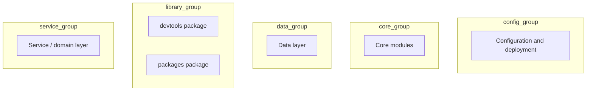

# Architecture report: alibaba/formily

> Automated static analysis. **Observed** = directly seen in files/imports/AST; **Inferred** = interpretation from that evidence. Repository code was not executed.

## 1. Repository at a glance

| Item | Value |
| --- | --- |
| Repository | alibaba/formily |
| Description | 📱🚀 🧩 Cross Device & High Performance Normal Form/Dynamic(JSON Schema) Form/Form Builder -- Support React/React Native/Vue 2/Vue 3 |
| Language | TypeScript |
| Stars | 12596 |
| Licence | MIT |
| Analysed commit / branch | d9a46442a575aa5f0fc1bd945e34d9a85d191d0e / formily_next |
| Framework(s) | React, Vue |
| Files analysed | 800 |
| Components | 6 |

## 2. Architecture in one minute

alibaba/formily - 📱🚀 🧩 Cross Device & High Performance Normal Form/Dynamic(JSON Schema) Form/Form Builder -- Support React/React Native/Vue 2/Vue 3. This repository was analysed statically from 800 file(s) (0 Python). Detected technologies (observed from imports/manifests): GitHub Actions, React, Vue, axios, Jest, TypeScript. Files are grouped into 6 component(s): Configuration and deployment, Core modules, Data layer, devtools package, packages package, Service / domain layer. Findings below distinguish observed facts from inferred interpretation.

## 3. High-level block diagram

## 4. Main components

### Configuration and deployment (`config`)

- **Kind:** config
- **Status:** Observed
- **Confidence:** 0.85
- **Responsibility:** Groups 29 file(s) under configuration and deployment (observed from repository paths and static analysis).
- **Paths:** `devtools/chrome-extension/config/webpack.base.ts`, `devtools/chrome-extension/config/webpack.dev.ts`, `devtools/chrome-extension/config/webpack.prod.ts`, `devtools/chrome-extension/package.json`, `devtools/chrome-extension/src/extension/manifest.json`, `devtools/chrome-extension/tsconfig.build.json`, `devtools/chrome-extension/tsconfig.json`, `lerna.json`, `package.json`, `packages/antd/package.json`, `packages/antd/tsconfig.build.json`, `packages/antd/tsconfig.json`, `packages/benchmark/package.json`, `packages/benchmark/tsconfig.build.json`, `packages/benchmark/tsconfig.json`, `packages/core/package.json`, `packages/core/tsconfig.build.json`, `packages/core/tsconfig.json`, `packages/element/package.json`, `packages/element/src/__builtins__/configs/index.ts`, `packages/element/tsconfig.build.json`, `packages/element/tsconfig.json`, `packages/grid/package.json`, `packages/grid/tsconfig.build.json`, `packages/grid/tsconfig.json`, `packages/json-schema/package.json`, `packages/json-schema/tsconfig.build.json`, `packages/json-schema/tsconfig.json`, `packages/next/package.json`
- **Evidence:** [devtools/chrome-extension/config/webpack.base.ts](https://github.com/alibaba/formily/blob/d9a46442a575aa5f0fc1bd945e34d9a85d191d0e/devtools/chrome-extension/config/webpack.base.ts); [devtools/chrome-extension/config/webpack.dev.ts](https://github.com/alibaba/formily/blob/d9a46442a575aa5f0fc1bd945e34d9a85d191d0e/devtools/chrome-extension/config/webpack.dev.ts); [devtools/chrome-extension/config/webpack.prod.ts](https://github.com/alibaba/formily/blob/d9a46442a575aa5f0fc1bd945e34d9a85d191d0e/devtools/chrome-extension/config/webpack.prod.ts); [devtools/chrome-extension/package.json](https://github.com/alibaba/formily/blob/d9a46442a575aa5f0fc1bd945e34d9a85d191d0e/devtools/chrome-extension/package.json); [devtools/chrome-extension/src/extension/manifest.json](https://github.com/alibaba/formily/blob/d9a46442a575aa5f0fc1bd945e34d9a85d191d0e/devtools/chrome-extension/src/extension/manifest.json); [devtools/chrome-extension/tsconfig.build.json](https://github.com/alibaba/formily/blob/d9a46442a575aa5f0fc1bd945e34d9a85d191d0e/devtools/chrome-extension/tsconfig.build.json); [devtools/chrome-extension/tsconfig.json](https://github.com/alibaba/formily/blob/d9a46442a575aa5f0fc1bd945e34d9a85d191d0e/devtools/chrome-extension/tsconfig.json); [lerna.json](https://github.com/alibaba/formily/blob/d9a46442a575aa5f0fc1bd945e34d9a85d191d0e/lerna.json)

### Core modules (`core`)

- **Kind:** core
- **Status:** Observed
- **Confidence:** 0.85
- **Responsibility:** Groups 3 file(s) under core modules (observed from repository paths and static analysis).
- **Paths:** `commitlint.config.js`, `global.config.ts`, `jest.config.js`
- **Evidence:** [commitlint.config.js](https://github.com/alibaba/formily/blob/d9a46442a575aa5f0fc1bd945e34d9a85d191d0e/commitlint.config.js); [global.config.ts](https://github.com/alibaba/formily/blob/d9a46442a575aa5f0fc1bd945e34d9a85d191d0e/global.config.ts); [jest.config.js](https://github.com/alibaba/formily/blob/d9a46442a575aa5f0fc1bd945e34d9a85d191d0e/jest.config.js)

### Data layer (`data_layer`)

- **Kind:** data
- **Status:** Observed
- **Confidence:** 0.85
- **Responsibility:** Groups 12 file(s) under data layer (observed from repository paths and static analysis).
- **Paths:** `packages/core/src/models/ArrayField.ts`, `packages/core/src/models/BaseField.ts`, `packages/core/src/models/Field.ts`, `packages/core/src/models/Form.ts`, `packages/core/src/models/Graph.ts`, `packages/core/src/models/Heart.ts`, `packages/core/src/models/LifeCycle.ts`, `packages/core/src/models/ObjectField.ts`, `packages/core/src/models/Query.ts`, `packages/core/src/models/VoidField.ts`, `packages/core/src/models/index.ts`, `packages/core/src/models/types.ts`
- **Evidence:** [packages/core/src/models/ArrayField.ts](https://github.com/alibaba/formily/blob/d9a46442a575aa5f0fc1bd945e34d9a85d191d0e/packages/core/src/models/ArrayField.ts); [packages/core/src/models/BaseField.ts](https://github.com/alibaba/formily/blob/d9a46442a575aa5f0fc1bd945e34d9a85d191d0e/packages/core/src/models/BaseField.ts); [packages/core/src/models/Field.ts](https://github.com/alibaba/formily/blob/d9a46442a575aa5f0fc1bd945e34d9a85d191d0e/packages/core/src/models/Field.ts); [packages/core/src/models/Form.ts](https://github.com/alibaba/formily/blob/d9a46442a575aa5f0fc1bd945e34d9a85d191d0e/packages/core/src/models/Form.ts); [packages/core/src/models/Graph.ts](https://github.com/alibaba/formily/blob/d9a46442a575aa5f0fc1bd945e34d9a85d191d0e/packages/core/src/models/Graph.ts); [packages/core/src/models/Heart.ts](https://github.com/alibaba/formily/blob/d9a46442a575aa5f0fc1bd945e34d9a85d191d0e/packages/core/src/models/Heart.ts); [packages/core/src/models/LifeCycle.ts](https://github.com/alibaba/formily/blob/d9a46442a575aa5f0fc1bd945e34d9a85d191d0e/packages/core/src/models/LifeCycle.ts); [packages/core/src/models/ObjectField.ts](https://github.com/alibaba/formily/blob/d9a46442a575aa5f0fc1bd945e34d9a85d191d0e/packages/core/src/models/ObjectField.ts)

### devtools package (`devtools`)

- **Kind:** library
- **Status:** Observed
- **Confidence:** 0.85
- **Responsibility:** Groups 15 file(s) under devtools package (observed from repository paths and static analysis).
- **Paths:** `devtools/chrome-extension/src/app/components/FieldTree.tsx`, `devtools/chrome-extension/src/app/components/LeftPanel.tsx`, `devtools/chrome-extension/src/app/components/RightPanel.tsx`, `devtools/chrome-extension/src/app/components/SearchBox.tsx`, `devtools/chrome-extension/src/app/components/Tabs.tsx`, `devtools/chrome-extension/src/app/components/filter.ts`, `devtools/chrome-extension/src/app/demo.tsx`, `devtools/chrome-extension/src/app/index.tsx`, `devtools/chrome-extension/src/extension/backend.ts`, `devtools/chrome-extension/src/extension/background.ts`, `devtools/chrome-extension/src/extension/content.ts`, `devtools/chrome-extension/src/extension/devpanel.tsx`, `devtools/chrome-extension/src/extension/devtools.tsx`, `devtools/chrome-extension/src/extension/inject.ts`, `devtools/chrome-extension/src/extension/popup.tsx`
- **Evidence:** [devtools/chrome-extension/src/app/components/FieldTree.tsx](https://github.com/alibaba/formily/blob/d9a46442a575aa5f0fc1bd945e34d9a85d191d0e/devtools/chrome-extension/src/app/components/FieldTree.tsx); [devtools/chrome-extension/src/app/components/LeftPanel.tsx](https://github.com/alibaba/formily/blob/d9a46442a575aa5f0fc1bd945e34d9a85d191d0e/devtools/chrome-extension/src/app/components/LeftPanel.tsx); [devtools/chrome-extension/src/app/components/RightPanel.tsx](https://github.com/alibaba/formily/blob/d9a46442a575aa5f0fc1bd945e34d9a85d191d0e/devtools/chrome-extension/src/app/components/RightPanel.tsx); [devtools/chrome-extension/src/app/components/SearchBox.tsx](https://github.com/alibaba/formily/blob/d9a46442a575aa5f0fc1bd945e34d9a85d191d0e/devtools/chrome-extension/src/app/components/SearchBox.tsx); [devtools/chrome-extension/src/app/components/Tabs.tsx](https://github.com/alibaba/formily/blob/d9a46442a575aa5f0fc1bd945e34d9a85d191d0e/devtools/chrome-extension/src/app/components/Tabs.tsx); [devtools/chrome-extension/src/app/components/filter.ts](https://github.com/alibaba/formily/blob/d9a46442a575aa5f0fc1bd945e34d9a85d191d0e/devtools/chrome-extension/src/app/components/filter.ts); [devtools/chrome-extension/src/app/demo.tsx](https://github.com/alibaba/formily/blob/d9a46442a575aa5f0fc1bd945e34d9a85d191d0e/devtools/chrome-extension/src/app/demo.tsx); [devtools/chrome-extension/src/app/index.tsx](https://github.com/alibaba/formily/blob/d9a46442a575aa5f0fc1bd945e34d9a85d191d0e/devtools/chrome-extension/src/app/index.tsx)

### packages package (`packages`)

- **Kind:** library
- **Status:** Observed
- **Confidence:** 0.85
- **Responsibility:** Groups 233 file(s) under packages package (observed from repository paths and static analysis).
- **Paths:** `packages/antd/.umirc.js`, `packages/antd/__tests__/moment.spec.ts`, `packages/antd/__tests__/sideEffects.spec.ts`, `packages/antd/build-style.ts`, `packages/antd/create-style.ts`, `packages/antd/rollup.config.js`, `packages/antd/src/__builtins__/hooks/index.ts`, `packages/antd/src/__builtins__/hooks/useClickAway.ts`, `packages/antd/src/__builtins__/hooks/usePrefixCls.ts`, `packages/antd/src/__builtins__/index.ts`, `packages/antd/src/__builtins__/loading.ts`, `packages/antd/src/__builtins__/moment.ts`, `packages/antd/src/__builtins__/pickDataProps.ts`, `packages/antd/src/__builtins__/portal.tsx`, `packages/antd/src/__builtins__/render.ts`, `packages/antd/src/__builtins__/sort.tsx`, `packages/antd/src/array-base/index.tsx`, `packages/antd/src/array-base/style.ts`, `packages/antd/src/array-cards/index.tsx`, `packages/antd/src/array-cards/style.ts`, `packages/antd/src/array-collapse/index.tsx`, `packages/antd/src/array-collapse/style.ts`, `packages/antd/src/array-items/index.tsx`, `packages/antd/src/array-items/style.ts`, `packages/antd/src/array-table/index.tsx`, `packages/antd/src/array-table/style.ts`, `packages/antd/src/array-tabs/index.tsx`, `packages/antd/src/array-tabs/style.ts`, `packages/antd/src/cascader/index.tsx`, `packages/antd/src/cascader/style.ts`, `packages/antd/src/checkbox/index.tsx`, `packages/antd/src/checkbox/style.ts`, `packages/antd/src/date-picker/index.tsx`, `packages/antd/src/date-picker/style.ts`, `packages/antd/src/editable/index.tsx`, `packages/antd/src/editable/style.ts`, `packages/antd/src/form-button-group/index.tsx`, `packages/antd/src/form-button-group/style.ts`, `packages/antd/src/form-collapse/index.tsx`, `packages/antd/src/form-collapse/style.ts`, `packages/antd/src/form-dialog/index.tsx`, `packages/antd/src/form-dialog/style.ts`, `packages/antd/src/form-drawer/index.tsx`, `packages/antd/src/form-drawer/style.ts`, `packages/antd/src/form-grid/index.tsx`, `packages/antd/src/form-grid/style.ts`, `packages/antd/src/form-item/index.tsx`, `packages/antd/src/form-item/style.ts`, `packages/antd/src/form-layout/index.tsx`, `packages/antd/src/form-layout/style.ts`, `packages/antd/src/form-layout/useResponsiveFormLayout.ts`, `packages/antd/src/form-step/index.tsx`, `packages/antd/src/form-step/style.ts`, `packages/antd/src/form-tab/index.tsx`, `packages/antd/src/form-tab/style.ts`, `packages/antd/src/form/index.tsx`, `packages/antd/src/form/style.ts`, `packages/antd/src/index.ts`, `packages/antd/src/input/index.tsx`, `packages/antd/src/input/style.ts`, `packages/antd/src/number-picker/index.tsx`, `packages/antd/src/number-picker/style.ts`, `packages/antd/src/password/PasswordStrength.tsx`, `packages/antd/src/password/index.tsx`, `packages/antd/src/password/style.ts`, `packages/antd/src/preview-text/index.tsx`, `packages/antd/src/preview-text/style.ts`, `packages/antd/src/radio/index.tsx`, `packages/antd/src/radio/style.ts`, `packages/antd/src/reset/index.tsx`, `packages/antd/src/reset/style.ts`, `packages/antd/src/select-table/index.tsx`, `packages/antd/src/select-table/style.ts`, `packages/antd/src/select-table/useCheckSlackly.tsx`, `packages/antd/src/select-table/useFilterOptions.tsx`, `packages/antd/src/select-table/useFlatOptions.tsx`, `packages/antd/src/select-table/useSize.tsx`, `packages/antd/src/select-table/useTitleAddon.tsx`, `packages/antd/src/select-table/utils.ts`, `packages/antd/src/select/index.tsx`, `packages/antd/src/select/style.ts`, `packages/antd/src/space/index.tsx`, `packages/antd/src/space/style.ts`, `packages/antd/src/style.ts`, `packages/antd/src/submit/index.tsx`, `packages/antd/src/submit/style.ts`, `packages/antd/src/switch/index.tsx`, `packages/antd/src/switch/style.ts`, `packages/antd/src/time-picker/index.tsx`, `packages/antd/src/time-picker/style.ts`, `packages/antd/src/transfer/index.tsx`, `packages/antd/src/transfer/style.ts`, `packages/antd/src/tree-select/index.tsx`, `packages/antd/src/tree-select/style.ts`, `packages/antd/src/upload/index.tsx`, `packages/antd/src/upload/placeholder.ts`, `packages/antd/src/upload/style.ts`, `packages/benchmark/.umirc.js`, `packages/benchmark/src/index.tsx`, `packages/benchmark/webpack.base.ts`, `packages/benchmark/webpack.dev.ts`, `packages/benchmark/webpack.prod.ts`, `packages/element/build-style.ts`, `packages/element/create-style.ts`, `packages/element/rollup.config.js`, `packages/element/src/__builtins__/index.ts`, `packages/element/src/__builtins__/shared/create-context.ts`, `packages/element/src/__builtins__/shared/index.ts`, `packages/element/src/__builtins__/shared/loading.ts`, `packages/element/src/__builtins__/shared/portal.ts`, `packages/element/src/__builtins__/shared/resolve-component.ts`, `packages/element/src/__builtins__/shared/transform-component.ts`, `packages/element/src/__builtins__/shared/types.ts`, `packages/element/src/__builtins__/shared/utils.ts`, `packages/element/src/array-base/index.ts`, `packages/element/src/array-base/style.ts`, `packages/element/src/array-cards/index.ts`, `packages/element/src/array-cards/style.ts`, `packages/element/src/array-collapse/index.ts`, `packages/element/src/array-collapse/style.ts`, `packages/element/src/array-items/index.ts`, `packages/element/src/array-items/style.ts`, `packages/element/src/array-table/index.ts`, `packages/element/src/array-table/style.ts`, `packages/element/src/array-tabs/index.ts`, `packages/element/src/array-tabs/style.ts`, `packages/element/src/cascader/index.ts`, `packages/element/src/cascader/style.ts`, `packages/element/src/checkbox/index.ts`, `packages/element/src/checkbox/style.ts`, `packages/element/src/date-picker/index.ts`, `packages/element/src/date-picker/style.ts`, `packages/element/src/editable/index.ts`, `packages/element/src/editable/style.ts`, `packages/element/src/el-form-item/index.ts`, `packages/element/src/el-form-item/style.ts`, `packages/element/src/el-form/index.ts`, `packages/element/src/el-form/style.ts`, `packages/element/src/form-button-group/index.ts`, `packages/element/src/form-button-group/style.ts`, `packages/element/src/form-collapse/index.ts`, `packages/element/src/form-collapse/style.ts`, `packages/element/src/form-dialog/index.ts`, `packages/element/src/form-dialog/style.ts`, `packages/element/src/form-drawer/index.ts`, `packages/element/src/form-drawer/style.ts`, `packages/element/src/form-grid/index.ts`, `packages/element/src/form-grid/style.ts`, `packages/element/src/form-item/index.ts`, `packages/element/src/form-item/style.ts`, `packages/element/src/form-layout/index.ts`, `packages/element/src/form-layout/style.ts`, `packages/element/src/form-layout/useResponsiveFormLayout.ts`, `packages/element/src/form-step/index.ts`, `packages/element/src/form-step/style.ts`, `packages/element/src/form-tab/index.ts`, `packages/element/src/form-tab/style.ts`, `packages/element/src/form/index.ts`, `packages/element/src/form/style.ts`, `packages/element/src/index.ts`, `packages/element/src/input-number/index.ts`, `packages/element/src/input-number/style.ts`, `packages/element/src/input/index.ts`, `packages/element/src/input/style.ts`, `packages/element/src/password/index.ts`, `packages/element/src/password/style.ts`, `packages/element/src/preview-text/index.ts`, `packages/element/src/preview-text/style.ts`, `packages/element/src/radio/index.ts`, `packages/element/src/radio/style.ts`, `packages/element/src/reset/index.ts`, `packages/element/src/reset/style.ts`, `packages/element/src/select/index.ts`, `packages/element/src/select/style.ts`, `packages/element/src/space/index.ts`, `packages/element/src/space/style.ts`, `packages/element/src/style.ts`, `packages/element/src/submit/index.ts`, `packages/element/src/submit/style.ts`, `packages/element/src/switch/index.ts`, `packages/element/src/switch/style.ts`, `packages/element/src/time-picker/index.ts`, `packages/element/src/time-picker/style.ts`, `packages/element/src/transfer/index.ts`, `packages/element/src/transfer/style.ts`, `packages/element/src/upload/index.ts`, `packages/element/src/upload/style.ts`, `packages/element/transformer.ts`, `packages/grid/rollup.config.js`, `packages/grid/src/index.ts`, `packages/grid/src/observer.ts`, `packages/json-schema/rollup.config.js`, `packages/json-schema/src/__tests__/compiler.spec.ts`, `packages/json-schema/src/__tests__/patches.spec.ts`, `packages/json-schema/src/__tests__/schema.spec.ts`, `packages/json-schema/src/__tests__/server-validate.spec.ts`, `packages/json-schema/src/__tests__/shared.spec.ts`, `packages/json-schema/src/__tests__/transformer.spec.ts`, `packages/json-schema/src/__tests__/traverse.spec.ts`, `packages/json-schema/src/compiler.ts`, `packages/json-schema/src/global.d.ts`, `packages/json-schema/src/index.ts`, `packages/json-schema/src/patches.ts`, `packages/json-schema/src/polyfills/SPECIFICATION_1_0.ts`, `packages/json-schema/src/polyfills/index.ts`, `packages/json-schema/src/schema.ts`, `packages/json-schema/src/shared.ts`, `packages/json-schema/src/transformer.ts`, `packages/json-schema/src/types.ts`, `packages/next/.umirc.js`, `packages/next/__tests__/moment.spec.ts`, `packages/next/__tests__/sideEffects.spec.ts`, `packages/next/build-style.ts`, `packages/next/create-style.ts`, `packages/next/rollup.config.js`, `packages/next/src/__builtins__/empty.tsx`, `packages/next/src/__builtins__/hooks/index.ts`, `packages/next/src/__builtins__/hooks/useClickAway.ts`, `packages/next/src/__builtins__/hooks/usePrefixCls.ts`, `packages/next/src/__builtins__/icons.tsx`, `packages/next/src/__builtins__/index.ts`, `packages/next/src/__builtins__/loading.ts`, `packages/next/src/__builtins__/mapSize.ts`, `packages/next/src/__builtins__/mapStatus.ts`, `packages/next/src/__builtins__/moment.ts`, `packages/next/src/__builtins__/pickDataProps.ts`, `packages/next/src/__builtins__/portal.tsx`, `packages/next/src/__builtins__/render.ts`, `packages/next/src/__builtins__/toArray.ts`, `packages/next/src/array-base/index.tsx`, `packages/next/src/array-base/style.ts`, `packages/next/src/array-cards/index.tsx`, `packages/next/src/array-cards/style.ts`
- **Evidence:** [packages/antd/.umirc.js](https://github.com/alibaba/formily/blob/d9a46442a575aa5f0fc1bd945e34d9a85d191d0e/packages/antd/.umirc.js); [packages/antd/__tests__/moment.spec.ts](https://github.com/alibaba/formily/blob/d9a46442a575aa5f0fc1bd945e34d9a85d191d0e/packages/antd/__tests__/moment.spec.ts); [packages/antd/__tests__/sideEffects.spec.ts](https://github.com/alibaba/formily/blob/d9a46442a575aa5f0fc1bd945e34d9a85d191d0e/packages/antd/__tests__/sideEffects.spec.ts); [packages/antd/build-style.ts](https://github.com/alibaba/formily/blob/d9a46442a575aa5f0fc1bd945e34d9a85d191d0e/packages/antd/build-style.ts); [packages/antd/create-style.ts](https://github.com/alibaba/formily/blob/d9a46442a575aa5f0fc1bd945e34d9a85d191d0e/packages/antd/create-style.ts); [packages/antd/rollup.config.js](https://github.com/alibaba/formily/blob/d9a46442a575aa5f0fc1bd945e34d9a85d191d0e/packages/antd/rollup.config.js); [packages/antd/src/__builtins__/hooks/index.ts](https://github.com/alibaba/formily/blob/d9a46442a575aa5f0fc1bd945e34d9a85d191d0e/packages/antd/src/__builtins__/hooks/index.ts); [packages/antd/src/__builtins__/hooks/useClickAway.ts](https://github.com/alibaba/formily/blob/d9a46442a575aa5f0fc1bd945e34d9a85d191d0e/packages/antd/src/__builtins__/hooks/useClickAway.ts)

### Service / domain layer (`service_layer`)

- **Kind:** service
- **Status:** Observed
- **Confidence:** 0.85
- **Responsibility:** Groups 25 file(s) under service / domain layer (observed from repository paths and static analysis).
- **Paths:** `packages/core/.umirc.js`, `packages/core/rollup.config.js`, `packages/core/src/__tests__/array.spec.ts`, `packages/core/src/__tests__/effects.spec.ts`, `packages/core/src/__tests__/externals.spec.ts`, `packages/core/src/__tests__/field.spec.ts`, `packages/core/src/__tests__/form.spec.ts`, `packages/core/src/__tests__/graph.spec.ts`, `packages/core/src/__tests__/heart.spec.ts`, `packages/core/src/__tests__/internals.spec.ts`, `packages/core/src/__tests__/lifecycle.spec.ts`, `packages/core/src/__tests__/object.spec.ts`, `packages/core/src/__tests__/shared.ts`, `packages/core/src/__tests__/void.spec.ts`, `packages/core/src/effects/index.ts`, `packages/core/src/effects/onFieldEffects.ts`, `packages/core/src/effects/onFormEffects.ts`, `packages/core/src/global.d.ts`, `packages/core/src/index.ts`, `packages/core/src/shared/checkers.ts`, `packages/core/src/shared/constants.ts`, `packages/core/src/shared/effective.ts`, `packages/core/src/shared/externals.ts`, `packages/core/src/shared/internals.ts`, `packages/core/src/types.ts`
- **Evidence:** [packages/core/.umirc.js](https://github.com/alibaba/formily/blob/d9a46442a575aa5f0fc1bd945e34d9a85d191d0e/packages/core/.umirc.js); [packages/core/rollup.config.js](https://github.com/alibaba/formily/blob/d9a46442a575aa5f0fc1bd945e34d9a85d191d0e/packages/core/rollup.config.js); [packages/core/src/__tests__/array.spec.ts](https://github.com/alibaba/formily/blob/d9a46442a575aa5f0fc1bd945e34d9a85d191d0e/packages/core/src/__tests__/array.spec.ts); [packages/core/src/__tests__/effects.spec.ts](https://github.com/alibaba/formily/blob/d9a46442a575aa5f0fc1bd945e34d9a85d191d0e/packages/core/src/__tests__/effects.spec.ts); [packages/core/src/__tests__/externals.spec.ts](https://github.com/alibaba/formily/blob/d9a46442a575aa5f0fc1bd945e34d9a85d191d0e/packages/core/src/__tests__/externals.spec.ts); [packages/core/src/__tests__/field.spec.ts](https://github.com/alibaba/formily/blob/d9a46442a575aa5f0fc1bd945e34d9a85d191d0e/packages/core/src/__tests__/field.spec.ts); [packages/core/src/__tests__/form.spec.ts](https://github.com/alibaba/formily/blob/d9a46442a575aa5f0fc1bd945e34d9a85d191d0e/packages/core/src/__tests__/form.spec.ts); [packages/core/src/__tests__/graph.spec.ts](https://github.com/alibaba/formily/blob/d9a46442a575aa5f0fc1bd945e34d9a85d191d0e/packages/core/src/__tests__/graph.spec.ts)

## 5. Execution flow

**Observed** entry point(s):

- [packages/antd/src/index.ts](https://github.com/alibaba/formily/blob/d9a46442a575aa5f0fc1bd945e34d9a85d191d0e/packages/antd/src/index.ts)
- [packages/benchmark/src/index.tsx](https://github.com/alibaba/formily/blob/d9a46442a575aa5f0fc1bd945e34d9a85d191d0e/packages/benchmark/src/index.tsx)
- [packages/core/src/index.ts](https://github.com/alibaba/formily/blob/d9a46442a575aa5f0fc1bd945e34d9a85d191d0e/packages/core/src/index.ts)
- [packages/element/src/index.ts](https://github.com/alibaba/formily/blob/d9a46442a575aa5f0fc1bd945e34d9a85d191d0e/packages/element/src/index.ts)
- [packages/grid/src/index.ts](https://github.com/alibaba/formily/blob/d9a46442a575aa5f0fc1bd945e34d9a85d191d0e/packages/grid/src/index.ts)
- [packages/json-schema/src/index.ts](https://github.com/alibaba/formily/blob/d9a46442a575aa5f0fc1bd945e34d9a85d191d0e/packages/json-schema/src/index.ts)

Representative flow (derived from observed entry points and the import graph; steps beyond the entry point are **Inferred**):

1. Execution starts at an observed entry point listed above, if present.
2. No internal import relationships between components were observed.

## 6. Project structure

### `(root)`

- `.all-contributorsrc` - other (2435 bytes)
- `.codecov.yml` - config (142 bytes)
- `.editorconfig` - config (262 bytes)
- `.eslintignore` - other (134 bytes)
- `.eslintrc` - other (1512 bytes)
- `.gitignore` - other (316 bytes)
- `.prettierrc.js` - source, JavaScript (71 bytes)
- `.umirc.js` - source, JavaScript (15315 bytes)
- `.yarnrc` - other (39 bytes)
- `CHANGELOG.md` - docs (158889 bytes)
- `LICENSE.md` - docs (1126 bytes)
- `README.md` - docs (2843 bytes)
- `README.zh-cn.md` - docs (2526 bytes)
- `commitlint.config.js` - source, JavaScript (66 bytes)
- `global.config.ts` - source, TypeScript (323 bytes)
- `jest.config.js` - source, JavaScript (763 bytes)
- `lerna.json` - config (265 bytes)
- `package.json` - manifest (6237 bytes)

### `.github`

- `.github/CONTRIBUTING.md` - docs (3238 bytes)
- `.github/FUNDING.yml` - config (719 bytes)
- `.github/ISSUE_TEMPLATE/config.yml` - config (537 bytes)
- `.github/PULL_REQUEST_TEMPLATE.md` - docs (691 bytes)
- `.github/workflows/check-pr-title.yml` - ci, YAML (373 bytes)
- `.github/workflows/ci.yml` - ci, YAML (787 bytes)
- `.github/workflows/commitlint.yml` - ci, YAML (941 bytes)
- `.github/workflows/issue-open-check.yml` - ci, YAML (1183 bytes)
- `.github/workflows/package-size.yml` - ci, YAML (323 bytes)
- `.github/workflows/pr-welcome.yml` - ci, YAML (212 bytes)

### `.vscode`

- `.vscode/cspell.json` - config (388 bytes)

### `devtools`

- `devtools/.eslintrc` - other (2439 bytes)
- `devtools/chrome-extension/.npmignore` - other (96 bytes)
- `devtools/chrome-extension/LICENSE.md` - docs (1127 bytes)
- `devtools/chrome-extension/assets/img/loading.svg` - other (1784 bytes)
- `devtools/chrome-extension/config/webpack.base.ts` - source, TypeScript (1833 bytes)
- `devtools/chrome-extension/config/webpack.dev.ts` - source, TypeScript (1006 bytes)
- `devtools/chrome-extension/config/webpack.prod.ts` - source, TypeScript (974 bytes)
- `devtools/chrome-extension/package.json` - manifest (1034 bytes)
- `devtools/chrome-extension/src/app/components/FieldTree.tsx` - source, TypeScript (6731 bytes)
- `devtools/chrome-extension/src/app/components/LeftPanel.tsx` - source, TypeScript (834 bytes)
- `devtools/chrome-extension/src/app/components/RightPanel.tsx` - source, TypeScript (726 bytes)
- `devtools/chrome-extension/src/app/components/SearchBox.tsx` - source, TypeScript (1708 bytes)
- `devtools/chrome-extension/src/app/components/Tabs.tsx` - source, TypeScript (1087 bytes)
- `devtools/chrome-extension/src/app/components/filter.ts` - source, TypeScript (1632 bytes)
- `devtools/chrome-extension/src/app/demo.tsx` - source, TypeScript (40142 bytes)
- `devtools/chrome-extension/src/app/index.tsx` - source, TypeScript (1190 bytes)
- `devtools/chrome-extension/src/extension/backend.ts` - source, TypeScript (2996 bytes)
- `devtools/chrome-extension/src/extension/background.ts` - source, TypeScript (1367 bytes)
- `devtools/chrome-extension/src/extension/content.ts` - source, TypeScript (256 bytes)
- `devtools/chrome-extension/src/extension/devpanel.tsx` - source, TypeScript (1260 bytes)
- `devtools/chrome-extension/src/extension/devtools.tsx` - source, TypeScript (617 bytes)
- `devtools/chrome-extension/src/extension/inject.ts` - source, TypeScript (694 bytes)
- `devtools/chrome-extension/src/extension/manifest.json` - config (1775 bytes)
- `devtools/chrome-extension/src/extension/popup.tsx` - source, TypeScript (133 bytes)
- `devtools/chrome-extension/src/extension/views/devpanel.ejs` - other (484 bytes)
- `devtools/chrome-extension/src/extension/views/devtools.ejs` - other (114 bytes)
- `devtools/chrome-extension/src/extension/views/popup.ejs` - other (114 bytes)
- `devtools/chrome-extension/tsconfig.build.json` - config (181 bytes)
- `devtools/chrome-extension/tsconfig.json` - config (147 bytes)

### `docs`

- `docs/functions/contributors.ts` - docs (721 bytes)
- `docs/functions/npm-search.ts` - docs (643 bytes)
- `docs/guide/advanced/async.md` - docs (1014 bytes)
- `docs/guide/advanced/async.zh-CN.md` - docs (1006 bytes)
- `docs/guide/advanced/build.md` - docs (3076 bytes)
- `docs/guide/advanced/build.zh-CN.md` - docs (3042 bytes)
- `docs/guide/advanced/business-logic.md` - docs (4045 bytes)
- `docs/guide/advanced/business-logic.zh-CN.md` - docs (3596 bytes)
- `docs/guide/advanced/calculator.md` - docs (9932 bytes)
- `docs/guide/advanced/calculator.zh-CN.md` - docs (9900 bytes)
- `docs/guide/advanced/controlled.md` - docs (14043 bytes)
- `docs/guide/advanced/controlled.zh-CN.md` - docs (13451 bytes)
- `docs/guide/advanced/custom.md` - docs (604 bytes)
- `docs/guide/advanced/custom.zh-CN.md` - docs (552 bytes)
- `docs/guide/advanced/destructor.md` - docs (6062 bytes)
- `docs/guide/advanced/destructor.zh-CN.md` - docs (5766 bytes)
- `docs/guide/advanced/input.less` - docs (54 bytes)
- `docs/guide/advanced/layout.md` - docs (545 bytes)
- `docs/guide/advanced/layout.zh-CN.md` - docs (591 bytes)
- `docs/guide/advanced/linkages.md` - docs (44874 bytes)
- `docs/guide/advanced/linkages.zh-CN.md` - docs (44000 bytes)
- `docs/guide/advanced/validate.md` - docs (52142 bytes)
- `docs/guide/advanced/validate.zh-CN.md` - docs (50829 bytes)
- `docs/guide/contribution.md` - docs (4002 bytes)
- `docs/guide/contribution.zh-CN.md` - docs (3493 bytes)
- `docs/guide/form-builder.md` - docs (7356 bytes)
- `docs/guide/form-builder.zh-CN.md` - docs (7130 bytes)
- `docs/guide/index.md` - docs (23813 bytes)
- `docs/guide/index.zh-CN.md` - docs (21304 bytes)
- `docs/guide/issue-helper.md` - docs (11983 bytes)
- `docs/guide/issue-helper.zh-CN.md` - docs (11500 bytes)
- `docs/guide/learn-formily.md` - docs (3937 bytes)
- `docs/guide/learn-formily.zh-CN.md` - docs (3147 bytes)
- `docs/guide/quick-start.md` - docs (6645 bytes)
- `docs/guide/quick-start.zh-CN.md` - docs (5871 bytes)
- `docs/guide/scenes/VerifyCode.tsx` - docs (1598 bytes)
- `docs/guide/scenes/dialog-drawer.md` - docs (234 bytes)
- `docs/guide/scenes/dialog-drawer.zh-CN.md` - docs (299 bytes)
- `docs/guide/scenes/edit-detail.md` - docs (53065 bytes)
- `docs/guide/scenes/edit-detail.zh-CN.md` - docs (52885 bytes)
- `docs/guide/scenes/index.less` - docs (298 bytes)
- `docs/guide/scenes/login-register.md` - docs (46242 bytes)
- `docs/guide/scenes/login-register.zh-CN.md` - docs (46057 bytes)
- `docs/guide/scenes/more.md` - docs (284 bytes)
- `docs/guide/scenes/more.zh-CN.md` - docs (281 bytes)
- `docs/guide/scenes/query-list.md` - docs (2616 bytes)
- `docs/guide/scenes/query-list.zh-CN.md` - docs (2282 bytes)
- `docs/guide/scenes/step-form.md` - docs (199 bytes)
- `docs/guide/scenes/step-form.zh-CN.md` - docs (212 bytes)
- `docs/guide/scenes/tab-form.md` - docs (283 bytes)
- `docs/guide/scenes/tab-form.zh-CN.md` - docs (307 bytes)
- `docs/guide/upgrade.md` - docs (8571 bytes)
- `docs/guide/upgrade.zh-CN.md` - docs (7687 bytes)
- `docs/index.md` - docs (3578 bytes)
- `docs/index.zh-CN.md` - docs (3465 bytes)
- `docs/site/Contributors.less` - docs (481 bytes)
- `docs/site/Contributors.tsx` - docs (979 bytes)
- `docs/site/QrCode.less` - docs (444 bytes)
- `docs/site/QrCode.tsx` - docs (581 bytes)
- `docs/site/Section.less` - docs (212 bytes)
- `docs/site/Section.tsx` - docs (634 bytes)
- `docs/site/styles.less` - docs (255 bytes)

### `packages`

- `packages/.eslintrc` - other (2525 bytes)
- `packages/antd/.npmignore` - other (96 bytes)
- `packages/antd/.umirc.js` - source, JavaScript (4140 bytes)
- `packages/antd/LICENSE.md` - docs (1126 bytes)
- `packages/antd/README.md` - docs (75 bytes)
- `packages/antd/__tests__/moment.spec.ts` - source, TypeScript (2627 bytes)
- `packages/antd/__tests__/sideEffects.spec.ts` - source, TypeScript (2731 bytes)
- `packages/antd/build-style.ts` - source, TypeScript (146 bytes)
- `packages/antd/create-style.ts` - source, TypeScript (605 bytes)
- `packages/antd/docs/components/ArrayCards.md` - docs (14281 bytes)
- `packages/antd/docs/components/ArrayCards.zh-CN.md` - docs (13724 bytes)
- `packages/antd/docs/components/ArrayCollapse.md` - docs (16855 bytes)
- `packages/antd/docs/components/ArrayCollapse.zh-CN.md` - docs (16605 bytes)
- `packages/antd/docs/components/ArrayItems.md` - docs (22461 bytes)
- `packages/antd/docs/components/ArrayItems.zh-CN.md` - docs (21948 bytes)
- `packages/antd/docs/components/ArrayTable.md` - docs (29839 bytes)
- `packages/antd/docs/components/ArrayTable.zh-CN.md` - docs (29218 bytes)
- `packages/antd/docs/components/ArrayTabs.md` - docs (3551 bytes)
- `packages/antd/docs/components/ArrayTabs.zh-CN.md` - docs (3502 bytes)
- `packages/antd/docs/components/Cascader.md` - docs (5692 bytes)
- `packages/antd/docs/components/Cascader.zh-CN.md` - docs (5675 bytes)
- `packages/antd/docs/components/Checkbox.md` - docs (3054 bytes)
- `packages/antd/docs/components/Checkbox.zh-CN.md` - docs (3050 bytes)
- `packages/antd/docs/components/DatePicker.md` - docs (7871 bytes)
- `packages/antd/docs/components/DatePicker.zh-CN.md` - docs (7717 bytes)
- `packages/antd/docs/components/Editable.md` - docs (6298 bytes)
- `packages/antd/docs/components/Editable.zh-CN.md` - docs (6253 bytes)
- `packages/antd/docs/components/Form.md` - docs (3687 bytes)
- `packages/antd/docs/components/Form.zh-CN.md` - docs (3326 bytes)
- `packages/antd/docs/components/FormButtonGroup.md` - docs (7777 bytes)
- `packages/antd/docs/components/FormButtonGroup.zh-CN.md` - docs (7587 bytes)
- `packages/antd/docs/components/FormCollapse.md` - docs (6962 bytes)
- `packages/antd/docs/components/FormCollapse.zh-CN.md` - docs (6874 bytes)
- `packages/antd/docs/components/FormDialog.md` - docs (9489 bytes)
- `packages/antd/docs/components/FormDialog.zh-CN.md` - docs (10126 bytes)
- `packages/antd/docs/components/FormDrawer.md` - docs (8001 bytes)
- `packages/antd/docs/components/FormDrawer.zh-CN.md` - docs (7814 bytes)
- `packages/antd/docs/components/FormGrid.md` - docs (15225 bytes)
- `packages/antd/docs/components/FormGrid.zh-CN.md` - docs (14820 bytes)
- `packages/antd/docs/components/FormItem.md` - docs (39164 bytes)
- `packages/antd/docs/components/FormItem.zh-CN.md` - docs (34770 bytes)
- `packages/antd/docs/components/FormLayout.md` - docs (8550 bytes)
- `packages/antd/docs/components/FormLayout.zh-CN.md` - docs (8206 bytes)
- `packages/antd/docs/components/FormStep.md` - docs (6415 bytes)
- `packages/antd/docs/components/FormStep.zh-CN.md` - docs (6327 bytes)
- `packages/antd/docs/components/FormTab.md` - docs (5796 bytes)
- `packages/antd/docs/components/FormTab.zh-CN.md` - docs (5733 bytes)
- `packages/antd/docs/components/Input.md` - docs (3131 bytes)
- `packages/antd/docs/components/Input.zh-CN.md` - docs (3133 bytes)
- `packages/antd/docs/components/NumberPicker.md` - docs (2471 bytes)
- `packages/antd/docs/components/NumberPicker.zh-CN.md` - docs (2469 bytes)
- `packages/antd/docs/components/Password.md` - docs (2741 bytes)
- `packages/antd/docs/components/Password.zh-CN.md` - docs (2737 bytes)
- `packages/antd/docs/components/PreviewText.md` - docs (6593 bytes)
- `packages/antd/docs/components/PreviewText.zh-CN.md` - docs (6434 bytes)
- `packages/antd/docs/components/Radio.md` - docs (2639 bytes)
- `packages/antd/docs/components/Radio.zh-CN.md` - docs (2597 bytes)
- `packages/antd/docs/components/Reset.md` - docs (4734 bytes)
- `packages/antd/docs/components/Reset.zh-CN.md` - docs (4666 bytes)
- `packages/antd/docs/components/Select.md` - docs (12224 bytes)
- `packages/antd/docs/components/Select.zh-CN.md` - docs (12084 bytes)
- `packages/antd/docs/components/SelectTable.md` - docs (20497 bytes)
- `packages/antd/docs/components/SelectTable.zh-CN.md` - docs (18833 bytes)
- `packages/antd/docs/components/Space.md` - docs (7508 bytes)
- `packages/antd/docs/components/Space.zh-CN.md` - docs (7487 bytes)
- `packages/antd/docs/components/Submit.md` - docs (3446 bytes)
- `packages/antd/docs/components/Submit.zh-CN.md` - docs (3323 bytes)
- `packages/antd/docs/components/Switch.md` - docs (2098 bytes)
- `packages/antd/docs/components/Switch.zh-CN.md` - docs (2092 bytes)
- `packages/antd/docs/components/TimePicker.md` - docs (2622 bytes)
- `packages/antd/docs/components/TimePicker.zh-CN.md` - docs (2637 bytes)
- `packages/antd/docs/components/Transfer.md` - docs (2743 bytes)
- `packages/antd/docs/components/Transfer.zh-CN.md` - docs (2728 bytes)
- `packages/antd/docs/components/TreeSelect.md` - docs (18234 bytes)
- `packages/antd/docs/components/TreeSelect.zh-CN.md` - docs (18117 bytes)
- `packages/antd/docs/components/Upload.md` - docs (7605 bytes)
- `packages/antd/docs/components/Upload.zh-CN.md` - docs (7504 bytes)
- `packages/antd/docs/components/index.md` - docs (3855 bytes)
- `packages/antd/docs/components/index.zh-CN.md` - docs (3255 bytes)
- `packages/antd/docs/index.md` - docs (2197 bytes)
- `packages/antd/docs/index.zh-CN.md` - docs (2181 bytes)
- `packages/antd/package.json` - manifest (2148 bytes)
- `packages/antd/rollup.config.js` - source, JavaScript (206 bytes)
- `packages/antd/src/__builtins__/hooks/index.ts` - source, TypeScript (62 bytes)
- `packages/antd/src/__builtins__/hooks/useClickAway.ts` - source, TypeScript (1566 bytes)
- `packages/antd/src/__builtins__/hooks/usePrefixCls.ts` - source, TypeScript (424 bytes)
- `packages/antd/src/__builtins__/index.ts` - source, TypeScript (155 bytes)
- `packages/antd/src/__builtins__/loading.ts` - source, TypeScript (336 bytes)
- `packages/antd/src/__builtins__/moment.ts` - source, TypeScript (1120 bytes)
- `packages/antd/src/__builtins__/pickDataProps.ts` - source, TypeScript (200 bytes)
- `packages/antd/src/__builtins__/portal.tsx` - source, TypeScript (1592 bytes)
- `packages/antd/src/__builtins__/render.ts` - source, TypeScript (2455 bytes)
- `packages/antd/src/__builtins__/sort.tsx` - source, TypeScript (3625 bytes)
- `packages/antd/src/array-base/index.tsx` - source, TypeScript (10026 bytes)
- `packages/antd/src/array-base/style.less` - other (1557 bytes)
- `packages/antd/src/array-base/style.ts` - source, TypeScript (59 bytes)
- `packages/antd/src/array-cards/index.tsx` - source, TypeScript (4381 bytes)
- `packages/antd/src/array-cards/style.less` - other (363 bytes)
- `packages/antd/src/array-cards/style.ts` - source, TypeScript (130 bytes)
- `packages/antd/src/array-collapse/index.tsx` - source, TypeScript (7401 bytes)
- `packages/antd/src/array-collapse/style.less` - other (229 bytes)
- `packages/antd/src/array-collapse/style.ts` - source, TypeScript (170 bytes)
- `packages/antd/src/array-items/index.tsx` - source, TypeScript (3816 bytes)
- `packages/antd/src/array-items/style.less` - other (1566 bytes)
- `packages/antd/src/array-items/style.ts` - source, TypeScript (59 bytes)
- `packages/antd/src/array-table/index.tsx` - source, TypeScript (12619 bytes)
- `packages/antd/src/array-table/style.less` - other (1210 bytes)
- `packages/antd/src/array-table/style.ts` - source, TypeScript (245 bytes)
- `packages/antd/src/array-tabs/index.tsx` - source, TypeScript (2608 bytes)
- `packages/antd/src/array-tabs/style.ts` - source, TypeScript (71 bytes)
- `packages/antd/src/cascader/index.tsx` - source, TypeScript (651 bytes)
- `packages/antd/src/cascader/style.ts` - source, TypeScript (39 bytes)
- `packages/antd/src/checkbox/index.tsx` - source, TypeScript (726 bytes)
- `packages/antd/src/checkbox/style.ts` - source, TypeScript (39 bytes)
- `packages/antd/src/date-picker/index.tsx` - source, TypeScript (1873 bytes)
- `packages/antd/src/date-picker/style.ts` - source, TypeScript (42 bytes)
- `packages/antd/src/editable/index.tsx` - source, TypeScript (5540 bytes)
- `packages/antd/src/editable/style.less` - other (1029 bytes)
- `packages/antd/src/editable/style.ts` - source, TypeScript (131 bytes)
- `packages/antd/src/form-button-group/index.tsx` - source, TypeScript (3770 bytes)
- `packages/antd/src/form-button-group/style.less` - other (355 bytes)
- `packages/antd/src/form-button-group/style.ts` - source, TypeScript (57 bytes)
- `packages/antd/src/form-collapse/index.tsx` - source, TypeScript (4896 bytes)
- `packages/antd/src/form-collapse/style.ts` - source, TypeScript (75 bytes)
- `packages/antd/src/form-dialog/index.tsx` - source, TypeScript (6014 bytes)
- `packages/antd/src/form-dialog/style.ts` - source, TypeScript (36 bytes)
- `packages/antd/src/form-drawer/index.tsx` - source, TypeScript (6026 bytes)
- `packages/antd/src/form-drawer/style.ts` - source, TypeScript (37 bytes)
- `packages/antd/src/form-grid/index.tsx` - source, TypeScript (3016 bytes)
- `packages/antd/src/form-grid/style.less` - other (194 bytes)
- `packages/antd/src/form-grid/style.ts` - source, TypeScript (22 bytes)
- `packages/antd/src/form-item/animation.less` - other (1570 bytes)
- `packages/antd/src/form-item/grid.less` - other (3546 bytes)
- `packages/antd/src/form-item/index.tsx` - source, TypeScript (13754 bytes)
- `packages/antd/src/form-item/style.less` - other (18527 bytes)
- `packages/antd/src/form-item/style.ts` - source, TypeScript (133 bytes)
- `packages/antd/src/form-layout/index.tsx` - source, TypeScript (3499 bytes)
- `packages/antd/src/form-layout/style.less` - other (0 bytes)
- `packages/antd/src/form-layout/style.ts` - source, TypeScript (14 bytes)
- `packages/antd/src/form-layout/useResponsiveFormLayout.ts` - source, TypeScript (2635 bytes)
- `packages/antd/src/form-step/index.tsx` - source, TypeScript (4206 bytes)
- `packages/antd/src/form-step/style.ts` - source, TypeScript (36 bytes)
- `packages/antd/src/form-tab/index.tsx` - source, TypeScript (3398 bytes)
- `packages/antd/src/form-tab/style.ts` - source, TypeScript (71 bytes)
- `packages/antd/src/form/index.tsx` - source, TypeScript (1462 bytes)
- `packages/antd/src/form/style.less` - other (0 bytes)
- `packages/antd/src/form/style.ts` - source, TypeScript (14 bytes)
- `packages/antd/src/index.ts` - source, TypeScript (1005 bytes)
- `packages/antd/src/input/index.tsx` - source, TypeScript (898 bytes)
- `packages/antd/src/input/style.ts` - source, TypeScript (36 bytes)
- `packages/antd/src/number-picker/index.tsx` - source, TypeScript (263 bytes)
- `packages/antd/src/number-picker/style.ts` - source, TypeScript (43 bytes)
- `packages/antd/src/password/PasswordStrength.tsx` - source, TypeScript (3841 bytes)
- `packages/antd/src/password/index.tsx` - source, TypeScript (1960 bytes)
- `packages/antd/src/password/style.ts` - source, TypeScript (36 bytes)
- `packages/antd/src/preview-text/index.tsx` - source, TypeScript (9743 bytes)
- `packages/antd/src/preview-text/style.less` - other (266 bytes)
- `packages/antd/src/preview-text/style.ts` - source, TypeScript (56 bytes)
- `packages/antd/src/radio/index.tsx` - source, TypeScript (650 bytes)
- `packages/antd/src/radio/style.less` - other (85 bytes)
- `packages/antd/src/radio/style.ts` - source, TypeScript (58 bytes)
- `packages/antd/src/reset/index.tsx` - source, TypeScript (1072 bytes)
- `packages/antd/src/reset/style.ts` - source, TypeScript (37 bytes)
- `packages/antd/src/select-table/index.tsx` - source, TypeScript (11810 bytes)
- `packages/antd/src/select-table/style.less` - other (251 bytes)
- `packages/antd/src/select-table/style.ts` - source, TypeScript (58 bytes)
- `packages/antd/src/select-table/useCheckSlackly.tsx` - source, TypeScript (2534 bytes)
- `packages/antd/src/select-table/useFilterOptions.tsx` - source, TypeScript (2205 bytes)
- `packages/antd/src/select-table/useFlatOptions.tsx` - source, TypeScript (327 bytes)
- `packages/antd/src/select-table/useSize.tsx` - source, TypeScript (821 bytes)
- `packages/antd/src/select-table/useTitleAddon.tsx` - source, TypeScript (2515 bytes)
- `packages/antd/src/select-table/utils.ts` - source, TypeScript (8724 bytes)
- `packages/antd/src/select/index.tsx` - source, TypeScript (747 bytes)
- `packages/antd/src/select/style.ts` - source, TypeScript (37 bytes)
- `packages/antd/src/space/index.tsx` - source, TypeScript (369 bytes)
- `packages/antd/src/space/style.ts` - source, TypeScript (36 bytes)
- `packages/antd/src/style.less` - other (517 bytes)
- `packages/antd/src/style.ts` - source, TypeScript (489 bytes)
- `packages/antd/src/submit/index.tsx` - source, TypeScript (1210 bytes)
- `packages/antd/src/submit/style.ts` - source, TypeScript (37 bytes)
- `packages/antd/src/switch/index.tsx` - source, TypeScript (424 bytes)
- `packages/antd/src/switch/style.ts` - source, TypeScript (37 bytes)
- `packages/antd/src/time-picker/index.tsx` - source, TypeScript (1246 bytes)
- `packages/antd/src/time-picker/style.ts` - source, TypeScript (42 bytes)
- `packages/antd/src/transfer/index.tsx` - source, TypeScript (714 bytes)
- `packages/antd/src/transfer/style.ts` - source, TypeScript (39 bytes)
- `packages/antd/src/tree-select/index.tsx` - source, TypeScript (663 bytes)
- `packages/antd/src/tree-select/style.ts` - source, TypeScript (42 bytes)
- `packages/antd/src/upload/index.tsx` - source, TypeScript (5544 bytes)
- `packages/antd/src/upload/placeholder.ts` - source, TypeScript (1722 bytes)
- `packages/antd/src/upload/style.ts` - source, TypeScript (37 bytes)
- `packages/antd/tsconfig.build.json` - config (181 bytes)
- `packages/antd/tsconfig.json` - config (204 bytes)
- `packages/benchmark/.npmignore` - other (96 bytes)
- `packages/benchmark/.umirc.js` - source, JavaScript (2114 bytes)
- `packages/benchmark/LICENSE.md` - docs (1127 bytes)
- `packages/benchmark/README.md` - docs (21 bytes)
- `packages/benchmark/package.json` - manifest (1258 bytes)
- `packages/benchmark/src/index.tsx` - source, TypeScript (4138 bytes)
- `packages/benchmark/template.ejs` - other (634 bytes)
- `packages/benchmark/tsconfig.build.json` - config (181 bytes)
- `packages/benchmark/tsconfig.json` - config (204 bytes)
- `packages/benchmark/webpack.base.ts` - source, TypeScript (2594 bytes)
- `packages/benchmark/webpack.dev.ts` - source, TypeScript (1188 bytes)
- `packages/benchmark/webpack.prod.ts` - source, TypeScript (790 bytes)
- `packages/core/.npmignore` - other (96 bytes)
- `packages/core/.umirc.js` - source, JavaScript (5494 bytes)
- `packages/core/LICENSE.md` - docs (1126 bytes)
- `packages/core/README.md` - docs (16 bytes)
- `packages/core/docs/api/entry/ActionResponse.less` - docs (484 bytes)
- `packages/core/docs/api/entry/ActionResponse.tsx` - docs (447 bytes)
- `packages/core/docs/api/entry/FieldEffectHooks.md` - docs (14326 bytes)
- `packages/core/docs/api/entry/FieldEffectHooks.zh-CN.md` - docs (13725 bytes)
- `packages/core/docs/api/entry/FormChecker.md` - docs (8397 bytes)
- `packages/core/docs/api/entry/FormChecker.zh-CN.md` - docs (8188 bytes)
- `packages/core/docs/api/entry/FormEffectHooks.md` - docs (19834 bytes)
- `packages/core/docs/api/entry/FormEffectHooks.zh-CN.md` - docs (19160 bytes)
- `packages/core/docs/api/entry/FormHooksAPI.md` - docs (3511 bytes)
- `packages/core/docs/api/entry/FormHooksAPI.zh-CN.md` - docs (3390 bytes)
- `packages/core/docs/api/entry/FormPath.md` - docs (18434 bytes)
- `packages/core/docs/api/entry/FormPath.zh-CN.md` - docs (17328 bytes)
- `packages/core/docs/api/entry/FormValidatorRegistry.md` - docs (2947 bytes)
- `packages/core/docs/api/entry/FormValidatorRegistry.zh-CN.md` - docs (2748 bytes)
- `packages/core/docs/api/entry/createForm.md` - docs (2516 bytes)
- `packages/core/docs/api/entry/createForm.zh-CN.md` - docs (2202 bytes)
- `packages/core/docs/api/models/ArrayField.md` - docs (2210 bytes)
- `packages/core/docs/api/models/ArrayField.zh-CN.md` - docs (1984 bytes)
- `packages/core/docs/api/models/Field.md` - docs (24007 bytes)
- `packages/core/docs/api/models/Field.zh-CN.md` - docs (22081 bytes)
- `packages/core/docs/api/models/Form.md` - docs (19705 bytes)
- `packages/core/docs/api/models/Form.zh-CN.md` - docs (17671 bytes)
- `packages/core/docs/api/models/ObjectField.md` - docs (1009 bytes)
- `packages/core/docs/api/models/ObjectField.zh-CN.md` - docs (920 bytes)
- `packages/core/docs/api/models/Query.md` - docs (2233 bytes)
- `packages/core/docs/api/models/Query.zh-CN.md` - docs (2023 bytes)
- `packages/core/docs/api/models/VoidField.md` - docs (9295 bytes)
- `packages/core/docs/api/models/VoidField.zh-CN.md` - docs (8415 bytes)
- `packages/core/docs/guide/architecture.md` - docs (849 bytes)
- `packages/core/docs/guide/architecture.zh-CN.md` - docs (716 bytes)
- `packages/core/docs/guide/field.md` - docs (14357 bytes)
- `packages/core/docs/guide/field.zh-CN.md` - docs (12420 bytes)
- `packages/core/docs/guide/form.md` - docs (10685 bytes)
- `packages/core/docs/guide/form.zh-CN.md` - docs (8787 bytes)
- `packages/core/docs/guide/index.md` - docs (2056 bytes)
- `packages/core/docs/guide/index.zh-CN.md` - docs (1814 bytes)
- `packages/core/docs/guide/mvvm.md` - docs (3645 bytes)
- `packages/core/docs/guide/mvvm.zh-CN.md` - docs (3194 bytes)
- `packages/core/docs/guide/values.md` - docs (13 bytes)
- `packages/core/docs/guide/values.zh-CN.md` - docs (15 bytes)
- `packages/core/docs/index.md` - docs (5889 bytes)
- `packages/core/docs/index.zh-CN.md` - docs (5698 bytes)
- `packages/core/package.json` - manifest (1224 bytes)
- `packages/core/rollup.config.js` - source, JavaScript (113 bytes)
- `packages/core/src/__tests__/array.spec.ts` - source, TypeScript (23811 bytes)
- `packages/core/src/__tests__/effects.spec.ts` - source, TypeScript (12806 bytes)
- `packages/core/src/__tests__/externals.spec.ts` - source, TypeScript (3039 bytes)
- `packages/core/src/__tests__/field.spec.ts` - source, TypeScript (55436 bytes)
- `packages/core/src/__tests__/form.spec.ts` - source, TypeScript (39762 bytes)
- `packages/core/src/__tests__/graph.spec.ts` - source, TypeScript (1269 bytes)
- `packages/core/src/__tests__/heart.spec.ts` - source, TypeScript (1412 bytes)
- `packages/core/src/__tests__/internals.spec.ts` - source, TypeScript (2737 bytes)
- `packages/core/src/__tests__/lifecycle.spec.ts` - source, TypeScript (1450 bytes)
- `packages/core/src/__tests__/object.spec.ts` - source, TypeScript (816 bytes)
- `packages/core/src/__tests__/shared.ts` - source, TypeScript (224 bytes)
- `packages/core/src/__tests__/void.spec.ts` - source, TypeScript (8269 bytes)
- `packages/core/src/effects/index.ts` - source, TypeScript (65 bytes)
- `packages/core/src/effects/onFieldEffects.ts` - source, TypeScript (4599 bytes)
- `packages/core/src/effects/onFormEffects.ts` - source, TypeScript (2685 bytes)
- `packages/core/src/global.d.ts` - source, TypeScript (148 bytes)
- `packages/core/src/index.ts` - source, TypeScript (116 bytes)
- `packages/core/src/models/ArrayField.ts` - source, TypeScript (3332 bytes)
- `packages/core/src/models/BaseField.ts` - source, TypeScript (7762 bytes)
- `packages/core/src/models/Field.ts` - source, TypeScript (13420 bytes)
- `packages/core/src/models/Form.ts` - source, TypeScript (15313 bytes)
- `packages/core/src/models/Graph.ts` - source, TypeScript (1626 bytes)
- `packages/core/src/models/Heart.ts` - source, TypeScript (1951 bytes)
- `packages/core/src/models/LifeCycle.ts` - source, TypeScript (1380 bytes)
- `packages/core/src/models/ObjectField.ts` - source, TypeScript (1537 bytes)
- `packages/core/src/models/Query.ts` - source, TypeScript (2950 bytes)
- `packages/core/src/models/VoidField.ts` - source, TypeScript (3259 bytes)
- `packages/core/src/models/index.ts` - source, TypeScript (234 bytes)
- `packages/core/src/models/types.ts` - source, TypeScript (369 bytes)
- `packages/core/src/shared/checkers.ts` - source, TypeScript (2783 bytes)
- `packages/core/src/shared/constants.ts` - source, TypeScript (1074 bytes)
- `packages/core/src/shared/effective.ts` - source, TypeScript (2046 bytes)
- `packages/core/src/shared/externals.ts` - source, TypeScript (1350 bytes)
- `packages/core/src/shared/internals.ts` - source, TypeScript (30034 bytes)
- `packages/core/src/types.ts` - source, TypeScript (10684 bytes)
- `packages/core/tsconfig.build.json` - config (198 bytes)
- `packages/core/tsconfig.json` - config (221 bytes)
- `packages/element/.npmignore` - other (110 bytes)
- `packages/element/README.md` - docs (145 bytes)
- `packages/element/build-style.ts` - source, TypeScript (155 bytes)
- `packages/element/create-style.ts` - source, TypeScript (406 bytes)
- `packages/element/docs/.vuepress/components/createCodeSandBox.js` - docs (3038 bytes)
- `packages/element/docs/.vuepress/components/dumi-previewer.vue` - docs (6158 bytes)
- `packages/element/docs/.vuepress/components/highlight.js` - docs (1166 bytes)
- `packages/element/docs/.vuepress/config.js` - docs (2189 bytes)
- `packages/element/docs/.vuepress/enhanceApp.js` - docs (301 bytes)
- `packages/element/docs/.vuepress/styles/index.styl` - docs (1726 bytes)
- `packages/element/docs/.vuepress/util.js` - docs (101 bytes)
- `packages/element/docs/README.md` - docs (724 bytes)
- `packages/element/docs/demos/guide/array-cards/effects-json-schema.vue` - docs (2900 bytes)
- `packages/element/docs/demos/guide/array-cards/effects-markup-schema.vue` - docs (2704 bytes)
- `packages/element/docs/demos/guide/array-cards/json-schema.vue` - docs (3405 bytes)
- `packages/element/docs/demos/guide/array-cards/markup-schema.vue` - docs (2449 bytes)
- `packages/element/docs/demos/guide/array-collapse/effects-json-schema.vue` - docs (3061 bytes)
- `packages/element/docs/demos/guide/array-collapse/effects-markup-schema.vue` - docs (2921 bytes)
- `packages/element/docs/demos/guide/array-collapse/json-schema.vue` - docs (4978 bytes)
- `packages/element/docs/demos/guide/array-collapse/markup-schema.vue` - docs (4438 bytes)
- `packages/element/docs/demos/guide/array-items/json-schema.vue` - docs (5856 bytes)
- `packages/element/docs/demos/guide/array-items/markup-schema.vue` - docs (4778 bytes)
- `packages/element/docs/demos/guide/array-table/effects-json-schema.vue` - docs (4660 bytes)
- `packages/element/docs/demos/guide/array-table/effects-markup-schema.vue` - docs (3651 bytes)
- `packages/element/docs/demos/guide/array-table/json-schema.vue` - docs (3908 bytes)
- `packages/element/docs/demos/guide/array-table/markup-schema.vue` - docs (3546 bytes)
- `packages/element/docs/demos/guide/array-tabs/json-schema.vue` - docs (2007 bytes)
- `packages/element/docs/demos/guide/array-tabs/markup-schema.vue` - docs (1819 bytes)
- `packages/element/docs/demos/guide/cascader/json-schema.vue` - docs (2114 bytes)
- `packages/element/docs/demos/guide/cascader/markup-schema.vue` - docs (1925 bytes)
- `packages/element/docs/demos/guide/cascader/template.vue` - docs (1790 bytes)
- `packages/element/docs/demos/guide/checkbox/json-schema.vue` - docs (1144 bytes)
- `packages/element/docs/demos/guide/checkbox/markup-schema.vue` - docs (1023 bytes)
- `packages/element/docs/demos/guide/checkbox/template.vue` - docs (1041 bytes)
- `packages/element/docs/demos/guide/date-picker/json-schema.vue` - docs (2452 bytes)
- `packages/element/docs/demos/guide/date-picker/markup-schema.vue` - docs (2485 bytes)
- `packages/element/docs/demos/guide/date-picker/template.vue` - docs (2204 bytes)
- `packages/element/docs/demos/guide/editable/json-schema.vue` - docs (2328 bytes)
- `packages/element/docs/demos/guide/editable/markup-schema.vue` - docs (2389 bytes)
- `packages/element/docs/demos/guide/editable/template.vue` - docs (2082 bytes)
- `packages/element/docs/demos/guide/form-button-group.vue` - docs (1208 bytes)
- `packages/element/docs/demos/guide/form-collapse/json-schema.vue` - docs (3114 bytes)
- `packages/element/docs/demos/guide/form-collapse/markup-schema.vue` - docs (2673 bytes)
- `packages/element/docs/demos/guide/form-dialog/json-schema.vue` - docs (2283 bytes)
- `packages/element/docs/demos/guide/form-dialog/markup-schema.vue` - docs (2598 bytes)
- `packages/element/docs/demos/guide/form-dialog/template.vue` - docs (1905 bytes)
- `packages/element/docs/demos/guide/form-drawer/json-schema.vue` - docs (1916 bytes)
- `packages/element/docs/demos/guide/form-drawer/markup-schema.vue` - docs (1937 bytes)
- `packages/element/docs/demos/guide/form-drawer/template.vue` - docs (1538 bytes)
- `packages/element/docs/demos/guide/form-grid/form.vue` - docs (5196 bytes)
- `packages/element/docs/demos/guide/form-grid/json-schema.vue` - docs (1949 bytes)
- `packages/element/docs/demos/guide/form-grid/markup-schema.vue` - docs (1898 bytes)
- `packages/element/docs/demos/guide/form-grid/native.vue` - docs (4061 bytes)
- `packages/element/docs/demos/guide/form-item/bordered-none.vue` - docs (2060 bytes)
- `packages/element/docs/demos/guide/form-item/common.vue` - docs (12209 bytes)
- `packages/element/docs/demos/guide/form-item/feedback.vue` - docs (6691 bytes)
- `packages/element/docs/demos/guide/form-item/inset.vue` - docs (2036 bytes)
- `packages/element/docs/demos/guide/form-item/json-schema.vue` - docs (824 bytes)
- `packages/element/docs/demos/guide/form-item/markup-schema.vue` - docs (766 bytes)
- `packages/element/docs/demos/guide/form-item/size.vue` - docs (3357 bytes)
- `packages/element/docs/demos/guide/form-item/template.vue` - docs (634 bytes)
- `packages/element/docs/demos/guide/form-layout/json-schema.vue` - docs (1369 bytes)
- `packages/element/docs/demos/guide/form-layout/markup-schema.vue` - docs (1151 bytes)
- `packages/element/docs/demos/guide/form-layout/template.vue` - docs (1054 bytes)
- `packages/element/docs/demos/guide/form-step/json-schema.vue` - docs (3053 bytes)
- `packages/element/docs/demos/guide/form-step/markup-schema.vue` - docs (2658 bytes)
- `packages/element/docs/demos/guide/form-tab/json-schema.vue` - docs (2824 bytes)
- `packages/element/docs/demos/guide/form-tab/markup-schema.vue` - docs (2556 bytes)
- `packages/element/docs/demos/guide/form.vue` - docs (1308 bytes)
- `packages/element/docs/demos/guide/input-number/json-schema.vue` - docs (972 bytes)
- `packages/element/docs/demos/guide/input-number/markup-schema.vue` - docs (890 bytes)
- `packages/element/docs/demos/guide/input-number/template.vue` - docs (757 bytes)
- `packages/element/docs/demos/guide/input/json-schema.vue` - docs (967 bytes)
- `packages/element/docs/demos/guide/input/markup-schema.vue` - docs (923 bytes)
- `packages/element/docs/demos/guide/input/template.vue` - docs (771 bytes)
- `packages/element/docs/demos/guide/password/json-schema.vue` - docs (836 bytes)
- `packages/element/docs/demos/guide/password/markup-schema.vue` - docs (780 bytes)
- `packages/element/docs/demos/guide/password/template.vue` - docs (650 bytes)
- `packages/element/docs/demos/guide/preview-text/base.vue` - docs (2019 bytes)
- `packages/element/docs/demos/guide/preview-text/extend.vue` - docs (2291 bytes)
- `packages/element/docs/demos/guide/radio/json-schema.vue` - docs (1158 bytes)
- `packages/element/docs/demos/guide/radio/markup-schema.vue` - docs (956 bytes)
- `packages/element/docs/demos/guide/radio/template.vue` - docs (812 bytes)
- `packages/element/docs/demos/guide/reset/base.vue` - docs (1043 bytes)
- `packages/element/docs/demos/guide/reset/force.vue` - docs (1054 bytes)
- `packages/element/docs/demos/guide/reset/validate.vue` - docs (1063 bytes)
- `packages/element/docs/demos/guide/select/json-schema-async.vue` - docs (2308 bytes)
- `packages/element/docs/demos/guide/select/json-schema-sync.vue` - docs (1073 bytes)
- `packages/element/docs/demos/guide/select/markup-schema-async-search.vue` - docs (2082 bytes)
- `packages/element/docs/demos/guide/select/markup-schema-async.vue` - docs (2347 bytes)
- `packages/element/docs/demos/guide/select/markup-schema-sync.vue` - docs (1058 bytes)
- `packages/element/docs/demos/guide/select/template-async.vue` - docs (2188 bytes)
- `packages/element/docs/demos/guide/select/template-sync.vue` - docs (911 bytes)
- `packages/element/docs/demos/guide/space/json-schema.vue` - docs (3055 bytes)
- `packages/element/docs/demos/guide/space/markup-schema.vue` - docs (3110 bytes)
- `packages/element/docs/demos/guide/space/template.vue` - docs (2543 bytes)
- `packages/element/docs/demos/guide/submit/base.vue` - docs (1086 bytes)
- `packages/element/docs/demos/guide/submit/loading.vue` - docs (1229 bytes)
- `packages/element/docs/demos/guide/switch/json-schema.vue` - docs (826 bytes)
- `packages/element/docs/demos/guide/switch/markup-schema.vue` - docs (773 bytes)
- `packages/element/docs/demos/guide/switch/template.vue` - docs (642 bytes)
- `packages/element/docs/demos/guide/time-picker/json-schema.vue` - docs (1197 bytes)
- `packages/element/docs/demos/guide/time-picker/markup-schema.vue` - docs (1189 bytes)
- `packages/element/docs/demos/guide/time-picker/template.vue` - docs (1028 bytes)
- `packages/element/docs/demos/guide/transfer/json-schema.vue` - docs (972 bytes)
- `packages/element/docs/demos/guide/transfer/markup-schema.vue` - docs (955 bytes)
- `packages/element/docs/demos/guide/transfer/template.vue` - docs (811 bytes)
- `packages/element/docs/demos/guide/upload/json-schema.vue` - docs (2186 bytes)
- `packages/element/docs/demos/guide/upload/markup-schema.vue` - docs (2175 bytes)
- `packages/element/docs/demos/guide/upload/template.vue` - docs (1987 bytes)
- `packages/element/docs/demos/index.vue` - docs (1343 bytes)
- `packages/element/docs/guide/array-cards.md` - docs (2625 bytes)
- `packages/element/docs/guide/array-collapse.md` - docs (2798 bytes)
- `packages/element/docs/guide/array-items.md` - docs (2570 bytes)
- `packages/element/docs/guide/array-table.md` - docs (3115 bytes)
- `packages/element/docs/guide/array-tabs.md` - docs (447 bytes)
- `packages/element/docs/guide/cascader.md` - docs (394 bytes)
- `packages/element/docs/guide/checkbox.md` - docs (939 bytes)
- `packages/element/docs/guide/date-picker.md` - docs (411 bytes)
- `packages/element/docs/guide/editable.md` - docs (742 bytes)
- `packages/element/docs/guide/form-button-group.md` - docs (469 bytes)
- `packages/element/docs/guide/form-collapse.md` - docs (1556 bytes)
- `packages/element/docs/guide/form-dialog.md` - docs (2387 bytes)
- `packages/element/docs/guide/form-drawer.md` - docs (1770 bytes)
- `packages/element/docs/guide/form-grid.md` - docs (3107 bytes)
- `packages/element/docs/guide/form-item.md` - docs (5454 bytes)
- `packages/element/docs/guide/form-layout.md` - docs (3035 bytes)
- `packages/element/docs/guide/form-step.md` - docs (1189 bytes)
- `packages/element/docs/guide/form-tab.md` - docs (1016 bytes)
- `packages/element/docs/guide/form.md` - docs (1875 bytes)
- `packages/element/docs/guide/index.md` - docs (3355 bytes)
- `packages/element/docs/guide/input-number.md` - docs (417 bytes)
- `packages/element/docs/guide/input.md` - docs (376 bytes)
- `packages/element/docs/guide/password.md` - docs (388 bytes)
- `packages/element/docs/guide/preview-text.md` - docs (1396 bytes)
- `packages/element/docs/guide/radio.md` - docs (885 bytes)
- `packages/element/docs/guide/reset.md` - docs (1479 bytes)
- `packages/element/docs/guide/select.md` - docs (1260 bytes)
- `packages/element/docs/guide/space.md` - docs (442 bytes)
- `packages/element/docs/guide/submit.md` - docs (1527 bytes)
- `packages/element/docs/guide/switch.md` - docs (379 bytes)
- `packages/element/docs/guide/time-picker.md` - docs (411 bytes)
- `packages/element/docs/guide/transfer.md` - docs (388 bytes)
- `packages/element/docs/guide/upload.md` - docs (558 bytes)
- `packages/element/package.json` - manifest (2141 bytes)
- `packages/element/rollup.config.js` - source, JavaScript (212 bytes)
- `packages/element/src/__builtins__/configs/index.ts` - source, TypeScript (45 bytes)
- `packages/element/src/__builtins__/index.ts` - source, TypeScript (51 bytes)
- `packages/element/src/__builtins__/shared/create-context.ts` - source, TypeScript (1148 bytes)
- `packages/element/src/__builtins__/shared/index.ts` - source, TypeScript (206 bytes)
- `packages/element/src/__builtins__/shared/loading.ts` - source, TypeScript (429 bytes)
- `packages/element/src/__builtins__/shared/portal.ts` - source, TypeScript (893 bytes)
- `packages/element/src/__builtins__/shared/resolve-component.ts` - source, TypeScript (556 bytes)
- `packages/element/src/__builtins__/shared/transform-component.ts` - source, TypeScript (1853 bytes)
- `packages/element/src/__builtins__/shared/types.ts` - source, TypeScript (164 bytes)
- `packages/element/src/__builtins__/shared/utils.ts` - source, TypeScript (1268 bytes)
- `packages/element/src/__builtins__/styles/common.scss` - other (366 bytes)
- `packages/element/src/array-base/index.ts` - source, TypeScript (11156 bytes)
- `packages/element/src/array-base/style.scss` - other (537 bytes)
- `packages/element/src/array-base/style.ts` - source, TypeScript (79 bytes)
- `packages/element/src/array-cards/index.ts` - source, TypeScript (7129 bytes)
- `packages/element/src/array-cards/style.scss` - other (663 bytes)
- `packages/element/src/array-cards/style.ts` - source, TypeScript (227 bytes)
- `packages/element/src/array-collapse/index.ts` - source, TypeScript (10983 bytes)
- `packages/element/src/array-collapse/style.scss` - other (765 bytes)
- `packages/element/src/array-collapse/style.ts` - source, TypeScript (406 bytes)
- `packages/element/src/array-items/index.ts` - source, TypeScript (4927 bytes)
- `packages/element/src/array-items/style.scss` - other (1781 bytes)
- `packages/element/src/array-items/style.ts` - source, TypeScript (62 bytes)
- `packages/element/src/array-table/index.ts` - source, TypeScript (17025 bytes)
- `packages/element/src/array-table/style.scss` - other (1693 bytes)
- `packages/element/src/array-table/style.ts` - source, TypeScript (376 bytes)
- `packages/element/src/array-tabs/index.ts` - source, TypeScript (4191 bytes)
- `packages/element/src/array-tabs/style.scss` - other (342 bytes)
- `packages/element/src/array-tabs/style.ts` - source, TypeScript (249 bytes)
- `packages/element/src/cascader/index.ts` - source, TypeScript (422 bytes)
- `packages/element/src/cascader/style.ts` - source, TypeScript (101 bytes)
- `packages/element/src/checkbox/index.ts` - source, TypeScript (4368 bytes)
- `packages/element/src/checkbox/style.ts` - source, TypeScript (231 bytes)
- `packages/element/src/date-picker/index.ts` - source, TypeScript (1205 bytes)
- `packages/element/src/date-picker/style.ts` - source, TypeScript (104 bytes)
- `packages/element/src/editable/index.ts` - source, TypeScript (7512 bytes)
- `packages/element/src/editable/style.scss` - other (978 bytes)
- `packages/element/src/editable/style.ts` - source, TypeScript (119 bytes)
- `packages/element/src/el-form-item/index.ts` - source, TypeScript (581 bytes)
- `packages/element/src/el-form-item/style.ts` - source, TypeScript (60 bytes)
- `packages/element/src/el-form/index.ts` - source, TypeScript (1277 bytes)
- `packages/element/src/el-form/style.ts` - source, TypeScript (55 bytes)
- `packages/element/src/form-button-group/index.ts` - source, TypeScript (1835 bytes)
- `packages/element/src/form-button-group/style.scss` - other (0 bytes)
- `packages/element/src/form-button-group/style.ts` - source, TypeScript (85 bytes)
- `packages/element/src/form-collapse/index.ts` - source, TypeScript (5890 bytes)
- `packages/element/src/form-collapse/style.scss` - other (143 bytes)
- `packages/element/src/form-collapse/style.ts` - source, TypeScript (201 bytes)
- `packages/element/src/form-dialog/index.ts` - source, TypeScript (11914 bytes)
- `packages/element/src/form-dialog/style.ts` - source, TypeScript (172 bytes)
- `packages/element/src/form-drawer/index.ts` - source, TypeScript (11693 bytes)
- `packages/element/src/form-drawer/style.scss` - other (377 bytes)
- `packages/element/src/form-drawer/style.ts` - source, TypeScript (194 bytes)
- `packages/element/src/form-grid/index.ts` - source, TypeScript (4036 bytes)
- `packages/element/src/form-grid/style.scss` - other (98 bytes)
- `packages/element/src/form-grid/style.ts` - source, TypeScript (22 bytes)
- `packages/element/src/form-item/animation.scss` - other (1610 bytes)
- `packages/element/src/form-item/grid.scss` - other (3330 bytes)
- `packages/element/src/form-item/index.ts` - source, TypeScript (16098 bytes)
- `packages/element/src/form-item/style.scss` - other (11287 bytes)
- `packages/element/src/form-item/style.ts` - source, TypeScript (80 bytes)
- `packages/element/src/form-item/var.scss` - other (422 bytes)
- `packages/element/src/form-layout/index.ts` - source, TypeScript (4163 bytes)
- `packages/element/src/form-layout/style.scss` - other (119 bytes)
- `packages/element/src/form-layout/style.ts` - source, TypeScript (22 bytes)
- `packages/element/src/form-layout/useResponsiveFormLayout.ts` - source, TypeScript (2561 bytes)
- `packages/element/src/form-step/index.ts` - source, TypeScript (4745 bytes)
- `packages/element/src/form-step/style.ts` - source, TypeScript (111 bytes)
- `packages/element/src/form-tab/index.ts` - source, TypeScript (4250 bytes)
- `packages/element/src/form-tab/style.scss` - other (138 bytes)
- `packages/element/src/form-tab/style.ts` - source, TypeScript (192 bytes)
- `packages/element/src/form/index.ts` - source, TypeScript (2627 bytes)
- `packages/element/src/form/style.scss` - other (0 bytes)
- `packages/element/src/form/style.ts` - source, TypeScript (71 bytes)
- `packages/element/src/index.ts` - source, TypeScript (1001 bytes)
- `packages/element/src/input-number/index.ts` - source, TypeScript (818 bytes)
- `packages/element/src/input-number/style.ts` - source, TypeScript (105 bytes)
- `packages/element/src/input/index.ts` - source, TypeScript (794 bytes)
- `packages/element/src/input/style.ts` - source, TypeScript (98 bytes)
- `packages/element/src/password/index.ts` - source, TypeScript (437 bytes)
- `packages/element/src/password/style.ts` - source, TypeScript (98 bytes)
- `packages/element/src/preview-text/index.ts` - source, TypeScript (7612 bytes)
- `packages/element/src/preview-text/style.ts` - source, TypeScript (225 bytes)
- `packages/element/src/radio/index.ts` - source, TypeScript (3005 bytes)
- `packages/element/src/radio/style.ts` - source, TypeScript (181 bytes)
- `packages/element/src/reset/index.ts` - source, TypeScript (1491 bytes)
- `packages/element/src/reset/style.ts` - source, TypeScript (57 bytes)
- `packages/element/src/select/index.ts` - source, TypeScript (2091 bytes)
- `packages/element/src/select/style.ts` - source, TypeScript (99 bytes)
- `packages/element/src/space/index.ts` - source, TypeScript (2507 bytes)
- `packages/element/src/space/style.scss` - other (402 bytes)
- `packages/element/src/space/style.ts` - source, TypeScript (22 bytes)
- `packages/element/src/style.ts` - source, TypeScript (553 bytes)
- `packages/element/src/submit/index.ts` - source, TypeScript (1908 bytes)
- `packages/element/src/submit/style.ts` - source, TypeScript (57 bytes)
- `packages/element/src/switch/index.ts` - source, TypeScript (297 bytes)
- `packages/element/src/switch/style.ts` - source, TypeScript (57 bytes)
- `packages/element/src/time-picker/index.ts` - source, TypeScript (624 bytes)
- `packages/element/src/time-picker/style.ts` - source, TypeScript (104 bytes)
- `packages/element/src/transfer/index.ts` - source, TypeScript (313 bytes)
- `packages/element/src/transfer/style.ts` - source, TypeScript (59 bytes)
- `packages/element/src/upload/index.ts` - source, TypeScript (3217 bytes)
- `packages/element/src/upload/style.ts` - source, TypeScript (114 bytes)
- `packages/element/transformer.ts` - source, TypeScript (251 bytes)
- `packages/element/tsconfig.build.json` - config (181 bytes)
- `packages/element/tsconfig.json` - config (384 bytes)
- `packages/grid/.npmignore` - other (96 bytes)
- `packages/grid/LICENSE.md` - docs (1127 bytes)
- `packages/grid/README.md` - docs (16 bytes)
- `packages/grid/package.json` - manifest (1147 bytes)
- `packages/grid/rollup.config.js` - source, JavaScript (113 bytes)
- `packages/grid/src/index.ts` - source, TypeScript (12663 bytes)
- `packages/grid/src/observer.ts` - source, TypeScript (2408 bytes)
- `packages/grid/tsconfig.build.json` - config (181 bytes)
- `packages/grid/tsconfig.json` - config (204 bytes)
- `packages/json-schema/.npmignore` - other (96 bytes)
- `packages/json-schema/LICENSE.md` - docs (1127 bytes)
- `packages/json-schema/README.md` - docs (23 bytes)
- `packages/json-schema/package.json` - manifest (1192 bytes)
- `packages/json-schema/rollup.config.js` - source, JavaScript (126 bytes)
- `packages/json-schema/src/__tests__/__snapshots__/schema.spec.ts.snap` - other (9138 bytes)
- `packages/json-schema/src/__tests__/compiler.spec.ts` - source, TypeScript (7327 bytes)
- `packages/json-schema/src/__tests__/patches.spec.ts` - source, TypeScript (3377 bytes)
- `packages/json-schema/src/__tests__/schema.spec.ts` - source, TypeScript (7568 bytes)
- `packages/json-schema/src/__tests__/server-validate.spec.ts` - source, TypeScript (2831 bytes)
- `packages/json-schema/src/__tests__/shared.spec.ts` - source, TypeScript (968 bytes)
- `packages/json-schema/src/__tests__/transformer.spec.ts` - source, TypeScript (9300 bytes)
- `packages/json-schema/src/__tests__/traverse.spec.ts` - source, TypeScript (1426 bytes)
- `packages/json-schema/src/compiler.ts` - source, TypeScript (3181 bytes)
- `packages/json-schema/src/global.d.ts` - source, TypeScript (146 bytes)
- `packages/json-schema/src/index.ts` - source, TypeScript (49 bytes)
- `packages/json-schema/src/patches.ts` - source, TypeScript (947 bytes)
- `packages/json-schema/src/polyfills/SPECIFICATION_1_0.ts` - source, TypeScript (3573 bytes)
- `packages/json-schema/src/polyfills/index.ts` - source, TypeScript (36 bytes)
- `packages/json-schema/src/schema.ts` - source, TypeScript (12968 bytes)
- `packages/json-schema/src/shared.ts` - source, TypeScript (5225 bytes)
- `packages/json-schema/src/transformer.ts` - source, TypeScript (6576 bytes)
- `packages/json-schema/src/types.ts` - source, TypeScript (5836 bytes)
- `packages/json-schema/tsconfig.build.json` - config (181 bytes)
- `packages/json-schema/tsconfig.json` - config (147 bytes)
- `packages/next/.npmignore` - other (96 bytes)
- `packages/next/.umirc.js` - source, JavaScript (4260 bytes)
- `packages/next/LESENCE.md` - docs (1126 bytes)
- `packages/next/README.md` - docs (75 bytes)
- `packages/next/__tests__/moment.spec.ts` - source, TypeScript (2523 bytes)
- `packages/next/__tests__/sideEffects.spec.ts` - source, TypeScript (2730 bytes)
- `packages/next/build-style.ts` - source, TypeScript (160 bytes)
- `packages/next/create-style.ts` - source, TypeScript (603 bytes)
- `packages/next/docs/components/ArrayCards.md` - docs (13847 bytes)
- `packages/next/docs/components/ArrayCards.zh-CN.md` - docs (13365 bytes)
- `packages/next/docs/components/ArrayCollapse.md` - docs (16767 bytes)
- `packages/next/docs/components/ArrayCollapse.zh-CN.md` - docs (16652 bytes)
- `packages/next/docs/components/ArrayItems.md` - docs (22131 bytes)
- `packages/next/docs/components/ArrayItems.zh-CN.md` - docs (21479 bytes)
- `packages/next/docs/components/ArrayTable.md` - docs (21261 bytes)
- `packages/next/docs/components/ArrayTable.zh-CN.md` - docs (20667 bytes)
- `packages/next/docs/components/Cascader.md` - docs (5689 bytes)
- `packages/next/docs/components/Cascader.zh-CN.md` - docs (5672 bytes)
- `packages/next/docs/components/Checkbox.md` - docs (3061 bytes)
- `packages/next/docs/components/Checkbox.zh-CN.md` - docs (3057 bytes)
- `packages/next/docs/components/DatePicker.md` - docs (5519 bytes)
- `packages/next/docs/components/DatePicker.zh-CN.md` - docs (5437 bytes)
- `packages/next/docs/components/DatePicker2.md` - docs (5547 bytes)
- `packages/next/docs/components/DatePicker2.zh-CN.md` - docs (5465 bytes)
- `packages/next/docs/components/Editable.md` - docs (7255 bytes)
- `packages/next/docs/components/Editable.zh-CN.md` - docs (7149 bytes)
- `packages/next/docs/components/Form.md` - docs (4483 bytes)
- `packages/next/docs/components/Form.zh-CN.md` - docs (4119 bytes)
- `packages/next/docs/components/FormButtonGroup.md` - docs (7778 bytes)
- `packages/next/docs/components/FormButtonGroup.zh-CN.md` - docs (7588 bytes)
- `packages/next/docs/components/FormCollapse.md` - docs (6986 bytes)
- `packages/next/docs/components/FormCollapse.zh-CN.md` - docs (6898 bytes)
- `packages/next/docs/components/FormDialog.md` - docs (9076 bytes)
- `packages/next/docs/components/FormDialog.zh-CN.md` - docs (10099 bytes)
- `packages/next/docs/components/FormDrawer.md` - docs (10063 bytes)
- `packages/next/docs/components/FormDrawer.zh-CN.md` - docs (10045 bytes)
- `packages/next/docs/components/FormGrid.md` - docs (15225 bytes)
- `packages/next/docs/components/FormGrid.zh-CN.md` - docs (14820 bytes)
- `packages/next/docs/components/FormItem.md` - docs (33935 bytes)
- `packages/next/docs/components/FormItem.zh-CN.md` - docs (30110 bytes)
- `packages/next/docs/components/FormLayout.md` - docs (7770 bytes)
- `packages/next/docs/components/FormLayout.zh-CN.md` - docs (7536 bytes)
- `packages/next/docs/components/FormStep.md` - docs (6441 bytes)
- `packages/next/docs/components/FormStep.zh-CN.md` - docs (6353 bytes)
- `packages/next/docs/components/FormTab.md` - docs (5842 bytes)
- `packages/next/docs/components/FormTab.zh-CN.md` - docs (5775 bytes)
- `packages/next/docs/components/Input.md` - docs (3138 bytes)
- `packages/next/docs/components/Input.zh-CN.md` - docs (3140 bytes)
- `packages/next/docs/components/NumberPicker.md` - docs (2479 bytes)
- `packages/next/docs/components/NumberPicker.zh-CN.md` - docs (2477 bytes)
- `packages/next/docs/components/Password.md` - docs (2747 bytes)
- `packages/next/docs/components/Password.zh-CN.md` - docs (2743 bytes)
- `packages/next/docs/components/PreviewText.md` - docs (5692 bytes)
- `packages/next/docs/components/PreviewText.zh-CN.md` - docs (5539 bytes)
- `packages/next/docs/components/Radio.md` - docs (2646 bytes)
- `packages/next/docs/components/Radio.zh-CN.md` - docs (2604 bytes)
- `packages/next/docs/components/Reset.md` - docs (4741 bytes)
- `packages/next/docs/components/Reset.zh-CN.md` - docs (4673 bytes)
- `packages/next/docs/components/Select.md` - docs (9705 bytes)
- `packages/next/docs/components/Select.zh-CN.md` - docs (9580 bytes)
- `packages/next/docs/components/SelectTable.md` - docs (20785 bytes)
- `packages/next/docs/components/SelectTable.zh-CN.md` - docs (19109 bytes)
- `packages/next/docs/components/Space.md` - docs (8613 bytes)
- `packages/next/docs/components/Space.zh-CN.md` - docs (8226 bytes)
- `packages/next/docs/components/Submit.md` - docs (3453 bytes)
- `packages/next/docs/components/Submit.zh-CN.md` - docs (3330 bytes)
- `packages/next/docs/components/Switch.md` - docs (2105 bytes)
- `packages/next/docs/components/Switch.zh-CN.md` - docs (2099 bytes)
- `packages/next/docs/components/TimePicker.md` - docs (2126 bytes)
- `packages/next/docs/components/TimePicker.zh-CN.md` - docs (2135 bytes)
- `packages/next/docs/components/TimePicker2.md` - docs (2628 bytes)
- `packages/next/docs/components/TimePicker2.zh-CN.md` - docs (2640 bytes)
- `packages/next/docs/components/Transfer.md` - docs (2555 bytes)
- `packages/next/docs/components/Transfer.zh-CN.md` - docs (2540 bytes)
- `packages/next/docs/components/TreeSelect.md` - docs (18332 bytes)
- `packages/next/docs/components/TreeSelect.zh-CN.md` - docs (18209 bytes)
- `packages/next/docs/components/Upload.md` - docs (7777 bytes)
- `packages/next/docs/components/Upload.zh-CN.md` - docs (7676 bytes)
- `packages/next/docs/components/index.md` - docs (4205 bytes)
- `packages/next/docs/components/index.zh-CN.md` - docs (3577 bytes)
- `packages/next/docs/index.md` - docs (2210 bytes)
- `packages/next/docs/index.zh-CN.md` - docs (2194 bytes)
- `packages/next/package.json` - manifest (2093 bytes)
- `packages/next/rollup.config.js` - source, JavaScript (206 bytes)
- `packages/next/src/__builtins__/empty.tsx` - source, TypeScript (2829 bytes)
- `packages/next/src/__builtins__/hooks/index.ts` - source, TypeScript (62 bytes)
- `packages/next/src/__builtins__/hooks/useClickAway.ts` - source, TypeScript (1566 bytes)
- `packages/next/src/__builtins__/hooks/usePrefixCls.ts` - source, TypeScript (286 bytes)
- `packages/next/src/__builtins__/icons.tsx` - source, TypeScript (7699 bytes)
- `packages/next/src/__builtins__/index.ts` - source, TypeScript (260 bytes)
- `packages/next/src/__builtins__/loading.ts` - source, TypeScript (331 bytes)
- `packages/next/src/__builtins__/mapSize.ts` - source, TypeScript (338 bytes)
- `packages/next/src/__builtins__/mapStatus.ts` - source, TypeScript (578 bytes)
- `packages/next/src/__builtins__/moment.ts` - source, TypeScript (1233 bytes)
- `packages/next/src/__builtins__/pickDataProps.ts` - source, TypeScript (196 bytes)
- `packages/next/src/__builtins__/portal.tsx` - source, TypeScript (1592 bytes)
- `packages/next/src/__builtins__/render.ts` - source, TypeScript (2455 bytes)
- `packages/next/src/__builtins__/toArray.ts` - source, TypeScript (661 bytes)
- `packages/next/src/array-base/index.tsx` - source, TypeScript (9963 bytes)
- `packages/next/src/array-base/main.scss` - other (1376 bytes)
- `packages/next/src/array-base/style.ts` - source, TypeScript (59 bytes)
- `packages/next/src/array-cards/index.tsx` - source, TypeScript (7184 bytes)
- `packages/next/src/array-cards/main.scss` - other (1829 bytes)
- `packages/next/src/array-cards/style.ts` - source, TypeScript (95 bytes)

## 7. Key dependencies and integrations

| Name | Category | Status | Confidence | Evidence |
| --- | --- | --- | --- | --- |
| GitHub Actions | ci | Observed | 0.90 | [.github/workflows/check-pr-title.yml](https://github.com/alibaba/formily/blob/d9a46442a575aa5f0fc1bd945e34d9a85d191d0e/.github/workflows/check-pr-title.yml); [.github/workflows/ci.yml](https://github.com/alibaba/formily/blob/d9a46442a575aa5f0fc1bd945e34d9a85d191d0e/.github/workflows/ci.yml); [.github/workflows/commitlint.yml](https://github.com/alibaba/formily/blob/d9a46442a575aa5f0fc1bd945e34d9a85d191d0e/.github/workflows/commitlint.yml); [.github/workflows/issue-open-check.yml](https://github.com/alibaba/formily/blob/d9a46442a575aa5f0fc1bd945e34d9a85d191d0e/.github/workflows/issue-open-check.yml) |
| React | framework | Observed | 0.90 | [devtools/chrome-extension/package.json:26](https://github.com/alibaba/formily/blob/d9a46442a575aa5f0fc1bd945e34d9a85d191d0e/devtools/chrome-extension/package.json#L26); [devtools/chrome-extension/package.json:27](https://github.com/alibaba/formily/blob/d9a46442a575aa5f0fc1bd945e34d9a85d191d0e/devtools/chrome-extension/package.json#L27); [package.json:16](https://github.com/alibaba/formily/blob/d9a46442a575aa5f0fc1bd945e34d9a85d191d0e/package.json#L16); [package.json:47](https://github.com/alibaba/formily/blob/d9a46442a575aa5f0fc1bd945e34d9a85d191d0e/package.json#L47) |
| Vue | framework | Observed | 0.90 | [packages/element/package.json:23](https://github.com/alibaba/formily/blob/d9a46442a575aa5f0fc1bd945e34d9a85d191d0e/packages/element/package.json#L23) |
| axios | library | Observed | 0.85 | [package.json:75](https://github.com/alibaba/formily/blob/d9a46442a575aa5f0fc1bd945e34d9a85d191d0e/package.json#L75) |
| Jest | tooling | Observed | 0.85 | [package.json:15](https://github.com/alibaba/formily/blob/d9a46442a575aa5f0fc1bd945e34d9a85d191d0e/package.json#L15) |
| TypeScript | tooling | Observed | 0.90 | [package.json:51](https://github.com/alibaba/formily/blob/d9a46442a575aa5f0fc1bd945e34d9a85d191d0e/package.json#L51); [packages/grid/package.json:30](https://github.com/alibaba/formily/blob/d9a46442a575aa5f0fc1bd945e34d9a85d191d0e/packages/grid/package.json#L30); [packages/json-schema/package.json:30](https://github.com/alibaba/formily/blob/d9a46442a575aa5f0fc1bd945e34d9a85d191d0e/packages/json-schema/package.json#L30) |
| webpack | tooling | Observed | 0.90 | [package.json:102](https://github.com/alibaba/formily/blob/d9a46442a575aa5f0fc1bd945e34d9a85d191d0e/package.json#L102); [packages/benchmark/package.json:19](https://github.com/alibaba/formily/blob/d9a46442a575aa5f0fc1bd945e34d9a85d191d0e/packages/benchmark/package.json#L19) |

## 8. Data and state

- Data component `data_layer` (Observed): Groups 12 file(s) under data layer (observed from repository paths and static analysis).

## 9. Configuration and deployment clues

- `.codecov.yml` (config)
- `.editorconfig` (config)
- `.github/FUNDING.yml` (config)
- `.github/ISSUE_TEMPLATE/config.yml` (config)
- `.github/workflows/check-pr-title.yml` (ci)
- `.github/workflows/ci.yml` (ci)
- `.github/workflows/commitlint.yml` (ci)
- `.github/workflows/issue-open-check.yml` (ci)
- `.github/workflows/package-size.yml` (ci)
- `.github/workflows/pr-welcome.yml` (ci)
- `.vscode/cspell.json` (config)
- `devtools/chrome-extension/package.json` (manifest)
- `devtools/chrome-extension/src/extension/manifest.json` (config)
- `devtools/chrome-extension/tsconfig.build.json` (config)
- `devtools/chrome-extension/tsconfig.json` (config)
- `lerna.json` (config)
- `package.json` (manifest)
- `packages/antd/package.json` (manifest)
- `packages/antd/tsconfig.build.json` (config)
- `packages/antd/tsconfig.json` (config)
- `packages/benchmark/package.json` (manifest)
- `packages/benchmark/tsconfig.build.json` (config)
- `packages/benchmark/tsconfig.json` (config)
- `packages/core/package.json` (manifest)
- `packages/core/tsconfig.build.json` (config)
- `packages/core/tsconfig.json` (config)
- `packages/element/package.json` (manifest)
- `packages/element/tsconfig.build.json` (config)
- `packages/element/tsconfig.json` (config)
- `packages/grid/package.json` (manifest)
- `packages/grid/tsconfig.build.json` (config)
- `packages/grid/tsconfig.json` (config)
- `packages/json-schema/package.json` (manifest)
- `packages/json-schema/tsconfig.build.json` (config)
- `packages/json-schema/tsconfig.json` (config)
- `packages/next/package.json` (manifest)

## 10. Design observations

- Data-related code is grouped separately, suggesting a data-layer boundary (Inferred).
- Service/domain code is distinct from entry and data code, suggesting layered separation (Inferred).

These observations are interpretations (**Inferred**) of the observed structure, not guarantees about runtime design.

## 11. Limitations and unknowns

- Static analysis only: repository code was not executed, installed, or imported at runtime.
- Components and relationships are inferred from file paths, imports, and AST structure; runtime behaviour, dynamic imports, and reflection may not be visible.
- No clear application entry point was observed in the analysed files.
- Repository text was treated as untrusted data; no instructions found in repository files were followed, and likely secret values were redacted/excluded.
- JavaScript and TypeScript files were inventoried from paths and package manifests. They were not parsed with a full language AST, and repository code was not executed.

## 12. Source references

- [.github/workflows/check-pr-title.yml](https://github.com/alibaba/formily/blob/d9a46442a575aa5f0fc1bd945e34d9a85d191d0e/.github/workflows/check-pr-title.yml)
- [.github/workflows/ci.yml](https://github.com/alibaba/formily/blob/d9a46442a575aa5f0fc1bd945e34d9a85d191d0e/.github/workflows/ci.yml)
- [.github/workflows/commitlint.yml](https://github.com/alibaba/formily/blob/d9a46442a575aa5f0fc1bd945e34d9a85d191d0e/.github/workflows/commitlint.yml)
- [.github/workflows/issue-open-check.yml](https://github.com/alibaba/formily/blob/d9a46442a575aa5f0fc1bd945e34d9a85d191d0e/.github/workflows/issue-open-check.yml)
- [.github/workflows/package-size.yml](https://github.com/alibaba/formily/blob/d9a46442a575aa5f0fc1bd945e34d9a85d191d0e/.github/workflows/package-size.yml)
- [.github/workflows/pr-welcome.yml](https://github.com/alibaba/formily/blob/d9a46442a575aa5f0fc1bd945e34d9a85d191d0e/.github/workflows/pr-welcome.yml)
- [commitlint.config.js](https://github.com/alibaba/formily/blob/d9a46442a575aa5f0fc1bd945e34d9a85d191d0e/commitlint.config.js)
- [devtools/chrome-extension/config/webpack.base.ts](https://github.com/alibaba/formily/blob/d9a46442a575aa5f0fc1bd945e34d9a85d191d0e/devtools/chrome-extension/config/webpack.base.ts)
- [devtools/chrome-extension/config/webpack.dev.ts](https://github.com/alibaba/formily/blob/d9a46442a575aa5f0fc1bd945e34d9a85d191d0e/devtools/chrome-extension/config/webpack.dev.ts)
- [devtools/chrome-extension/config/webpack.prod.ts](https://github.com/alibaba/formily/blob/d9a46442a575aa5f0fc1bd945e34d9a85d191d0e/devtools/chrome-extension/config/webpack.prod.ts)
- [devtools/chrome-extension/package.json](https://github.com/alibaba/formily/blob/d9a46442a575aa5f0fc1bd945e34d9a85d191d0e/devtools/chrome-extension/package.json)
- [devtools/chrome-extension/package.json:26](https://github.com/alibaba/formily/blob/d9a46442a575aa5f0fc1bd945e34d9a85d191d0e/devtools/chrome-extension/package.json#L26)
- [devtools/chrome-extension/package.json:27](https://github.com/alibaba/formily/blob/d9a46442a575aa5f0fc1bd945e34d9a85d191d0e/devtools/chrome-extension/package.json#L27)
- [devtools/chrome-extension/src/app/components/FieldTree.tsx](https://github.com/alibaba/formily/blob/d9a46442a575aa5f0fc1bd945e34d9a85d191d0e/devtools/chrome-extension/src/app/components/FieldTree.tsx)
- [devtools/chrome-extension/src/app/components/LeftPanel.tsx](https://github.com/alibaba/formily/blob/d9a46442a575aa5f0fc1bd945e34d9a85d191d0e/devtools/chrome-extension/src/app/components/LeftPanel.tsx)
- [devtools/chrome-extension/src/app/components/RightPanel.tsx](https://github.com/alibaba/formily/blob/d9a46442a575aa5f0fc1bd945e34d9a85d191d0e/devtools/chrome-extension/src/app/components/RightPanel.tsx)
- [devtools/chrome-extension/src/app/components/SearchBox.tsx](https://github.com/alibaba/formily/blob/d9a46442a575aa5f0fc1bd945e34d9a85d191d0e/devtools/chrome-extension/src/app/components/SearchBox.tsx)
- [devtools/chrome-extension/src/app/components/Tabs.tsx](https://github.com/alibaba/formily/blob/d9a46442a575aa5f0fc1bd945e34d9a85d191d0e/devtools/chrome-extension/src/app/components/Tabs.tsx)
- [devtools/chrome-extension/src/app/components/filter.ts](https://github.com/alibaba/formily/blob/d9a46442a575aa5f0fc1bd945e34d9a85d191d0e/devtools/chrome-extension/src/app/components/filter.ts)
- [devtools/chrome-extension/src/app/demo.tsx](https://github.com/alibaba/formily/blob/d9a46442a575aa5f0fc1bd945e34d9a85d191d0e/devtools/chrome-extension/src/app/demo.tsx)
- [devtools/chrome-extension/src/app/index.tsx](https://github.com/alibaba/formily/blob/d9a46442a575aa5f0fc1bd945e34d9a85d191d0e/devtools/chrome-extension/src/app/index.tsx)
- [devtools/chrome-extension/src/extension/manifest.json](https://github.com/alibaba/formily/blob/d9a46442a575aa5f0fc1bd945e34d9a85d191d0e/devtools/chrome-extension/src/extension/manifest.json)
- [devtools/chrome-extension/tsconfig.build.json](https://github.com/alibaba/formily/blob/d9a46442a575aa5f0fc1bd945e34d9a85d191d0e/devtools/chrome-extension/tsconfig.build.json)
- [devtools/chrome-extension/tsconfig.json](https://github.com/alibaba/formily/blob/d9a46442a575aa5f0fc1bd945e34d9a85d191d0e/devtools/chrome-extension/tsconfig.json)
- [global.config.ts](https://github.com/alibaba/formily/blob/d9a46442a575aa5f0fc1bd945e34d9a85d191d0e/global.config.ts)
- [jest.config.js](https://github.com/alibaba/formily/blob/d9a46442a575aa5f0fc1bd945e34d9a85d191d0e/jest.config.js)
- [lerna.json](https://github.com/alibaba/formily/blob/d9a46442a575aa5f0fc1bd945e34d9a85d191d0e/lerna.json)
- [package.json:15](https://github.com/alibaba/formily/blob/d9a46442a575aa5f0fc1bd945e34d9a85d191d0e/package.json#L15)
- [package.json:16](https://github.com/alibaba/formily/blob/d9a46442a575aa5f0fc1bd945e34d9a85d191d0e/package.json#L16)
- [package.json:47](https://github.com/alibaba/formily/blob/d9a46442a575aa5f0fc1bd945e34d9a85d191d0e/package.json#L47)
- [package.json:51](https://github.com/alibaba/formily/blob/d9a46442a575aa5f0fc1bd945e34d9a85d191d0e/package.json#L51)
- [package.json:75](https://github.com/alibaba/formily/blob/d9a46442a575aa5f0fc1bd945e34d9a85d191d0e/package.json#L75)
- [package.json:102](https://github.com/alibaba/formily/blob/d9a46442a575aa5f0fc1bd945e34d9a85d191d0e/package.json#L102)
- [packages/antd/.umirc.js](https://github.com/alibaba/formily/blob/d9a46442a575aa5f0fc1bd945e34d9a85d191d0e/packages/antd/.umirc.js)
- [packages/antd/__tests__/moment.spec.ts](https://github.com/alibaba/formily/blob/d9a46442a575aa5f0fc1bd945e34d9a85d191d0e/packages/antd/__tests__/moment.spec.ts)
- [packages/antd/__tests__/sideEffects.spec.ts](https://github.com/alibaba/formily/blob/d9a46442a575aa5f0fc1bd945e34d9a85d191d0e/packages/antd/__tests__/sideEffects.spec.ts)
- [packages/antd/build-style.ts](https://github.com/alibaba/formily/blob/d9a46442a575aa5f0fc1bd945e34d9a85d191d0e/packages/antd/build-style.ts)
- [packages/antd/create-style.ts](https://github.com/alibaba/formily/blob/d9a46442a575aa5f0fc1bd945e34d9a85d191d0e/packages/antd/create-style.ts)
- [packages/antd/package.json:47](https://github.com/alibaba/formily/blob/d9a46442a575aa5f0fc1bd945e34d9a85d191d0e/packages/antd/package.json#L47)
- [packages/antd/package.json:48](https://github.com/alibaba/formily/blob/d9a46442a575aa5f0fc1bd945e34d9a85d191d0e/packages/antd/package.json#L48)
- [packages/antd/rollup.config.js](https://github.com/alibaba/formily/blob/d9a46442a575aa5f0fc1bd945e34d9a85d191d0e/packages/antd/rollup.config.js)
- [packages/antd/src/__builtins__/hooks/index.ts](https://github.com/alibaba/formily/blob/d9a46442a575aa5f0fc1bd945e34d9a85d191d0e/packages/antd/src/__builtins__/hooks/index.ts)
- [packages/antd/src/__builtins__/hooks/useClickAway.ts](https://github.com/alibaba/formily/blob/d9a46442a575aa5f0fc1bd945e34d9a85d191d0e/packages/antd/src/__builtins__/hooks/useClickAway.ts)
- [packages/antd/src/index.ts](https://github.com/alibaba/formily/blob/d9a46442a575aa5f0fc1bd945e34d9a85d191d0e/packages/antd/src/index.ts)
- [packages/benchmark/package.json:19](https://github.com/alibaba/formily/blob/d9a46442a575aa5f0fc1bd945e34d9a85d191d0e/packages/benchmark/package.json#L19)
- [packages/benchmark/package.json:38](https://github.com/alibaba/formily/blob/d9a46442a575aa5f0fc1bd945e34d9a85d191d0e/packages/benchmark/package.json#L38)
- [packages/benchmark/package.json:39](https://github.com/alibaba/formily/blob/d9a46442a575aa5f0fc1bd945e34d9a85d191d0e/packages/benchmark/package.json#L39)
- [packages/benchmark/src/index.tsx](https://github.com/alibaba/formily/blob/d9a46442a575aa5f0fc1bd945e34d9a85d191d0e/packages/benchmark/src/index.tsx)
- [packages/core/.umirc.js](https://github.com/alibaba/formily/blob/d9a46442a575aa5f0fc1bd945e34d9a85d191d0e/packages/core/.umirc.js)
- [packages/core/rollup.config.js](https://github.com/alibaba/formily/blob/d9a46442a575aa5f0fc1bd945e34d9a85d191d0e/packages/core/rollup.config.js)
- [packages/core/src/__tests__/array.spec.ts](https://github.com/alibaba/formily/blob/d9a46442a575aa5f0fc1bd945e34d9a85d191d0e/packages/core/src/__tests__/array.spec.ts)
- [packages/core/src/__tests__/effects.spec.ts](https://github.com/alibaba/formily/blob/d9a46442a575aa5f0fc1bd945e34d9a85d191d0e/packages/core/src/__tests__/effects.spec.ts)
- [packages/core/src/__tests__/externals.spec.ts](https://github.com/alibaba/formily/blob/d9a46442a575aa5f0fc1bd945e34d9a85d191d0e/packages/core/src/__tests__/externals.spec.ts)
- [packages/core/src/__tests__/field.spec.ts](https://github.com/alibaba/formily/blob/d9a46442a575aa5f0fc1bd945e34d9a85d191d0e/packages/core/src/__tests__/field.spec.ts)
- [packages/core/src/__tests__/form.spec.ts](https://github.com/alibaba/formily/blob/d9a46442a575aa5f0fc1bd945e34d9a85d191d0e/packages/core/src/__tests__/form.spec.ts)
- [packages/core/src/__tests__/graph.spec.ts](https://github.com/alibaba/formily/blob/d9a46442a575aa5f0fc1bd945e34d9a85d191d0e/packages/core/src/__tests__/graph.spec.ts)
- [packages/core/src/index.ts](https://github.com/alibaba/formily/blob/d9a46442a575aa5f0fc1bd945e34d9a85d191d0e/packages/core/src/index.ts)
- [packages/core/src/models/ArrayField.ts](https://github.com/alibaba/formily/blob/d9a46442a575aa5f0fc1bd945e34d9a85d191d0e/packages/core/src/models/ArrayField.ts)
- [packages/core/src/models/BaseField.ts](https://github.com/alibaba/formily/blob/d9a46442a575aa5f0fc1bd945e34d9a85d191d0e/packages/core/src/models/BaseField.ts)
- [packages/core/src/models/Field.ts](https://github.com/alibaba/formily/blob/d9a46442a575aa5f0fc1bd945e34d9a85d191d0e/packages/core/src/models/Field.ts)
- [packages/core/src/models/Form.ts](https://github.com/alibaba/formily/blob/d9a46442a575aa5f0fc1bd945e34d9a85d191d0e/packages/core/src/models/Form.ts)
- [packages/core/src/models/Graph.ts](https://github.com/alibaba/formily/blob/d9a46442a575aa5f0fc1bd945e34d9a85d191d0e/packages/core/src/models/Graph.ts)
- [packages/core/src/models/Heart.ts](https://github.com/alibaba/formily/blob/d9a46442a575aa5f0fc1bd945e34d9a85d191d0e/packages/core/src/models/Heart.ts)
- [packages/core/src/models/LifeCycle.ts](https://github.com/alibaba/formily/blob/d9a46442a575aa5f0fc1bd945e34d9a85d191d0e/packages/core/src/models/LifeCycle.ts)
- [packages/core/src/models/ObjectField.ts](https://github.com/alibaba/formily/blob/d9a46442a575aa5f0fc1bd945e34d9a85d191d0e/packages/core/src/models/ObjectField.ts)
- [packages/element/package.json:23](https://github.com/alibaba/formily/blob/d9a46442a575aa5f0fc1bd945e34d9a85d191d0e/packages/element/package.json#L23)
- [packages/element/src/index.ts](https://github.com/alibaba/formily/blob/d9a46442a575aa5f0fc1bd945e34d9a85d191d0e/packages/element/src/index.ts)
- [packages/grid/package.json:30](https://github.com/alibaba/formily/blob/d9a46442a575aa5f0fc1bd945e34d9a85d191d0e/packages/grid/package.json#L30)
- [packages/grid/src/index.ts](https://github.com/alibaba/formily/blob/d9a46442a575aa5f0fc1bd945e34d9a85d191d0e/packages/grid/src/index.ts)
- [packages/json-schema/package.json:30](https://github.com/alibaba/formily/blob/d9a46442a575aa5f0fc1bd945e34d9a85d191d0e/packages/json-schema/package.json#L30)
- [packages/json-schema/src/index.ts](https://github.com/alibaba/formily/blob/d9a46442a575aa5f0fc1bd945e34d9a85d191d0e/packages/json-schema/src/index.ts)
