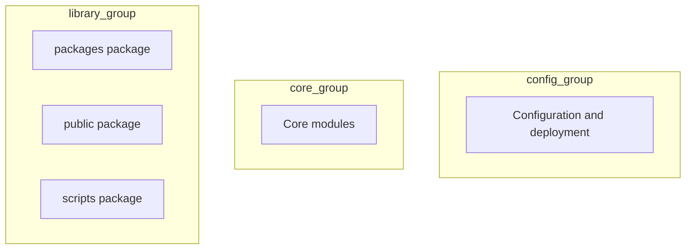

# Architecture report: alibaba/hooks

> Automated static analysis. **Observed** = directly seen in files/imports/AST; **Inferred** = interpretation from that evidence. Repository code was not executed.

## 1. Repository at a glance

| Item | Value |
| --- | --- |
| Repository | alibaba/hooks |
| Description | A high-quality & reliable React Hooks library.   https://alibaba.github.io/hooks/ |
| Language | TypeScript |
| Stars | 14979 |
| Licence | MIT |
| Analysed commit / branch | a0c33c21caefda40753fe4b3cbb3b1efbabd1a79 / master |
| Framework(s) | React |
| Files analysed | 664 |
| Components | 5 |

## 2. Architecture in one minute

alibaba/hooks - A high-quality & reliable React Hooks library.   https://alibaba.github.io/hooks/. This repository was analysed statically from 664 file(s) (0 Python). Detected technologies (observed from imports/manifests): GitHub Actions, React, React Router, TypeScript, Vitest, webpack. Files are grouped into 5 component(s): Configuration and deployment, Core modules, packages package, public package, scripts package. Findings below distinguish observed facts from inferred interpretation.

## 3. High-level block diagram

## 4. Main components

### Configuration and deployment (`config`)

- **Kind:** config
- **Status:** Observed
- **Confidence:** 0.85
- **Responsibility:** Groups 13 file(s) under configuration and deployment (observed from repository paths and static analysis).
- **Paths:** `biome.json`, `config/config.ts`, `config/hooks.ts`, `package.json`, `packages/hooks/package.json`, `packages/hooks/tsconfig.json`, `packages/hooks/tsconfig.pro.json`, `packages/use-url-state/package.json`, `packages/use-url-state/tsconfig.json`, `packages/use-url-state/tsconfig.pro.json`, `pnpm-workspace.yaml`, `tsconfig.base.json`, `tsconfig.pro.json`
- **Evidence:** [biome.json](https://github.com/alibaba/hooks/blob/a0c33c21caefda40753fe4b3cbb3b1efbabd1a79/biome.json); [config/config.ts](https://github.com/alibaba/hooks/blob/a0c33c21caefda40753fe4b3cbb3b1efbabd1a79/config/config.ts); [config/hooks.ts](https://github.com/alibaba/hooks/blob/a0c33c21caefda40753fe4b3cbb3b1efbabd1a79/config/hooks.ts); [package.json](https://github.com/alibaba/hooks/blob/a0c33c21caefda40753fe4b3cbb3b1efbabd1a79/package.json); [packages/hooks/package.json](https://github.com/alibaba/hooks/blob/a0c33c21caefda40753fe4b3cbb3b1efbabd1a79/packages/hooks/package.json); [packages/hooks/tsconfig.json](https://github.com/alibaba/hooks/blob/a0c33c21caefda40753fe4b3cbb3b1efbabd1a79/packages/hooks/tsconfig.json); [packages/hooks/tsconfig.pro.json](https://github.com/alibaba/hooks/blob/a0c33c21caefda40753fe4b3cbb3b1efbabd1a79/packages/hooks/tsconfig.pro.json); [packages/use-url-state/package.json](https://github.com/alibaba/hooks/blob/a0c33c21caefda40753fe4b3cbb3b1efbabd1a79/packages/use-url-state/package.json)

### Core modules (`core`)

- **Kind:** core
- **Status:** Observed
- **Confidence:** 0.85
- **Responsibility:** Groups 3 file(s) under core modules (observed from repository paths and static analysis).
- **Paths:** `gulpfile.js`, `vitest.config.ts`, `webpack.common.ts`
- **Evidence:** [gulpfile.js](https://github.com/alibaba/hooks/blob/a0c33c21caefda40753fe4b3cbb3b1efbabd1a79/gulpfile.js); [vitest.config.ts](https://github.com/alibaba/hooks/blob/a0c33c21caefda40753fe4b3cbb3b1efbabd1a79/vitest.config.ts); [webpack.common.ts](https://github.com/alibaba/hooks/blob/a0c33c21caefda40753fe4b3cbb3b1efbabd1a79/webpack.common.ts)

### packages package (`packages`)

- **Kind:** library
- **Status:** Observed
- **Confidence:** 0.85
- **Responsibility:** Groups 416 file(s) under packages package (observed from repository paths and static analysis).
- **Paths:** `packages/hooks/gulpfile.js`, `packages/hooks/src/__tests__/refTypes.spec.ts`, `packages/hooks/src/createDeepCompareEffect/__tests__/index.spec.ts`, `packages/hooks/src/createDeepCompareEffect/index.ts`, `packages/hooks/src/createUpdateEffect/__tests__/index.spec.ts`, `packages/hooks/src/createUpdateEffect/index.ts`, `packages/hooks/src/createUseStorageState/__tests__/index.spec.ts`, `packages/hooks/src/createUseStorageState/index.ts`, `packages/hooks/src/global.d.ts`, `packages/hooks/src/index.spec.ts`, `packages/hooks/src/index.ts`, `packages/hooks/src/useAntdTable/__tests__/index.spec.ts`, `packages/hooks/src/useAntdTable/demo/cache.tsx`, `packages/hooks/src/useAntdTable/demo/form.tsx`, `packages/hooks/src/useAntdTable/demo/init.tsx`, `packages/hooks/src/useAntdTable/demo/ready.tsx`, `packages/hooks/src/useAntdTable/demo/table.tsx`, `packages/hooks/src/useAntdTable/demo/validate.tsx`, `packages/hooks/src/useAntdTable/index.tsx`, `packages/hooks/src/useAntdTable/types.ts`, `packages/hooks/src/useAsyncEffect/__tests__/index.spec.ts`, `packages/hooks/src/useAsyncEffect/demo/demo1.tsx`, `packages/hooks/src/useAsyncEffect/demo/demo2.tsx`, `packages/hooks/src/useAsyncEffect/index.ts`, `packages/hooks/src/useBoolean/__tests__/index.spec.ts`, `packages/hooks/src/useBoolean/demo/demo1.tsx`, `packages/hooks/src/useBoolean/index.ts`, `packages/hooks/src/useClickAway/__tests__/index.spec.ts`, `packages/hooks/src/useClickAway/demo/demo1.tsx`, `packages/hooks/src/useClickAway/demo/demo2.tsx`, `packages/hooks/src/useClickAway/demo/demo3.tsx`, `packages/hooks/src/useClickAway/demo/demo4.tsx`, `packages/hooks/src/useClickAway/demo/demo5.tsx`, `packages/hooks/src/useClickAway/demo/demo6.tsx`, `packages/hooks/src/useClickAway/index.ts`, `packages/hooks/src/useControllableValue/__tests__/index.spec.ts`, `packages/hooks/src/useControllableValue/demo/demo1.tsx`, `packages/hooks/src/useControllableValue/demo/demo2.tsx`, `packages/hooks/src/useControllableValue/demo/demo3.tsx`, `packages/hooks/src/useControllableValue/index.ts`, `packages/hooks/src/useCookieState/__tests__/index.spec.tsx`, `packages/hooks/src/useCookieState/demo/demo1.tsx`, `packages/hooks/src/useCookieState/demo/demo2.tsx`, `packages/hooks/src/useCookieState/demo/demo3.tsx`, `packages/hooks/src/useCookieState/index.ts`, `packages/hooks/src/useCountDown/__tests__/index.spec.ts`, `packages/hooks/src/useCountDown/demo/demo1.tsx`, `packages/hooks/src/useCountDown/demo/demo2.tsx`, `packages/hooks/src/useCountDown/demo/demo3.tsx`, `packages/hooks/src/useCountDown/index.ts`, `packages/hooks/src/useCounter/__tests__/index.spec.ts`, `packages/hooks/src/useCounter/demo/demo1.tsx`, `packages/hooks/src/useCounter/index.ts`, `packages/hooks/src/useCreation/__tests__/index.spec.ts`, `packages/hooks/src/useCreation/demo/demo1.tsx`, `packages/hooks/src/useCreation/index.ts`, `packages/hooks/src/useDebounce/__tests__/index.spec.ts`, `packages/hooks/src/useDebounce/debounceOptions.ts`, `packages/hooks/src/useDebounce/demo/demo1.tsx`, `packages/hooks/src/useDebounce/index.ts`, `packages/hooks/src/useDebounceEffect/__tests__/index.spec.ts`, `packages/hooks/src/useDebounceEffect/demo/demo1.tsx`, `packages/hooks/src/useDebounceEffect/index.ts`, `packages/hooks/src/useDebounceFn/__tests__/index.spec.ts`, `packages/hooks/src/useDebounceFn/demo/demo1.tsx`, `packages/hooks/src/useDebounceFn/index.ts`, `packages/hooks/src/useDeepCompareEffect/__tests__/index.spec.ts`, `packages/hooks/src/useDeepCompareEffect/demo/demo1.tsx`, `packages/hooks/src/useDeepCompareEffect/index.tsx`, `packages/hooks/src/useDeepCompareLayoutEffect/__tests__/index.spec.ts`, `packages/hooks/src/useDeepCompareLayoutEffect/demo/demo1.tsx`, `packages/hooks/src/useDeepCompareLayoutEffect/index.tsx`, `packages/hooks/src/useDocumentVisibility/__tests__/index.spec.ts`, `packages/hooks/src/useDocumentVisibility/demo/demo1.tsx`, `packages/hooks/src/useDocumentVisibility/index.ts`, `packages/hooks/src/useDrag/__tests__/index.spec.ts`, `packages/hooks/src/useDrag/index.ts`, `packages/hooks/src/useDrop/__tests__/index.spec.ts`, `packages/hooks/src/useDrop/demo/demo1.tsx`, `packages/hooks/src/useDrop/demo/demo2.tsx`, `packages/hooks/src/useDrop/index.ts`, `packages/hooks/src/useDynamicList/__tests__/index.spec.ts`, `packages/hooks/src/useDynamicList/demo/demo1.tsx`, `packages/hooks/src/useDynamicList/demo/demo2.tsx`, `packages/hooks/src/useDynamicList/demo/demo3.tsx`, `packages/hooks/src/useDynamicList/demo/demo4.tsx`, `packages/hooks/src/useDynamicList/index.ts`, `packages/hooks/src/useEventEmitter/__tests__/index.spec.ts`, `packages/hooks/src/useEventEmitter/demo/demo1.tsx`, `packages/hooks/src/useEventEmitter/index.ts`, `packages/hooks/src/useEventListener/__tests__/index.spec.ts`, `packages/hooks/src/useEventListener/demo/demo1.tsx`, `packages/hooks/src/useEventListener/demo/demo2.tsx`, `packages/hooks/src/useEventListener/demo/demo3.tsx`, `packages/hooks/src/useEventListener/index.ts`, `packages/hooks/src/useEventTarget/__tests__/index.spec.ts`, `packages/hooks/src/useEventTarget/demo/demo1.tsx`, `packages/hooks/src/useEventTarget/demo/demo2.tsx`, `packages/hooks/src/useEventTarget/index.ts`, `packages/hooks/src/useExternal/__tests__/index.spec.ts`, `packages/hooks/src/useExternal/demo/demo1.tsx`, `packages/hooks/src/useExternal/demo/demo2.tsx`, `packages/hooks/src/useExternal/demo/demo3.tsx`, `packages/hooks/src/useExternal/index.ts`, `packages/hooks/src/useFavicon/__tests__/index.spec.tsx`, `packages/hooks/src/useFavicon/demo/demo1.tsx`, `packages/hooks/src/useFavicon/index.ts`, `packages/hooks/src/useFocusWithin/__tests__/index.spec.tsx`, `packages/hooks/src/useFocusWithin/demo/demo1.tsx`, `packages/hooks/src/useFocusWithin/demo/demo2.tsx`, `packages/hooks/src/useFocusWithin/index.tsx`, `packages/hooks/src/useFullscreen/__tests__/index.spec.ts`, `packages/hooks/src/useFullscreen/demo/demo1.tsx`, `packages/hooks/src/useFullscreen/demo/demo2.tsx`, `packages/hooks/src/useFullscreen/demo/demo3.tsx`, `packages/hooks/src/useFullscreen/demo/demo4.tsx`, `packages/hooks/src/useFullscreen/index.ts`, `packages/hooks/src/useFusionTable/__tests__/index.spec.ts`, `packages/hooks/src/useFusionTable/demo/cache.tsx`, `packages/hooks/src/useFusionTable/demo/form.tsx`, `packages/hooks/src/useFusionTable/demo/init.tsx`, `packages/hooks/src/useFusionTable/demo/table.tsx`, `packages/hooks/src/useFusionTable/demo/validate.tsx`, `packages/hooks/src/useFusionTable/fusionAdapter.ts`, `packages/hooks/src/useFusionTable/index.tsx`, `packages/hooks/src/useFusionTable/types.ts`, `packages/hooks/src/useGetState/__tests__/index.spec.ts`, `packages/hooks/src/useGetState/demo/demo1.tsx`, `packages/hooks/src/useGetState/index.ts`, `packages/hooks/src/useHistoryTravel/__tests__/index.spec.ts`, `packages/hooks/src/useHistoryTravel/demo/demo1.tsx`, `packages/hooks/src/useHistoryTravel/demo/demo2.tsx`, `packages/hooks/src/useHistoryTravel/demo/demo3.tsx`, `packages/hooks/src/useHistoryTravel/index.ts`, `packages/hooks/src/useHover/__tests__/index.spec.tsx`, `packages/hooks/src/useHover/demo/demo1.tsx`, `packages/hooks/src/useHover/demo/demo2.tsx`, `packages/hooks/src/useHover/index.ts`, `packages/hooks/src/useInViewport/__tests__/index.spec.ts`, `packages/hooks/src/useInViewport/demo/demo1.tsx`, `packages/hooks/src/useInViewport/demo/demo2.tsx`, `packages/hooks/src/useInViewport/demo/demo3.tsx`, `packages/hooks/src/useInViewport/index.ts`, `packages/hooks/src/useInfiniteScroll/__tests__/index.spec.ts`, `packages/hooks/src/useInfiniteScroll/demo/default.tsx`, `packages/hooks/src/useInfiniteScroll/demo/mutate.tsx`, `packages/hooks/src/useInfiniteScroll/demo/pagination.tsx`, `packages/hooks/src/useInfiniteScroll/demo/reload.tsx`, `packages/hooks/src/useInfiniteScroll/demo/scroll.tsx`, `packages/hooks/src/useInfiniteScroll/demo/scrollTop.tsx`, `packages/hooks/src/useInfiniteScroll/index.tsx`, `packages/hooks/src/useInfiniteScroll/types.ts`, `packages/hooks/src/useInterval/__tests__/index.spec.ts`, `packages/hooks/src/useInterval/demo/demo1.tsx`, `packages/hooks/src/useInterval/demo/demo2.tsx`, `packages/hooks/src/useInterval/index.ts`, `packages/hooks/src/useIsomorphicLayoutEffect/__tests__/index.spec.ts`, `packages/hooks/src/useIsomorphicLayoutEffect/index.ts`, `packages/hooks/src/useKeyPress/__tests__/index.spec.tsx`, `packages/hooks/src/useKeyPress/demo/demo1.tsx`, `packages/hooks/src/useKeyPress/demo/demo2.tsx`, `packages/hooks/src/useKeyPress/demo/demo3.tsx`, `packages/hooks/src/useKeyPress/demo/demo4.tsx`, `packages/hooks/src/useKeyPress/demo/demo5.tsx`, `packages/hooks/src/useKeyPress/demo/demo6.tsx`, `packages/hooks/src/useKeyPress/demo/demo7.tsx`, `packages/hooks/src/useKeyPress/demo/demo8.tsx`, `packages/hooks/src/useKeyPress/index.ts`, `packages/hooks/src/useLatest/__tests__/index.spec.ts`, `packages/hooks/src/useLatest/demo/demo1.tsx`, `packages/hooks/src/useLatest/index.ts`, `packages/hooks/src/useLocalStorageState/__tests__/index.spec.ts`, `packages/hooks/src/useLocalStorageState/demo/demo1.tsx`, `packages/hooks/src/useLocalStorageState/demo/demo2.tsx`, `packages/hooks/src/useLocalStorageState/demo/demo3.tsx`, `packages/hooks/src/useLocalStorageState/demo/demo4.tsx`, `packages/hooks/src/useLocalStorageState/index.ts`, `packages/hooks/src/useLockFn/__tests__/index.spec.ts`, `packages/hooks/src/useLockFn/demo/demo1.tsx`, `packages/hooks/src/useLockFn/index.ts`, `packages/hooks/src/useLongPress/__tests__/index.spec.ts`, `packages/hooks/src/useLongPress/demo/demo1.tsx`, `packages/hooks/src/useLongPress/demo/demo2.tsx`, `packages/hooks/src/useLongPress/demo/demo3.tsx`, `packages/hooks/src/useLongPress/index.ts`, `packages/hooks/src/useMap/__tests__/index.spec.ts`, `packages/hooks/src/useMap/demo/demo1.tsx`, `packages/hooks/src/useMap/index.ts`, `packages/hooks/src/useMemoizedFn/__tests__/index.spec.ts`, `packages/hooks/src/useMemoizedFn/demo/demo1.tsx`, `packages/hooks/src/useMemoizedFn/demo/demo2.tsx`, `packages/hooks/src/useMemoizedFn/index.ts`, `packages/hooks/src/useMount/__tests__/index.spec.ts`, `packages/hooks/src/useMount/demo/demo1.tsx`, `packages/hooks/src/useMount/index.ts`, `packages/hooks/src/useMouse/__tests__/index.spec.ts`, `packages/hooks/src/useMouse/demo/demo1.tsx`, `packages/hooks/src/useMouse/demo/demo2.tsx`, `packages/hooks/src/useMouse/index.ts`, `packages/hooks/src/useMutationObserver/__tests__/index.spec.ts`, `packages/hooks/src/useMutationObserver/demo/demo1.tsx`, `packages/hooks/src/useMutationObserver/index.ts`, `packages/hooks/src/useNetwork/__tests__/index.spec.ts`, `packages/hooks/src/useNetwork/demo/demo1.tsx`, `packages/hooks/src/useNetwork/index.ts`, `packages/hooks/src/usePagination/__tests__/index.spec.ts`, `packages/hooks/src/usePagination/demo/demo1.tsx`, `packages/hooks/src/usePagination/demo/demo2.tsx`, `packages/hooks/src/usePagination/demo/demo3.tsx`, `packages/hooks/src/usePagination/demo/demo4.tsx`, `packages/hooks/src/usePagination/index.ts`, `packages/hooks/src/usePagination/types.ts`, `packages/hooks/src/usePrevious/__tests__/index.spec.ts`, `packages/hooks/src/usePrevious/demo/demo1.tsx`, `packages/hooks/src/usePrevious/demo/demo2.tsx`, `packages/hooks/src/usePrevious/index.ts`, `packages/hooks/src/useRafInterval/__tests__/index.spec.ts`, `packages/hooks/src/useRafInterval/__tests__/node.spec.ts`, `packages/hooks/src/useRafInterval/demo/demo1.tsx`, `packages/hooks/src/useRafInterval/demo/demo2.tsx`, `packages/hooks/src/useRafInterval/index.ts`, `packages/hooks/src/useRafState/__tests__/index.spec.ts`, `packages/hooks/src/useRafState/demo/demo1.tsx`, `packages/hooks/src/useRafState/index.ts`, `packages/hooks/src/useRafTimeout/__tests__/index.spec.ts`, `packages/hooks/src/useRafTimeout/__tests__/node.spec.ts`, `packages/hooks/src/useRafTimeout/demo/demo1.tsx`, `packages/hooks/src/useRafTimeout/demo/demo2.tsx`, `packages/hooks/src/useRafTimeout/index.ts`, `packages/hooks/src/useReactive/__tests__/index.spec.tsx`, `packages/hooks/src/useReactive/demo/demo1.tsx`, `packages/hooks/src/useReactive/demo/demo2.tsx`, `packages/hooks/src/useReactive/demo/demo3.tsx`, `packages/hooks/src/useReactive/demo/demo4.tsx`, `packages/hooks/src/useReactive/demo/index.tsx`, `packages/hooks/src/useReactive/index.ts`, `packages/hooks/src/useRequest/__tests__/index.spec.ts`, `packages/hooks/src/useRequest/__tests__/useAutoRunPlugin.spec.ts`, `packages/hooks/src/useRequest/__tests__/useCachePlugin.spec.tsx`, `packages/hooks/src/useRequest/__tests__/useDebouncePlugin.spec.ts`, `packages/hooks/src/useRequest/__tests__/useLoadingDelayPlugin.spec.ts`, `packages/hooks/src/useRequest/__tests__/usePollingPlugin.spec.ts`, `packages/hooks/src/useRequest/__tests__/useRefreshOnWindowFocusPlugin.spec.ts`, `packages/hooks/src/useRequest/__tests__/useRetryPlugin.spec.ts`, `packages/hooks/src/useRequest/__tests__/useThrottlePlugin.spec.ts`, `packages/hooks/src/useRequest/doc/basic/demo/cancel.tsx`, `packages/hooks/src/useRequest/doc/basic/demo/default.tsx`, `packages/hooks/src/useRequest/doc/basic/demo/lifeCycle.tsx`, `packages/hooks/src/useRequest/doc/basic/demo/manual-run.tsx`, `packages/hooks/src/useRequest/doc/basic/demo/manual-runAsync.tsx`, `packages/hooks/src/useRequest/doc/basic/demo/mutate.tsx`, `packages/hooks/src/useRequest/doc/basic/demo/params.tsx`, `packages/hooks/src/useRequest/doc/basic/demo/refresh.tsx`, `packages/hooks/src/useRequest/doc/cache/demo/cacheKey.tsx`, `packages/hooks/src/useRequest/doc/cache/demo/clearCache.tsx`, `packages/hooks/src/useRequest/doc/cache/demo/params.tsx`, `packages/hooks/src/useRequest/doc/cache/demo/setCache.tsx`, `packages/hooks/src/useRequest/doc/cache/demo/share.tsx`, `packages/hooks/src/useRequest/doc/cache/demo/staleTime.tsx`, `packages/hooks/src/useRequest/doc/debounce/demo/debounce.tsx`, `packages/hooks/src/useRequest/doc/index/demo/default.tsx`, `packages/hooks/src/useRequest/doc/index/demo/manual.tsx`, `packages/hooks/src/useRequest/doc/loadingDelay/demo/loadingDelay.tsx`, `packages/hooks/src/useRequest/doc/polling/demo/polling.tsx`, `packages/hooks/src/useRequest/doc/polling/demo/pollingError.tsx`, `packages/hooks/src/useRequest/doc/ready/demo/manualReady.tsx`, `packages/hooks/src/useRequest/doc/ready/demo/ready.tsx`, `packages/hooks/src/useRequest/doc/refreshDeps/demo/refreshDeps.tsx`, `packages/hooks/src/useRequest/doc/refreshDeps/demo/refreshDepsAction.tsx`, `packages/hooks/src/useRequest/doc/refreshOnWindowFocus/demo/refreshOnWindowFocus.tsx`, `packages/hooks/src/useRequest/doc/retry/demo/retry.tsx`, `packages/hooks/src/useRequest/doc/throttle/demo/throttle.tsx`, `packages/hooks/src/useRequest/index.ts`, `packages/hooks/src/useRequest/src/Fetch.ts`, `packages/hooks/src/useRequest/src/plugins/useAutoRunPlugin.ts`, `packages/hooks/src/useRequest/src/plugins/useCachePlugin.ts`, `packages/hooks/src/useRequest/src/plugins/useDebouncePlugin.ts`, `packages/hooks/src/useRequest/src/plugins/useLoadingDelayPlugin.ts`, `packages/hooks/src/useRequest/src/plugins/usePollingPlugin.ts`, `packages/hooks/src/useRequest/src/plugins/useRefreshOnWindowFocusPlugin.ts`, `packages/hooks/src/useRequest/src/plugins/useRetryPlugin.ts`, `packages/hooks/src/useRequest/src/plugins/useThrottlePlugin.ts`, `packages/hooks/src/useRequest/src/types.ts`, `packages/hooks/src/useRequest/src/useRequest.ts`, `packages/hooks/src/useRequest/src/useRequestImplement.ts`, `packages/hooks/src/useRequest/src/utils/cache.ts`, `packages/hooks/src/useRequest/src/utils/cachePromise.ts`, `packages/hooks/src/useRequest/src/utils/cacheSubscribe.ts`, `packages/hooks/src/useRequest/src/utils/cancelledError.ts`, `packages/hooks/src/useRequest/src/utils/isDocumentVisible.ts`, `packages/hooks/src/useRequest/src/utils/isOnline.ts`, `packages/hooks/src/useRequest/src/utils/limit.ts`, `packages/hooks/src/useRequest/src/utils/subscribeFocus.ts`, `packages/hooks/src/useRequest/src/utils/subscribeReVisible.ts`, `packages/hooks/src/useResetState/__tests__/index.spec.ts`, `packages/hooks/src/useResetState/demo/demo1.tsx`, `packages/hooks/src/useResetState/index.ts`, `packages/hooks/src/useResponsive/__tests__/index.spec.ts`, `packages/hooks/src/useResponsive/demo/demo1.tsx`, `packages/hooks/src/useResponsive/index.ts`, `packages/hooks/src/useSafeState/__tests__/index.spec.ts`, `packages/hooks/src/useSafeState/demo/demo1.tsx`, `packages/hooks/src/useSafeState/index.ts`, `packages/hooks/src/useScroll/__tests__/index.spec.ts`, `packages/hooks/src/useScroll/demo/demo1.tsx`, `packages/hooks/src/useScroll/demo/demo2.tsx`, `packages/hooks/src/useScroll/demo/demo3.tsx`, `packages/hooks/src/useScroll/index.ts`, `packages/hooks/src/useSelections/__tests__/index.spec.ts`, `packages/hooks/src/useSelections/demo/demo1.tsx`, `packages/hooks/src/useSelections/demo/demo2.tsx`, `packages/hooks/src/useSelections/demo/demo3.tsx`, `packages/hooks/src/useSelections/index.ts`, `packages/hooks/src/useSessionStorageState/__tests__/index.spec.ts`, `packages/hooks/src/useSessionStorageState/index.ts`, `packages/hooks/src/useSet/__tests__/index.spec.ts`, `packages/hooks/src/useSet/demo/demo1.tsx`, `packages/hooks/src/useSet/index.ts`, `packages/hooks/src/useSetState/__tests__/index.spec.ts`, `packages/hooks/src/useSetState/demo/demo1.tsx`, `packages/hooks/src/useSetState/demo/demo2.tsx`, `packages/hooks/src/useSetState/index.ts`, `packages/hooks/src/useSize/__tests__/index.spec.tsx`, `packages/hooks/src/useSize/demo/demo1.tsx`, `packages/hooks/src/useSize/demo/demo2.tsx`, `packages/hooks/src/useSize/index.ts`, `packages/hooks/src/useTextSelection/__tests__/index.spec.ts`, `packages/hooks/src/useTextSelection/demo/demo1.tsx`, `packages/hooks/src/useTextSelection/demo/demo2.tsx`, `packages/hooks/src/useTextSelection/demo/demo3.tsx`, `packages/hooks/src/useTextSelection/index.ts`, `packages/hooks/src/useTheme/__tests__/index.spec.ts`, `packages/hooks/src/useTheme/__tests__/ssr.spec.tsx`, `packages/hooks/src/useTheme/demo/demo1.tsx`, `packages/hooks/src/useTheme/index.ts`, `packages/hooks/src/useThrottle/__tests__/index.spec.ts`, `packages/hooks/src/useThrottle/demo/demo1.tsx`, `packages/hooks/src/useThrottle/index.ts`, `packages/hooks/src/useThrottle/throttleOptions.ts`, `packages/hooks/src/useThrottleEffect/__tests__/index.spec.ts`, `packages/hooks/src/useThrottleEffect/demo/demo1.tsx`, `packages/hooks/src/useThrottleEffect/index.ts`, `packages/hooks/src/useThrottleFn/__tests__/index.spec.ts`, `packages/hooks/src/useThrottleFn/demo/demo1.tsx`, `packages/hooks/src/useThrottleFn/index.ts`, `packages/hooks/src/useTimeout/__tests__/index.spec.ts`, `packages/hooks/src/useTimeout/demo/demo1.tsx`, `packages/hooks/src/useTimeout/demo/demo2.tsx`, `packages/hooks/src/useTimeout/index.ts`, `packages/hooks/src/useTitle/__tests__/index.spec.ts`, `packages/hooks/src/useTitle/demo/demo1.tsx`, `packages/hooks/src/useTitle/index.ts`, `packages/hooks/src/useToggle/__tests__/index.spec.ts`, `packages/hooks/src/useToggle/demo/demo1.tsx`, `packages/hooks/src/useToggle/demo/demo2.tsx`, `packages/hooks/src/useToggle/index.ts`, `packages/hooks/src/useTrackedEffect/__tests__/index.spec.ts`, `packages/hooks/src/useTrackedEffect/demo/demo1.tsx`, `packages/hooks/src/useTrackedEffect/index.ts`, `packages/hooks/src/useUnmount/__tests__/index.spec.ts`, `packages/hooks/src/useUnmount/demo/demo1.tsx`, `packages/hooks/src/useUnmount/index.ts`, `packages/hooks/src/useUnmountedRef/__tests__/index.spec.ts`, `packages/hooks/src/useUnmountedRef/demo/demo1.tsx`, `packages/hooks/src/useUnmountedRef/index.tsx`, `packages/hooks/src/useUpdate/__tests__/index.spec.ts`, `packages/hooks/src/useUpdate/demo/demo1.tsx`, `packages/hooks/src/useUpdate/index.ts`, `packages/hooks/src/useUpdateEffect/__tests__/index.spec.ts`, `packages/hooks/src/useUpdateEffect/demo/demo1.tsx`, `packages/hooks/src/useUpdateEffect/index.ts`, `packages/hooks/src/useUpdateLayoutEffect/__tests__/index.spec.ts`, `packages/hooks/src/useUpdateLayoutEffect/demo/demo1.tsx`, `packages/hooks/src/useUpdateLayoutEffect/index.ts`, `packages/hooks/src/useVirtualList/__tests__/index.spec.ts`, `packages/hooks/src/useVirtualList/demo/demo1.tsx`, `packages/hooks/src/useVirtualList/demo/demo2.tsx`, `packages/hooks/src/useVirtualList/index.ts`, `packages/hooks/src/useWebSocket/__tests__/index.spec.ts`, `packages/hooks/src/useWebSocket/demo/demo1.tsx`, `packages/hooks/src/useWebSocket/index.ts`, `packages/hooks/src/useWhyDidYouUpdate/__tests__/index.spec.ts`, `packages/hooks/src/useWhyDidYouUpdate/demo/demo1.tsx`, `packages/hooks/src/useWhyDidYouUpdate/index.ts`, `packages/hooks/src/utils/__tests__/index.spec.ts`, `packages/hooks/src/utils/createEffectWithTarget.ts`, `packages/hooks/src/utils/depsAreSame.ts`, `packages/hooks/src/utils/depsEqual.ts`, `packages/hooks/src/utils/domTarget.ts`, `packages/hooks/src/utils/getDocumentOrShadow.ts`, `packages/hooks/src/utils/index.ts`, `packages/hooks/src/utils/isAppleDevice.ts`, `packages/hooks/src/utils/isBrowser.ts`, `packages/hooks/src/utils/isDev.ts`, `packages/hooks/src/utils/lodash-polyfill.ts`, `packages/hooks/src/utils/noop.ts`, `packages/hooks/src/utils/rect.ts`, `packages/hooks/src/utils/testingHelpers.ts`, `packages/hooks/src/utils/tests.tsx`, `packages/hooks/src/utils/useDeepCompareWithTarget.ts`, `packages/hooks/src/utils/useEffectWithTarget.ts`, `packages/hooks/src/utils/useIsomorphicLayoutEffectWithTarget.ts`, `packages/hooks/src/utils/useLayoutEffectWithTarget.ts`, `packages/hooks/vitest.config.ts`, `packages/hooks/webpack.config.ts`, `packages/use-url-state/__tests__/browser.spec.tsx`, `packages/use-url-state/__tests__/router.spec.tsx`, `packages/use-url-state/__tests__/setup.tsx`, `packages/use-url-state/demo/demo1.tsx`, `packages/use-url-state/demo/demo2.tsx`, `packages/use-url-state/demo/demo3.tsx`, `packages/use-url-state/demo/demo4.tsx`, `packages/use-url-state/gulpfile.js`, `packages/use-url-state/src/index.ts`, `packages/use-url-state/vitest.config.ts`, `packages/use-url-state/webpack.config.ts`
- **Evidence:** [packages/hooks/gulpfile.js](https://github.com/alibaba/hooks/blob/a0c33c21caefda40753fe4b3cbb3b1efbabd1a79/packages/hooks/gulpfile.js); [packages/hooks/src/__tests__/refTypes.spec.ts](https://github.com/alibaba/hooks/blob/a0c33c21caefda40753fe4b3cbb3b1efbabd1a79/packages/hooks/src/__tests__/refTypes.spec.ts); [packages/hooks/src/createDeepCompareEffect/__tests__/index.spec.ts](https://github.com/alibaba/hooks/blob/a0c33c21caefda40753fe4b3cbb3b1efbabd1a79/packages/hooks/src/createDeepCompareEffect/__tests__/index.spec.ts); [packages/hooks/src/createDeepCompareEffect/index.ts](https://github.com/alibaba/hooks/blob/a0c33c21caefda40753fe4b3cbb3b1efbabd1a79/packages/hooks/src/createDeepCompareEffect/index.ts); [packages/hooks/src/createUpdateEffect/__tests__/index.spec.ts](https://github.com/alibaba/hooks/blob/a0c33c21caefda40753fe4b3cbb3b1efbabd1a79/packages/hooks/src/createUpdateEffect/__tests__/index.spec.ts); [packages/hooks/src/createUpdateEffect/index.ts](https://github.com/alibaba/hooks/blob/a0c33c21caefda40753fe4b3cbb3b1efbabd1a79/packages/hooks/src/createUpdateEffect/index.ts); [packages/hooks/src/createUseStorageState/__tests__/index.spec.ts](https://github.com/alibaba/hooks/blob/a0c33c21caefda40753fe4b3cbb3b1efbabd1a79/packages/hooks/src/createUseStorageState/__tests__/index.spec.ts); [packages/hooks/src/createUseStorageState/index.ts](https://github.com/alibaba/hooks/blob/a0c33c21caefda40753fe4b3cbb3b1efbabd1a79/packages/hooks/src/createUseStorageState/index.ts)

### public package (`public`)

- **Kind:** library
- **Status:** Observed
- **Confidence:** 0.85
- **Responsibility:** Groups 1 file(s) under public package (observed from repository paths and static analysis).
- **Paths:** `public/useExternal/test-external-script.js`
- **Evidence:** [public/useExternal/test-external-script.js](https://github.com/alibaba/hooks/blob/a0c33c21caefda40753fe4b3cbb3b1efbabd1a79/public/useExternal/test-external-script.js)

### scripts package (`scripts`)

- **Kind:** library
- **Status:** Observed
- **Confidence:** 0.85
- **Responsibility:** Groups 1 file(s) under scripts package (observed from repository paths and static analysis).
- **Paths:** `scripts/build-with-relative-paths.js`
- **Evidence:** [scripts/build-with-relative-paths.js](https://github.com/alibaba/hooks/blob/a0c33c21caefda40753fe4b3cbb3b1efbabd1a79/scripts/build-with-relative-paths.js)

## 5. Execution flow

**Observed** entry point(s):

- [packages/hooks/src/index.ts](https://github.com/alibaba/hooks/blob/a0c33c21caefda40753fe4b3cbb3b1efbabd1a79/packages/hooks/src/index.ts)
- [packages/use-url-state/src/index.ts](https://github.com/alibaba/hooks/blob/a0c33c21caefda40753fe4b3cbb3b1efbabd1a79/packages/use-url-state/src/index.ts)

Representative flow (derived from observed entry points and the import graph; steps beyond the entry point are **Inferred**):

1. Execution starts at an observed entry point listed above, if present.
2. No internal import relationships between components were observed.

## 6. Project structure

### `(root)`

- `.babelrc` - other (100 bytes)
- `.coveralls.yml` - config (71 bytes)
- `.editorconfig` - config (244 bytes)
- `.gitignore` - other (226 bytes)
- `.gitleaks.toml` - config (4188 bytes)
- `.travis.yml` - ci, YAML (275 bytes)
- `AGENTS.md` - docs (3650 bytes)
- `CLAUDE.md` - docs (11 bytes)
- `CONTRIBUTING.MD` - docs (1486 bytes)
- `CONTRIBUTING.zh-CN.MD` - docs (1584 bytes)
- `LICENSE` - docs (1071 bytes)
- `README.md` - docs (3516 bytes)
- `README.zh-CN.md` - docs (3380 bytes)
- `RELEASING.md` - docs (7424 bytes)
- `SECURITY.md` - docs (139 bytes)
- `biome.json` - config (813 bytes)
- `gulpfile.js` - source, JavaScript (1411 bytes)
- `package.json` - manifest (3279 bytes)
- `pnpm-workspace.yaml` - config (27 bytes)
- `tsconfig.base.json` - config (1373 bytes)
- `tsconfig.pro.json` - config (640 bytes)
- `umd.html` - other (907 bytes)
- `vitest.config.ts` - source, TypeScript (271 bytes)
- `webpack.common.ts` - source, TypeScript (304 bytes)

### `.cursor`

- `.cursor/rules/demo.mdc` - other (1230 bytes)
- `.cursor/rules/docs.mdc` - other (1138 bytes)
- `.cursor/rules/git.mdc` - other (3145 bytes)
- `.cursor/rules/project.mdc` - other (628 bytes)
- `.cursor/rules/testing.mdc` - other (286 bytes)
- `.cursor/rules/typescript.mdc` - other (2608 bytes)

### `.github`

- `.github/PULL_REQUEST_TEMPLATE.md` - docs (1678 bytes)
- `.github/PULL_REQUEST_TEMPLATE/pr_cn.md` - docs (1454 bytes)
- `.github/workflows/comment-when-needs-more-info.yml` - ci, YAML (678 bytes)
- `.github/workflows/gitleaks.yml` - ci, YAML (375 bytes)
- `.github/workflows/issue-close-require.yml` - ci, YAML (2650 bytes)
- `.github/workflows/issue-reply.yml` - ci, YAML (2708 bytes)
- `.github/workflows/pkg.pr.new.yml` - ci, YAML (766 bytes)
- `.github/workflows/static.yml` - ci, YAML (1898 bytes)
- `.github/workflows/test.yml` - ci, YAML (1381 bytes)

### `.husky`

- `.husky/commit-msg` - other (67 bytes)
- `.husky/pre-commit` - other (67 bytes)

### `config`

- `config/config.ts` - source, TypeScript (7015 bytes)
- `config/hooks.ts` - source, TypeScript (2524 bytes)

### `docs`

- `docs/guide/blog/function.en-US.md` - docs (2521 bytes)
- `docs/guide/blog/function.zh-CN.md` - docs (2349 bytes)
- `docs/guide/blog/hmr.en-US.md` - docs (10436 bytes)
- `docs/guide/blog/hmr.zh-CN.md` - docs (10157 bytes)
- `docs/guide/blog/ssr.en-US.md` - docs (4437 bytes)
- `docs/guide/blog/ssr.zh-CN.md` - docs (4385 bytes)
- `docs/guide/blog/strict.en-US.md` - docs (3318 bytes)
- `docs/guide/blog/strict.zh-CN.md` - docs (3229 bytes)
- `docs/guide/dom.en-US.md` - docs (1322 bytes)
- `docs/guide/dom.zh-CN.md` - docs (1292 bytes)
- `docs/guide/index.en-US.md` - docs (888 bytes)
- `docs/guide/index.zh-CN.md` - docs (817 bytes)
- `docs/guide/upgrade.en-US.md` - docs (8421 bytes)
- `docs/guide/upgrade.zh-CN.md` - docs (7545 bytes)
- `docs/index.en-US.md` - docs (3278 bytes)
- `docs/index.zh-CN.md` - docs (3172 bytes)

### `example`

- `example/.gitkeep` - other (421 bytes)

### `packages`

- `packages/hooks/gulpfile.js` - source, JavaScript (1626 bytes)
- `packages/hooks/package.json` - manifest (1377 bytes)
- `packages/hooks/src/__tests__/refTypes.spec.ts` - source, TypeScript (1651 bytes)
- `packages/hooks/src/createDeepCompareEffect/__tests__/index.spec.ts` - source, TypeScript (2551 bytes)
- `packages/hooks/src/createDeepCompareEffect/index.ts` - source, TypeScript (621 bytes)
- `packages/hooks/src/createUpdateEffect/__tests__/index.spec.ts` - source, TypeScript (934 bytes)
- `packages/hooks/src/createUpdateEffect/index.ts` - source, TypeScript (608 bytes)
- `packages/hooks/src/createUseStorageState/__tests__/index.spec.ts` - source, TypeScript (4139 bytes)
- `packages/hooks/src/createUseStorageState/index.ts` - source, TypeScript (4616 bytes)
- `packages/hooks/src/global.d.ts` - source, TypeScript (67 bytes)
- `packages/hooks/src/index.spec.ts` - source, TypeScript (266 bytes)
- `packages/hooks/src/index.ts` - source, TypeScript (4994 bytes)
- `packages/hooks/src/useAntdTable/__tests__/index.spec.ts` - source, TypeScript (10421 bytes)
- `packages/hooks/src/useAntdTable/demo/cache.tsx` - source, TypeScript (4601 bytes)
- `packages/hooks/src/useAntdTable/demo/form.tsx` - source, TypeScript (3509 bytes)
- `packages/hooks/src/useAntdTable/demo/init.tsx` - source, TypeScript (3643 bytes)
- `packages/hooks/src/useAntdTable/demo/ready.tsx` - source, TypeScript (3859 bytes)
- `packages/hooks/src/useAntdTable/demo/table.tsx` - source, TypeScript (1054 bytes)
- `packages/hooks/src/useAntdTable/demo/validate.tsx` - source, TypeScript (2457 bytes)
- `packages/hooks/src/useAntdTable/index.en-US.md` - docs (5450 bytes)
- `packages/hooks/src/useAntdTable/index.tsx` - source, TypeScript (6956 bytes)
- `packages/hooks/src/useAntdTable/index.zh-CN.md` - docs (5170 bytes)
- `packages/hooks/src/useAntdTable/types.ts` - source, TypeScript (1748 bytes)
- `packages/hooks/src/useAsyncEffect/__tests__/index.spec.ts` - source, TypeScript (2453 bytes)
- `packages/hooks/src/useAsyncEffect/demo/demo1.tsx` - source, TypeScript (658 bytes)
- `packages/hooks/src/useAsyncEffect/demo/demo2.tsx` - source, TypeScript (1203 bytes)
- `packages/hooks/src/useAsyncEffect/index.en-US.md` - docs (339 bytes)
- `packages/hooks/src/useAsyncEffect/index.ts` - source, TypeScript (997 bytes)
- `packages/hooks/src/useAsyncEffect/index.zh-CN.md` - docs (339 bytes)
- `packages/hooks/src/useBoolean/__tests__/index.spec.ts` - source, TypeScript (1727 bytes)
- `packages/hooks/src/useBoolean/demo/demo1.tsx` - source, TypeScript (705 bytes)
- `packages/hooks/src/useBoolean/index.en-US.md` - docs (1216 bytes)
- `packages/hooks/src/useBoolean/index.ts` - source, TypeScript (598 bytes)
- `packages/hooks/src/useBoolean/index.zh-CN.md` - docs (1043 bytes)
- `packages/hooks/src/useClickAway/__tests__/index.spec.ts` - source, TypeScript (4406 bytes)
- `packages/hooks/src/useClickAway/demo/demo1.tsx` - source, TypeScript (591 bytes)
- `packages/hooks/src/useClickAway/demo/demo2.tsx` - source, TypeScript (611 bytes)
- `packages/hooks/src/useClickAway/demo/demo3.tsx` - source, TypeScript (696 bytes)
- `packages/hooks/src/useClickAway/demo/demo4.tsx` - source, TypeScript (721 bytes)
- `packages/hooks/src/useClickAway/demo/demo5.tsx` - source, TypeScript (690 bytes)
- `packages/hooks/src/useClickAway/demo/demo6.tsx` - source, TypeScript (719 bytes)
- `packages/hooks/src/useClickAway/index.en-US.md` - docs (1642 bytes)
- `packages/hooks/src/useClickAway/index.ts` - source, TypeScript (2261 bytes)
- `packages/hooks/src/useClickAway/index.zh-CN.md` - docs (1621 bytes)
- `packages/hooks/src/useControllableValue/__tests__/index.spec.ts` - source, TypeScript (2467 bytes)
- `packages/hooks/src/useControllableValue/demo/demo1.tsx` - source, TypeScript (651 bytes)
- `packages/hooks/src/useControllableValue/demo/demo2.tsx` - source, TypeScript (878 bytes)
- `packages/hooks/src/useControllableValue/demo/demo3.tsx` - source, TypeScript (901 bytes)
- `packages/hooks/src/useControllableValue/index.en-US.md` - docs (2010 bytes)
- `packages/hooks/src/useControllableValue/index.ts` - source, TypeScript (1868 bytes)
- `packages/hooks/src/useControllableValue/index.zh-CN.md` - docs (1905 bytes)
- `packages/hooks/src/useCookieState/__tests__/index.spec.tsx` - source, TypeScript (4385 bytes)
- `packages/hooks/src/useCookieState/demo/demo1.tsx` - source, TypeScript (579 bytes)
- `packages/hooks/src/useCookieState/demo/demo2.tsx` - source, TypeScript (979 bytes)
- `packages/hooks/src/useCookieState/demo/demo3.tsx` - source, TypeScript (1280 bytes)
- `packages/hooks/src/useCookieState/index.en-US.md` - docs (2997 bytes)
- `packages/hooks/src/useCookieState/index.ts` - source, TypeScript (2387 bytes)
- `packages/hooks/src/useCookieState/index.zh-CN.md` - docs (2808 bytes)
- `packages/hooks/src/useCountDown/__tests__/index.spec.ts` - source, TypeScript (6858 bytes)
- `packages/hooks/src/useCountDown/demo/demo1.tsx` - source, TypeScript (589 bytes)
- `packages/hooks/src/useCountDown/demo/demo2.tsx` - source, TypeScript (983 bytes)
- `packages/hooks/src/useCountDown/demo/demo3.tsx` - source, TypeScript (390 bytes)
- `packages/hooks/src/useCountDown/index.en-US.md` - docs (2065 bytes)
- `packages/hooks/src/useCountDown/index.ts` - source, TypeScript (2059 bytes)
- `packages/hooks/src/useCountDown/index.zh-CN.md` - docs (1889 bytes)
- `packages/hooks/src/useCounter/__tests__/index.spec.ts` - source, TypeScript (1254 bytes)
- `packages/hooks/src/useCounter/demo/demo1.tsx` - source, TypeScript (1064 bytes)
- `packages/hooks/src/useCounter/index.en-US.md` - docs (1314 bytes)
- `packages/hooks/src/useCounter/index.ts` - source, TypeScript (1607 bytes)
- `packages/hooks/src/useCounter/index.zh-CN.md` - docs (1146 bytes)
- `packages/hooks/src/useCreation/__tests__/index.spec.ts` - source, TypeScript (921 bytes)
- `packages/hooks/src/useCreation/demo/demo1.tsx` - source, TypeScript (802 bytes)
- `packages/hooks/src/useCreation/index.en-US.md` - docs (1449 bytes)
- `packages/hooks/src/useCreation/index.ts` - source, TypeScript (510 bytes)
- `packages/hooks/src/useCreation/index.zh-CN.md` - docs (1548 bytes)
- `packages/hooks/src/useDebounce/__tests__/index.spec.ts` - source, TypeScript (865 bytes)
- `packages/hooks/src/useDebounce/debounceOptions.ts` - source, TypeScript (117 bytes)
- `packages/hooks/src/useDebounce/demo/demo1.tsx` - source, TypeScript (677 bytes)
- `packages/hooks/src/useDebounce/index.en-US.md` - docs (1199 bytes)
- `packages/hooks/src/useDebounce/index.ts` - source, TypeScript (446 bytes)
- `packages/hooks/src/useDebounce/index.zh-CN.md` - docs (921 bytes)
- `packages/hooks/src/useDebounceEffect/__tests__/index.spec.ts` - source, TypeScript (2688 bytes)
- `packages/hooks/src/useDebounceEffect/demo/demo1.tsx` - source, TypeScript (712 bytes)
- `packages/hooks/src/useDebounceEffect/index.en-US.md` - docs (1531 bytes)
- `packages/hooks/src/useDebounceEffect/index.ts` - source, TypeScript (623 bytes)
- `packages/hooks/src/useDebounceEffect/index.zh-CN.md` - docs (1146 bytes)
- `packages/hooks/src/useDebounceFn/__tests__/index.spec.ts` - source, TypeScript (1443 bytes)
- `packages/hooks/src/useDebounceFn/demo/demo1.tsx` - source, TypeScript (707 bytes)
- `packages/hooks/src/useDebounceFn/index.en-US.md` - docs (1804 bytes)
- `packages/hooks/src/useDebounceFn/index.ts` - source, TypeScript (1030 bytes)
- `packages/hooks/src/useDebounceFn/index.zh-CN.md` - docs (1471 bytes)
- `packages/hooks/src/useDeepCompareEffect/__tests__/index.spec.ts` - source, TypeScript (678 bytes)
- `packages/hooks/src/useDeepCompareEffect/demo/demo1.tsx` - source, TypeScript (714 bytes)
- `packages/hooks/src/useDeepCompareEffect/index.en-US.md` - docs (364 bytes)
- `packages/hooks/src/useDeepCompareEffect/index.tsx` - source, TypeScript (157 bytes)
- `packages/hooks/src/useDeepCompareEffect/index.zh-CN.md` - docs (369 bytes)
- `packages/hooks/src/useDeepCompareLayoutEffect/__tests__/index.spec.ts` - source, TypeScript (680 bytes)
- `packages/hooks/src/useDeepCompareLayoutEffect/demo/demo1.tsx` - source, TypeScript (738 bytes)
- `packages/hooks/src/useDeepCompareLayoutEffect/index.en-US.md` - docs (382 bytes)
- `packages/hooks/src/useDeepCompareLayoutEffect/index.tsx` - source, TypeScript (169 bytes)
- `packages/hooks/src/useDeepCompareLayoutEffect/index.zh-CN.md` - docs (387 bytes)
- `packages/hooks/src/useDocumentVisibility/__tests__/index.spec.ts` - source, TypeScript (1530 bytes)
- `packages/hooks/src/useDocumentVisibility/demo/demo1.tsx` - source, TypeScript (527 bytes)
- `packages/hooks/src/useDocumentVisibility/index.en-US.md` - docs (662 bytes)
- `packages/hooks/src/useDocumentVisibility/index.ts` - source, TypeScript (678 bytes)
- `packages/hooks/src/useDocumentVisibility/index.zh-CN.md` - docs (682 bytes)
- `packages/hooks/src/useDrag/__tests__/index.spec.ts` - source, TypeScript (2339 bytes)
- `packages/hooks/src/useDrag/index.ts` - source, TypeScript (2221 bytes)
- `packages/hooks/src/useDrop/__tests__/index.spec.ts` - source, TypeScript (5343 bytes)
- `packages/hooks/src/useDrop/demo/demo1.tsx` - source, TypeScript (1874 bytes)
- `packages/hooks/src/useDrop/demo/demo2.tsx` - source, TypeScript (793 bytes)
- `packages/hooks/src/useDrop/index.en-US.md` - docs (5435 bytes)
- `packages/hooks/src/useDrop/index.ts` - source, TypeScript (3954 bytes)
- `packages/hooks/src/useDrop/index.zh-CN.md` - docs (5026 bytes)
- `packages/hooks/src/useDynamicList/__tests__/index.spec.ts` - source, TypeScript (5910 bytes)
- `packages/hooks/src/useDynamicList/demo/demo1.tsx` - source, TypeScript (1697 bytes)
- `packages/hooks/src/useDynamicList/demo/demo2.tsx` - source, TypeScript (2280 bytes)
- `packages/hooks/src/useDynamicList/demo/demo3.tsx` - source, TypeScript (2162 bytes)
- `packages/hooks/src/useDynamicList/demo/demo4.tsx` - source, TypeScript (3412 bytes)
- `packages/hooks/src/useDynamicList/index.en-US.md` - docs (3875 bytes)
- `packages/hooks/src/useDynamicList/index.ts` - source, TypeScript (4590 bytes)
- `packages/hooks/src/useDynamicList/index.zh-CN.md` - docs (3534 bytes)
- `packages/hooks/src/useEventEmitter/__tests__/index.spec.ts` - source, TypeScript (906 bytes)
- `packages/hooks/src/useEventEmitter/demo/demo1.tsx` - source, TypeScript (1406 bytes)
- `packages/hooks/src/useEventEmitter/index.en-US.md` - docs (1817 bytes)
- `packages/hooks/src/useEventEmitter/index.ts` - source, TypeScript (1058 bytes)
- `packages/hooks/src/useEventEmitter/index.zh-CN.md` - docs (1814 bytes)
- `packages/hooks/src/useEventListener/__tests__/index.spec.ts` - source, TypeScript (2830 bytes)
- `packages/hooks/src/useEventListener/demo/demo1.tsx` - source, TypeScript (531 bytes)
- `packages/hooks/src/useEventListener/demo/demo2.tsx` - source, TypeScript (413 bytes)
- `packages/hooks/src/useEventListener/demo/demo3.tsx` - source, TypeScript (596 bytes)
- `packages/hooks/src/useEventListener/index.en-US.md` - docs (3329 bytes)
- `packages/hooks/src/useEventListener/index.ts` - source, TypeScript (2588 bytes)
- `packages/hooks/src/useEventListener/index.zh-CN.md` - docs (2724 bytes)
- `packages/hooks/src/useEventTarget/__tests__/index.spec.ts` - source, TypeScript (1709 bytes)
- `packages/hooks/src/useEventTarget/demo/demo1.tsx` - source, TypeScript (534 bytes)
- `packages/hooks/src/useEventTarget/demo/demo2.tsx` - source, TypeScript (682 bytes)
- `packages/hooks/src/useEventTarget/index.en-US.md` - docs (1351 bytes)
- `packages/hooks/src/useEventTarget/index.ts` - source, TypeScript (976 bytes)
- `packages/hooks/src/useEventTarget/index.zh-CN.md` - docs (1239 bytes)
- `packages/hooks/src/useExternal/__tests__/index.spec.ts` - source, TypeScript (4909 bytes)
- `packages/hooks/src/useExternal/demo/demo1.tsx` - source, TypeScript (646 bytes)
- `packages/hooks/src/useExternal/demo/demo2.tsx` - source, TypeScript (1515 bytes)
- `packages/hooks/src/useExternal/demo/demo3.tsx` - source, TypeScript (1938 bytes)
- `packages/hooks/src/useExternal/index.en-US.md` - docs (1946 bytes)
- `packages/hooks/src/useExternal/index.ts` - source, TypeScript (4062 bytes)
- `packages/hooks/src/useExternal/index.zh-CN.md` - docs (1654 bytes)
- `packages/hooks/src/useFavicon/__tests__/index.spec.tsx` - source, TypeScript (1520 bytes)
- `packages/hooks/src/useFavicon/demo/demo1.tsx` - source, TypeScript (867 bytes)
- `packages/hooks/src/useFavicon/index.en-US.md` - docs (724 bytes)
- `packages/hooks/src/useFavicon/index.ts` - source, TypeScript (758 bytes)
- `packages/hooks/src/useFavicon/index.zh-CN.md` - docs (745 bytes)
- `packages/hooks/src/useFocusWithin/__tests__/index.spec.tsx` - source, TypeScript (1548 bytes)
- `packages/hooks/src/useFocusWithin/demo/demo1.tsx` - source, TypeScript (1189 bytes)
- `packages/hooks/src/useFocusWithin/demo/demo2.tsx` - source, TypeScript (846 bytes)
- `packages/hooks/src/useFocusWithin/index.en-US.md` - docs (1647 bytes)
- `packages/hooks/src/useFocusWithin/index.tsx` - source, TypeScript (1022 bytes)
- `packages/hooks/src/useFocusWithin/index.zh-CN.md` - docs (1505 bytes)
- `packages/hooks/src/useFullscreen/__tests__/index.spec.ts` - source, TypeScript (8286 bytes)
- `packages/hooks/src/useFullscreen/demo/demo1.tsx` - source, TypeScript (931 bytes)
- `packages/hooks/src/useFullscreen/demo/demo2.tsx` - source, TypeScript (594 bytes)
- `packages/hooks/src/useFullscreen/demo/demo3.tsx` - source, TypeScript (908 bytes)
- `packages/hooks/src/useFullscreen/demo/demo4.tsx` - source, TypeScript (1204 bytes)
- `packages/hooks/src/useFullscreen/index.en-US.md` - docs (2447 bytes)
- `packages/hooks/src/useFullscreen/index.ts` - source, TypeScript (3949 bytes)
- `packages/hooks/src/useFullscreen/index.zh-CN.md` - docs (2176 bytes)
- `packages/hooks/src/useFusionTable/__tests__/index.spec.ts` - source, TypeScript (5267 bytes)
- `packages/hooks/src/useFusionTable/demo/cache.tsx` - source, TypeScript (3683 bytes)
- `packages/hooks/src/useFusionTable/demo/form.tsx` - source, TypeScript (3536 bytes)
- `packages/hooks/src/useFusionTable/demo/init.tsx` - source, TypeScript (3951 bytes)
- `packages/hooks/src/useFusionTable/demo/table.tsx` - source, TypeScript (1194 bytes)
- `packages/hooks/src/useFusionTable/demo/validate.tsx` - source, TypeScript (2388 bytes)
- `packages/hooks/src/useFusionTable/fusionAdapter.ts` - source, TypeScript (1476 bytes)
- `packages/hooks/src/useFusionTable/index.en-US.md` - docs (5469 bytes)
- `packages/hooks/src/useFusionTable/index.tsx` - source, TypeScript (653 bytes)
- `packages/hooks/src/useFusionTable/index.zh-CN.md` - docs (5518 bytes)
- `packages/hooks/src/useFusionTable/types.ts` - source, TypeScript (1198 bytes)
- `packages/hooks/src/useGetState/__tests__/index.spec.ts` - source, TypeScript (983 bytes)
- `packages/hooks/src/useGetState/demo/demo1.tsx` - source, TypeScript (640 bytes)
- `packages/hooks/src/useGetState/index.en-US.md` - docs (650 bytes)
- `packages/hooks/src/useGetState/index.ts` - source, TypeScript (689 bytes)
- `packages/hooks/src/useGetState/index.zh-CN.md` - docs (641 bytes)
- `packages/hooks/src/useHistoryTravel/__tests__/index.spec.ts` - source, TypeScript (10517 bytes)
- `packages/hooks/src/useHistoryTravel/demo/demo1.tsx` - source, TypeScript (724 bytes)
- `packages/hooks/src/useHistoryTravel/demo/demo2.tsx` - source, TypeScript (2192 bytes)
- `packages/hooks/src/useHistoryTravel/demo/demo3.tsx` - source, TypeScript (938 bytes)
- `packages/hooks/src/useHistoryTravel/index.en-US.md` - docs (2560 bytes)
- `packages/hooks/src/useHistoryTravel/index.ts` - source, TypeScript (3009 bytes)
- `packages/hooks/src/useHistoryTravel/index.zh-CN.md` - docs (2040 bytes)
- `packages/hooks/src/useHover/__tests__/index.spec.tsx` - source, TypeScript (820 bytes)
- `packages/hooks/src/useHover/demo/demo1.tsx` - source, TypeScript (402 bytes)
- `packages/hooks/src/useHover/demo/demo2.tsx` - source, TypeScript (606 bytes)
- `packages/hooks/src/useHover/index.en-US.md` - docs (1491 bytes)
- `packages/hooks/src/useHover/index.ts` - source, TypeScript (779 bytes)
- `packages/hooks/src/useHover/index.zh-CN.md` - docs (1398 bytes)
- `packages/hooks/src/useInViewport/__tests__/index.spec.ts` - source, TypeScript (3080 bytes)
- `packages/hooks/src/useInViewport/demo/demo1.tsx` - source, TypeScript (969 bytes)
- `packages/hooks/src/useInViewport/demo/demo2.tsx` - source, TypeScript (1525 bytes)
- `packages/hooks/src/useInViewport/demo/demo3.tsx` - source, TypeScript (2760 bytes)
- `packages/hooks/src/useInViewport/index.en-US.md` - docs (3499 bytes)
- `packages/hooks/src/useInViewport/index.ts` - source, TypeScript (1505 bytes)
- `packages/hooks/src/useInViewport/index.zh-CN.md` - docs (3021 bytes)
- `packages/hooks/src/useInfiniteScroll/__tests__/index.spec.ts` - source, TypeScript (34405 bytes)
- `packages/hooks/src/useInfiniteScroll/demo/default.tsx` - source, TypeScript (1436 bytes)
- `packages/hooks/src/useInfiniteScroll/demo/mutate.tsx` - source, TypeScript (2160 bytes)
- `packages/hooks/src/useInfiniteScroll/demo/pagination.tsx` - source, TypeScript (1454 bytes)
- `packages/hooks/src/useInfiniteScroll/demo/reload.tsx` - source, TypeScript (1788 bytes)
- `packages/hooks/src/useInfiniteScroll/demo/scroll.tsx` - source, TypeScript (1676 bytes)
- `packages/hooks/src/useInfiniteScroll/demo/scrollTop.tsx` - source, TypeScript (2108 bytes)
- `packages/hooks/src/useInfiniteScroll/index.en-US.md` - docs (9779 bytes)
- `packages/hooks/src/useInfiniteScroll/index.tsx` - source, TypeScript (6712 bytes)
- `packages/hooks/src/useInfiniteScroll/index.zh-CN.md` - docs (7871 bytes)
- `packages/hooks/src/useInfiniteScroll/types.ts` - source, TypeScript (976 bytes)
- `packages/hooks/src/useInterval/__tests__/index.spec.ts` - source, TypeScript (1713 bytes)
- `packages/hooks/src/useInterval/demo/demo1.tsx` - source, TypeScript (374 bytes)
- `packages/hooks/src/useInterval/demo/demo2.tsx` - source, TypeScript (1006 bytes)
- `packages/hooks/src/useInterval/index.en-US.md` - docs (1855 bytes)
- `packages/hooks/src/useInterval/index.ts` - source, TypeScript (771 bytes)
- `packages/hooks/src/useInterval/index.zh-CN.md` - docs (1211 bytes)
- `packages/hooks/src/useIsomorphicLayoutEffect/__tests__/index.spec.ts` - source, TypeScript (399 bytes)
- `packages/hooks/src/useIsomorphicLayoutEffect/index.en-US.md` - docs (1008 bytes)
- `packages/hooks/src/useIsomorphicLayoutEffect/index.ts` - source, TypeScript (233 bytes)
- `packages/hooks/src/useIsomorphicLayoutEffect/index.zh-CN.md` - docs (968 bytes)
- `packages/hooks/src/useKeyPress/__tests__/index.spec.tsx` - source, TypeScript (8506 bytes)
- `packages/hooks/src/useKeyPress/demo/demo1.tsx` - source, TypeScript (867 bytes)
- `packages/hooks/src/useKeyPress/demo/demo2.tsx` - source, TypeScript (787 bytes)
- `packages/hooks/src/useKeyPress/demo/demo3.tsx` - source, TypeScript (735 bytes)
- `packages/hooks/src/useKeyPress/demo/demo4.tsx` - source, TypeScript (788 bytes)
- `packages/hooks/src/useKeyPress/demo/demo5.tsx` - source, TypeScript (1828 bytes)
- `packages/hooks/src/useKeyPress/demo/demo6.tsx` - source, TypeScript (1218 bytes)
- `packages/hooks/src/useKeyPress/demo/demo7.tsx` - source, TypeScript (945 bytes)
- `packages/hooks/src/useKeyPress/demo/demo8.tsx` - source, TypeScript (1019 bytes)
- `packages/hooks/src/useKeyPress/index.en-US.md` - docs (3374 bytes)
- `packages/hooks/src/useKeyPress/index.ts` - source, TypeScript (7398 bytes)
- `packages/hooks/src/useKeyPress/index.zh-CN.md` - docs (3045 bytes)
- `packages/hooks/src/useLatest/__tests__/index.spec.ts` - source, TypeScript (853 bytes)
- `packages/hooks/src/useLatest/demo/demo1.tsx` - source, TypeScript (841 bytes)
- `packages/hooks/src/useLatest/index.en-US.md` - docs (280 bytes)
- `packages/hooks/src/useLatest/index.ts` - source, TypeScript (231 bytes)
- `packages/hooks/src/useLatest/index.zh-CN.md` - docs (265 bytes)
- `packages/hooks/src/useLocalStorageState/__tests__/index.spec.ts` - source, TypeScript (5453 bytes)
- `packages/hooks/src/useLocalStorageState/demo/demo1.tsx` - source, TypeScript (925 bytes)
- `packages/hooks/src/useLocalStorageState/demo/demo2.tsx` - source, TypeScript (918 bytes)
- `packages/hooks/src/useLocalStorageState/demo/demo3.tsx` - source, TypeScript (1039 bytes)
- `packages/hooks/src/useLocalStorageState/demo/demo4.tsx` - source, TypeScript (1206 bytes)
- `packages/hooks/src/useLocalStorageState/index.en-US.md` - docs (3716 bytes)
- `packages/hooks/src/useLocalStorageState/index.ts` - source, TypeScript (247 bytes)
- `packages/hooks/src/useLocalStorageState/index.zh-CN.md` - docs (3303 bytes)
- `packages/hooks/src/useLockFn/__tests__/index.spec.ts` - source, TypeScript (1462 bytes)
- `packages/hooks/src/useLockFn/demo/demo1.tsx` - source, TypeScript (867 bytes)
- `packages/hooks/src/useLockFn/index.en-US.md` - docs (837 bytes)
- `packages/hooks/src/useLockFn/index.ts` - source, TypeScript (518 bytes)
- `packages/hooks/src/useLockFn/index.zh-CN.md` - docs (833 bytes)
- `packages/hooks/src/useLongPress/__tests__/index.spec.ts` - source, TypeScript (5250 bytes)
- `packages/hooks/src/useLongPress/demo/demo1.tsx` - source, TypeScript (561 bytes)
- `packages/hooks/src/useLongPress/demo/demo2.tsx` - source, TypeScript (576 bytes)
- `packages/hooks/src/useLongPress/demo/demo3.tsx` - source, TypeScript (686 bytes)
- `packages/hooks/src/useLongPress/index.en-US.md` - docs (2350 bytes)
- `packages/hooks/src/useLongPress/index.ts` - source, TypeScript (8661 bytes)
- `packages/hooks/src/useLongPress/index.zh-CN.md` - docs (1998 bytes)
- `packages/hooks/src/useMap/__tests__/index.spec.ts` - source, TypeScript (4060 bytes)
- `packages/hooks/src/useMap/demo/demo1.tsx` - source, TypeScript (886 bytes)
- `packages/hooks/src/useMap/index.en-US.md` - docs (1107 bytes)
- `packages/hooks/src/useMap/index.ts` - source, TypeScript (985 bytes)
- `packages/hooks/src/useMap/index.zh-CN.md` - docs (1161 bytes)
- `packages/hooks/src/useMemoizedFn/__tests__/index.spec.ts` - source, TypeScript (898 bytes)
- `packages/hooks/src/useMemoizedFn/demo/demo1.tsx` - source, TypeScript (1057 bytes)
- `packages/hooks/src/useMemoizedFn/demo/demo2.tsx` - source, TypeScript (1966 bytes)
- `packages/hooks/src/useMemoizedFn/index.en-US.md` - docs (2123 bytes)
- `packages/hooks/src/useMemoizedFn/index.ts` - source, TypeScript (902 bytes)
- `packages/hooks/src/useMemoizedFn/index.zh-CN.md` - docs (1831 bytes)
- `packages/hooks/src/useMount/__tests__/index.spec.ts` - source, TypeScript (1578 bytes)
- `packages/hooks/src/useMount/demo/demo1.tsx` - source, TypeScript (686 bytes)
- `packages/hooks/src/useMount/index.en-US.md` - docs (448 bytes)
- `packages/hooks/src/useMount/index.ts` - source, TypeScript (682 bytes)
- `packages/hooks/src/useMount/index.zh-CN.md` - docs (405 bytes)
- `packages/hooks/src/useMouse/__tests__/index.spec.ts` - source, TypeScript (1826 bytes)
- `packages/hooks/src/useMouse/demo/demo1.tsx` - source, TypeScript (489 bytes)
- `packages/hooks/src/useMouse/demo/demo2.tsx` - source, TypeScript (1098 bytes)
- `packages/hooks/src/useMouse/index.en-US.md` - docs (2874 bytes)
- `packages/hooks/src/useMouse/index.ts` - source, TypeScript (1800 bytes)
- `packages/hooks/src/useMouse/index.zh-CN.md` - docs (1798 bytes)
- `packages/hooks/src/useMutationObserver/__tests__/index.spec.ts` - source, TypeScript (2393 bytes)
- `packages/hooks/src/useMutationObserver/demo/demo1.tsx` - source, TypeScript (777 bytes)
- `packages/hooks/src/useMutationObserver/index.en-US.md` - docs (1172 bytes)
- `packages/hooks/src/useMutationObserver/index.ts` - source, TypeScript (869 bytes)
- `packages/hooks/src/useMutationObserver/index.zh-CN.md` - docs (1127 bytes)
- `packages/hooks/src/useNetwork/__tests__/index.spec.ts` - source, TypeScript (568 bytes)
- `packages/hooks/src/useNetwork/demo/demo1.tsx` - source, TypeScript (369 bytes)
- `packages/hooks/src/useNetwork/index.en-US.md` - docs (2354 bytes)
- `packages/hooks/src/useNetwork/index.ts` - source, TypeScript (2065 bytes)
- `packages/hooks/src/useNetwork/index.zh-CN.md` - docs (2201 bytes)
- `packages/hooks/src/usePagination/__tests__/index.spec.ts` - source, TypeScript (5129 bytes)
- `packages/hooks/src/usePagination/demo/demo1.tsx` - source, TypeScript (1462 bytes)
- `packages/hooks/src/usePagination/demo/demo2.tsx` - source, TypeScript (2165 bytes)
- `packages/hooks/src/usePagination/demo/demo3.tsx` - source, TypeScript (1987 bytes)
- `packages/hooks/src/usePagination/demo/demo4.tsx` - source, TypeScript (2707 bytes)
- `packages/hooks/src/usePagination/index.en-US.md` - docs (3582 bytes)
- `packages/hooks/src/usePagination/index.ts` - source, TypeScript (1973 bytes)
- `packages/hooks/src/usePagination/index.zh-CN.md` - docs (3061 bytes)
- `packages/hooks/src/usePagination/types.ts` - source, TypeScript (866 bytes)
- `packages/hooks/src/usePrevious/__tests__/index.spec.ts` - source, TypeScript (2705 bytes)
- `packages/hooks/src/usePrevious/demo/demo1.tsx` - source, TypeScript (706 bytes)
- `packages/hooks/src/usePrevious/demo/demo2.tsx` - source, TypeScript (2342 bytes)
- `packages/hooks/src/usePrevious/index.en-US.md` - docs (1155 bytes)
- `packages/hooks/src/usePrevious/index.ts` - source, TypeScript (537 bytes)
- `packages/hooks/src/usePrevious/index.zh-CN.md` - docs (1046 bytes)
- `packages/hooks/src/useRafInterval/__tests__/index.spec.ts` - source, TypeScript (2262 bytes)
- `packages/hooks/src/useRafInterval/__tests__/node.spec.ts` - source, TypeScript (1043 bytes)
- `packages/hooks/src/useRafInterval/demo/demo1.tsx` - source, TypeScript (380 bytes)
- `packages/hooks/src/useRafInterval/demo/demo2.tsx` - source, TypeScript (1054 bytes)
- `packages/hooks/src/useRafInterval/index.en-US.md` - docs (2348 bytes)
- `packages/hooks/src/useRafInterval/index.ts` - source, TypeScript (1745 bytes)
- `packages/hooks/src/useRafInterval/index.zh-CN.md` - docs (1602 bytes)
- `packages/hooks/src/useRafState/__tests__/index.spec.ts` - source, TypeScript (643 bytes)
- `packages/hooks/src/useRafState/demo/demo1.tsx` - source, TypeScript (707 bytes)
- `packages/hooks/src/useRafState/index.en-US.md` - docs (323 bytes)
- `packages/hooks/src/useRafState/index.ts` - source, TypeScript (820 bytes)
- `packages/hooks/src/useRafState/index.zh-CN.md` - docs (315 bytes)
- `packages/hooks/src/useRafTimeout/__tests__/index.spec.ts` - source, TypeScript (1390 bytes)
- `packages/hooks/src/useRafTimeout/__tests__/node.spec.ts` - source, TypeScript (1175 bytes)
- `packages/hooks/src/useRafTimeout/demo/demo1.tsx` - source, TypeScript (374 bytes)
- `packages/hooks/src/useRafTimeout/demo/demo2.tsx` - source, TypeScript (1021 bytes)
- `packages/hooks/src/useRafTimeout/index.en-US.md` - docs (1404 bytes)
- `packages/hooks/src/useRafTimeout/index.ts` - source, TypeScript (1596 bytes)
- `packages/hooks/src/useRafTimeout/index.zh-CN.md` - docs (1208 bytes)
- `packages/hooks/src/useReactive/__tests__/index.spec.tsx` - source, TypeScript (8708 bytes)
- `packages/hooks/src/useReactive/demo/demo1.tsx` - source, TypeScript (713 bytes)
- `packages/hooks/src/useReactive/demo/demo2.tsx` - source, TypeScript (1150 bytes)
- `packages/hooks/src/useReactive/demo/demo3.tsx` - source, TypeScript (956 bytes)
- `packages/hooks/src/useReactive/demo/demo4.tsx` - source, TypeScript (1461 bytes)
- `packages/hooks/src/useReactive/demo/index.tsx` - source, TypeScript (1785 bytes)
- `packages/hooks/src/useReactive/index.en-US.md` - docs (967 bytes)
- `packages/hooks/src/useReactive/index.ts` - source, TypeScript (1889 bytes)
- `packages/hooks/src/useReactive/index.zh-CN.md` - docs (901 bytes)
- `packages/hooks/src/useRequest/__tests__/index.spec.ts` - source, TypeScript (13209 bytes)
- `packages/hooks/src/useRequest/__tests__/useAutoRunPlugin.spec.ts` - source, TypeScript (7140 bytes)
- `packages/hooks/src/useRequest/__tests__/useCachePlugin.spec.tsx` - source, TypeScript (6386 bytes)
- `packages/hooks/src/useRequest/__tests__/useDebouncePlugin.spec.ts` - source, TypeScript (5770 bytes)
- `packages/hooks/src/useRequest/__tests__/useLoadingDelayPlugin.spec.ts` - source, TypeScript (2132 bytes)
- `packages/hooks/src/useRequest/__tests__/usePollingPlugin.spec.ts` - source, TypeScript (3827 bytes)
- `packages/hooks/src/useRequest/__tests__/useRefreshOnWindowFocusPlugin.spec.ts` - source, TypeScript (2627 bytes)
- `packages/hooks/src/useRequest/__tests__/useRetryPlugin.spec.ts` - source, TypeScript (2676 bytes)
- `packages/hooks/src/useRequest/__tests__/useThrottlePlugin.spec.ts` - source, TypeScript (5186 bytes)
- `packages/hooks/src/useRequest/doc/basic/basic.en-US.md` - docs (11903 bytes)
- `packages/hooks/src/useRequest/doc/basic/basic.zh-CN.md` - docs (10277 bytes)
- `packages/hooks/src/useRequest/doc/basic/demo/cancel.tsx` - source, TypeScript (1200 bytes)
- `packages/hooks/src/useRequest/doc/basic/demo/default.tsx` - source, TypeScript (651 bytes)
- `packages/hooks/src/useRequest/doc/basic/demo/lifeCycle.tsx` - source, TypeScript (1263 bytes)
- `packages/hooks/src/useRequest/doc/basic/demo/manual-run.tsx` - source, TypeScript (1439 bytes)
- `packages/hooks/src/useRequest/doc/basic/demo/manual-runAsync.tsx` - source, TypeScript (1462 bytes)
- `packages/hooks/src/useRequest/doc/basic/demo/mutate.tsx` - source, TypeScript (1656 bytes)
- `packages/hooks/src/useRequest/doc/basic/demo/params.tsx` - source, TypeScript (918 bytes)
- `packages/hooks/src/useRequest/doc/basic/demo/refresh.tsx` - source, TypeScript (771 bytes)
- `packages/hooks/src/useRequest/doc/cache/cache.en-US.md` - docs (5474 bytes)
- `packages/hooks/src/useRequest/doc/cache/cache.zh-CN.md` - docs (4937 bytes)
- `packages/hooks/src/useRequest/doc/cache/demo/cacheKey.tsx` - source, TypeScript (945 bytes)
- `packages/hooks/src/useRequest/doc/cache/demo/clearCache.tsx` - source, TypeScript (1840 bytes)
- `packages/hooks/src/useRequest/doc/cache/demo/params.tsx` - source, TypeScript (1452 bytes)
- `packages/hooks/src/useRequest/doc/cache/demo/setCache.tsx` - source, TypeScript (1115 bytes)
- `packages/hooks/src/useRequest/doc/cache/demo/share.tsx` - source, TypeScript (942 bytes)
- `packages/hooks/src/useRequest/doc/cache/demo/staleTime.tsx` - source, TypeScript (967 bytes)
- `packages/hooks/src/useRequest/doc/debounce/debounce.en-US.md` - docs (1826 bytes)
- `packages/hooks/src/useRequest/doc/debounce/debounce.zh-CN.md` - docs (1566 bytes)
- `packages/hooks/src/useRequest/doc/debounce/demo/debounce.tsx` - source, TypeScript (750 bytes)
- `packages/hooks/src/useRequest/doc/index/demo/default.tsx` - source, TypeScript (531 bytes)
- `packages/hooks/src/useRequest/doc/index/demo/manual.tsx` - source, TypeScript (1221 bytes)
- `packages/hooks/src/useRequest/doc/index/index.en-US.md` - docs (1427 bytes)
- `packages/hooks/src/useRequest/doc/index/index.zh-CN.md` - docs (1306 bytes)
- `packages/hooks/src/useRequest/doc/loadingDelay/demo/loadingDelay.tsx` - source, TypeScript (829 bytes)
- `packages/hooks/src/useRequest/doc/loadingDelay/loadingDelay.en-US.md` - docs (959 bytes)
- `packages/hooks/src/useRequest/doc/loadingDelay/loadingDelay.zh-CN.md` - docs (901 bytes)
- `packages/hooks/src/useRequest/doc/polling/demo/polling.tsx` - source, TypeScript (668 bytes)
- `packages/hooks/src/useRequest/doc/polling/demo/pollingError.tsx` - source, TypeScript (842 bytes)
- `packages/hooks/src/useRequest/doc/polling/polling.en-US.md` - docs (2881 bytes)
- `packages/hooks/src/useRequest/doc/polling/polling.zh-CN.md` - docs (2538 bytes)
- `packages/hooks/src/useRequest/doc/ready/demo/manualReady.tsx` - source, TypeScript (760 bytes)
- `packages/hooks/src/useRequest/doc/ready/demo/ready.tsx` - source, TypeScript (617 bytes)
- `packages/hooks/src/useRequest/doc/ready/ready.en-US.md` - docs (1171 bytes)
- `packages/hooks/src/useRequest/doc/ready/ready.zh-CN.md` - docs (1065 bytes)
- `packages/hooks/src/useRequest/doc/refreshDeps/demo/refreshDeps.tsx` - source, TypeScript (1089 bytes)
- `packages/hooks/src/useRequest/doc/refreshDeps/demo/refreshDepsAction.tsx` - source, TypeScript (1486 bytes)
- `packages/hooks/src/useRequest/doc/refreshDeps/refresyDeps.en-US.md` - docs (1859 bytes)
- `packages/hooks/src/useRequest/doc/refreshDeps/refresyDeps.zh-CN.md` - docs (2047 bytes)
- `packages/hooks/src/useRequest/doc/refreshOnWindowFocus/demo/refreshOnWindowFocus.tsx` - source, TypeScript (394 bytes)
- `packages/hooks/src/useRequest/doc/refreshOnWindowFocus/refreshOnWindowFocus.en-US.md` - docs (1239 bytes)
- `packages/hooks/src/useRequest/doc/refreshOnWindowFocus/refreshOnWindowFocus.zh-CN.md` - docs (1141 bytes)
- `packages/hooks/src/useRequest/doc/retry/demo/retry.tsx` - source, TypeScript (914 bytes)
- `packages/hooks/src/useRequest/doc/retry/retry.en-US.md` - docs (1966 bytes)
- `packages/hooks/src/useRequest/doc/retry/retry.zh-CN.md` - docs (1666 bytes)
- `packages/hooks/src/useRequest/doc/throttle/demo/throttle.tsx` - source, TypeScript (750 bytes)
- `packages/hooks/src/useRequest/doc/throttle/throttle.en-US.md` - docs (1645 bytes)
- `packages/hooks/src/useRequest/doc/throttle/throttle.zh-CN.md` - docs (1408 bytes)
- `packages/hooks/src/useRequest/index.ts` - source, TypeScript (256 bytes)
- `packages/hooks/src/useRequest/src/Fetch.ts` - source, TypeScript (4104 bytes)
- `packages/hooks/src/useRequest/src/plugins/useAutoRunPlugin.ts` - source, TypeScript (1091 bytes)
- `packages/hooks/src/useRequest/src/plugins/useCachePlugin.ts` - source, TypeScript (3807 bytes)
- `packages/hooks/src/useRequest/src/plugins/useDebouncePlugin.ts` - source, TypeScript (2740 bytes)
- `packages/hooks/src/useRequest/src/plugins/useLoadingDelayPlugin.ts` - source, TypeScript (908 bytes)
- `packages/hooks/src/useRequest/src/plugins/usePollingPlugin.ts` - source, TypeScript (1870 bytes)
- `packages/hooks/src/useRequest/src/plugins/useRefreshOnWindowFocusPlugin.ts` - source, TypeScript (926 bytes)
- `packages/hooks/src/useRequest/src/plugins/useRetryPlugin.ts` - source, TypeScript (1260 bytes)
- `packages/hooks/src/useRequest/src/plugins/useThrottlePlugin.ts` - source, TypeScript (2169 bytes)
- `packages/hooks/src/useRequest/src/types.ts` - source, TypeScript (3332 bytes)
- `packages/hooks/src/useRequest/src/useRequest.ts` - source, TypeScript (2290 bytes)
- `packages/hooks/src/useRequest/src/useRequestImplement.ts` - source, TypeScript (2408 bytes)
- `packages/hooks/src/useRequest/src/utils/cache.ts` - source, TypeScript (1331 bytes)
- `packages/hooks/src/useRequest/src/utils/cachePromise.ts` - source, TypeScript (686 bytes)
- `packages/hooks/src/useRequest/src/utils/cacheSubscribe.ts` - source, TypeScript (524 bytes)
- `packages/hooks/src/useRequest/src/utils/cancelledError.ts` - source, TypeScript (1376 bytes)
- `packages/hooks/src/useRequest/src/utils/isDocumentVisible.ts` - source, TypeScript (196 bytes)
- `packages/hooks/src/useRequest/src/utils/isOnline.ts` - source, TypeScript (215 bytes)
- `packages/hooks/src/useRequest/src/utils/limit.ts` - source, TypeScript (246 bytes)
- `packages/hooks/src/useRequest/src/utils/subscribeFocus.ts` - source, TypeScript (692 bytes)
- `packages/hooks/src/useRequest/src/utils/subscribeReVisible.ts` - source, TypeScript (575 bytes)
- `packages/hooks/src/useResetState/__tests__/index.spec.ts` - source, TypeScript (2846 bytes)
- `packages/hooks/src/useResetState/demo/demo1.tsx` - source, TypeScript (881 bytes)
- `packages/hooks/src/useResetState/index.en-US.md` - docs (351 bytes)
- `packages/hooks/src/useResetState/index.ts` - source, TypeScript (801 bytes)
- `packages/hooks/src/useResetState/index.zh-CN.md` - docs (356 bytes)
- `packages/hooks/src/useResponsive/__tests__/__snapshots__/index.spec.ts.snap` - other (979 bytes)
- `packages/hooks/src/useResponsive/__tests__/index.spec.ts` - source, TypeScript (889 bytes)
- `packages/hooks/src/useResponsive/demo/demo1.tsx` - source, TypeScript (807 bytes)
- `packages/hooks/src/useResponsive/index.en-US.md` - docs (816 bytes)
- `packages/hooks/src/useResponsive/index.ts` - source, TypeScript (1958 bytes)
- `packages/hooks/src/useResponsive/index.zh-CN.md` - docs (796 bytes)
- `packages/hooks/src/useSafeState/__tests__/index.spec.ts` - source, TypeScript (970 bytes)
- `packages/hooks/src/useSafeState/demo/demo1.tsx` - source, TypeScript (548 bytes)
- `packages/hooks/src/useSafeState/index.en-US.md` - docs (432 bytes)
- `packages/hooks/src/useSafeState/index.ts` - source, TypeScript (771 bytes)
- `packages/hooks/src/useSafeState/index.zh-CN.md` - docs (369 bytes)
- `packages/hooks/src/useScroll/__tests__/index.spec.ts` - source, TypeScript (314 bytes)
- `packages/hooks/src/useScroll/demo/demo1.tsx` - source, TypeScript (2094 bytes)
- `packages/hooks/src/useScroll/demo/demo2.tsx` - source, TypeScript (339 bytes)
- `packages/hooks/src/useScroll/demo/demo3.tsx` - source, TypeScript (2203 bytes)
- `packages/hooks/src/useScroll/index.en-US.md` - docs (1250 bytes)
- `packages/hooks/src/useScroll/index.ts` - source, TypeScript (2391 bytes)
- `packages/hooks/src/useScroll/index.zh-CN.md` - docs (1197 bytes)
- `packages/hooks/src/useSelections/__tests__/index.spec.ts` - source, TypeScript (9419 bytes)
- `packages/hooks/src/useSelections/demo/demo1.tsx` - source, TypeScript (1313 bytes)
- `packages/hooks/src/useSelections/demo/demo2.tsx` - source, TypeScript (1520 bytes)
- `packages/hooks/src/useSelections/demo/demo3.tsx` - source, TypeScript (3051 bytes)
- `packages/hooks/src/useSelections/index.en-US.md` - docs (6387 bytes)
- `packages/hooks/src/useSelections/index.ts` - source, TypeScript (3132 bytes)
- `packages/hooks/src/useSelections/index.zh-CN.md` - docs (5556 bytes)
- `packages/hooks/src/useSessionStorageState/__tests__/index.spec.ts` - source, TypeScript (1591 bytes)
- `packages/hooks/src/useSessionStorageState/index.en-US.md` - docs (722 bytes)
- `packages/hooks/src/useSessionStorageState/index.ts` - source, TypeScript (255 bytes)
- `packages/hooks/src/useSessionStorageState/index.zh-CN.md` - docs (693 bytes)
- `packages/hooks/src/useSet/__tests__/index.spec.ts` - source, TypeScript (3309 bytes)
- `packages/hooks/src/useSet/demo/demo1.tsx` - source, TypeScript (654 bytes)
- `packages/hooks/src/useSet/index.en-US.md` - docs (818 bytes)
- `packages/hooks/src/useSet/index.ts` - source, TypeScript (903 bytes)
- `packages/hooks/src/useSet/index.zh-CN.md` - docs (800 bytes)
- `packages/hooks/src/useSetState/__tests__/index.spec.ts` - source, TypeScript (1825 bytes)
- `packages/hooks/src/useSetState/demo/demo1.tsx` - source, TypeScript (693 bytes)
- `packages/hooks/src/useSetState/demo/demo2.tsx` - source, TypeScript (780 bytes)
- `packages/hooks/src/useSetState/index.en-US.md` - docs (1160 bytes)
- `packages/hooks/src/useSetState/index.ts` - source, TypeScript (1001 bytes)
- `packages/hooks/src/useSetState/index.zh-CN.md` - docs (1055 bytes)
- `packages/hooks/src/useSize/__tests__/index.spec.tsx` - source, TypeScript (2812 bytes)
- `packages/hooks/src/useSize/demo/demo1.tsx` - source, TypeScript (477 bytes)
- `packages/hooks/src/useSize/demo/demo2.tsx` - source, TypeScript (558 bytes)
- `packages/hooks/src/useSize/index.en-US.md` - docs (1129 bytes)
- `packages/hooks/src/useSize/index.ts` - source, TypeScript (1168 bytes)
- `packages/hooks/src/useSize/index.zh-CN.md` - docs (1083 bytes)
- `packages/hooks/src/useTextSelection/__tests__/index.spec.ts` - source, TypeScript (2925 bytes)
- `packages/hooks/src/useTextSelection/demo/demo1.tsx` - source, TypeScript (384 bytes)
- `packages/hooks/src/useTextSelection/demo/demo2.tsx` - source, TypeScript (1679 bytes)
- `packages/hooks/src/useTextSelection/demo/demo3.tsx` - source, TypeScript (701 bytes)
- `packages/hooks/src/useTextSelection/index.en-US.md` - docs (1585 bytes)
- `packages/hooks/src/useTextSelection/index.ts` - source, TypeScript (2750 bytes)
- `packages/hooks/src/useTextSelection/index.zh-CN.md` - docs (1401 bytes)
- `packages/hooks/src/useTheme/__tests__/index.spec.ts` - source, TypeScript (6242 bytes)
- `packages/hooks/src/useTheme/__tests__/ssr.spec.tsx` - source, TypeScript (1712 bytes)
- `packages/hooks/src/useTheme/demo/demo1.tsx` - source, TypeScript (1088 bytes)
- `packages/hooks/src/useTheme/index.en-US.md` - docs (1530 bytes)
- `packages/hooks/src/useTheme/index.ts` - source, TypeScript (2183 bytes)
- `packages/hooks/src/useTheme/index.zh-CN.md` - docs (1441 bytes)
- `packages/hooks/src/useThrottle/__tests__/index.spec.ts` - source, TypeScript (2963 bytes)
- `packages/hooks/src/useThrottle/demo/demo1.tsx` - source, TypeScript (650 bytes)
- `packages/hooks/src/useThrottle/index.en-US.md` - docs (1022 bytes)
- `packages/hooks/src/useThrottle/index.ts` - source, TypeScript (446 bytes)
- `packages/hooks/src/useThrottle/index.zh-CN.md` - docs (842 bytes)
- `packages/hooks/src/useThrottle/throttleOptions.ts` - source, TypeScript (97 bytes)
- `packages/hooks/src/useThrottleEffect/__tests__/index.spec.ts` - source, TypeScript (2228 bytes)
- `packages/hooks/src/useThrottleEffect/demo/demo1.tsx` - source, TypeScript (712 bytes)
- `packages/hooks/src/useThrottleEffect/index.en-US.md` - docs (1269 bytes)
- `packages/hooks/src/useThrottleEffect/index.ts` - source, TypeScript (623 bytes)
- `packages/hooks/src/useThrottleEffect/index.zh-CN.md` - docs (1057 bytes)
- `packages/hooks/src/useThrottleFn/__tests__/index.spec.ts` - source, TypeScript (1673 bytes)
- `packages/hooks/src/useThrottleFn/demo/demo1.tsx` - source, TypeScript (651 bytes)
- `packages/hooks/src/useThrottleFn/index.en-US.md` - docs (1623 bytes)
- `packages/hooks/src/useThrottleFn/index.ts` - source, TypeScript (1017 bytes)
- `packages/hooks/src/useThrottleFn/index.zh-CN.md` - docs (1372 bytes)
- `packages/hooks/src/useTimeout/__tests__/index.spec.ts` - source, TypeScript (1291 bytes)
- `packages/hooks/src/useTimeout/demo/demo1.tsx` - source, TypeScript (363 bytes)
- `packages/hooks/src/useTimeout/demo/demo2.tsx` - source, TypeScript (953 bytes)
- `packages/hooks/src/useTimeout/index.en-US.md` - docs (1108 bytes)
- `packages/hooks/src/useTimeout/index.ts` - source, TypeScript (650 bytes)
- `packages/hooks/src/useTimeout/index.zh-CN.md` - docs (970 bytes)
- `packages/hooks/src/useTitle/__tests__/index.spec.ts` - source, TypeScript (1232 bytes)
- `packages/hooks/src/useTitle/demo/demo1.tsx` - source, TypeScript (291 bytes)
- `packages/hooks/src/useTitle/index.en-US.md` - docs (743 bytes)
- `packages/hooks/src/useTitle/index.ts` - source, TypeScript (587 bytes)
- `packages/hooks/src/useTitle/index.zh-CN.md` - docs (637 bytes)
- `packages/hooks/src/useToggle/__tests__/index.spec.ts` - source, TypeScript (1228 bytes)
- `packages/hooks/src/useToggle/demo/demo1.tsx` - source, TypeScript (707 bytes)
- `packages/hooks/src/useToggle/demo/demo2.tsx` - source, TypeScript (982 bytes)
- `packages/hooks/src/useToggle/index.en-US.md` - docs (1966 bytes)
- `packages/hooks/src/useToggle/index.ts` - source, TypeScript (1138 bytes)
- `packages/hooks/src/useToggle/index.zh-CN.md` - docs (1747 bytes)
- `packages/hooks/src/useTrackedEffect/__tests__/index.spec.ts` - source, TypeScript (4581 bytes)
- `packages/hooks/src/useTrackedEffect/demo/demo1.tsx` - source, TypeScript (916 bytes)
- `packages/hooks/src/useTrackedEffect/index.en-US.md` - docs (596 bytes)
- `packages/hooks/src/useTrackedEffect/index.ts` - source, TypeScript (1167 bytes)
- `packages/hooks/src/useTrackedEffect/index.zh-CN.md` - docs (574 bytes)
- `packages/hooks/src/useUnmount/__tests__/index.spec.ts` - source, TypeScript (469 bytes)
- `packages/hooks/src/useUnmount/demo/demo1.tsx` - source, TypeScript (693 bytes)
- `packages/hooks/src/useUnmount/index.en-US.md` - docs (455 bytes)
- `packages/hooks/src/useUnmount/index.ts` - source, TypeScript (466 bytes)
- `packages/hooks/src/useUnmount/index.zh-CN.md` - docs (415 bytes)
- `packages/hooks/src/useUnmountedRef/__tests__/index.spec.ts` - source, TypeScript (473 bytes)
- `packages/hooks/src/useUnmountedRef/demo/demo1.tsx` - source, TypeScript (823 bytes)
- `packages/hooks/src/useUnmountedRef/index.en-US.md` - docs (506 bytes)
- `packages/hooks/src/useUnmountedRef/index.tsx` - source, TypeScript (372 bytes)
- `packages/hooks/src/useUnmountedRef/index.zh-CN.md` - docs (455 bytes)
- `packages/hooks/src/useUpdate/__tests__/index.spec.ts` - source, TypeScript (864 bytes)
- `packages/hooks/src/useUpdate/demo/demo1.tsx` - source, TypeScript (409 bytes)
- `packages/hooks/src/useUpdate/index.en-US.md` - docs (248 bytes)
- `packages/hooks/src/useUpdate/index.ts` - source, TypeScript (219 bytes)
- `packages/hooks/src/useUpdate/index.zh-CN.md` - docs (245 bytes)
- `packages/hooks/src/useUpdateEffect/__tests__/index.spec.ts` - source, TypeScript (807 bytes)
- `packages/hooks/src/useUpdateEffect/demo/demo1.tsx` - source, TypeScript (1065 bytes)
- `packages/hooks/src/useUpdateEffect/index.en-US.md` - docs (345 bytes)
- `packages/hooks/src/useUpdateEffect/index.ts` - source, TypeScript (142 bytes)
- `packages/hooks/src/useUpdateEffect/index.zh-CN.md` - docs (377 bytes)
- `packages/hooks/src/useUpdateLayoutEffect/__tests__/index.spec.ts` - source, TypeScript (831 bytes)
- `packages/hooks/src/useUpdateLayoutEffect/demo/demo1.tsx` - source, TypeScript (1164 bytes)
- `packages/hooks/src/useUpdateLayoutEffect/index.en-US.md` - docs (363 bytes)
- `packages/hooks/src/useUpdateLayoutEffect/index.ts` - source, TypeScript (154 bytes)
- `packages/hooks/src/useUpdateLayoutEffect/index.zh-CN.md` - docs (407 bytes)
- `packages/hooks/src/useVirtualList/__tests__/index.spec.ts` - source, TypeScript (3243 bytes)
- `packages/hooks/src/useVirtualList/demo/demo1.tsx` - source, TypeScript (1158 bytes)
- `packages/hooks/src/useVirtualList/demo/demo2.tsx` - source, TypeScript (1832 bytes)
- `packages/hooks/src/useVirtualList/index.en-US.md` - docs (2831 bytes)
- `packages/hooks/src/useVirtualList/index.ts` - source, TypeScript (4472 bytes)
- `packages/hooks/src/useVirtualList/index.zh-CN.md` - docs (2472 bytes)
- `packages/hooks/src/useWebSocket/__tests__/index.spec.ts` - source, TypeScript (4319 bytes)
- `packages/hooks/src/useWebSocket/demo/demo1.tsx` - source, TypeScript (1575 bytes)
- `packages/hooks/src/useWebSocket/index.en-US.md` - docs (3816 bytes)
- `packages/hooks/src/useWebSocket/index.ts` - source, TypeScript (4511 bytes)
- `packages/hooks/src/useWebSocket/index.zh-CN.md` - docs (3512 bytes)
- `packages/hooks/src/useWhyDidYouUpdate/__tests__/index.spec.ts` - source, TypeScript (815 bytes)
- `packages/hooks/src/useWhyDidYouUpdate/demo/demo1.tsx` - source, TypeScript (1236 bytes)
- `packages/hooks/src/useWhyDidYouUpdate/index.en-US.md` - docs (975 bytes)
- `packages/hooks/src/useWhyDidYouUpdate/index.ts` - source, TypeScript (797 bytes)
- `packages/hooks/src/useWhyDidYouUpdate/index.zh-CN.md` - docs (950 bytes)
- `packages/hooks/src/utils/__tests__/index.spec.ts` - source, TypeScript (2395 bytes)
- `packages/hooks/src/utils/createEffectWithTarget.ts` - source, TypeScript (1834 bytes)
- `packages/hooks/src/utils/depsAreSame.ts` - source, TypeScript (336 bytes)
- `packages/hooks/src/utils/depsEqual.ts` - source, TypeScript (198 bytes)
- `packages/hooks/src/utils/domTarget.ts` - source, TypeScript (794 bytes)
- `packages/hooks/src/utils/getDocumentOrShadow.ts` - source, TypeScript (968 bytes)
- `packages/hooks/src/utils/index.ts` - source, TypeScript (908 bytes)
- `packages/hooks/src/utils/isAppleDevice.ts` - source, TypeScript (151 bytes)
- `packages/hooks/src/utils/isBrowser.ts` - source, TypeScript (140 bytes)
- `packages/hooks/src/utils/isDev.ts` - source, TypeScript (112 bytes)
- `packages/hooks/src/utils/lodash-polyfill.ts` - source, TypeScript (416 bytes)
- `packages/hooks/src/utils/noop.ts` - source, TypeScript (45 bytes)
- `packages/hooks/src/utils/rect.ts` - source, TypeScript (745 bytes)
- `packages/hooks/src/utils/testingHelpers.ts` - source, TypeScript (382 bytes)
- `packages/hooks/src/utils/tests.tsx` - source, TypeScript (359 bytes)
- `packages/hooks/src/utils/useDeepCompareWithTarget.ts` - source, TypeScript (681 bytes)
- `packages/hooks/src/utils/useEffectWithTarget.ts` - source, TypeScript (199 bytes)
- `packages/hooks/src/utils/useIsomorphicLayoutEffectWithTarget.ts` - source, TypeScript (326 bytes)
- `packages/hooks/src/utils/useLayoutEffectWithTarget.ts` - source, TypeScript (211 bytes)
- `packages/hooks/tsconfig.json` - config (296 bytes)
- `packages/hooks/tsconfig.pro.json` - config (344 bytes)
- `packages/hooks/vitest.config.ts` - source, TypeScript (438 bytes)
- `packages/hooks/webpack.config.ts` - source, TypeScript (403 bytes)
- `packages/use-url-state/README.md` - docs (777 bytes)
- `packages/use-url-state/__tests__/browser.spec.tsx` - source, TypeScript (1792 bytes)
- `packages/use-url-state/__tests__/router.spec.tsx` - source, TypeScript (367 bytes)
- `packages/use-url-state/__tests__/setup.tsx` - source, TypeScript (842 bytes)
- `packages/use-url-state/demo/demo1.tsx` - source, TypeScript (844 bytes)
- `packages/use-url-state/demo/demo2.tsx` - source, TypeScript (1742 bytes)
- `packages/use-url-state/demo/demo3.tsx` - source, TypeScript (904 bytes)
- `packages/use-url-state/demo/demo4.tsx` - source, TypeScript (2079 bytes)
- `packages/use-url-state/gulpfile.js` - source, JavaScript (89 bytes)
- `packages/use-url-state/package.json` - manifest (1213 bytes)
- `packages/use-url-state/src/index.ts` - source, TypeScript (2771 bytes)
- `packages/use-url-state/tsconfig.json` - config (286 bytes)
- `packages/use-url-state/tsconfig.pro.json` - config (114 bytes)
- `packages/use-url-state/use-url-state.en-US.md` - docs (3107 bytes)
- `packages/use-url-state/use-url-state.zh-CN.md` - docs (3030 bytes)
- `packages/use-url-state/vitest.config.ts` - source, TypeScript (434 bytes)
- `packages/use-url-state/webpack.config.ts` - source, TypeScript (433 bytes)

### `public`

- `public/logo.svg` - other (8401 bytes)
- `public/simple-logo.svg` - other (2139 bytes)
- `public/style.css` - other (489 bytes)
- `public/useExternal/bootstrap-badge.css` - other (991 bytes)
- `public/useExternal/test-external-script.js` - source, JavaScript (80 bytes)

### `scripts`

- `scripts/build-with-relative-paths.js` - source, JavaScript (1171 bytes)

## 7. Key dependencies and integrations

| Name | Category | Status | Confidence | Evidence |
| --- | --- | --- | --- | --- |
| GitHub Actions | ci | Observed | 0.90 | [.github/workflows/comment-when-needs-more-info.yml](https://github.com/alibaba/hooks/blob/a0c33c21caefda40753fe4b3cbb3b1efbabd1a79/.github/workflows/comment-when-needs-more-info.yml); [.github/workflows/gitleaks.yml](https://github.com/alibaba/hooks/blob/a0c33c21caefda40753fe4b3cbb3b1efbabd1a79/.github/workflows/gitleaks.yml); [.github/workflows/issue-close-require.yml](https://github.com/alibaba/hooks/blob/a0c33c21caefda40753fe4b3cbb3b1efbabd1a79/.github/workflows/issue-close-require.yml); [.github/workflows/issue-reply.yml](https://github.com/alibaba/hooks/blob/a0c33c21caefda40753fe4b3cbb3b1efbabd1a79/.github/workflows/issue-reply.yml) |
| React | framework | Observed | 0.90 | [package.json:20](https://github.com/alibaba/hooks/blob/a0c33c21caefda40753fe4b3cbb3b1efbabd1a79/package.json#L20); [package.json:50](https://github.com/alibaba/hooks/blob/a0c33c21caefda40753fe4b3cbb3b1efbabd1a79/package.json#L50); [packages/hooks/package.json:4](https://github.com/alibaba/hooks/blob/a0c33c21caefda40753fe4b3cbb3b1efbabd1a79/packages/hooks/package.json#L4); [packages/hooks/package.json:53](https://github.com/alibaba/hooks/blob/a0c33c21caefda40753fe4b3cbb3b1efbabd1a79/packages/hooks/package.json#L53) |
| React Router | library | Observed | 0.90 | [package.json:51](https://github.com/alibaba/hooks/blob/a0c33c21caefda40753fe4b3cbb3b1efbabd1a79/package.json#L51); [packages/use-url-state/package.json:43](https://github.com/alibaba/hooks/blob/a0c33c21caefda40753fe4b3cbb3b1efbabd1a79/packages/use-url-state/package.json#L43) |
| TypeScript | tooling | Observed | 0.85 | [package.json:66](https://github.com/alibaba/hooks/blob/a0c33c21caefda40753fe4b3cbb3b1efbabd1a79/package.json#L66) |
| Vitest | tooling | Observed | 0.85 | [package.json:21](https://github.com/alibaba/hooks/blob/a0c33c21caefda40753fe4b3cbb3b1efbabd1a79/package.json#L21) |
| webpack | tooling | Observed | 0.85 | [package.json:82](https://github.com/alibaba/hooks/blob/a0c33c21caefda40753fe4b3cbb3b1efbabd1a79/package.json#L82) |

## 8. Data and state

No database, cache, queue, or persistent-state usage was observed in the analysed files. State handling, if any, may be in-memory or in files that were not analysed.

## 9. Configuration and deployment clues

- `.coveralls.yml` (config)
- `.editorconfig` (config)
- `.github/workflows/comment-when-needs-more-info.yml` (ci)
- `.github/workflows/gitleaks.yml` (ci)
- `.github/workflows/issue-close-require.yml` (ci)
- `.github/workflows/issue-reply.yml` (ci)
- `.github/workflows/pkg.pr.new.yml` (ci)
- `.github/workflows/static.yml` (ci)
- `.github/workflows/test.yml` (ci)
- `.gitleaks.toml` (config)
- `.travis.yml` (ci)
- `biome.json` (config)
- `package.json` (manifest)
- `packages/hooks/package.json` (manifest)
- `packages/hooks/tsconfig.json` (config)
- `packages/hooks/tsconfig.pro.json` (config)
- `packages/use-url-state/package.json` (manifest)
- `packages/use-url-state/tsconfig.json` (config)
- `packages/use-url-state/tsconfig.pro.json` (config)
- `pnpm-workspace.yaml` (config)
- `tsconfig.base.json` (config)
- `tsconfig.pro.json` (config)

## 10. Design observations

- No strong design patterns could be established from the available evidence.

These observations are interpretations (**Inferred**) of the observed structure, not guarantees about runtime design.

## 11. Limitations and unknowns

- Static analysis only: repository code was not executed, installed, or imported at runtime.
- Components and relationships are inferred from file paths, imports, and AST structure; runtime behaviour, dynamic imports, and reflection may not be visible.
- 1 file(s) were skipped during inventory (1 x likely secret file excluded).
- No clear application entry point was observed in the analysed files.
- Repository text was treated as untrusted data; no instructions found in repository files were followed, and likely secret values were redacted/excluded.
- JavaScript and TypeScript files were inventoried from paths and package manifests. They were not parsed with a full language AST, and repository code was not executed.

## 12. Source references

- [.github/workflows/comment-when-needs-more-info.yml](https://github.com/alibaba/hooks/blob/a0c33c21caefda40753fe4b3cbb3b1efbabd1a79/.github/workflows/comment-when-needs-more-info.yml)
- [.github/workflows/gitleaks.yml](https://github.com/alibaba/hooks/blob/a0c33c21caefda40753fe4b3cbb3b1efbabd1a79/.github/workflows/gitleaks.yml)
- [.github/workflows/issue-close-require.yml](https://github.com/alibaba/hooks/blob/a0c33c21caefda40753fe4b3cbb3b1efbabd1a79/.github/workflows/issue-close-require.yml)
- [.github/workflows/issue-reply.yml](https://github.com/alibaba/hooks/blob/a0c33c21caefda40753fe4b3cbb3b1efbabd1a79/.github/workflows/issue-reply.yml)
- [.github/workflows/pkg.pr.new.yml](https://github.com/alibaba/hooks/blob/a0c33c21caefda40753fe4b3cbb3b1efbabd1a79/.github/workflows/pkg.pr.new.yml)
- [.github/workflows/static.yml](https://github.com/alibaba/hooks/blob/a0c33c21caefda40753fe4b3cbb3b1efbabd1a79/.github/workflows/static.yml)
- [.github/workflows/test.yml](https://github.com/alibaba/hooks/blob/a0c33c21caefda40753fe4b3cbb3b1efbabd1a79/.github/workflows/test.yml)
- [biome.json](https://github.com/alibaba/hooks/blob/a0c33c21caefda40753fe4b3cbb3b1efbabd1a79/biome.json)
- [config/config.ts](https://github.com/alibaba/hooks/blob/a0c33c21caefda40753fe4b3cbb3b1efbabd1a79/config/config.ts)
- [config/hooks.ts](https://github.com/alibaba/hooks/blob/a0c33c21caefda40753fe4b3cbb3b1efbabd1a79/config/hooks.ts)
- [gulpfile.js](https://github.com/alibaba/hooks/blob/a0c33c21caefda40753fe4b3cbb3b1efbabd1a79/gulpfile.js)
- [package.json](https://github.com/alibaba/hooks/blob/a0c33c21caefda40753fe4b3cbb3b1efbabd1a79/package.json)
- [package.json:20](https://github.com/alibaba/hooks/blob/a0c33c21caefda40753fe4b3cbb3b1efbabd1a79/package.json#L20)
- [package.json:21](https://github.com/alibaba/hooks/blob/a0c33c21caefda40753fe4b3cbb3b1efbabd1a79/package.json#L21)
- [package.json:50](https://github.com/alibaba/hooks/blob/a0c33c21caefda40753fe4b3cbb3b1efbabd1a79/package.json#L50)
- [package.json:51](https://github.com/alibaba/hooks/blob/a0c33c21caefda40753fe4b3cbb3b1efbabd1a79/package.json#L51)
- [package.json:66](https://github.com/alibaba/hooks/blob/a0c33c21caefda40753fe4b3cbb3b1efbabd1a79/package.json#L66)
- [package.json:82](https://github.com/alibaba/hooks/blob/a0c33c21caefda40753fe4b3cbb3b1efbabd1a79/package.json#L82)
- [packages/hooks/gulpfile.js](https://github.com/alibaba/hooks/blob/a0c33c21caefda40753fe4b3cbb3b1efbabd1a79/packages/hooks/gulpfile.js)
- [packages/hooks/package.json](https://github.com/alibaba/hooks/blob/a0c33c21caefda40753fe4b3cbb3b1efbabd1a79/packages/hooks/package.json)
- [packages/hooks/package.json:4](https://github.com/alibaba/hooks/blob/a0c33c21caefda40753fe4b3cbb3b1efbabd1a79/packages/hooks/package.json#L4)
- [packages/hooks/package.json:53](https://github.com/alibaba/hooks/blob/a0c33c21caefda40753fe4b3cbb3b1efbabd1a79/packages/hooks/package.json#L53)
- [packages/hooks/src/__tests__/refTypes.spec.ts](https://github.com/alibaba/hooks/blob/a0c33c21caefda40753fe4b3cbb3b1efbabd1a79/packages/hooks/src/__tests__/refTypes.spec.ts)
- [packages/hooks/src/createDeepCompareEffect/__tests__/index.spec.ts](https://github.com/alibaba/hooks/blob/a0c33c21caefda40753fe4b3cbb3b1efbabd1a79/packages/hooks/src/createDeepCompareEffect/__tests__/index.spec.ts)
- [packages/hooks/src/createDeepCompareEffect/index.ts](https://github.com/alibaba/hooks/blob/a0c33c21caefda40753fe4b3cbb3b1efbabd1a79/packages/hooks/src/createDeepCompareEffect/index.ts)
- [packages/hooks/src/createUpdateEffect/__tests__/index.spec.ts](https://github.com/alibaba/hooks/blob/a0c33c21caefda40753fe4b3cbb3b1efbabd1a79/packages/hooks/src/createUpdateEffect/__tests__/index.spec.ts)
- [packages/hooks/src/createUpdateEffect/index.ts](https://github.com/alibaba/hooks/blob/a0c33c21caefda40753fe4b3cbb3b1efbabd1a79/packages/hooks/src/createUpdateEffect/index.ts)
- [packages/hooks/src/createUseStorageState/__tests__/index.spec.ts](https://github.com/alibaba/hooks/blob/a0c33c21caefda40753fe4b3cbb3b1efbabd1a79/packages/hooks/src/createUseStorageState/__tests__/index.spec.ts)
- [packages/hooks/src/createUseStorageState/index.ts](https://github.com/alibaba/hooks/blob/a0c33c21caefda40753fe4b3cbb3b1efbabd1a79/packages/hooks/src/createUseStorageState/index.ts)
- [packages/hooks/src/index.ts](https://github.com/alibaba/hooks/blob/a0c33c21caefda40753fe4b3cbb3b1efbabd1a79/packages/hooks/src/index.ts)
- [packages/hooks/tsconfig.json](https://github.com/alibaba/hooks/blob/a0c33c21caefda40753fe4b3cbb3b1efbabd1a79/packages/hooks/tsconfig.json)
- [packages/hooks/tsconfig.pro.json](https://github.com/alibaba/hooks/blob/a0c33c21caefda40753fe4b3cbb3b1efbabd1a79/packages/hooks/tsconfig.pro.json)
- [packages/use-url-state/package.json](https://github.com/alibaba/hooks/blob/a0c33c21caefda40753fe4b3cbb3b1efbabd1a79/packages/use-url-state/package.json)
- [packages/use-url-state/package.json:41](https://github.com/alibaba/hooks/blob/a0c33c21caefda40753fe4b3cbb3b1efbabd1a79/packages/use-url-state/package.json#L41)
- [packages/use-url-state/package.json:42](https://github.com/alibaba/hooks/blob/a0c33c21caefda40753fe4b3cbb3b1efbabd1a79/packages/use-url-state/package.json#L42)
- [packages/use-url-state/package.json:43](https://github.com/alibaba/hooks/blob/a0c33c21caefda40753fe4b3cbb3b1efbabd1a79/packages/use-url-state/package.json#L43)
- [packages/use-url-state/src/index.ts](https://github.com/alibaba/hooks/blob/a0c33c21caefda40753fe4b3cbb3b1efbabd1a79/packages/use-url-state/src/index.ts)
- [public/useExternal/test-external-script.js](https://github.com/alibaba/hooks/blob/a0c33c21caefda40753fe4b3cbb3b1efbabd1a79/public/useExternal/test-external-script.js)
- [scripts/build-with-relative-paths.js](https://github.com/alibaba/hooks/blob/a0c33c21caefda40753fe4b3cbb3b1efbabd1a79/scripts/build-with-relative-paths.js)
- [vitest.config.ts](https://github.com/alibaba/hooks/blob/a0c33c21caefda40753fe4b3cbb3b1efbabd1a79/vitest.config.ts)
- [webpack.common.ts](https://github.com/alibaba/hooks/blob/a0c33c21caefda40753fe4b3cbb3b1efbabd1a79/webpack.common.ts)
