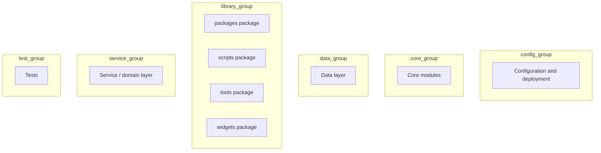

# Architecture report: alibaba/x-render

> Automated static analysis. **Observed** = directly seen in files/imports/AST; **Inferred** = interpretation from that evidence. Repository code was not executed.

## 1. Repository at a glance

| Item | Value |
| --- | --- |
| Repository | alibaba/x-render |
| Description | 🚴‍♀️ Very easy to use process form table chart solution. |
| Language | TypeScript |
| Stars | 7847 |
| Licence | Not detected |
| Analysed commit / branch | 33027864d98ab917f06a4e2656fd7c5bba3bfa2c / master |
| Framework(s) | React |
| Files analysed | 713 |
| Components | 9 |

## 2. Architecture in one minute

alibaba/x-render - 🚴‍♀️ Very easy to use process form table chart solution.. This repository was analysed statically from 713 file(s) (0 Python). Detected technologies (observed from imports/manifests): GitHub Actions, React, axios, Jest, TypeScript, Vite. Files are grouped into 9 component(s): Configuration and deployment, Core modules, Data layer, packages package, scripts package, Service / domain layer, Tests, tools package. Findings below distinguish observed facts from inferred interpretation.

## 3. High-level block diagram

## 4. Main components

### Configuration and deployment (`config`)

- **Kind:** config
- **Status:** Observed
- **Confidence:** 0.85
- **Responsibility:** Groups 44 file(s) under configuration and deployment (observed from repository paths and static analysis).
- **Paths:** `lerna.json`, `package.json`, `packages/chart-render/package.json`, `packages/chart-render/tsconfig.json`, `packages/data-render/package.json`, `packages/data-render/tsconfig.json`, `packages/form-render-mobile/package.json`, `packages/form-render-mobile/tsconfig.json`, `packages/form-render/package.json`, `packages/form-render/tsconfig.json`, `packages/table-render/package.json`, `packages/table-render/tsconfig.json`, `packages/x-flow/package.json`, `packages/x-flow/tsconfig.json`, `tools/schema-builder/package.json`, `tools/schema-builder/src/settings/index.ts`, `tools/schema-builder/src/settings/meta/card.ts`, `tools/schema-builder/src/settings/meta/cardList.ts`, `tools/schema-builder/src/settings/meta/checkbox.ts`, `tools/schema-builder/src/settings/meta/checkboxes.ts`, `tools/schema-builder/src/settings/meta/color.ts`, `tools/schema-builder/src/settings/meta/date.ts`, `tools/schema-builder/src/settings/meta/dateRange.ts`, `tools/schema-builder/src/settings/meta/form.ts`, `tools/schema-builder/src/settings/meta/imageInput.ts`, `tools/schema-builder/src/settings/meta/input.ts`, `tools/schema-builder/src/settings/meta/number.ts`, `tools/schema-builder/src/settings/meta/radio.ts`, `tools/schema-builder/src/settings/meta/rate.ts`, `tools/schema-builder/src/settings/meta/select.ts`, `tools/schema-builder/src/settings/meta/slider.ts`, `tools/schema-builder/src/settings/meta/switch.ts`, `tools/schema-builder/src/settings/meta/textarea.ts`, `tools/schema-builder/src/settings/meta/time.ts`, `tools/schema-builder/src/settings/meta/timeRange.ts`, `tools/schema-builder/src/settings/meta/treeSelect.ts`, `tools/schema-builder/src/settings/meta/urlInput.ts`, `tools/schema-builder/src/settings/utils.ts`, `tools/schema-builder/tsconfig.json`, `tsconfig.jest.json`, `turbo.json`, `widgets/AsyncOptions/package.json`, `widgets/RichText/package.json`, `widgets/template/package.json`
- **Evidence:** [lerna.json](https://github.com/alibaba/x-render/blob/33027864d98ab917f06a4e2656fd7c5bba3bfa2c/lerna.json); [package.json](https://github.com/alibaba/x-render/blob/33027864d98ab917f06a4e2656fd7c5bba3bfa2c/package.json); [packages/chart-render/package.json](https://github.com/alibaba/x-render/blob/33027864d98ab917f06a4e2656fd7c5bba3bfa2c/packages/chart-render/package.json); [packages/chart-render/tsconfig.json](https://github.com/alibaba/x-render/blob/33027864d98ab917f06a4e2656fd7c5bba3bfa2c/packages/chart-render/tsconfig.json); [packages/data-render/package.json](https://github.com/alibaba/x-render/blob/33027864d98ab917f06a4e2656fd7c5bba3bfa2c/packages/data-render/package.json); [packages/data-render/tsconfig.json](https://github.com/alibaba/x-render/blob/33027864d98ab917f06a4e2656fd7c5bba3bfa2c/packages/data-render/tsconfig.json); [packages/form-render-mobile/package.json](https://github.com/alibaba/x-render/blob/33027864d98ab917f06a4e2656fd7c5bba3bfa2c/packages/form-render-mobile/package.json); [packages/form-render-mobile/tsconfig.json](https://github.com/alibaba/x-render/blob/33027864d98ab917f06a4e2656fd7c5bba3bfa2c/packages/form-render-mobile/tsconfig.json)

### Core modules (`core`)

- **Kind:** core
- **Status:** Observed
- **Confidence:** 0.85
- **Responsibility:** Groups 3 file(s) under core modules (observed from repository paths and static analysis).
- **Paths:** `app.ts`, `typing.d.ts`, `vitest.config.ts`
- **Evidence:** [app.ts](https://github.com/alibaba/x-render/blob/33027864d98ab917f06a4e2656fd7c5bba3bfa2c/app.ts); [typing.d.ts](https://github.com/alibaba/x-render/blob/33027864d98ab917f06a4e2656fd7c5bba3bfa2c/typing.d.ts); [vitest.config.ts](https://github.com/alibaba/x-render/blob/33027864d98ab917f06a4e2656fd7c5bba3bfa2c/vitest.config.ts)

### Data layer (`data_layer`)

- **Kind:** data
- **Status:** Observed
- **Confidence:** 0.85
- **Responsibility:** Groups 29 file(s) under data layer (observed from repository paths and static analysis).
- **Paths:** `packages/data-render/src/models/context.ts`, `packages/data-render/src/models/expression.ts`, `packages/data-render/src/models/isHidden.ts`, `packages/data-render/src/models/resolver.tsx`, `packages/data-render/src/models/store.ts`, `packages/form-render-mobile/src/models/context.ts`, `packages/form-render-mobile/src/models/store.ts`, `packages/form-render-mobile/src/models/transformProps.ts`, `packages/form-render-mobile/src/models/useForm.ts`, `packages/form-render/src/models/bindValues.ts`, `packages/form-render/src/models/context.ts`, `packages/form-render/src/models/expression.ts`, `packages/form-render/src/models/fieldShouldUpdate.ts`, `packages/form-render/src/models/filterValuesHidden.ts`, `packages/form-render/src/models/filterValuesUndefined.ts`, `packages/form-render/src/models/flattenSchema.ts`, `packages/form-render/src/models/formCoreUtils.ts`, `packages/form-render/src/models/formDataSkeleton.ts`, `packages/form-render/src/models/layout.ts`, `packages/form-render/src/models/mapping.tsx`, `packages/form-render/src/models/sortProperties.ts`, `packages/form-render/src/models/store.ts`, `packages/form-render/src/models/transformProps.ts`, `packages/form-render/src/models/useForm.ts`, `packages/form-render/src/models/validateMessage.ts`, `packages/form-render/src/models/validates.ts`, `packages/x-flow/src/models/context.ts`, `packages/x-flow/src/models/event-emitter.tsx`, `packages/x-flow/src/models/store.ts`
- **Evidence:** [packages/data-render/src/models/context.ts](https://github.com/alibaba/x-render/blob/33027864d98ab917f06a4e2656fd7c5bba3bfa2c/packages/data-render/src/models/context.ts); [packages/data-render/src/models/expression.ts](https://github.com/alibaba/x-render/blob/33027864d98ab917f06a4e2656fd7c5bba3bfa2c/packages/data-render/src/models/expression.ts); [packages/data-render/src/models/isHidden.ts](https://github.com/alibaba/x-render/blob/33027864d98ab917f06a4e2656fd7c5bba3bfa2c/packages/data-render/src/models/isHidden.ts); [packages/data-render/src/models/resolver.tsx](https://github.com/alibaba/x-render/blob/33027864d98ab917f06a4e2656fd7c5bba3bfa2c/packages/data-render/src/models/resolver.tsx); [packages/data-render/src/models/store.ts](https://github.com/alibaba/x-render/blob/33027864d98ab917f06a4e2656fd7c5bba3bfa2c/packages/data-render/src/models/store.ts); [packages/form-render-mobile/src/models/context.ts](https://github.com/alibaba/x-render/blob/33027864d98ab917f06a4e2656fd7c5bba3bfa2c/packages/form-render-mobile/src/models/context.ts); [packages/form-render-mobile/src/models/store.ts](https://github.com/alibaba/x-render/blob/33027864d98ab917f06a4e2656fd7c5bba3bfa2c/packages/form-render-mobile/src/models/store.ts); [packages/form-render-mobile/src/models/transformProps.ts](https://github.com/alibaba/x-render/blob/33027864d98ab917f06a4e2656fd7c5bba3bfa2c/packages/form-render-mobile/src/models/transformProps.ts)

### packages package (`packages`)

- **Kind:** library
- **Status:** Observed
- **Confidence:** 0.85
- **Responsibility:** Groups 221 file(s) under packages package (observed from repository paths and static analysis).
- **Paths:** `packages/chart-render/.fatherrc.ts`, `packages/chart-render/src/components/ChartContainer/index.tsx`, `packages/chart-render/src/components/ChartProvider/index.tsx`, `packages/chart-render/src/components/Search/index.tsx`, `packages/chart-render/src/index.ts`, `packages/chart-render/src/utils/index.ts`, `packages/chart-render/src/utils/store.ts`, `packages/chart-render/src/utils/type.ts`, `packages/chart-render/src/widgets/Column/index.tsx`, `packages/chart-render/src/widgets/Pie/index.tsx`, `packages/data-render/.fatherrc.js`, `packages/data-render/src/index.ts`, `packages/data-render/src/type.ts`, `packages/data-render/src/utils/common.ts`, `packages/data-render/src/widgets/FButton/index.tsx`, `packages/data-render/src/widgets/FButtonFold/index.tsx`, `packages/data-render/src/widgets/FCard/index.tsx`, `packages/data-render/src/widgets/FCollapse/index.tsx`, `packages/data-render/src/widgets/FDescriptions/index.tsx`, `packages/data-render/src/widgets/FEncryption/index.tsx`, `packages/data-render/src/widgets/FIconLabel/index.tsx`, `packages/data-render/src/widgets/FImage/index.tsx`, `packages/data-render/src/widgets/FLabel/index.tsx`, `packages/data-render/src/widgets/FPanel/index.tsx`, `packages/data-render/src/widgets/FProgress/index.tsx`, `packages/data-render/src/widgets/FProgressBar/index.tsx`, `packages/data-render/src/widgets/FRadioGroup/index.tsx`, `packages/data-render/src/widgets/FRow/index.tsx`, `packages/data-render/src/widgets/FSpace/index.tsx`, `packages/data-render/src/widgets/FStatistic/index.tsx`, `packages/data-render/src/widgets/FSteps/index.tsx`, `packages/data-render/src/widgets/FSuckNav/index.tsx`, `packages/data-render/src/widgets/FTable/detalColumn.tsx`, `packages/data-render/src/widgets/FTable/index.tsx`, `packages/data-render/src/widgets/FTabs/index.tsx`, `packages/data-render/src/widgets/FTags/index.tsx`, `packages/data-render/src/widgets/FText/index.tsx`, `packages/data-render/src/widgets/FTextEllipsis/index.tsx`, `packages/data-render/src/widgets/FTimeline/index.tsx`, `packages/data-render/src/widgets/FTitle/index.tsx`, `packages/data-render/src/widgets/FTooltip/index.tsx`, `packages/data-render/src/widgets/components/BaseCollapse/index.tsx`, `packages/data-render/src/widgets/components/BaseTable/basic.ts`, `packages/data-render/src/widgets/components/BaseTable/index.tsx`, `packages/data-render/src/widgets/components/CopyLabel/index.tsx`, `packages/data-render/src/widgets/components/Encryption/index.tsx`, `packages/data-render/src/widgets/components/IconLabel/index.tsx`, `packages/data-render/src/widgets/components/IconView/index.tsx`, `packages/data-render/src/widgets/components/InnerHtml/index.tsx`, `packages/data-render/src/widgets/components/ReactNode/index.tsx`, `packages/data-render/src/widgets/components/RequestTable/index.tsx`, `packages/data-render/src/widgets/components/SuckTabs/index.tsx`, `packages/data-render/src/widgets/components/TextEllipsis/index.tsx`, `packages/data-render/src/widgets/components/TextView/index.tsx`, `packages/data-render/src/widgets/index.ts`, `packages/data-render/src/widgets/utils/common.ts`, `packages/data-render/src/widgets/utils/createIconFont.ts`, `packages/data-render/src/widgets/utils/hooks.ts`, `packages/data-render/src/withProvider.tsx`, `packages/form-render-mobile/.fatherrc.js`, `packages/form-render-mobile/src/form-core/connectForm.tsx`, `packages/form-render-mobile/src/form-core/index.tsx`, `packages/form-render-mobile/src/index.tsx`, `packages/form-render-mobile/src/locales/en_US.ts`, `packages/form-render-mobile/src/locales/index.ts`, `packages/form-render-mobile/src/locales/zh_CN.ts`, `packages/form-render-mobile/src/render-core/FieldItem/field.tsx`, `packages/form-render-mobile/src/render-core/FieldItem/index.tsx`, `packages/form-render-mobile/src/render-core/FieldItem/main.tsx`, `packages/form-render-mobile/src/render-core/FieldItem/module.tsx`, `packages/form-render-mobile/src/render-core/FieldList/index.tsx`, `packages/form-render-mobile/src/render-core/index.tsx`, `packages/form-render-mobile/src/type.ts`, `packages/form-render-mobile/src/utils/index.ts`, `packages/form-render-mobile/src/widgets/Card/index.tsx`, `packages/form-render-mobile/src/widgets/Cascader/index.tsx`, `packages/form-render-mobile/src/widgets/Collapse/index.tsx`, `packages/form-render-mobile/src/widgets/DatePicker/index.tsx`, `packages/form-render-mobile/src/widgets/Group/index.tsx`, `packages/form-render-mobile/src/widgets/Html/index.tsx`, `packages/form-render-mobile/src/widgets/Picker/index.tsx`, `packages/form-render-mobile/src/widgets/Radio/index.tsx`, `packages/form-render-mobile/src/widgets/index.tsx`, `packages/form-render-mobile/src/widgets/utils.ts`, `packages/form-render-mobile/src/withProvider.tsx`, `packages/form-render/.fatherrc.js`, `packages/form-render/__tests__/core-utils.spec.ts`, `packages/form-render/__tests__/demo.tsx`, `packages/form-render/__tests__/form-demo.tsx`, `packages/form-render/__tests__/form-fields.spec.tsx`, `packages/form-render/__tests__/form.spec.tsx`, `packages/form-render/__tests__/get-descriptor.spec.ts`, `packages/form-render/__tests__/schema.ts`, `packages/form-render/__tests__/utils.spec.ts`, `packages/form-render/src/derivative/SearchForm/ActionView.tsx`, `packages/form-render/src/derivative/SearchForm/index.tsx`, `packages/form-render/src/derivative/SlimRender/index.tsx`, `packages/form-render/src/form-core/connectForm.tsx`, `packages/form-render/src/form-core/index.tsx`, `packages/form-render/src/index.ts`, `packages/form-render/src/locales/en_US.ts`, `packages/form-render/src/locales/index.ts`, `packages/form-render/src/locales/zh_CN.ts`, `packages/form-render/src/render-core/FieldItem/field.tsx`, `packages/form-render/src/render-core/FieldItem/index.tsx`, `packages/form-render/src/render-core/FieldItem/main.tsx`, `packages/form-render/src/render-core/FieldItem/module.tsx`, `packages/form-render/src/render-core/FieldList/field.tsx`, `packages/form-render/src/render-core/FieldList/index.tsx`, `packages/form-render/src/render-core/FieldList/main.tsx`, `packages/form-render/src/render-core/FieldList/modules.tsx`, `packages/form-render/src/render-core/index.tsx`, `packages/form-render/src/type.ts`, `packages/form-render/src/utils/index.ts`, `packages/form-render/src/widgets/ErrorSchema/index.tsx`, `packages/form-render/src/widgets/boxCollapse/index.tsx`, `packages/form-render/src/widgets/boxLineTitle/index.tsx`, `packages/form-render/src/widgets/boxSubInline/index.tsx`, `packages/form-render/src/widgets/boxcard/index.tsx`, `packages/form-render/src/widgets/components/DatePicker/index.tsx`, `packages/form-render/src/widgets/components/FButton/index.tsx`, `packages/form-render/src/widgets/components/HeaderTitle/index.tsx`, `packages/form-render/src/widgets/components/PanelView/index.tsx`, `packages/form-render/src/widgets/components/TimePicker/index.tsx`, `packages/form-render/src/widgets/fields/checkbox/index.tsx`, `packages/form-render/src/widgets/fields/checkboxes/index.tsx`, `packages/form-render/src/widgets/fields/color/alphahexMap.ts`, `packages/form-render/src/widgets/fields/color/index.tsx`, `packages/form-render/src/widgets/fields/date/index.tsx`, `packages/form-render/src/widgets/fields/dateRange/index.tsx`, `packages/form-render/src/widgets/fields/html/index.tsx`, `packages/form-render/src/widgets/fields/imageInput/index.tsx`, `packages/form-render/src/widgets/fields/input/index.tsx`, `packages/form-render/src/widgets/fields/number/index.tsx`, `packages/form-render/src/widgets/fields/percentSlider/index.tsx`, `packages/form-render/src/widgets/fields/radio/index.tsx`, `packages/form-render/src/widgets/fields/rate/index.tsx`, `packages/form-render/src/widgets/fields/select/index.tsx`, `packages/form-render/src/widgets/fields/slider/index.tsx`, `packages/form-render/src/widgets/fields/switch/index.tsx`, `packages/form-render/src/widgets/fields/textArea/index.tsx`, `packages/form-render/src/widgets/fields/time/index.tsx`, `packages/form-render/src/widgets/fields/timeRange/index.tsx`, `packages/form-render/src/widgets/fields/treeSelect/index.tsx`, `packages/form-render/src/widgets/fields/upload/index.tsx`, `packages/form-render/src/widgets/fields/urlInput/index.tsx`, `packages/form-render/src/widgets/index.ts`, `packages/form-render/src/widgets/listCard/index.tsx`, `packages/form-render/src/widgets/listDrawer/drawerForm.tsx`, `packages/form-render/src/widgets/listDrawer/index.tsx`, `packages/form-render/src/widgets/listSimple/index.tsx`, `packages/form-render/src/widgets/listTab/index.tsx`, `packages/form-render/src/widgets/listTable/index.tsx`, `packages/form-render/src/widgets/listTable/tableCell.tsx`, `packages/form-render/src/widgets/listVirtual/index.tsx`, `packages/form-render/src/widgets/listVirtual/virtualCell.tsx`, `packages/form-render/src/widgets/utils/hooks.ts`, `packages/form-render/src/widgets/utils/index.ts`, `packages/form-render/src/widgets/utils/withFieldWrap.tsx`, `packages/form-render/src/widgets/voidTitle/index.tsx`, `packages/form-render/src/withProvider.tsx`, `packages/table-render/.fatherrc.ts`, `packages/table-render/__tests__/utils.spec.ts`, `packages/table-render/src/index.tsx`, `packages/table-render/src/locales/en_US.ts`, `packages/table-render/src/locales/index.ts`, `packages/table-render/src/locales/zh_CN.ts`, `packages/table-render/src/types.ts`, `packages/table-render/src/utils/index.ts`, `packages/x-flow/.fatherrc.js`, `packages/x-flow/src/XFlow.tsx`, `packages/x-flow/src/components/CandidateNode/index.tsx`, `packages/x-flow/src/components/CustomEdge/index.tsx`, `packages/x-flow/src/components/CustomNode/index.tsx`, `packages/x-flow/src/components/CustomNode/sourceHandle.tsx`, `packages/x-flow/src/components/FAutoComplete/index.tsx`, `packages/x-flow/src/components/FlowProvider/index.tsx`, `packages/x-flow/src/components/IconView/index.tsx`, `packages/x-flow/src/components/NodeContainer/TitleMenuTooltip.tsx`, `packages/x-flow/src/components/NodeContainer/index.tsx`, `packages/x-flow/src/components/NodeEditor/index.tsx`, `packages/x-flow/src/components/NodeLogPanel/components/CodePanel.tsx`, `packages/x-flow/src/components/NodeLogPanel/components/DetailPanel.tsx`, `packages/x-flow/src/components/NodeLogPanel/components/StatusPanel.tsx`, `packages/x-flow/src/components/NodeLogPanel/components/TrackNodeItem.tsx`, `packages/x-flow/src/components/NodeLogPanel/components/TrackPanel.tsx`, `packages/x-flow/src/components/NodeLogPanel/index.tsx`, `packages/x-flow/src/components/NodesMenu/index.tsx`, `packages/x-flow/src/components/NodesPopover/index.tsx`, `packages/x-flow/src/components/PanelContainer/index.tsx`, `packages/x-flow/src/components/PanelStatusLogContainer/index.tsx`, `packages/x-flow/src/components/TextEllipsis/index.tsx`, `packages/x-flow/src/hooks/useEdges.ts`, `packages/x-flow/src/hooks/useFlow.ts`, `packages/x-flow/src/hooks/useNodes.ts`, `packages/x-flow/src/hooks/useStore.ts`, `packages/x-flow/src/hooks/useTemporalStore.ts`, `packages/x-flow/src/index.ts`, `packages/x-flow/src/nodes/index.tsx`, `packages/x-flow/src/nodes/node-common/index.tsx`, `packages/x-flow/src/nodes/node-end/index.tsx`, `packages/x-flow/src/nodes/node-note/index.tsx`, `packages/x-flow/src/nodes/node-parallel/ParallelBuildInNodeWidget.tsx`, `packages/x-flow/src/nodes/node-parallel/index.tsx`, `packages/x-flow/src/nodes/node-parallel/setting/index.tsx`, `packages/x-flow/src/nodes/node-start/index.tsx`, `packages/x-flow/src/nodes/node-switch/SwitchBuildInNodeWidget.tsx`, `packages/x-flow/src/nodes/node-switch/index.tsx`, `packages/x-flow/src/nodes/node-switch/setting/index.tsx`, `packages/x-flow/src/operator/Control/index.tsx`, `packages/x-flow/src/operator/UndoRedo/index.tsx`, `packages/x-flow/src/operator/ZoomInOut/index.tsx`, `packages/x-flow/src/operator/ZoomInOut/shortcuts-name.tsx`, `packages/x-flow/src/operator/index.tsx`, `packages/x-flow/src/types.ts`, `packages/x-flow/src/utils/autoLayoutNodes.ts`, `packages/x-flow/src/utils/createIconFont.ts`, `packages/x-flow/src/utils/flow.ts`, `packages/x-flow/src/utils/hooks.ts`, `packages/x-flow/src/utils/index.ts`, `packages/x-flow/src/withProvider.tsx`
- **Evidence:** [packages/chart-render/.fatherrc.ts](https://github.com/alibaba/x-render/blob/33027864d98ab917f06a4e2656fd7c5bba3bfa2c/packages/chart-render/.fatherrc.ts); [packages/chart-render/src/components/ChartContainer/index.tsx](https://github.com/alibaba/x-render/blob/33027864d98ab917f06a4e2656fd7c5bba3bfa2c/packages/chart-render/src/components/ChartContainer/index.tsx); [packages/chart-render/src/components/ChartProvider/index.tsx](https://github.com/alibaba/x-render/blob/33027864d98ab917f06a4e2656fd7c5bba3bfa2c/packages/chart-render/src/components/ChartProvider/index.tsx); [packages/chart-render/src/components/Search/index.tsx](https://github.com/alibaba/x-render/blob/33027864d98ab917f06a4e2656fd7c5bba3bfa2c/packages/chart-render/src/components/Search/index.tsx); [packages/chart-render/src/index.ts](https://github.com/alibaba/x-render/blob/33027864d98ab917f06a4e2656fd7c5bba3bfa2c/packages/chart-render/src/index.ts); [packages/chart-render/src/utils/index.ts](https://github.com/alibaba/x-render/blob/33027864d98ab917f06a4e2656fd7c5bba3bfa2c/packages/chart-render/src/utils/index.ts); [packages/chart-render/src/utils/store.ts](https://github.com/alibaba/x-render/blob/33027864d98ab917f06a4e2656fd7c5bba3bfa2c/packages/chart-render/src/utils/store.ts); [packages/chart-render/src/utils/type.ts](https://github.com/alibaba/x-render/blob/33027864d98ab917f06a4e2656fd7c5bba3bfa2c/packages/chart-render/src/utils/type.ts)

### scripts package (`scripts`)

- **Kind:** library
- **Status:** Observed
- **Confidence:** 0.85
- **Responsibility:** Groups 3 file(s) under scripts package (observed from repository paths and static analysis).
- **Paths:** `scripts/dumi-plugin/publicPath.ts`, `scripts/dumi-plugin/redirect.ts`, `scripts/prettier-plugin/index.js`
- **Evidence:** [scripts/dumi-plugin/publicPath.ts](https://github.com/alibaba/x-render/blob/33027864d98ab917f06a4e2656fd7c5bba3bfa2c/scripts/dumi-plugin/publicPath.ts); [scripts/dumi-plugin/redirect.ts](https://github.com/alibaba/x-render/blob/33027864d98ab917f06a4e2656fd7c5bba3bfa2c/scripts/dumi-plugin/redirect.ts); [scripts/prettier-plugin/index.js](https://github.com/alibaba/x-render/blob/33027864d98ab917f06a4e2656fd7c5bba3bfa2c/scripts/prettier-plugin/index.js)

### Service / domain layer (`service_layer`)

- **Kind:** service
- **Status:** Observed
- **Confidence:** 0.85
- **Responsibility:** Groups 19 file(s) under service / domain layer (observed from repository paths and static analysis).
- **Paths:** `packages/data-render/src/core/index.tsx`, `packages/data-render/src/core/renderer.tsx`, `packages/table-render/src/core/ErrorBoundary/index.tsx`, `packages/table-render/src/core/SearchView/index.tsx`, `packages/table-render/src/core/TableView/copy.tsx`, `packages/table-render/src/core/TableView/field.tsx`, `packages/table-render/src/core/TableView/index.tsx`, `packages/table-render/src/core/TableView/widgets.tsx`, `packages/table-render/src/core/ToolbarView/InteriorTool/ColumnSetting/index.tsx`, `packages/table-render/src/core/ToolbarView/InteriorTool/ColumnSetting/item.tsx`, `packages/table-render/src/core/ToolbarView/InteriorTool/ColumnSetting/utils.ts`, `packages/table-render/src/core/ToolbarView/InteriorTool/DensityIcon.tsx`, `packages/table-render/src/core/ToolbarView/InteriorTool/FullScreenIcon.tsx`, `packages/table-render/src/core/ToolbarView/InteriorTool/ReloadIcon.tsx`, `packages/table-render/src/core/ToolbarView/InteriorTool/index.tsx`, `packages/table-render/src/core/ToolbarView/TitleView.tsx`, `packages/table-render/src/core/ToolbarView/index.tsx`, `packages/table-render/src/core/index.tsx`, `packages/table-render/src/core/store.ts`
- **Evidence:** [packages/data-render/src/core/index.tsx](https://github.com/alibaba/x-render/blob/33027864d98ab917f06a4e2656fd7c5bba3bfa2c/packages/data-render/src/core/index.tsx); [packages/data-render/src/core/renderer.tsx](https://github.com/alibaba/x-render/blob/33027864d98ab917f06a4e2656fd7c5bba3bfa2c/packages/data-render/src/core/renderer.tsx); [packages/table-render/src/core/ErrorBoundary/index.tsx](https://github.com/alibaba/x-render/blob/33027864d98ab917f06a4e2656fd7c5bba3bfa2c/packages/table-render/src/core/ErrorBoundary/index.tsx); [packages/table-render/src/core/SearchView/index.tsx](https://github.com/alibaba/x-render/blob/33027864d98ab917f06a4e2656fd7c5bba3bfa2c/packages/table-render/src/core/SearchView/index.tsx); [packages/table-render/src/core/TableView/copy.tsx](https://github.com/alibaba/x-render/blob/33027864d98ab917f06a4e2656fd7c5bba3bfa2c/packages/table-render/src/core/TableView/copy.tsx); [packages/table-render/src/core/TableView/field.tsx](https://github.com/alibaba/x-render/blob/33027864d98ab917f06a4e2656fd7c5bba3bfa2c/packages/table-render/src/core/TableView/field.tsx); [packages/table-render/src/core/TableView/index.tsx](https://github.com/alibaba/x-render/blob/33027864d98ab917f06a4e2656fd7c5bba3bfa2c/packages/table-render/src/core/TableView/index.tsx); [packages/table-render/src/core/TableView/widgets.tsx](https://github.com/alibaba/x-render/blob/33027864d98ab917f06a4e2656fd7c5bba3bfa2c/packages/table-render/src/core/TableView/widgets.tsx)

### Tests (`tests`)

- **Kind:** test
- **Status:** Observed
- **Confidence:** 0.85
- **Responsibility:** Groups 8 file(s) under tests (observed from repository paths and static analysis).
- **Paths:** `docs/form-render-mobile/test/index.tsx`, `docs/form-render-mobile/test/test.md`, `docs/form-render/test/bigJson.tsx`, `docs/form-render/test/bind.tsx`, `docs/form-render/test/dependencies.tsx`, `docs/form-render/test/disaply-column.md`, `docs/form-render/test/removeHidden.tsx`, `docs/form-render/test/test.md`
- **Evidence:** [docs/form-render-mobile/test/index.tsx](https://github.com/alibaba/x-render/blob/33027864d98ab917f06a4e2656fd7c5bba3bfa2c/docs/form-render-mobile/test/index.tsx); [docs/form-render-mobile/test/test.md](https://github.com/alibaba/x-render/blob/33027864d98ab917f06a4e2656fd7c5bba3bfa2c/docs/form-render-mobile/test/test.md); [docs/form-render/test/bigJson.tsx](https://github.com/alibaba/x-render/blob/33027864d98ab917f06a4e2656fd7c5bba3bfa2c/docs/form-render/test/bigJson.tsx); [docs/form-render/test/bind.tsx](https://github.com/alibaba/x-render/blob/33027864d98ab917f06a4e2656fd7c5bba3bfa2c/docs/form-render/test/bind.tsx); [docs/form-render/test/dependencies.tsx](https://github.com/alibaba/x-render/blob/33027864d98ab917f06a4e2656fd7c5bba3bfa2c/docs/form-render/test/dependencies.tsx); [docs/form-render/test/disaply-column.md](https://github.com/alibaba/x-render/blob/33027864d98ab917f06a4e2656fd7c5bba3bfa2c/docs/form-render/test/disaply-column.md); [docs/form-render/test/removeHidden.tsx](https://github.com/alibaba/x-render/blob/33027864d98ab917f06a4e2656fd7c5bba3bfa2c/docs/form-render/test/removeHidden.tsx); [docs/form-render/test/test.md](https://github.com/alibaba/x-render/blob/33027864d98ab917f06a4e2656fd7c5bba3bfa2c/docs/form-render/test/test.md)

### tools package (`tools`)

- **Kind:** library
- **Status:** Observed
- **Confidence:** 0.85
- **Responsibility:** Groups 5 file(s) under tools package (observed from repository paths and static analysis).
- **Paths:** `tools/schema-builder/.fatherrc.js`, `tools/schema-builder/src/createIframe.ts`, `tools/schema-builder/src/index.ts`, `tools/schema-builder/src/main.tsx`, `tools/schema-builder/src/type.ts`
- **Evidence:** [tools/schema-builder/.fatherrc.js](https://github.com/alibaba/x-render/blob/33027864d98ab917f06a4e2656fd7c5bba3bfa2c/tools/schema-builder/.fatherrc.js); [tools/schema-builder/src/createIframe.ts](https://github.com/alibaba/x-render/blob/33027864d98ab917f06a4e2656fd7c5bba3bfa2c/tools/schema-builder/src/createIframe.ts); [tools/schema-builder/src/index.ts](https://github.com/alibaba/x-render/blob/33027864d98ab917f06a4e2656fd7c5bba3bfa2c/tools/schema-builder/src/index.ts); [tools/schema-builder/src/main.tsx](https://github.com/alibaba/x-render/blob/33027864d98ab917f06a4e2656fd7c5bba3bfa2c/tools/schema-builder/src/main.tsx); [tools/schema-builder/src/type.ts](https://github.com/alibaba/x-render/blob/33027864d98ab917f06a4e2656fd7c5bba3bfa2c/tools/schema-builder/src/type.ts)

### widgets package (`widgets`)

- **Kind:** library
- **Status:** Observed
- **Confidence:** 0.85
- **Responsibility:** Groups 6 file(s) under widgets package (observed from repository paths and static analysis).
- **Paths:** `widgets/AsyncOptions/.fatherrc.js`, `widgets/AsyncOptions/src/index.js`, `widgets/RichText/.fatherrc.js`, `widgets/RichText/src/index.js`, `widgets/template/.fatherrc.js`, `widgets/template/src/index.js`
- **Evidence:** [widgets/AsyncOptions/.fatherrc.js](https://github.com/alibaba/x-render/blob/33027864d98ab917f06a4e2656fd7c5bba3bfa2c/widgets/AsyncOptions/.fatherrc.js); [widgets/AsyncOptions/src/index.js](https://github.com/alibaba/x-render/blob/33027864d98ab917f06a4e2656fd7c5bba3bfa2c/widgets/AsyncOptions/src/index.js); [widgets/RichText/.fatherrc.js](https://github.com/alibaba/x-render/blob/33027864d98ab917f06a4e2656fd7c5bba3bfa2c/widgets/RichText/.fatherrc.js); [widgets/RichText/src/index.js](https://github.com/alibaba/x-render/blob/33027864d98ab917f06a4e2656fd7c5bba3bfa2c/widgets/RichText/src/index.js); [widgets/template/.fatherrc.js](https://github.com/alibaba/x-render/blob/33027864d98ab917f06a4e2656fd7c5bba3bfa2c/widgets/template/.fatherrc.js); [widgets/template/src/index.js](https://github.com/alibaba/x-render/blob/33027864d98ab917f06a4e2656fd7c5bba3bfa2c/widgets/template/src/index.js)

## 5. Execution flow

**Observed** entry point(s):

- [app.ts](https://github.com/alibaba/x-render/blob/33027864d98ab917f06a4e2656fd7c5bba3bfa2c/app.ts)
- [packages/chart-render/src/index.ts](https://github.com/alibaba/x-render/blob/33027864d98ab917f06a4e2656fd7c5bba3bfa2c/packages/chart-render/src/index.ts)
- [packages/data-render/src/index.ts](https://github.com/alibaba/x-render/blob/33027864d98ab917f06a4e2656fd7c5bba3bfa2c/packages/data-render/src/index.ts)
- [packages/form-render-mobile/src/index.tsx](https://github.com/alibaba/x-render/blob/33027864d98ab917f06a4e2656fd7c5bba3bfa2c/packages/form-render-mobile/src/index.tsx)
- [packages/form-render/src/index.ts](https://github.com/alibaba/x-render/blob/33027864d98ab917f06a4e2656fd7c5bba3bfa2c/packages/form-render/src/index.ts)
- [packages/table-render/src/index.tsx](https://github.com/alibaba/x-render/blob/33027864d98ab917f06a4e2656fd7c5bba3bfa2c/packages/table-render/src/index.tsx)
- [packages/x-flow/src/index.ts](https://github.com/alibaba/x-render/blob/33027864d98ab917f06a4e2656fd7c5bba3bfa2c/packages/x-flow/src/index.ts)
- [scripts/prettier-plugin/index.js](https://github.com/alibaba/x-render/blob/33027864d98ab917f06a4e2656fd7c5bba3bfa2c/scripts/prettier-plugin/index.js)
- [tools/schema-builder/src/index.ts](https://github.com/alibaba/x-render/blob/33027864d98ab917f06a4e2656fd7c5bba3bfa2c/tools/schema-builder/src/index.ts)
- [tools/schema-builder/src/main.tsx](https://github.com/alibaba/x-render/blob/33027864d98ab917f06a4e2656fd7c5bba3bfa2c/tools/schema-builder/src/main.tsx)
- [widgets/AsyncOptions/src/index.js](https://github.com/alibaba/x-render/blob/33027864d98ab917f06a4e2656fd7c5bba3bfa2c/widgets/AsyncOptions/src/index.js)
- [widgets/RichText/src/index.js](https://github.com/alibaba/x-render/blob/33027864d98ab917f06a4e2656fd7c5bba3bfa2c/widgets/RichText/src/index.js)

Representative flow (derived from observed entry points and the import graph; steps beyond the entry point are **Inferred**):

1. Execution starts at an observed entry point listed above, if present.
2. No internal import relationships between components were observed.

## 6. Project structure

### `(root)`

- `.dumirc.ts` - source, TypeScript (2509 bytes)
- `.editorconfig` - config (245 bytes)
- `.fatherrc.js` - source, JavaScript (221 bytes)
- `.gitignore` - other (667 bytes)
- `.prettierignore` - other (676 bytes)
- `.prettierrc` - other (200 bytes)
- `CODE_OF_CONDUCT.md` - docs (3346 bytes)
- `CONTRIBUTING.md` - docs (2589 bytes)
- `README.md` - docs (7247 bytes)
- `app.ts` - source, TypeScript (193 bytes)
- `lerna.json` - config (148 bytes)
- `package.json` - manifest (3531 bytes)
- `tsconfig.jest.json` - config (335 bytes)
- `turbo.json` - config (155 bytes)
- `typing.d.ts` - source, TypeScript (43 bytes)
- `vitest.config.ts` - source, TypeScript (342 bytes)

### `.dumi`

- `.dumi/loading.tsx` - source, TypeScript (239 bytes)
- `.dumi/theme/builtins/TypeSchema/index.less` - other (930 bytes)
- `.dumi/theme/builtins/TypeSchema/index.tsx` - source, TypeScript (7969 bytes)
- `.dumi/theme/layouts/GlobalLayout/index.tsx` - source, TypeScript (282 bytes)
- `.dumi/theme/slots/Header/GithubLink.tsx` - source, TypeScript (466 bytes)
- `.dumi/theme/slots/Header/Navigation.tsx` - source, TypeScript (1736 bytes)
- `.dumi/theme/slots/Header/ThemeSwitch.tsx` - source, TypeScript (1326 bytes)
- `.dumi/theme/slots/Header/index.less` - other (1687 bytes)
- `.dumi/theme/slots/Header/index.tsx` - source, TypeScript (1578 bytes)
- `.dumi/tmp-production/core/EmptyRoute.tsx` - source, TypeScript (285 bytes)
- `.dumi/tmp-production/core/defineApp.ts` - source, TypeScript (625 bytes)
- `.dumi/tmp-production/core/exportStaticRuntimePlugin.ts` - source, TypeScript (291 bytes)
- `.dumi/tmp-production/core/helmet.ts` - source, TypeScript (410 bytes)
- `.dumi/tmp-production/core/helmetContext.ts` - source, TypeScript (119 bytes)
- `.dumi/tmp-production/core/history.ts` - source, TypeScript (1659 bytes)
- `.dumi/tmp-production/core/historyIntelli.ts` - source, TypeScript (3512 bytes)
- `.dumi/tmp-production/core/plugin.ts` - source, TypeScript (1779 bytes)
- `.dumi/tmp-production/core/pluginConfig.ts` - source, TypeScript (10306 bytes)
- `.dumi/tmp-production/core/pluginConfigJoi.d.ts` - source, TypeScript (858 bytes)
- `.dumi/tmp-production/core/polyfill.ts` - source, TypeScript (17793 bytes)
- `.dumi/tmp-production/core/route.tsx` - source, TypeScript (15551 bytes)
- `.dumi/tmp-production/core/terminal.ts` - source, TypeScript (1417 bytes)
- `.dumi/tmp-production/dumi/exportStaticRuntimePlugin.ts` - source, TypeScript (287 bytes)
- `.dumi/tmp-production/dumi/exports.ts` - source, TypeScript (215 bytes)
- `.dumi/tmp-production/dumi/locales/config.ts` - source, TypeScript (3258 bytes)
- `.dumi/tmp-production/dumi/locales/runtime.tsx` - source, TypeScript (1479 bytes)
- `.dumi/tmp-production/dumi/meta/atoms.ts` - source, TypeScript (124 bytes)
- `.dumi/tmp-production/dumi/meta/index.ts` - source, TypeScript (13121 bytes)
- `.dumi/tmp-production/dumi/meta/runtime.ts` - source, TypeScript (1030 bytes)
- `.dumi/tmp-production/dumi/meta/tabs.ts` - source, TypeScript (116 bytes)
- `.dumi/tmp-production/dumi/theme/ContextWrapper.tsx` - source, TypeScript (1941 bytes)
- `.dumi/tmp-production/dumi/theme/builtins/API.ts` - source, TypeScript (202 bytes)
- `.dumi/tmp-production/dumi/theme/builtins/Badge.ts` - source, TypeScript (204 bytes)
- `.dumi/tmp-production/dumi/theme/builtins/Container.ts` - source, TypeScript (208 bytes)
- `.dumi/tmp-production/dumi/theme/builtins/Previewer.ts` - source, TypeScript (208 bytes)
- `.dumi/tmp-production/dumi/theme/builtins/SourceCode.ts` - source, TypeScript (209 bytes)
- `.dumi/tmp-production/dumi/theme/builtins/Table.ts` - source, TypeScript (204 bytes)
- `.dumi/tmp-production/dumi/theme/layouts/DocLayout.ts` - source, TypeScript (207 bytes)
- `.dumi/tmp-production/dumi/theme/slots/ColorSwitch.ts` - source, TypeScript (207 bytes)
- `.dumi/tmp-production/dumi/theme/slots/Content.ts` - source, TypeScript (203 bytes)
- `.dumi/tmp-production/dumi/theme/slots/ContentTabs.ts` - source, TypeScript (207 bytes)
- `.dumi/tmp-production/dumi/theme/slots/Features.ts` - source, TypeScript (204 bytes)
- `.dumi/tmp-production/dumi/theme/slots/Footer.ts` - source, TypeScript (202 bytes)
- `.dumi/tmp-production/dumi/theme/slots/HeadeExtra.ts` - source, TypeScript (206 bytes)
- `.dumi/tmp-production/dumi/theme/slots/Header.ts` - source, TypeScript (202 bytes)
- `.dumi/tmp-production/dumi/theme/slots/Hero.ts` - source, TypeScript (200 bytes)
- `.dumi/tmp-production/dumi/theme/slots/HeroTitle.ts` - source, TypeScript (205 bytes)
- `.dumi/tmp-production/dumi/theme/slots/LangSwitch.ts` - source, TypeScript (206 bytes)
- `.dumi/tmp-production/dumi/theme/slots/Logo.ts` - source, TypeScript (200 bytes)
- `.dumi/tmp-production/dumi/theme/slots/Navbar.ts` - source, TypeScript (202 bytes)
- `.dumi/tmp-production/dumi/theme/slots/NavbarExtra.ts` - source, TypeScript (207 bytes)
- `.dumi/tmp-production/dumi/theme/slots/NotFound.ts` - source, TypeScript (204 bytes)
- `.dumi/tmp-production/dumi/theme/slots/PreviewerActions.ts` - source, TypeScript (212 bytes)
- `.dumi/tmp-production/dumi/theme/slots/PreviewerActionsExtra.ts` - source, TypeScript (217 bytes)
- `.dumi/tmp-production/dumi/theme/slots/RtlSwitch.ts` - source, TypeScript (205 bytes)
- `.dumi/tmp-production/dumi/theme/slots/SearchBar.ts` - source, TypeScript (308 bytes)
- `.dumi/tmp-production/dumi/theme/slots/SearchResult.ts` - source, TypeScript (208 bytes)
- `.dumi/tmp-production/dumi/theme/slots/Sidebar.ts` - source, TypeScript (203 bytes)
- `.dumi/tmp-production/dumi/theme/slots/SocialIcon.ts` - source, TypeScript (206 bytes)
- `.dumi/tmp-production/dumi/theme/slots/Toc.ts` - source, TypeScript (199 bytes)
- `.dumi/tmp-production/exports.ts` - source, TypeScript (1217 bytes)
- `.dumi/tmp-production/testBrowser.tsx` - source, TypeScript (2525 bytes)
- `.dumi/tmp-production/umi.ts` - source, TypeScript (2899 bytes)

### `.github`

- `.github/ISSUE_TEMPLATE/bug-report.md` - docs (1004 bytes)
- `.github/ISSUE_TEMPLATE/feature_request.md` - docs (304 bytes)
- `.github/workflows/ci.yml` - ci, YAML (829 bytes)
- `.github/workflows/coverage.yml` - ci, YAML (505 bytes)
- `.github/workflows/deploy.yml` - ci, YAML (529 bytes)
- `.github/workflows/emoji-helper.yml` - ci, YAML (257 bytes)
- `.github/workflows/issue-helper.yml` - ci, YAML (1219 bytes)
- `.github/workflows/mirror.yml` - ci, YAML (496 bytes)

### `.turbo`

- `.turbo/daemon/58af6c43ce0c4d29-turbo.log.2024-12-04` - other (1290 bytes)
- `.turbo/daemon/9af73f40ad414c73-turbo.log.2024-12-03` - other (1761 bytes)
- `.turbo/daemon/9af73f40ad414c73-turbo.log.2024-12-04` - other (20552 bytes)
- `.turbo/daemon/ae401ef4dd981f33-turbo.log.2024-08-26` - other (1065 bytes)

### `docs`

- `docs/data-render/data/basic.ts` - docs (1252 bytes)
- `docs/data-render/index.md` - docs (1571 bytes)
- `docs/data-render/schema/basic.ts` - docs (4259 bytes)
- `docs/form-render-mobile/api.md` - docs (14939 bytes)
- `docs/form-render-mobile/demo/allWidget.tsx` - docs (2734 bytes)
- `docs/form-render-mobile/demo/basic.tsx` - docs (2017 bytes)
- `docs/form-render-mobile/demo/card.tsx` - docs (1526 bytes)
- `docs/form-render-mobile/demo/collaspa.tsx` - docs (1688 bytes)
- `docs/form-render-mobile/demo/group.tsx` - docs (1734 bytes)
- `docs/form-render-mobile/demo/index.tsx` - docs (2016 bytes)
- `docs/form-render-mobile/demo/list.tsx` - docs (1230 bytes)
- `docs/form-render-mobile/disaply.md` - docs (1167 bytes)
- `docs/form-render-mobile/index.md` - docs (1778 bytes)
- `docs/form-render-mobile/test/index.tsx` - test, TypeScript (1236 bytes)
- `docs/form-render-mobile/test/test.md` - test (45 bytes)
- `docs/form-render/advaced-example.md` - docs (6524 bytes)
- `docs/form-render/advanced-bind.md` - docs (5193 bytes)
- `docs/form-render/advanced-layout.md` - docs (8285 bytes)
- `docs/form-render/advanced-linkage.md` - docs (10978 bytes)
- `docs/form-render/advanced-path.md` - docs (4325 bytes)
- `docs/form-render/advanced-slimrender.md` - docs (1551 bytes)
- `docs/form-render/advanced-validate.md` - docs (7455 bytes)
- `docs/form-render/advanced-widget.md` - docs (10204 bytes)
- `docs/form-render/api-props.md` - docs (13568 bytes)
- `docs/form-render/api-schema.md` - docs (8277 bytes)
- `docs/form-render/changelog.md` - docs (142 bytes)
- `docs/form-render/demo/FormRender.jsx` - docs (265 bytes)
- `docs/form-render/demo/bind.tsx` - docs (1965 bytes)
- `docs/form-render/demo/defaultChange.tsx` - docs (4586 bytes)
- `docs/form-render/demo/dymic.tsx` - docs (2551 bytes)
- `docs/form-render/demo/form-slim/basic.tsx` - docs (691 bytes)
- `docs/form-render/demo/form-slim/form-list.tsx` - docs (750 bytes)
- `docs/form-render/demo/linkage/list.tsx` - docs (1062 bytes)
- `docs/form-render/demo/outLabelCol.tsx` - docs (1031 bytes)
- `docs/form-render/demo/validateFields.tsx` - docs (1016 bytes)
- `docs/form-render/demo/widget/basic.tsx` - docs (1134 bytes)
- `docs/form-render/demo/widget/depend-linkage.tsx` - docs (998 bytes)
- `docs/form-render/demo/widget/desc-widget.tsx` - docs (634 bytes)
- `docs/form-render/demo/widget/label-widget.tsx` - docs (592 bytes)
- `docs/form-render/demo/widget/linkage.tsx` - docs (1052 bytes)
- `docs/form-render/demo/widget/readonly-widget.tsx` - docs (1066 bytes)
- `docs/form-render/disaply-search.md` - docs (4933 bytes)
- `docs/form-render/display-row.md` - docs (22933 bytes)
- `docs/form-render/faq.md` - docs (881 bytes)
- `docs/form-render/index.md` - docs (3066 bytes)
- `docs/form-render/migrate.md` - docs (4624 bytes)
- `docs/form-render/schema/baseControl.ts` - docs (2831 bytes)
- `docs/form-render/schema/basic.ts` - docs (355 bytes)
- `docs/form-render/schema/cellSpan.ts` - docs (440 bytes)
- `docs/form-render/schema/schema.ts` - docs (2023 bytes)
- `docs/form-render/schema/simple.ts` - docs (411 bytes)
- `docs/form-render/schema/span.ts` - docs (618 bytes)
- `docs/form-render/test/bigJson.tsx` - test, TypeScript (2157 bytes)
- `docs/form-render/test/bind.tsx` - test, TypeScript (2509 bytes)
- `docs/form-render/test/dependencies.tsx` - test, TypeScript (3733 bytes)
- `docs/form-render/test/disaply-column.md` - test (16142 bytes)
- `docs/form-render/test/removeHidden.tsx` - test, TypeScript (3724 bytes)
- `docs/form-render/test/test.md` - test (373 bytes)
- `docs/form-render/utils/index.js` - docs (221 bytes)
- `docs/index.en-US.md` - docs (1406 bytes)
- `docs/index.zh-CN.md` - docs (1324 bytes)
- `docs/playground/controller/index.css` - docs (265 bytes)
- `docs/playground/controller/index.tsx` - docs (1680 bytes)
- `docs/playground/customized/AsyncSelect.js` - docs (1756 bytes)
- `docs/playground/example/expression.ts` - docs (1432 bytes)
- `docs/playground/index.less` - docs (1888 bytes)
- `docs/playground/index.md` - docs (103 bytes)
- `docs/playground/index.tsx` - docs (4567 bytes)
- `docs/playground/json/basic.json` - config (6094 bytes)
- `docs/playground/json/demo.json` - config (4792 bytes)
- `docs/playground/json/dynamic-function.js` - docs (437 bytes)
- `docs/playground/json/format.json` - config (623 bytes)
- `docs/playground/json/function.json` - config (3472 bytes)
- `docs/playground/json/input.json` - config (2133 bytes)
- `docs/playground/json/new-feature.json` - config (5138 bytes)
- `docs/playground/json/select.json` - config (726 bytes)
- `docs/playground/json/simplest.json` - config (1411 bytes)
- `docs/playground/json/test.json` - config (454 bytes)
- `docs/playground/serialize.js` - docs (9606 bytes)
- `docs/schema-builder-online/index.md` - docs (500 bytes)
- `docs/schema-builder/api.md` - docs (3852 bytes)
- `docs/schema-builder/index.md` - docs (2386 bytes)
- `docs/table-render/.test/test.md` - docs (41 bytes)
- `docs/table-render/api.md` - docs (10926 bytes)
- `docs/table-render/basic.md` - docs (153 bytes)
- `docs/table-render/collapsed.md` - docs (1473 bytes)
- `docs/table-render/custom-table.md` - docs (347 bytes)
- `docs/table-render/demo/basic/index.tsx` - docs (1143 bytes)
- `docs/table-render/demo/display/custom-table.tsx` - docs (927 bytes)
- `docs/table-render/demo/toolbar/basic.tsx` - docs (1368 bytes)
- `docs/table-render/demo/toolbar/selection-tool.tsx` - docs (1461 bytes)
- `docs/table-render/index.md` - docs (3342 bytes)
- `docs/table-render/migrate.md` - docs (1942 bytes)
- `docs/table-render/noSearch.md` - docs (647 bytes)
- `docs/table-render/promptly-search.md` - docs (2295 bytes)
- `docs/table-render/static/request.ts` - docs (910 bytes)
- `docs/table-render/static/search.ts` - docs (1903 bytes)
- `docs/table-render/static/table.tsx` - docs (1108 bytes)
- `docs/table-render/tabs.md` - docs (905 bytes)
- `docs/table-render/toolbar.md` - docs (699 bytes)
- `docs/table-render/valueType.md` - docs (4506 bytes)
- `docs/tools/proptypes/index.md` - docs (4226 bytes)
- `docs/tools/vscode/index.md` - docs (3486 bytes)
- `docs/xflow/FlowProvider.md` - docs (2575 bytes)
- `docs/xflow/api.md` - docs (20282 bytes)
- `docs/xflow/best-practices.md` - docs (237 bytes)
- `docs/xflow/custom-node-setting.md` - docs (4825 bytes)
- `docs/xflow/custom-node-view.md` - docs (1110 bytes)
- `docs/xflow/data/basic.ts` - docs (1252 bytes)
- `docs/xflow/demo/basic/index.tsx` - docs (679 bytes)
- `docs/xflow/demo/basic/setting.tsx` - docs (6310 bytes)
- `docs/xflow/demo/best/basic/TextEllipsis/index.less` - docs (216 bytes)
- `docs/xflow/demo/best/basic/TextEllipsis/index.tsx` - docs (2375 bytes)
- `docs/xflow/demo/best/basic/const.tsx` - docs (6489 bytes)
- `docs/xflow/demo/best/basic/header.tsx` - docs (570 bytes)
- `docs/xflow/demo/best/basic/index.less` - docs (1102 bytes)
- `docs/xflow/demo/best/basic/index.tsx` - docs (630 bytes)
- `docs/xflow/demo/best/basic/setting.tsx` - docs (10679 bytes)
- `docs/xflow/demo/best/basic/showSwitchNode.tsx` - docs (852 bytes)
- `docs/xflow/demo/best/basic/tools.tsx` - docs (422 bytes)
- `docs/xflow/demo/best/demo2/CustomSvg.tsx` - docs (2005 bytes)
- `docs/xflow/demo/best/demo2/TextEllipsis/index.less` - docs (216 bytes)
- `docs/xflow/demo/best/demo2/TextEllipsis/index.tsx` - docs (2375 bytes)
- `docs/xflow/demo/best/demo2/const.tsx` - docs (6489 bytes)
- `docs/xflow/demo/best/demo2/header.tsx` - docs (570 bytes)
- `docs/xflow/demo/best/demo2/index.less` - docs (1371 bytes)
- `docs/xflow/demo/best/demo2/index.tsx` - docs (5484 bytes)
- `docs/xflow/demo/best/demo2/setting.tsx` - docs (5782 bytes)
- `docs/xflow/demo/best/demo2/showSwitchNode.tsx` - docs (852 bytes)
- `docs/xflow/demo/best/demo2/tools.tsx` - docs (422 bytes)
- `docs/xflow/demo/custom-flow/advancedLinkageCase/customWidget.tsx` - docs (3912 bytes)
- `docs/xflow/demo/custom-flow/advancedLinkageCase/index.tsx` - docs (1602 bytes)
- `docs/xflow/demo/custom-flow/advancedLinkageCase/setting.tsx` - docs (3005 bytes)
- `docs/xflow/demo/custom-flow/customWidget.tsx` - docs (299 bytes)
- `docs/xflow/demo/custom-flow/fullCase/components/ReadOnlyPanel.tsx` - docs (191 bytes)
- `docs/xflow/demo/custom-flow/fullCase/components/TagWidget.tsx` - docs (2679 bytes)
- `docs/xflow/demo/custom-flow/fullCase/components/customWidget.tsx` - docs (3690 bytes)
- `docs/xflow/demo/custom-flow/fullCase/components/secondTagWidget.tsx` - docs (4188 bytes)
- `docs/xflow/demo/custom-flow/fullCase/const.ts` - docs (4225 bytes)
- `docs/xflow/demo/custom-flow/fullCase/index.less` - docs (1638 bytes)
- `docs/xflow/demo/custom-flow/fullCase/index.tsx` - docs (2667 bytes)
- `docs/xflow/demo/custom-flow/fullCase/setting.ts` - docs (2680 bytes)
- `docs/xflow/demo/custom-flow/index.tsx` - docs (805 bytes)
- `docs/xflow/demo/custom-flow/setting.tsx` - docs (3030 bytes)
- `docs/xflow/demo/flow-provider/edges.ts` - docs (67 bytes)
- `docs/xflow/demo/flow-provider/index.tsx` - docs (1044 bytes)
- `docs/xflow/demo/flow-provider/nodes.ts` - docs (235 bytes)
- `docs/xflow/demo/flow-provider/setting.tsx` - docs (4350 bytes)
- `docs/xflow/demo/layout/LR/index.tsx` - docs (11786 bytes)
- `docs/xflow/demo/layout/LR/setting.tsx` - docs (5459 bytes)
- `docs/xflow/demo/layout/TB/index.tsx` - docs (7974 bytes)
- `docs/xflow/demo/layout/TB/setting.tsx` - docs (5568 bytes)
- `docs/xflow/demo/log/buildIn-log/CustomGroupTittle.tsx` - docs (565 bytes)
- `docs/xflow/demo/log/buildIn-log/DetailLogWidget.tsx` - docs (1070 bytes)
- `docs/xflow/demo/log/buildIn-log/index.tsx` - docs (7406 bytes)
- `docs/xflow/demo/log/buildIn-log/setting.tsx` - docs (6477 bytes)
- `docs/xflow/demo/log/buildIn-log/utils.tsx` - docs (549 bytes)
- `docs/xflow/demo/log/custom-log/index.tsx` - docs (3228 bytes)
- `docs/xflow/demo/log/custom-log/setting.tsx` - docs (6477 bytes)
- `docs/xflow/demo/log/custom-log/utils.tsx` - docs (549 bytes)
- `docs/xflow/demo/log/index.tsx` - docs (4028 bytes)
- `docs/xflow/demo/log/runNode/index.tsx` - docs (1290 bytes)
- `docs/xflow/demo/log/runNode/setting.tsx` - docs (6554 bytes)
- `docs/xflow/demo/log/runNode/utils.tsx` - docs (549 bytes)
- `docs/xflow/demo/log/setting.tsx` - docs (6477 bytes)
- `docs/xflow/demo/log/utils.tsx` - docs (549 bytes)
- `docs/xflow/demo/nodeSetting/data.tsx` - docs (4454 bytes)
- `docs/xflow/demo/nodeSetting/fullDemo/CustomImg.tsx` - docs (200 bytes)
- `docs/xflow/demo/nodeSetting/fullDemo/CustomSvg.tsx` - docs (2005 bytes)
- `docs/xflow/demo/nodeSetting/fullDemo/index.tsx` - docs (2294 bytes)
- `docs/xflow/demo/nodeSetting/fullDemo/settings.ts` - docs (8618 bytes)
- `docs/xflow/demo/nodeSetting/index.tsx` - docs (1279 bytes)
- `docs/xflow/demo/nodeSetting/setting.tsx` - docs (4350 bytes)
- `docs/xflow/demo/nodeWidget/index.less` - docs (97 bytes)
- `docs/xflow/demo/nodeWidget/index.tsx` - docs (6499 bytes)
- `docs/xflow/demo/nodeWidget/setting.ts` - docs (3381 bytes)
- `docs/xflow/demo/parallelNode/custome/index.tsx` - docs (2403 bytes)
- `docs/xflow/demo/parallelNode/custome/setting.tsx` - docs (6509 bytes)
- `docs/xflow/demo/parallelNode/index.tsx` - docs (2125 bytes)
- `docs/xflow/demo/parallelNode/setting.tsx` - docs (6477 bytes)
- `docs/xflow/demo/quickStart/index.tsx` - docs (3399 bytes)
- `docs/xflow/demo/switchNode/customSwitchNode/index.tsx` - docs (678 bytes)
- `docs/xflow/demo/switchNode/customSwitchNode/setting.tsx` - docs (3335 bytes)
- `docs/xflow/demo/switchNode/index.tsx` - docs (3767 bytes)
- `docs/xflow/demo/switchNode/setting.tsx` - docs (3412 bytes)
- `docs/xflow/index.md` - docs (10072 bytes)
- `docs/xflow/layout.md` - docs (2126 bytes)
- `docs/xflow/log.md` - docs (3365 bytes)
- `docs/xflow/nodeBuildIn.md` - docs (2610 bytes)
- `docs/xflow/nodeSetting.md` - docs (6199 bytes)
- `docs/xflow/question.md` - docs (2022 bytes)
- `docs/xflow/quickStart.md` - docs (3856 bytes)
- `docs/xflow/schema/basic.ts` - docs (4259 bytes)
- `docs/xflow/schema/custom-settings.ts` - docs (3932 bytes)
- `docs/xflow/schema/settings.ts` - docs (4538 bytes)
- `docs/xflow/singlePointDebug.md` - docs (1317 bytes)
- `docs/xflow/updateLog.md` - docs (391 bytes)

### `packages`

- `packages/chart-render/.fatherrc.ts` - source, TypeScript (103 bytes)
- `packages/chart-render/CHANGELOG.md` - docs (1150 bytes)
- `packages/chart-render/README.md` - docs (10157 bytes)
- `packages/chart-render/package.json` - manifest (1367 bytes)
- `packages/chart-render/src/components/ChartContainer/index.less` - other (46 bytes)
- `packages/chart-render/src/components/ChartContainer/index.tsx` - source, TypeScript (406 bytes)
- `packages/chart-render/src/components/ChartProvider/index.tsx` - source, TypeScript (588 bytes)
- `packages/chart-render/src/components/Search/index.less` - other (603 bytes)
- `packages/chart-render/src/components/Search/index.tsx` - source, TypeScript (4101 bytes)
- `packages/chart-render/src/index.ts` - source, TypeScript (317 bytes)
- `packages/chart-render/src/utils/index.ts` - source, TypeScript (257 bytes)
- `packages/chart-render/src/utils/store.ts` - source, TypeScript (783 bytes)
- `packages/chart-render/src/utils/type.ts` - source, TypeScript (1190 bytes)
- `packages/chart-render/src/widgets/Column/index.tsx` - source, TypeScript (3640 bytes)
- `packages/chart-render/src/widgets/Pie/index.tsx` - source, TypeScript (983 bytes)
- `packages/chart-render/tsconfig.json` - config (510 bytes)
- `packages/data-render/.fatherrc.js` - source, JavaScript (657 bytes)
- `packages/data-render/CHANGELOG.md` - docs (17 bytes)
- `packages/data-render/CONTRIBUTING.md` - docs (0 bytes)
- `packages/data-render/LICENSE` - docs (1077 bytes)
- `packages/data-render/README.md` - docs (2310 bytes)
- `packages/data-render/package.json` - manifest (1814 bytes)
- `packages/data-render/src/core/index.less` - other (0 bytes)
- `packages/data-render/src/core/index.tsx` - source, TypeScript (2363 bytes)
- `packages/data-render/src/core/renderer.tsx` - source, TypeScript (2378 bytes)
- `packages/data-render/src/index.ts` - source, TypeScript (281 bytes)
- `packages/data-render/src/models/context.ts` - source, TypeScript (137 bytes)
- `packages/data-render/src/models/expression.ts` - source, TypeScript (2146 bytes)
- `packages/data-render/src/models/isHidden.ts` - source, TypeScript (3889 bytes)
- `packages/data-render/src/models/resolver.tsx` - source, TypeScript (2767 bytes)
- `packages/data-render/src/models/store.ts` - source, TypeScript (659 bytes)
- `packages/data-render/src/type.ts` - source, TypeScript (82 bytes)
- `packages/data-render/src/utils/common.ts` - source, TypeScript (7482 bytes)
- `packages/data-render/src/widgets/FButton/index.less` - other (174 bytes)
- `packages/data-render/src/widgets/FButton/index.tsx` - source, TypeScript (5908 bytes)
- `packages/data-render/src/widgets/FButtonFold/index.less` - other (174 bytes)
- `packages/data-render/src/widgets/FButtonFold/index.tsx` - source, TypeScript (1295 bytes)
- `packages/data-render/src/widgets/FCard/index.less` - other (58 bytes)
- `packages/data-render/src/widgets/FCard/index.tsx` - source, TypeScript (836 bytes)
- `packages/data-render/src/widgets/FCollapse/index.tsx` - source, TypeScript (1039 bytes)
- `packages/data-render/src/widgets/FDescriptions/index.less` - other (1061 bytes)
- `packages/data-render/src/widgets/FDescriptions/index.tsx` - source, TypeScript (5802 bytes)
- `packages/data-render/src/widgets/FEncryption/index.tsx` - source, TypeScript (1190 bytes)
- `packages/data-render/src/widgets/FIconLabel/index.tsx` - source, TypeScript (957 bytes)
- `packages/data-render/src/widgets/FImage/index.less` - other (262 bytes)
- `packages/data-render/src/widgets/FImage/index.tsx` - source, TypeScript (535 bytes)
- `packages/data-render/src/widgets/FLabel/index.less` - other (181 bytes)
- `packages/data-render/src/widgets/FLabel/index.tsx` - source, TypeScript (616 bytes)
- `packages/data-render/src/widgets/FPanel/index.less` - other (0 bytes)
- `packages/data-render/src/widgets/FPanel/index.tsx` - source, TypeScript (654 bytes)
- `packages/data-render/src/widgets/FProgress/index.less` - other (824 bytes)
- `packages/data-render/src/widgets/FProgress/index.tsx` - source, TypeScript (837 bytes)
- `packages/data-render/src/widgets/FProgressBar/index.tsx` - source, TypeScript (1079 bytes)
- `packages/data-render/src/widgets/FRadioGroup/index.tsx` - source, TypeScript (2059 bytes)
- `packages/data-render/src/widgets/FRow/index.less` - other (235 bytes)
- `packages/data-render/src/widgets/FRow/index.tsx` - source, TypeScript (886 bytes)
- `packages/data-render/src/widgets/FSpace/index.tsx` - source, TypeScript (755 bytes)
- `packages/data-render/src/widgets/FStatistic/index.tsx` - source, TypeScript (1414 bytes)
- `packages/data-render/src/widgets/FSteps/index.less` - other (51 bytes)
- `packages/data-render/src/widgets/FSteps/index.tsx` - source, TypeScript (932 bytes)
- `packages/data-render/src/widgets/FSuckNav/index.tsx` - source, TypeScript (925 bytes)
- `packages/data-render/src/widgets/FTable/detalColumn.tsx` - source, TypeScript (2336 bytes)
- `packages/data-render/src/widgets/FTable/index.tsx` - source, TypeScript (1466 bytes)
- `packages/data-render/src/widgets/FTabs/index.tsx` - source, TypeScript (617 bytes)
- `packages/data-render/src/widgets/FTags/index.tsx` - source, TypeScript (1149 bytes)
- `packages/data-render/src/widgets/FText/index.less` - other (226 bytes)
- `packages/data-render/src/widgets/FText/index.tsx` - source, TypeScript (4475 bytes)
- `packages/data-render/src/widgets/FTextEllipsis/index.tsx` - source, TypeScript (874 bytes)
- `packages/data-render/src/widgets/FTimeline/index.tsx` - source, TypeScript (932 bytes)
- `packages/data-render/src/widgets/FTitle/index.less` - other (271 bytes)
- `packages/data-render/src/widgets/FTitle/index.tsx` - source, TypeScript (724 bytes)
- `packages/data-render/src/widgets/FTooltip/index.less` - other (35 bytes)
- `packages/data-render/src/widgets/FTooltip/index.tsx` - source, TypeScript (772 bytes)
- `packages/data-render/src/widgets/components/BaseCollapse/index.less` - other (1231 bytes)
- `packages/data-render/src/widgets/components/BaseCollapse/index.tsx` - source, TypeScript (1421 bytes)
- `packages/data-render/src/widgets/components/BaseTable/basic.ts` - source, TypeScript (2837 bytes)
- `packages/data-render/src/widgets/components/BaseTable/index.less` - other (104 bytes)
- `packages/data-render/src/widgets/components/BaseTable/index.tsx` - source, TypeScript (2406 bytes)
- `packages/data-render/src/widgets/components/CopyLabel/index.less` - other (127 bytes)
- `packages/data-render/src/widgets/components/CopyLabel/index.tsx` - source, TypeScript (647 bytes)
- `packages/data-render/src/widgets/components/Encryption/index.less` - other (408 bytes)
- `packages/data-render/src/widgets/components/Encryption/index.tsx` - source, TypeScript (1531 bytes)
- `packages/data-render/src/widgets/components/IconLabel/index.less` - other (133 bytes)
- `packages/data-render/src/widgets/components/IconLabel/index.tsx` - source, TypeScript (846 bytes)
- `packages/data-render/src/widgets/components/IconView/index.tsx` - source, TypeScript (282 bytes)
- `packages/data-render/src/widgets/components/InnerHtml/index.tsx` - source, TypeScript (397 bytes)
- `packages/data-render/src/widgets/components/ReactNode/index.tsx` - source, TypeScript (734 bytes)
- `packages/data-render/src/widgets/components/RequestTable/index.less` - other (51 bytes)
- `packages/data-render/src/widgets/components/RequestTable/index.tsx` - source, TypeScript (2362 bytes)
- `packages/data-render/src/widgets/components/SuckTabs/index.less` - other (980 bytes)
- `packages/data-render/src/widgets/components/SuckTabs/index.tsx` - source, TypeScript (4643 bytes)
- `packages/data-render/src/widgets/components/TextEllipsis/index.less` - other (216 bytes)
- `packages/data-render/src/widgets/components/TextEllipsis/index.tsx` - source, TypeScript (3956 bytes)
- `packages/data-render/src/widgets/components/TextView/index.tsx` - source, TypeScript (1110 bytes)
- `packages/data-render/src/widgets/index.ts` - source, TypeScript (1237 bytes)
- `packages/data-render/src/widgets/utils/common.ts` - source, TypeScript (7582 bytes)
- `packages/data-render/src/widgets/utils/createIconFont.ts` - source, TypeScript (208 bytes)
- `packages/data-render/src/widgets/utils/hooks.ts` - source, TypeScript (405 bytes)
- `packages/data-render/src/withProvider.tsx` - source, TypeScript (1231 bytes)
- `packages/data-render/tsconfig.json` - config (761 bytes)
- `packages/form-render-mobile/.fatherrc.js` - source, JavaScript (576 bytes)
- `packages/form-render-mobile/CHANGELOG.md` - docs (522 bytes)
- `packages/form-render-mobile/CONTRIBUTING.md` - docs (1036 bytes)
- `packages/form-render-mobile/LICENSE` - docs (1077 bytes)
- `packages/form-render-mobile/README.md` - docs (2577 bytes)
- `packages/form-render-mobile/package.json` - manifest (1898 bytes)
- `packages/form-render-mobile/src/form-core/connectForm.tsx` - source, TypeScript (265 bytes)
- `packages/form-render-mobile/src/form-core/index.less` - other (321 bytes)
- `packages/form-render-mobile/src/form-core/index.tsx` - source, TypeScript (5776 bytes)
- `packages/form-render-mobile/src/index.tsx` - source, TypeScript (486 bytes)
- `packages/form-render-mobile/src/locales/en_US.ts` - source, TypeScript (761 bytes)
- `packages/form-render-mobile/src/locales/index.ts` - source, TypeScript (110 bytes)
- `packages/form-render-mobile/src/locales/zh_CN.ts` - source, TypeScript (717 bytes)
- `packages/form-render-mobile/src/models/context.ts` - source, TypeScript (136 bytes)
- `packages/form-render-mobile/src/models/store.ts` - source, TypeScript (769 bytes)
- `packages/form-render-mobile/src/models/transformProps.ts` - source, TypeScript (1161 bytes)
- `packages/form-render-mobile/src/models/useForm.ts` - source, TypeScript (8786 bytes)
- `packages/form-render-mobile/src/render-core/FieldItem/field.tsx` - source, TypeScript (395 bytes)
- `packages/form-render-mobile/src/render-core/FieldItem/index.tsx` - source, TypeScript (1813 bytes)
- `packages/form-render-mobile/src/render-core/FieldItem/main.tsx` - source, TypeScript (4212 bytes)
- `packages/form-render-mobile/src/render-core/FieldItem/module.tsx` - source, TypeScript (6098 bytes)
- `packages/form-render-mobile/src/render-core/FieldList/index.less` - other (99 bytes)
- `packages/form-render-mobile/src/render-core/FieldList/index.tsx` - source, TypeScript (3900 bytes)
- `packages/form-render-mobile/src/render-core/index.tsx` - source, TypeScript (1748 bytes)
- `packages/form-render-mobile/src/type.ts` - source, TypeScript (7470 bytes)
- `packages/form-render-mobile/src/utils/index.ts` - source, TypeScript (4916 bytes)
- `packages/form-render-mobile/src/widgets/Card/index.less` - other (516 bytes)
- `packages/form-render-mobile/src/widgets/Card/index.tsx` - source, TypeScript (1012 bytes)
- `packages/form-render-mobile/src/widgets/Cascader/index.tsx` - source, TypeScript (883 bytes)
- `packages/form-render-mobile/src/widgets/Collapse/index.tsx` - source, TypeScript (545 bytes)
- `packages/form-render-mobile/src/widgets/DatePicker/index.tsx` - source, TypeScript (1466 bytes)
- `packages/form-render-mobile/src/widgets/Group/index.less` - other (294 bytes)
- `packages/form-render-mobile/src/widgets/Group/index.tsx` - source, TypeScript (287 bytes)
- `packages/form-render-mobile/src/widgets/Html/index.tsx` - source, TypeScript (2578 bytes)
- `packages/form-render-mobile/src/widgets/Picker/index.tsx` - source, TypeScript (1150 bytes)
- `packages/form-render-mobile/src/widgets/Radio/index.tsx` - source, TypeScript (463 bytes)
- `packages/form-render-mobile/src/widgets/index.less` - other (0 bytes)
- `packages/form-render-mobile/src/widgets/index.tsx` - source, TypeScript (1130 bytes)
- `packages/form-render-mobile/src/widgets/utils.ts` - source, TypeScript (531 bytes)
- `packages/form-render-mobile/src/withProvider.tsx` - source, TypeScript (2308 bytes)
- `packages/form-render-mobile/tsconfig.json` - config (768 bytes)
- `packages/form-render/.fatherrc.js` - source, JavaScript (630 bytes)
- `packages/form-render/CHANGELOG.md` - docs (5494 bytes)
- `packages/form-render/CONTRIBUTING.md` - docs (1036 bytes)
- `packages/form-render/LICENSE` - docs (1077 bytes)
- `packages/form-render/README.md` - docs (3427 bytes)
- `packages/form-render/__tests__/core-utils.spec.ts` - source, TypeScript (712 bytes)
- `packages/form-render/__tests__/demo.tsx` - source, TypeScript (1342 bytes)
- `packages/form-render/__tests__/form-demo.tsx` - source, TypeScript (2678 bytes)
- `packages/form-render/__tests__/form-fields.spec.tsx` - source, TypeScript (3387 bytes)
- `packages/form-render/__tests__/form.spec.tsx` - source, TypeScript (776 bytes)
- `packages/form-render/__tests__/get-descriptor.spec.ts` - source, TypeScript (3536 bytes)
- `packages/form-render/__tests__/schema.ts` - source, TypeScript (7112 bytes)
- `packages/form-render/__tests__/utils.spec.ts` - source, TypeScript (1293 bytes)
- `packages/form-render/package.json` - manifest (1843 bytes)
- `packages/form-render/src/derivative/SearchForm/ActionView.tsx` - source, TypeScript (2248 bytes)
- `packages/form-render/src/derivative/SearchForm/index.less` - other (610 bytes)
- `packages/form-render/src/derivative/SearchForm/index.tsx` - source, TypeScript (6607 bytes)
- `packages/form-render/src/derivative/SlimRender/index.tsx` - source, TypeScript (183 bytes)
- `packages/form-render/src/form-core/connectForm.tsx` - source, TypeScript (265 bytes)
- `packages/form-render/src/form-core/index.less` - other (588 bytes)
- `packages/form-render/src/form-core/index.tsx` - source, TypeScript (7153 bytes)
- `packages/form-render/src/index.ts` - source, TypeScript (730 bytes)
- `packages/form-render/src/locales/en_US.ts` - source, TypeScript (779 bytes)
- `packages/form-render/src/locales/index.ts` - source, TypeScript (110 bytes)
- `packages/form-render/src/locales/zh_CN.ts` - source, TypeScript (737 bytes)
- `packages/form-render/src/models/bindValues.ts` - source, TypeScript (4280 bytes)
- `packages/form-render/src/models/context.ts` - source, TypeScript (136 bytes)
- `packages/form-render/src/models/expression.ts` - source, TypeScript (4147 bytes)
- `packages/form-render/src/models/fieldShouldUpdate.ts` - source, TypeScript (2734 bytes)
- `packages/form-render/src/models/filterValuesHidden.ts` - source, TypeScript (1809 bytes)
- `packages/form-render/src/models/filterValuesUndefined.ts` - source, TypeScript (1211 bytes)
- `packages/form-render/src/models/flattenSchema.ts` - source, TypeScript (2386 bytes)
- `packages/form-render/src/models/formCoreUtils.ts` - source, TypeScript (5315 bytes)
- `packages/form-render/src/models/formDataSkeleton.ts` - source, TypeScript (1004 bytes)
- `packages/form-render/src/models/layout.ts` - source, TypeScript (1501 bytes)
- `packages/form-render/src/models/mapping.tsx` - source, TypeScript (3298 bytes)
- `packages/form-render/src/models/sortProperties.ts` - source, TypeScript (726 bytes)
- `packages/form-render/src/models/store.ts` - source, TypeScript (624 bytes)
- `packages/form-render/src/models/transformProps.ts` - source, TypeScript (1405 bytes)
- `packages/form-render/src/models/useForm.ts` - source, TypeScript (9658 bytes)
- `packages/form-render/src/models/validateMessage.ts` - source, TypeScript (2980 bytes)
- `packages/form-render/src/models/validates.ts` - source, TypeScript (3777 bytes)
- `packages/form-render/src/render-core/FieldItem/field.tsx` - source, TypeScript (2353 bytes)
- `packages/form-render/src/render-core/FieldItem/index.tsx` - source, TypeScript (2085 bytes)
- `packages/form-render/src/render-core/FieldItem/main.tsx` - source, TypeScript (6776 bytes)
- `packages/form-render/src/render-core/FieldItem/module.tsx` - source, TypeScript (8395 bytes)
- `packages/form-render/src/render-core/FieldList/field.tsx` - source, TypeScript (7577 bytes)
- `packages/form-render/src/render-core/FieldList/index.tsx` - source, TypeScript (1607 bytes)
- `packages/form-render/src/render-core/FieldList/main.tsx` - source, TypeScript (2754 bytes)
- `packages/form-render/src/render-core/FieldList/modules.tsx` - source, TypeScript (2199 bytes)
- `packages/form-render/src/render-core/index.less` - other (568 bytes)
- `packages/form-render/src/render-core/index.tsx` - source, TypeScript (1793 bytes)
- `packages/form-render/src/type.ts` - source, TypeScript (10944 bytes)
- `packages/form-render/src/utils/index.ts` - source, TypeScript (3488 bytes)
- `packages/form-render/src/widgets/ErrorSchema/index.tsx` - source, TypeScript (436 bytes)
- `packages/form-render/src/widgets/boxCollapse/index.less` - other (1304 bytes)
- `packages/form-render/src/widgets/boxCollapse/index.tsx` - source, TypeScript (1663 bytes)
- `packages/form-render/src/widgets/boxLineTitle/index.less` - other (379 bytes)
- `packages/form-render/src/widgets/boxLineTitle/index.tsx` - source, TypeScript (664 bytes)
- `packages/form-render/src/widgets/boxSubInline/index.less` - other (403 bytes)
- `packages/form-render/src/widgets/boxSubInline/index.tsx` - source, TypeScript (1085 bytes)
- `packages/form-render/src/widgets/boxcard/index.less` - other (368 bytes)
- `packages/form-render/src/widgets/boxcard/index.tsx` - source, TypeScript (621 bytes)
- `packages/form-render/src/widgets/components/DatePicker/index.tsx` - source, TypeScript (556 bytes)
- `packages/form-render/src/widgets/components/FButton/index.tsx` - source, TypeScript (436 bytes)
- `packages/form-render/src/widgets/components/HeaderTitle/index.less` - other (0 bytes)
- `packages/form-render/src/widgets/components/HeaderTitle/index.tsx` - source, TypeScript (359 bytes)
- `packages/form-render/src/widgets/components/PanelView/index.less` - other (127 bytes)
- `packages/form-render/src/widgets/components/PanelView/index.tsx` - source, TypeScript (272 bytes)
- `packages/form-render/src/widgets/components/TimePicker/index.tsx` - source, TypeScript (454 bytes)
- `packages/form-render/src/widgets/fields/checkbox/index.tsx` - source, TypeScript (398 bytes)
- `packages/form-render/src/widgets/fields/checkboxes/index.tsx` - source, TypeScript (865 bytes)
- `packages/form-render/src/widgets/fields/color/alphahexMap.ts` - source, TypeScript (1455 bytes)
- `packages/form-render/src/widgets/fields/color/index.less` - other (382 bytes)
- `packages/form-render/src/widgets/fields/color/index.tsx` - source, TypeScript (1766 bytes)
- `packages/form-render/src/widgets/fields/date/index.tsx` - source, TypeScript (1340 bytes)
- `packages/form-render/src/widgets/fields/dateRange/index.tsx` - source, TypeScript (1668 bytes)
- `packages/form-render/src/widgets/fields/html/index.tsx` - source, TypeScript (1371 bytes)
- `packages/form-render/src/widgets/fields/imageInput/index.less` - other (95 bytes)
- `packages/form-render/src/widgets/fields/imageInput/index.tsx` - source, TypeScript (1118 bytes)
- `packages/form-render/src/widgets/fields/input/index.tsx` - source, TypeScript (122 bytes)
- `packages/form-render/src/widgets/fields/number/index.tsx` - source, TypeScript (134 bytes)
- `packages/form-render/src/widgets/fields/percentSlider/index.tsx` - source, TypeScript (2027 bytes)
- `packages/form-render/src/widgets/fields/radio/index.tsx` - source, TypeScript (838 bytes)
- `packages/form-render/src/widgets/fields/rate/index.tsx` - source, TypeScript (120 bytes)
- `packages/form-render/src/widgets/fields/select/index.tsx` - source, TypeScript (124 bytes)
- `packages/form-render/src/widgets/fields/slider/index.less` - other (69 bytes)
- `packages/form-render/src/widgets/fields/slider/index.tsx` - source, TypeScript (1374 bytes)
- `packages/form-render/src/widgets/fields/switch/index.tsx` - source, TypeScript (124 bytes)
- `packages/form-render/src/widgets/fields/textArea/index.tsx` - source, TypeScript (369 bytes)
- `packages/form-render/src/widgets/fields/time/index.tsx` - source, TypeScript (704 bytes)
- `packages/form-render/src/widgets/fields/timeRange/index.tsx` - source, TypeScript (1112 bytes)
- `packages/form-render/src/widgets/fields/treeSelect/index.tsx` - source, TypeScript (132 bytes)
- `packages/form-render/src/widgets/fields/upload/index.less` - other (675 bytes)
- `packages/form-render/src/widgets/fields/upload/index.tsx` - source, TypeScript (1813 bytes)
- `packages/form-render/src/widgets/fields/urlInput/index.tsx` - source, TypeScript (1670 bytes)
- `packages/form-render/src/widgets/index.ts` - source, TypeScript (1863 bytes)
- `packages/form-render/src/widgets/listCard/index.less` - other (353 bytes)
- `packages/form-render/src/widgets/listCard/index.tsx` - source, TypeScript (4080 bytes)
- `packages/form-render/src/widgets/listDrawer/drawerForm.tsx` - source, TypeScript (886 bytes)
- `packages/form-render/src/widgets/listDrawer/index.less` - other (309 bytes)
- `packages/form-render/src/widgets/listDrawer/index.tsx` - source, TypeScript (7797 bytes)
- `packages/form-render/src/widgets/listSimple/index.less` - other (515 bytes)
- `packages/form-render/src/widgets/listSimple/index.tsx` - source, TypeScript (3537 bytes)
- `packages/form-render/src/widgets/listTab/index.less` - other (0 bytes)
- `packages/form-render/src/widgets/listTab/index.tsx` - source, TypeScript (2850 bytes)
- `packages/form-render/src/widgets/listTable/index.less` - other (694 bytes)
- `packages/form-render/src/widgets/listTable/index.tsx` - source, TypeScript (5806 bytes)
- `packages/form-render/src/widgets/listTable/tableCell.tsx` - source, TypeScript (1385 bytes)
- `packages/form-render/src/widgets/listVirtual/index.less` - other (698 bytes)
- `packages/form-render/src/widgets/listVirtual/index.tsx` - source, TypeScript (5741 bytes)
- `packages/form-render/src/widgets/listVirtual/virtualCell.tsx` - source, TypeScript (1349 bytes)
- `packages/form-render/src/widgets/utils/hooks.ts` - source, TypeScript (446 bytes)
- `packages/form-render/src/widgets/utils/index.ts` - source, TypeScript (1715 bytes)
- `packages/form-render/src/widgets/utils/withFieldWrap.tsx` - source, TypeScript (425 bytes)
- `packages/form-render/src/widgets/voidTitle/index.less` - other (116 bytes)
- `packages/form-render/src/widgets/voidTitle/index.tsx` - source, TypeScript (268 bytes)
- `packages/form-render/src/withProvider.tsx` - source, TypeScript (2201 bytes)
- `packages/form-render/tsconfig.json` - config (761 bytes)
- `packages/table-render/.fatherrc.ts` - source, TypeScript (566 bytes)
- `packages/table-render/CHANGELOG.md` - docs (848 bytes)
- `packages/table-render/CONTRIBUTION.md` - docs (268 bytes)
- `packages/table-render/LICENSE` - docs (1077 bytes)
- `packages/table-render/README.md` - docs (3646 bytes)
- `packages/table-render/__tests__/utils.spec.ts` - source, TypeScript (838 bytes)
- `packages/table-render/package.json` - manifest (1687 bytes)
- `packages/table-render/src/core/ErrorBoundary/index.tsx` - source, TypeScript (808 bytes)
- `packages/table-render/src/core/SearchView/index.tsx` - source, TypeScript (1285 bytes)
- `packages/table-render/src/core/TableView/copy.tsx` - source, TypeScript (699 bytes)
- `packages/table-render/src/core/TableView/field.tsx` - source, TypeScript (4017 bytes)
- `packages/table-render/src/core/TableView/index.tsx` - source, TypeScript (5548 bytes)
- `packages/table-render/src/core/TableView/widgets.tsx` - source, TypeScript (940 bytes)
- `packages/table-render/src/core/ToolbarView/InteriorTool/ColumnSetting/index.less` - other (912 bytes)
- `packages/table-render/src/core/ToolbarView/InteriorTool/ColumnSetting/index.tsx` - source, TypeScript (6218 bytes)
- `packages/table-render/src/core/ToolbarView/InteriorTool/ColumnSetting/item.tsx` - source, TypeScript (2606 bytes)
- `packages/table-render/src/core/ToolbarView/InteriorTool/ColumnSetting/utils.ts` - source, TypeScript (2415 bytes)
- `packages/table-render/src/core/ToolbarView/InteriorTool/DensityIcon.tsx` - source, TypeScript (1381 bytes)
- `packages/table-render/src/core/ToolbarView/InteriorTool/FullScreenIcon.tsx` - source, TypeScript (1206 bytes)
- `packages/table-render/src/core/ToolbarView/InteriorTool/ReloadIcon.tsx` - source, TypeScript (472 bytes)
- `packages/table-render/src/core/ToolbarView/InteriorTool/index.tsx` - source, TypeScript (1359 bytes)
- `packages/table-render/src/core/ToolbarView/TitleView.tsx` - source, TypeScript (1105 bytes)
- `packages/table-render/src/core/ToolbarView/index.less` - other (215 bytes)
- `packages/table-render/src/core/ToolbarView/index.tsx` - source, TypeScript (1214 bytes)
- `packages/table-render/src/core/index.less` - other (598 bytes)
- `packages/table-render/src/core/index.tsx` - source, TypeScript (5807 bytes)
- `packages/table-render/src/core/store.ts` - source, TypeScript (1933 bytes)
- `packages/table-render/src/index.tsx` - source, TypeScript (1560 bytes)
- `packages/table-render/src/locales/en_US.ts` - source, TypeScript (408 bytes)
- `packages/table-render/src/locales/index.ts` - source, TypeScript (110 bytes)
- `packages/table-render/src/locales/zh_CN.ts` - source, TypeScript (377 bytes)
- `packages/table-render/src/types.ts` - source, TypeScript (4560 bytes)
- `packages/table-render/src/utils/index.ts` - source, TypeScript (2728 bytes)
- `packages/table-render/tsconfig.json` - config (618 bytes)
- `packages/table-render/开发文档.md` - docs (337 bytes)
- `packages/x-flow/.fatherrc.js` - source, JavaScript (436 bytes)
- `packages/x-flow/CHANGELOG.md` - docs (300 bytes)
- `packages/x-flow/CONTRIBUTING.md` - docs (1031 bytes)
- `packages/x-flow/LICENSE` - docs (1077 bytes)
- `packages/x-flow/README.md` - docs (3754 bytes)
- `packages/x-flow/package.json` - manifest (1900 bytes)
- `packages/x-flow/src/XFlow.tsx` - source, TypeScript (16732 bytes)
- `packages/x-flow/src/components/CandidateNode/index.tsx` - source, TypeScript (1878 bytes)
- `packages/x-flow/src/components/CustomEdge/index.less` - other (410 bytes)
- `packages/x-flow/src/components/CustomEdge/index.tsx` - source, TypeScript (5325 bytes)
- `packages/x-flow/src/components/CustomNode/index.less` - other (2248 bytes)
- `packages/x-flow/src/components/CustomNode/index.tsx` - source, TypeScript (14461 bytes)
- `packages/x-flow/src/components/CustomNode/sourceHandle.tsx` - source, TypeScript (3218 bytes)
- `packages/x-flow/src/components/FAutoComplete/index.tsx` - source, TypeScript (2321 bytes)
- `packages/x-flow/src/components/FlowProvider/index.tsx` - source, TypeScript (1937 bytes)
- `packages/x-flow/src/components/IconView/index.tsx` - source, TypeScript (353 bytes)
- `packages/x-flow/src/components/NodeContainer/TitleMenuTooltip.tsx` - source, TypeScript (820 bytes)
- `packages/x-flow/src/components/NodeContainer/index.less` - other (1611 bytes)
- `packages/x-flow/src/components/NodeContainer/index.tsx` - source, TypeScript (2982 bytes)
- `packages/x-flow/src/components/NodeEditor/index.tsx` - source, TypeScript (5813 bytes)
- `packages/x-flow/src/components/NodeLogPanel/components/CodePanel.tsx` - source, TypeScript (2548 bytes)
- `packages/x-flow/src/components/NodeLogPanel/components/DetailPanel.tsx` - source, TypeScript (2053 bytes)
- `packages/x-flow/src/components/NodeLogPanel/components/StatusPanel.tsx` - source, TypeScript (2680 bytes)
- `packages/x-flow/src/components/NodeLogPanel/components/TrackNodeItem.tsx` - source, TypeScript (4201 bytes)
- `packages/x-flow/src/components/NodeLogPanel/components/TrackPanel.tsx` - source, TypeScript (1436 bytes)
- `packages/x-flow/src/components/NodeLogPanel/index.less` - other (3879 bytes)
- `packages/x-flow/src/components/NodeLogPanel/index.tsx` - source, TypeScript (2548 bytes)
- `packages/x-flow/src/components/NodesMenu/index.less` - other (1183 bytes)
- `packages/x-flow/src/components/NodesMenu/index.tsx` - source, TypeScript (4825 bytes)
- `packages/x-flow/src/components/NodesPopover/index.less` - other (69 bytes)
- `packages/x-flow/src/components/NodesPopover/index.tsx` - source, TypeScript (3043 bytes)
- `packages/x-flow/src/components/PanelContainer/index.less` - other (2682 bytes)
- `packages/x-flow/src/components/PanelContainer/index.tsx` - source, TypeScript (6598 bytes)
- `packages/x-flow/src/components/PanelStatusLogContainer/index.less` - other (2355 bytes)
- `packages/x-flow/src/components/PanelStatusLogContainer/index.tsx` - source, TypeScript (3748 bytes)
- `packages/x-flow/src/components/TextEllipsis/index.less` - other (217 bytes)
- `packages/x-flow/src/components/TextEllipsis/index.tsx` - source, TypeScript (2439 bytes)
- `packages/x-flow/src/hooks/useEdges.ts` - source, TypeScript (491 bytes)
- `packages/x-flow/src/hooks/useFlow.ts` - source, TypeScript (7342 bytes)
- `packages/x-flow/src/hooks/useNodes.ts` - source, TypeScript (477 bytes)
- `packages/x-flow/src/hooks/useStore.ts` - source, TypeScript (1112 bytes)
- `packages/x-flow/src/hooks/useTemporalStore.ts` - source, TypeScript (585 bytes)
- `packages/x-flow/src/index.less` - other (546 bytes)
- `packages/x-flow/src/index.ts` - source, TypeScript (435 bytes)
- `packages/x-flow/src/models/context.ts` - source, TypeScript (347 bytes)
- `packages/x-flow/src/models/event-emitter.tsx` - source, TypeScript (790 bytes)
- `packages/x-flow/src/models/store.ts` - source, TypeScript (3996 bytes)
- `packages/x-flow/src/nodes/index.less` - other (654 bytes)
- `packages/x-flow/src/nodes/index.tsx` - source, TypeScript (478 bytes)
- `packages/x-flow/src/nodes/node-common/index.less` - other (244 bytes)
- `packages/x-flow/src/nodes/node-common/index.tsx` - source, TypeScript (1781 bytes)
- `packages/x-flow/src/nodes/node-end/index.less` - other (244 bytes)
- `packages/x-flow/src/nodes/node-end/index.tsx` - source, TypeScript (1780 bytes)
- `packages/x-flow/src/nodes/node-note/index.less` - other (1056 bytes)
- `packages/x-flow/src/nodes/node-note/index.tsx` - source, TypeScript (2194 bytes)
- `packages/x-flow/src/nodes/node-parallel/ParallelBuildInNodeWidget.tsx` - source, TypeScript (3473 bytes)
- `packages/x-flow/src/nodes/node-parallel/index.less` - other (1338 bytes)
- `packages/x-flow/src/nodes/node-parallel/index.tsx` - source, TypeScript (2503 bytes)
- `packages/x-flow/src/nodes/node-parallel/setting/index.tsx` - source, TypeScript (1479 bytes)
- `packages/x-flow/src/nodes/node-start/index.less` - other (244 bytes)
- `packages/x-flow/src/nodes/node-start/index.tsx` - source, TypeScript (1800 bytes)
- `packages/x-flow/src/nodes/node-switch/SwitchBuildInNodeWidget.tsx` - source, TypeScript (4133 bytes)
- `packages/x-flow/src/nodes/node-switch/index.less` - other (1140 bytes)
- `packages/x-flow/src/nodes/node-switch/index.tsx` - source, TypeScript (2547 bytes)
- `packages/x-flow/src/nodes/node-switch/setting/index.tsx` - source, TypeScript (1255 bytes)
- `packages/x-flow/src/operator/Control/index.less` - other (863 bytes)
- `packages/x-flow/src/operator/Control/index.tsx` - source, TypeScript (5418 bytes)
- `packages/x-flow/src/operator/UndoRedo/index.less` - other (352 bytes)
- `packages/x-flow/src/operator/UndoRedo/index.tsx` - source, TypeScript (1395 bytes)
- `packages/x-flow/src/operator/ZoomInOut/index.less` - other (764 bytes)
- `packages/x-flow/src/operator/ZoomInOut/index.tsx` - source, TypeScript (3780 bytes)
- `packages/x-flow/src/operator/ZoomInOut/shortcuts-name.tsx` - source, TypeScript (638 bytes)
- `packages/x-flow/src/operator/index.less` - other (541 bytes)
- `packages/x-flow/src/operator/index.tsx` - source, TypeScript (1368 bytes)
- `packages/x-flow/src/types.ts` - source, TypeScript (6623 bytes)
- `packages/x-flow/src/utils/autoLayoutNodes.ts` - source, TypeScript (2213 bytes)
- `packages/x-flow/src/utils/createIconFont.ts` - source, TypeScript (284 bytes)
- `packages/x-flow/src/utils/flow.ts` - source, TypeScript (494 bytes)
- `packages/x-flow/src/utils/hooks.ts` - source, TypeScript (1126 bytes)
- `packages/x-flow/src/utils/index.ts` - source, TypeScript (9212 bytes)
- `packages/x-flow/src/withProvider.tsx` - source, TypeScript (2361 bytes)
- `packages/x-flow/tsconfig.json` - config (761 bytes)

### `scripts`

- `scripts/dumi-plugin/publicPath.ts` - source, TypeScript (130 bytes)
- `scripts/dumi-plugin/redirect.ts` - source, TypeScript (221 bytes)
- `scripts/prettier-plugin/index.js` - source, JavaScript (2046 bytes)

### `tools`

- `tools/schema-builder/.fatherrc.js` - source, JavaScript (627 bytes)
- `tools/schema-builder/CHANGELOG.md` - docs (12 bytes)
- `tools/schema-builder/LICENSE` - docs (1077 bytes)
- `tools/schema-builder/README.md` - docs (543 bytes)
- `tools/schema-builder/package.json` - manifest (2449 bytes)
- `tools/schema-builder/src/createIframe.ts` - source, TypeScript (2351 bytes)
- `tools/schema-builder/src/index.ts` - source, TypeScript (47 bytes)
- `tools/schema-builder/src/main.tsx` - source, TypeScript (1414 bytes)
- `tools/schema-builder/src/settings/index.ts` - source, TypeScript (1176 bytes)
- `tools/schema-builder/src/settings/meta/card.ts` - source, TypeScript (2270 bytes)
- `tools/schema-builder/src/settings/meta/cardList.ts` - source, TypeScript (5475 bytes)
- `tools/schema-builder/src/settings/meta/checkbox.ts` - source, TypeScript (672 bytes)
- `tools/schema-builder/src/settings/meta/checkboxes.ts` - source, TypeScript (1646 bytes)
- `tools/schema-builder/src/settings/meta/color.ts` - source, TypeScript (492 bytes)
- `tools/schema-builder/src/settings/meta/date.ts` - source, TypeScript (652 bytes)
- `tools/schema-builder/src/settings/meta/dateRange.ts` - source, TypeScript (951 bytes)
- `tools/schema-builder/src/settings/meta/form.ts` - source, TypeScript (3068 bytes)
- `tools/schema-builder/src/settings/meta/imageInput.ts` - source, TypeScript (493 bytes)
- `tools/schema-builder/src/settings/meta/input.ts` - source, TypeScript (1393 bytes)
- `tools/schema-builder/src/settings/meta/number.ts` - source, TypeScript (1663 bytes)
- `tools/schema-builder/src/settings/meta/radio.ts` - source, TypeScript (1659 bytes)
- `tools/schema-builder/src/settings/meta/rate.ts` - source, TypeScript (1243 bytes)
- `tools/schema-builder/src/settings/meta/select.ts` - source, TypeScript (1434 bytes)
- `tools/schema-builder/src/settings/meta/slider.ts` - source, TypeScript (900 bytes)
- `tools/schema-builder/src/settings/meta/switch.ts` - source, TypeScript (1138 bytes)
- `tools/schema-builder/src/settings/meta/textarea.ts` - source, TypeScript (1665 bytes)
- `tools/schema-builder/src/settings/meta/time.ts` - source, TypeScript (672 bytes)
- `tools/schema-builder/src/settings/meta/timeRange.ts` - source, TypeScript (939 bytes)
- `tools/schema-builder/src/settings/meta/treeSelect.ts` - source, TypeScript (2301 bytes)
- `tools/schema-builder/src/settings/meta/urlInput.ts` - source, TypeScript (824 bytes)
- `tools/schema-builder/src/settings/utils.ts` - source, TypeScript (5244 bytes)
- `tools/schema-builder/src/type.ts` - source, TypeScript (637 bytes)
- `tools/schema-builder/tsconfig.json` - config (1748 bytes)

### `widgets`

- `widgets/AsyncOptions/.fatherrc.js` - source, JavaScript (370 bytes)
- `widgets/AsyncOptions/README.md` - docs (0 bytes)
- `widgets/AsyncOptions/package.json` - manifest (903 bytes)
- `widgets/AsyncOptions/src/index.js` - source, JavaScript (90 bytes)
- `widgets/RichText/.fatherrc.js` - source, JavaScript (370 bytes)
- `widgets/RichText/README.md` - docs (0 bytes)
- `widgets/RichText/package.json` - manifest (905 bytes)
- `widgets/RichText/src/index.js` - source, JavaScript (1230 bytes)
- `widgets/template/.fatherrc.js` - source, JavaScript (370 bytes)
- `widgets/template/README.md` - docs (0 bytes)
- `widgets/template/package.json` - manifest (850 bytes)
- `widgets/template/src/index.js` - source, JavaScript (100 bytes)

## 7. Key dependencies and integrations

| Name | Category | Status | Confidence | Evidence |
| --- | --- | --- | --- | --- |
| GitHub Actions | ci | Observed | 0.90 | [.github/workflows/ci.yml](https://github.com/alibaba/x-render/blob/33027864d98ab917f06a4e2656fd7c5bba3bfa2c/.github/workflows/ci.yml); [.github/workflows/coverage.yml](https://github.com/alibaba/x-render/blob/33027864d98ab917f06a4e2656fd7c5bba3bfa2c/.github/workflows/coverage.yml); [.github/workflows/deploy.yml](https://github.com/alibaba/x-render/blob/33027864d98ab917f06a4e2656fd7c5bba3bfa2c/.github/workflows/deploy.yml); [.github/workflows/emoji-helper.yml](https://github.com/alibaba/x-render/blob/33027864d98ab917f06a4e2656fd7c5bba3bfa2c/.github/workflows/emoji-helper.yml) |
| React | framework | Observed | 0.90 | [package.json:48](https://github.com/alibaba/x-render/blob/33027864d98ab917f06a4e2656fd7c5bba3bfa2c/package.json#L48); [package.json:100](https://github.com/alibaba/x-render/blob/33027864d98ab917f06a4e2656fd7c5bba3bfa2c/package.json#L100); [packages/chart-render/package.json:9](https://github.com/alibaba/x-render/blob/33027864d98ab917f06a4e2656fd7c5bba3bfa2c/packages/chart-render/package.json#L9); [packages/data-render/package.json:9](https://github.com/alibaba/x-render/blob/33027864d98ab917f06a4e2656fd7c5bba3bfa2c/packages/data-render/package.json#L9) |
| axios | library | Observed | 0.85 | [widgets/AsyncOptions/package.json:32](https://github.com/alibaba/x-render/blob/33027864d98ab917f06a4e2656fd7c5bba3bfa2c/widgets/AsyncOptions/package.json#L32) |
| Jest | tooling | Observed | 0.85 | [package.json:52](https://github.com/alibaba/x-render/blob/33027864d98ab917f06a4e2656fd7c5bba3bfa2c/package.json#L52) |
| TypeScript | tooling | Observed | 0.85 | [package.json:39](https://github.com/alibaba/x-render/blob/33027864d98ab917f06a4e2656fd7c5bba3bfa2c/package.json#L39) |
| Vite | tooling | Observed | 0.85 | [package.json:29](https://github.com/alibaba/x-render/blob/33027864d98ab917f06a4e2656fd7c5bba3bfa2c/package.json#L29) |
| Vitest | tooling | Observed | 0.85 | [package.json:29](https://github.com/alibaba/x-render/blob/33027864d98ab917f06a4e2656fd7c5bba3bfa2c/package.json#L29) |

## 8. Data and state

- Data component `data_layer` (Observed): Groups 29 file(s) under data layer (observed from repository paths and static analysis).

## 9. Configuration and deployment clues

- `.editorconfig` (config)
- `.github/workflows/ci.yml` (ci)
- `.github/workflows/coverage.yml` (ci)
- `.github/workflows/deploy.yml` (ci)
- `.github/workflows/emoji-helper.yml` (ci)
- `.github/workflows/issue-helper.yml` (ci)
- `.github/workflows/mirror.yml` (ci)
- `docs/playground/json/basic.json` (config)
- `docs/playground/json/demo.json` (config)
- `docs/playground/json/format.json` (config)
- `docs/playground/json/function.json` (config)
- `docs/playground/json/input.json` (config)
- `docs/playground/json/new-feature.json` (config)
- `docs/playground/json/select.json` (config)
- `docs/playground/json/simplest.json` (config)
- `docs/playground/json/test.json` (config)
- `lerna.json` (config)
- `package.json` (manifest)
- `packages/chart-render/package.json` (manifest)
- `packages/chart-render/tsconfig.json` (config)
- `packages/data-render/package.json` (manifest)
- `packages/data-render/tsconfig.json` (config)
- `packages/form-render-mobile/package.json` (manifest)
- `packages/form-render-mobile/tsconfig.json` (config)
- `packages/form-render/package.json` (manifest)
- `packages/form-render/tsconfig.json` (config)
- `packages/table-render/package.json` (manifest)
- `packages/table-render/tsconfig.json` (config)
- `packages/x-flow/package.json` (manifest)
- `packages/x-flow/tsconfig.json` (config)
- `tools/schema-builder/package.json` (manifest)
- `tools/schema-builder/tsconfig.json` (config)
- `tsconfig.jest.json` (config)
- `turbo.json` (config)
- `widgets/AsyncOptions/package.json` (manifest)
- `widgets/RichText/package.json` (manifest)
- `widgets/template/package.json` (manifest)

## 10. Design observations

- Data-related code is grouped separately, suggesting a data-layer boundary (Inferred).
- Service/domain code is distinct from entry and data code, suggesting layered separation (Inferred).
- Tests are present alongside source code (Observed from test file paths).

These observations are interpretations (**Inferred**) of the observed structure, not guarantees about runtime design.

## 11. Limitations and unknowns

- Static analysis only: repository code was not executed, installed, or imported at runtime.
- Components and relationships are inferred from file paths, imports, and AST structure; runtime behaviour, dynamic imports, and reflection may not be visible.
- 1 file(s) were skipped during inventory (1 x likely secret file excluded).
- No clear application entry point was observed in the analysed files.
- Repository text was treated as untrusted data; no instructions found in repository files were followed, and likely secret values were redacted/excluded.
- JavaScript and TypeScript files were inventoried from paths and package manifests. They were not parsed with a full language AST, and repository code was not executed.

## 12. Source references

- [.github/workflows/ci.yml](https://github.com/alibaba/x-render/blob/33027864d98ab917f06a4e2656fd7c5bba3bfa2c/.github/workflows/ci.yml)
- [.github/workflows/coverage.yml](https://github.com/alibaba/x-render/blob/33027864d98ab917f06a4e2656fd7c5bba3bfa2c/.github/workflows/coverage.yml)
- [.github/workflows/deploy.yml](https://github.com/alibaba/x-render/blob/33027864d98ab917f06a4e2656fd7c5bba3bfa2c/.github/workflows/deploy.yml)
- [.github/workflows/emoji-helper.yml](https://github.com/alibaba/x-render/blob/33027864d98ab917f06a4e2656fd7c5bba3bfa2c/.github/workflows/emoji-helper.yml)
- [.github/workflows/issue-helper.yml](https://github.com/alibaba/x-render/blob/33027864d98ab917f06a4e2656fd7c5bba3bfa2c/.github/workflows/issue-helper.yml)
- [.github/workflows/mirror.yml](https://github.com/alibaba/x-render/blob/33027864d98ab917f06a4e2656fd7c5bba3bfa2c/.github/workflows/mirror.yml)
- [app.ts](https://github.com/alibaba/x-render/blob/33027864d98ab917f06a4e2656fd7c5bba3bfa2c/app.ts)
- [docs/form-render-mobile/test/index.tsx](https://github.com/alibaba/x-render/blob/33027864d98ab917f06a4e2656fd7c5bba3bfa2c/docs/form-render-mobile/test/index.tsx)
- [docs/form-render-mobile/test/test.md](https://github.com/alibaba/x-render/blob/33027864d98ab917f06a4e2656fd7c5bba3bfa2c/docs/form-render-mobile/test/test.md)
- [docs/form-render/test/bigJson.tsx](https://github.com/alibaba/x-render/blob/33027864d98ab917f06a4e2656fd7c5bba3bfa2c/docs/form-render/test/bigJson.tsx)
- [docs/form-render/test/bind.tsx](https://github.com/alibaba/x-render/blob/33027864d98ab917f06a4e2656fd7c5bba3bfa2c/docs/form-render/test/bind.tsx)
- [docs/form-render/test/dependencies.tsx](https://github.com/alibaba/x-render/blob/33027864d98ab917f06a4e2656fd7c5bba3bfa2c/docs/form-render/test/dependencies.tsx)
- [docs/form-render/test/disaply-column.md](https://github.com/alibaba/x-render/blob/33027864d98ab917f06a4e2656fd7c5bba3bfa2c/docs/form-render/test/disaply-column.md)
- [docs/form-render/test/removeHidden.tsx](https://github.com/alibaba/x-render/blob/33027864d98ab917f06a4e2656fd7c5bba3bfa2c/docs/form-render/test/removeHidden.tsx)
- [docs/form-render/test/test.md](https://github.com/alibaba/x-render/blob/33027864d98ab917f06a4e2656fd7c5bba3bfa2c/docs/form-render/test/test.md)
- [lerna.json](https://github.com/alibaba/x-render/blob/33027864d98ab917f06a4e2656fd7c5bba3bfa2c/lerna.json)
- [package.json](https://github.com/alibaba/x-render/blob/33027864d98ab917f06a4e2656fd7c5bba3bfa2c/package.json)
- [package.json:29](https://github.com/alibaba/x-render/blob/33027864d98ab917f06a4e2656fd7c5bba3bfa2c/package.json#L29)
- [package.json:39](https://github.com/alibaba/x-render/blob/33027864d98ab917f06a4e2656fd7c5bba3bfa2c/package.json#L39)
- [package.json:48](https://github.com/alibaba/x-render/blob/33027864d98ab917f06a4e2656fd7c5bba3bfa2c/package.json#L48)
- [package.json:52](https://github.com/alibaba/x-render/blob/33027864d98ab917f06a4e2656fd7c5bba3bfa2c/package.json#L52)
- [package.json:100](https://github.com/alibaba/x-render/blob/33027864d98ab917f06a4e2656fd7c5bba3bfa2c/package.json#L100)
- [packages/chart-render/.fatherrc.ts](https://github.com/alibaba/x-render/blob/33027864d98ab917f06a4e2656fd7c5bba3bfa2c/packages/chart-render/.fatherrc.ts)
- [packages/chart-render/package.json](https://github.com/alibaba/x-render/blob/33027864d98ab917f06a4e2656fd7c5bba3bfa2c/packages/chart-render/package.json)
- [packages/chart-render/package.json:9](https://github.com/alibaba/x-render/blob/33027864d98ab917f06a4e2656fd7c5bba3bfa2c/packages/chart-render/package.json#L9)
- [packages/chart-render/src/components/ChartContainer/index.tsx](https://github.com/alibaba/x-render/blob/33027864d98ab917f06a4e2656fd7c5bba3bfa2c/packages/chart-render/src/components/ChartContainer/index.tsx)
- [packages/chart-render/src/components/ChartProvider/index.tsx](https://github.com/alibaba/x-render/blob/33027864d98ab917f06a4e2656fd7c5bba3bfa2c/packages/chart-render/src/components/ChartProvider/index.tsx)
- [packages/chart-render/src/components/Search/index.tsx](https://github.com/alibaba/x-render/blob/33027864d98ab917f06a4e2656fd7c5bba3bfa2c/packages/chart-render/src/components/Search/index.tsx)
- [packages/chart-render/src/index.ts](https://github.com/alibaba/x-render/blob/33027864d98ab917f06a4e2656fd7c5bba3bfa2c/packages/chart-render/src/index.ts)
- [packages/chart-render/src/utils/index.ts](https://github.com/alibaba/x-render/blob/33027864d98ab917f06a4e2656fd7c5bba3bfa2c/packages/chart-render/src/utils/index.ts)
- [packages/chart-render/src/utils/store.ts](https://github.com/alibaba/x-render/blob/33027864d98ab917f06a4e2656fd7c5bba3bfa2c/packages/chart-render/src/utils/store.ts)
- [packages/chart-render/src/utils/type.ts](https://github.com/alibaba/x-render/blob/33027864d98ab917f06a4e2656fd7c5bba3bfa2c/packages/chart-render/src/utils/type.ts)
- [packages/chart-render/tsconfig.json](https://github.com/alibaba/x-render/blob/33027864d98ab917f06a4e2656fd7c5bba3bfa2c/packages/chart-render/tsconfig.json)
- [packages/data-render/package.json](https://github.com/alibaba/x-render/blob/33027864d98ab917f06a4e2656fd7c5bba3bfa2c/packages/data-render/package.json)
- [packages/data-render/package.json:9](https://github.com/alibaba/x-render/blob/33027864d98ab917f06a4e2656fd7c5bba3bfa2c/packages/data-render/package.json#L9)
- [packages/data-render/package.json:76](https://github.com/alibaba/x-render/blob/33027864d98ab917f06a4e2656fd7c5bba3bfa2c/packages/data-render/package.json#L76)
- [packages/data-render/src/core/index.tsx](https://github.com/alibaba/x-render/blob/33027864d98ab917f06a4e2656fd7c5bba3bfa2c/packages/data-render/src/core/index.tsx)
- [packages/data-render/src/core/renderer.tsx](https://github.com/alibaba/x-render/blob/33027864d98ab917f06a4e2656fd7c5bba3bfa2c/packages/data-render/src/core/renderer.tsx)
- [packages/data-render/src/index.ts](https://github.com/alibaba/x-render/blob/33027864d98ab917f06a4e2656fd7c5bba3bfa2c/packages/data-render/src/index.ts)
- [packages/data-render/src/models/context.ts](https://github.com/alibaba/x-render/blob/33027864d98ab917f06a4e2656fd7c5bba3bfa2c/packages/data-render/src/models/context.ts)
- [packages/data-render/src/models/expression.ts](https://github.com/alibaba/x-render/blob/33027864d98ab917f06a4e2656fd7c5bba3bfa2c/packages/data-render/src/models/expression.ts)
- [packages/data-render/src/models/isHidden.ts](https://github.com/alibaba/x-render/blob/33027864d98ab917f06a4e2656fd7c5bba3bfa2c/packages/data-render/src/models/isHidden.ts)
- [packages/data-render/src/models/resolver.tsx](https://github.com/alibaba/x-render/blob/33027864d98ab917f06a4e2656fd7c5bba3bfa2c/packages/data-render/src/models/resolver.tsx)
- [packages/data-render/src/models/store.ts](https://github.com/alibaba/x-render/blob/33027864d98ab917f06a4e2656fd7c5bba3bfa2c/packages/data-render/src/models/store.ts)
- [packages/data-render/tsconfig.json](https://github.com/alibaba/x-render/blob/33027864d98ab917f06a4e2656fd7c5bba3bfa2c/packages/data-render/tsconfig.json)
- [packages/form-render-mobile/package.json](https://github.com/alibaba/x-render/blob/33027864d98ab917f06a4e2656fd7c5bba3bfa2c/packages/form-render-mobile/package.json)
- [packages/form-render-mobile/package.json:10](https://github.com/alibaba/x-render/blob/33027864d98ab917f06a4e2656fd7c5bba3bfa2c/packages/form-render-mobile/package.json#L10)
- [packages/form-render-mobile/package.json:77](https://github.com/alibaba/x-render/blob/33027864d98ab917f06a4e2656fd7c5bba3bfa2c/packages/form-render-mobile/package.json#L77)
- [packages/form-render-mobile/src/index.tsx](https://github.com/alibaba/x-render/blob/33027864d98ab917f06a4e2656fd7c5bba3bfa2c/packages/form-render-mobile/src/index.tsx)
- [packages/form-render-mobile/src/models/context.ts](https://github.com/alibaba/x-render/blob/33027864d98ab917f06a4e2656fd7c5bba3bfa2c/packages/form-render-mobile/src/models/context.ts)
- [packages/form-render-mobile/src/models/store.ts](https://github.com/alibaba/x-render/blob/33027864d98ab917f06a4e2656fd7c5bba3bfa2c/packages/form-render-mobile/src/models/store.ts)
- [packages/form-render-mobile/src/models/transformProps.ts](https://github.com/alibaba/x-render/blob/33027864d98ab917f06a4e2656fd7c5bba3bfa2c/packages/form-render-mobile/src/models/transformProps.ts)
- [packages/form-render-mobile/tsconfig.json](https://github.com/alibaba/x-render/blob/33027864d98ab917f06a4e2656fd7c5bba3bfa2c/packages/form-render-mobile/tsconfig.json)
- [packages/form-render/package.json:10](https://github.com/alibaba/x-render/blob/33027864d98ab917f06a4e2656fd7c5bba3bfa2c/packages/form-render/package.json#L10)
- [packages/form-render/src/index.ts](https://github.com/alibaba/x-render/blob/33027864d98ab917f06a4e2656fd7c5bba3bfa2c/packages/form-render/src/index.ts)
- [packages/table-render/src/core/ErrorBoundary/index.tsx](https://github.com/alibaba/x-render/blob/33027864d98ab917f06a4e2656fd7c5bba3bfa2c/packages/table-render/src/core/ErrorBoundary/index.tsx)
- [packages/table-render/src/core/SearchView/index.tsx](https://github.com/alibaba/x-render/blob/33027864d98ab917f06a4e2656fd7c5bba3bfa2c/packages/table-render/src/core/SearchView/index.tsx)
- [packages/table-render/src/core/TableView/copy.tsx](https://github.com/alibaba/x-render/blob/33027864d98ab917f06a4e2656fd7c5bba3bfa2c/packages/table-render/src/core/TableView/copy.tsx)
- [packages/table-render/src/core/TableView/field.tsx](https://github.com/alibaba/x-render/blob/33027864d98ab917f06a4e2656fd7c5bba3bfa2c/packages/table-render/src/core/TableView/field.tsx)
- [packages/table-render/src/core/TableView/index.tsx](https://github.com/alibaba/x-render/blob/33027864d98ab917f06a4e2656fd7c5bba3bfa2c/packages/table-render/src/core/TableView/index.tsx)
- [packages/table-render/src/core/TableView/widgets.tsx](https://github.com/alibaba/x-render/blob/33027864d98ab917f06a4e2656fd7c5bba3bfa2c/packages/table-render/src/core/TableView/widgets.tsx)
- [packages/table-render/src/index.tsx](https://github.com/alibaba/x-render/blob/33027864d98ab917f06a4e2656fd7c5bba3bfa2c/packages/table-render/src/index.tsx)
- [packages/x-flow/src/index.ts](https://github.com/alibaba/x-render/blob/33027864d98ab917f06a4e2656fd7c5bba3bfa2c/packages/x-flow/src/index.ts)
- [scripts/dumi-plugin/publicPath.ts](https://github.com/alibaba/x-render/blob/33027864d98ab917f06a4e2656fd7c5bba3bfa2c/scripts/dumi-plugin/publicPath.ts)
- [scripts/dumi-plugin/redirect.ts](https://github.com/alibaba/x-render/blob/33027864d98ab917f06a4e2656fd7c5bba3bfa2c/scripts/dumi-plugin/redirect.ts)
- [scripts/prettier-plugin/index.js](https://github.com/alibaba/x-render/blob/33027864d98ab917f06a4e2656fd7c5bba3bfa2c/scripts/prettier-plugin/index.js)
- [tools/schema-builder/.fatherrc.js](https://github.com/alibaba/x-render/blob/33027864d98ab917f06a4e2656fd7c5bba3bfa2c/tools/schema-builder/.fatherrc.js)
- [tools/schema-builder/src/createIframe.ts](https://github.com/alibaba/x-render/blob/33027864d98ab917f06a4e2656fd7c5bba3bfa2c/tools/schema-builder/src/createIframe.ts)
- [tools/schema-builder/src/index.ts](https://github.com/alibaba/x-render/blob/33027864d98ab917f06a4e2656fd7c5bba3bfa2c/tools/schema-builder/src/index.ts)
- [tools/schema-builder/src/main.tsx](https://github.com/alibaba/x-render/blob/33027864d98ab917f06a4e2656fd7c5bba3bfa2c/tools/schema-builder/src/main.tsx)
- [tools/schema-builder/src/type.ts](https://github.com/alibaba/x-render/blob/33027864d98ab917f06a4e2656fd7c5bba3bfa2c/tools/schema-builder/src/type.ts)
- [typing.d.ts](https://github.com/alibaba/x-render/blob/33027864d98ab917f06a4e2656fd7c5bba3bfa2c/typing.d.ts)
- [vitest.config.ts](https://github.com/alibaba/x-render/blob/33027864d98ab917f06a4e2656fd7c5bba3bfa2c/vitest.config.ts)
- [widgets/AsyncOptions/.fatherrc.js](https://github.com/alibaba/x-render/blob/33027864d98ab917f06a4e2656fd7c5bba3bfa2c/widgets/AsyncOptions/.fatherrc.js)
- [widgets/AsyncOptions/package.json:32](https://github.com/alibaba/x-render/blob/33027864d98ab917f06a4e2656fd7c5bba3bfa2c/widgets/AsyncOptions/package.json#L32)
- [widgets/AsyncOptions/src/index.js](https://github.com/alibaba/x-render/blob/33027864d98ab917f06a4e2656fd7c5bba3bfa2c/widgets/AsyncOptions/src/index.js)
- [widgets/RichText/.fatherrc.js](https://github.com/alibaba/x-render/blob/33027864d98ab917f06a4e2656fd7c5bba3bfa2c/widgets/RichText/.fatherrc.js)
- [widgets/RichText/src/index.js](https://github.com/alibaba/x-render/blob/33027864d98ab917f06a4e2656fd7c5bba3bfa2c/widgets/RichText/src/index.js)
- [widgets/template/.fatherrc.js](https://github.com/alibaba/x-render/blob/33027864d98ab917f06a4e2656fd7c5bba3bfa2c/widgets/template/.fatherrc.js)
- [widgets/template/src/index.js](https://github.com/alibaba/x-render/blob/33027864d98ab917f06a4e2656fd7c5bba3bfa2c/widgets/template/src/index.js)
