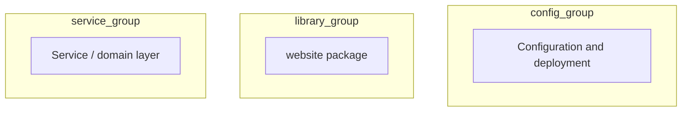

# Architecture report: andrew--r/frontend-case-studies

> Automated static analysis. **Observed** = directly seen in files/imports/AST; **Inferred** = interpretation from that evidence. Repository code was not executed.

## 1. Repository at a glance

| Item | Value |
| --- | --- |
| Repository | andrew--r/frontend-case-studies |
| Description | 💼 A curated list of talks and articles about real world frontend development |
| Language | Astro |
| Stars | 7437 |
| Licence | Not detected |
| Analysed commit / branch | aa9329a0ddf5453c99a1b5d1de1356e9cf042f7f / master |
| Framework(s) | None detected |
| Files analysed | 40 |
| Components | 3 |

## 2. Architecture in one minute

andrew--r/frontend-case-studies - 💼 A curated list of talks and articles about real world frontend development. This repository was analysed statically from 40 file(s) (0 Python). Detected technologies (observed from imports/manifests): no known frameworks/libraries. Files are grouped into 3 component(s): Configuration and deployment, Service / domain layer, website package. Findings below distinguish observed facts from inferred interpretation.

## 3. High-level block diagram

## 4. Main components

### Configuration and deployment (`config`)

- **Kind:** config
- **Status:** Observed
- **Confidence:** 0.85
- **Responsibility:** Groups 6 file(s) under configuration and deployment (observed from repository paths and static analysis).
- **Paths:** `website/package.json`, `website/pnpm-workspace.yaml`, `website/src/domain/caseStudy/data.ru.toml`, `website/src/domain/company/data.ru.toml`, `website/src/domain/company/data.toml`, `website/tsconfig.json`
- **Evidence:** [website/package.json](https://github.com/andrew--r/frontend-case-studies/blob/aa9329a0ddf5453c99a1b5d1de1356e9cf042f7f/website/package.json); [website/pnpm-workspace.yaml](https://github.com/andrew--r/frontend-case-studies/blob/aa9329a0ddf5453c99a1b5d1de1356e9cf042f7f/website/pnpm-workspace.yaml); [website/src/domain/caseStudy/data.ru.toml](https://github.com/andrew--r/frontend-case-studies/blob/aa9329a0ddf5453c99a1b5d1de1356e9cf042f7f/website/src/domain/caseStudy/data.ru.toml); [website/src/domain/company/data.ru.toml](https://github.com/andrew--r/frontend-case-studies/blob/aa9329a0ddf5453c99a1b5d1de1356e9cf042f7f/website/src/domain/company/data.ru.toml); [website/src/domain/company/data.toml](https://github.com/andrew--r/frontend-case-studies/blob/aa9329a0ddf5453c99a1b5d1de1356e9cf042f7f/website/src/domain/company/data.toml); [website/tsconfig.json](https://github.com/andrew--r/frontend-case-studies/blob/aa9329a0ddf5453c99a1b5d1de1356e9cf042f7f/website/tsconfig.json)

### Service / domain layer (`service_layer`)

- **Kind:** service
- **Status:** Observed
- **Confidence:** 0.85
- **Responsibility:** Groups 4 file(s) under service / domain layer (observed from repository paths and static analysis).
- **Paths:** `website/src/domain/caseStudy/lib/index.ts`, `website/src/domain/caseStudy/schema.ts`, `website/src/domain/company/lib/index.ts`, `website/src/domain/company/schema.ts`
- **Evidence:** [website/src/domain/caseStudy/lib/index.ts](https://github.com/andrew--r/frontend-case-studies/blob/aa9329a0ddf5453c99a1b5d1de1356e9cf042f7f/website/src/domain/caseStudy/lib/index.ts); [website/src/domain/caseStudy/schema.ts](https://github.com/andrew--r/frontend-case-studies/blob/aa9329a0ddf5453c99a1b5d1de1356e9cf042f7f/website/src/domain/caseStudy/schema.ts); [website/src/domain/company/lib/index.ts](https://github.com/andrew--r/frontend-case-studies/blob/aa9329a0ddf5453c99a1b5d1de1356e9cf042f7f/website/src/domain/company/lib/index.ts); [website/src/domain/company/schema.ts](https://github.com/andrew--r/frontend-case-studies/blob/aa9329a0ddf5453c99a1b5d1de1356e9cf042f7f/website/src/domain/company/schema.ts)

### website package (`website`)

- **Kind:** library
- **Status:** Observed
- **Confidence:** 0.85
- **Responsibility:** Groups 5 file(s) under website package (observed from repository paths and static analysis).
- **Paths:** `website/astro.config.mjs`, `website/src/config.ts`, `website/src/content.config.ts`, `website/src/pages/companies/[company]/rss.xml.ts`, `website/src/pages/rss.xml.ts`
- **Evidence:** [website/astro.config.mjs](https://github.com/andrew--r/frontend-case-studies/blob/aa9329a0ddf5453c99a1b5d1de1356e9cf042f7f/website/astro.config.mjs); [website/src/config.ts](https://github.com/andrew--r/frontend-case-studies/blob/aa9329a0ddf5453c99a1b5d1de1356e9cf042f7f/website/src/config.ts); [website/src/content.config.ts](https://github.com/andrew--r/frontend-case-studies/blob/aa9329a0ddf5453c99a1b5d1de1356e9cf042f7f/website/src/content.config.ts); [website/src/pages/companies/[company]/rss.xml.ts](https://github.com/andrew--r/frontend-case-studies/blob/aa9329a0ddf5453c99a1b5d1de1356e9cf042f7f/website/src/pages/companies/%5Bcompany%5D/rss.xml.ts); [website/src/pages/rss.xml.ts](https://github.com/andrew--r/frontend-case-studies/blob/aa9329a0ddf5453c99a1b5d1de1356e9cf042f7f/website/src/pages/rss.xml.ts)

## 5. Execution flow

No entry point was observed; the startup flow below is therefore limited.

Representative flow (derived from observed entry points and the import graph; steps beyond the entry point are **Inferred**):

1. Execution starts at an observed entry point listed above, if present.
2. No internal import relationships between components were observed.

## 6. Project structure

### `(root)`

- `.editorconfig` - config (176 bytes)
- `.nvmrc` - other (8 bytes)
- `readme.md` - docs (161236 bytes)

### `.claude`

- `.claude/settings.local.json` - config (220 bytes)

### `website`

- `website/.gitignore` - other (303 bytes)
- `website/CLAUDE.md` - docs (1143 bytes)
- `website/README.md` - docs (563 bytes)
- `website/astro.config.mjs` - source, JavaScript (251 bytes)
- `website/package.json` - manifest (393 bytes)
- `website/pnpm-workspace.yaml` - config (43 bytes)
- `website/public/robots.txt` - docs (74 bytes)
- `website/public/s/images/favicon.svg` - other (1103 bytes)
- `website/src/components/BackToTop.astro` - other (1618 bytes)
- `website/src/components/CaseStudiesList.astro` - other (1692 bytes)
- `website/src/components/Factoids.astro` - other (932 bytes)
- `website/src/components/Footer.astro` - other (622 bytes)
- `website/src/components/Header.astro` - other (1113 bytes)
- `website/src/components/Navigation.astro` - other (757 bytes)
- `website/src/components/RssLink.astro` - other (1109 bytes)
- `website/src/components/RssMetaLink.astro` - other (244 bytes)
- `website/src/config.ts` - source, TypeScript (212 bytes)
- `website/src/content.config.ts` - source, TypeScript (748 bytes)
- `website/src/domain/caseStudy/data.ru.toml` - config (29636 bytes)
- `website/src/domain/caseStudy/lib/index.ts` - source, TypeScript (1108 bytes)
- `website/src/domain/caseStudy/schema.ts` - source, TypeScript (240 bytes)
- `website/src/domain/company/data.ru.toml` - config (2357 bytes)
- `website/src/domain/company/data.toml` - config (15972 bytes)
- `website/src/domain/company/lib/index.ts` - source, TypeScript (706 bytes)
- `website/src/domain/company/schema.ts` - source, TypeScript (285 bytes)
- `website/src/layouts/BaseLayout.astro` - other (2689 bytes)
- `website/src/pages/companies/[company]/index.astro` - other (2291 bytes)
- `website/src/pages/companies/[company]/rss.xml.ts` - source, TypeScript (1573 bytes)
- `website/src/pages/companies/index.astro` - other (1655 bytes)
- `website/src/pages/index.astro` - other (2396 bytes)
- `website/src/pages/rss.xml.ts` - source, TypeScript (1047 bytes)
- `website/src/styles/base.css` - other (874 bytes)
- `website/src/styles/links.css` - other (480 bytes)
- `website/src/styles/reset.css` - other (1032 bytes)
- `website/src/styles/utility.css` - other (74 bytes)
- `website/tsconfig.json` - config (225 bytes)

## 7. Key dependencies and integrations

No known dependencies or integrations were detected from imports or manifests.

## 8. Data and state

No database, cache, queue, or persistent-state usage was observed in the analysed files. State handling, if any, may be in-memory or in files that were not analysed.

## 9. Configuration and deployment clues

- `.claude/settings.local.json` (config)
- `.editorconfig` (config)
- `website/package.json` (manifest)
- `website/pnpm-workspace.yaml` (config)
- `website/src/domain/caseStudy/data.ru.toml` (config)
- `website/src/domain/company/data.ru.toml` (config)
- `website/src/domain/company/data.toml` (config)
- `website/tsconfig.json` (config)

## 10. Design observations

- Service/domain code is distinct from entry and data code, suggesting layered separation (Inferred).

These observations are interpretations (**Inferred**) of the observed structure, not guarantees about runtime design.

## 11. Limitations and unknowns

- Static analysis only: repository code was not executed, installed, or imported at runtime.
- Components and relationships are inferred from file paths, imports, and AST structure; runtime behaviour, dynamic imports, and reflection may not be visible.
- 1 file(s) were skipped during inventory (1 x lockfile excluded).
- No clear application entry point was observed in the analysed files.
- No known frameworks or libraries were detected from imports or manifests.
- Repository text was treated as untrusted data; no instructions found in repository files were followed, and likely secret values were redacted/excluded.
- JavaScript and TypeScript files were inventoried from paths and package manifests. They were not parsed with a full language AST, and repository code was not executed.

## 12. Source references

- [website/astro.config.mjs](https://github.com/andrew--r/frontend-case-studies/blob/aa9329a0ddf5453c99a1b5d1de1356e9cf042f7f/website/astro.config.mjs)
- [website/package.json](https://github.com/andrew--r/frontend-case-studies/blob/aa9329a0ddf5453c99a1b5d1de1356e9cf042f7f/website/package.json)
- [website/pnpm-workspace.yaml](https://github.com/andrew--r/frontend-case-studies/blob/aa9329a0ddf5453c99a1b5d1de1356e9cf042f7f/website/pnpm-workspace.yaml)
- [website/src/config.ts](https://github.com/andrew--r/frontend-case-studies/blob/aa9329a0ddf5453c99a1b5d1de1356e9cf042f7f/website/src/config.ts)
- [website/src/content.config.ts](https://github.com/andrew--r/frontend-case-studies/blob/aa9329a0ddf5453c99a1b5d1de1356e9cf042f7f/website/src/content.config.ts)
- [website/src/domain/caseStudy/data.ru.toml](https://github.com/andrew--r/frontend-case-studies/blob/aa9329a0ddf5453c99a1b5d1de1356e9cf042f7f/website/src/domain/caseStudy/data.ru.toml)
- [website/src/domain/caseStudy/lib/index.ts](https://github.com/andrew--r/frontend-case-studies/blob/aa9329a0ddf5453c99a1b5d1de1356e9cf042f7f/website/src/domain/caseStudy/lib/index.ts)
- [website/src/domain/caseStudy/schema.ts](https://github.com/andrew--r/frontend-case-studies/blob/aa9329a0ddf5453c99a1b5d1de1356e9cf042f7f/website/src/domain/caseStudy/schema.ts)
- [website/src/domain/company/data.ru.toml](https://github.com/andrew--r/frontend-case-studies/blob/aa9329a0ddf5453c99a1b5d1de1356e9cf042f7f/website/src/domain/company/data.ru.toml)
- [website/src/domain/company/data.toml](https://github.com/andrew--r/frontend-case-studies/blob/aa9329a0ddf5453c99a1b5d1de1356e9cf042f7f/website/src/domain/company/data.toml)
- [website/src/domain/company/lib/index.ts](https://github.com/andrew--r/frontend-case-studies/blob/aa9329a0ddf5453c99a1b5d1de1356e9cf042f7f/website/src/domain/company/lib/index.ts)
- [website/src/domain/company/schema.ts](https://github.com/andrew--r/frontend-case-studies/blob/aa9329a0ddf5453c99a1b5d1de1356e9cf042f7f/website/src/domain/company/schema.ts)
- [website/src/pages/companies/[company]/rss.xml.ts](https://github.com/andrew--r/frontend-case-studies/blob/aa9329a0ddf5453c99a1b5d1de1356e9cf042f7f/website/src/pages/companies/%5Bcompany%5D/rss.xml.ts)
- [website/src/pages/rss.xml.ts](https://github.com/andrew--r/frontend-case-studies/blob/aa9329a0ddf5453c99a1b5d1de1356e9cf042f7f/website/src/pages/rss.xml.ts)
- [website/tsconfig.json](https://github.com/andrew--r/frontend-case-studies/blob/aa9329a0ddf5453c99a1b5d1de1356e9cf042f7f/website/tsconfig.json)
