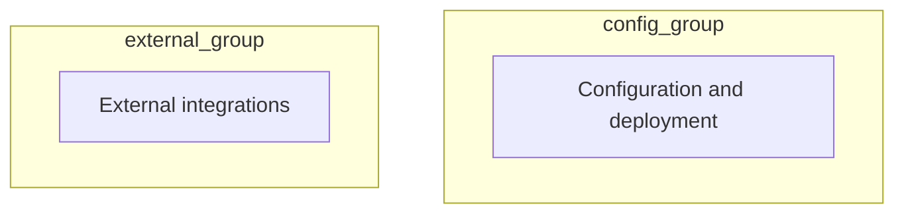

# Architecture report: andrewngu/sound-redux

> Automated static analysis. **Observed** = directly seen in files/imports/AST; **Inferred** = interpretation from that evidence. Repository code was not executed.

## 1. Repository at a glance

| Item | Value |
| --- | --- |
| Repository | andrewngu/sound-redux |
| Description | A Soundcloud client built with React / Redux |
| Language | JavaScript |
| Stars | 4968 |
| Licence | GPL-3.0 |
| Analysed commit / branch | c5f36935c2ab07fbbeeaf63573434fd815f503ad / master |
| Framework(s) | React |
| Files analysed | 146 |
| Components | 2 |

## 2. Architecture in one minute

andrewngu/sound-redux - A Soundcloud client built with React / Redux. This repository was analysed statically from 146 file(s) (0 Python). Detected technologies (observed from imports/manifests): React, Redux, webpack. Files are grouped into 2 component(s): Configuration and deployment, External integrations. Findings below distinguish observed facts from inferred interpretation.

## 3. High-level block diagram

## 4. Main components

### Configuration and deployment (`config`)

- **Kind:** config
- **Status:** Observed
- **Confidence:** 0.85
- **Responsibility:** Groups 1 file(s) under configuration and deployment (observed from repository paths and static analysis).
- **Paths:** `package.json`
- **Evidence:** [package.json](https://github.com/andrewngu/sound-redux/blob/c5f36935c2ab07fbbeeaf63573434fd815f503ad/package.json)

### External integrations (`external_integrations`)

- **Kind:** external
- **Status:** Observed
- **Confidence:** 0.85
- **Responsibility:** Groups 101 file(s) under external integrations (observed from repository paths and static analysis).
- **Paths:** `client/src/actions/EnvironmentActions.js`, `client/src/actions/HistoryActions.js`, `client/src/actions/PlayerActions.js`, `client/src/actions/PlaylistActions.js`, `client/src/actions/RouterActions.js`, `client/src/actions/SessionActions.js`, `client/src/actions/SongActions.js`, `client/src/actions/UserActions.js`, `client/src/components/ArtworkPlay.jsx`, `client/src/components/Heart.jsx`, `client/src/components/HeartCount.jsx`, `client/src/components/History.jsx`, `client/src/components/HistorySong.jsx`, `client/src/components/InfiniteScroll.jsx`, `client/src/components/Link.jsx`, `client/src/components/Loader.jsx`, `client/src/components/LoginPopoverPanel.jsx`, `client/src/components/Nav.jsx`, `client/src/components/NavPlaylists.jsx`, `client/src/components/NavPlaylistsItem.jsx`, `client/src/components/NavSearch.jsx`, `client/src/components/NavSession.jsx`, `client/src/components/NavStream.jsx`, `client/src/components/NavUser.jsx`, `client/src/components/Player.jsx`, `client/src/components/Popover.jsx`, `client/src/components/PopoverPanel.jsx`, `client/src/components/Root.jsx`, `client/src/components/Router.jsx`, `client/src/components/SessionPopoverPanel.jsx`, `client/src/components/SidebarBody.jsx`, `client/src/components/Slider.jsx`, `client/src/components/Song.jsx`, `client/src/components/SongComment.jsx`, `client/src/components/SongComments.jsx`, `client/src/components/SongList.jsx`, `client/src/components/SongListItem.jsx`, `client/src/components/SongMain.jsx`, `client/src/components/Songs.jsx`, `client/src/components/SongsBody.jsx`, `client/src/components/SongsBodyCard.jsx`, `client/src/components/SongsBodyCardMobileEvents.jsx`, `client/src/components/SongsBodyRendered.jsx`, `client/src/components/SongsHeader.jsx`, `client/src/components/SongsHeaderGenres.jsx`, `client/src/components/SongsHeaderTimes.jsx`, `client/src/components/Stats.jsx`, `client/src/components/Switch.jsx`, `client/src/components/User.jsx`, `client/src/components/UserFollowButton.jsx`, `client/src/components/UserFollowing.jsx`, `client/src/components/UserFollowings.jsx`, `client/src/components/UserMain.jsx`, `client/src/components/Waveform.jsx`, `client/src/components/WaveformEvents.jsx`, `client/src/components/audio.jsx`, `client/src/components/stickyOnScroll.jsx`, `client/src/constants/ActionTypes.js`, `client/src/constants/ApiConstants.js`, `client/src/constants/EnvironmentConstants.js`, `client/src/constants/ImageConstants.js`, `client/src/constants/PlaylistConstants.js`, `client/src/constants/RouterConstants.js`, `client/src/constants/Schemas.js`, `client/src/constants/SongConstants.js`, `client/src/containers/HistoryContainer.jsx`, `client/src/containers/NavContainer.jsx`, `client/src/containers/PlayerContainer.jsx`, `client/src/containers/RootContainer.jsx`, `client/src/containers/SongContainer.jsx`, `client/src/containers/SongsContainer.jsx`, `client/src/containers/UserContainer.jsx`, `client/src/index.jsx`, `client/src/reducers/entities.js`, `client/src/reducers/environment.js`, `client/src/reducers/history.js`, `client/src/reducers/index.js`, `client/src/reducers/player.js`, `client/src/reducers/playlists.js`, `client/src/reducers/router.js`, `client/src/reducers/session.js`, `client/src/selectors/CommonSelectors.js`, `client/src/selectors/HistorySelectors.js`, `client/src/selectors/NavSelectors.js`, `client/src/selectors/PlayerSelectors.js`, `client/src/selectors/SongSelectors.js`, `client/src/selectors/SongsSelectors.js`, `client/src/selectors/UserSelectors.js`, `client/src/store/configureStore.js`, `client/src/utils/ApiUtils.js`, `client/src/utils/DomUtils.js`, `client/src/utils/ImageUtils.js`, `client/src/utils/NumberUtils.js`, `client/src/utils/PlayerUtils.js`, `client/src/utils/PlaylistUtils.js`, `client/src/utils/RouterUtils.js`, `client/src/utils/ScrollUtils.js`, `client/src/utils/SongUtils.js`, `client/src/utils/UserUtils.js`, `client/webpack.dev.config.js`, `client/webpack.prod.config.js`
- **Evidence:** [client/src/actions/EnvironmentActions.js](https://github.com/andrewngu/sound-redux/blob/c5f36935c2ab07fbbeeaf63573434fd815f503ad/client/src/actions/EnvironmentActions.js); [client/src/actions/HistoryActions.js](https://github.com/andrewngu/sound-redux/blob/c5f36935c2ab07fbbeeaf63573434fd815f503ad/client/src/actions/HistoryActions.js); [client/src/actions/PlayerActions.js](https://github.com/andrewngu/sound-redux/blob/c5f36935c2ab07fbbeeaf63573434fd815f503ad/client/src/actions/PlayerActions.js); [client/src/actions/PlaylistActions.js](https://github.com/andrewngu/sound-redux/blob/c5f36935c2ab07fbbeeaf63573434fd815f503ad/client/src/actions/PlaylistActions.js); [client/src/actions/RouterActions.js](https://github.com/andrewngu/sound-redux/blob/c5f36935c2ab07fbbeeaf63573434fd815f503ad/client/src/actions/RouterActions.js); [client/src/actions/SessionActions.js](https://github.com/andrewngu/sound-redux/blob/c5f36935c2ab07fbbeeaf63573434fd815f503ad/client/src/actions/SessionActions.js); [client/src/actions/SongActions.js](https://github.com/andrewngu/sound-redux/blob/c5f36935c2ab07fbbeeaf63573434fd815f503ad/client/src/actions/SongActions.js); [client/src/actions/UserActions.js](https://github.com/andrewngu/sound-redux/blob/c5f36935c2ab07fbbeeaf63573434fd815f503ad/client/src/actions/UserActions.js)

## 5. Execution flow

**Observed** entry point(s):

- [client/src/index.jsx](https://github.com/andrewngu/sound-redux/blob/c5f36935c2ab07fbbeeaf63573434fd815f503ad/client/src/index.jsx)
- [client/src/reducers/index.js](https://github.com/andrewngu/sound-redux/blob/c5f36935c2ab07fbbeeaf63573434fd815f503ad/client/src/reducers/index.js)

Representative flow (derived from observed entry points and the import graph; steps beyond the entry point are **Inferred**):

1. Execution starts at an observed entry point listed above, if present.
2. No internal import relationships between components were observed.

## 6. Project structure

### `(root)`

- `.gitignore` - other (42 bytes)
- `LICENSE` - docs (32472 bytes)
- `README.md` - docs (693 bytes)
- `package.json` - manifest (2098 bytes)

### `client`

- `client/public/api/callback/index.html` - other (217 bytes)
- `client/public/index.html` - other (1086 bytes)
- `client/src/.babelrc` - other (113 bytes)
- `client/src/.eslintrc` - other (106 bytes)
- `client/src/actions/EnvironmentActions.js` - source, JavaScript (397 bytes)
- `client/src/actions/HistoryActions.js` - source, JavaScript (161 bytes)
- `client/src/actions/PlayerActions.js` - source, JavaScript (1798 bytes)
- `client/src/actions/PlaylistActions.js` - source, JavaScript (2143 bytes)
- `client/src/actions/RouterActions.js` - source, JavaScript (930 bytes)
- `client/src/actions/SessionActions.js` - source, JavaScript (6541 bytes)
- `client/src/actions/SongActions.js` - source, JavaScript (1722 bytes)
- `client/src/actions/UserActions.js` - source, JavaScript (1818 bytes)
- `client/src/components/ArtworkPlay.jsx` - source, JavaScript (1282 bytes)
- `client/src/components/Heart.jsx` - source, JavaScript (1731 bytes)
- `client/src/components/HeartCount.jsx` - source, JavaScript (536 bytes)
- `client/src/components/History.jsx` - source, JavaScript (1887 bytes)
- `client/src/components/HistorySong.jsx` - source, JavaScript (1874 bytes)
- `client/src/components/InfiniteScroll.jsx` - source, JavaScript (1122 bytes)
- `client/src/components/Link.jsx` - source, JavaScript (1237 bytes)
- `client/src/components/Loader.jsx` - source, JavaScript (872 bytes)
- `client/src/components/LoginPopoverPanel.jsx` - source, JavaScript (414 bytes)
- `client/src/components/Nav.jsx` - source, JavaScript (2617 bytes)
- `client/src/components/NavPlaylists.jsx` - source, JavaScript (1197 bytes)
- `client/src/components/NavPlaylistsItem.jsx` - source, JavaScript (1260 bytes)
- `client/src/components/NavSearch.jsx` - source, JavaScript (1557 bytes)
- `client/src/components/NavSession.jsx` - source, JavaScript (1963 bytes)
- `client/src/components/NavStream.jsx` - source, JavaScript (1830 bytes)
- `client/src/components/NavUser.jsx` - source, JavaScript (1419 bytes)
- `client/src/components/Player.jsx` - source, JavaScript (5461 bytes)
- `client/src/components/Popover.jsx` - source, JavaScript (1191 bytes)
- `client/src/components/PopoverPanel.jsx` - source, JavaScript (1188 bytes)
- `client/src/components/Root.jsx` - source, JavaScript (1176 bytes)
- `client/src/components/Router.jsx` - source, JavaScript (480 bytes)
- `client/src/components/SessionPopoverPanel.jsx` - source, JavaScript (379 bytes)
- `client/src/components/SidebarBody.jsx` - source, JavaScript (686 bytes)
- `client/src/components/Slider.jsx` - source, JavaScript (2471 bytes)
- `client/src/components/Song.jsx` - source, JavaScript (3345 bytes)
- `client/src/components/SongComment.jsx` - source, JavaScript (1099 bytes)
- `client/src/components/SongComments.jsx` - source, JavaScript (1430 bytes)
- `client/src/components/SongList.jsx` - source, JavaScript (1612 bytes)
- `client/src/components/SongListItem.jsx` - source, JavaScript (3213 bytes)
- `client/src/components/SongMain.jsx` - source, JavaScript (2980 bytes)
- `client/src/components/Songs.jsx` - source, JavaScript (3452 bytes)
- `client/src/components/SongsBody.jsx` - source, JavaScript (2824 bytes)
- `client/src/components/SongsBodyCard.jsx` - source, JavaScript (3068 bytes)
- `client/src/components/SongsBodyCardMobileEvents.jsx` - source, JavaScript (1023 bytes)
- `client/src/components/SongsBodyRendered.jsx` - source, JavaScript (2001 bytes)
- `client/src/components/SongsHeader.jsx` - source, JavaScript (1726 bytes)
- `client/src/components/SongsHeaderGenres.jsx` - source, JavaScript (1774 bytes)
- `client/src/components/SongsHeaderTimes.jsx` - source, JavaScript (1170 bytes)
- `client/src/components/Stats.jsx` - source, JavaScript (1491 bytes)
- `client/src/components/Switch.jsx` - source, JavaScript (816 bytes)
- `client/src/components/User.jsx` - source, JavaScript (3305 bytes)
- `client/src/components/UserFollowButton.jsx` - source, JavaScript (865 bytes)
- `client/src/components/UserFollowing.jsx` - source, JavaScript (1578 bytes)
- `client/src/components/UserFollowings.jsx` - source, JavaScript (1073 bytes)
- `client/src/components/UserMain.jsx` - source, JavaScript (2526 bytes)
- `client/src/components/Waveform.jsx` - source, JavaScript (2495 bytes)
- `client/src/components/WaveformEvents.jsx` - source, JavaScript (728 bytes)
- `client/src/components/audio.jsx` - source, JavaScript (3837 bytes)
- `client/src/components/stickyOnScroll.jsx` - source, JavaScript (1107 bytes)
- `client/src/constants/ActionTypes.js` - source, JavaScript (1628 bytes)
- `client/src/constants/ApiConstants.js` - source, JavaScript (1190 bytes)
- `client/src/constants/EnvironmentConstants.js` - source, JavaScript (66 bytes)
- `client/src/constants/ImageConstants.js` - source, JavaScript (97 bytes)
- `client/src/constants/PlaylistConstants.js` - source, JavaScript (1163 bytes)
- `client/src/constants/RouterConstants.js` - source, JavaScript (339 bytes)
- `client/src/constants/Schemas.js` - source, JavaScript (341 bytes)
- `client/src/constants/SongConstants.js` - source, JavaScript (416 bytes)
- `client/src/containers/HistoryContainer.jsx` - source, JavaScript (880 bytes)
- `client/src/containers/NavContainer.jsx` - source, JavaScript (1089 bytes)
- `client/src/containers/PlayerContainer.jsx` - source, JavaScript (1689 bytes)
- `client/src/containers/RootContainer.jsx` - source, JavaScript (1106 bytes)
- `client/src/containers/SongContainer.jsx` - source, JavaScript (1197 bytes)
- `client/src/containers/SongsContainer.jsx` - source, JavaScript (1506 bytes)
- `client/src/containers/UserContainer.jsx` - source, JavaScript (1340 bytes)
- `client/src/index.jsx` - source, JavaScript (812 bytes)
- `client/src/reducers/entities.js` - source, JavaScript (450 bytes)
- `client/src/reducers/environment.js` - source, JavaScript (387 bytes)
- `client/src/reducers/history.js` - source, JavaScript (991 bytes)
- `client/src/reducers/index.js` - source, JavaScript (506 bytes)
- `client/src/reducers/player.js` - source, JavaScript (1783 bytes)
- `client/src/reducers/playlists.js` - source, JavaScript (2393 bytes)
- `client/src/reducers/router.js` - source, JavaScript (413 bytes)
- `client/src/reducers/session.js` - source, JavaScript (1452 bytes)
- `client/src/selectors/CommonSelectors.js` - source, JavaScript (2926 bytes)
- `client/src/selectors/HistorySelectors.js` - source, JavaScript (567 bytes)
- `client/src/selectors/NavSelectors.js` - source, JavaScript (1046 bytes)
- `client/src/selectors/PlayerSelectors.js` - source, JavaScript (1556 bytes)
- `client/src/selectors/SongSelectors.js` - source, JavaScript (1562 bytes)
- `client/src/selectors/SongsSelectors.js` - source, JavaScript (529 bytes)
- `client/src/selectors/UserSelectors.js` - source, JavaScript (1572 bytes)
- `client/src/store/configureStore.js` - source, JavaScript (488 bytes)
- `client/src/utils/ApiUtils.js` - source, JavaScript (770 bytes)
- `client/src/utils/DomUtils.js` - source, JavaScript (219 bytes)
- `client/src/utils/ImageUtils.js` - source, JavaScript (420 bytes)
- `client/src/utils/NumberUtils.js` - source, JavaScript (448 bytes)
- `client/src/utils/PlayerUtils.js` - source, JavaScript (215 bytes)
- `client/src/utils/PlaylistUtils.js` - source, JavaScript (3634 bytes)
- `client/src/utils/RouterUtils.js` - source, JavaScript (1511 bytes)
- `client/src/utils/ScrollUtils.js` - source, JavaScript (1518 bytes)
- `client/src/utils/SongUtils.js` - source, JavaScript (197 bytes)
- `client/src/utils/UserUtils.js` - source, JavaScript (850 bytes)
- `client/styles/custom/components/a.scss` - other (96 bytes)
- `client/styles/custom/components/artwork-play.scss` - other (592 bytes)
- `client/styles/custom/components/button.scss` - other (962 bytes)
- `client/styles/custom/components/container.scss` - other (92 bytes)
- `client/styles/custom/components/heart.scss` - other (494 bytes)
- `client/styles/custom/components/history.scss` - other (1616 bytes)
- `client/styles/custom/components/loader.scss` - other (755 bytes)
- `client/styles/custom/components/nav-playlists.scss` - other (1035 bytes)
- `client/styles/custom/components/nav-search.scss` - other (467 bytes)
- `client/styles/custom/components/nav-session.scss` - other (1254 bytes)
- `client/styles/custom/components/nav-user.scss` - other (463 bytes)
- `client/styles/custom/components/nav.scss` - other (755 bytes)
- `client/styles/custom/components/player.scss` - other (2548 bytes)
- `client/styles/custom/components/popover.scss` - other (743 bytes)
- `client/styles/custom/components/reset.scss` - other (183 bytes)
- `client/styles/custom/components/row.scss` - other (294 bytes)
- `client/styles/custom/components/sidebar.scss` - other (428 bytes)
- `client/styles/custom/components/slider.scss` - other (544 bytes)
- `client/styles/custom/components/song-comment.scss` - other (921 bytes)
- `client/styles/custom/components/song-list.scss` - other (1627 bytes)
- `client/styles/custom/components/song-main.scss` - other (1431 bytes)
- `client/styles/custom/components/song.scss` - other (207 bytes)
- `client/styles/custom/components/songs-body-card.scss` - other (1893 bytes)
- `client/styles/custom/components/songs-body.scss` - other (128 bytes)
- `client/styles/custom/components/songs-header.scss` - other (3060 bytes)
- `client/styles/custom/components/stats.scss` - other (456 bytes)
- `client/styles/custom/components/switch.scss` - other (550 bytes)
- `client/styles/custom/components/toggle-play-button.scss` - other (915 bytes)
- `client/styles/custom/components/user-following.scss` - other (744 bytes)
- `client/styles/custom/components/user-main.scss` - other (1530 bytes)
- `client/styles/custom/components/user.scss` - other (207 bytes)
- `client/styles/custom/components/waveform.scss` - other (1533 bytes)
- `client/styles/custom/custom.scss` - other (1036 bytes)
- `client/styles/custom/mixins.scss` - other (175 bytes)
- `client/styles/custom/variables.scss` - other (712 bytes)
- `client/styles/ionicons/ionicons.scss` - other (57198 bytes)
- `client/styles/main.scss` - other (54 bytes)
- `client/webpack.dev.config.js` - source, JavaScript (1388 bytes)
- `client/webpack.prod.config.js` - source, JavaScript (1986 bytes)

## 7. Key dependencies and integrations

| Name | Category | Status | Confidence | Evidence |
| --- | --- | --- | --- | --- |
| React | framework | Observed | 0.90 | [package.json:30](https://github.com/andrewngu/sound-redux/blob/c5f36935c2ab07fbbeeaf63573434fd815f503ad/package.json#L30); [package.json:60](https://github.com/andrewngu/sound-redux/blob/c5f36935c2ab07fbbeeaf63573434fd815f503ad/package.json#L60) |
| Redux | library | Observed | 0.85 | [package.json:2](https://github.com/andrewngu/sound-redux/blob/c5f36935c2ab07fbbeeaf63573434fd815f503ad/package.json#L2) |
| webpack | tooling | Observed | 0.85 | [package.json:8](https://github.com/andrewngu/sound-redux/blob/c5f36935c2ab07fbbeeaf63573434fd815f503ad/package.json#L8) |

## 8. Data and state

No database, cache, queue, or persistent-state usage was observed in the analysed files. State handling, if any, may be in-memory or in files that were not analysed.

## 9. Configuration and deployment clues

- `package.json` (manifest)

## 10. Design observations

- External integrations appear isolated behind a boundary component (Inferred from imports/paths).

These observations are interpretations (**Inferred**) of the observed structure, not guarantees about runtime design.

## 11. Limitations and unknowns

- Static analysis only: repository code was not executed, installed, or imported at runtime.
- Components and relationships are inferred from file paths, imports, and AST structure; runtime behaviour, dynamic imports, and reflection may not be visible.
- No clear application entry point was observed in the analysed files.
- Repository text was treated as untrusted data; no instructions found in repository files were followed, and likely secret values were redacted/excluded.
- JavaScript and TypeScript files were inventoried from paths and package manifests. They were not parsed with a full language AST, and repository code was not executed.

## 12. Source references

- [client/src/actions/EnvironmentActions.js](https://github.com/andrewngu/sound-redux/blob/c5f36935c2ab07fbbeeaf63573434fd815f503ad/client/src/actions/EnvironmentActions.js)
- [client/src/actions/HistoryActions.js](https://github.com/andrewngu/sound-redux/blob/c5f36935c2ab07fbbeeaf63573434fd815f503ad/client/src/actions/HistoryActions.js)
- [client/src/actions/PlayerActions.js](https://github.com/andrewngu/sound-redux/blob/c5f36935c2ab07fbbeeaf63573434fd815f503ad/client/src/actions/PlayerActions.js)
- [client/src/actions/PlaylistActions.js](https://github.com/andrewngu/sound-redux/blob/c5f36935c2ab07fbbeeaf63573434fd815f503ad/client/src/actions/PlaylistActions.js)
- [client/src/actions/RouterActions.js](https://github.com/andrewngu/sound-redux/blob/c5f36935c2ab07fbbeeaf63573434fd815f503ad/client/src/actions/RouterActions.js)
- [client/src/actions/SessionActions.js](https://github.com/andrewngu/sound-redux/blob/c5f36935c2ab07fbbeeaf63573434fd815f503ad/client/src/actions/SessionActions.js)
- [client/src/actions/SongActions.js](https://github.com/andrewngu/sound-redux/blob/c5f36935c2ab07fbbeeaf63573434fd815f503ad/client/src/actions/SongActions.js)
- [client/src/actions/UserActions.js](https://github.com/andrewngu/sound-redux/blob/c5f36935c2ab07fbbeeaf63573434fd815f503ad/client/src/actions/UserActions.js)
- [client/src/index.jsx](https://github.com/andrewngu/sound-redux/blob/c5f36935c2ab07fbbeeaf63573434fd815f503ad/client/src/index.jsx)
- [client/src/reducers/index.js](https://github.com/andrewngu/sound-redux/blob/c5f36935c2ab07fbbeeaf63573434fd815f503ad/client/src/reducers/index.js)
- [package.json](https://github.com/andrewngu/sound-redux/blob/c5f36935c2ab07fbbeeaf63573434fd815f503ad/package.json)
- [package.json:2](https://github.com/andrewngu/sound-redux/blob/c5f36935c2ab07fbbeeaf63573434fd815f503ad/package.json#L2)
- [package.json:8](https://github.com/andrewngu/sound-redux/blob/c5f36935c2ab07fbbeeaf63573434fd815f503ad/package.json#L8)
- [package.json:30](https://github.com/andrewngu/sound-redux/blob/c5f36935c2ab07fbbeeaf63573434fd815f503ad/package.json#L30)
- [package.json:60](https://github.com/andrewngu/sound-redux/blob/c5f36935c2ab07fbbeeaf63573434fd815f503ad/package.json#L60)
