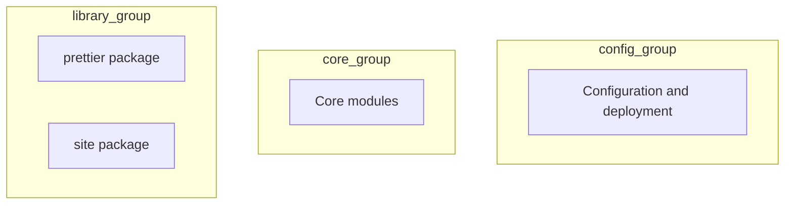

# Architecture report: ant-design/ant-design-landing

> Automated static analysis. **Observed** = directly seen in files/imports/AST; **Inferred** = interpretation from that evidence. Repository code was not executed.

## 1. Repository at a glance

| Item | Value |
| --- | --- |
| Repository | ant-design/ant-design-landing |
| Description | :mountain_bicyclist: Landing Pages of Ant Design System |
| Language | JavaScript |
| Stars | 6539 |
| Licence | MIT |
| Analysed commit / branch | 54f4360f0df75dd53e2febcd90b1b095801efb41 / master |
| Framework(s) | React |
| Files analysed | 305 |
| Components | 4 |

## 2. Architecture in one minute

ant-design/ant-design-landing - :mountain_bicyclist: Landing Pages of Ant Design System. This repository was analysed statically from 305 file(s) (0 Python). Detected technologies (observed from imports/manifests): React, Redux. Files are grouped into 4 component(s): Configuration and deployment, Core modules, prettier package, site package. Findings below distinguish observed facts from inferred interpretation.

## 3. High-level block diagram

## 4. Main components

### Configuration and deployment (`config`)

- **Kind:** config
- **Status:** Observed
- **Confidence:** 0.85
- **Responsibility:** Groups 3 file(s) under configuration and deployment (observed from repository paths and static analysis).
- **Paths:** `package.json`, `renovate.json`, `site/theme/template/Home/component/data.json`
- **Evidence:** [package.json](https://github.com/ant-design/ant-design-landing/blob/54f4360f0df75dd53e2febcd90b1b095801efb41/package.json); [renovate.json](https://github.com/ant-design/ant-design-landing/blob/54f4360f0df75dd53e2febcd90b1b095801efb41/renovate.json); [site/theme/template/Home/component/data.json](https://github.com/ant-design/ant-design-landing/blob/54f4360f0df75dd53e2febcd90b1b095801efb41/site/theme/template/Home/component/data.json)

### Core modules (`core`)

- **Kind:** core
- **Status:** Observed
- **Confidence:** 0.85
- **Responsibility:** Groups 1 file(s) under core modules (observed from repository paths and static analysis).
- **Paths:** `webpack.config.js`
- **Evidence:** [webpack.config.js](https://github.com/ant-design/ant-design-landing/blob/54f4360f0df75dd53e2febcd90b1b095801efb41/webpack.config.js)

### prettier package (`prettier`)

- **Kind:** library
- **Status:** Observed
- **Confidence:** 0.85
- **Responsibility:** Groups 7 file(s) under prettier package (observed from repository paths and static analysis).
- **Paths:** `prettier/install-service-worker.js`, `prettier/lib/parser-graphql.js`, `prettier/lib/parser-parse5.js`, `prettier/lib/parser-vue.js`, `prettier/lib/sw-toolbox.js`, `prettier/service-worker.js`, `prettier/worker.js`
- **Evidence:** [prettier/install-service-worker.js](https://github.com/ant-design/ant-design-landing/blob/54f4360f0df75dd53e2febcd90b1b095801efb41/prettier/install-service-worker.js); [prettier/lib/parser-graphql.js](https://github.com/ant-design/ant-design-landing/blob/54f4360f0df75dd53e2febcd90b1b095801efb41/prettier/lib/parser-graphql.js); [prettier/lib/parser-parse5.js](https://github.com/ant-design/ant-design-landing/blob/54f4360f0df75dd53e2febcd90b1b095801efb41/prettier/lib/parser-parse5.js); [prettier/lib/parser-vue.js](https://github.com/ant-design/ant-design-landing/blob/54f4360f0df75dd53e2febcd90b1b095801efb41/prettier/lib/parser-vue.js); [prettier/lib/sw-toolbox.js](https://github.com/ant-design/ant-design-landing/blob/54f4360f0df75dd53e2febcd90b1b095801efb41/prettier/lib/sw-toolbox.js); [prettier/service-worker.js](https://github.com/ant-design/ant-design-landing/blob/54f4360f0df75dd53e2febcd90b1b095801efb41/prettier/service-worker.js); [prettier/worker.js](https://github.com/ant-design/ant-design-landing/blob/54f4360f0df75dd53e2febcd90b1b095801efb41/prettier/worker.js)

### site package (`site`)

- **Kind:** library
- **Status:** Observed
- **Confidence:** 0.85
- **Responsibility:** Groups 172 file(s) under site package (observed from repository paths and static analysis).
- **Paths:** `site/bisheng.common.config.js`, `site/bisheng.edit.config.js`, `site/bisheng.index.config.js`, `site/bisheng.templates.config.js`, `site/edit/en-US.js`, `site/edit/index.js`, `site/edit/static/style.js`, `site/edit/template/NotFound.jsx`, `site/edit/template/component.config.js`, `site/edit/template/components/EditInfluence.jsx`, `site/edit/template/components/EditListController.jsx`, `site/edit/template/components/EditStageController.jsx`, `site/edit/template/components/Iframe.jsx`, `site/edit/template/components/ListComponents/CheckboxGroup.jsx`, `site/edit/template/components/ListComponents/ChildComp.jsx`, `site/edit/template/components/ListComponents/EditorComp.jsx`, `site/edit/template/components/ListComponents/EditorOther.jsx`, `site/edit/template/components/ListComponents/InputGroup.jsx`, `site/edit/template/components/ListComponents/PropsComp.jsx`, `site/edit/template/components/MediumEditor.jsx`, `site/edit/template/components/NavController/HistoryButton.jsx`, `site/edit/template/components/NavController/NewFileButton.jsx`, `site/edit/template/components/NavController/PublishModal.jsx`, `site/edit/template/components/NavController/index.jsx`, `site/edit/template/components/SideMenu.jsx`, `site/edit/template/components/StateComponents/ButtonViewComponent/ContentEditView.jsx`, `site/edit/template/components/StateComponents/ButtonViewComponent/ContentEditViewItem.jsx`, `site/edit/template/components/StateComponents/ButtonViewComponent/ContentWrapper.jsx`, `site/edit/template/components/StateComponents/ButtonViewComponent/IconComp.jsx`, `site/edit/template/components/StateComponents/ButtonViewComponent/ImageComp.jsx`, `site/edit/template/components/StateComponents/ButtonViewComponent/LinkComp.jsx`, `site/edit/template/components/StateComponents/ButtonViewComponent/MenuComp.jsx`, `site/edit/template/components/StateComponents/ButtonViewComponent/MenuEditView.jsx`, `site/edit/template/components/StateComponents/ButtonViewComponent/TextyComp.jsx`, `site/edit/template/components/StateComponents/ButtonViewComponent/VideoComp.jsx`, `site/edit/template/components/StateComponents/EditButtonView.jsx`, `site/edit/template/components/StateComponents/ListSort.jsx`, `site/edit/template/components/StateComponents/SwitchSlideView.jsx`, `site/edit/template/components/saveJsZip.jsx`, `site/edit/template/index.jsx`, `site/edit/template/layout.jsx`, `site/edit/template/template.config.js`, `site/edit/template/utils.jsx`, `site/edit/zh-CN.js`, `site/shared/constants.js`, `site/shared/defaultTemplate.js`, `site/shared/leancloud.js`, `site/shared/localStorage.js`, `site/shared/redux/actionTypes.js`, `site/shared/redux/actions.js`, `site/shared/redux/index.js`, `site/shared/redux/reducers/currentEditData.js`, `site/shared/redux/reducers/historyEdit.js`, `site/shared/redux/reducers/index.js`, `site/shared/redux/reducers/mediaStateSelect.js`, `site/shared/redux/reducers/templateData.js`, `site/shared/redux/reducers/userIsLogin.js`, `site/shared/redux/saga.js`, `site/shared/url.js`, `site/shared/utils.js`, `site/templates/index.js`, `site/templates/static/lessToString.jsx`, `site/templates/template/BottomBar.jsx`, `site/templates/template/NotFound.jsx`, `site/templates/template/element/Banner0/index.jsx`, `site/templates/template/element/Banner0/template.config.js`, `site/templates/template/element/Banner1/index.jsx`, `site/templates/template/element/Banner1/template.config.js`, `site/templates/template/element/Banner2/index.jsx`, `site/templates/template/element/Banner2/template.config.js`, `site/templates/template/element/Banner3/index.jsx`, `site/templates/template/element/Banner3/template.config.js`, `site/templates/template/element/Banner4/index.jsx`, `site/templates/template/element/Banner4/template.config.js`, `site/templates/template/element/Banner5/index.jsx`, `site/templates/template/element/Banner5/template.config.js`, `site/templates/template/element/Content0/index.jsx`, `site/templates/template/element/Content0/template.config.js`, `site/templates/template/element/Content1/index.jsx`, `site/templates/template/element/Content1/template.config.js`, `site/templates/template/element/Content10/index.jsx`, `site/templates/template/element/Content10/template.config.js`, `site/templates/template/element/Content11/index.jsx`, `site/templates/template/element/Content11/template.config.js`, `site/templates/template/element/Content12/index.jsx`, `site/templates/template/element/Content12/template.config.js`, `site/templates/template/element/Content13/index.jsx`, `site/templates/template/element/Content13/template.config.js`, `site/templates/template/element/Content2/index.jsx`, `site/templates/template/element/Content2/template.config.js`, `site/templates/template/element/Content3/index.jsx`, `site/templates/template/element/Content3/template.config.js`, `site/templates/template/element/Content4/index.jsx`, `site/templates/template/element/Content4/template.config.js`, `site/templates/template/element/Content5/index.jsx`, `site/templates/template/element/Content5/template.config.js`, `site/templates/template/element/Content6/index.jsx`, `site/templates/template/element/Content6/template.config.js`, `site/templates/template/element/Content7/index.jsx`, `site/templates/template/element/Content7/template.config.js`, `site/templates/template/element/Content8/index.jsx`, `site/templates/template/element/Content8/template.config.js`, `site/templates/template/element/Content9/index.jsx`, `site/templates/template/element/Content9/template.config.js`, `site/templates/template/element/Feature6/index.jsx`, `site/templates/template/element/Feature6/template.config.js`, `site/templates/template/element/Feature7/index.jsx`, `site/templates/template/element/Feature7/template.config.js`, `site/templates/template/element/Feature8/index.jsx`, `site/templates/template/element/Feature8/template.config.js`, `site/templates/template/element/Footer0/index.jsx`, `site/templates/template/element/Footer0/template.config.js`, `site/templates/template/element/Footer1/index.jsx`, `site/templates/template/element/Footer1/template.config.js`, `site/templates/template/element/Footer2/index.jsx`, `site/templates/template/element/Footer2/template.config.js`, `site/templates/template/element/Nav0/index.jsx`, `site/templates/template/element/Nav0/template.config.js`, `site/templates/template/element/Nav1/index.jsx`, `site/templates/template/element/Nav1/template.config.js`, `site/templates/template/element/Nav2/index.jsx`, `site/templates/template/element/Nav2/template.config.js`, `site/templates/template/element/Nav3/index.jsx`, `site/templates/template/element/Nav3/template.config.js`, `site/templates/template/element/Pricing0/index.jsx`, `site/templates/template/element/Pricing0/template.config.js`, `site/templates/template/element/Pricing1/index.jsx`, `site/templates/template/element/Pricing1/template.config.js`, `site/templates/template/element/Pricing2/index.jsx`, `site/templates/template/element/Pricing2/template.config.js`, `site/templates/template/element/Teams0/index.jsx`, `site/templates/template/element/Teams0/template.config.js`, `site/templates/template/element/Teams1/index.jsx`, `site/templates/template/element/Teams1/template.config.js`, `site/templates/template/element/Teams2/index.jsx`, `site/templates/template/element/Teams2/template.config.js`, `site/templates/template/element/Teams3/index.jsx`, `site/templates/template/element/Teams3/template.config.js`, `site/templates/template/element/template.config.js`, `site/templates/template/index.jsx`, `site/templates/template/layout.jsx`, `site/templates/template/other/Point.jsx`, `site/templates/template/other/otherToString.jsx`, `site/templates/template/utils.jsx`, `site/theme/en-US.js`, `site/theme/index.js`, `site/theme/static/style.js`, `site/theme/template/Content/Article.jsx`, `site/theme/template/Content/EditButton.jsx`, `site/theme/template/Content/MainContent.jsx`, `site/theme/template/Content/index.jsx`, `site/theme/template/Home/Banner.jsx`, `site/theme/template/Home/Page1.jsx`, `site/theme/template/Home/Page2.jsx`, `site/theme/template/Home/Page3.jsx`, `site/theme/template/Home/Page4.jsx`, `site/theme/template/Home/component/ImageLoadComp.jsx`, `site/theme/template/Home/component/Templates.jsx`, `site/theme/template/Home/component/WaterfallLayout.jsx`, `site/theme/template/Home/index.jsx`, `site/theme/template/Home/utils.jsx`, `site/theme/template/Layout/Footer.jsx`, `site/theme/template/Layout/Header.jsx`, `site/theme/template/Layout/Layout.jsx`, `site/theme/template/Layout/PhoneNav.jsx`, `site/theme/template/Layout/index.jsx`, `site/theme/template/NotFound.jsx`, `site/theme/template/Other/Cases.jsx`, `site/theme/template/Other/Download.jsx`, `site/theme/template/utils.jsx`, `site/theme/zh-CN.js`, `site/utils.jsx`
- **Evidence:** [site/bisheng.common.config.js](https://github.com/ant-design/ant-design-landing/blob/54f4360f0df75dd53e2febcd90b1b095801efb41/site/bisheng.common.config.js); [site/bisheng.edit.config.js](https://github.com/ant-design/ant-design-landing/blob/54f4360f0df75dd53e2febcd90b1b095801efb41/site/bisheng.edit.config.js); [site/bisheng.index.config.js](https://github.com/ant-design/ant-design-landing/blob/54f4360f0df75dd53e2febcd90b1b095801efb41/site/bisheng.index.config.js); [site/bisheng.templates.config.js](https://github.com/ant-design/ant-design-landing/blob/54f4360f0df75dd53e2febcd90b1b095801efb41/site/bisheng.templates.config.js); [site/edit/en-US.js](https://github.com/ant-design/ant-design-landing/blob/54f4360f0df75dd53e2febcd90b1b095801efb41/site/edit/en-US.js); [site/edit/index.js](https://github.com/ant-design/ant-design-landing/blob/54f4360f0df75dd53e2febcd90b1b095801efb41/site/edit/index.js); [site/edit/static/style.js](https://github.com/ant-design/ant-design-landing/blob/54f4360f0df75dd53e2febcd90b1b095801efb41/site/edit/static/style.js); [site/edit/template/NotFound.jsx](https://github.com/ant-design/ant-design-landing/blob/54f4360f0df75dd53e2febcd90b1b095801efb41/site/edit/template/NotFound.jsx)

## 5. Execution flow

**Observed** entry point(s):

- [site/edit/index.js](https://github.com/ant-design/ant-design-landing/blob/54f4360f0df75dd53e2febcd90b1b095801efb41/site/edit/index.js)
- [site/edit/template/index.jsx](https://github.com/ant-design/ant-design-landing/blob/54f4360f0df75dd53e2febcd90b1b095801efb41/site/edit/template/index.jsx)
- [site/shared/redux/index.js](https://github.com/ant-design/ant-design-landing/blob/54f4360f0df75dd53e2febcd90b1b095801efb41/site/shared/redux/index.js)
- [site/templates/index.js](https://github.com/ant-design/ant-design-landing/blob/54f4360f0df75dd53e2febcd90b1b095801efb41/site/templates/index.js)
- [site/templates/template/index.jsx](https://github.com/ant-design/ant-design-landing/blob/54f4360f0df75dd53e2febcd90b1b095801efb41/site/templates/template/index.jsx)
- [site/theme/index.js](https://github.com/ant-design/ant-design-landing/blob/54f4360f0df75dd53e2febcd90b1b095801efb41/site/theme/index.js)

Representative flow (derived from observed entry points and the import graph; steps beyond the entry point are **Inferred**):

1. Execution starts at an observed entry point listed above, if present.
2. No internal import relationships between components were observed.

## 6. Project structure

### `(root)`

- `.editorconfig` - config (244 bytes)
- `.eslintignore` - other (20 bytes)
- `.eslintrc.js` - source, JavaScript (2245 bytes)
- `.gitignore` - other (155 bytes)
- `.stylelintrc` - other (728 bytes)
- `CNAME` - other (18 bytes)
- `LICENSE` - docs (1100 bytes)
- `README-zh_CN.md` - docs (1721 bytes)
- `README.md` - docs (1844 bytes)
- `documentation.md` - docs (187 bytes)
- `index.text` - other (1390 bytes)
- `package.json` - manifest (3706 bytes)
- `renovate.json` - config (41 bytes)
- `webpack.config.js` - source, JavaScript (868 bytes)

### `.github`

- `.github/FUNDING.yml` - config (406 bytes)

### `docs`

- `docs/cases.md` - docs (1231 bytes)
- `docs/download.md` - docs (1288 bytes)
- `docs/edit/edit-block.md` - docs (6255 bytes)
- `docs/edit/video.md` - docs (449 bytes)
- `docs/guide/banner.md` - docs (2087 bytes)
- `docs/guide/content.md` - docs (2565 bytes)
- `docs/guide/examples.md` - docs (1171 bytes)
- `docs/guide/header-footer.md` - docs (2159 bytes)
- `docs/guide/layout.md` - docs (1252 bytes)
- `docs/guide/type.md` - docs (2194 bytes)
- `docs/introduce.md` - docs (3155 bytes)
- `docs/use/create-react-app.en-US.md` - docs (8648 bytes)
- `docs/use/create-react-app.zh-CN.md` - docs (8325 bytes)
- `docs/use/dumi.md` - docs (1388 bytes)
- `docs/use/dva-cli.md` - docs (2347 bytes)
- `docs/use/getting-started.md` - docs (4035 bytes)
- `docs/use/pro-1-x.md` - docs (5078 bytes)
- `docs/use/pro.md` - docs (1927 bytes)
- `docs/use/umi.md` - docs (8303 bytes)

### `prettier`

- `prettier/install-service-worker.js` - source, JavaScript (152 bytes)
- `prettier/lib/parser-graphql.js` - source, JavaScript (37874 bytes)
- `prettier/lib/parser-parse5.js` - source, JavaScript (197012 bytes)
- `prettier/lib/parser-vue.js` - source, JavaScript (10950 bytes)
- `prettier/lib/sw-toolbox.js` - source, JavaScript (15793 bytes)
- `prettier/service-worker.js` - source, JavaScript (601 bytes)
- `prettier/worker.js` - source, JavaScript (2165 bytes)

### `site`

- `site/bisheng.common.config.js` - source, JavaScript (4006 bytes)
- `site/bisheng.edit.config.js` - source, JavaScript (284 bytes)
- `site/bisheng.index.config.js` - source, JavaScript (515 bytes)
- `site/bisheng.templates.config.js` - source, JavaScript (309 bytes)
- `site/edit/en-US.js` - source, JavaScript (7859 bytes)
- `site/edit/index.js` - source, JavaScript (199 bytes)
- `site/edit/static/banner-slide.less` - other (1398 bytes)
- `site/edit/static/common.less` - other (982 bytes)
- `site/edit/static/content.less` - other (769 bytes)
- `site/edit/static/custom.less` - other (181 bytes)
- `site/edit/static/edit-influence.less` - other (722 bytes)
- `site/edit/static/edit-list/box-model.less` - other (1532 bytes)
- `site/edit/static/edit-list/child.less` - other (701 bytes)
- `site/edit/static/edit-list/collapse.less` - other (2632 bytes)
- `site/edit/static/edit-list/common.less` - other (6213 bytes)
- `site/edit/static/edit-list/custom.less` - other (283 bytes)
- `site/edit/static/edit-list/editor-bg-image.less` - other (1343 bytes)
- `site/edit/static/edit-list/editor-color.less` - other (1166 bytes)
- `site/edit/static/edit-list/editor-font.less` - other (939 bytes)
- `site/edit/static/edit-list/editor-gradient.less` - other (930 bytes)
- `site/edit/static/edit-list/index.less` - other (1438 bytes)
- `site/edit/static/edit-stage.less` - other (2889 bytes)
- `site/edit/static/index.html` - other (7972 bytes)
- `site/edit/static/index.less` - other (1021 bytes)
- `site/edit/static/login-controller.less` - other (1076 bytes)
- `site/edit/static/nav-controller.less` - other (2120 bytes)
- `site/edit/static/other-view.less` - other (930 bytes)
- `site/edit/static/side-menu.less` - other (2144 bytes)
- `site/edit/static/sort.less` - other (536 bytes)
- `site/edit/static/style.js` - source, JavaScript (383 bytes)
- `site/edit/template/NotFound.jsx` - source, JavaScript (452 bytes)
- `site/edit/template/component.config.js` - source, JavaScript (6390 bytes)
- `site/edit/template/components/EditInfluence.jsx` - source, JavaScript (1132 bytes)
- `site/edit/template/components/EditListController.jsx` - source, JavaScript (2102 bytes)
- `site/edit/template/components/EditStageController.jsx` - source, JavaScript (21006 bytes)
- `site/edit/template/components/Iframe.jsx` - source, JavaScript (2245 bytes)
- `site/edit/template/components/ListComponents/CheckboxGroup.jsx` - source, JavaScript (1234 bytes)
- `site/edit/template/components/ListComponents/ChildComp.jsx` - source, JavaScript (7291 bytes)
- `site/edit/template/components/ListComponents/EditorComp.jsx` - source, JavaScript (5067 bytes)
- `site/edit/template/components/ListComponents/EditorOther.jsx` - source, JavaScript (6218 bytes)
- `site/edit/template/components/ListComponents/InputGroup.jsx` - source, JavaScript (1087 bytes)
- `site/edit/template/components/ListComponents/PropsComp.jsx` - source, JavaScript (12064 bytes)
- `site/edit/template/components/MediumEditor.jsx` - source, JavaScript (1969 bytes)
- `site/edit/template/components/NavController/HistoryButton.jsx` - source, JavaScript (2536 bytes)
- `site/edit/template/components/NavController/NewFileButton.jsx` - source, JavaScript (4175 bytes)
- `site/edit/template/components/NavController/PublishModal.jsx` - source, JavaScript (10050 bytes)
- `site/edit/template/components/NavController/index.jsx` - source, JavaScript (9079 bytes)
- `site/edit/template/components/SideMenu.jsx` - source, JavaScript (8741 bytes)
- `site/edit/template/components/StateComponents/ButtonViewComponent/ContentEditView.jsx` - source, JavaScript (758 bytes)
- `site/edit/template/components/StateComponents/ButtonViewComponent/ContentEditViewItem.jsx` - source, JavaScript (1170 bytes)
- `site/edit/template/components/StateComponents/ButtonViewComponent/ContentWrapper.jsx` - source, JavaScript (900 bytes)
- `site/edit/template/components/StateComponents/ButtonViewComponent/IconComp.jsx` - source, JavaScript (1167 bytes)
- `site/edit/template/components/StateComponents/ButtonViewComponent/ImageComp.jsx` - source, JavaScript (1017 bytes)
- `site/edit/template/components/StateComponents/ButtonViewComponent/LinkComp.jsx` - source, JavaScript (3730 bytes)
- `site/edit/template/components/StateComponents/ButtonViewComponent/MenuComp.jsx` - source, JavaScript (1000 bytes)
- `site/edit/template/components/StateComponents/ButtonViewComponent/MenuEditView.jsx` - source, JavaScript (5623 bytes)
- `site/edit/template/components/StateComponents/ButtonViewComponent/TextyComp.jsx` - source, JavaScript (896 bytes)
- `site/edit/template/components/StateComponents/ButtonViewComponent/VideoComp.jsx` - source, JavaScript (1876 bytes)
- `site/edit/template/components/StateComponents/EditButtonView.jsx` - source, JavaScript (3434 bytes)
- `site/edit/template/components/StateComponents/ListSort.jsx` - source, JavaScript (12044 bytes)
- `site/edit/template/components/StateComponents/SwitchSlideView.jsx` - source, JavaScript (5214 bytes)
- `site/edit/template/components/saveJsZip.jsx` - source, JavaScript (12201 bytes)
- `site/edit/template/index.jsx` - source, JavaScript (1037 bytes)
- `site/edit/template/layout.jsx` - source, JavaScript (5989 bytes)
- `site/edit/template/template.config.js` - source, JavaScript (9144 bytes)
- `site/edit/template/utils.jsx` - source, JavaScript (1682 bytes)
- `site/edit/zh-CN.js` - source, JavaScript (7859 bytes)
- `site/shared/constants.js` - source, JavaScript (362 bytes)
- `site/shared/defaultTemplate.js` - source, JavaScript (15896 bytes)
- `site/shared/leancloud.js` - source, JavaScript (295 bytes)
- `site/shared/localStorage.js` - source, JavaScript (1030 bytes)
- `site/shared/redux/actionTypes.js` - source, JavaScript (884 bytes)
- `site/shared/redux/actions.js` - source, JavaScript (1204 bytes)
- `site/shared/redux/index.js` - source, JavaScript (470 bytes)
- `site/shared/redux/reducers/currentEditData.js` - source, JavaScript (286 bytes)
- `site/shared/redux/reducers/historyEdit.js` - source, JavaScript (602 bytes)
- `site/shared/redux/reducers/index.js` - source, JavaScript (415 bytes)
- `site/shared/redux/reducers/mediaStateSelect.js` - source, JavaScript (249 bytes)
- `site/shared/redux/reducers/templateData.js` - source, JavaScript (1298 bytes)
- `site/shared/redux/reducers/userIsLogin.js` - source, JavaScript (394 bytes)
- `site/shared/redux/saga.js` - source, JavaScript (5351 bytes)
- `site/shared/url.js` - source, JavaScript (498 bytes)
- `site/shared/utils.js` - source, JavaScript (4793 bytes)
- `site/templates/index.js` - source, JavaScript (89 bytes)
- `site/templates/static/bottom-func-bar.less` - other (1795 bytes)
- `site/templates/static/common.less` - other (429 bytes)
- `site/templates/static/content.less` - other (758 bytes)
- `site/templates/static/custom.less` - other (761 bytes)
- `site/templates/static/index.html` - other (5735 bytes)
- `site/templates/static/index.less` - other (184 bytes)
- `site/templates/static/lessToString.jsx` - source, JavaScript (301 bytes)
- `site/templates/static/point.less` - other (1004 bytes)
- `site/templates/template/BottomBar.jsx` - source, JavaScript (1763 bytes)
- `site/templates/template/NotFound.jsx` - source, JavaScript (496 bytes)
- `site/templates/template/element/Banner0/index.jsx` - source, JavaScript (2492 bytes)
- `site/templates/template/element/Banner0/index.less` - other (1857 bytes)
- `site/templates/template/element/Banner0/template.config.js` - source, JavaScript (657 bytes)
- `site/templates/template/element/Banner1/index.jsx` - source, JavaScript (5032 bytes)
- `site/templates/template/element/Banner1/index.less` - other (2620 bytes)
- `site/templates/template/element/Banner1/template.config.js` - source, JavaScript (2358 bytes)
- `site/templates/template/element/Banner2/index.jsx` - source, JavaScript (4271 bytes)
- `site/templates/template/element/Banner2/index.less` - other (2800 bytes)
- `site/templates/template/element/Banner2/template.config.js` - source, JavaScript (1021 bytes)
- `site/templates/template/element/Banner3/index.jsx` - source, JavaScript (1996 bytes)
- `site/templates/template/element/Banner3/index.less` - other (2064 bytes)
- `site/templates/template/element/Banner3/template.config.js` - source, JavaScript (878 bytes)
- `site/templates/template/element/Banner4/index.jsx` - source, JavaScript (1601 bytes)
- `site/templates/template/element/Banner4/index.less` - other (1052 bytes)
- `site/templates/template/element/Banner4/template.config.js` - source, JavaScript (1034 bytes)
- `site/templates/template/element/Banner5/index.jsx` - source, JavaScript (1601 bytes)
- `site/templates/template/element/Banner5/index.less` - other (2274 bytes)
- `site/templates/template/element/Banner5/template.config.js` - source, JavaScript (1265 bytes)
- `site/templates/template/element/Content0/index.jsx` - source, JavaScript (2108 bytes)
- `site/templates/template/element/Content0/index.less` - other (923 bytes)
- `site/templates/template/element/Content0/template.config.js` - source, JavaScript (2988 bytes)
- `site/templates/template/element/Content1/index.jsx` - source, JavaScript (2514 bytes)
- `site/templates/template/element/Content1/index.less` - other (1533 bytes)
- `site/templates/template/element/Content1/template.config.js` - source, JavaScript (1086 bytes)
- `site/templates/template/element/Content10/index.jsx` - source, JavaScript (1978 bytes)
- `site/templates/template/element/Content10/index.less` - other (1694 bytes)
- `site/templates/template/element/Content10/template.config.js` - source, JavaScript (1091 bytes)
- `site/templates/template/element/Content11/index.jsx` - source, JavaScript (1781 bytes)
- `site/templates/template/element/Content11/index.less` - other (1087 bytes)
- `site/templates/template/element/Content11/template.config.js` - source, JavaScript (1211 bytes)
- `site/templates/template/element/Content12/index.jsx` - source, JavaScript (2140 bytes)
- `site/templates/template/element/Content12/index.less` - other (1015 bytes)
- `site/templates/template/element/Content12/template.config.js` - source, JavaScript (2090 bytes)
- `site/templates/template/element/Content13/index.jsx` - source, JavaScript (1038 bytes)
- `site/templates/template/element/Content13/index.less` - other (547 bytes)
- `site/templates/template/element/Content13/template.config.js` - source, JavaScript (1031 bytes)
- `site/templates/template/element/Content2/index.jsx` - source, JavaScript (2506 bytes)
- `site/templates/template/element/Content2/index.less` - other (1545 bytes)
- `site/templates/template/element/Content2/template.config.js` - source, JavaScript (1091 bytes)
- `site/templates/template/element/Content3/index.jsx` - source, JavaScript (3708 bytes)
- `site/templates/template/element/Content3/index.less` - other (1100 bytes)
- `site/templates/template/element/Content3/template.config.js` - source, JavaScript (3081 bytes)
- `site/templates/template/element/Content4/index.jsx` - source, JavaScript (2095 bytes)
- `site/templates/template/element/Content4/index.less` - other (809 bytes)
- `site/templates/template/element/Content4/template.config.js` - source, JavaScript (1041 bytes)
- `site/templates/template/element/Content5/index.jsx` - source, JavaScript (2563 bytes)
- `site/templates/template/element/Content5/index.less` - other (1456 bytes)
- `site/templates/template/element/Content5/template.config.js` - source, JavaScript (2735 bytes)
- `site/templates/template/element/Content6/index.jsx` - source, JavaScript (3396 bytes)
- `site/templates/template/element/Content6/index.less` - other (1547 bytes)
- `site/templates/template/element/Content6/template.config.js` - source, JavaScript (2500 bytes)
- `site/templates/template/element/Content7/index.jsx` - source, JavaScript (5695 bytes)
- `site/templates/template/element/Content7/index.less` - other (1297 bytes)
- `site/templates/template/element/Content7/template.config.js` - source, JavaScript (4589 bytes)
- `site/templates/template/element/Content8/index.jsx` - source, JavaScript (2923 bytes)
- `site/templates/template/element/Content8/index.less` - other (1567 bytes)
- `site/templates/template/element/Content8/template.config.js` - source, JavaScript (5827 bytes)
- `site/templates/template/element/Content9/index.jsx` - source, JavaScript (3646 bytes)
- `site/templates/template/element/Content9/index.less` - other (2698 bytes)
- `site/templates/template/element/Content9/template.config.js` - source, JavaScript (6630 bytes)
- `site/templates/template/element/Feature6/index.jsx` - source, JavaScript (6400 bytes)
- `site/templates/template/element/Feature6/index.less` - other (1783 bytes)
- `site/templates/template/element/Feature6/template.config.js` - source, JavaScript (4695 bytes)
- `site/templates/template/element/Feature7/index.jsx` - source, JavaScript (1698 bytes)
- `site/templates/template/element/Feature7/index.less` - other (1502 bytes)
- `site/templates/template/element/Feature7/template.config.js` - source, JavaScript (7700 bytes)
- `site/templates/template/element/Feature8/index.jsx` - source, JavaScript (5773 bytes)
- `site/templates/template/element/Feature8/index.less` - other (3919 bytes)
- `site/templates/template/element/Feature8/template.config.js` - source, JavaScript (11999 bytes)
- `site/templates/template/element/Footer0/index.jsx` - source, JavaScript (993 bytes)
- `site/templates/template/element/Footer0/index.less` - other (525 bytes)
- `site/templates/template/element/Footer0/template.config.js` - source, JavaScript (528 bytes)
- `site/templates/template/element/Footer1/index.jsx` - source, JavaScript (2912 bytes)
- `site/templates/template/element/Footer1/index.less` - other (1726 bytes)
- `site/templates/template/element/Footer1/template.config.js` - source, JavaScript (3078 bytes)
- `site/templates/template/element/Footer2/index.jsx` - source, JavaScript (2058 bytes)
- `site/templates/template/element/Footer2/index.less` - other (990 bytes)
- `site/templates/template/element/Footer2/template.config.js` - source, JavaScript (9918 bytes)
- `site/templates/template/element/Nav0/index.jsx` - source, JavaScript (5723 bytes)
- `site/templates/template/element/Nav0/index.less` - other (2989 bytes)
- `site/templates/template/element/Nav0/template.config.js` - source, JavaScript (3357 bytes)
- `site/templates/template/element/Nav1/index.jsx` - source, JavaScript (4862 bytes)
- `site/templates/template/element/Nav1/index.less` - other (3127 bytes)
- `site/templates/template/element/Nav1/template.config.js` - source, JavaScript (1208 bytes)
- `site/templates/template/element/Nav2/index.jsx` - source, JavaScript (3352 bytes)
- `site/templates/template/element/Nav2/index.less` - other (2587 bytes)
- `site/templates/template/element/Nav2/template.config.js` - source, JavaScript (796 bytes)
- `site/templates/template/element/Nav3/index.jsx` - source, JavaScript (5747 bytes)
- `site/templates/template/element/Nav3/index.less` - other (3116 bytes)
- `site/templates/template/element/Nav3/template.config.js` - source, JavaScript (3386 bytes)
- `site/templates/template/element/Pricing0/index.jsx` - source, JavaScript (2155 bytes)
- `site/templates/template/element/Pricing0/index.less` - other (1745 bytes)
- `site/templates/template/element/Pricing0/template.config.js` - source, JavaScript (1595 bytes)
- `site/templates/template/element/Pricing1/index.jsx` - source, JavaScript (3585 bytes)
- `site/templates/template/element/Pricing1/index.less` - other (1647 bytes)
- `site/templates/template/element/Pricing1/template.config.js` - source, JavaScript (2514 bytes)
- `site/templates/template/element/Pricing2/index.jsx` - source, JavaScript (4054 bytes)
- `site/templates/template/element/Pricing2/index.less` - other (873 bytes)
- `site/templates/template/element/Pricing2/template.config.js` - source, JavaScript (10151 bytes)
- `site/templates/template/element/Teams0/index.jsx` - source, JavaScript (3882 bytes)
- `site/templates/template/element/Teams0/index.less` - other (1280 bytes)
- `site/templates/template/element/Teams0/template.config.js` - source, JavaScript (2600 bytes)
- `site/templates/template/element/Teams1/index.jsx` - source, JavaScript (1851 bytes)
- `site/templates/template/element/Teams1/index.less` - other (1047 bytes)
- `site/templates/template/element/Teams1/template.config.js` - source, JavaScript (3726 bytes)
- `site/templates/template/element/Teams2/index.jsx` - source, JavaScript (2243 bytes)
- `site/templates/template/element/Teams2/index.less` - other (1080 bytes)
- `site/templates/template/element/Teams2/template.config.js` - source, JavaScript (9286 bytes)
- `site/templates/template/element/Teams3/index.jsx` - source, JavaScript (3067 bytes)
- `site/templates/template/element/Teams3/index.less` - other (1843 bytes)
- `site/templates/template/element/Teams3/template.config.js` - source, JavaScript (12508 bytes)
- `site/templates/template/element/template.config.js` - source, JavaScript (2446 bytes)
- `site/templates/template/index.jsx` - source, JavaScript (293 bytes)
- `site/templates/template/layout.jsx` - source, JavaScript (8047 bytes)
- `site/templates/template/other/Point.jsx` - source, JavaScript (782 bytes)
- `site/templates/template/other/otherToString.jsx` - source, JavaScript (287 bytes)
- `site/templates/template/utils.jsx` - source, JavaScript (3499 bytes)
- `site/theme/en-US.js` - source, JavaScript (2635 bytes)
- `site/theme/index.js` - source, JavaScript (1315 bytes)
- `site/theme/static/antd.less` - other (148 bytes)
- `site/theme/static/common.less` - other (1511 bytes)
- `site/theme/static/default.less` - other (563 bytes)
- `site/theme/static/footer.less` - other (1823 bytes)
- `site/theme/static/header.less` - other (1459 bytes)
- `site/theme/static/home/banner.less` - other (1942 bytes)
- `site/theme/static/home/index.less` - other (1223 bytes)
- `site/theme/static/home/page1.less` - other (2344 bytes)
- `site/theme/static/home/page2.less` - other (2172 bytes)
- `site/theme/static/home/page3.less` - other (1037 bytes)
- `site/theme/static/home/page4.less` - other (500 bytes)
- `site/theme/static/home/responsive.less` - other (532 bytes)
- `site/theme/static/index.less` - other (285 bytes)
- `site/theme/static/page/highlight.less` - other (2571 bytes)
- `site/theme/static/page/index.less` - other (625 bytes)
- `site/theme/static/page/markdown.less` - other (7375 bytes)
- `site/theme/static/page/page-nav.less` - other (834 bytes)
- `site/theme/static/page/responsive.less` - other (315 bytes)
- `site/theme/static/page/toc.less` - other (783 bytes)
- `site/theme/static/preview-img.less` - other (2518 bytes)
- `site/theme/static/responsive.less` - other (2280 bytes)
- `site/theme/static/style.js` - source, JavaScript (149 bytes)
- `site/theme/static/template.html` - other (3972 bytes)
- `site/theme/template/Content/Article.jsx` - source, JavaScript (3990 bytes)
- `site/theme/template/Content/EditButton.jsx` - source, JavaScript (434 bytes)
- `site/theme/template/Content/MainContent.jsx` - source, JavaScript (9297 bytes)
- `site/theme/template/Content/index.jsx` - source, JavaScript (1254 bytes)
- `site/theme/template/Home/Banner.jsx` - source, JavaScript (5760 bytes)
- `site/theme/template/Home/Page1.jsx` - source, JavaScript (3761 bytes)
- `site/theme/template/Home/Page2.jsx` - source, JavaScript (3664 bytes)
- `site/theme/template/Home/Page3.jsx` - source, JavaScript (5767 bytes)
- `site/theme/template/Home/Page4.jsx` - source, JavaScript (3386 bytes)
- `site/theme/template/Home/component/ImageLoadComp.jsx` - source, JavaScript (1407 bytes)
- `site/theme/template/Home/component/Templates.jsx` - source, JavaScript (3921 bytes)
- `site/theme/template/Home/component/WaterfallLayout.jsx` - source, JavaScript (4345 bytes)
- `site/theme/template/Home/component/data.json` - config (2227 bytes)
- `site/theme/template/Home/index.jsx` - source, JavaScript (745 bytes)
- `site/theme/template/Home/utils.jsx` - source, JavaScript (1703 bytes)
- `site/theme/template/Layout/Footer.jsx` - source, JavaScript (6873 bytes)
- `site/theme/template/Layout/Header.jsx` - source, JavaScript (4567 bytes)
- `site/theme/template/Layout/Layout.jsx` - source, JavaScript (2020 bytes)
- `site/theme/template/Layout/PhoneNav.jsx` - source, JavaScript (1138 bytes)
- `site/theme/template/Layout/index.jsx` - source, JavaScript (510 bytes)
- `site/theme/template/NotFound.jsx` - source, JavaScript (501 bytes)
- `site/theme/template/Other/Cases.jsx` - source, JavaScript (656 bytes)
- `site/theme/template/Other/Download.jsx` - source, JavaScript (884 bytes)
- `site/theme/template/Other/cases.less` - other (454 bytes)
- `site/theme/template/Other/download.less` - other (667 bytes)
- `site/theme/template/utils.jsx` - source, JavaScript (3913 bytes)
- `site/theme/zh-CN.js` - source, JavaScript (2735 bytes)
- `site/utils.jsx` - source, JavaScript (11370 bytes)

## 7. Key dependencies and integrations

| Name | Category | Status | Confidence | Evidence |
| --- | --- | --- | --- | --- |
| React | framework | Observed | 0.90 | [package.json:15](https://github.com/ant-design/ant-design-landing/blob/54f4360f0df75dd53e2febcd90b1b095801efb41/package.json#L15); [package.json:69](https://github.com/ant-design/ant-design-landing/blob/54f4360f0df75dd53e2febcd90b1b095801efb41/package.json#L69) |
| Redux | library | Observed | 0.85 | [package.json:32](https://github.com/ant-design/ant-design-landing/blob/54f4360f0df75dd53e2febcd90b1b095801efb41/package.json#L32) |

## 8. Data and state

No database, cache, queue, or persistent-state usage was observed in the analysed files. State handling, if any, may be in-memory or in files that were not analysed.

## 9. Configuration and deployment clues

- `.editorconfig` (config)
- `.github/FUNDING.yml` (config)
- `package.json` (manifest)
- `renovate.json` (config)
- `site/theme/template/Home/component/data.json` (config)

## 10. Design observations

- No strong design patterns could be established from the available evidence.

These observations are interpretations (**Inferred**) of the observed structure, not guarantees about runtime design.

## 11. Limitations and unknowns

- Static analysis only: repository code was not executed, installed, or imported at runtime.
- Components and relationships are inferred from file paths, imports, and AST structure; runtime behaviour, dynamic imports, and reflection may not be visible.
- No clear application entry point was observed in the analysed files.
- Repository text was treated as untrusted data; no instructions found in repository files were followed, and likely secret values were redacted/excluded.
- JavaScript and TypeScript files were inventoried from paths and package manifests. They were not parsed with a full language AST, and repository code was not executed.

## 12. Source references

- [package.json](https://github.com/ant-design/ant-design-landing/blob/54f4360f0df75dd53e2febcd90b1b095801efb41/package.json)
- [package.json:15](https://github.com/ant-design/ant-design-landing/blob/54f4360f0df75dd53e2febcd90b1b095801efb41/package.json#L15)
- [package.json:32](https://github.com/ant-design/ant-design-landing/blob/54f4360f0df75dd53e2febcd90b1b095801efb41/package.json#L32)
- [package.json:69](https://github.com/ant-design/ant-design-landing/blob/54f4360f0df75dd53e2febcd90b1b095801efb41/package.json#L69)
- [prettier/install-service-worker.js](https://github.com/ant-design/ant-design-landing/blob/54f4360f0df75dd53e2febcd90b1b095801efb41/prettier/install-service-worker.js)
- [prettier/lib/parser-graphql.js](https://github.com/ant-design/ant-design-landing/blob/54f4360f0df75dd53e2febcd90b1b095801efb41/prettier/lib/parser-graphql.js)
- [prettier/lib/parser-parse5.js](https://github.com/ant-design/ant-design-landing/blob/54f4360f0df75dd53e2febcd90b1b095801efb41/prettier/lib/parser-parse5.js)
- [prettier/lib/parser-vue.js](https://github.com/ant-design/ant-design-landing/blob/54f4360f0df75dd53e2febcd90b1b095801efb41/prettier/lib/parser-vue.js)
- [prettier/lib/sw-toolbox.js](https://github.com/ant-design/ant-design-landing/blob/54f4360f0df75dd53e2febcd90b1b095801efb41/prettier/lib/sw-toolbox.js)
- [prettier/service-worker.js](https://github.com/ant-design/ant-design-landing/blob/54f4360f0df75dd53e2febcd90b1b095801efb41/prettier/service-worker.js)
- [prettier/worker.js](https://github.com/ant-design/ant-design-landing/blob/54f4360f0df75dd53e2febcd90b1b095801efb41/prettier/worker.js)
- [renovate.json](https://github.com/ant-design/ant-design-landing/blob/54f4360f0df75dd53e2febcd90b1b095801efb41/renovate.json)
- [site/bisheng.common.config.js](https://github.com/ant-design/ant-design-landing/blob/54f4360f0df75dd53e2febcd90b1b095801efb41/site/bisheng.common.config.js)
- [site/bisheng.edit.config.js](https://github.com/ant-design/ant-design-landing/blob/54f4360f0df75dd53e2febcd90b1b095801efb41/site/bisheng.edit.config.js)
- [site/bisheng.index.config.js](https://github.com/ant-design/ant-design-landing/blob/54f4360f0df75dd53e2febcd90b1b095801efb41/site/bisheng.index.config.js)
- [site/bisheng.templates.config.js](https://github.com/ant-design/ant-design-landing/blob/54f4360f0df75dd53e2febcd90b1b095801efb41/site/bisheng.templates.config.js)
- [site/edit/en-US.js](https://github.com/ant-design/ant-design-landing/blob/54f4360f0df75dd53e2febcd90b1b095801efb41/site/edit/en-US.js)
- [site/edit/index.js](https://github.com/ant-design/ant-design-landing/blob/54f4360f0df75dd53e2febcd90b1b095801efb41/site/edit/index.js)
- [site/edit/static/style.js](https://github.com/ant-design/ant-design-landing/blob/54f4360f0df75dd53e2febcd90b1b095801efb41/site/edit/static/style.js)
- [site/edit/template/NotFound.jsx](https://github.com/ant-design/ant-design-landing/blob/54f4360f0df75dd53e2febcd90b1b095801efb41/site/edit/template/NotFound.jsx)
- [site/edit/template/index.jsx](https://github.com/ant-design/ant-design-landing/blob/54f4360f0df75dd53e2febcd90b1b095801efb41/site/edit/template/index.jsx)
- [site/shared/redux/index.js](https://github.com/ant-design/ant-design-landing/blob/54f4360f0df75dd53e2febcd90b1b095801efb41/site/shared/redux/index.js)
- [site/templates/index.js](https://github.com/ant-design/ant-design-landing/blob/54f4360f0df75dd53e2febcd90b1b095801efb41/site/templates/index.js)
- [site/templates/template/index.jsx](https://github.com/ant-design/ant-design-landing/blob/54f4360f0df75dd53e2febcd90b1b095801efb41/site/templates/template/index.jsx)
- [site/theme/index.js](https://github.com/ant-design/ant-design-landing/blob/54f4360f0df75dd53e2febcd90b1b095801efb41/site/theme/index.js)
- [site/theme/template/Home/component/data.json](https://github.com/ant-design/ant-design-landing/blob/54f4360f0df75dd53e2febcd90b1b095801efb41/site/theme/template/Home/component/data.json)
- [webpack.config.js](https://github.com/ant-design/ant-design-landing/blob/54f4360f0df75dd53e2febcd90b1b095801efb41/webpack.config.js)
