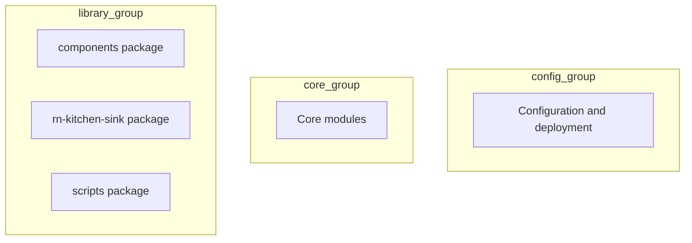

# Architecture report: ant-design/ant-design-mobile-rn

> Automated static analysis. **Observed** = directly seen in files/imports/AST; **Inferred** = interpretation from that evidence. Repository code was not executed.

## 1. Repository at a glance

| Item | Value |
| --- | --- |
| Repository | ant-design/ant-design-mobile-rn |
| Description | Ant Design for React Native |
| Language | TypeScript |
| Stars | 3343 |
| Licence | MIT |
| Analysed commit / branch | ebf8a8d2f8808623893980eaebb7ca6b5c0a77c1 / master |
| Framework(s) | React |
| Files analysed | 800 |
| Components | 5 |

## 2. Architecture in one minute

ant-design/ant-design-mobile-rn - Ant Design for React Native. This repository was analysed statically from 800 file(s) (0 Python). Detected technologies (observed from imports/manifests): GitHub Actions, React, Jest, TypeScript. Files are grouped into 5 component(s): components package, Configuration and deployment, Core modules, rn-kitchen-sink package, scripts package. Findings below distinguish observed facts from inferred interpretation.

## 3. High-level block diagram

## 4. Main components

### components package (`components`)

- **Kind:** library
- **Status:** Observed
- **Confidence:** 0.85
- **Responsibility:** Groups 430 file(s) under components package (observed from repository paths and static analysis).
- **Paths:** `components/_util/devWarning.tsx`, `components/_util/getLocale.tsx`, `components/_util/hooks/useAnimations.tsx`, `components/_util/hooks/useClickAway.ts`, `components/_util/hooks/useClickAway.web.ts`, `components/_util/hooks/useScroll.ts`, `components/_util/isPromise.ts`, `components/_util/reactNode.ts`, `components/_util/traverse-react-node.tsx`, `components/_util/with-default-props.tsx`, `components/accordion/__tests__/demo.test.js`, `components/accordion/demo/basic.tsx`, `components/accordion/index.tsx`, `components/accordion/style/index.tsx`, `components/action-sheet/AndroidContainer.tsx`, `components/action-sheet/__tests__/demo.test.js`, `components/action-sheet/demo/basic.tsx`, `components/action-sheet/index.native.tsx`, `components/action-sheet/index.tsx`, `components/action-sheet/style/index.tsx`, `components/activity-indicator/__tests__/demo.test.js`, `components/activity-indicator/demo/basic.tsx`, `components/activity-indicator/index.tsx`, `components/activity-indicator/style/index.tsx`, `components/badge/__tests__/demo.test.js`, `components/badge/__tests__/index.test.js`, `components/badge/demo/basic.tsx`, `components/badge/index.tsx`, `components/badge/style/index.tsx`, `components/button/ButtonWave.tsx`, `components/button/PropsType.tsx`, `components/button/__tests__/demo.test.js`, `components/button/__tests__/index.test.js`, `components/button/demo/basic.tsx`, `components/button/index.tsx`, `components/button/style/index.tsx`, `components/card/CardBody.tsx`, `components/card/CardFooter.tsx`, `components/card/CardHeader.tsx`, `components/card/__tests__/demo.test.js`, `components/card/demo/basic.tsx`, `components/card/index.tsx`, `components/card/style/index.tsx`, `components/carousel/PropsType.tsx`, `components/carousel/__tests__/demo.test.js`, `components/carousel/demo/basic.tsx`, `components/carousel/index.tsx`, `components/carousel/style/index.tsx`, `components/checkbox/AgreeItem.tsx`, `components/checkbox/Checkbox.tsx`, `components/checkbox/CheckboxItem.tsx`, `components/checkbox/PropsType.tsx`, `components/checkbox/__tests__/demo.test.js`, `components/checkbox/demo/basic.tsx`, `components/checkbox/index.tsx`, `components/checkbox/style/index.tsx`, `components/collapse/CollapsePanelContent.tsx`, `components/collapse/PropsType.tsx`, `components/collapse/collapse.tsx`, `components/collapse/demo/basic.tsx`, `components/collapse/index.tsx`, `components/date-picker-view/PropsType.tsx`, `components/date-picker-view/date-picker-view.tsx`, `components/date-picker-view/demo/basic.tsx`, `components/date-picker-view/index.tsx`, `components/date-picker-view/locale/en_US.tsx`, `components/date-picker-view/locale/es_ES.tsx`, `components/date-picker-view/locale/fa_IR.tsx`, `components/date-picker-view/locale/id_ID.tsx`, `components/date-picker-view/locale/ko_KR.tsx`, `components/date-picker-view/locale/pt_BR.tsx`, `components/date-picker-view/locale/ru_RU.tsx`, `components/date-picker-view/locale/sv_SE.tsx`, `components/date-picker-view/locale/zh_CN.tsx`, `components/date-picker-view/useRenderLabel.ts`, `components/date-picker/PropsType.tsx`, `components/date-picker/columns-extend.tsx`, `components/date-picker/date-picker-date-utils.ts`, `components/date-picker/date-picker-utils.ts`, `components/date-picker/date-picker-week-utils.ts`, `components/date-picker/date-picker.tsx`, `components/date-picker/datepicker/locale/ko_KR.tsx`, `components/date-picker/demo/basic.tsx`, `components/date-picker/index.tsx`, `components/date-picker/locale/en_US.tsx`, `components/date-picker/locale/es_ES.tsx`, `components/date-picker/locale/fa_IR.tsx`, `components/date-picker/locale/id_ID.tsx`, `components/date-picker/locale/ko_KR.tsx`, `components/date-picker/locale/pt_BR.tsx`, `components/date-picker/locale/ru_RU.tsx`, `components/date-picker/locale/sv_SE.tsx`, `components/date-picker/locale/zh_CN.tsx`, `components/date-picker/util.ts`, `components/divider/Divider.tsx`, `components/divider/Line.tsx`, `components/divider/PropsType.tsx`, `components/divider/__tests__/demo.test.js`, `components/divider/demo/basic.tsx`, `components/divider/index.tsx`, `components/divider/style/index.tsx`, `components/drawer/PropsType.tsx`, `components/drawer/__tests__/demo.test.js`, `components/drawer/__tests__/index.test.js`, `components/drawer/demo/basic.tsx`, `components/drawer/index.tsx`, `components/flex/Flex.tsx`, `components/flex/FlexItem.tsx`, `components/flex/PropsType.tsx`, `components/flex/__tests__/demo.test.js`, `components/flex/demo/basic.tsx`, `components/flex/index.tsx`, `components/form/ErrorList.tsx`, `components/form/Form.tsx`, `components/form/FormItem/ItemHolder.tsx`, `components/form/FormItem/StatusProvider.tsx`, `components/form/FormItem/index.tsx`, `components/form/FormItemLabel.tsx`, `components/form/FormList.tsx`, `components/form/PropsType.tsx`, `components/form/context.tsx`, `components/form/demo/basic.tsx`, `components/form/hooks/useChildren.ts`, `components/form/hooks/useDebounce.ts`, `components/form/hooks/useForm.ts`, `components/form/hooks/useFormInstance.ts`, `components/form/hooks/useFormItemStatus.ts`, `components/form/hooks/useFormWarning.ts`, `components/form/hooks/useFrameState.ts`, `components/form/hooks/useItemRef.ts`, `components/form/index.ts`, `components/form/interface.ts`, `components/form/locale/en_US.tsx`, `components/form/locale/es_ES.tsx`, `components/form/locale/fa_IR.tsx`, `components/form/locale/id_ID.tsx`, `components/form/locale/ko_KR.tsx`, `components/form/locale/pt_BR.tsx`, `components/form/locale/ru_RU.tsx`, `components/form/locale/sv_SE.tsx`, `components/form/locale/zh_CN.tsx`, `components/form/style/index.tsx`, `components/form/util.ts`, `components/form/validateMessagesContext.tsx`, `components/grid/PropsType.tsx`, `components/grid/__tests__/demo.test.js`, `components/grid/demo/basic.tsx`, `components/grid/index.tsx`, `components/grid/style/index.tsx`, `components/icon/__tests__/demo.test.js`, `components/icon/demo/basic.tsx`, `components/icon/index.tsx`, `components/index.tsx`, `components/input-item/Input.tsx`, `components/input-item/PropsType.tsx`, `components/input-item/__tests__/demo.test.js`, `components/input-item/demo/basic.tsx`, `components/input-item/index.tsx`, `components/input-item/locale/en_US.tsx`, `components/input-item/locale/es_ES.tsx`, `components/input-item/locale/fa_IR.tsx`, `components/input-item/locale/ko_KR.tsx`, `components/input-item/locale/pt_BR.tsx`, `components/input-item/locale/ru_RU.tsx`, `components/input-item/locale/sv_SE.tsx`, `components/input-item/locale/zh_CN.tsx`, `components/input-item/style/index.tsx`, `components/input/Input.tsx`, `components/input/Item.tsx`, `components/input/PropsType.tsx`, `components/input/TextArea/index.android.tsx`, `components/input/TextArea/index.tsx`, `components/input/TextArea/index.web.tsx`, `components/input/demo/basic.tsx`, `components/input/index.tsx`, `components/input/style/index.tsx`, `components/input/style/textarea.tsx`, `components/list-view/demo/basic.tsx`, `components/list-view/index.tsx`, `components/list-view/locale/en_US.tsx`, `components/list-view/locale/es_ES.tsx`, `components/list-view/locale/fa_IR.tsx`, `components/list-view/locale/ko_KR.tsx`, `components/list-view/locale/pt_BR.tsx`, `components/list-view/locale/ru_RU.tsx`, `components/list-view/locale/sv_SE.tsx`, `components/list-view/locale/zh_CN.tsx`, `components/list/Brief.tsx`, `components/list/List.tsx`, `components/list/ListItem.tsx`, `components/list/PropsType.tsx`, `components/list/__tests__/demo.test.js`, `components/list/demo/basic.tsx`, `components/list/index.tsx`, `components/list/style/index.tsx`, `components/locale-provider/en_US.tsx`, `components/locale-provider/es_ES.tsx`, `components/locale-provider/fa_IR.tsx`, `components/locale-provider/index.tsx`, `components/locale-provider/ko_KR.tsx`, `components/locale-provider/pt_BR.tsx`, `components/locale-provider/ru_RU.tsx`, `components/locale-provider/sv_SE.tsx`, `components/locale-provider/useLocale.tsx`, `components/locale-provider/zh_CN.tsx`, `components/modal/AlertContainer.tsx`, `components/modal/Modal.tsx`, `components/modal/ModalView.tsx`, `components/modal/OperationContainer.tsx`, `components/modal/PromptContainer.tsx`, `components/modal/PropsType.tsx`, `components/modal/__tests__/demo.test.js`, `components/modal/alert.tsx`, `components/modal/demo/basic.tsx`, `components/modal/index.tsx`, `components/modal/locale/en_US.tsx`, `components/modal/locale/es_ES.tsx`, `components/modal/locale/fa_IR.tsx`, `components/modal/locale/ko_KR.tsx`, `components/modal/locale/pt_BR.tsx`, `components/modal/locale/ru_RU.tsx`, `components/modal/locale/sv_SE.tsx`, `components/modal/locale/zh_CN.tsx`, `components/modal/operation.tsx`, `components/modal/prompt.tsx`, `components/modal/style/index.tsx`, `components/modal/style/prompt.tsx`, `components/modal/useModal/index.tsx`, `components/notice-bar/Marquee.tsx`, `components/notice-bar/PropsType.tsx`, `components/notice-bar/demo/basic.tsx`, `components/notice-bar/index.tsx`, `components/notice-bar/notice-bar.tsx`, `components/notice-bar/style/index.tsx`, `components/pagination/PropsType.tsx`, `components/pagination/__tests__/demo.test.js`, `components/pagination/__tests__/index.test.js`, `components/pagination/demo/basic.tsx`, `components/pagination/index.tsx`, `components/pagination/locale/en_US.tsx`, `components/pagination/locale/es_ES.tsx`, `components/pagination/locale/fa_IR.tsx`, `components/pagination/locale/ko_KR.tsx`, `components/pagination/locale/pt_BR.tsx`, `components/pagination/locale/ru_RU.tsx`, `components/pagination/locale/sv_SE.tsx`, `components/pagination/locale/zh_CN.tsx`, `components/pagination/style/index.tsx`, `components/picker-view/PropsType.tsx`, `components/picker-view/Wheel.tsx`, `components/picker-view/columns-extend.tsx`, `components/picker-view/demo/basic.tsx`, `components/picker-view/index.tsx`, `components/picker-view/picker-view.tsx`, `components/picker-view/style/index.tsx`, `components/picker/Picker.tsx`, `components/picker/Popup.tsx`, `components/picker/PopupPickerTypes.tsx`, `components/picker/PropsType.tsx`, `components/picker/__tests__/demo.test.js`, `components/picker/__tests__/index.test.js`, `components/picker/demo/basic.tsx`, `components/picker/index.tsx`, `components/picker/locale/en_US.tsx`, `components/picker/locale/es_ES.tsx`, `components/picker/locale/fa_IR.tsx`, `components/picker/locale/id_ID.tsx`, `components/picker/locale/ko_KR.tsx`, `components/picker/locale/pt_BR.tsx`, `components/picker/locale/ru_RU.tsx`, `components/picker/locale/sv_SE.tsx`, `components/picker/locale/zh_CN.tsx`, `components/picker/style/index.tsx`, `components/popover/__tests__/demo.test.js`, `components/popover/__tests__/index.test.js`, `components/popover/demo/basic.tsx`, `components/popover/index.tsx`, `components/popover/style/index.tsx`, `components/portal/demo/basic.tsx`, `components/portal/index.tsx`, `components/portal/portal-consumer.tsx`, `components/portal/portal-host.tsx`, `components/portal/portal-manager.tsx`, `components/portal/portal.tsx`, `components/progress/__tests__/demo.test.js`, `components/progress/__tests__/index.test.js`, `components/progress/demo/basic.tsx`, `components/progress/index.tsx`, `components/progress/style/index.tsx`, `components/provider/AccessibilityContext.tsx`, `components/provider/DisabledContext.tsx`, `components/provider/HapticsContext.tsx`, `components/provider/__tests__/demo.test.js`, `components/provider/demo/basic.tsx`, `components/provider/index.tsx`, `components/radio/PropsType.tsx`, `components/radio/Radio.tsx`, `components/radio/RadioContext.tsx`, `components/radio/RadioGroup.tsx`, `components/radio/RadioItem.tsx`, `components/radio/__tests__/demo.test.js`, `components/radio/demo/basic.tsx`, `components/radio/index.tsx`, `components/radio/style/index.tsx`, `components/rate/AnimatedIcon.tsx`, `components/rate/PropsType.tsx`, `components/rate/RateIcon.tsx`, `components/rate/__tests__/demo.test.js`, `components/rate/constants.ts`, `components/rate/demo/basic.tsx`, `components/rate/index.tsx`, `components/rate/style/index.tsx`, `components/rate/utils.ts`, `components/result/PropsType.tsx`, `components/result/__tests__/demo.test.js`, `components/result/__tests__/index.test.js`, `components/result/demo/basic.tsx`, `components/result/index.tsx`, `components/result/style/index.tsx`, `components/search-bar/PropsType.tsx`, `components/search-bar/__tests__/demo.test.js`, `components/search-bar/__tests__/index.test.js`, `components/search-bar/demo/basic.tsx`, `components/search-bar/index.tsx`, `components/search-bar/locale/en_US.tsx`, `components/search-bar/locale/es_ES.tsx`, `components/search-bar/locale/fa_IR.tsx`, `components/search-bar/locale/ko_KR.tsx`, `components/search-bar/locale/pt_BR.tsx`, `components/search-bar/locale/ru_RU.tsx`, `components/search-bar/locale/sv_SE.tsx`, `components/search-bar/locale/zh_CN.tsx`, `components/search-bar/style/index.tsx`, `components/skeleton/PropsType.tsx`, `components/skeleton/Skeleton.tsx`, `components/skeleton/SkeletonParagraph.tsx`, `components/skeleton/SkeletonProvider.tsx`, `components/skeleton/SkeletonTitle.tsx`, `components/skeleton/__tests__/demo.test.js`, `components/skeleton/demo/basic.tsx`, `components/skeleton/index.tsx`, `components/skeleton/style/index.tsx`, `components/slider/PropsType.tsx`, `components/slider/demo/basic.tsx`, `components/slider/index.tsx`, `components/slider/marks.tsx`, `components/slider/slider.tsx`, `components/slider/style/index.tsx`, `components/slider/thumb-icon.tsx`, `components/slider/thumb-popover.tsx`, `components/slider/thumb.tsx`, `components/slider/ticks.tsx`, `components/stepper/PropsType.tsx`, `components/stepper/__tests__/demo.test.js`, `components/stepper/demo/basic.tsx`, `components/stepper/index.tsx`, `components/stepper/stepper.tsx`, `components/stepper/style/index.tsx`, `components/steps/StepsItem.tsx`, `components/steps/__tests__/demo.test.js`, `components/steps/demo/basic.tsx`, `components/steps/index.tsx`, `components/steps/style/index.tsx`, `components/style/index.tsx`, `components/style/themes/default.tsx`, `components/swipe-action/PropsType.tsx`, `components/swipe-action/RenderActions.tsx`, `components/swipe-action/__tests__/demo.test.js`, `components/swipe-action/demo/basic.tsx`, `components/swipe-action/index.tsx`, `components/swipe-action/style/index.tsx`, `components/swipe-action/swipe-action.tsx`, `components/switch/PropsType.tsx`, `components/switch/Switch.tsx`, `components/switch/__tests__/demo.test.js`, `components/switch/demo/basic.tsx`, `components/switch/index.tsx`, `components/switch/style/index.tsx`, `components/tab-bar/PropsType.tsx`, `components/tab-bar/TabBarItem.tsx`, `components/tab-bar/__tests__/demo.test.js`, `components/tab-bar/demo/basic.tsx`, `components/tab-bar/index.tsx`, `components/tab-bar/style/index.tsx`, `components/tabs/DefaultTabBar.tsx`, `components/tabs/PropsType.tsx`, `components/tabs/Tabs.tsx`, `components/tabs/__tests__/dome.test.js`, `components/tabs/demo/basic.tsx`, `components/tabs/index.tsx`, `components/tabs/style/index.tsx`, `components/tabs/style/tabs.tsx`, `components/tag/PropsType.tsx`, `components/tag/__tests__/demo.test.js`, `components/tag/__tests__/index.test.js`, `components/tag/demo/basic.tsx`, `components/tag/index.tsx`, `components/tag/style/index.tsx`, `components/text/index.tsx`, `components/textarea-item/PropsType.tsx`, `components/textarea-item/__tests__/demo.test.js`, `components/textarea-item/demo/basic.tsx`, `components/textarea-item/index.tsx`, `components/textarea-item/style/index.tsx`, `components/toast/PropsType.tsx`, `components/toast/ToastContainer.tsx`, `components/toast/__tests__/demo.test.js`, `components/toast/demo/basic.tsx`, `components/toast/index.tsx`, `components/toast/methods.tsx`, `components/toast/style/index.tsx`, `components/toast/useToast/index.tsx`, `components/tooltip/PropsType.tsx`, `components/tooltip/Tooltip.tsx`, `components/tooltip/TooltipMenu.tsx`, `components/tooltip/Wrapper.tsx`, `components/tooltip/demo/basic.tsx`, `components/tooltip/index.tsx`, `components/tooltip/normalize-placement.ts`, `components/tooltip/style/index.tsx`, `components/types.ts`, `components/view/__tests__/demo.test.js`, `components/view/demo/basic.tsx`, `components/view/index.tsx`, `components/white-space/__tests__/demo.test.js`, `components/white-space/demo/basic.tsx`, `components/white-space/index.tsx`, `components/wing-blank/__tests__/demo.test.js`, `components/wing-blank/demo/basic.tsx`, `components/wing-blank/index.tsx`
- **Evidence:** [components/_util/devWarning.tsx](https://github.com/ant-design/ant-design-mobile-rn/blob/ebf8a8d2f8808623893980eaebb7ca6b5c0a77c1/components/_util/devWarning.tsx); [components/_util/getLocale.tsx](https://github.com/ant-design/ant-design-mobile-rn/blob/ebf8a8d2f8808623893980eaebb7ca6b5c0a77c1/components/_util/getLocale.tsx); [components/_util/hooks/useAnimations.tsx](https://github.com/ant-design/ant-design-mobile-rn/blob/ebf8a8d2f8808623893980eaebb7ca6b5c0a77c1/components/_util/hooks/useAnimations.tsx); [components/_util/hooks/useClickAway.ts](https://github.com/ant-design/ant-design-mobile-rn/blob/ebf8a8d2f8808623893980eaebb7ca6b5c0a77c1/components/_util/hooks/useClickAway.ts); [components/_util/hooks/useClickAway.web.ts](https://github.com/ant-design/ant-design-mobile-rn/blob/ebf8a8d2f8808623893980eaebb7ca6b5c0a77c1/components/_util/hooks/useClickAway.web.ts); [components/_util/hooks/useScroll.ts](https://github.com/ant-design/ant-design-mobile-rn/blob/ebf8a8d2f8808623893980eaebb7ca6b5c0a77c1/components/_util/hooks/useScroll.ts); [components/_util/isPromise.ts](https://github.com/ant-design/ant-design-mobile-rn/blob/ebf8a8d2f8808623893980eaebb7ca6b5c0a77c1/components/_util/isPromise.ts); [components/_util/reactNode.ts](https://github.com/ant-design/ant-design-mobile-rn/blob/ebf8a8d2f8808623893980eaebb7ca6b5c0a77c1/components/_util/reactNode.ts)

### Configuration and deployment (`config`)

- **Kind:** config
- **Status:** Observed
- **Confidence:** 0.85
- **Responsibility:** Groups 7 file(s) under configuration and deployment (observed from repository paths and static analysis).
- **Paths:** `components/_util/version.json`, `components/picker/demo/data.json`, `package.json`, `rn-kitchen-sink/android/app/build.gradle`, `rn-kitchen-sink/android/build.gradle`, `rn-kitchen-sink/ios/KitchenSink/Images.xcassets/AppIcon.appiconset/Contents.json`, `rn-kitchen-sink/ios/KitchenSink/Images.xcassets/Contents.json`
- **Evidence:** [components/_util/version.json](https://github.com/ant-design/ant-design-mobile-rn/blob/ebf8a8d2f8808623893980eaebb7ca6b5c0a77c1/components/_util/version.json); [components/picker/demo/data.json](https://github.com/ant-design/ant-design-mobile-rn/blob/ebf8a8d2f8808623893980eaebb7ca6b5c0a77c1/components/picker/demo/data.json); [package.json](https://github.com/ant-design/ant-design-mobile-rn/blob/ebf8a8d2f8808623893980eaebb7ca6b5c0a77c1/package.json); [rn-kitchen-sink/android/app/build.gradle](https://github.com/ant-design/ant-design-mobile-rn/blob/ebf8a8d2f8808623893980eaebb7ca6b5c0a77c1/rn-kitchen-sink/android/app/build.gradle); [rn-kitchen-sink/android/build.gradle](https://github.com/ant-design/ant-design-mobile-rn/blob/ebf8a8d2f8808623893980eaebb7ca6b5c0a77c1/rn-kitchen-sink/android/build.gradle); [rn-kitchen-sink/ios/KitchenSink/Images.xcassets/AppIcon.appiconset/Contents.json](https://github.com/ant-design/ant-design-mobile-rn/blob/ebf8a8d2f8808623893980eaebb7ca6b5c0a77c1/rn-kitchen-sink/ios/KitchenSink/Images.xcassets/AppIcon.appiconset/Contents.json); [rn-kitchen-sink/ios/KitchenSink/Images.xcassets/Contents.json](https://github.com/ant-design/ant-design-mobile-rn/blob/ebf8a8d2f8808623893980eaebb7ca6b5c0a77c1/rn-kitchen-sink/ios/KitchenSink/Images.xcassets/Contents.json)

### Core modules (`core`)

- **Kind:** core
- **Status:** Observed
- **Confidence:** 0.85
- **Responsibility:** Groups 6 file(s) under core modules (observed from repository paths and static analysis).
- **Paths:** `babel.config.js`, `eslint.config.js`, `index.js`, `jestSetup.js`, `metro.config.js`, `react-native.config.js`
- **Evidence:** [babel.config.js](https://github.com/ant-design/ant-design-mobile-rn/blob/ebf8a8d2f8808623893980eaebb7ca6b5c0a77c1/babel.config.js); [eslint.config.js](https://github.com/ant-design/ant-design-mobile-rn/blob/ebf8a8d2f8808623893980eaebb7ca6b5c0a77c1/eslint.config.js); [index.js](https://github.com/ant-design/ant-design-mobile-rn/blob/ebf8a8d2f8808623893980eaebb7ca6b5c0a77c1/index.js); [jestSetup.js](https://github.com/ant-design/ant-design-mobile-rn/blob/ebf8a8d2f8808623893980eaebb7ca6b5c0a77c1/jestSetup.js); [metro.config.js](https://github.com/ant-design/ant-design-mobile-rn/blob/ebf8a8d2f8808623893980eaebb7ca6b5c0a77c1/metro.config.js); [react-native.config.js](https://github.com/ant-design/ant-design-mobile-rn/blob/ebf8a8d2f8808623893980eaebb7ca6b5c0a77c1/react-native.config.js)

### rn-kitchen-sink package (`rn_kitchen_sink`)

- **Kind:** library
- **Status:** Observed
- **Confidence:** 0.85
- **Responsibility:** Groups 8 file(s) under rn-kitchen-sink package (observed from repository paths and static analysis).
- **Paths:** `rn-kitchen-sink/App.js`, `rn-kitchen-sink/android/app/src/debug/java/com/kitchensink/ReactNativeFlipper.java`, `rn-kitchen-sink/android/app/src/main/java/com/kitchensink/MainActivity.java`, `rn-kitchen-sink/android/app/src/main/java/com/kitchensink/MainApplication.java`, `rn-kitchen-sink/components/Theme.js`, `rn-kitchen-sink/components/index.js`, `rn-kitchen-sink/demoList.js`, `rn-kitchen-sink/ios/KitchenSink/AppDelegate.h`
- **Evidence:** [rn-kitchen-sink/App.js](https://github.com/ant-design/ant-design-mobile-rn/blob/ebf8a8d2f8808623893980eaebb7ca6b5c0a77c1/rn-kitchen-sink/App.js); [rn-kitchen-sink/android/app/src/debug/java/com/kitchensink/ReactNativeFlipper.java](https://github.com/ant-design/ant-design-mobile-rn/blob/ebf8a8d2f8808623893980eaebb7ca6b5c0a77c1/rn-kitchen-sink/android/app/src/debug/java/com/kitchensink/ReactNativeFlipper.java); [rn-kitchen-sink/android/app/src/main/java/com/kitchensink/MainActivity.java](https://github.com/ant-design/ant-design-mobile-rn/blob/ebf8a8d2f8808623893980eaebb7ca6b5c0a77c1/rn-kitchen-sink/android/app/src/main/java/com/kitchensink/MainActivity.java); [rn-kitchen-sink/android/app/src/main/java/com/kitchensink/MainApplication.java](https://github.com/ant-design/ant-design-mobile-rn/blob/ebf8a8d2f8808623893980eaebb7ca6b5c0a77c1/rn-kitchen-sink/android/app/src/main/java/com/kitchensink/MainApplication.java); [rn-kitchen-sink/components/Theme.js](https://github.com/ant-design/ant-design-mobile-rn/blob/ebf8a8d2f8808623893980eaebb7ca6b5c0a77c1/rn-kitchen-sink/components/Theme.js); [rn-kitchen-sink/components/index.js](https://github.com/ant-design/ant-design-mobile-rn/blob/ebf8a8d2f8808623893980eaebb7ca6b5c0a77c1/rn-kitchen-sink/components/index.js); [rn-kitchen-sink/demoList.js](https://github.com/ant-design/ant-design-mobile-rn/blob/ebf8a8d2f8808623893980eaebb7ca6b5c0a77c1/rn-kitchen-sink/demoList.js); [rn-kitchen-sink/ios/KitchenSink/AppDelegate.h](https://github.com/ant-design/ant-design-mobile-rn/blob/ebf8a8d2f8808623893980eaebb7ca6b5c0a77c1/rn-kitchen-sink/ios/KitchenSink/AppDelegate.h)

### scripts package (`scripts`)

- **Kind:** library
- **Status:** Observed
- **Confidence:** 0.85
- **Responsibility:** Groups 1 file(s) under scripts package (observed from repository paths and static analysis).
- **Paths:** `scripts/copy-app-res.js`
- **Evidence:** [scripts/copy-app-res.js](https://github.com/ant-design/ant-design-mobile-rn/blob/ebf8a8d2f8808623893980eaebb7ca6b5c0a77c1/scripts/copy-app-res.js)

## 5. Execution flow

**Observed** entry point(s):

- [.dumi/pages/404/index.tsx](https://github.com/ant-design/ant-design-mobile-rn/blob/ebf8a8d2f8808623893980eaebb7ca6b5c0a77c1/.dumi/pages/404/index.tsx)
- [components/accordion/index.tsx](https://github.com/ant-design/ant-design-mobile-rn/blob/ebf8a8d2f8808623893980eaebb7ca6b5c0a77c1/components/accordion/index.tsx)
- [components/accordion/style/index.tsx](https://github.com/ant-design/ant-design-mobile-rn/blob/ebf8a8d2f8808623893980eaebb7ca6b5c0a77c1/components/accordion/style/index.tsx)
- [components/action-sheet/index.tsx](https://github.com/ant-design/ant-design-mobile-rn/blob/ebf8a8d2f8808623893980eaebb7ca6b5c0a77c1/components/action-sheet/index.tsx)
- [components/action-sheet/style/index.tsx](https://github.com/ant-design/ant-design-mobile-rn/blob/ebf8a8d2f8808623893980eaebb7ca6b5c0a77c1/components/action-sheet/style/index.tsx)
- [components/activity-indicator/index.tsx](https://github.com/ant-design/ant-design-mobile-rn/blob/ebf8a8d2f8808623893980eaebb7ca6b5c0a77c1/components/activity-indicator/index.tsx)
- [components/activity-indicator/style/index.tsx](https://github.com/ant-design/ant-design-mobile-rn/blob/ebf8a8d2f8808623893980eaebb7ca6b5c0a77c1/components/activity-indicator/style/index.tsx)
- [components/badge/index.tsx](https://github.com/ant-design/ant-design-mobile-rn/blob/ebf8a8d2f8808623893980eaebb7ca6b5c0a77c1/components/badge/index.tsx)
- [components/badge/style/index.tsx](https://github.com/ant-design/ant-design-mobile-rn/blob/ebf8a8d2f8808623893980eaebb7ca6b5c0a77c1/components/badge/style/index.tsx)
- [components/button/index.tsx](https://github.com/ant-design/ant-design-mobile-rn/blob/ebf8a8d2f8808623893980eaebb7ca6b5c0a77c1/components/button/index.tsx)
- [components/button/style/index.tsx](https://github.com/ant-design/ant-design-mobile-rn/blob/ebf8a8d2f8808623893980eaebb7ca6b5c0a77c1/components/button/style/index.tsx)
- [example/index.js](https://github.com/ant-design/ant-design-mobile-rn/blob/ebf8a8d2f8808623893980eaebb7ca6b5c0a77c1/example/index.js)

Representative flow (derived from observed entry points and the import graph; steps beyond the entry point are **Inferred**):

1. Execution starts at an observed entry point listed above, if present.
2. No internal import relationships between components were observed.

## 6. Project structure

### `(root)`

- `.buckconfig` - other (114 bytes)
- `.dumirc.ts` - source, TypeScript (4552 bytes)
- `.editorconfig` - config (167 bytes)
- `.flowconfig` - other (1946 bytes)
- `.gitignore` - other (956 bytes)
- `.jest.config.js` - source, JavaScript (1204 bytes)
- `.npmignore` - other (31 bytes)
- `.nvmrc` - other (2 bytes)
- `.prettierrc` - other (119 bytes)
- `.travis.yml` - ci, YAML (647 bytes)
- `.watchmanconfig` - other (2 bytes)
- `AGENTS.md` - docs (5597 bytes)
- `AUTHORS.txt` - docs (1658 bytes)
- `CHANGELOG.en-US.md` - docs (20074 bytes)
- `CHANGELOG.zh-CN.md` - docs (20567 bytes)
- `CLAUDE.md` - docs (128 bytes)
- `CNAME` - other (21 bytes)
- `LICENSE` - docs (1100 bytes)
- `README.md` - docs (7482 bytes)
- `README.zh-CN.md` - docs (6963 bytes)
- `babel.config.js` - source, JavaScript (905 bytes)
- `development.en-US.md` - docs (3820 bytes)
- `development.zh-CN.md` - docs (3417 bytes)
- `eslint.config.js` - source, JavaScript (1510 bytes)
- `index.js` - source, JavaScript (31 bytes)
- `jestSetup.js` - source, JavaScript (1016 bytes)
- `metro.config.js` - source, JavaScript (299 bytes)
- `package.json` - manifest (5086 bytes)
- `react-native.config.js` - source, JavaScript (174 bytes)

### `.dumi`

- `.dumi/_llms/accordion/semantic.md` - docs (922 bytes)
- `.dumi/_llms/action-sheet/semantic.md` - docs (1290 bytes)
- `.dumi/_llms/activity-indicator/semantic.md` - docs (1092 bytes)
- `.dumi/_llms/badge/semantic.md` - docs (1187 bytes)
- `.dumi/_llms/button/semantic.md` - docs (1636 bytes)
- `.dumi/_llms/card/semantic.md` - docs (2977 bytes)
- `.dumi/_llms/carousel/semantic.md` - docs (1352 bytes)
- `.dumi/_llms/checkbox/semantic.md` - docs (1442 bytes)
- `.dumi/_llms/divider/semantic.md` - docs (1848 bytes)
- `.dumi/_llms/form/semantic.md` - docs (2211 bytes)
- `.dumi/_llms/grid/semantic.md` - docs (1630 bytes)
- `.dumi/_llms/input-item/semantic.md` - docs (1649 bytes)
- `.dumi/_llms/input/semantic.md` - docs (1642 bytes)
- `.dumi/_llms/list/semantic.md` - docs (1894 bytes)
- `.dumi/_llms/modal/semantic.md` - docs (1946 bytes)
- `.dumi/_llms/notice-bar/semantic.md` - docs (1510 bytes)
- `.dumi/_llms/pagination/semantic.md` - docs (2165 bytes)
- `.dumi/_llms/picker-view/semantic.md` - docs (2410 bytes)
- `.dumi/_llms/picker/semantic.md` - docs (2679 bytes)
- `.dumi/_llms/popover/semantic.md` - docs (1114 bytes)
- `.dumi/_llms/progress/semantic.md` - docs (823 bytes)
- `.dumi/_llms/radio/semantic.md` - docs (903 bytes)
- `.dumi/_llms/rate/semantic.md` - docs (1016 bytes)
- `.dumi/_llms/result/semantic.md` - docs (1298 bytes)
- `.dumi/_llms/search-bar/semantic.md` - docs (705 bytes)
- `.dumi/_llms/skeleton/semantic.md` - docs (1092 bytes)
- `.dumi/_llms/slider/semantic.md` - docs (3283 bytes)
- `.dumi/_llms/stepper/semantic.md` - docs (1915 bytes)
- `.dumi/_llms/steps/semantic.md` - docs (2087 bytes)
- `.dumi/_llms/swipe-action/semantic.md` - docs (1797 bytes)
- `.dumi/_llms/switch/semantic.md` - docs (2323 bytes)
- `.dumi/_llms/tab-bar/semantic.md` - docs (2310 bytes)
- `.dumi/_llms/tabs/semantic.md` - docs (2843 bytes)
- `.dumi/_llms/tag/semantic.md` - docs (1984 bytes)
- `.dumi/_llms/textarea-item/semantic.md` - docs (1195 bytes)
- `.dumi/_llms/toast/semantic.md` - docs (1321 bytes)
- `.dumi/_llms/tooltip/semantic.md` - docs (1208 bytes)
- `.dumi/global.less` - other (343 bytes)
- `.dumi/global.tsx` - source, TypeScript (436 bytes)
- `.dumi/loaders/type-only-stub-loader.js` - source, JavaScript (788 bytes)
- `.dumi/pages/404/index.tsx` - source, TypeScript (551 bytes)
- `.dumi/pages/index-cn/codes/code.tsx` - source, TypeScript (1337 bytes)
- `.dumi/pages/index-cn/index.md` - docs (121 bytes)
- `.dumi/pages/index/codes/code.tsx` - source, TypeScript (1337 bytes)
- `.dumi/pages/index/index.md` - docs (127 bytes)
- `.dumi/theme.d.ts` - source, TypeScript (109 bytes)
- `.dumi/theme/builtins/Homepage/components/Copilot/XChat.tsx` - source, TypeScript (12657 bytes)
- `.dumi/theme/builtins/Homepage/components/Copilot/demoPng.ts` - source, TypeScript (77470 bytes)
- `.dumi/theme/builtins/Homepage/components/Copilot/index.less` - other (687 bytes)
- `.dumi/theme/builtins/Homepage/components/Copilot/index.tsx` - source, TypeScript (1084 bytes)
- `.dumi/theme/builtins/Homepage/components/Copilot/local.ts` - source, TypeScript (13464 bytes)
- `.dumi/theme/builtins/Homepage/components/Copilot/promptTemplate.ts` - source, TypeScript (2971 bytes)
- `.dumi/theme/builtins/Homepage/components/Previewer/index.less` - other (180 bytes)
- `.dumi/theme/builtins/Homepage/components/Previewer/index.tsx` - source, TypeScript (2754 bytes)
- `.dumi/theme/builtins/Homepage/index.less` - other (5737 bytes)
- `.dumi/theme/builtins/Homepage/index.tsx` - source, TypeScript (8151 bytes)
- `.dumi/theme/layouts/DocLayout/index.less` - other (2155 bytes)
- `.dumi/theme/layouts/DocLayout/index.tsx` - source, TypeScript (1577 bytes)
- `.dumi/theme/layouts/DocLayout/markdown.less` - other (7350 bytes)
- `.dumi/theme/locales/en-US.json` - config (3028 bytes)
- `.dumi/theme/locales/zh-CN.json` - config (2882 bytes)
- `.dumi/theme/plugin.ts` - source, TypeScript (257 bytes)
- `.dumi/theme/plugins/llms.ts` - source, TypeScript (15849 bytes)
- `.dumi/theme/plugins/routes.ts` - source, TypeScript (1362 bytes)
- `.dumi/theme/plugins/semantic-md.ts` - source, TypeScript (2977 bytes)
- `.dumi/theme/slots/Content/DocAnchor.less` - other (605 bytes)
- `.dumi/theme/slots/Content/DocAnchor.tsx` - source, TypeScript (1940 bytes)
- `.dumi/theme/slots/Content/index.less` - other (2016 bytes)
- `.dumi/theme/slots/Content/index.tsx` - source, TypeScript (2438 bytes)
- `.dumi/theme/slots/Footer/index.less` - other (2541 bytes)
- `.dumi/theme/slots/Footer/index.tsx` - source, TypeScript (5093 bytes)
- `.dumi/theme/slots/Header/index.less` - other (2054 bytes)
- `.dumi/theme/slots/Header/index.tsx` - source, TypeScript (5623 bytes)
- `.dumi/theme/slots/Sidebar/index.less` - other (2982 bytes)
- `.dumi/theme/slots/Sidebar/index.tsx` - source, TypeScript (2465 bytes)
- `.dumi/theme/slots/Sidebar/useMenu.tsx` - source, TypeScript (5181 bytes)
- `.dumi/theme/utils.ts` - source, TypeScript (907 bytes)
- `.dumi/tsconfig.json` - config (124 bytes)

### `.github`

- `.github/CONTRIBUTING.md` - docs (3247 bytes)
- `.github/ISSUE_TEMPLATE/ISSUE_TEMPLATE.md` - docs (395 bytes)
- `.github/ISSUE_TEMPLATE/bug_report.yml` - config (2585 bytes)
- `.github/ISSUE_TEMPLATE/bug_report_zh.yml` - config (2583 bytes)
- `.github/ISSUE_TEMPLATE/config.yml` - config (239 bytes)
- `.github/PULL_REQUEST_TEMPLATE.md` - docs (861 bytes)
- `.github/lock.yml` - config (569 bytes)
- `.github/workflows/issue-close-require.yml` - ci, YAML (1031 bytes)
- `.github/workflows/issue-open-check.yml` - ci, YAML (1211 bytes)

### `.vscode`

- `.vscode/settings.json` - config (219 bytes)

### `components`

- `components/_util/devWarning.tsx` - source, TypeScript (183 bytes)
- `components/_util/getLocale.tsx` - source, TypeScript (1029 bytes)
- `components/_util/hooks/useAnimations.tsx` - source, TypeScript (1713 bytes)
- `components/_util/hooks/useClickAway.ts` - source, TypeScript (1103 bytes)
- `components/_util/hooks/useClickAway.web.ts` - source, TypeScript (1896 bytes)
- `components/_util/hooks/useScroll.ts` - source, TypeScript (867 bytes)
- `components/_util/isPromise.ts` - source, TypeScript (164 bytes)
- `components/_util/reactNode.ts` - source, TypeScript (755 bytes)
- `components/_util/traverse-react-node.tsx` - source, TypeScript (499 bytes)
- `components/_util/version.json` - config (3 bytes)
- `components/_util/with-default-props.tsx` - source, TypeScript (465 bytes)
- `components/accordion/__tests__/__snapshots__/demo.test.js.snap` - other (17375 bytes)
- `components/accordion/__tests__/demo.test.js` - source, JavaScript (81 bytes)
- `components/accordion/demo/basic.md` - docs (1390 bytes)
- `components/accordion/demo/basic.tsx` - source, TypeScript (1109 bytes)
- `components/accordion/index.en-US.md` - docs (1607 bytes)
- `components/accordion/index.tsx` - source, TypeScript (2956 bytes)
- `components/accordion/index.zh-CN.md` - docs (1352 bytes)
- `components/accordion/style/index.tsx` - source, TypeScript (1361 bytes)
- `components/action-sheet/AndroidContainer.tsx` - source, TypeScript (3233 bytes)
- `components/action-sheet/__tests__/__snapshots__/demo.test.js.snap` - other (5426 bytes)
- `components/action-sheet/__tests__/demo.test.js` - source, JavaScript (84 bytes)
- `components/action-sheet/demo/basic.md` - docs (2350 bytes)
- `components/action-sheet/demo/basic.tsx` - source, TypeScript (2161 bytes)
- `components/action-sheet/index.en-US.md` - docs (2584 bytes)
- `components/action-sheet/index.native.tsx` - source, TypeScript (2218 bytes)
- `components/action-sheet/index.tsx` - source, TypeScript (1310 bytes)
- `components/action-sheet/index.zh-CN.md` - docs (2575 bytes)
- `components/action-sheet/style/index.tsx` - source, TypeScript (2088 bytes)
- `components/activity-indicator/__tests__/__snapshots__/demo.test.js.snap` - other (8466 bytes)
- `components/activity-indicator/__tests__/demo.test.js` - source, JavaScript (90 bytes)
- `components/activity-indicator/demo/basic.md` - docs (2970 bytes)
- `components/activity-indicator/demo/basic.tsx` - source, TypeScript (2795 bytes)
- `components/activity-indicator/index.en-US.md` - docs (1237 bytes)
- `components/activity-indicator/index.tsx` - source, TypeScript (1901 bytes)
- `components/activity-indicator/index.zh-CN.md` - docs (1139 bytes)
- `components/activity-indicator/style/index.tsx` - source, TypeScript (1261 bytes)
- `components/badge/__tests__/__snapshots__/demo.test.js.snap` - other (8889 bytes)
- `components/badge/__tests__/demo.test.js` - source, JavaScript (77 bytes)
- `components/badge/__tests__/index.test.js` - source, JavaScript (261 bytes)
- `components/badge/demo/basic.md` - docs (2366 bytes)
- `components/badge/demo/basic.tsx` - source, TypeScript (2151 bytes)
- `components/badge/index.en-US.md` - docs (810 bytes)
- `components/badge/index.tsx` - source, TypeScript (1992 bytes)
- `components/badge/index.zh-CN.md` - docs (969 bytes)
- `components/badge/style/index.tsx` - source, TypeScript (1516 bytes)
- `components/button/ButtonWave.tsx` - source, TypeScript (1064 bytes)
- `components/button/PropsType.tsx` - source, TypeScript (446 bytes)
- `components/button/__tests__/__snapshots__/demo.test.js.snap` - other (32300 bytes)
- `components/button/__tests__/demo.test.js` - source, JavaScript (78 bytes)
- `components/button/__tests__/index.test.js` - source, JavaScript (2643 bytes)
- `components/button/demo/basic.md` - docs (1537 bytes)
- `components/button/demo/basic.tsx` - source, TypeScript (1555 bytes)
- `components/button/index.en-US.md` - docs (2496 bytes)
- `components/button/index.tsx` - source, TypeScript (5115 bytes)
- `components/button/index.zh-CN.md` - docs (2548 bytes)
- `components/button/style/index.tsx` - source, TypeScript (5425 bytes)
- `components/card/CardBody.tsx` - source, TypeScript (663 bytes)
- `components/card/CardFooter.tsx` - source, TypeScript (1503 bytes)
- `components/card/CardHeader.tsx` - source, TypeScript (2152 bytes)
- `components/card/__tests__/__snapshots__/demo.test.js.snap` - other (18733 bytes)
- `components/card/__tests__/demo.test.js` - source, JavaScript (76 bytes)
- `components/card/demo/basic.md` - docs (1692 bytes)
- `components/card/demo/basic.tsx` - source, TypeScript (1517 bytes)
- `components/card/index.en-US.md` - docs (1259 bytes)
- `components/card/index.tsx` - source, TypeScript (1234 bytes)
- `components/card/index.zh-CN.md` - docs (1034 bytes)
- `components/card/style/index.tsx` - source, TypeScript (2143 bytes)
- `components/carousel/PropsType.tsx` - source, TypeScript (1143 bytes)
- `components/carousel/__tests__/__snapshots__/demo.test.js.snap` - other (25780 bytes)
- `components/carousel/__tests__/demo.test.js` - source, JavaScript (80 bytes)
- `components/carousel/demo/basic.md` - docs (3889 bytes)
- `components/carousel/demo/basic.tsx` - source, TypeScript (4111 bytes)
- `components/carousel/index.en-US.md` - docs (3055 bytes)
- `components/carousel/index.tsx` - source, TypeScript (14168 bytes)
- `components/carousel/index.zh-CN.md` - docs (2816 bytes)
- `components/carousel/style/index.tsx` - source, TypeScript (969 bytes)
- `components/checkbox/AgreeItem.tsx` - source, TypeScript (501 bytes)
- `components/checkbox/Checkbox.tsx` - source, TypeScript (5125 bytes)
- `components/checkbox/CheckboxItem.tsx` - source, TypeScript (2664 bytes)
- `components/checkbox/PropsType.tsx` - source, TypeScript (962 bytes)
- `components/checkbox/__tests__/__snapshots__/demo.test.js.snap` - other (90398 bytes)
- `components/checkbox/__tests__/demo.test.js` - source, JavaScript (80 bytes)
- `components/checkbox/demo/basic.md` - docs (2407 bytes)
- `components/checkbox/demo/basic.tsx` - source, TypeScript (4865 bytes)
- `components/checkbox/index.en-US.md` - docs (1049 bytes)
- `components/checkbox/index.tsx` - source, TypeScript (348 bytes)
- `components/checkbox/index.zh-CN.md` - docs (940 bytes)
- `components/checkbox/style/index.tsx` - source, TypeScript (2701 bytes)
- `components/collapse/CollapsePanelContent.tsx` - source, TypeScript (1870 bytes)
- `components/collapse/PropsType.tsx` - source, TypeScript (772 bytes)
- `components/collapse/collapse.tsx` - source, TypeScript (4678 bytes)
- `components/collapse/demo/basic.md` - docs (2957 bytes)
- `components/collapse/demo/basic.tsx` - source, TypeScript (2783 bytes)
- `components/collapse/index.en-US.md` - docs (2037 bytes)
- `components/collapse/index.tsx` - source, TypeScript (320 bytes)
- `components/collapse/index.zh-CN.md` - docs (1973 bytes)
- `components/date-picker-view/PropsType.tsx` - source, TypeScript (993 bytes)
- `components/date-picker-view/date-picker-view.tsx` - source, TypeScript (2686 bytes)
- `components/date-picker-view/demo/basic.md` - docs (2801 bytes)
- `components/date-picker-view/demo/basic.tsx` - source, TypeScript (2545 bytes)
- `components/date-picker-view/index.en-US.md` - docs (1539 bytes)
- `components/date-picker-view/index.tsx` - source, TypeScript (79 bytes)
- `components/date-picker-view/index.zh-CN.md` - docs (1555 bytes)
- `components/date-picker-view/locale/en_US.tsx` - source, TypeScript (105 bytes)
- `components/date-picker-view/locale/es_ES.tsx` - source, TypeScript (105 bytes)
- `components/date-picker-view/locale/fa_IR.tsx` - source, TypeScript (161 bytes)
- `components/date-picker-view/locale/id_ID.tsx` - source, TypeScript (105 bytes)
- `components/date-picker-view/locale/ko_KR.tsx` - source, TypeScript (131 bytes)
- `components/date-picker-view/locale/pt_BR.tsx` - source, TypeScript (125 bytes)
- `components/date-picker-view/locale/ru_RU.tsx` - source, TypeScript (105 bytes)
- `components/date-picker-view/locale/sv_SE.tsx` - source, TypeScript (105 bytes)
- `components/date-picker-view/locale/zh_CN.tsx` - source, TypeScript (145 bytes)
- `components/date-picker-view/useRenderLabel.ts` - source, TypeScript (758 bytes)
- `components/date-picker/PropsType.tsx` - source, TypeScript (1668 bytes)
- `components/date-picker/columns-extend.tsx` - source, TypeScript (1139 bytes)
- `components/date-picker/date-picker-date-utils.ts` - source, TypeScript (6134 bytes)
- `components/date-picker/date-picker-utils.ts` - source, TypeScript (2160 bytes)
- `components/date-picker/date-picker-week-utils.ts` - source, TypeScript (3863 bytes)
- `components/date-picker/date-picker.tsx` - source, TypeScript (4474 bytes)
- `components/date-picker/datepicker/locale/ko_KR.tsx` - source, TypeScript (131 bytes)
- `components/date-picker/demo/basic.md` - docs (1116 bytes)
- `components/date-picker/demo/basic.tsx` - source, TypeScript (769 bytes)
- `components/date-picker/index.en-US.md` - docs (2239 bytes)
- `components/date-picker/index.tsx` - source, TypeScript (137 bytes)
- `components/date-picker/index.zh-CN.md` - docs (2220 bytes)
- `components/date-picker/locale/en_US.tsx` - source, TypeScript (179 bytes)
- `components/date-picker/locale/es_ES.tsx` - source, TypeScript (179 bytes)
- `components/date-picker/locale/fa_IR.tsx` - source, TypeScript (179 bytes)
- `components/date-picker/locale/id_ID.tsx` - source, TypeScript (179 bytes)
- `components/date-picker/locale/ko_KR.tsx` - source, TypeScript (179 bytes)
- `components/date-picker/locale/pt_BR.tsx` - source, TypeScript (179 bytes)
- `components/date-picker/locale/ru_RU.tsx` - source, TypeScript (179 bytes)
- `components/date-picker/locale/sv_SE.tsx` - source, TypeScript (179 bytes)
- `components/date-picker/locale/zh_CN.tsx` - source, TypeScript (179 bytes)
- `components/date-picker/util.ts` - source, TypeScript (92 bytes)
- `components/divider/Divider.tsx` - source, TypeScript (5448 bytes)
- `components/divider/Line.tsx` - source, TypeScript (4235 bytes)
- `components/divider/PropsType.tsx` - source, TypeScript (725 bytes)
- `components/divider/__tests__/__snapshots__/demo.test.js.snap` - other (94979 bytes)
- `components/divider/__tests__/demo.test.js` - source, JavaScript (79 bytes)
- `components/divider/demo/basic.md` - docs (5845 bytes)
- `components/divider/demo/basic.tsx` - source, TypeScript (5619 bytes)
- `components/divider/index.en-US.md` - docs (2843 bytes)
- `components/divider/index.tsx` - source, TypeScript (109 bytes)
- `components/divider/index.zh-CN.md` - docs (2672 bytes)
- `components/divider/style/index.tsx` - source, TypeScript (1014 bytes)
- `components/drawer/PropsType.tsx` - source, TypeScript (178 bytes)
- `components/drawer/__tests__/demo.test.js` - source, JavaScript (99 bytes)
- `components/drawer/__tests__/index.test.js` - source, JavaScript (260 bytes)
- `components/drawer/demo/basic.md` - docs (2513 bytes)
- `components/drawer/demo/basic.tsx` - source, TypeScript (2266 bytes)
- `components/drawer/index.en-US.md` - docs (946 bytes)
- `components/drawer/index.tsx` - source, TypeScript (1874 bytes)
- `components/drawer/index.zh-CN.md` - docs (798 bytes)
- `components/flex/Flex.tsx` - source, TypeScript (2036 bytes)
- `components/flex/FlexItem.tsx` - source, TypeScript (1212 bytes)
- `components/flex/PropsType.tsx` - source, TypeScript (432 bytes)
- `components/flex/__tests__/__snapshots__/demo.test.js.snap` - other (56598 bytes)
- `components/flex/__tests__/demo.test.js` - source, JavaScript (76 bytes)
- `components/flex/demo/basic.md` - docs (10948 bytes)
- `components/flex/demo/basic.tsx` - source, TypeScript (10538 bytes)
- `components/flex/index.en-US.md` - docs (1070 bytes)
- `components/flex/index.tsx` - source, TypeScript (103 bytes)
- `components/flex/index.zh-CN.md` - docs (989 bytes)
- `components/form/ErrorList.tsx` - source, TypeScript (1910 bytes)
- `components/form/Form.tsx` - source, TypeScript (3421 bytes)
- `components/form/FormItem/ItemHolder.tsx` - source, TypeScript (3548 bytes)
- `components/form/FormItem/StatusProvider.tsx` - source, TypeScript (3607 bytes)
- `components/form/FormItem/index.tsx` - source, TypeScript (13140 bytes)
- `components/form/FormItemLabel.tsx` - source, TypeScript (1703 bytes)
- `components/form/FormList.tsx` - source, TypeScript (1721 bytes)
- `components/form/PropsType.tsx` - source, TypeScript (34 bytes)
- `components/form/context.tsx` - source, TypeScript (2864 bytes)
- `components/form/demo/basic.md` - docs (4346 bytes)
- `components/form/demo/basic.tsx` - source, TypeScript (4267 bytes)
- `components/form/hooks/useChildren.ts` - source, TypeScript (373 bytes)
- `components/form/hooks/useDebounce.ts` - source, TypeScript (386 bytes)
- `components/form/hooks/useForm.ts` - source, TypeScript (1620 bytes)
- `components/form/hooks/useFormInstance.ts` - source, TypeScript (263 bytes)
- `components/form/hooks/useFormItemStatus.ts` - source, TypeScript (869 bytes)
- `components/form/hooks/useFormWarning.ts` - source, TypeScript (508 bytes)
- `components/form/hooks/useFrameState.ts` - source, TypeScript (1203 bytes)
- `components/form/hooks/useItemRef.ts` - source, TypeScript (917 bytes)
- `components/form/index.en-US.md` - docs (25240 bytes)
- `components/form/index.ts` - source, TypeScript (1276 bytes)
- `components/form/index.zh-CN.md` - docs (26059 bytes)
- `components/form/interface.ts` - source, TypeScript (152 bytes)
- `components/form/locale/en_US.tsx` - source, TypeScript (1629 bytes)
- `components/form/locale/es_ES.tsx` - source, TypeScript (1687 bytes)
- `components/form/locale/fa_IR.tsx` - source, TypeScript (1959 bytes)
- `components/form/locale/id_ID.tsx` - source, TypeScript (18 bytes)
- `components/form/locale/ko_KR.tsx` - source, TypeScript (1824 bytes)
- `components/form/locale/pt_BR.tsx` - source, TypeScript (1729 bytes)
- `components/form/locale/ru_RU.tsx` - source, TypeScript (2386 bytes)
- `components/form/locale/sv_SE.tsx` - source, TypeScript (1668 bytes)
- `components/form/locale/zh_CN.tsx` - source, TypeScript (1521 bytes)
- `components/form/style/index.tsx` - source, TypeScript (1591 bytes)
- `components/form/util.ts` - source, TypeScript (1895 bytes)
- `components/form/validateMessagesContext.tsx` - source, TypeScript (310 bytes)
- `components/grid/PropsType.tsx` - source, TypeScript (445 bytes)
- `components/grid/__tests__/__snapshots__/demo.test.js.snap` - other (100195 bytes)
- `components/grid/__tests__/demo.test.js` - source, JavaScript (76 bytes)
- `components/grid/demo/basic.md` - docs (1266 bytes)
- `components/grid/demo/basic.tsx` - source, TypeScript (1233 bytes)
- `components/grid/index.en-US.md` - docs (1915 bytes)
- `components/grid/index.tsx` - source, TypeScript (5901 bytes)
- `components/grid/index.zh-CN.md` - docs (1747 bytes)
- `components/grid/style/index.tsx` - source, TypeScript (572 bytes)
- `components/icon/__tests__/demo.test.js` - source, JavaScript (76 bytes)
- `components/icon/demo/basic.md` - docs (714 bytes)
- `components/icon/demo/basic.tsx` - source, TypeScript (1122 bytes)
- `components/icon/index.en-US.md` - docs (1630 bytes)
- `components/icon/index.tsx` - source, TypeScript (1038 bytes)
- `components/icon/index.zh-CN.md` - docs (1625 bytes)
- `components/image-picker/index.en-US.md` - docs (131 bytes)
- `components/image-picker/index.zh-CN.md` - docs (156 bytes)
- `components/index.tsx` - source, TypeScript (3002 bytes)
- `components/input-item/Input.tsx` - source, TypeScript (1263 bytes)
- `components/input-item/PropsType.tsx` - source, TypeScript (920 bytes)
- `components/input-item/__tests__/__snapshots__/demo.test.js.snap` - other (36273 bytes)
- `components/input-item/__tests__/demo.test.js` - source, JavaScript (82 bytes)
- `components/input-item/demo/basic.md` - docs (5481 bytes)
- `components/input-item/demo/basic.tsx` - source, TypeScript (5641 bytes)
- `components/input-item/index.en-US.md` - docs (3391 bytes)
- `components/input-item/index.tsx` - source, TypeScript (7708 bytes)
- `components/input-item/index.zh-CN.md` - docs (3208 bytes)
- `components/input-item/locale/en_US.tsx` - source, TypeScript (115 bytes)
- `components/input-item/locale/es_ES.tsx` - source, TypeScript (115 bytes)
- `components/input-item/locale/fa_IR.tsx` - source, TypeScript (114 bytes)
- `components/input-item/locale/ko_KR.tsx` - source, TypeScript (122 bytes)
- `components/input-item/locale/pt_BR.tsx` - source, TypeScript (110 bytes)
- `components/input-item/locale/ru_RU.tsx` - source, TypeScript (172 bytes)
- `components/input-item/locale/sv_SE.tsx` - source, TypeScript (113 bytes)
- `components/input-item/locale/zh_CN.tsx` - source, TypeScript (112 bytes)
- `components/input-item/style/index.tsx` - source, TypeScript (1652 bytes)
- `components/input/Input.tsx` - source, TypeScript (9243 bytes)
- `components/input/Item.tsx` - source, TypeScript (64 bytes)
- `components/input/PropsType.tsx` - source, TypeScript (1322 bytes)
- `components/input/TextArea/index.android.tsx` - source, TypeScript (2575 bytes)
- `components/input/TextArea/index.tsx` - source, TypeScript (3759 bytes)
- `components/input/TextArea/index.web.tsx` - source, TypeScript (3140 bytes)
- `components/input/demo/basic.md` - docs (2572 bytes)
- `components/input/demo/basic.tsx` - source, TypeScript (2339 bytes)
- `components/input/index.en-US.md` - docs (3460 bytes)
- `components/input/index.tsx` - source, TypeScript (368 bytes)
- `components/input/index.zh-CN.md` - docs (3278 bytes)
- `components/input/style/index.tsx` - source, TypeScript (1641 bytes)
- `components/input/style/textarea.tsx` - source, TypeScript (981 bytes)
- `components/list-view/demo/basic.md` - docs (1765 bytes)
- `components/list-view/demo/basic.tsx` - source, TypeScript (1746 bytes)
- `components/list-view/index.en-US.md` - docs (229 bytes)
- `components/list-view/index.tsx` - source, TypeScript (4249 bytes)
- `components/list-view/index.zh-CN.md` - docs (242 bytes)
- `components/list-view/locale/en_US.tsx` - source, TypeScript (219 bytes)
- `components/list-view/locale/es_ES.tsx` - source, TypeScript (244 bytes)
- `components/list-view/locale/fa_IR.tsx` - source, TypeScript (352 bytes)
- `components/list-view/locale/ko_KR.tsx` - source, TypeScript (240 bytes)
- `components/list-view/locale/pt_BR.tsx` - source, TypeScript (248 bytes)
- `components/list-view/locale/ru_RU.tsx` - source, TypeScript (219 bytes)
- `components/list-view/locale/sv_SE.tsx` - source, TypeScript (219 bytes)
- `components/list-view/locale/zh_CN.tsx` - source, TypeScript (225 bytes)
- `components/list/Brief.tsx` - source, TypeScript (827 bytes)
- `components/list/List.tsx` - source, TypeScript (1789 bytes)
- `components/list/ListItem.tsx` - source, TypeScript (6657 bytes)
- `components/list/PropsType.tsx` - source, TypeScript (688 bytes)
- `components/list/__tests__/__snapshots__/demo.test.js.snap` - other (40668 bytes)
- `components/list/__tests__/demo.test.js` - source, JavaScript (76 bytes)
- `components/list/demo/basic.md` - docs (3445 bytes)
- `components/list/demo/basic.tsx` - source, TypeScript (3231 bytes)
- `components/list/index.en-US.md` - docs (3270 bytes)
- `components/list/index.tsx` - source, TypeScript (307 bytes)
- `components/list/index.zh-CN.md` - docs (3080 bytes)
- `components/list/style/index.tsx` - source, TypeScript (3307 bytes)
- `components/locale-provider/en_US.tsx` - source, TypeScript (591 bytes)
- `components/locale-provider/es_ES.tsx` - source, TypeScript (591 bytes)
- `components/locale-provider/fa_IR.tsx` - source, TypeScript (591 bytes)
- `components/locale-provider/index.tsx` - source, TypeScript (2507 bytes)
- `components/locale-provider/ko_KR.tsx` - source, TypeScript (594 bytes)
- `components/locale-provider/pt_BR.tsx` - source, TypeScript (594 bytes)
- `components/locale-provider/ru_RU.tsx` - source, TypeScript (591 bytes)
- `components/locale-provider/sv_SE.tsx` - source, TypeScript (591 bytes)
- `components/locale-provider/useLocale.tsx` - source, TypeScript (1221 bytes)
- `components/locale-provider/zh_CN.tsx` - source, TypeScript (594 bytes)
- `components/modal/AlertContainer.tsx` - source, TypeScript (2034 bytes)
- `components/modal/Modal.tsx` - source, TypeScript (7189 bytes)
- `components/modal/ModalView.tsx` - source, TypeScript (7646 bytes)
- `components/modal/OperationContainer.tsx` - source, TypeScript (2123 bytes)
- `components/modal/PromptContainer.tsx` - source, TypeScript (5836 bytes)
- `components/modal/PropsType.tsx` - source, TypeScript (1174 bytes)
- `components/modal/__tests__/__snapshots__/demo.test.js.snap` - other (32559 bytes)
- `components/modal/__tests__/demo.test.js` - source, JavaScript (168 bytes)
- `components/modal/alert.tsx` - source, TypeScript (629 bytes)
- `components/modal/demo/basic.md` - docs (5230 bytes)
- `components/modal/demo/basic.tsx` - source, TypeScript (7134 bytes)
- `components/modal/index.en-US.md` - docs (7390 bytes)
- `components/modal/index.tsx` - source, TypeScript (281 bytes)
- `components/modal/index.zh-CN.md` - docs (6952 bytes)
- `components/modal/locale/en_US.tsx` - source, TypeScript (83 bytes)
- `components/modal/locale/es_ES.tsx` - source, TypeScript (84 bytes)
- `components/modal/locale/fa_IR.tsx` - source, TypeScript (93 bytes)
- `components/modal/locale/ko_KR.tsx` - source, TypeScript (87 bytes)
- `components/modal/locale/pt_BR.tsx` - source, TypeScript (85 bytes)
- `components/modal/locale/ru_RU.tsx` - source, TypeScript (97 bytes)
- `components/modal/locale/sv_SE.tsx` - source, TypeScript (82 bytes)
- `components/modal/locale/zh_CN.tsx` - source, TypeScript (87 bytes)
- `components/modal/operation.tsx` - source, TypeScript (553 bytes)
- `components/modal/prompt.tsx` - source, TypeScript (1006 bytes)
- `components/modal/style/index.tsx` - source, TypeScript (2941 bytes)
- `components/modal/style/prompt.tsx` - source, TypeScript (1258 bytes)
- `components/modal/useModal/index.tsx` - source, TypeScript (4007 bytes)
- `components/notice-bar/Marquee.tsx` - source, TypeScript (6833 bytes)
- `components/notice-bar/PropsType.tsx` - source, TypeScript (936 bytes)
- `components/notice-bar/demo/basic.md` - docs (2448 bytes)
- `components/notice-bar/demo/basic.tsx` - source, TypeScript (4368 bytes)
- `components/notice-bar/index.en-US.md` - docs (4146 bytes)
- `components/notice-bar/index.tsx` - source, TypeScript (150 bytes)
- `components/notice-bar/index.zh-CN.md` - docs (3761 bytes)
- `components/notice-bar/notice-bar.tsx` - source, TypeScript (2222 bytes)
- `components/notice-bar/style/index.tsx` - source, TypeScript (1188 bytes)
- `components/pagination/PropsType.tsx` - source, TypeScript (313 bytes)
- `components/pagination/__tests__/__snapshots__/demo.test.js.snap` - other (16519 bytes)
- `components/pagination/__tests__/demo.test.js` - source, JavaScript (82 bytes)
- `components/pagination/__tests__/index.test.js` - source, JavaScript (274 bytes)
- `components/pagination/demo/basic.md` - docs (902 bytes)
- `components/pagination/demo/basic.tsx` - source, TypeScript (722 bytes)
- `components/pagination/index.en-US.md` - docs (980 bytes)
- `components/pagination/index.tsx` - source, TypeScript (3896 bytes)
- `components/pagination/index.zh-CN.md` - docs (813 bytes)
- `components/pagination/locale/en_US.tsx` - source, TypeScript (59 bytes)
- `components/pagination/locale/es_ES.tsx` - source, TypeScript (57 bytes)
- `components/pagination/locale/fa_IR.tsx` - source, TypeScript (67 bytes)
- `components/pagination/locale/ko_KR.tsx` - source, TypeScript (63 bytes)
- `components/pagination/locale/pt_BR.tsx` - source, TypeScript (61 bytes)
- `components/pagination/locale/ru_RU.tsx` - source, TypeScript (73 bytes)
- `components/pagination/locale/sv_SE.tsx` - source, TypeScript (63 bytes)
- `components/pagination/locale/zh_CN.tsx` - source, TypeScript (69 bytes)
- `components/pagination/style/index.tsx` - source, TypeScript (1186 bytes)
- `components/picker-view/PropsType.tsx` - source, TypeScript (1065 bytes)
- `components/picker-view/Wheel.tsx` - source, TypeScript (5105 bytes)
- `components/picker-view/columns-extend.tsx` - source, TypeScript (2326 bytes)
- `components/picker-view/demo/basic.md` - docs (952 bytes)
- `components/picker-view/demo/basic.tsx` - source, TypeScript (1486 bytes)
- `components/picker-view/index.en-US.md` - docs (3631 bytes)
- `components/picker-view/index.tsx` - source, TypeScript (1713 bytes)
- `components/picker-view/index.zh-CN.md` - docs (3311 bytes)
- `components/picker-view/picker-view.tsx` - source, TypeScript (4702 bytes)
- `components/picker-view/style/index.tsx` - source, TypeScript (1536 bytes)
- `components/picker/Picker.tsx` - source, TypeScript (5650 bytes)
- `components/picker/Popup.tsx` - source, TypeScript (1839 bytes)
- `components/picker/PopupPickerTypes.tsx` - source, TypeScript (554 bytes)
- `components/picker/PropsType.tsx` - source, TypeScript (954 bytes)
- `components/picker/__tests__/__snapshots__/demo.test.js.snap` - other (11347 bytes)
- `components/picker/__tests__/__snapshots__/index.test.js.snap` - other (6839 bytes)
- `components/picker/__tests__/demo.test.js` - source, JavaScript (78 bytes)
- `components/picker/__tests__/index.test.js` - source, JavaScript (3176 bytes)
- `components/picker/demo/basic.md` - docs (2445 bytes)
- `components/picker/demo/basic.tsx` - source, TypeScript (3216 bytes)
- `components/picker/demo/data.json` - config (142144 bytes)
- `components/picker/index.en-US.md` - docs (6505 bytes)
- `components/picker/index.tsx` - source, TypeScript (2496 bytes)
- `components/picker/index.zh-CN.md` - docs (6089 bytes)
- `components/picker/locale/en_US.tsx` - source, TypeScript (86 bytes)
- `components/picker/locale/es_ES.tsx` - source, TypeScript (85 bytes)
- `components/picker/locale/fa_IR.tsx` - source, TypeScript (111 bytes)
- `components/picker/locale/id_ID.tsx` - source, TypeScript (86 bytes)
- `components/picker/locale/ko_KR.tsx` - source, TypeScript (95 bytes)
- `components/picker/locale/pt_BR.tsx` - source, TypeScript (84 bytes)
- `components/picker/locale/ru_RU.tsx` - source, TypeScript (81 bytes)
- `components/picker/locale/sv_SE.tsx` - source, TypeScript (88 bytes)
- `components/picker/locale/zh_CN.tsx` - source, TypeScript (86 bytes)
- `components/picker/style/index.tsx` - source, TypeScript (1317 bytes)
- `components/popover/__tests__/demo.test.js` - source, JavaScript (182 bytes)
- `components/popover/__tests__/index.test.js` - source, JavaScript (268 bytes)
- `components/popover/demo/basic.md` - docs (3169 bytes)
- `components/popover/demo/basic.tsx` - source, TypeScript (3634 bytes)
- `components/popover/index.en-US.md` - docs (1794 bytes)
- `components/popover/index.tsx` - source, TypeScript (4158 bytes)
- `components/popover/index.zh-CN.md` - docs (1556 bytes)
- `components/popover/style/index.tsx` - source, TypeScript (520 bytes)
- `components/portal/_README.md` - docs (161 bytes)
- `components/portal/demo/basic.tsx` - source, TypeScript (959 bytes)
- `components/portal/index.tsx` - source, TypeScript (52 bytes)
- `components/portal/portal-consumer.tsx` - source, TypeScript (745 bytes)
- `components/portal/portal-host.tsx` - source, TypeScript (5132 bytes)
- `components/portal/portal-manager.tsx` - source, TypeScript (1374 bytes)
- `components/portal/portal.tsx` - source, TypeScript (1322 bytes)
- `components/progress/__tests__/__snapshots__/demo.test.js.snap` - other (4479 bytes)
- `components/progress/__tests__/demo.test.js` - source, JavaScript (80 bytes)
- `components/progress/__tests__/index.test.js` - source, JavaScript (270 bytes)
- `components/progress/demo/basic.md` - docs (1390 bytes)
- `components/progress/demo/basic.tsx` - source, TypeScript (1207 bytes)
- `components/progress/index.en-US.md` - docs (731 bytes)
- `components/progress/index.tsx` - source, TypeScript (3100 bytes)
- `components/progress/index.zh-CN.md` - docs (748 bytes)
- `components/progress/style/index.tsx` - source, TypeScript (464 bytes)
- `components/provider/AccessibilityContext.tsx` - source, TypeScript (643 bytes)
- `components/provider/DisabledContext.tsx` - source, TypeScript (573 bytes)
- `components/provider/HapticsContext.tsx` - source, TypeScript (551 bytes)
- `components/provider/__tests__/__snapshots__/demo.test.js.snap` - other (21071 bytes)
- `components/provider/__tests__/demo.test.js` - source, JavaScript (80 bytes)
- `components/provider/demo/basic.md` - docs (2975 bytes)
- `components/provider/demo/basic.tsx` - source, TypeScript (3299 bytes)
- `components/provider/index.en-US.md` - docs (3069 bytes)
- `components/provider/index.tsx` - source, TypeScript (1550 bytes)
- `components/provider/index.zh-CN.md` - docs (2789 bytes)
- `components/radio/PropsType.tsx` - source, TypeScript (1277 bytes)
- `components/radio/Radio.tsx` - source, TypeScript (2161 bytes)
- `components/radio/RadioContext.tsx` - source, TypeScript (276 bytes)
- `components/radio/RadioGroup.tsx` - source, TypeScript (2579 bytes)
- `components/radio/RadioItem.tsx` - source, TypeScript (2394 bytes)
- `components/radio/__tests__/__snapshots__/demo.test.js.snap` - other (174653 bytes)
- `components/radio/__tests__/demo.test.js` - source, JavaScript (77 bytes)
- `components/radio/demo/basic.md` - docs (2267 bytes)
- `components/radio/demo/basic.tsx` - source, TypeScript (5012 bytes)
- `components/radio/index.en-US.md` - docs (1586 bytes)
- `components/radio/index.tsx` - source, TypeScript (287 bytes)
- `components/radio/index.zh-CN.md` - docs (1472 bytes)
- `components/radio/style/index.tsx` - source, TypeScript (875 bytes)
- `components/rate/AnimatedIcon.tsx` - source, TypeScript (1084 bytes)
- `components/rate/PropsType.tsx` - source, TypeScript (1243 bytes)
- `components/rate/RateIcon.tsx` - source, TypeScript (2259 bytes)
- `components/rate/__tests__/__snapshots__/demo.test.js.snap` - other (85616 bytes)
- `components/rate/__tests__/demo.test.js` - source, JavaScript (76 bytes)
- `components/rate/constants.ts` - source, TypeScript (228 bytes)
- `components/rate/demo/basic.md` - docs (2324 bytes)
- `components/rate/demo/basic.tsx` - source, TypeScript (2143 bytes)
- `components/rate/index.en-US.md` - docs (4807 bytes)
- `components/rate/index.tsx` - source, TypeScript (6239 bytes)
- `components/rate/index.zh-CN.md` - docs (4479 bytes)
- `components/rate/style/index.tsx` - source, TypeScript (377 bytes)
- `components/rate/utils.ts` - source, TypeScript (216 bytes)
- `components/result/PropsType.tsx` - source, TypeScript (334 bytes)
- `components/result/__tests__/__snapshots__/demo.test.js.snap` - other (8916 bytes)
- `components/result/__tests__/demo.test.js` - source, JavaScript (78 bytes)
- `components/result/__tests__/index.test.js` - source, JavaScript (266 bytes)
- `components/result/demo/basic.md` - docs (1542 bytes)
- `components/result/demo/basic.tsx` - source, TypeScript (1690 bytes)
- `components/result/index.en-US.md` - docs (947 bytes)
- `components/result/index.tsx` - source, TypeScript (2378 bytes)
- `components/result/index.zh-CN.md` - docs (954 bytes)
- `components/result/style/index.tsx` - source, TypeScript (1248 bytes)
- `components/search-bar/PropsType.tsx` - source, TypeScript (901 bytes)
- `components/search-bar/__tests__/__snapshots__/demo.test.js.snap` - other (4174 bytes)
- `components/search-bar/__tests__/demo.test.js` - source, JavaScript (82 bytes)
- `components/search-bar/__tests__/index.test.js` - source, JavaScript (1564 bytes)
- `components/search-bar/demo/basic.md` - docs (1007 bytes)
- `components/search-bar/demo/basic.tsx` - source, TypeScript (758 bytes)
- `components/search-bar/index.en-US.md` - docs (1611 bytes)
- `components/search-bar/index.tsx` - source, TypeScript (4045 bytes)
- `components/search-bar/index.zh-CN.md` - docs (1515 bytes)
- `components/search-bar/locale/en_US.tsx` - source, TypeScript (43 bytes)
- `components/search-bar/locale/es_ES.tsx` - source, TypeScript (45 bytes)
- `components/search-bar/locale/fa_IR.tsx` - source, TypeScript (43 bytes)
- `components/search-bar/locale/ko_KR.tsx` - source, TypeScript (43 bytes)
- `components/search-bar/locale/pt_BR.tsx` - source, TypeScript (45 bytes)
- `components/search-bar/locale/ru_RU.tsx` - source, TypeScript (49 bytes)
- `components/search-bar/locale/sv_SE.tsx` - source, TypeScript (43 bytes)
- `components/search-bar/locale/zh_CN.tsx` - source, TypeScript (43 bytes)
- `components/search-bar/style/index.tsx` - source, TypeScript (1707 bytes)
- `components/segmented-control/index.en-US.md` - docs (265 bytes)
- `components/segmented-control/index.zh-CN.md` - docs (279 bytes)
- `components/skeleton/PropsType.tsx` - source, TypeScript (485 bytes)
- `components/skeleton/Skeleton.tsx` - source, TypeScript (2799 bytes)
- `components/skeleton/SkeletonParagraph.tsx` - source, TypeScript (1329 bytes)
- `components/skeleton/SkeletonProvider.tsx` - source, TypeScript (1424 bytes)
- `components/skeleton/SkeletonTitle.tsx` - source, TypeScript (774 bytes)
- `components/skeleton/__tests__/__snapshots__/demo.test.js.snap` - other (10078 bytes)
- `components/skeleton/__tests__/demo.test.js` - source, JavaScript (80 bytes)
- `components/skeleton/demo/basic.md` - docs (1047 bytes)
- `components/skeleton/demo/basic.tsx` - source, TypeScript (760 bytes)
- `components/skeleton/index.en-US.md` - docs (2403 bytes)
- `components/skeleton/index.tsx` - source, TypeScript (694 bytes)
- `components/skeleton/index.zh-CN.md` - docs (2300 bytes)
- `components/skeleton/style/index.tsx` - source, TypeScript (1024 bytes)
- `components/slider/PropsType.tsx` - source, TypeScript (1308 bytes)
- `components/slider/demo/basic.md` - docs (2442 bytes)
- `components/slider/demo/basic.tsx` - source, TypeScript (3895 bytes)
- `components/slider/index.en-US.md` - docs (3457 bytes)
- `components/slider/index.tsx` - source, TypeScript (101 bytes)
- `components/slider/index.zh-CN.md` - docs (3083 bytes)
- `components/slider/marks.tsx` - source, TypeScript (1264 bytes)
- `components/slider/slider.tsx` - source, TypeScript (11955 bytes)
- `components/slider/style/index.tsx` - source, TypeScript (1971 bytes)
- `components/slider/thumb-icon.tsx` - source, TypeScript (1076 bytes)
- `components/slider/thumb-popover.tsx` - source, TypeScript (1551 bytes)
- `components/slider/thumb.tsx` - source, TypeScript (2520 bytes)
- `components/slider/ticks.tsx` - source, TypeScript (1421 bytes)
- `components/stepper/PropsType.tsx` - source, TypeScript (1324 bytes)
- `components/stepper/__tests__/__snapshots__/demo.test.js.snap` - other (141579 bytes)
- `components/stepper/__tests__/demo.test.js` - source, JavaScript (79 bytes)
- `components/stepper/demo/basic.md` - docs (1450 bytes)
- `components/stepper/demo/basic.tsx` - source, TypeScript (3346 bytes)
- `components/stepper/index.en-US.md` - docs (3125 bytes)
- `components/stepper/index.tsx` - source, TypeScript (109 bytes)
- `components/stepper/index.zh-CN.md` - docs (3086 bytes)
- `components/stepper/stepper.tsx` - source, TypeScript (8030 bytes)
- `components/stepper/style/index.tsx` - source, TypeScript (1301 bytes)
- `components/steps/StepsItem.tsx` - source, TypeScript (5316 bytes)
- `components/steps/__tests__/__snapshots__/demo.test.js.snap` - other (78983 bytes)
- `components/steps/__tests__/demo.test.js` - source, JavaScript (77 bytes)
- `components/steps/demo/basic.md` - docs (4668 bytes)
- `components/steps/demo/basic.tsx` - source, TypeScript (7035 bytes)
- `components/steps/index.en-US.md` - docs (3151 bytes)
- `components/steps/index.tsx` - source, TypeScript (2098 bytes)
- `components/steps/index.zh-CN.md` - docs (3038 bytes)
- `components/steps/style/index.tsx` - source, TypeScript (3305 bytes)
- `components/style/index.tsx` - source, TypeScript (2238 bytes)
- `components/style/themes/default.tsx` - source, TypeScript (4553 bytes)
- `components/swipe-action/PropsType.tsx` - source, TypeScript (831 bytes)
- `components/swipe-action/RenderActions.tsx` - source, TypeScript (3443 bytes)
- `components/swipe-action/__tests__/__snapshots__/demo.test.js.snap` - other (19958 bytes)
- `components/swipe-action/__tests__/demo.test.js` - source, JavaScript (84 bytes)
- `components/swipe-action/demo/basic.md` - docs (1583 bytes)
- `components/swipe-action/demo/basic.tsx` - source, TypeScript (1862 bytes)
- `components/swipe-action/index.en-US.md` - docs (3005 bytes)
- `components/swipe-action/index.tsx` - source, TypeScript (126 bytes)
- `components/swipe-action/index.zh-CN.md` - docs (2711 bytes)
- `components/swipe-action/style/index.tsx` - source, TypeScript (534 bytes)
- `components/swipe-action/swipe-action.tsx` - source, TypeScript (2780 bytes)
- `components/switch/PropsType.tsx` - source, TypeScript (578 bytes)
- `components/switch/Switch.tsx` - source, TypeScript (7615 bytes)
- `components/switch/__tests__/demo.test.js` - source, JavaScript (179 bytes)
- `components/switch/demo/basic.md` - docs (1181 bytes)
- `components/switch/demo/basic.tsx` - source, TypeScript (2585 bytes)
- `components/switch/index.en-US.md` - docs (1644 bytes)
- `components/switch/index.tsx` - source, TypeScript (53 bytes)
- `components/switch/index.zh-CN.md` - docs (1567 bytes)
- `components/switch/style/index.tsx` - source, TypeScript (2334 bytes)
- `components/tab-bar/PropsType.tsx` - source, TypeScript (946 bytes)
- `components/tab-bar/TabBarItem.tsx` - source, TypeScript (1924 bytes)
- `components/tab-bar/__tests__/__snapshots__/demo.test.js.snap` - other (11766 bytes)
- `components/tab-bar/__tests__/demo.test.js` - source, JavaScript (79 bytes)
- `components/tab-bar/demo/basic.md` - docs (2126 bytes)
- `components/tab-bar/demo/basic.tsx` - source, TypeScript (1919 bytes)
- `components/tab-bar/index.en-US.md` - docs (1511 bytes)
- `components/tab-bar/index.tsx` - source, TypeScript (2304 bytes)
- `components/tab-bar/index.zh-CN.md` - docs (2253 bytes)
- `components/tab-bar/style/index.tsx` - source, TypeScript (1566 bytes)
- `components/tabs/DefaultTabBar.tsx` - source, TypeScript (12494 bytes)
- `components/tabs/PropsType.tsx` - source, TypeScript (3387 bytes)
- `components/tabs/Tabs.tsx` - source, TypeScript (9722 bytes)
- `components/tabs/__tests__/__snapshots__/dome.test.js.snap` - other (4135 bytes)
- `components/tabs/__tests__/dome.test.js` - source, JavaScript (76 bytes)
- `components/tabs/demo/basic.md` - docs (3759 bytes)
- `components/tabs/demo/basic.tsx` - source, TypeScript (3590 bytes)
- `components/tabs/index.en-US.md` - docs (2985 bytes)
- `components/tabs/index.tsx` - source, TypeScript (51 bytes)
- `components/tabs/index.zh-CN.md` - docs (2627 bytes)
- `components/tabs/style/index.tsx` - source, TypeScript (848 bytes)
- `components/tabs/style/tabs.tsx` - source, TypeScript (539 bytes)
- `components/tag/PropsType.tsx` - source, TypeScript (232 bytes)
- `components/tag/__tests__/__snapshots__/demo.test.js.snap` - other (12625 bytes)
- `components/tag/__tests__/demo.test.js` - source, JavaScript (75 bytes)
- `components/tag/__tests__/index.test.js` - source, JavaScript (1838 bytes)
- `components/tag/demo/basic.md` - docs (1271 bytes)
- `components/tag/demo/basic.tsx` - source, TypeScript (1049 bytes)
- `components/tag/index.en-US.md` - docs (1131 bytes)
- `components/tag/index.tsx` - source, TypeScript (3558 bytes)
- `components/tag/index.zh-CN.md` - docs (886 bytes)
- `components/tag/style/index.tsx` - source, TypeScript (1891 bytes)
- `components/text/index.tsx` - source, TypeScript (47 bytes)
- `components/textarea-item/PropsType.tsx` - source, TypeScript (544 bytes)
- `components/textarea-item/__tests__/__snapshots__/demo.test.js.snap` - other (12792 bytes)
- `components/textarea-item/__tests__/demo.test.js` - source, JavaScript (85 bytes)
- `components/textarea-item/demo/basic.md` - docs (1639 bytes)
- `components/textarea-item/demo/basic.tsx` - source, TypeScript (1435 bytes)
- `components/textarea-item/index.en-US.md` - docs (2135 bytes)
- `components/textarea-item/index.tsx` - source, TypeScript (5108 bytes)
- `components/textarea-item/index.zh-CN.md` - docs (1868 bytes)
- `components/textarea-item/style/index.tsx` - source, TypeScript (1052 bytes)
- `components/toast/PropsType.tsx` - source, TypeScript (458 bytes)
- `components/toast/ToastContainer.tsx` - source, TypeScript (3791 bytes)
- `components/toast/__tests__/__snapshots__/demo.test.js.snap` - other (44543 bytes)
- `components/toast/__tests__/demo.test.js` - source, JavaScript (77 bytes)
- `components/toast/demo/basic.md` - docs (2269 bytes)
- `components/toast/demo/basic.tsx` - source, TypeScript (4235 bytes)
- `components/toast/index.en-US.md` - docs (3278 bytes)
- `components/toast/index.tsx` - source, TypeScript (494 bytes)
- `components/toast/index.zh-CN.md` - docs (3383 bytes)
- `components/toast/methods.tsx` - source, TypeScript (2062 bytes)
- `components/toast/style/index.tsx` - source, TypeScript (1315 bytes)
- `components/toast/useToast/index.tsx` - source, TypeScript (2901 bytes)
- `components/tooltip/PropsType.tsx` - source, TypeScript (1387 bytes)
- `components/tooltip/Tooltip.tsx` - source, TypeScript (5213 bytes)
- `components/tooltip/TooltipMenu.tsx` - source, TypeScript (2859 bytes)
- `components/tooltip/Wrapper.tsx` - source, TypeScript (1588 bytes)
- `components/tooltip/demo/basic.md` - docs (3585 bytes)
- `components/tooltip/demo/basic.tsx` - source, TypeScript (3794 bytes)
- `components/tooltip/index.en-US.md` - docs (4581 bytes)
- `components/tooltip/index.tsx` - source, TypeScript (831 bytes)
- `components/tooltip/index.zh-CN.md` - docs (4633 bytes)
- `components/tooltip/normalize-placement.ts` - source, TypeScript (496 bytes)
- `components/tooltip/style/index.tsx` - source, TypeScript (1556 bytes)
- `components/types.ts` - source, TypeScript (3292 bytes)
- `components/view/__tests__/__snapshots__/demo.test.js.snap` - other (2274 bytes)
- `components/view/__tests__/demo.test.js` - source, JavaScript (83 bytes)
- `components/view/demo/basic.md` - docs (654 bytes)
- `components/view/demo/basic.tsx` - source, TypeScript (480 bytes)
- `components/view/index.en-US.md` - docs (1351 bytes)
- `components/view/index.tsx` - source, TypeScript (1179 bytes)
- `components/view/index.zh-CN.md` - docs (1317 bytes)
- `components/white-space/__tests__/__snapshots__/demo.test.js.snap` - other (2274 bytes)
- `components/white-space/__tests__/demo.test.js` - source, JavaScript (83 bytes)
- `components/white-space/demo/basic.md` - docs (973 bytes)
- `components/white-space/demo/basic.tsx` - source, TypeScript (795 bytes)
- `components/white-space/index.en-US.md` - docs (333 bytes)
- `components/white-space/index.tsx` - source, TypeScript (595 bytes)
- `components/white-space/index.zh-CN.md` - docs (335 bytes)
- `components/wing-blank/__tests__/__snapshots__/demo.test.js.snap` - other (2033 bytes)
- `components/wing-blank/__tests__/demo.test.js` - source, JavaScript (82 bytes)
- `components/wing-blank/demo/basic.md` - docs (1017 bytes)
- `components/wing-blank/demo/basic.tsx` - source, TypeScript (838 bytes)
- `components/wing-blank/index.en-US.md` - docs (331 bytes)
- `components/wing-blank/index.tsx` - source, TypeScript (750 bytes)
- `components/wing-blank/index.zh-CN.md` - docs (321 bytes)

### `docs`

- `docs/blog/headless.en-US.md` - docs (2984 bytes)
- `docs/blog/headless.zh-CN.md` - docs (2971 bytes)
- `docs/blog/llms-docs.en-US.md` - docs (5208 bytes)
- `docs/blog/llms-docs.zh-CN.md` - docs (4699 bytes)
- `docs/blog/what-is-styles.en-US.md` - docs (6747 bytes)
- `docs/blog/what-is-styles.zh-CN.md` - docs (6607 bytes)
- `docs/react/introduce.en-US.md` - docs (7501 bytes)
- `docs/react/introduce.zh-CN.md` - docs (7148 bytes)
- `docs/react/support.en-US.md` - docs (595 bytes)
- `docs/react/support.zh-CN.md` - docs (1926 bytes)
- `docs/react/upgrade-notes.en-US.md` - docs (4537 bytes)
- `docs/react/upgrade-notes.zh-CN.md` - docs (4624 bytes)

### `example`

- `example/.gitignore` - other (127 bytes)
- `example/.nvmrc` - other (2 bytes)
- `example/README.md` - docs (973 bytes)
- `example/app.config.js` - source, JavaScript (363 bytes)
- `example/app.json` - config (1428 bytes)
- `example/app/+html.tsx` - source, TypeScript (991 bytes)
- `example/app/_layout.tsx` - source, TypeScript (2880 bytes)
- `example/app/demo/[title].tsx` - source, TypeScript (1671 bytes)
- `example/app/index.tsx` - source, TypeScript (2297 bytes)
- `example/babel.config.js` - source, JavaScript (105 bytes)
- `example/eas.json` - config (135 bytes)
- `example/index.js` - source, JavaScript (28 bytes)
- `example/metro.config.js` - source, JavaScript (1414 bytes)
- `example/package.json` - manifest (1183 bytes)
- `example/public/index.html` - other (3258 bytes)
- `example/tsconfig.json` - config (331 bytes)

### `rn-kitchen-sink`

- `rn-kitchen-sink/App.js` - source, JavaScript (2522 bytes)
- `rn-kitchen-sink/android/app/_BUCK` - other (1316 bytes)
- `rn-kitchen-sink/android/app/build.gradle` - manifest (8963 bytes)
- `rn-kitchen-sink/android/app/build_defs.bzl` - other (602 bytes)
- `rn-kitchen-sink/android/app/proguard-rules.pro` - other (435 bytes)
- `rn-kitchen-sink/android/app/src/debug/AndroidManifest.xml` - other (495 bytes)
- `rn-kitchen-sink/android/app/src/debug/java/com/kitchensink/ReactNativeFlipper.java` - source, Java (3266 bytes)
- `rn-kitchen-sink/android/app/src/main/AndroidManifest.xml` - other (935 bytes)
- `rn-kitchen-sink/android/app/src/main/java/com/kitchensink/MainActivity.java` - source, Java (349 bytes)
- `rn-kitchen-sink/android/app/src/main/java/com/kitchensink/MainApplication.java` - source, Java (2605 bytes)
- `rn-kitchen-sink/android/app/src/main/res/mipmap-anydpi-v26/ic_launcher.xml` - other (270 bytes)
- `rn-kitchen-sink/android/app/src/main/res/mipmap-anydpi-v26/ic_launcher_round.xml` - other (270 bytes)
- `rn-kitchen-sink/android/app/src/main/res/values/strings.xml` - other (74 bytes)
- `rn-kitchen-sink/android/app/src/main/res/values/styles.xml` - other (249 bytes)
- `rn-kitchen-sink/android/build.gradle` - manifest (1044 bytes)
- `rn-kitchen-sink/android/gradle.properties` - other (1275 bytes)
- `rn-kitchen-sink/android/gradle/wrapper/gradle-wrapper.properties` - other (200 bytes)
- `rn-kitchen-sink/android/gradlew` - other (5766 bytes)
- `rn-kitchen-sink/android/gradlew.bat` - other (2763 bytes)
- `rn-kitchen-sink/android/settings.gradle` - other (198 bytes)
- `rn-kitchen-sink/components/Theme.js` - source, JavaScript (1768 bytes)
- `rn-kitchen-sink/components/index.js` - source, JavaScript (2216 bytes)
- `rn-kitchen-sink/demoList.js` - source, JavaScript (10158 bytes)
- `rn-kitchen-sink/icon.svg` - other (4575 bytes)
- `rn-kitchen-sink/ios/KitchenSink.xcodeproj/project.pbxproj` - other (30332 bytes)
- `rn-kitchen-sink/ios/KitchenSink.xcodeproj/xcshareddata/xcschemes/KitchenSink.xcscheme` - other (3318 bytes)
- `rn-kitchen-sink/ios/KitchenSink.xcworkspace/contents.xcworkspacedata` - other (229 bytes)
- `rn-kitchen-sink/ios/KitchenSink.xcworkspace/xcshareddata/IDEWorkspaceChecks.plist` - other (238 bytes)
- `rn-kitchen-sink/ios/KitchenSink/AppDelegate.h` - source, C/C++ (196 bytes)
- `rn-kitchen-sink/ios/KitchenSink/AppDelegate.m` - other (2318 bytes)
- `rn-kitchen-sink/ios/KitchenSink/Images.xcassets/AppIcon.appiconset/Contents.json` - config (2229 bytes)
- `rn-kitchen-sink/ios/KitchenSink/Images.xcassets/Contents.json` - config (63 bytes)
- `rn-kitchen-sink/ios/KitchenSink/Info.plist` - other (1658 bytes)
- `rn-kitchen-sink/ios/KitchenSink/LaunchScreen.storyboard` - other (4235 bytes)
- `rn-kitchen-sink/ios/KitchenSink/main.m` - other (200 bytes)
- `rn-kitchen-sink/ios/KitchenSinkTests/Info.plist` - other (733 bytes)
- `rn-kitchen-sink/ios/KitchenSinkTests/KitchenSinkTests.m` - other (1791 bytes)
- `rn-kitchen-sink/ios/Podfile` - other (745 bytes)

### `scripts`

- `scripts/copy-app-res.js` - source, JavaScript (372 bytes)

## 7. Key dependencies and integrations

| Name | Category | Status | Confidence | Evidence |
| --- | --- | --- | --- | --- |
| GitHub Actions | ci | Observed | 0.90 | [.github/workflows/issue-close-require.yml](https://github.com/ant-design/ant-design-mobile-rn/blob/ebf8a8d2f8808623893980eaebb7ca6b5c0a77c1/.github/workflows/issue-close-require.yml); [.github/workflows/issue-open-check.yml](https://github.com/ant-design/ant-design-mobile-rn/blob/ebf8a8d2f8808623893980eaebb7ca6b5c0a77c1/.github/workflows/issue-open-check.yml) |
| React | framework | Observed | 0.90 | [package.json:2](https://github.com/ant-design/ant-design-mobile-rn/blob/ebf8a8d2f8808623893980eaebb7ca6b5c0a77c1/package.json#L2); [package.json:92](https://github.com/ant-design/ant-design-mobile-rn/blob/ebf8a8d2f8808623893980eaebb7ca6b5c0a77c1/package.json#L92) |
| Jest | tooling | Observed | 0.85 | [package.json:63](https://github.com/ant-design/ant-design-mobile-rn/blob/ebf8a8d2f8808623893980eaebb7ca6b5c0a77c1/package.json#L63) |
| TypeScript | tooling | Observed | 0.90 | [example/package.json:38](https://github.com/ant-design/ant-design-mobile-rn/blob/ebf8a8d2f8808623893980eaebb7ca6b5c0a77c1/example/package.json#L38); [package.json:105](https://github.com/ant-design/ant-design-mobile-rn/blob/ebf8a8d2f8808623893980eaebb7ca6b5c0a77c1/package.json#L105) |

## 8. Data and state

No database, cache, queue, or persistent-state usage was observed in the analysed files. State handling, if any, may be in-memory or in files that were not analysed.

## 9. Configuration and deployment clues

- `.dumi/theme/locales/en-US.json` (config)
- `.dumi/theme/locales/zh-CN.json` (config)
- `.dumi/tsconfig.json` (config)
- `.editorconfig` (config)
- `.github/ISSUE_TEMPLATE/bug_report.yml` (config)
- `.github/ISSUE_TEMPLATE/bug_report_zh.yml` (config)
- `.github/ISSUE_TEMPLATE/config.yml` (config)
- `.github/lock.yml` (config)
- `.github/workflows/issue-close-require.yml` (ci)
- `.github/workflows/issue-open-check.yml` (ci)
- `.travis.yml` (ci)
- `.vscode/settings.json` (config)
- `components/_util/version.json` (config)
- `components/picker/demo/data.json` (config)
- `example/app.json` (config)
- `example/eas.json` (config)
- `example/package.json` (manifest)
- `example/tsconfig.json` (config)
- `package.json` (manifest)
- `rn-kitchen-sink/android/app/build.gradle` (manifest)
- `rn-kitchen-sink/android/build.gradle` (manifest)
- `rn-kitchen-sink/ios/KitchenSink/Images.xcassets/AppIcon.appiconset/Contents.json` (config)
- `rn-kitchen-sink/ios/KitchenSink/Images.xcassets/Contents.json` (config)

## 10. Design observations

- No strong design patterns could be established from the available evidence.

These observations are interpretations (**Inferred**) of the observed structure, not guarantees about runtime design.

## 11. Limitations and unknowns

- Static analysis only: repository code was not executed, installed, or imported at runtime.
- Components and relationships are inferred from file paths, imports, and AST structure; runtime behaviour, dynamic imports, and reflection may not be visible.
- No clear application entry point was observed in the analysed files.
- Repository text was treated as untrusted data; no instructions found in repository files were followed, and likely secret values were redacted/excluded.
- JavaScript and TypeScript files were inventoried from paths and package manifests. They were not parsed with a full language AST, and repository code was not executed.

## 12. Source references

- [.dumi/pages/404/index.tsx](https://github.com/ant-design/ant-design-mobile-rn/blob/ebf8a8d2f8808623893980eaebb7ca6b5c0a77c1/.dumi/pages/404/index.tsx)
- [.github/workflows/issue-close-require.yml](https://github.com/ant-design/ant-design-mobile-rn/blob/ebf8a8d2f8808623893980eaebb7ca6b5c0a77c1/.github/workflows/issue-close-require.yml)
- [.github/workflows/issue-open-check.yml](https://github.com/ant-design/ant-design-mobile-rn/blob/ebf8a8d2f8808623893980eaebb7ca6b5c0a77c1/.github/workflows/issue-open-check.yml)
- [babel.config.js](https://github.com/ant-design/ant-design-mobile-rn/blob/ebf8a8d2f8808623893980eaebb7ca6b5c0a77c1/babel.config.js)
- [components/_util/devWarning.tsx](https://github.com/ant-design/ant-design-mobile-rn/blob/ebf8a8d2f8808623893980eaebb7ca6b5c0a77c1/components/_util/devWarning.tsx)
- [components/_util/getLocale.tsx](https://github.com/ant-design/ant-design-mobile-rn/blob/ebf8a8d2f8808623893980eaebb7ca6b5c0a77c1/components/_util/getLocale.tsx)
- [components/_util/hooks/useAnimations.tsx](https://github.com/ant-design/ant-design-mobile-rn/blob/ebf8a8d2f8808623893980eaebb7ca6b5c0a77c1/components/_util/hooks/useAnimations.tsx)
- [components/_util/hooks/useClickAway.ts](https://github.com/ant-design/ant-design-mobile-rn/blob/ebf8a8d2f8808623893980eaebb7ca6b5c0a77c1/components/_util/hooks/useClickAway.ts)
- [components/_util/hooks/useClickAway.web.ts](https://github.com/ant-design/ant-design-mobile-rn/blob/ebf8a8d2f8808623893980eaebb7ca6b5c0a77c1/components/_util/hooks/useClickAway.web.ts)
- [components/_util/hooks/useScroll.ts](https://github.com/ant-design/ant-design-mobile-rn/blob/ebf8a8d2f8808623893980eaebb7ca6b5c0a77c1/components/_util/hooks/useScroll.ts)
- [components/_util/isPromise.ts](https://github.com/ant-design/ant-design-mobile-rn/blob/ebf8a8d2f8808623893980eaebb7ca6b5c0a77c1/components/_util/isPromise.ts)
- [components/_util/reactNode.ts](https://github.com/ant-design/ant-design-mobile-rn/blob/ebf8a8d2f8808623893980eaebb7ca6b5c0a77c1/components/_util/reactNode.ts)
- [components/_util/version.json](https://github.com/ant-design/ant-design-mobile-rn/blob/ebf8a8d2f8808623893980eaebb7ca6b5c0a77c1/components/_util/version.json)
- [components/accordion/index.tsx](https://github.com/ant-design/ant-design-mobile-rn/blob/ebf8a8d2f8808623893980eaebb7ca6b5c0a77c1/components/accordion/index.tsx)
- [components/accordion/style/index.tsx](https://github.com/ant-design/ant-design-mobile-rn/blob/ebf8a8d2f8808623893980eaebb7ca6b5c0a77c1/components/accordion/style/index.tsx)
- [components/action-sheet/index.tsx](https://github.com/ant-design/ant-design-mobile-rn/blob/ebf8a8d2f8808623893980eaebb7ca6b5c0a77c1/components/action-sheet/index.tsx)
- [components/action-sheet/style/index.tsx](https://github.com/ant-design/ant-design-mobile-rn/blob/ebf8a8d2f8808623893980eaebb7ca6b5c0a77c1/components/action-sheet/style/index.tsx)
- [components/activity-indicator/index.tsx](https://github.com/ant-design/ant-design-mobile-rn/blob/ebf8a8d2f8808623893980eaebb7ca6b5c0a77c1/components/activity-indicator/index.tsx)
- [components/activity-indicator/style/index.tsx](https://github.com/ant-design/ant-design-mobile-rn/blob/ebf8a8d2f8808623893980eaebb7ca6b5c0a77c1/components/activity-indicator/style/index.tsx)
- [components/badge/index.tsx](https://github.com/ant-design/ant-design-mobile-rn/blob/ebf8a8d2f8808623893980eaebb7ca6b5c0a77c1/components/badge/index.tsx)
- [components/badge/style/index.tsx](https://github.com/ant-design/ant-design-mobile-rn/blob/ebf8a8d2f8808623893980eaebb7ca6b5c0a77c1/components/badge/style/index.tsx)
- [components/button/index.tsx](https://github.com/ant-design/ant-design-mobile-rn/blob/ebf8a8d2f8808623893980eaebb7ca6b5c0a77c1/components/button/index.tsx)
- [components/button/style/index.tsx](https://github.com/ant-design/ant-design-mobile-rn/blob/ebf8a8d2f8808623893980eaebb7ca6b5c0a77c1/components/button/style/index.tsx)
- [components/picker/demo/data.json](https://github.com/ant-design/ant-design-mobile-rn/blob/ebf8a8d2f8808623893980eaebb7ca6b5c0a77c1/components/picker/demo/data.json)
- [eslint.config.js](https://github.com/ant-design/ant-design-mobile-rn/blob/ebf8a8d2f8808623893980eaebb7ca6b5c0a77c1/eslint.config.js)
- [example/index.js](https://github.com/ant-design/ant-design-mobile-rn/blob/ebf8a8d2f8808623893980eaebb7ca6b5c0a77c1/example/index.js)
- [example/package.json:38](https://github.com/ant-design/ant-design-mobile-rn/blob/ebf8a8d2f8808623893980eaebb7ca6b5c0a77c1/example/package.json#L38)
- [index.js](https://github.com/ant-design/ant-design-mobile-rn/blob/ebf8a8d2f8808623893980eaebb7ca6b5c0a77c1/index.js)
- [jestSetup.js](https://github.com/ant-design/ant-design-mobile-rn/blob/ebf8a8d2f8808623893980eaebb7ca6b5c0a77c1/jestSetup.js)
- [metro.config.js](https://github.com/ant-design/ant-design-mobile-rn/blob/ebf8a8d2f8808623893980eaebb7ca6b5c0a77c1/metro.config.js)
- [package.json](https://github.com/ant-design/ant-design-mobile-rn/blob/ebf8a8d2f8808623893980eaebb7ca6b5c0a77c1/package.json)
- [package.json:2](https://github.com/ant-design/ant-design-mobile-rn/blob/ebf8a8d2f8808623893980eaebb7ca6b5c0a77c1/package.json#L2)
- [package.json:63](https://github.com/ant-design/ant-design-mobile-rn/blob/ebf8a8d2f8808623893980eaebb7ca6b5c0a77c1/package.json#L63)
- [package.json:92](https://github.com/ant-design/ant-design-mobile-rn/blob/ebf8a8d2f8808623893980eaebb7ca6b5c0a77c1/package.json#L92)
- [package.json:105](https://github.com/ant-design/ant-design-mobile-rn/blob/ebf8a8d2f8808623893980eaebb7ca6b5c0a77c1/package.json#L105)
- [react-native.config.js](https://github.com/ant-design/ant-design-mobile-rn/blob/ebf8a8d2f8808623893980eaebb7ca6b5c0a77c1/react-native.config.js)
- [rn-kitchen-sink/App.js](https://github.com/ant-design/ant-design-mobile-rn/blob/ebf8a8d2f8808623893980eaebb7ca6b5c0a77c1/rn-kitchen-sink/App.js)
- [rn-kitchen-sink/android/app/build.gradle](https://github.com/ant-design/ant-design-mobile-rn/blob/ebf8a8d2f8808623893980eaebb7ca6b5c0a77c1/rn-kitchen-sink/android/app/build.gradle)
- [rn-kitchen-sink/android/app/src/debug/java/com/kitchensink/ReactNativeFlipper.java](https://github.com/ant-design/ant-design-mobile-rn/blob/ebf8a8d2f8808623893980eaebb7ca6b5c0a77c1/rn-kitchen-sink/android/app/src/debug/java/com/kitchensink/ReactNativeFlipper.java)
- [rn-kitchen-sink/android/app/src/main/java/com/kitchensink/MainActivity.java](https://github.com/ant-design/ant-design-mobile-rn/blob/ebf8a8d2f8808623893980eaebb7ca6b5c0a77c1/rn-kitchen-sink/android/app/src/main/java/com/kitchensink/MainActivity.java)
- [rn-kitchen-sink/android/app/src/main/java/com/kitchensink/MainApplication.java](https://github.com/ant-design/ant-design-mobile-rn/blob/ebf8a8d2f8808623893980eaebb7ca6b5c0a77c1/rn-kitchen-sink/android/app/src/main/java/com/kitchensink/MainApplication.java)
- [rn-kitchen-sink/android/build.gradle](https://github.com/ant-design/ant-design-mobile-rn/blob/ebf8a8d2f8808623893980eaebb7ca6b5c0a77c1/rn-kitchen-sink/android/build.gradle)
- [rn-kitchen-sink/components/Theme.js](https://github.com/ant-design/ant-design-mobile-rn/blob/ebf8a8d2f8808623893980eaebb7ca6b5c0a77c1/rn-kitchen-sink/components/Theme.js)
- [rn-kitchen-sink/components/index.js](https://github.com/ant-design/ant-design-mobile-rn/blob/ebf8a8d2f8808623893980eaebb7ca6b5c0a77c1/rn-kitchen-sink/components/index.js)
- [rn-kitchen-sink/demoList.js](https://github.com/ant-design/ant-design-mobile-rn/blob/ebf8a8d2f8808623893980eaebb7ca6b5c0a77c1/rn-kitchen-sink/demoList.js)
- [rn-kitchen-sink/ios/KitchenSink/AppDelegate.h](https://github.com/ant-design/ant-design-mobile-rn/blob/ebf8a8d2f8808623893980eaebb7ca6b5c0a77c1/rn-kitchen-sink/ios/KitchenSink/AppDelegate.h)
- [rn-kitchen-sink/ios/KitchenSink/Images.xcassets/AppIcon.appiconset/Contents.json](https://github.com/ant-design/ant-design-mobile-rn/blob/ebf8a8d2f8808623893980eaebb7ca6b5c0a77c1/rn-kitchen-sink/ios/KitchenSink/Images.xcassets/AppIcon.appiconset/Contents.json)
- [rn-kitchen-sink/ios/KitchenSink/Images.xcassets/Contents.json](https://github.com/ant-design/ant-design-mobile-rn/blob/ebf8a8d2f8808623893980eaebb7ca6b5c0a77c1/rn-kitchen-sink/ios/KitchenSink/Images.xcassets/Contents.json)
- [scripts/copy-app-res.js](https://github.com/ant-design/ant-design-mobile-rn/blob/ebf8a8d2f8808623893980eaebb7ca6b5c0a77c1/scripts/copy-app-res.js)
