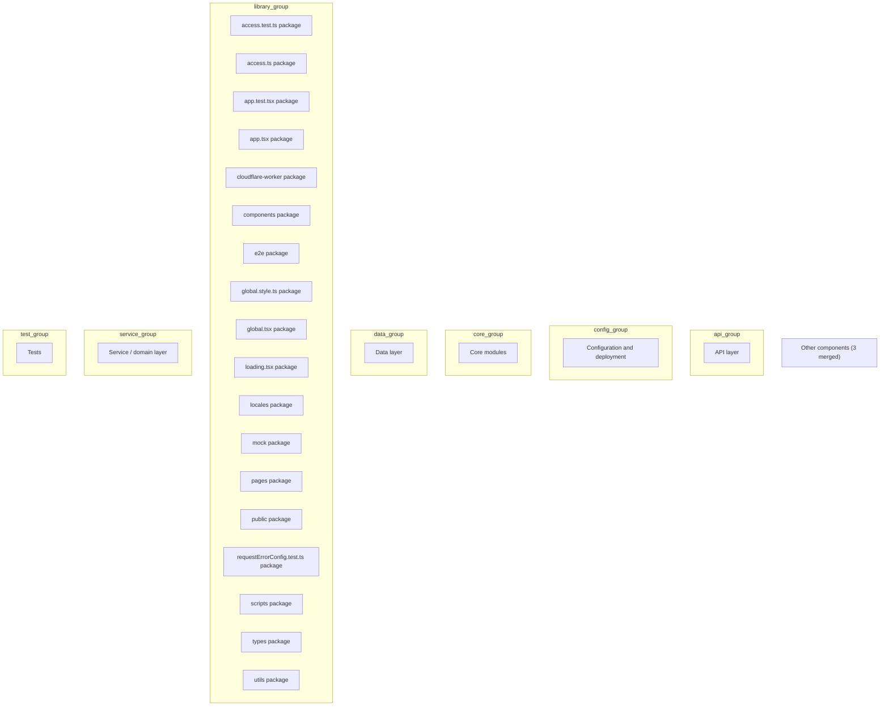

# Architecture report: ant-design/ant-design-pro

> Automated static analysis. **Observed** = directly seen in files/imports/AST; **Inferred** = interpretation from that evidence. Repository code was not executed.

## 1. Repository at a glance

| Item | Value |
| --- | --- |
| Repository | ant-design/ant-design-pro |
| Description | 👨🏻‍💻👩🏻‍💻 Use Ant Design like a Pro! |
| Language | TypeScript |
| Stars | 38960 |
| Licence | MIT |
| Analysed commit / branch | 42f2cb1d303380909ea04c73b5e60679d09c321a / master |
| Framework(s) | Express, React |
| Files analysed | 326 |
| Components | 27 |

## 2. Architecture in one minute

ant-design/ant-design-pro - 👨🏻‍💻👩🏻‍💻 Use Ant Design like a Pro!. This repository was analysed statically from 326 file(s) (0 Python). Detected technologies (observed from imports/manifests): GitHub Actions, Express, React, Tailwind CSS, TypeScript, Vitest. Files are grouped into 27 component(s): access.test.ts package, access.ts package, API layer, app.test.tsx package, app.tsx package, cloudflare-worker package, components package, Configuration and deployment. Findings below distinguish observed facts from inferred interpretation.

## 3. High-level block diagram

## 4. Main components

### access.test.ts package (`access_test_ts`)

- **Kind:** library
- **Status:** Observed
- **Confidence:** 0.85
- **Responsibility:** Groups 1 file(s) under access.test.ts package (observed from repository paths and static analysis).
- **Paths:** `src/access.test.ts`
- **Evidence:** [src/access.test.ts](https://github.com/ant-design/ant-design-pro/blob/42f2cb1d303380909ea04c73b5e60679d09c321a/src/access.test.ts)

### access.ts package (`access_ts`)

- **Kind:** library
- **Status:** Observed
- **Confidence:** 0.85
- **Responsibility:** Groups 1 file(s) under access.ts package (observed from repository paths and static analysis).
- **Paths:** `src/access.ts`
- **Evidence:** [src/access.ts](https://github.com/ant-design/ant-design-pro/blob/42f2cb1d303380909ea04c73b5e60679d09c321a/src/access.ts)

### API layer (`api_layer`)

- **Kind:** api
- **Status:** Observed
- **Confidence:** 0.85
- **Responsibility:** Groups 10 file(s) under api layer (observed from repository paths and static analysis).
- **Paths:** `cloudflare-worker/src/routes/dashboard.ts`, `cloudflare-worker/src/routes/errors.ts`, `cloudflare-worker/src/routes/geographic.ts`, `cloudflare-worker/src/routes/list.ts`, `cloudflare-worker/src/routes/monitor.ts`, `cloudflare-worker/src/routes/notices.ts`, `cloudflare-worker/src/routes/profile.ts`, `cloudflare-worker/src/routes/settings.ts`, `cloudflare-worker/src/routes/table.ts`, `cloudflare-worker/src/routes/user.ts`
- **Evidence:** [cloudflare-worker/src/routes/dashboard.ts](https://github.com/ant-design/ant-design-pro/blob/42f2cb1d303380909ea04c73b5e60679d09c321a/cloudflare-worker/src/routes/dashboard.ts); [cloudflare-worker/src/routes/errors.ts](https://github.com/ant-design/ant-design-pro/blob/42f2cb1d303380909ea04c73b5e60679d09c321a/cloudflare-worker/src/routes/errors.ts); [cloudflare-worker/src/routes/geographic.ts](https://github.com/ant-design/ant-design-pro/blob/42f2cb1d303380909ea04c73b5e60679d09c321a/cloudflare-worker/src/routes/geographic.ts); [cloudflare-worker/src/routes/list.ts](https://github.com/ant-design/ant-design-pro/blob/42f2cb1d303380909ea04c73b5e60679d09c321a/cloudflare-worker/src/routes/list.ts); [cloudflare-worker/src/routes/monitor.ts](https://github.com/ant-design/ant-design-pro/blob/42f2cb1d303380909ea04c73b5e60679d09c321a/cloudflare-worker/src/routes/monitor.ts); [cloudflare-worker/src/routes/notices.ts](https://github.com/ant-design/ant-design-pro/blob/42f2cb1d303380909ea04c73b5e60679d09c321a/cloudflare-worker/src/routes/notices.ts); [cloudflare-worker/src/routes/profile.ts](https://github.com/ant-design/ant-design-pro/blob/42f2cb1d303380909ea04c73b5e60679d09c321a/cloudflare-worker/src/routes/profile.ts); [cloudflare-worker/src/routes/settings.ts](https://github.com/ant-design/ant-design-pro/blob/42f2cb1d303380909ea04c73b5e60679d09c321a/cloudflare-worker/src/routes/settings.ts)

### app.test.tsx package (`app_test_tsx`)

- **Kind:** library
- **Status:** Observed
- **Confidence:** 0.85
- **Responsibility:** Groups 1 file(s) under app.test.tsx package (observed from repository paths and static analysis).
- **Paths:** `src/app.test.tsx`
- **Evidence:** [src/app.test.tsx](https://github.com/ant-design/ant-design-pro/blob/42f2cb1d303380909ea04c73b5e60679d09c321a/src/app.test.tsx)

### app.tsx package (`app_tsx`)

- **Kind:** library
- **Status:** Observed
- **Confidence:** 0.85
- **Responsibility:** Groups 1 file(s) under app.tsx package (observed from repository paths and static analysis).
- **Paths:** `src/app.tsx`
- **Evidence:** [src/app.tsx](https://github.com/ant-design/ant-design-pro/blob/42f2cb1d303380909ea04c73b5e60679d09c321a/src/app.tsx)

### cloudflare-worker package (`cloudflare_worker`)

- **Kind:** library
- **Status:** Observed
- **Confidence:** 0.85
- **Responsibility:** Groups 2 file(s) under cloudflare-worker package (observed from repository paths and static analysis).
- **Paths:** `cloudflare-worker/src/index.ts`, `cloudflare-worker/src/utils/cors.ts`
- **Evidence:** [cloudflare-worker/src/index.ts](https://github.com/ant-design/ant-design-pro/blob/42f2cb1d303380909ea04c73b5e60679d09c321a/cloudflare-worker/src/index.ts); [cloudflare-worker/src/utils/cors.ts](https://github.com/ant-design/ant-design-pro/blob/42f2cb1d303380909ea04c73b5e60679d09c321a/cloudflare-worker/src/utils/cors.ts)

### components package (`components`)

- **Kind:** library
- **Status:** Observed
- **Confidence:** 0.85
- **Responsibility:** Groups 18 file(s) under components package (observed from repository paths and static analysis).
- **Paths:** `src/components/ArticleListContent/index.style.ts`, `src/components/ArticleListContent/index.tsx`, `src/components/AvatarList/index.style.ts`, `src/components/AvatarList/index.tsx`, `src/components/ErrorBoundary/index.tsx`, `src/components/Footer/index.tsx`, `src/components/HeaderDropdown/index.tsx`, `src/components/OfflineBanner/index.tsx`, `src/components/RightContent/AvatarDropdown.tsx`, `src/components/RightContent/LangDropdown.tsx`, `src/components/RightContent/VersionDropdown.tsx`, `src/components/RightContent/index.tsx`, `src/components/RightContent/style.ts`, `src/components/StandardFormRow/index.style.ts`, `src/components/StandardFormRow/index.tsx`, `src/components/TagSelect/index.style.ts`, `src/components/TagSelect/index.tsx`, `src/components/index.ts`
- **Evidence:** [src/components/ArticleListContent/index.style.ts](https://github.com/ant-design/ant-design-pro/blob/42f2cb1d303380909ea04c73b5e60679d09c321a/src/components/ArticleListContent/index.style.ts); [src/components/ArticleListContent/index.tsx](https://github.com/ant-design/ant-design-pro/blob/42f2cb1d303380909ea04c73b5e60679d09c321a/src/components/ArticleListContent/index.tsx); [src/components/AvatarList/index.style.ts](https://github.com/ant-design/ant-design-pro/blob/42f2cb1d303380909ea04c73b5e60679d09c321a/src/components/AvatarList/index.style.ts); [src/components/AvatarList/index.tsx](https://github.com/ant-design/ant-design-pro/blob/42f2cb1d303380909ea04c73b5e60679d09c321a/src/components/AvatarList/index.tsx); [src/components/ErrorBoundary/index.tsx](https://github.com/ant-design/ant-design-pro/blob/42f2cb1d303380909ea04c73b5e60679d09c321a/src/components/ErrorBoundary/index.tsx); [src/components/Footer/index.tsx](https://github.com/ant-design/ant-design-pro/blob/42f2cb1d303380909ea04c73b5e60679d09c321a/src/components/Footer/index.tsx); [src/components/HeaderDropdown/index.tsx](https://github.com/ant-design/ant-design-pro/blob/42f2cb1d303380909ea04c73b5e60679d09c321a/src/components/HeaderDropdown/index.tsx); [src/components/OfflineBanner/index.tsx](https://github.com/ant-design/ant-design-pro/blob/42f2cb1d303380909ea04c73b5e60679d09c321a/src/components/OfflineBanner/index.tsx)

### Configuration and deployment (`config`)

- **Kind:** config
- **Status:** Observed
- **Confidence:** 0.85
- **Responsibility:** Groups 28 file(s) under configuration and deployment (observed from repository paths and static analysis).
- **Paths:** `biome.json`, `cloudflare-worker/package.json`, `cloudflare-worker/tsconfig.json`, `cloudflare-worker/wrangler.toml`, `codecov.yml`, `config/config.ts`, `config/defaultSettings.ts`, `config/md-raw-loader.cjs`, `config/oneapi.json`, `config/proxy.ts`, `config/routes.simple.ts`, `config/routes.ts`, `doctor.config.json`, `package.json`, `src/manifest.json`, `src/pages/account/settings/_mock.ts`, `src/pages/account/settings/components/base.test.tsx`, `src/pages/account/settings/components/base.tsx`, `src/pages/account/settings/components/binding.tsx`, `src/pages/account/settings/components/index.style.ts`, `src/pages/account/settings/components/notification.tsx`, `src/pages/account/settings/components/security.tsx`, `src/pages/account/settings/data.d.ts`, `src/pages/account/settings/index.tsx`, `src/pages/account/settings/service.test.ts`, `src/pages/account/settings/service.ts`, `src/pages/account/settings/style.style.ts`, `tsconfig.json`
- **Evidence:** [biome.json](https://github.com/ant-design/ant-design-pro/blob/42f2cb1d303380909ea04c73b5e60679d09c321a/biome.json); [cloudflare-worker/package.json](https://github.com/ant-design/ant-design-pro/blob/42f2cb1d303380909ea04c73b5e60679d09c321a/cloudflare-worker/package.json); [cloudflare-worker/tsconfig.json](https://github.com/ant-design/ant-design-pro/blob/42f2cb1d303380909ea04c73b5e60679d09c321a/cloudflare-worker/tsconfig.json); [cloudflare-worker/wrangler.toml](https://github.com/ant-design/ant-design-pro/blob/42f2cb1d303380909ea04c73b5e60679d09c321a/cloudflare-worker/wrangler.toml); [codecov.yml](https://github.com/ant-design/ant-design-pro/blob/42f2cb1d303380909ea04c73b5e60679d09c321a/codecov.yml); [config/config.ts](https://github.com/ant-design/ant-design-pro/blob/42f2cb1d303380909ea04c73b5e60679d09c321a/config/config.ts); [config/defaultSettings.ts](https://github.com/ant-design/ant-design-pro/blob/42f2cb1d303380909ea04c73b5e60679d09c321a/config/defaultSettings.ts); [config/md-raw-loader.cjs](https://github.com/ant-design/ant-design-pro/blob/42f2cb1d303380909ea04c73b5e60679d09c321a/config/md-raw-loader.cjs)

### Core modules (`core`)

- **Kind:** core
- **Status:** Observed
- **Confidence:** 0.85
- **Responsibility:** Groups 3 file(s) under core modules (observed from repository paths and static analysis).
- **Paths:** `playwright.config.ts`, `tailwind.config.js`, `vitest.config.ts`
- **Evidence:** [playwright.config.ts](https://github.com/ant-design/ant-design-pro/blob/42f2cb1d303380909ea04c73b5e60679d09c321a/playwright.config.ts); [tailwind.config.js](https://github.com/ant-design/ant-design-pro/blob/42f2cb1d303380909ea04c73b5e60679d09c321a/tailwind.config.js); [vitest.config.ts](https://github.com/ant-design/ant-design-pro/blob/42f2cb1d303380909ea04c73b5e60679d09c321a/vitest.config.ts)

### Data layer (`data_layer`)

- **Kind:** data
- **Status:** Observed
- **Confidence:** 0.85
- **Responsibility:** Groups 5 file(s) under data layer (observed from repository paths and static analysis).
- **Paths:** `cloudflare-worker/src/data/common.ts`, `cloudflare-worker/src/data/dashboard.ts`, `cloudflare-worker/src/data/notices.ts`, `cloudflare-worker/src/data/table.ts`, `cloudflare-worker/src/data/user.ts`
- **Evidence:** [cloudflare-worker/src/data/common.ts](https://github.com/ant-design/ant-design-pro/blob/42f2cb1d303380909ea04c73b5e60679d09c321a/cloudflare-worker/src/data/common.ts); [cloudflare-worker/src/data/dashboard.ts](https://github.com/ant-design/ant-design-pro/blob/42f2cb1d303380909ea04c73b5e60679d09c321a/cloudflare-worker/src/data/dashboard.ts); [cloudflare-worker/src/data/notices.ts](https://github.com/ant-design/ant-design-pro/blob/42f2cb1d303380909ea04c73b5e60679d09c321a/cloudflare-worker/src/data/notices.ts); [cloudflare-worker/src/data/table.ts](https://github.com/ant-design/ant-design-pro/blob/42f2cb1d303380909ea04c73b5e60679d09c321a/cloudflare-worker/src/data/table.ts); [cloudflare-worker/src/data/user.ts](https://github.com/ant-design/ant-design-pro/blob/42f2cb1d303380909ea04c73b5e60679d09c321a/cloudflare-worker/src/data/user.ts)

### e2e package (`e2e`)

- **Kind:** library
- **Status:** Observed
- **Confidence:** 0.85
- **Responsibility:** Groups 1 file(s) under e2e package (observed from repository paths and static analysis).
- **Paths:** `e2e/login.spec.ts`
- **Evidence:** [e2e/login.spec.ts](https://github.com/ant-design/ant-design-pro/blob/42f2cb1d303380909ea04c73b5e60679d09c321a/e2e/login.spec.ts)

### global.style.ts package (`global_style_ts`)

- **Kind:** library
- **Status:** Observed
- **Confidence:** 0.85
- **Responsibility:** Groups 1 file(s) under global.style.ts package (observed from repository paths and static analysis).
- **Paths:** `src/global.style.ts`
- **Evidence:** [src/global.style.ts](https://github.com/ant-design/ant-design-pro/blob/42f2cb1d303380909ea04c73b5e60679d09c321a/src/global.style.ts)

### global.tsx package (`global_tsx`)

- **Kind:** library
- **Status:** Observed
- **Confidence:** 0.85
- **Responsibility:** Groups 1 file(s) under global.tsx package (observed from repository paths and static analysis).
- **Paths:** `src/global.tsx`
- **Evidence:** [src/global.tsx](https://github.com/ant-design/ant-design-pro/blob/42f2cb1d303380909ea04c73b5e60679d09c321a/src/global.tsx)

### loading.tsx package (`loading_tsx`)

- **Kind:** library
- **Status:** Observed
- **Confidence:** 0.85
- **Responsibility:** Groups 1 file(s) under loading.tsx package (observed from repository paths and static analysis).
- **Paths:** `src/loading.tsx`
- **Evidence:** [src/loading.tsx](https://github.com/ant-design/ant-design-pro/blob/42f2cb1d303380909ea04c73b5e60679d09c321a/src/loading.tsx)

### locales package (`locales`)

- **Kind:** library
- **Status:** Observed
- **Confidence:** 0.85
- **Responsibility:** Groups 64 file(s) under locales package (observed from repository paths and static analysis).
- **Paths:** `src/locales/bn-BD.ts`, `src/locales/bn-BD/component.ts`, `src/locales/bn-BD/globalHeader.ts`, `src/locales/bn-BD/menu.ts`, `src/locales/bn-BD/network.ts`, `src/locales/bn-BD/pages.ts`, `src/locales/bn-BD/settingDrawer.ts`, `src/locales/bn-BD/settings.ts`, `src/locales/en-US.ts`, `src/locales/en-US/component.ts`, `src/locales/en-US/globalHeader.ts`, `src/locales/en-US/menu.ts`, `src/locales/en-US/network.ts`, `src/locales/en-US/pages.ts`, `src/locales/en-US/settingDrawer.ts`, `src/locales/en-US/settings.ts`, `src/locales/fa-IR.ts`, `src/locales/fa-IR/component.ts`, `src/locales/fa-IR/globalHeader.ts`, `src/locales/fa-IR/menu.ts`, `src/locales/fa-IR/network.ts`, `src/locales/fa-IR/pages.ts`, `src/locales/fa-IR/settingDrawer.ts`, `src/locales/fa-IR/settings.ts`, `src/locales/id-ID.ts`, `src/locales/id-ID/component.ts`, `src/locales/id-ID/globalHeader.ts`, `src/locales/id-ID/menu.ts`, `src/locales/id-ID/network.ts`, `src/locales/id-ID/pages.ts`, `src/locales/id-ID/settingDrawer.ts`, `src/locales/id-ID/settings.ts`, `src/locales/ja-JP.ts`, `src/locales/ja-JP/component.ts`, `src/locales/ja-JP/globalHeader.ts`, `src/locales/ja-JP/menu.ts`, `src/locales/ja-JP/network.ts`, `src/locales/ja-JP/pages.ts`, `src/locales/ja-JP/settingDrawer.ts`, `src/locales/ja-JP/settings.ts`, `src/locales/pt-BR.ts`, `src/locales/pt-BR/component.ts`, `src/locales/pt-BR/globalHeader.ts`, `src/locales/pt-BR/menu.ts`, `src/locales/pt-BR/network.ts`, `src/locales/pt-BR/pages.ts`, `src/locales/pt-BR/settingDrawer.ts`, `src/locales/pt-BR/settings.ts`, `src/locales/zh-CN.ts`, `src/locales/zh-CN/component.ts`, `src/locales/zh-CN/globalHeader.ts`, `src/locales/zh-CN/menu.ts`, `src/locales/zh-CN/network.ts`, `src/locales/zh-CN/pages.ts`, `src/locales/zh-CN/settingDrawer.ts`, `src/locales/zh-CN/settings.ts`, `src/locales/zh-TW.ts`, `src/locales/zh-TW/component.ts`, `src/locales/zh-TW/globalHeader.ts`, `src/locales/zh-TW/menu.ts`, `src/locales/zh-TW/network.ts`, `src/locales/zh-TW/pages.ts`, `src/locales/zh-TW/settingDrawer.ts`, `src/locales/zh-TW/settings.ts`
- **Evidence:** [src/locales/bn-BD.ts](https://github.com/ant-design/ant-design-pro/blob/42f2cb1d303380909ea04c73b5e60679d09c321a/src/locales/bn-BD.ts); [src/locales/bn-BD/component.ts](https://github.com/ant-design/ant-design-pro/blob/42f2cb1d303380909ea04c73b5e60679d09c321a/src/locales/bn-BD/component.ts); [src/locales/bn-BD/globalHeader.ts](https://github.com/ant-design/ant-design-pro/blob/42f2cb1d303380909ea04c73b5e60679d09c321a/src/locales/bn-BD/globalHeader.ts); [src/locales/bn-BD/menu.ts](https://github.com/ant-design/ant-design-pro/blob/42f2cb1d303380909ea04c73b5e60679d09c321a/src/locales/bn-BD/menu.ts); [src/locales/bn-BD/network.ts](https://github.com/ant-design/ant-design-pro/blob/42f2cb1d303380909ea04c73b5e60679d09c321a/src/locales/bn-BD/network.ts); [src/locales/bn-BD/pages.ts](https://github.com/ant-design/ant-design-pro/blob/42f2cb1d303380909ea04c73b5e60679d09c321a/src/locales/bn-BD/pages.ts); [src/locales/bn-BD/settingDrawer.ts](https://github.com/ant-design/ant-design-pro/blob/42f2cb1d303380909ea04c73b5e60679d09c321a/src/locales/bn-BD/settingDrawer.ts); [src/locales/bn-BD/settings.ts](https://github.com/ant-design/ant-design-pro/blob/42f2cb1d303380909ea04c73b5e60679d09c321a/src/locales/bn-BD/settings.ts)

### mock package (`mock`)

- **Kind:** library
- **Status:** Observed
- **Confidence:** 0.85
- **Responsibility:** Groups 6 file(s) under mock package (observed from repository paths and static analysis).
- **Paths:** `mock/fakeList.ts`, `mock/listTableList.ts`, `mock/notices.ts`, `mock/route.ts`, `mock/user.ts`, `mock/utils.ts`
- **Evidence:** [mock/fakeList.ts](https://github.com/ant-design/ant-design-pro/blob/42f2cb1d303380909ea04c73b5e60679d09c321a/mock/fakeList.ts); [mock/listTableList.ts](https://github.com/ant-design/ant-design-pro/blob/42f2cb1d303380909ea04c73b5e60679d09c321a/mock/listTableList.ts); [mock/notices.ts](https://github.com/ant-design/ant-design-pro/blob/42f2cb1d303380909ea04c73b5e60679d09c321a/mock/notices.ts); [mock/route.ts](https://github.com/ant-design/ant-design-pro/blob/42f2cb1d303380909ea04c73b5e60679d09c321a/mock/route.ts); [mock/user.ts](https://github.com/ant-design/ant-design-pro/blob/42f2cb1d303380909ea04c73b5e60679d09c321a/mock/user.ts); [mock/utils.ts](https://github.com/ant-design/ant-design-pro/blob/42f2cb1d303380909ea04c73b5e60679d09c321a/mock/utils.ts)

### pages package (`pages`)

- **Kind:** library
- **Status:** Observed
- **Confidence:** 0.85
- **Responsibility:** Groups 124 file(s) under pages package (observed from repository paths and static analysis).
- **Paths:** `src/pages/Admin.tsx`, `src/pages/Welcome.tsx`, `src/pages/account/center/Center.style.ts`, `src/pages/account/center/_mock.ts`, `src/pages/account/center/components/Applications/index.style.ts`, `src/pages/account/center/components/Applications/index.tsx`, `src/pages/account/center/components/Articles/index.style.ts`, `src/pages/account/center/components/Articles/index.tsx`, `src/pages/account/center/components/Projects/index.style.ts`, `src/pages/account/center/components/Projects/index.tsx`, `src/pages/account/center/data.d.ts`, `src/pages/account/center/index.tsx`, `src/pages/account/center/service.ts`, `src/pages/chatbot/data.d.ts`, `src/pages/chatbot/index.tsx`, `src/pages/chatbot/service.ts`, `src/pages/chatbot/style.ts`, `src/pages/dashboard/analysis/_mock.ts`, `src/pages/dashboard/analysis/components/Charts/ChartCard/index.style.ts`, `src/pages/dashboard/analysis/components/Charts/ChartCard/index.tsx`, `src/pages/dashboard/analysis/components/Charts/Field/index.style.ts`, `src/pages/dashboard/analysis/components/Charts/Field/index.tsx`, `src/pages/dashboard/analysis/components/Charts/index.style.ts`, `src/pages/dashboard/analysis/components/IntroduceRow.tsx`, `src/pages/dashboard/analysis/components/NumberInfo/index.style.ts`, `src/pages/dashboard/analysis/components/NumberInfo/index.tsx`, `src/pages/dashboard/analysis/components/OfflineData.tsx`, `src/pages/dashboard/analysis/components/PageLoading/index.tsx`, `src/pages/dashboard/analysis/components/ProportionSales.tsx`, `src/pages/dashboard/analysis/components/SalesCard.tsx`, `src/pages/dashboard/analysis/components/TopSearch.tsx`, `src/pages/dashboard/analysis/components/Trend/index.style.ts`, `src/pages/dashboard/analysis/components/Trend/index.tsx`, `src/pages/dashboard/analysis/data.d.ts`, `src/pages/dashboard/analysis/index.test.tsx`, `src/pages/dashboard/analysis/index.tsx`, `src/pages/dashboard/analysis/service.ts`, `src/pages/dashboard/analysis/style.style.ts`, `src/pages/dashboard/analysis/utils/Yuan.tsx`, `src/pages/dashboard/analysis/utils/utils.ts`, `src/pages/dashboard/monitor/_mock.ts`, `src/pages/dashboard/monitor/components/ActiveChart/index.style.ts`, `src/pages/dashboard/monitor/components/ActiveChart/index.tsx`, `src/pages/dashboard/monitor/components/Map/index.style.ts`, `src/pages/dashboard/monitor/components/Map/index.tsx`, `src/pages/dashboard/monitor/data.d.ts`, `src/pages/dashboard/monitor/index.tsx`, `src/pages/dashboard/monitor/service.ts`, `src/pages/dashboard/monitor/style.style.ts`, `src/pages/dashboard/workplace/_mock.ts`, `src/pages/dashboard/workplace/components/EditableLinkGroup/index.style.ts`, `src/pages/dashboard/workplace/components/EditableLinkGroup/index.tsx`, `src/pages/dashboard/workplace/data.d.ts`, `src/pages/dashboard/workplace/index.tsx`, `src/pages/dashboard/workplace/service.ts`, `src/pages/dashboard/workplace/style.style.ts`, `src/pages/exception/403/index.tsx`, `src/pages/exception/404/index.tsx`, `src/pages/exception/500/index.tsx`, `src/pages/form/advanced-form/_mock.ts`, `src/pages/form/advanced-form/index.tsx`, `src/pages/form/advanced-form/service.ts`, `src/pages/form/advanced-form/style.style.ts`, `src/pages/form/basic-form/_mock.ts`, `src/pages/form/basic-form/index.test.tsx`, `src/pages/form/basic-form/index.tsx`, `src/pages/form/basic-form/service.ts`, `src/pages/form/basic-form/style.style.ts`, `src/pages/form/step-form/_mock.ts`, `src/pages/form/step-form/data.d.ts`, `src/pages/form/step-form/index.tsx`, `src/pages/form/step-form/style.style.ts`, `src/pages/list/basic-list/_mock.ts`, `src/pages/list/basic-list/components/OperationModal.tsx`, `src/pages/list/basic-list/data.d.ts`, `src/pages/list/basic-list/index.tsx`, `src/pages/list/basic-list/service.ts`, `src/pages/list/basic-list/style.style.ts`, `src/pages/list/basic-list/utils/utils.style.ts`, `src/pages/list/card-list/_mock.ts`, `src/pages/list/card-list/data.d.ts`, `src/pages/list/card-list/index.tsx`, `src/pages/list/card-list/service.ts`, `src/pages/list/card-list/style.style.ts`, `src/pages/list/card-list/utils/utils.style.ts`, `src/pages/list/mock/index.ts`, `src/pages/list/search/applications/data.d.ts`, `src/pages/list/search/applications/index.tsx`, `src/pages/list/search/applications/service.ts`, `src/pages/list/search/applications/style.style.ts`, `src/pages/list/search/applications/utils/utils.style.ts`, `src/pages/list/search/articles/data.d.ts`, `src/pages/list/search/articles/index.tsx`, `src/pages/list/search/articles/service.ts`, `src/pages/list/search/articles/style.style.ts`, `src/pages/list/search/index.tsx`, `src/pages/list/search/projects/data.d.ts`, `src/pages/list/search/projects/index.tsx`, `src/pages/list/search/projects/service.ts`, `src/pages/list/search/projects/style.style.ts`, `src/pages/profile/advanced/_mock.ts`, `src/pages/profile/advanced/data.d.ts`, `src/pages/profile/advanced/index.tsx`, `src/pages/profile/advanced/service.ts`, `src/pages/profile/advanced/style.style.ts`, `src/pages/profile/basic/_mock.ts`, `src/pages/profile/basic/data.d.ts`, `src/pages/profile/basic/index.tsx`, `src/pages/profile/basic/service.ts`, `src/pages/result/fail/index.style.ts`, `src/pages/result/fail/index.tsx`, `src/pages/result/success/index.style.ts`, `src/pages/result/success/index.tsx`, `src/pages/table-list/components/CreateForm.tsx`, `src/pages/table-list/components/UpdateForm.tsx`, `src/pages/table-list/index.test.tsx`, `src/pages/table-list/index.tsx`, `src/pages/user/login/index.tsx`, `src/pages/user/register-result/index.tsx`, `src/pages/user/register-result/style.style.ts`, `src/pages/user/register/_mock.ts`, `src/pages/user/register/index.tsx`, `src/pages/user/register/service.ts`, `src/pages/user/register/styles.ts`
- **Evidence:** [src/pages/Admin.tsx](https://github.com/ant-design/ant-design-pro/blob/42f2cb1d303380909ea04c73b5e60679d09c321a/src/pages/Admin.tsx); [src/pages/Welcome.tsx](https://github.com/ant-design/ant-design-pro/blob/42f2cb1d303380909ea04c73b5e60679d09c321a/src/pages/Welcome.tsx); [src/pages/account/center/Center.style.ts](https://github.com/ant-design/ant-design-pro/blob/42f2cb1d303380909ea04c73b5e60679d09c321a/src/pages/account/center/Center.style.ts); [src/pages/account/center/_mock.ts](https://github.com/ant-design/ant-design-pro/blob/42f2cb1d303380909ea04c73b5e60679d09c321a/src/pages/account/center/_mock.ts); [src/pages/account/center/components/Applications/index.style.ts](https://github.com/ant-design/ant-design-pro/blob/42f2cb1d303380909ea04c73b5e60679d09c321a/src/pages/account/center/components/Applications/index.style.ts); [src/pages/account/center/components/Applications/index.tsx](https://github.com/ant-design/ant-design-pro/blob/42f2cb1d303380909ea04c73b5e60679d09c321a/src/pages/account/center/components/Applications/index.tsx); [src/pages/account/center/components/Articles/index.style.ts](https://github.com/ant-design/ant-design-pro/blob/42f2cb1d303380909ea04c73b5e60679d09c321a/src/pages/account/center/components/Articles/index.style.ts); [src/pages/account/center/components/Articles/index.tsx](https://github.com/ant-design/ant-design-pro/blob/42f2cb1d303380909ea04c73b5e60679d09c321a/src/pages/account/center/components/Articles/index.tsx)

### public package (`public`)

- **Kind:** library
- **Status:** Observed
- **Confidence:** 0.85
- **Responsibility:** Groups 1 file(s) under public package (observed from repository paths and static analysis).
- **Paths:** `public/scripts/loading.js`
- **Evidence:** [public/scripts/loading.js](https://github.com/ant-design/ant-design-pro/blob/42f2cb1d303380909ea04c73b5e60679d09c321a/public/scripts/loading.js)

### requestErrorConfig.test.ts package (`requesterrorconfig_test_ts`)

- **Kind:** library
- **Status:** Observed
- **Confidence:** 0.85
- **Responsibility:** Groups 1 file(s) under requesterrorconfig.test.ts package (observed from repository paths and static analysis).
- **Paths:** `src/requestErrorConfig.test.ts`
- **Evidence:** [src/requestErrorConfig.test.ts](https://github.com/ant-design/ant-design-pro/blob/42f2cb1d303380909ea04c73b5e60679d09c321a/src/requestErrorConfig.test.ts)

### requestErrorConfig.ts package (`requesterrorconfig_ts`)

- **Kind:** library
- **Status:** Observed
- **Confidence:** 0.85
- **Responsibility:** Groups 1 file(s) under requesterrorconfig.ts package (observed from repository paths and static analysis).
- **Paths:** `src/requestErrorConfig.ts`
- **Evidence:** [src/requestErrorConfig.ts](https://github.com/ant-design/ant-design-pro/blob/42f2cb1d303380909ea04c73b5e60679d09c321a/src/requestErrorConfig.ts)

### scripts package (`scripts`)

- **Kind:** library
- **Status:** Observed
- **Confidence:** 0.85
- **Responsibility:** Groups 2 file(s) under scripts package (observed from repository paths and static analysis).
- **Paths:** `scripts/i18n-remove.js`, `scripts/simple.js`
- **Evidence:** [scripts/i18n-remove.js](https://github.com/ant-design/ant-design-pro/blob/42f2cb1d303380909ea04c73b5e60679d09c321a/scripts/i18n-remove.js); [scripts/simple.js](https://github.com/ant-design/ant-design-pro/blob/42f2cb1d303380909ea04c73b5e60679d09c321a/scripts/simple.js)

### Service / domain layer (`service_layer`)

- **Kind:** service
- **Status:** Observed
- **Confidence:** 0.85
- **Responsibility:** Groups 4 file(s) under service / domain layer (observed from repository paths and static analysis).
- **Paths:** `src/services/ant-design-pro/api.ts`, `src/services/ant-design-pro/index.ts`, `src/services/ant-design-pro/login.ts`, `src/services/ant-design-pro/typings.d.ts`
- **Evidence:** [src/services/ant-design-pro/api.ts](https://github.com/ant-design/ant-design-pro/blob/42f2cb1d303380909ea04c73b5e60679d09c321a/src/services/ant-design-pro/api.ts); [src/services/ant-design-pro/index.ts](https://github.com/ant-design/ant-design-pro/blob/42f2cb1d303380909ea04c73b5e60679d09c321a/src/services/ant-design-pro/index.ts); [src/services/ant-design-pro/login.ts](https://github.com/ant-design/ant-design-pro/blob/42f2cb1d303380909ea04c73b5e60679d09c321a/src/services/ant-design-pro/login.ts); [src/services/ant-design-pro/typings.d.ts](https://github.com/ant-design/ant-design-pro/blob/42f2cb1d303380909ea04c73b5e60679d09c321a/src/services/ant-design-pro/typings.d.ts)

### service-worker.js package (`service_worker_js`)

- **Kind:** library
- **Status:** Observed
- **Confidence:** 0.85
- **Responsibility:** Groups 1 file(s) under service-worker.js package (observed from repository paths and static analysis).
- **Paths:** `src/service-worker.js`
- **Evidence:** [src/service-worker.js](https://github.com/ant-design/ant-design-pro/blob/42f2cb1d303380909ea04c73b5e60679d09c321a/src/service-worker.js)

### Tests (`tests`)

- **Kind:** test
- **Status:** Observed
- **Confidence:** 0.85
- **Responsibility:** Groups 3 file(s) under tests (observed from repository paths and static analysis).
- **Paths:** `tests/__mocks__/mermaid.ts`, `tests/__mocks__/raw.ts`, `tests/setupTests.ts`
- **Evidence:** [tests/__mocks__/mermaid.ts](https://github.com/ant-design/ant-design-pro/blob/42f2cb1d303380909ea04c73b5e60679d09c321a/tests/__mocks__/mermaid.ts); [tests/__mocks__/raw.ts](https://github.com/ant-design/ant-design-pro/blob/42f2cb1d303380909ea04c73b5e60679d09c321a/tests/__mocks__/raw.ts); [tests/setupTests.ts](https://github.com/ant-design/ant-design-pro/blob/42f2cb1d303380909ea04c73b5e60679d09c321a/tests/setupTests.ts)

### types package (`types`)

- **Kind:** library
- **Status:** Observed
- **Confidence:** 0.85
- **Responsibility:** Groups 2 file(s) under types package (observed from repository paths and static analysis).
- **Paths:** `types/cache/mock/login.mock.cache.js`, `types/index.d.ts`
- **Evidence:** [types/cache/mock/login.mock.cache.js](https://github.com/ant-design/ant-design-pro/blob/42f2cb1d303380909ea04c73b5e60679d09c321a/types/cache/mock/login.mock.cache.js); [types/index.d.ts](https://github.com/ant-design/ant-design-pro/blob/42f2cb1d303380909ea04c73b5e60679d09c321a/types/index.d.ts)

### typings.d.ts package (`typings_d_ts`)

- **Kind:** library
- **Status:** Observed
- **Confidence:** 0.85
- **Responsibility:** Groups 1 file(s) under typings.d.ts package (observed from repository paths and static analysis).
- **Paths:** `src/typings.d.ts`
- **Evidence:** [src/typings.d.ts](https://github.com/ant-design/ant-design-pro/blob/42f2cb1d303380909ea04c73b5e60679d09c321a/src/typings.d.ts)

### utils package (`utils`)

- **Kind:** library
- **Status:** Observed
- **Confidence:** 0.85
- **Responsibility:** Groups 3 file(s) under utils package (observed from repository paths and static analysis).
- **Paths:** `src/utils/chinaDivision.test.ts`, `src/utils/chinaDivision.ts`, `src/utils/format.ts`
- **Evidence:** [src/utils/chinaDivision.test.ts](https://github.com/ant-design/ant-design-pro/blob/42f2cb1d303380909ea04c73b5e60679d09c321a/src/utils/chinaDivision.test.ts); [src/utils/chinaDivision.ts](https://github.com/ant-design/ant-design-pro/blob/42f2cb1d303380909ea04c73b5e60679d09c321a/src/utils/chinaDivision.ts); [src/utils/format.ts](https://github.com/ant-design/ant-design-pro/blob/42f2cb1d303380909ea04c73b5e60679d09c321a/src/utils/format.ts)

## 5. Execution flow

**Observed** entry point(s):

- [cloudflare-worker/src/index.ts](https://github.com/ant-design/ant-design-pro/blob/42f2cb1d303380909ea04c73b5e60679d09c321a/cloudflare-worker/src/index.ts)
- [src/app.tsx](https://github.com/ant-design/ant-design-pro/blob/42f2cb1d303380909ea04c73b5e60679d09c321a/src/app.tsx)
- [src/components/ArticleListContent/index.tsx](https://github.com/ant-design/ant-design-pro/blob/42f2cb1d303380909ea04c73b5e60679d09c321a/src/components/ArticleListContent/index.tsx)
- [src/components/AvatarList/index.tsx](https://github.com/ant-design/ant-design-pro/blob/42f2cb1d303380909ea04c73b5e60679d09c321a/src/components/AvatarList/index.tsx)
- [src/components/ErrorBoundary/index.tsx](https://github.com/ant-design/ant-design-pro/blob/42f2cb1d303380909ea04c73b5e60679d09c321a/src/components/ErrorBoundary/index.tsx)
- [src/components/Footer/index.tsx](https://github.com/ant-design/ant-design-pro/blob/42f2cb1d303380909ea04c73b5e60679d09c321a/src/components/Footer/index.tsx)
- [src/components/HeaderDropdown/index.tsx](https://github.com/ant-design/ant-design-pro/blob/42f2cb1d303380909ea04c73b5e60679d09c321a/src/components/HeaderDropdown/index.tsx)
- [src/components/OfflineBanner/index.tsx](https://github.com/ant-design/ant-design-pro/blob/42f2cb1d303380909ea04c73b5e60679d09c321a/src/components/OfflineBanner/index.tsx)
- [src/components/RightContent/index.tsx](https://github.com/ant-design/ant-design-pro/blob/42f2cb1d303380909ea04c73b5e60679d09c321a/src/components/RightContent/index.tsx)
- [src/components/StandardFormRow/index.tsx](https://github.com/ant-design/ant-design-pro/blob/42f2cb1d303380909ea04c73b5e60679d09c321a/src/components/StandardFormRow/index.tsx)
- [src/components/TagSelect/index.tsx](https://github.com/ant-design/ant-design-pro/blob/42f2cb1d303380909ea04c73b5e60679d09c321a/src/components/TagSelect/index.tsx)
- [src/components/index.ts](https://github.com/ant-design/ant-design-pro/blob/42f2cb1d303380909ea04c73b5e60679d09c321a/src/components/index.ts)

Representative flow (derived from observed entry points and the import graph; steps beyond the entry point are **Inferred**):

1. Execution starts at an observed entry point listed above, if present.
2. No internal import relationships between components were observed.

## 6. Project structure

### `(root)`

- `.commitlintrc.js` - source, JavaScript (67 bytes)
- `.editorconfig` - config (245 bytes)
- `.gitignore` - other (650 bytes)
- `.lintstagedrc` - other (146 bytes)
- `CLAUDE.md` - docs (6083 bytes)
- `CODE_OF_CONDUCT.md` - docs (3213 bytes)
- `LICENSE` - docs (1075 bytes)
- `README.md` - docs (6635 bytes)
- `README.zh-CN.md` - docs (6197 bytes)
- `biome.json` - config (1203 bytes)
- `codecov.yml` - config (336 bytes)
- `doctor.config.json` - config (983 bytes)
- `package.json` - manifest (4129 bytes)
- `playwright.config.ts` - source, TypeScript (660 bytes)
- `tailwind.config.js` - source, JavaScript (53 bytes)
- `tailwind.css` - other (51 bytes)
- `tsconfig.json` - config (601 bytes)
- `vitest.config.ts` - source, TypeScript (1307 bytes)

### `.claude`

- `.claude/skills/antd/SKILL.md` - docs (7744 bytes)
- `.claude/skills/pro-upgrade/SKILL.md` - docs (6633 bytes)

### `.github`

- `.github/FUNDING.yml` - config (684 bytes)
- `.github/ISSUE_TEMPLATE/bug_report.md` - docs (931 bytes)
- `.github/ISSUE_TEMPLATE/feature_request.md` - docs (656 bytes)
- `.github/ISSUE_TEMPLATE/question.md` - docs (751 bytes)
- `.github/dependabot.yml` - config (434 bytes)
- `.github/workflows/antd-cli.yml` - ci, YAML (6389 bytes)
- `.github/workflows/ci.yml` - ci, YAML (1528 bytes)
- `.github/workflows/coverage.yml` - ci, YAML (601 bytes)
- `.github/workflows/deploy.yml` - ci, YAML (776 bytes)
- `.github/workflows/e2e.yml` - ci, YAML (625 bytes)
- `.github/workflows/emoji-helper.yml` - ci, YAML (332 bytes)
- `.github/workflows/issue-labeled.yml` - ci, YAML (2355 bytes)
- `.github/workflows/preview-build.yml` - ci, YAML (777 bytes)
- `.github/workflows/preview-deploy.yml` - ci, YAML (1486 bytes)
- `.github/workflows/react-doctor.yml` - ci, YAML (677 bytes)

### `.husky`

- `.husky/commit-msg` - other (33 bytes)
- `.husky/pre-commit` - other (12 bytes)

### `cloudflare-worker`

- `cloudflare-worker/package.json` - manifest (386 bytes)
- `cloudflare-worker/src/data/common.ts` - source, TypeScript (4793 bytes)
- `cloudflare-worker/src/data/dashboard.ts` - source, TypeScript (7633 bytes)
- `cloudflare-worker/src/data/notices.ts` - source, TypeScript (3630 bytes)
- `cloudflare-worker/src/data/table.ts` - source, TypeScript (1034 bytes)
- `cloudflare-worker/src/data/user.ts` - source, TypeScript (399 bytes)
- `cloudflare-worker/src/index.ts` - source, TypeScript (1598 bytes)
- `cloudflare-worker/src/routes/dashboard.ts` - source, TypeScript (1340 bytes)
- `cloudflare-worker/src/routes/errors.ts` - source, TypeScript (948 bytes)
- `cloudflare-worker/src/routes/geographic.ts` - source, TypeScript (466 bytes)
- `cloudflare-worker/src/routes/list.ts` - source, TypeScript (2625 bytes)
- `cloudflare-worker/src/routes/monitor.ts` - source, TypeScript (2208 bytes)
- `cloudflare-worker/src/routes/notices.ts` - source, TypeScript (188 bytes)
- `cloudflare-worker/src/routes/profile.ts` - source, TypeScript (2978 bytes)
- `cloudflare-worker/src/routes/settings.ts` - source, TypeScript (258 bytes)
- `cloudflare-worker/src/routes/table.ts` - source, TypeScript (3750 bytes)
- `cloudflare-worker/src/routes/user.ts` - source, TypeScript (1033 bytes)
- `cloudflare-worker/src/utils/cors.ts` - source, TypeScript (292 bytes)
- `cloudflare-worker/tsconfig.json` - config (375 bytes)
- `cloudflare-worker/wrangler.toml` - config (107 bytes)

### `config`

- `config/config.ts` - source, TypeScript (7038 bytes)
- `config/defaultSettings.ts` - source, TypeScript (650 bytes)
- `config/md-raw-loader.cjs` - source, JavaScript (135 bytes)
- `config/oneapi.json` - config (14150 bytes)
- `config/proxy.ts` - source, TypeScript (1256 bytes)
- `config/routes.simple.ts` - source, TypeScript (831 bytes)
- `config/routes.ts` - source, TypeScript (7173 bytes)

### `docs`

- `docs/cheatsheet.en-US.md` - docs (19744 bytes)
- `docs/cheatsheet.zh-CN.md` - docs (19581 bytes)
- `docs/roadmap/v6.1.0-release-plan.md` - docs (6556 bytes)
- `docs/roadmap/v6.1.0-upgrade-evaluation.md` - docs (3179 bytes)

### `e2e`

- `e2e/login.spec.ts` - source, TypeScript (986 bytes)

### `mock`

- `mock/fakeList.ts` - source, TypeScript (372 bytes)
- `mock/listTableList.ts` - source, TypeScript (4918 bytes)
- `mock/notices.ts` - source, TypeScript (3682 bytes)
- `mock/route.ts` - source, TypeScript (110 bytes)
- `mock/user.ts` - source, TypeScript (3468 bytes)
- `mock/utils.ts` - source, TypeScript (4954 bytes)

### `public`

- `public/CNAME` - other (22 bytes)
- `public/logo.svg` - other (3896 bytes)
- `public/pro_icon.svg` - other (677 bytes)
- `public/scripts/loading.js` - source, JavaScript (5252 bytes)

### `scripts`

- `scripts/i18n-remove.js` - source, JavaScript (18316 bytes)
- `scripts/simple.js` - source, JavaScript (4517 bytes)

### `src`

- `src/access.test.ts` - source, TypeScript (1536 bytes)
- `src/access.ts` - source, TypeScript (283 bytes)
- `src/app.test.tsx` - source, TypeScript (3845 bytes)
- `src/app.tsx` - source, TypeScript (5975 bytes)
- `src/components/ArticleListContent/index.style.ts` - source, TypeScript (678 bytes)
- `src/components/ArticleListContent/index.tsx` - source, TypeScript (822 bytes)
- `src/components/AvatarList/index.style.ts` - source, TypeScript (1124 bytes)
- `src/components/AvatarList/index.tsx` - source, TypeScript (2577 bytes)
- `src/components/ErrorBoundary/index.tsx` - source, TypeScript (4511 bytes)
- `src/components/Footer/index.tsx` - source, TypeScript (3690 bytes)
- `src/components/HeaderDropdown/index.tsx` - source, TypeScript (1182 bytes)
- `src/components/OfflineBanner/index.tsx` - source, TypeScript (1152 bytes)
- `src/components/RightContent/AvatarDropdown.tsx` - source, TypeScript (2310 bytes)
- `src/components/RightContent/LangDropdown.tsx` - source, TypeScript (2106 bytes)
- `src/components/RightContent/VersionDropdown.tsx` - source, TypeScript (1059 bytes)
- `src/components/RightContent/index.tsx` - source, TypeScript (715 bytes)
- `src/components/RightContent/style.ts` - source, TypeScript (461 bytes)
- `src/components/StandardFormRow/index.style.ts` - source, TypeScript (1502 bytes)
- `src/components/StandardFormRow/index.tsx` - source, TypeScript (858 bytes)
- `src/components/TagSelect/index.style.ts` - source, TypeScript (730 bytes)
- `src/components/TagSelect/index.tsx` - source, TypeScript (4497 bytes)
- `src/components/index.ts` - source, TypeScript (759 bytes)
- `src/global.less` - other (2076 bytes)
- `src/global.style.ts` - source, TypeScript (988 bytes)
- `src/global.tsx` - source, TypeScript (26 bytes)
- `src/loading.tsx` - source, TypeScript (167 bytes)
- `src/locales/bn-BD.ts` - source, TypeScript (782 bytes)
- `src/locales/bn-BD/component.ts` - source, TypeScript (178 bytes)
- `src/locales/bn-BD/globalHeader.ts` - source, TypeScript (1253 bytes)
- `src/locales/bn-BD/menu.ts` - source, TypeScript (3118 bytes)
- `src/locales/bn-BD/network.ts` - source, TypeScript (1586 bytes)
- `src/locales/bn-BD/pages.ts` - source, TypeScript (6345 bytes)
- `src/locales/bn-BD/settingDrawer.ts` - source, TypeScript (2376 bytes)
- `src/locales/bn-BD/settings.ts` - source, TypeScript (5234 bytes)
- `src/locales/en-US.ts` - source, TypeScript (634 bytes)
- `src/locales/en-US/component.ts` - source, TypeScript (144 bytes)
- `src/locales/en-US/globalHeader.ts` - source, TypeScript (932 bytes)
- `src/locales/en-US/menu.ts` - source, TypeScript (2023 bytes)
- `src/locales/en-US/network.ts` - source, TypeScript (770 bytes)
- `src/locales/en-US/pages.ts` - source, TypeScript (4896 bytes)
- `src/locales/en-US/settingDrawer.ts` - source, TypeScript (1536 bytes)
- `src/locales/en-US/settings.ts` - source, TypeScript (3359 bytes)
- `src/locales/fa-IR.ts` - source, TypeScript (697 bytes)
- `src/locales/fa-IR/component.ts` - source, TypeScript (148 bytes)
- `src/locales/fa-IR/globalHeader.ts` - source, TypeScript (1067 bytes)
- `src/locales/fa-IR/menu.ts` - source, TypeScript (2366 bytes)
- `src/locales/fa-IR/network.ts` - source, TypeScript (1183 bytes)
- `src/locales/fa-IR/pages.ts` - source, TypeScript (5151 bytes)
- `src/locales/fa-IR/settingDrawer.ts` - source, TypeScript (1847 bytes)
- `src/locales/fa-IR/settings.ts` - source, TypeScript (4138 bytes)
- `src/locales/id-ID.ts` - source, TypeScript (639 bytes)
- `src/locales/id-ID/component.ts` - source, TypeScript (144 bytes)
- `src/locales/id-ID/globalHeader.ts` - source, TypeScript (910 bytes)
- `src/locales/id-ID/menu.ts` - source, TypeScript (2073 bytes)
- `src/locales/id-ID/network.ts` - source, TypeScript (779 bytes)
- `src/locales/id-ID/pages.ts` - source, TypeScript (4273 bytes)
- `src/locales/id-ID/settingDrawer.ts` - source, TypeScript (1594 bytes)
- `src/locales/id-ID/settings.ts` - source, TypeScript (3381 bytes)
- `src/locales/ja-JP.ts` - source, TypeScript (705 bytes)
- `src/locales/ja-JP/component.ts` - source, TypeScript (157 bytes)
- `src/locales/ja-JP/globalHeader.ts` - source, TypeScript (924 bytes)
- `src/locales/ja-JP/menu.ts` - source, TypeScript (2302 bytes)
- `src/locales/ja-JP/network.ts` - source, TypeScript (1053 bytes)
- `src/locales/ja-JP/pages.ts` - source, TypeScript (4730 bytes)
- `src/locales/ja-JP/settingDrawer.ts` - source, TypeScript (1885 bytes)
- `src/locales/ja-JP/settings.ts` - source, TypeScript (4014 bytes)
- `src/locales/pt-BR.ts` - source, TypeScript (664 bytes)
- `src/locales/pt-BR/component.ts` - source, TypeScript (148 bytes)
- `src/locales/pt-BR/globalHeader.ts` - source, TypeScript (898 bytes)
- `src/locales/pt-BR/menu.ts` - source, TypeScript (2141 bytes)
- `src/locales/pt-BR/network.ts` - source, TypeScript (830 bytes)
- `src/locales/pt-BR/pages.ts` - source, TypeScript (4455 bytes)
- `src/locales/pt-BR/settingDrawer.ts` - source, TypeScript (1670 bytes)
- `src/locales/pt-BR/settings.ts` - source, TypeScript (3614 bytes)
- `src/locales/zh-CN.ts` - source, TypeScript (623 bytes)
- `src/locales/zh-CN/component.ts` - source, TypeScript (145 bytes)
- `src/locales/zh-CN/globalHeader.ts` - source, TypeScript (911 bytes)
- `src/locales/zh-CN/menu.ts` - source, TypeScript (2090 bytes)
- `src/locales/zh-CN/network.ts` - source, TypeScript (702 bytes)
- `src/locales/zh-CN/pages.ts` - source, TypeScript (4732 bytes)
- `src/locales/zh-CN/settingDrawer.ts` - source, TypeScript (1550 bytes)
- `src/locales/zh-CN/settings.ts` - source, TypeScript (3129 bytes)
- `src/locales/zh-TW.ts` - source, TypeScript (623 bytes)
- `src/locales/zh-TW/component.ts` - source, TypeScript (145 bytes)
- `src/locales/zh-TW/globalHeader.ts` - source, TypeScript (911 bytes)
- `src/locales/zh-TW/menu.ts` - source, TypeScript (2056 bytes)
- `src/locales/zh-TW/network.ts` - source, TypeScript (730 bytes)
- `src/locales/zh-TW/pages.ts` - source, TypeScript (4061 bytes)
- `src/locales/zh-TW/settingDrawer.ts` - source, TypeScript (1550 bytes)
- `src/locales/zh-TW/settings.ts` - source, TypeScript (3129 bytes)
- `src/manifest.json` - config (444 bytes)
- `src/pages/Admin.tsx` - source, TypeScript (1443 bytes)
- `src/pages/Welcome-dark.css` - other (2522 bytes)
- `src/pages/Welcome.css` - other (4152 bytes)
- `src/pages/Welcome.tsx` - source, TypeScript (6360 bytes)
- `src/pages/account/center/Center.style.ts` - source, TypeScript (1556 bytes)
- `src/pages/account/center/_mock.ts` - source, TypeScript (1138 bytes)
- `src/pages/account/center/components/Applications/index.style.ts` - source, TypeScript (1059 bytes)
- `src/pages/account/center/components/Applications/index.tsx` - source, TypeScript (3397 bytes)
- `src/pages/account/center/components/Articles/index.style.ts` - source, TypeScript (291 bytes)
- `src/pages/account/center/components/Articles/index.tsx` - source, TypeScript (1954 bytes)
- `src/pages/account/center/components/Projects/index.style.ts` - source, TypeScript (1068 bytes)
- `src/pages/account/center/components/Projects/index.tsx` - source, TypeScript (1828 bytes)
- `src/pages/account/center/data.d.ts` - source, TypeScript (1317 bytes)
- `src/pages/account/center/index.tsx` - source, TypeScript (6568 bytes)
- `src/pages/account/center/service.ts` - source, TypeScript (401 bytes)
- `src/pages/account/settings/_mock.ts` - source, TypeScript (790 bytes)
- `src/pages/account/settings/components/base.test.tsx` - source, TypeScript (7572 bytes)
- `src/pages/account/settings/components/base.tsx` - source, TypeScript (8223 bytes)
- `src/pages/account/settings/components/binding.tsx` - source, TypeScript (1288 bytes)
- `src/pages/account/settings/components/index.style.ts` - source, TypeScript (1341 bytes)
- `src/pages/account/settings/components/notification.tsx` - source, TypeScript (1276 bytes)
- `src/pages/account/settings/components/security.tsx` - source, TypeScript (1728 bytes)
- `src/pages/account/settings/data.d.ts` - source, TypeScript (813 bytes)
- `src/pages/account/settings/index.tsx` - source, TypeScript (3054 bytes)
- `src/pages/account/settings/service.test.ts` - source, TypeScript (561 bytes)
- `src/pages/account/settings/service.ts` - source, TypeScript (638 bytes)
- `src/pages/account/settings/style.style.ts` - source, TypeScript (1968 bytes)
- `src/pages/chatbot/data.d.ts` - source, TypeScript (275 bytes)
- `src/pages/chatbot/index.tsx` - source, TypeScript (9377 bytes)
- `src/pages/chatbot/service.ts` - source, TypeScript (562 bytes)
- `src/pages/chatbot/style.ts` - source, TypeScript (1456 bytes)
- `src/pages/dashboard/analysis/_mock.ts` - source, TypeScript (3629 bytes)
- `src/pages/dashboard/analysis/components/Charts/ChartCard/index.style.ts` - source, TypeScript (1591 bytes)
- `src/pages/dashboard/analysis/components/Charts/ChartCard/index.tsx` - source, TypeScript (2565 bytes)
- `src/pages/dashboard/analysis/components/Charts/Field/index.style.ts` - source, TypeScript (425 bytes)
- `src/pages/dashboard/analysis/components/Charts/Field/index.tsx` - source, TypeScript (484 bytes)
- `src/pages/dashboard/analysis/components/Charts/index.style.ts` - source, TypeScript (477 bytes)
- `src/pages/dashboard/analysis/components/IntroduceRow.tsx` - source, TypeScript (4256 bytes)
- `src/pages/dashboard/analysis/components/NumberInfo/index.style.ts` - source, TypeScript (1302 bytes)
- `src/pages/dashboard/analysis/components/NumberInfo/index.tsx` - source, TypeScript (1996 bytes)
- `src/pages/dashboard/analysis/components/OfflineData.tsx` - source, TypeScript (2487 bytes)
- `src/pages/dashboard/analysis/components/PageLoading/index.tsx` - source, TypeScript (250 bytes)
- `src/pages/dashboard/analysis/components/ProportionSales.tsx` - source, TypeScript (1781 bytes)
- `src/pages/dashboard/analysis/components/SalesCard.tsx` - source, TypeScript (7064 bytes)
- `src/pages/dashboard/analysis/components/TopSearch.tsx` - source, TypeScript (4007 bytes)
- `src/pages/dashboard/analysis/components/Trend/index.style.ts` - source, TypeScript (608 bytes)
- `src/pages/dashboard/analysis/components/Trend/index.tsx` - source, TypeScript (1018 bytes)
- `src/pages/dashboard/analysis/data.d.ts` - source, TypeScript (844 bytes)
- `src/pages/dashboard/analysis/index.test.tsx` - source, TypeScript (6573 bytes)
- `src/pages/dashboard/analysis/index.tsx` - source, TypeScript (4837 bytes)
- `src/pages/dashboard/analysis/service.ts` - source, TypeScript (209 bytes)
- `src/pages/dashboard/analysis/style.style.ts` - source, TypeScript (4128 bytes)
- `src/pages/dashboard/analysis/utils/Yuan.tsx` - source, TypeScript (191 bytes)
- `src/pages/dashboard/analysis/utils/utils.ts` - source, TypeScript (1375 bytes)
- `src/pages/dashboard/monitor/_mock.ts` - source, TypeScript (659 bytes)
- `src/pages/dashboard/monitor/components/ActiveChart/index.style.ts` - source, TypeScript (1102 bytes)
- `src/pages/dashboard/monitor/components/ActiveChart/index.tsx` - source, TypeScript (2771 bytes)
- `src/pages/dashboard/monitor/components/Map/index.style.ts` - source, TypeScript (439 bytes)
- `src/pages/dashboard/monitor/components/Map/index.tsx` - source, TypeScript (11498 bytes)
- `src/pages/dashboard/monitor/data.d.ts` - source, TypeScript (76 bytes)
- `src/pages/dashboard/monitor/index.tsx` - source, TypeScript (5972 bytes)
- `src/pages/dashboard/monitor/service.ts` - source, TypeScript (187 bytes)
- `src/pages/dashboard/monitor/style.style.ts` - source, TypeScript (424 bytes)
- `src/pages/dashboard/workplace/_mock.ts` - source, TypeScript (9561 bytes)
- `src/pages/dashboard/workplace/components/EditableLinkGroup/index.style.ts` - source, TypeScript (430 bytes)
- `src/pages/dashboard/workplace/components/EditableLinkGroup/index.tsx` - source, TypeScript (996 bytes)
- `src/pages/dashboard/workplace/data.d.ts` - source, TypeScript (1876 bytes)
- `src/pages/dashboard/workplace/index.tsx` - source, TypeScript (8695 bytes)
- `src/pages/dashboard/workplace/service.ts` - source, TypeScript (479 bytes)
- `src/pages/dashboard/workplace/style.style.ts` - source, TypeScript (5427 bytes)
- `src/pages/exception/403/index.tsx` - source, TypeScript (395 bytes)
- `src/pages/exception/404/index.tsx` - source, TypeScript (609 bytes)
- `src/pages/exception/500/index.tsx` - source, TypeScript (370 bytes)
- `src/pages/form/advanced-form/_mock.ts` - source, TypeScript (181 bytes)
- `src/pages/form/advanced-form/index.tsx` - source, TypeScript (14353 bytes)
- `src/pages/form/advanced-form/service.ts` - source, TypeScript (177 bytes)
- `src/pages/form/advanced-form/style.style.ts` - source, TypeScript (1150 bytes)
- `src/pages/form/basic-form/_mock.ts` - source, TypeScript (178 bytes)
- `src/pages/form/basic-form/index.test.tsx` - source, TypeScript (4378 bytes)
- `src/pages/form/basic-form/index.tsx` - source, TypeScript (5400 bytes)
- `src/pages/form/basic-form/service.ts` - source, TypeScript (174 bytes)
- `src/pages/form/basic-form/style.style.ts` - source, TypeScript (228 bytes)
- `src/pages/form/step-form/_mock.ts` - source, TypeScript (177 bytes)
- `src/pages/form/step-form/data.d.ts` - source, TypeScript (208 bytes)
- `src/pages/form/step-form/index.tsx` - source, TypeScript (7231 bytes)
- `src/pages/form/step-form/style.style.ts` - source, TypeScript (275 bytes)
- `src/pages/list/basic-list/_mock.ts` - source, TypeScript (1181 bytes)
- `src/pages/list/basic-list/components/OperationModal.tsx` - source, TypeScript (3341 bytes)
- `src/pages/list/basic-list/data.d.ts` - source, TypeScript (544 bytes)
- `src/pages/list/basic-list/index.tsx` - source, TypeScript (7241 bytes)
- `src/pages/list/basic-list/service.ts` - source, TypeScript (1084 bytes)
- `src/pages/list/basic-list/style.style.ts` - source, TypeScript (3701 bytes)
- `src/pages/list/basic-list/utils/utils.style.ts` - source, TypeScript (126 bytes)
- `src/pages/list/card-list/_mock.ts` - source, TypeScript (404 bytes)
- `src/pages/list/card-list/data.d.ts` - source, TypeScript (543 bytes)
- `src/pages/list/card-list/index.tsx` - source, TypeScript (4070 bytes)
- `src/pages/list/card-list/service.ts` - source, TypeScript (276 bytes)
- `src/pages/list/card-list/style.style.ts` - source, TypeScript (2238 bytes)
- `src/pages/list/card-list/utils/utils.style.ts` - source, TypeScript (126 bytes)
- `src/pages/list/mock/index.ts` - source, TypeScript (222 bytes)
- `src/pages/list/search/applications/data.d.ts` - source, TypeScript (587 bytes)
- `src/pages/list/search/applications/index.tsx` - source, TypeScript (6209 bytes)
- `src/pages/list/search/applications/service.ts` - source, TypeScript (262 bytes)
- `src/pages/list/search/applications/style.style.ts` - source, TypeScript (1030 bytes)
- `src/pages/list/search/applications/utils/utils.style.ts` - source, TypeScript (126 bytes)
- `src/pages/list/search/articles/data.d.ts` - source, TypeScript (586 bytes)
- `src/pages/list/search/articles/index.tsx` - source, TypeScript (7208 bytes)
- `src/pages/list/search/articles/service.ts` - source, TypeScript (262 bytes)
- `src/pages/list/search/articles/style.style.ts` - source, TypeScript (695 bytes)
- `src/pages/list/search/index.tsx` - source, TypeScript (1712 bytes)
- `src/pages/list/search/projects/data.d.ts` - source, TypeScript (639 bytes)
- `src/pages/list/search/projects/index.tsx` - source, TypeScript (5199 bytes)
- `src/pages/list/search/projects/service.ts` - source, TypeScript (260 bytes)
- `src/pages/list/search/projects/style.style.ts` - source, TypeScript (1068 bytes)
- `src/pages/profile/advanced/_mock.ts` - source, TypeScript (1516 bytes)
- `src/pages/profile/advanced/data.d.ts` - source, TypeScript (599 bytes)
- `src/pages/profile/advanced/index.tsx` - source, TypeScript (11496 bytes)
- `src/pages/profile/advanced/service.ts` - source, TypeScript (131 bytes)
- `src/pages/profile/advanced/style.style.ts` - source, TypeScript (1037 bytes)
- `src/pages/profile/basic/_mock.ts` - source, TypeScript (1662 bytes)
- `src/pages/profile/basic/data.d.ts` - source, TypeScript (286 bytes)
- `src/pages/profile/basic/index.tsx` - source, TypeScript (4355 bytes)
- `src/pages/profile/basic/service.ts` - source, TypeScript (277 bytes)
- `src/pages/result/fail/index.style.ts` - source, TypeScript (336 bytes)
- `src/pages/result/fail/index.tsx` - source, TypeScript (1862 bytes)
- `src/pages/result/success/index.style.ts` - source, TypeScript (411 bytes)
- `src/pages/result/success/index.tsx` - source, TypeScript (3330 bytes)
- `src/pages/table-list/components/CreateForm.tsx` - source, TypeScript (2270 bytes)
- `src/pages/table-list/components/UpdateForm.tsx` - source, TypeScript (6893 bytes)
- `src/pages/table-list/index.test.tsx` - source, TypeScript (4846 bytes)
- `src/pages/table-list/index.tsx` - source, TypeScript (9116 bytes)
- `src/pages/user/login/index.tsx` - source, TypeScript (11875 bytes)
- `src/pages/user/register-result/index.tsx` - source, TypeScript (1066 bytes)
- `src/pages/user/register-result/style.style.ts` - source, TypeScript (503 bytes)
- `src/pages/user/register/_mock.ts` - source, TypeScript (213 bytes)
- `src/pages/user/register/index.tsx` - source, TypeScript (8398 bytes)
- `src/pages/user/register/service.ts` - source, TypeScript (445 bytes)
- `src/pages/user/register/styles.ts` - source, TypeScript (972 bytes)
- `src/requestErrorConfig.test.ts` - source, TypeScript (7298 bytes)
- `src/requestErrorConfig.ts` - source, TypeScript (3472 bytes)
- `src/service-worker.js` - source, JavaScript (2107 bytes)
- `src/services/ant-design-pro/api.ts` - source, TypeScript (2233 bytes)
- `src/services/ant-design-pro/index.ts` - source, TypeScript (181 bytes)
- `src/services/ant-design-pro/login.ts` - source, TypeScript (417 bytes)
- `src/services/ant-design-pro/typings.d.ts` - source, TypeScript (1987 bytes)
- `src/typings.d.ts` - source, TypeScript (490 bytes)
- `src/utils/chinaDivision.test.ts` - source, TypeScript (1439 bytes)
- `src/utils/chinaDivision.ts` - source, TypeScript (1866 bytes)
- `src/utils/format.ts` - source, TypeScript (497 bytes)

### `tests`

- `tests/__mocks__/mermaid.ts` - test, TypeScript (19 bytes)
- `tests/__mocks__/raw.ts` - test, TypeScript (34 bytes)
- `tests/setupTests.ts` - test, TypeScript (102 bytes)

### `types`

- `types/cache/mock/login.mock.cache.js` - source, JavaScript (9936 bytes)
- `types/index.d.ts` - source, TypeScript (10394 bytes)

## 7. Key dependencies and integrations

| Name | Category | Status | Confidence | Evidence |
| --- | --- | --- | --- | --- |
| GitHub Actions | ci | Observed | 0.90 | [.github/workflows/antd-cli.yml](https://github.com/ant-design/ant-design-pro/blob/42f2cb1d303380909ea04c73b5e60679d09c321a/.github/workflows/antd-cli.yml); [.github/workflows/ci.yml](https://github.com/ant-design/ant-design-pro/blob/42f2cb1d303380909ea04c73b5e60679d09c321a/.github/workflows/ci.yml); [.github/workflows/coverage.yml](https://github.com/ant-design/ant-design-pro/blob/42f2cb1d303380909ea04c73b5e60679d09c321a/.github/workflows/coverage.yml); [.github/workflows/deploy.yml](https://github.com/ant-design/ant-design-pro/blob/42f2cb1d303380909ea04c73b5e60679d09c321a/.github/workflows/deploy.yml) |
| Express | framework | Observed | 0.85 | [package.json:66](https://github.com/ant-design/ant-design-pro/blob/42f2cb1d303380909ea04c73b5e60679d09c321a/package.json#L66) |
| React | framework | Observed | 0.90 | [package.json:34](https://github.com/ant-design/ant-design-pro/blob/42f2cb1d303380909ea04c73b5e60679d09c321a/package.json#L34); [package.json:56](https://github.com/ant-design/ant-design-pro/blob/42f2cb1d303380909ea04c73b5e60679d09c321a/package.json#L56) |
| Tailwind CSS | library | Observed | 0.85 | [package.json:90](https://github.com/ant-design/ant-design-pro/blob/42f2cb1d303380909ea04c73b5e60679d09c321a/package.json#L90) |
| TypeScript | tooling | Observed | 0.90 | [cloudflare-worker/package.json:16](https://github.com/ant-design/ant-design-pro/blob/42f2cb1d303380909ea04c73b5e60679d09c321a/cloudflare-worker/package.json#L16); [package.json:92](https://github.com/ant-design/ant-design-pro/blob/42f2cb1d303380909ea04c73b5e60679d09c321a/package.json#L92) |
| Vitest | tooling | Observed | 0.85 | [package.json:27](https://github.com/ant-design/ant-design-pro/blob/42f2cb1d303380909ea04c73b5e60679d09c321a/package.json#L27) |

## 8. Data and state

- Data component `data_layer` (Observed): Groups 5 file(s) under data layer (observed from repository paths and static analysis).

## 9. Configuration and deployment clues

- `.editorconfig` (config)
- `.github/FUNDING.yml` (config)
- `.github/dependabot.yml` (config)
- `.github/workflows/antd-cli.yml` (ci)
- `.github/workflows/ci.yml` (ci)
- `.github/workflows/coverage.yml` (ci)
- `.github/workflows/deploy.yml` (ci)
- `.github/workflows/e2e.yml` (ci)
- `.github/workflows/emoji-helper.yml` (ci)
- `.github/workflows/issue-labeled.yml` (ci)
- `.github/workflows/preview-build.yml` (ci)
- `.github/workflows/preview-deploy.yml` (ci)
- `.github/workflows/react-doctor.yml` (ci)
- `biome.json` (config)
- `cloudflare-worker/package.json` (manifest)
- `cloudflare-worker/tsconfig.json` (config)
- `cloudflare-worker/wrangler.toml` (config)
- `codecov.yml` (config)
- `config/oneapi.json` (config)
- `doctor.config.json` (config)
- `package.json` (manifest)
- `src/manifest.json` (config)
- `tsconfig.json` (config)

## 10. Design observations

- An entry/API layer is separated from other code (Inferred from paths and decorators).
- Data-related code is grouped separately, suggesting a data-layer boundary (Inferred).
- Service/domain code is distinct from entry and data code, suggesting layered separation (Inferred).
- Tests are present alongside source code (Observed from test file paths).

These observations are interpretations (**Inferred**) of the observed structure, not guarantees about runtime design.

## 11. Limitations and unknowns

- Static analysis only: repository code was not executed, installed, or imported at runtime.
- Components and relationships are inferred from file paths, imports, and AST structure; runtime behaviour, dynamic imports, and reflection may not be visible.
- 1 file(s) were skipped during inventory (1 x likely secret file excluded).
- No clear application entry point was observed in the analysed files.
- Repository text was treated as untrusted data; no instructions found in repository files were followed, and likely secret values were redacted/excluded.
- JavaScript and TypeScript files were inventoried from paths and package manifests. They were not parsed with a full language AST, and repository code was not executed.

## 12. Source references

- [.github/workflows/antd-cli.yml](https://github.com/ant-design/ant-design-pro/blob/42f2cb1d303380909ea04c73b5e60679d09c321a/.github/workflows/antd-cli.yml)
- [.github/workflows/ci.yml](https://github.com/ant-design/ant-design-pro/blob/42f2cb1d303380909ea04c73b5e60679d09c321a/.github/workflows/ci.yml)
- [.github/workflows/coverage.yml](https://github.com/ant-design/ant-design-pro/blob/42f2cb1d303380909ea04c73b5e60679d09c321a/.github/workflows/coverage.yml)
- [.github/workflows/deploy.yml](https://github.com/ant-design/ant-design-pro/blob/42f2cb1d303380909ea04c73b5e60679d09c321a/.github/workflows/deploy.yml)
- [.github/workflows/e2e.yml](https://github.com/ant-design/ant-design-pro/blob/42f2cb1d303380909ea04c73b5e60679d09c321a/.github/workflows/e2e.yml)
- [.github/workflows/emoji-helper.yml](https://github.com/ant-design/ant-design-pro/blob/42f2cb1d303380909ea04c73b5e60679d09c321a/.github/workflows/emoji-helper.yml)
- [.github/workflows/issue-labeled.yml](https://github.com/ant-design/ant-design-pro/blob/42f2cb1d303380909ea04c73b5e60679d09c321a/.github/workflows/issue-labeled.yml)
- [.github/workflows/preview-build.yml](https://github.com/ant-design/ant-design-pro/blob/42f2cb1d303380909ea04c73b5e60679d09c321a/.github/workflows/preview-build.yml)
- [biome.json](https://github.com/ant-design/ant-design-pro/blob/42f2cb1d303380909ea04c73b5e60679d09c321a/biome.json)
- [cloudflare-worker/package.json](https://github.com/ant-design/ant-design-pro/blob/42f2cb1d303380909ea04c73b5e60679d09c321a/cloudflare-worker/package.json)
- [cloudflare-worker/package.json:16](https://github.com/ant-design/ant-design-pro/blob/42f2cb1d303380909ea04c73b5e60679d09c321a/cloudflare-worker/package.json#L16)
- [cloudflare-worker/src/data/common.ts](https://github.com/ant-design/ant-design-pro/blob/42f2cb1d303380909ea04c73b5e60679d09c321a/cloudflare-worker/src/data/common.ts)
- [cloudflare-worker/src/data/dashboard.ts](https://github.com/ant-design/ant-design-pro/blob/42f2cb1d303380909ea04c73b5e60679d09c321a/cloudflare-worker/src/data/dashboard.ts)
- [cloudflare-worker/src/data/notices.ts](https://github.com/ant-design/ant-design-pro/blob/42f2cb1d303380909ea04c73b5e60679d09c321a/cloudflare-worker/src/data/notices.ts)
- [cloudflare-worker/src/data/table.ts](https://github.com/ant-design/ant-design-pro/blob/42f2cb1d303380909ea04c73b5e60679d09c321a/cloudflare-worker/src/data/table.ts)
- [cloudflare-worker/src/data/user.ts](https://github.com/ant-design/ant-design-pro/blob/42f2cb1d303380909ea04c73b5e60679d09c321a/cloudflare-worker/src/data/user.ts)
- [cloudflare-worker/src/index.ts](https://github.com/ant-design/ant-design-pro/blob/42f2cb1d303380909ea04c73b5e60679d09c321a/cloudflare-worker/src/index.ts)
- [cloudflare-worker/src/routes/dashboard.ts](https://github.com/ant-design/ant-design-pro/blob/42f2cb1d303380909ea04c73b5e60679d09c321a/cloudflare-worker/src/routes/dashboard.ts)
- [cloudflare-worker/src/routes/errors.ts](https://github.com/ant-design/ant-design-pro/blob/42f2cb1d303380909ea04c73b5e60679d09c321a/cloudflare-worker/src/routes/errors.ts)
- [cloudflare-worker/src/routes/geographic.ts](https://github.com/ant-design/ant-design-pro/blob/42f2cb1d303380909ea04c73b5e60679d09c321a/cloudflare-worker/src/routes/geographic.ts)
- [cloudflare-worker/src/routes/list.ts](https://github.com/ant-design/ant-design-pro/blob/42f2cb1d303380909ea04c73b5e60679d09c321a/cloudflare-worker/src/routes/list.ts)
- [cloudflare-worker/src/routes/monitor.ts](https://github.com/ant-design/ant-design-pro/blob/42f2cb1d303380909ea04c73b5e60679d09c321a/cloudflare-worker/src/routes/monitor.ts)
- [cloudflare-worker/src/routes/notices.ts](https://github.com/ant-design/ant-design-pro/blob/42f2cb1d303380909ea04c73b5e60679d09c321a/cloudflare-worker/src/routes/notices.ts)
- [cloudflare-worker/src/routes/profile.ts](https://github.com/ant-design/ant-design-pro/blob/42f2cb1d303380909ea04c73b5e60679d09c321a/cloudflare-worker/src/routes/profile.ts)
- [cloudflare-worker/src/routes/settings.ts](https://github.com/ant-design/ant-design-pro/blob/42f2cb1d303380909ea04c73b5e60679d09c321a/cloudflare-worker/src/routes/settings.ts)
- [cloudflare-worker/src/utils/cors.ts](https://github.com/ant-design/ant-design-pro/blob/42f2cb1d303380909ea04c73b5e60679d09c321a/cloudflare-worker/src/utils/cors.ts)
- [cloudflare-worker/tsconfig.json](https://github.com/ant-design/ant-design-pro/blob/42f2cb1d303380909ea04c73b5e60679d09c321a/cloudflare-worker/tsconfig.json)
- [cloudflare-worker/wrangler.toml](https://github.com/ant-design/ant-design-pro/blob/42f2cb1d303380909ea04c73b5e60679d09c321a/cloudflare-worker/wrangler.toml)
- [codecov.yml](https://github.com/ant-design/ant-design-pro/blob/42f2cb1d303380909ea04c73b5e60679d09c321a/codecov.yml)
- [config/config.ts](https://github.com/ant-design/ant-design-pro/blob/42f2cb1d303380909ea04c73b5e60679d09c321a/config/config.ts)
- [config/defaultSettings.ts](https://github.com/ant-design/ant-design-pro/blob/42f2cb1d303380909ea04c73b5e60679d09c321a/config/defaultSettings.ts)
- [config/md-raw-loader.cjs](https://github.com/ant-design/ant-design-pro/blob/42f2cb1d303380909ea04c73b5e60679d09c321a/config/md-raw-loader.cjs)
- [e2e/login.spec.ts](https://github.com/ant-design/ant-design-pro/blob/42f2cb1d303380909ea04c73b5e60679d09c321a/e2e/login.spec.ts)
- [mock/fakeList.ts](https://github.com/ant-design/ant-design-pro/blob/42f2cb1d303380909ea04c73b5e60679d09c321a/mock/fakeList.ts)
- [mock/listTableList.ts](https://github.com/ant-design/ant-design-pro/blob/42f2cb1d303380909ea04c73b5e60679d09c321a/mock/listTableList.ts)
- [mock/notices.ts](https://github.com/ant-design/ant-design-pro/blob/42f2cb1d303380909ea04c73b5e60679d09c321a/mock/notices.ts)
- [mock/route.ts](https://github.com/ant-design/ant-design-pro/blob/42f2cb1d303380909ea04c73b5e60679d09c321a/mock/route.ts)
- [mock/user.ts](https://github.com/ant-design/ant-design-pro/blob/42f2cb1d303380909ea04c73b5e60679d09c321a/mock/user.ts)
- [mock/utils.ts](https://github.com/ant-design/ant-design-pro/blob/42f2cb1d303380909ea04c73b5e60679d09c321a/mock/utils.ts)
- [package.json:27](https://github.com/ant-design/ant-design-pro/blob/42f2cb1d303380909ea04c73b5e60679d09c321a/package.json#L27)
- [package.json:34](https://github.com/ant-design/ant-design-pro/blob/42f2cb1d303380909ea04c73b5e60679d09c321a/package.json#L34)
- [package.json:56](https://github.com/ant-design/ant-design-pro/blob/42f2cb1d303380909ea04c73b5e60679d09c321a/package.json#L56)
- [package.json:66](https://github.com/ant-design/ant-design-pro/blob/42f2cb1d303380909ea04c73b5e60679d09c321a/package.json#L66)
- [package.json:90](https://github.com/ant-design/ant-design-pro/blob/42f2cb1d303380909ea04c73b5e60679d09c321a/package.json#L90)
- [package.json:92](https://github.com/ant-design/ant-design-pro/blob/42f2cb1d303380909ea04c73b5e60679d09c321a/package.json#L92)
- [playwright.config.ts](https://github.com/ant-design/ant-design-pro/blob/42f2cb1d303380909ea04c73b5e60679d09c321a/playwright.config.ts)
- [public/scripts/loading.js](https://github.com/ant-design/ant-design-pro/blob/42f2cb1d303380909ea04c73b5e60679d09c321a/public/scripts/loading.js)
- [scripts/i18n-remove.js](https://github.com/ant-design/ant-design-pro/blob/42f2cb1d303380909ea04c73b5e60679d09c321a/scripts/i18n-remove.js)
- [scripts/simple.js](https://github.com/ant-design/ant-design-pro/blob/42f2cb1d303380909ea04c73b5e60679d09c321a/scripts/simple.js)
- [src/access.test.ts](https://github.com/ant-design/ant-design-pro/blob/42f2cb1d303380909ea04c73b5e60679d09c321a/src/access.test.ts)
- [src/access.ts](https://github.com/ant-design/ant-design-pro/blob/42f2cb1d303380909ea04c73b5e60679d09c321a/src/access.ts)
- [src/app.test.tsx](https://github.com/ant-design/ant-design-pro/blob/42f2cb1d303380909ea04c73b5e60679d09c321a/src/app.test.tsx)
- [src/app.tsx](https://github.com/ant-design/ant-design-pro/blob/42f2cb1d303380909ea04c73b5e60679d09c321a/src/app.tsx)
- [src/components/ArticleListContent/index.style.ts](https://github.com/ant-design/ant-design-pro/blob/42f2cb1d303380909ea04c73b5e60679d09c321a/src/components/ArticleListContent/index.style.ts)
- [src/components/ArticleListContent/index.tsx](https://github.com/ant-design/ant-design-pro/blob/42f2cb1d303380909ea04c73b5e60679d09c321a/src/components/ArticleListContent/index.tsx)
- [src/components/AvatarList/index.style.ts](https://github.com/ant-design/ant-design-pro/blob/42f2cb1d303380909ea04c73b5e60679d09c321a/src/components/AvatarList/index.style.ts)
- [src/components/AvatarList/index.tsx](https://github.com/ant-design/ant-design-pro/blob/42f2cb1d303380909ea04c73b5e60679d09c321a/src/components/AvatarList/index.tsx)
- [src/components/ErrorBoundary/index.tsx](https://github.com/ant-design/ant-design-pro/blob/42f2cb1d303380909ea04c73b5e60679d09c321a/src/components/ErrorBoundary/index.tsx)
- [src/components/Footer/index.tsx](https://github.com/ant-design/ant-design-pro/blob/42f2cb1d303380909ea04c73b5e60679d09c321a/src/components/Footer/index.tsx)
- [src/components/HeaderDropdown/index.tsx](https://github.com/ant-design/ant-design-pro/blob/42f2cb1d303380909ea04c73b5e60679d09c321a/src/components/HeaderDropdown/index.tsx)
- [src/components/OfflineBanner/index.tsx](https://github.com/ant-design/ant-design-pro/blob/42f2cb1d303380909ea04c73b5e60679d09c321a/src/components/OfflineBanner/index.tsx)
- [src/components/RightContent/index.tsx](https://github.com/ant-design/ant-design-pro/blob/42f2cb1d303380909ea04c73b5e60679d09c321a/src/components/RightContent/index.tsx)
- [src/components/StandardFormRow/index.tsx](https://github.com/ant-design/ant-design-pro/blob/42f2cb1d303380909ea04c73b5e60679d09c321a/src/components/StandardFormRow/index.tsx)
- [src/components/TagSelect/index.tsx](https://github.com/ant-design/ant-design-pro/blob/42f2cb1d303380909ea04c73b5e60679d09c321a/src/components/TagSelect/index.tsx)
- [src/components/index.ts](https://github.com/ant-design/ant-design-pro/blob/42f2cb1d303380909ea04c73b5e60679d09c321a/src/components/index.ts)
- [src/global.style.ts](https://github.com/ant-design/ant-design-pro/blob/42f2cb1d303380909ea04c73b5e60679d09c321a/src/global.style.ts)
- [src/global.tsx](https://github.com/ant-design/ant-design-pro/blob/42f2cb1d303380909ea04c73b5e60679d09c321a/src/global.tsx)
- [src/loading.tsx](https://github.com/ant-design/ant-design-pro/blob/42f2cb1d303380909ea04c73b5e60679d09c321a/src/loading.tsx)
- [src/locales/bn-BD.ts](https://github.com/ant-design/ant-design-pro/blob/42f2cb1d303380909ea04c73b5e60679d09c321a/src/locales/bn-BD.ts)
- [src/locales/bn-BD/component.ts](https://github.com/ant-design/ant-design-pro/blob/42f2cb1d303380909ea04c73b5e60679d09c321a/src/locales/bn-BD/component.ts)
- [src/locales/bn-BD/globalHeader.ts](https://github.com/ant-design/ant-design-pro/blob/42f2cb1d303380909ea04c73b5e60679d09c321a/src/locales/bn-BD/globalHeader.ts)
- [src/locales/bn-BD/menu.ts](https://github.com/ant-design/ant-design-pro/blob/42f2cb1d303380909ea04c73b5e60679d09c321a/src/locales/bn-BD/menu.ts)
- [src/locales/bn-BD/network.ts](https://github.com/ant-design/ant-design-pro/blob/42f2cb1d303380909ea04c73b5e60679d09c321a/src/locales/bn-BD/network.ts)
- [src/locales/bn-BD/pages.ts](https://github.com/ant-design/ant-design-pro/blob/42f2cb1d303380909ea04c73b5e60679d09c321a/src/locales/bn-BD/pages.ts)
- [src/locales/bn-BD/settingDrawer.ts](https://github.com/ant-design/ant-design-pro/blob/42f2cb1d303380909ea04c73b5e60679d09c321a/src/locales/bn-BD/settingDrawer.ts)
- [src/locales/bn-BD/settings.ts](https://github.com/ant-design/ant-design-pro/blob/42f2cb1d303380909ea04c73b5e60679d09c321a/src/locales/bn-BD/settings.ts)
- [src/pages/Admin.tsx](https://github.com/ant-design/ant-design-pro/blob/42f2cb1d303380909ea04c73b5e60679d09c321a/src/pages/Admin.tsx)
- [src/pages/Welcome.tsx](https://github.com/ant-design/ant-design-pro/blob/42f2cb1d303380909ea04c73b5e60679d09c321a/src/pages/Welcome.tsx)
- [src/pages/account/center/Center.style.ts](https://github.com/ant-design/ant-design-pro/blob/42f2cb1d303380909ea04c73b5e60679d09c321a/src/pages/account/center/Center.style.ts)
- [src/pages/account/center/_mock.ts](https://github.com/ant-design/ant-design-pro/blob/42f2cb1d303380909ea04c73b5e60679d09c321a/src/pages/account/center/_mock.ts)
- [src/pages/account/center/components/Applications/index.style.ts](https://github.com/ant-design/ant-design-pro/blob/42f2cb1d303380909ea04c73b5e60679d09c321a/src/pages/account/center/components/Applications/index.style.ts)
- [src/pages/account/center/components/Applications/index.tsx](https://github.com/ant-design/ant-design-pro/blob/42f2cb1d303380909ea04c73b5e60679d09c321a/src/pages/account/center/components/Applications/index.tsx)
- [src/pages/account/center/components/Articles/index.style.ts](https://github.com/ant-design/ant-design-pro/blob/42f2cb1d303380909ea04c73b5e60679d09c321a/src/pages/account/center/components/Articles/index.style.ts)
- [src/pages/account/center/components/Articles/index.tsx](https://github.com/ant-design/ant-design-pro/blob/42f2cb1d303380909ea04c73b5e60679d09c321a/src/pages/account/center/components/Articles/index.tsx)
- [src/requestErrorConfig.test.ts](https://github.com/ant-design/ant-design-pro/blob/42f2cb1d303380909ea04c73b5e60679d09c321a/src/requestErrorConfig.test.ts)
- [src/requestErrorConfig.ts](https://github.com/ant-design/ant-design-pro/blob/42f2cb1d303380909ea04c73b5e60679d09c321a/src/requestErrorConfig.ts)
- [src/service-worker.js](https://github.com/ant-design/ant-design-pro/blob/42f2cb1d303380909ea04c73b5e60679d09c321a/src/service-worker.js)
- [src/services/ant-design-pro/api.ts](https://github.com/ant-design/ant-design-pro/blob/42f2cb1d303380909ea04c73b5e60679d09c321a/src/services/ant-design-pro/api.ts)
- [src/services/ant-design-pro/index.ts](https://github.com/ant-design/ant-design-pro/blob/42f2cb1d303380909ea04c73b5e60679d09c321a/src/services/ant-design-pro/index.ts)
- [src/services/ant-design-pro/login.ts](https://github.com/ant-design/ant-design-pro/blob/42f2cb1d303380909ea04c73b5e60679d09c321a/src/services/ant-design-pro/login.ts)
- [src/services/ant-design-pro/typings.d.ts](https://github.com/ant-design/ant-design-pro/blob/42f2cb1d303380909ea04c73b5e60679d09c321a/src/services/ant-design-pro/typings.d.ts)
- [src/typings.d.ts](https://github.com/ant-design/ant-design-pro/blob/42f2cb1d303380909ea04c73b5e60679d09c321a/src/typings.d.ts)
- [src/utils/chinaDivision.test.ts](https://github.com/ant-design/ant-design-pro/blob/42f2cb1d303380909ea04c73b5e60679d09c321a/src/utils/chinaDivision.test.ts)
- [src/utils/chinaDivision.ts](https://github.com/ant-design/ant-design-pro/blob/42f2cb1d303380909ea04c73b5e60679d09c321a/src/utils/chinaDivision.ts)
- [src/utils/format.ts](https://github.com/ant-design/ant-design-pro/blob/42f2cb1d303380909ea04c73b5e60679d09c321a/src/utils/format.ts)
- [tailwind.config.js](https://github.com/ant-design/ant-design-pro/blob/42f2cb1d303380909ea04c73b5e60679d09c321a/tailwind.config.js)
- [tests/__mocks__/mermaid.ts](https://github.com/ant-design/ant-design-pro/blob/42f2cb1d303380909ea04c73b5e60679d09c321a/tests/__mocks__/mermaid.ts)
- [tests/__mocks__/raw.ts](https://github.com/ant-design/ant-design-pro/blob/42f2cb1d303380909ea04c73b5e60679d09c321a/tests/__mocks__/raw.ts)
- [tests/setupTests.ts](https://github.com/ant-design/ant-design-pro/blob/42f2cb1d303380909ea04c73b5e60679d09c321a/tests/setupTests.ts)
- [types/cache/mock/login.mock.cache.js](https://github.com/ant-design/ant-design-pro/blob/42f2cb1d303380909ea04c73b5e60679d09c321a/types/cache/mock/login.mock.cache.js)
- [types/index.d.ts](https://github.com/ant-design/ant-design-pro/blob/42f2cb1d303380909ea04c73b5e60679d09c321a/types/index.d.ts)
- [vitest.config.ts](https://github.com/ant-design/ant-design-pro/blob/42f2cb1d303380909ea04c73b5e60679d09c321a/vitest.config.ts)
