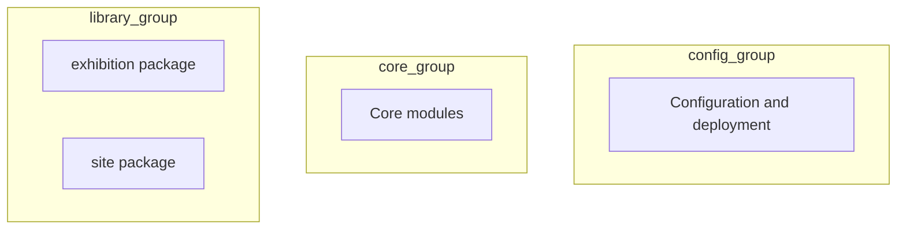

# Architecture report: ant-design/ant-motion

> Automated static analysis. **Observed** = directly seen in files/imports/AST; **Inferred** = interpretation from that evidence. Repository code was not executed.

## 1. Repository at a glance

| Item | Value |
| --- | --- |
| Repository | ant-design/ant-motion |
| Description |   :bicyclist: Animate specification and components of Ant Design |
| Language | JavaScript |
| Stars | 4630 |
| Licence | MIT |
| Analysed commit / branch | b37b07bea15927f83ec3518ca3af1fae91c1c6b5 / master |
| Framework(s) | React |
| Files analysed | 147 |
| Components | 4 |

## 2. Architecture in one minute

ant-design/ant-motion -   :bicyclist: Animate specification and components of Ant Design. This repository was analysed statically from 147 file(s) (0 Python). Detected technologies (observed from imports/manifests): React, React Router. Files are grouped into 4 component(s): Configuration and deployment, Core modules, exhibition package, site package. Findings below distinguish observed facts from inferred interpretation.

## 3. High-level block diagram

## 4. Main components

### Configuration and deployment (`config`)

- **Kind:** config
- **Status:** Observed
- **Confidence:** 0.85
- **Responsibility:** Groups 2 file(s) under configuration and deployment (observed from repository paths and static analysis).
- **Paths:** `package.json`, `renovate.json`
- **Evidence:** [package.json](https://github.com/ant-design/ant-motion/blob/b37b07bea15927f83ec3518ca3af1fae91c1c6b5/package.json); [renovate.json](https://github.com/ant-design/ant-motion/blob/b37b07bea15927f83ec3518ca3af1fae91c1c6b5/renovate.json)

### Core modules (`core`)

- **Kind:** core
- **Status:** Observed
- **Confidence:** 0.85
- **Responsibility:** Groups 2 file(s) under core modules (observed from repository paths and static analysis).
- **Paths:** `theme.js`, `webpack.config.js`
- **Evidence:** [theme.js](https://github.com/ant-design/ant-motion/blob/b37b07bea15927f83ec3518ca3af1fae91c1c6b5/theme.js); [webpack.config.js](https://github.com/ant-design/ant-motion/blob/b37b07bea15927f83ec3518ca3af1fae91c1c6b5/webpack.config.js)

### exhibition package (`exhibition`)

- **Kind:** library
- **Status:** Observed
- **Confidence:** 0.85
- **Responsibility:** Groups 10 file(s) under exhibition package (observed from repository paths and static analysis).
- **Paths:** `exhibition/js/carousel3d.jsx`, `exhibition/js/detail-swich.jsx`, `exhibition/js/linked-animate.jsx`, `exhibition/js/list-anim-animateDemo.jsx`, `exhibition/js/list-anim-tweenOneDemo.jsx`, `exhibition/js/list-sort.jsx`, `exhibition/js/logo-gather-anim.jsx`, `exhibition/js/pic-details-anim.jsx`, `exhibition/js/snow.jsx`, `exhibition/js/table-enter-leave.jsx`
- **Evidence:** [exhibition/js/carousel3d.jsx](https://github.com/ant-design/ant-motion/blob/b37b07bea15927f83ec3518ca3af1fae91c1c6b5/exhibition/js/carousel3d.jsx); [exhibition/js/detail-swich.jsx](https://github.com/ant-design/ant-motion/blob/b37b07bea15927f83ec3518ca3af1fae91c1c6b5/exhibition/js/detail-swich.jsx); [exhibition/js/linked-animate.jsx](https://github.com/ant-design/ant-motion/blob/b37b07bea15927f83ec3518ca3af1fae91c1c6b5/exhibition/js/linked-animate.jsx); [exhibition/js/list-anim-animateDemo.jsx](https://github.com/ant-design/ant-motion/blob/b37b07bea15927f83ec3518ca3af1fae91c1c6b5/exhibition/js/list-anim-animateDemo.jsx); [exhibition/js/list-anim-tweenOneDemo.jsx](https://github.com/ant-design/ant-motion/blob/b37b07bea15927f83ec3518ca3af1fae91c1c6b5/exhibition/js/list-anim-tweenOneDemo.jsx); [exhibition/js/list-sort.jsx](https://github.com/ant-design/ant-motion/blob/b37b07bea15927f83ec3518ca3af1fae91c1c6b5/exhibition/js/list-sort.jsx); [exhibition/js/logo-gather-anim.jsx](https://github.com/ant-design/ant-motion/blob/b37b07bea15927f83ec3518ca3af1fae91c1c6b5/exhibition/js/logo-gather-anim.jsx); [exhibition/js/pic-details-anim.jsx](https://github.com/ant-design/ant-motion/blob/b37b07bea15927f83ec3518ca3af1fae91c1c6b5/exhibition/js/pic-details-anim.jsx)

### site package (`site`)

- **Kind:** library
- **Status:** Observed
- **Confidence:** 0.85
- **Responsibility:** Groups 31 file(s) under site package (observed from repository paths and static analysis).
- **Paths:** `site/bisheng.config.js`, `site/theme/en-US.js`, `site/theme/index.js`, `site/theme/static/style.js`, `site/theme/template/Content/Article.jsx`, `site/theme/template/Content/ComponentDoc.jsx`, `site/theme/template/Content/DemoItem.jsx`, `site/theme/template/Content/DemoLayout.jsx`, `site/theme/template/Content/Page.jsx`, `site/theme/template/Exhibition/Details.jsx`, `site/theme/template/Exhibition/index.jsx`, `site/theme/template/Home/Banner.jsx`, `site/theme/template/Home/CodeDemo.jsx`, `site/theme/template/Home/Demo.jsx`, `site/theme/template/Home/Page1.jsx`, `site/theme/template/Home/Page2.jsx`, `site/theme/template/Home/Page3.jsx`, `site/theme/template/Home/index.jsx`, `site/theme/template/Layout/Footer.jsx`, `site/theme/template/Layout/Header.jsx`, `site/theme/template/Layout/Layout.jsx`, `site/theme/template/Layout/index.jsx`, `site/theme/template/Layout/nav.js`, `site/theme/template/NotFound.jsx`, `site/theme/template/other/EaseExplain.jsx`, `site/theme/template/other/ListSort.jsx`, `site/theme/template/other/Principle.jsx`, `site/theme/template/other/QueueDemo.jsx`, `site/theme/template/template.config.js`, `site/theme/template/utils.jsx`, `site/theme/zh-CN.js`
- **Evidence:** [site/bisheng.config.js](https://github.com/ant-design/ant-motion/blob/b37b07bea15927f83ec3518ca3af1fae91c1c6b5/site/bisheng.config.js); [site/theme/en-US.js](https://github.com/ant-design/ant-motion/blob/b37b07bea15927f83ec3518ca3af1fae91c1c6b5/site/theme/en-US.js); [site/theme/index.js](https://github.com/ant-design/ant-motion/blob/b37b07bea15927f83ec3518ca3af1fae91c1c6b5/site/theme/index.js); [site/theme/static/style.js](https://github.com/ant-design/ant-motion/blob/b37b07bea15927f83ec3518ca3af1fae91c1c6b5/site/theme/static/style.js); [site/theme/template/Content/Article.jsx](https://github.com/ant-design/ant-motion/blob/b37b07bea15927f83ec3518ca3af1fae91c1c6b5/site/theme/template/Content/Article.jsx); [site/theme/template/Content/ComponentDoc.jsx](https://github.com/ant-design/ant-motion/blob/b37b07bea15927f83ec3518ca3af1fae91c1c6b5/site/theme/template/Content/ComponentDoc.jsx); [site/theme/template/Content/DemoItem.jsx](https://github.com/ant-design/ant-motion/blob/b37b07bea15927f83ec3518ca3af1fae91c1c6b5/site/theme/template/Content/DemoItem.jsx); [site/theme/template/Content/DemoLayout.jsx](https://github.com/ant-design/ant-motion/blob/b37b07bea15927f83ec3518ca3af1fae91c1c6b5/site/theme/template/Content/DemoLayout.jsx)

## 5. Execution flow

**Observed** entry point(s):

- [site/theme/index.js](https://github.com/ant-design/ant-motion/blob/b37b07bea15927f83ec3518ca3af1fae91c1c6b5/site/theme/index.js)

Representative flow (derived from observed entry points and the import graph; steps beyond the entry point are **Inferred**):

1. Execution starts at an observed entry point listed above, if present.
2. No internal import relationships between components were observed.

## 6. Project structure

### `(root)`

- `.editorconfig` - config (245 bytes)
- `.eslintignore` - other (20 bytes)
- `.eslintrc.js` - source, JavaScript (2219 bytes)
- `.gitignore` - other (155 bytes)
- `.stylelintrc` - other (728 bytes)
- `CNAME` - other (17 bytes)
- `LICENSE.md` - docs (1100 bytes)
- `README.cn.md` - docs (3342 bytes)
- `README.md` - docs (3805 bytes)
- `package.json` - manifest (2324 bytes)
- `renovate.json` - config (41 bytes)
- `theme.js` - source, JavaScript (104 bytes)
- `webpack.config.js` - source, JavaScript (868 bytes)

### `.github`

- `.github/FUNDING.yml` - config (398 bytes)

### `components`

- `components/animate/demo/appear.md` - docs (1039 bytes)
- `components/animate/demo/remove.md` - docs (1019 bytes)
- `components/animate/demo/simple.md` - docs (2096 bytes)
- `components/animate/index.en-US.md` - docs (1931 bytes)
- `components/animate/index.zh-CN.md` - docs (1893 bytes)
- `components/banner-anim/demo/autoplay.md` - docs (1726 bytes)
- `components/banner-anim/demo/bgParallax.md` - docs (2219 bytes)
- `components/banner-anim/demo/customArrowThumb.md` - docs (7461 bytes)
- `components/banner-anim/demo/followMouse.md` - docs (2117 bytes)
- `components/banner-anim/demo/simple.md` - docs (2182 bytes)
- `components/banner-anim/demo/video.md` - docs (1992 bytes)
- `components/banner-anim/index.en-US.md` - docs (5805 bytes)
- `components/banner-anim/index.zh-CN.md` - docs (6170 bytes)
- `components/queue-anim/demo/basic.md` - docs (1146 bytes)
- `components/queue-anim/demo/change.md` - docs (1734 bytes)
- `components/queue-anim/demo/custom.md` - docs (1327 bytes)
- `components/queue-anim/demo/enter-leave.md` - docs (1507 bytes)
- `components/queue-anim/demo/page.md` - docs (1933 bytes)
- `components/queue-anim/demo/simple.md` - docs (440 bytes)
- `components/queue-anim/index.en-US.md` - docs (3250 bytes)
- `components/queue-anim/index.zh-CN.md` - docs (3463 bytes)
- `components/scroll-anim/demo/overPack.md` - docs (1398 bytes)
- `components/scroll-anim/demo/parallax-custom.md` - docs (686 bytes)
- `components/scroll-anim/demo/parallax-timeline.md` - docs (780 bytes)
- `components/scroll-anim/demo/parallax.md` - docs (833 bytes)
- `components/scroll-anim/index.en-US.md` - docs (7797 bytes)
- `components/scroll-anim/index.zh-CN.md` - docs (7520 bytes)
- `components/texty/demo/basic.md` - docs (423 bytes)
- `components/texty/demo/custom.md` - docs (2079 bytes)
- `components/texty/demo/effect.md` - docs (1706 bytes)
- `components/texty/demo/example.md` - docs (4921 bytes)
- `components/texty/demo/switch.md` - docs (736 bytes)
- `components/texty/index.en-US.md` - docs (3202 bytes)
- `components/texty/index.zh-CN.md` - docs (3376 bytes)
- `components/tween-one/demo/bezier.md` - docs (1726 bytes)
- `components/tween-one/demo/children.md` - docs (2160 bytes)
- `components/tween-one/demo/control.md` - docs (2049 bytes)
- `components/tween-one/demo/easingPath.md` - docs (1399 bytes)
- `components/tween-one/demo/path.md` - docs (1625 bytes)
- `components/tween-one/demo/position.md` - docs (1005 bytes)
- `components/tween-one/demo/svgDraw.md` - docs (1601 bytes)
- `components/tween-one/demo/svgMorph.md` - docs (1357 bytes)
- `components/tween-one/demo/timeline.md` - docs (1139 bytes)
- `components/tween-one/index.en-US.md` - docs (9184 bytes)
- `components/tween-one/index.zh-CN.md` - docs (9462 bytes)

### `exhibition`

- `exhibition/demo/carousel3d.md` - docs (9765 bytes)
- `exhibition/demo/detail-switch.md` - docs (7737 bytes)
- `exhibition/demo/linked-animate.md` - docs (6037 bytes)
- `exhibition/demo/list-anim.md` - docs (7902 bytes)
- `exhibition/demo/list-sort.md` - docs (3387 bytes)
- `exhibition/demo/logo-gather-anim.md` - docs (12932 bytes)
- `exhibition/demo/pic-details-anim.md` - docs (10328 bytes)
- `exhibition/demo/snow.md` - docs (6969 bytes)
- `exhibition/demo/table-enter-leave.md` - docs (12067 bytes)
- `exhibition/js/carousel3d.css` - other (1002 bytes)
- `exhibition/js/carousel3d.jsx` - source, JavaScript (8303 bytes)
- `exhibition/js/detail-swich.css` - other (1695 bytes)
- `exhibition/js/detail-swich.jsx` - source, JavaScript (5343 bytes)
- `exhibition/js/linked-animate.css` - other (469 bytes)
- `exhibition/js/linked-animate.jsx` - source, JavaScript (5096 bytes)
- `exhibition/js/list-anim-animateDemo.css` - other (2742 bytes)
- `exhibition/js/list-anim-animateDemo.jsx` - source, JavaScript (6112 bytes)
- `exhibition/js/list-anim-tweeOneDemo.css` - other (1838 bytes)
- `exhibition/js/list-anim-tweenOneDemo.jsx` - source, JavaScript (5184 bytes)
- `exhibition/js/list-sort.css` - other (1079 bytes)
- `exhibition/js/list-sort.jsx` - source, JavaScript (1773 bytes)
- `exhibition/js/logo-gather-anim.css` - other (1947 bytes)
- `exhibition/js/logo-gather-anim.jsx` - source, JavaScript (10057 bytes)
- `exhibition/js/money.less` - other (516 bytes)
- `exhibition/js/pic-details-anim.css` - other (3508 bytes)
- `exhibition/js/pic-details-anim.jsx` - source, JavaScript (6289 bytes)
- `exhibition/js/snow.css` - other (630 bytes)
- `exhibition/js/snow.jsx` - source, JavaScript (5680 bytes)
- `exhibition/js/table-enter-leave.css` - other (5053 bytes)
- `exhibition/js/table-enter-leave.jsx` - source, JavaScript (5773 bytes)

### `language`

- `language/animate-term.md` - docs (5330 bytes)
- `language/basic.en-US.md` - docs (981 bytes)
- `language/basic.zh-CN.md` - docs (779 bytes)
- `language/combined.md` - docs (1687 bytes)
- `language/principle.en-US.md` - docs (2232 bytes)
- `language/principle.zh-CN.md` - docs (1933 bytes)
- `language/space.md` - docs (1941 bytes)
- `language/speed.md` - docs (5058 bytes)
- `language/transition.en-US.md` - docs (2616 bytes)
- `language/transition.zh-CN.md` - docs (2759 bytes)

### `site`

- `site/bisheng.config.js` - source, JavaScript (2236 bytes)
- `site/theme/en-US.js` - source, JavaScript (2643 bytes)
- `site/theme/index.js` - source, JavaScript (2430 bytes)
- `site/theme/static/common.less` - other (6826 bytes)
- `site/theme/static/custom.less` - other (1615 bytes)
- `site/theme/static/demo.less` - other (6399 bytes)
- `site/theme/static/demolayout.less` - other (1674 bytes)
- `site/theme/static/exhibition.less` - other (771 bytes)
- `site/theme/static/footer.less` - other (1738 bytes)
- `site/theme/static/global.less` - other (1100 bytes)
- `site/theme/static/highlight.less` - other (2523 bytes)
- `site/theme/static/home.less` - other (9025 bytes)
- `site/theme/static/index.html` - other (8373 bytes)
- `site/theme/static/logo-demo.less` - other (540 bytes)
- `site/theme/static/markdown.less` - other (7156 bytes)
- `site/theme/static/page.less` - other (3043 bytes)
- `site/theme/static/responsive.less` - other (6763 bytes)
- `site/theme/static/splicing.less` - other (3005 bytes)
- `site/theme/static/style.js` - source, JavaScript (544 bytes)
- `site/theme/template/Content/Article.jsx` - source, JavaScript (2586 bytes)
- `site/theme/template/Content/ComponentDoc.jsx` - source, JavaScript (4297 bytes)
- `site/theme/template/Content/DemoItem.jsx` - source, JavaScript (4273 bytes)
- `site/theme/template/Content/DemoLayout.jsx` - source, JavaScript (952 bytes)
- `site/theme/template/Content/Page.jsx` - source, JavaScript (9922 bytes)
- `site/theme/template/Exhibition/Details.jsx` - source, JavaScript (2599 bytes)
- `site/theme/template/Exhibition/index.jsx` - source, JavaScript (1570 bytes)
- `site/theme/template/Home/Banner.jsx` - source, JavaScript (3609 bytes)
- `site/theme/template/Home/CodeDemo.jsx` - source, JavaScript (2562 bytes)
- `site/theme/template/Home/Demo.jsx` - source, JavaScript (9366 bytes)
- `site/theme/template/Home/Page1.jsx` - source, JavaScript (1935 bytes)
- `site/theme/template/Home/Page2.jsx` - source, JavaScript (2876 bytes)
- `site/theme/template/Home/Page3.jsx` - source, JavaScript (1390 bytes)
- `site/theme/template/Home/index.jsx` - source, JavaScript (1901 bytes)
- `site/theme/template/Layout/Footer.jsx` - source, JavaScript (6378 bytes)
- `site/theme/template/Layout/Header.jsx` - source, JavaScript (6178 bytes)
- `site/theme/template/Layout/Layout.jsx` - source, JavaScript (3522 bytes)
- `site/theme/template/Layout/index.jsx` - source, JavaScript (1992 bytes)
- `site/theme/template/Layout/nav.js` - source, JavaScript (668 bytes)
- `site/theme/template/NotFound.jsx` - source, JavaScript (561 bytes)
- `site/theme/template/other/EaseExplain.jsx` - source, JavaScript (2239 bytes)
- `site/theme/template/other/ListSort.jsx` - source, JavaScript (11378 bytes)
- `site/theme/template/other/Principle.jsx` - source, JavaScript (1843 bytes)
- `site/theme/template/other/QueueDemo.jsx` - source, JavaScript (2964 bytes)
- `site/theme/template/other/principle.less` - other (480 bytes)
- `site/theme/template/other/queueDemo.less` - other (534 bytes)
- `site/theme/template/template.config.js` - source, JavaScript (2926 bytes)
- `site/theme/template/utils.jsx` - source, JavaScript (3060 bytes)
- `site/theme/zh-CN.js` - source, JavaScript (2689 bytes)

## 7. Key dependencies and integrations

| Name | Category | Status | Confidence | Evidence |
| --- | --- | --- | --- | --- |
| React | framework | Observed | 0.90 | [package.json:5](https://github.com/ant-design/ant-motion/blob/b37b07bea15927f83ec3518ca3af1fae91c1c6b5/package.json#L5); [package.json:48](https://github.com/ant-design/ant-motion/blob/b37b07bea15927f83ec3518ca3af1fae91c1c6b5/package.json#L48) |
| React Router | library | Observed | 0.85 | [package.json:51](https://github.com/ant-design/ant-motion/blob/b37b07bea15927f83ec3518ca3af1fae91c1c6b5/package.json#L51) |

## 8. Data and state

No database, cache, queue, or persistent-state usage was observed in the analysed files. State handling, if any, may be in-memory or in files that were not analysed.

## 9. Configuration and deployment clues

- `.editorconfig` (config)
- `.github/FUNDING.yml` (config)
- `package.json` (manifest)
- `renovate.json` (config)

## 10. Design observations

- No strong design patterns could be established from the available evidence.

These observations are interpretations (**Inferred**) of the observed structure, not guarantees about runtime design.

## 11. Limitations and unknowns

- Static analysis only: repository code was not executed, installed, or imported at runtime.
- Components and relationships are inferred from file paths, imports, and AST structure; runtime behaviour, dynamic imports, and reflection may not be visible.
- No clear application entry point was observed in the analysed files.
- Repository text was treated as untrusted data; no instructions found in repository files were followed, and likely secret values were redacted/excluded.
- JavaScript and TypeScript files were inventoried from paths and package manifests. They were not parsed with a full language AST, and repository code was not executed.

## 12. Source references

- [exhibition/js/carousel3d.jsx](https://github.com/ant-design/ant-motion/blob/b37b07bea15927f83ec3518ca3af1fae91c1c6b5/exhibition/js/carousel3d.jsx)
- [exhibition/js/detail-swich.jsx](https://github.com/ant-design/ant-motion/blob/b37b07bea15927f83ec3518ca3af1fae91c1c6b5/exhibition/js/detail-swich.jsx)
- [exhibition/js/linked-animate.jsx](https://github.com/ant-design/ant-motion/blob/b37b07bea15927f83ec3518ca3af1fae91c1c6b5/exhibition/js/linked-animate.jsx)
- [exhibition/js/list-anim-animateDemo.jsx](https://github.com/ant-design/ant-motion/blob/b37b07bea15927f83ec3518ca3af1fae91c1c6b5/exhibition/js/list-anim-animateDemo.jsx)
- [exhibition/js/list-anim-tweenOneDemo.jsx](https://github.com/ant-design/ant-motion/blob/b37b07bea15927f83ec3518ca3af1fae91c1c6b5/exhibition/js/list-anim-tweenOneDemo.jsx)
- [exhibition/js/list-sort.jsx](https://github.com/ant-design/ant-motion/blob/b37b07bea15927f83ec3518ca3af1fae91c1c6b5/exhibition/js/list-sort.jsx)
- [exhibition/js/logo-gather-anim.jsx](https://github.com/ant-design/ant-motion/blob/b37b07bea15927f83ec3518ca3af1fae91c1c6b5/exhibition/js/logo-gather-anim.jsx)
- [exhibition/js/pic-details-anim.jsx](https://github.com/ant-design/ant-motion/blob/b37b07bea15927f83ec3518ca3af1fae91c1c6b5/exhibition/js/pic-details-anim.jsx)
- [package.json](https://github.com/ant-design/ant-motion/blob/b37b07bea15927f83ec3518ca3af1fae91c1c6b5/package.json)
- [package.json:5](https://github.com/ant-design/ant-motion/blob/b37b07bea15927f83ec3518ca3af1fae91c1c6b5/package.json#L5)
- [package.json:48](https://github.com/ant-design/ant-motion/blob/b37b07bea15927f83ec3518ca3af1fae91c1c6b5/package.json#L48)
- [package.json:51](https://github.com/ant-design/ant-motion/blob/b37b07bea15927f83ec3518ca3af1fae91c1c6b5/package.json#L51)
- [renovate.json](https://github.com/ant-design/ant-motion/blob/b37b07bea15927f83ec3518ca3af1fae91c1c6b5/renovate.json)
- [site/bisheng.config.js](https://github.com/ant-design/ant-motion/blob/b37b07bea15927f83ec3518ca3af1fae91c1c6b5/site/bisheng.config.js)
- [site/theme/en-US.js](https://github.com/ant-design/ant-motion/blob/b37b07bea15927f83ec3518ca3af1fae91c1c6b5/site/theme/en-US.js)
- [site/theme/index.js](https://github.com/ant-design/ant-motion/blob/b37b07bea15927f83ec3518ca3af1fae91c1c6b5/site/theme/index.js)
- [site/theme/static/style.js](https://github.com/ant-design/ant-motion/blob/b37b07bea15927f83ec3518ca3af1fae91c1c6b5/site/theme/static/style.js)
- [site/theme/template/Content/Article.jsx](https://github.com/ant-design/ant-motion/blob/b37b07bea15927f83ec3518ca3af1fae91c1c6b5/site/theme/template/Content/Article.jsx)
- [site/theme/template/Content/ComponentDoc.jsx](https://github.com/ant-design/ant-motion/blob/b37b07bea15927f83ec3518ca3af1fae91c1c6b5/site/theme/template/Content/ComponentDoc.jsx)
- [site/theme/template/Content/DemoItem.jsx](https://github.com/ant-design/ant-motion/blob/b37b07bea15927f83ec3518ca3af1fae91c1c6b5/site/theme/template/Content/DemoItem.jsx)
- [site/theme/template/Content/DemoLayout.jsx](https://github.com/ant-design/ant-motion/blob/b37b07bea15927f83ec3518ca3af1fae91c1c6b5/site/theme/template/Content/DemoLayout.jsx)
- [theme.js](https://github.com/ant-design/ant-motion/blob/b37b07bea15927f83ec3518ca3af1fae91c1c6b5/theme.js)
- [webpack.config.js](https://github.com/ant-design/ant-motion/blob/b37b07bea15927f83ec3518ca3af1fae91c1c6b5/webpack.config.js)
