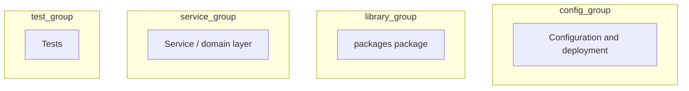

# Architecture report: ant-design/x

> Automated static analysis. **Observed** = directly seen in files/imports/AST; **Inferred** = interpretation from that evidence. Repository code was not executed.

## 1. Repository at a glance

| Item | Value |
| --- | --- |
| Repository | ant-design/x |
| Description | Craft AI-driven interface effortlessly🤖 |
| Language | TypeScript |
| Stars | 4847 |
| Licence | Not detected |
| Analysed commit / branch | da08db16714b608d7f5db248c2b2fcc30a756660 / main |
| Framework(s) | React |
| Files analysed | 799 |
| Components | 4 |

## 2. Architecture in one minute

ant-design/x - Craft AI-driven interface effortlessly🤖. This repository was analysed statically from 799 file(s) (0 Python). Detected technologies (observed from imports/manifests): GitHub Actions, React, TypeScript, Vite. Files are grouped into 4 component(s): Configuration and deployment, packages package, Service / domain layer, Tests. Findings below distinguish observed facts from inferred interpretation.

## 3. High-level block diagram

## 4. Main components

### Configuration and deployment (`config`)

- **Kind:** config
- **Status:** Observed
- **Confidence:** 0.85
- **Responsibility:** Groups 25 file(s) under configuration and deployment (observed from repository paths and static analysis).
- **Paths:** `biome.json`, `package.json`, `packages/x-card/.lintstagedrc.json`, `packages/x-card/package.json`, `packages/x-card/tsconfig.json`, `packages/x-markdown/BUG_VERSIONS.json`, `packages/x-markdown/mako.config.json`, `packages/x-markdown/package.json`, `packages/x-markdown/src/plugins/version/plugin-meta.json`, `packages/x-markdown/tsconfig.json`, `packages/x-sdk/BUG_VERSIONS.json`, `packages/x-sdk/mako.config.json`, `packages/x-sdk/package.json`, `packages/x-sdk/tsconfig.json`, `packages/x-skill/.claude-plugin/marketplace.json`, `packages/x-skill/.skill.json`, `packages/x-skill/package.json`, `packages/x-skill/src/skill-meta.json`, `packages/x-skill/tsconfig.json`, `packages/x/.dumi/theme/locales/en-US.json`, `packages/x/.dumi/theme/locales/zh-CN.json`, `packages/x/.dumi/tsconfig.json`, `packages/x/.lintstagedrc.json`, `packages/x/BUG_VERSIONS.json`, `packages/x/bunfig.toml`
- **Evidence:** [biome.json](https://github.com/ant-design/x/blob/da08db16714b608d7f5db248c2b2fcc30a756660/biome.json); [package.json](https://github.com/ant-design/x/blob/da08db16714b608d7f5db248c2b2fcc30a756660/package.json); [packages/x-card/.lintstagedrc.json](https://github.com/ant-design/x/blob/da08db16714b608d7f5db248c2b2fcc30a756660/packages/x-card/.lintstagedrc.json); [packages/x-card/package.json](https://github.com/ant-design/x/blob/da08db16714b608d7f5db248c2b2fcc30a756660/packages/x-card/package.json); [packages/x-card/tsconfig.json](https://github.com/ant-design/x/blob/da08db16714b608d7f5db248c2b2fcc30a756660/packages/x-card/tsconfig.json); [packages/x-markdown/BUG_VERSIONS.json](https://github.com/ant-design/x/blob/da08db16714b608d7f5db248c2b2fcc30a756660/packages/x-markdown/BUG_VERSIONS.json); [packages/x-markdown/mako.config.json](https://github.com/ant-design/x/blob/da08db16714b608d7f5db248c2b2fcc30a756660/packages/x-markdown/mako.config.json); [packages/x-markdown/package.json](https://github.com/ant-design/x/blob/da08db16714b608d7f5db248c2b2fcc30a756660/packages/x-markdown/package.json)

### packages package (`packages`)

- **Kind:** library
- **Status:** Observed
- **Confidence:** 0.85
- **Responsibility:** Groups 529 file(s) under packages package (observed from repository paths and static analysis).
- **Paths:** `packages/x-card/.fatherrc.ts`, `packages/x-card/.jest.js`, `packages/x-card/scripts/generate-version.ts`, `packages/x-card/src/A2UI/Box.tsx`, `packages/x-card/src/A2UI/Card.tsx`, `packages/x-card/src/A2UI/Card.v0.8.ts`, `packages/x-card/src/A2UI/Card.v0.9.ts`, `packages/x-card/src/A2UI/Context.tsx`, `packages/x-card/src/A2UI/__tests__/Box.coverage.test.tsx`, `packages/x-card/src/A2UI/__tests__/Card.coverage.test.tsx`, `packages/x-card/src/A2UI/__tests__/Card.v0.8.test.ts`, `packages/x-card/src/A2UI/__tests__/Card.v0.9.test.ts`, `packages/x-card/src/A2UI/__tests__/catalog.test.ts`, `packages/x-card/src/A2UI/__tests__/components.test.ts`, `packages/x-card/src/A2UI/__tests__/integration.test.tsx`, `packages/x-card/src/A2UI/__tests__/utils.test.ts`, `packages/x-card/src/A2UI/catalog.ts`, `packages/x-card/src/A2UI/format/components.ts`, `packages/x-card/src/A2UI/index.ts`, `packages/x-card/src/A2UI/types/box.ts`, `packages/x-card/src/A2UI/types/command_v0.8.ts`, `packages/x-card/src/A2UI/types/command_v0.9.ts`, `packages/x-card/src/A2UI/utils.ts`, `packages/x-card/src/index.ts`, `packages/x-card/src/version.ts`, `packages/x-markdown/.fatherrc.ts`, `packages/x-markdown/.jest.js`, `packages/x-markdown/jest-puppeteer.config.js`, `packages/x-markdown/scripts/generate-plugin-meta.ts`, `packages/x-markdown/scripts/generate-version.ts`, `packages/x-markdown/src/XMarkdown/AnimationText.tsx`, `packages/x-markdown/src/XMarkdown/DebugPanel/DebugPanel.tsx`, `packages/x-markdown/src/XMarkdown/DebugPanel/index.ts`, `packages/x-markdown/src/XMarkdown/Section.tsx`, `packages/x-markdown/src/XMarkdown/__benchmark__/components/MarkdownRenderer.tsx`, `packages/x-markdown/src/XMarkdown/__benchmark__/playwright-ct.config.ts`, `packages/x-markdown/src/XMarkdown/__benchmark__/playwright/index.tsx`, `packages/x-markdown/src/XMarkdown/__benchmark__/scripts/check-performance.js`, `packages/x-markdown/src/XMarkdown/__benchmark__/scripts/run-benchmark.js`, `packages/x-markdown/src/XMarkdown/__tests__/AnimationText.test.tsx`, `packages/x-markdown/src/XMarkdown/__tests__/DebugPanel.test.tsx`, `packages/x-markdown/src/XMarkdown/__tests__/Parser.test.ts`, `packages/x-markdown/src/XMarkdown/__tests__/Renderer.test.ts`, `packages/x-markdown/src/XMarkdown/__tests__/hooks.test.tsx`, `packages/x-markdown/src/XMarkdown/__tests__/incremental.test.tsx`, `packages/x-markdown/src/XMarkdown/__tests__/index.test.tsx`, `packages/x-markdown/src/XMarkdown/__tests__/preset.test.tsx`, `packages/x-markdown/src/XMarkdown/__tests__/useTypewriter.test.tsx`, `packages/x-markdown/src/XMarkdown/hooks/index.ts`, `packages/x-markdown/src/XMarkdown/hooks/useStreaming.ts`, `packages/x-markdown/src/XMarkdown/hooks/useTypewriter.ts`, `packages/x-markdown/src/XMarkdown/index.tsx`, `packages/x-markdown/src/XMarkdown/interface.ts`, `packages/x-markdown/src/XMarkdown/utils/memo.ts`, `packages/x-markdown/src/XMarkdown/utils/streaming.ts`, `packages/x-markdown/src/XMarkdown/utils/tail.ts`, `packages/x-markdown/src/index.ts`, `packages/x-markdown/src/plugins/Latex/__tests__/index.test.tsx`, `packages/x-markdown/src/plugins/Latex/index.ts`, `packages/x-markdown/src/plugins/type.ts`, `packages/x-markdown/src/plugins/version/index.ts`, `packages/x-markdown/src/version/index.ts`, `packages/x-markdown/typings/custom-typings.d.ts`, `packages/x-markdown/typings/index.d.ts`, `packages/x-markdown/typings/jest.d.ts`, `packages/x-sdk/.fatherrc.ts`, `packages/x-sdk/.jest.js`, `packages/x-sdk/scripts/generate-version.ts`, `packages/x-sdk/src/_util/type.ts`, `packages/x-sdk/src/chat-providers/AbstractChatProvider.ts`, `packages/x-sdk/src/chat-providers/DeepSeekChatProvider.ts`, `packages/x-sdk/src/chat-providers/DefaultChatProvider.ts`, `packages/x-sdk/src/chat-providers/OpenAIChatProvider.ts`, `packages/x-sdk/src/chat-providers/__test__/providers.test.ts`, `packages/x-sdk/src/chat-providers/index.ts`, `packages/x-sdk/src/chat-providers/types/model.ts`, `packages/x-sdk/src/index.ts`, `packages/x-sdk/src/version/index.ts`, `packages/x-sdk/src/x-chat/__test__/index.test.tsx`, `packages/x-sdk/src/x-chat/__test__/store.test.ts`, `packages/x-sdk/src/x-chat/__test__/useSyncState.test.tsx`, `packages/x-sdk/src/x-chat/index.ts`, `packages/x-sdk/src/x-chat/store.ts`, `packages/x-sdk/src/x-chat/useSyncState.ts`, `packages/x-sdk/src/x-conversations/__test__/index.test.tsx`, `packages/x-sdk/src/x-conversations/index.ts`, `packages/x-sdk/src/x-conversations/store.ts`, `packages/x-sdk/src/x-mcp-client/__test__/index.test.ts`, `packages/x-sdk/src/x-mcp-client/index.ts`, `packages/x-sdk/src/x-request/__test__/abort.test.ts`, `packages/x-sdk/src/x-request/__test__/index.test.ts`, `packages/x-sdk/src/x-request/__test__/json-state.test.ts`, `packages/x-sdk/src/x-request/__test__/x-fetch.test.tsx`, `packages/x-sdk/src/x-request/index.ts`, `packages/x-sdk/src/x-request/x-fetch.ts`, `packages/x-sdk/src/x-stream/__test__/index.test.ts`, `packages/x-sdk/src/x-stream/index.ts`, `packages/x-sdk/typings/custom-typings.d.ts`, `packages/x-sdk/typings/index.d.ts`, `packages/x-sdk/typings/jest.d.ts`, `packages/x-skill/.fatherrc.ts`, `packages/x-skill/scripts/config.ts`, `packages/x-skill/scripts/dekko.ts`, `packages/x-skill/scripts/generate-meta.ts`, `packages/x-skill/scripts/generate-version.ts`, `packages/x-skill/scripts/skillApi.ts`, `packages/x-skill/scripts/typings/custom-typings.d.ts`, `packages/x-skill/src/getSkillRepo.ts`, `packages/x-skill/src/help.ts`, `packages/x-skill/src/index.ts`, `packages/x-skill/src/locale/index.ts`, `packages/x-skill/src/safePath.ts`, `packages/x/.dumi/components/SemanticPreview.tsx`, `packages/x/.dumi/hooks/use.ts`, `packages/x/.dumi/hooks/useDark.tsx`, `packages/x/.dumi/hooks/useFetch/cache.ts`, `packages/x/.dumi/hooks/useFetch/index.ts`, `packages/x/.dumi/hooks/useLayoutState.ts`, `packages/x/.dumi/hooks/useLocale.ts`, `packages/x/.dumi/hooks/useLocation.ts`, `packages/x/.dumi/hooks/useLottie.ts`, `packages/x/.dumi/hooks/useMenu.tsx`, `packages/x/.dumi/hooks/useScrollY.ts`, `packages/x/.dumi/hooks/useThemeAnimation.ts`, `packages/x/.dumi/loading.js`, `packages/x/.dumi/pages/404/index.tsx`, `packages/x/.dumi/pages/index-cn/index.ts`, `packages/x/.dumi/pages/index/common/Container.tsx`, `packages/x/.dumi/pages/index/common/CustomizationProvider.tsx`, `packages/x/.dumi/pages/index/common/CustomizationSender.tsx`, `packages/x/.dumi/pages/index/common/Introduction.tsx`, `packages/x/.dumi/pages/index/components/CompIntroduction/Customization.tsx`, `packages/x/.dumi/pages/index/components/CompIntroduction/index.tsx`, `packages/x/.dumi/pages/index/components/DesignBanner.tsx`, `packages/x/.dumi/pages/index/components/DesignFramework.tsx`, `packages/x/.dumi/pages/index/components/DesignGuide.tsx`, `packages/x/.dumi/pages/index/components/Lottie.tsx`, `packages/x/.dumi/pages/index/components/MainBanner.tsx`, `packages/x/.dumi/pages/index/components/SceneIntroduction/Assistant.tsx`, `packages/x/.dumi/pages/index/components/SceneIntroduction/Independent.tsx`, `packages/x/.dumi/pages/index/components/SceneIntroduction/Nest.tsx`, `packages/x/.dumi/pages/index/components/SceneIntroduction/index.tsx`, `packages/x/.dumi/pages/index/components/SiteContext.ts`, `packages/x/.dumi/pages/index/index.tsx`, `packages/x/.dumi/rehypeAntd.ts`, `packages/x/.dumi/remarkAnchor.ts`, `packages/x/.dumi/remarkAntd.ts`, `packages/x/.dumi/theme/SiteThemeProvider.tsx`, `packages/x/.dumi/theme/builtins/APITable/index.tsx`, `packages/x/.dumi/theme/builtins/Antd.tsx`, `packages/x/.dumi/theme/builtins/Audio/index.tsx`, `packages/x/.dumi/theme/builtins/Badge/index.tsx`, `packages/x/.dumi/theme/builtins/ColorChunk/index.tsx`, `packages/x/.dumi/theme/builtins/ColorPaletteTool/index.ts`, `packages/x/.dumi/theme/builtins/ColorPaletteToolDark/index.ts`, `packages/x/.dumi/theme/builtins/ColorPalettes/index.ts`, `packages/x/.dumi/theme/builtins/ComponentMeta/index.tsx`, `packages/x/.dumi/theme/builtins/ComponentOverview/index.tsx`, `packages/x/.dumi/theme/builtins/ComponentTokenTable/index.tsx`, `packages/x/.dumi/theme/builtins/Container/index.tsx`, `packages/x/.dumi/theme/builtins/Container/style.ts`, `packages/x/.dumi/theme/builtins/DemoWrapper/index.tsx`, `packages/x/.dumi/theme/builtins/IconSearch/Category.tsx`, `packages/x/.dumi/theme/builtins/IconSearch/CopyableIcon.tsx`, `packages/x/.dumi/theme/builtins/IconSearch/IconSearch.tsx`, `packages/x/.dumi/theme/builtins/IconSearch/fields.ts`, `packages/x/.dumi/theme/builtins/IconSearch/index.tsx`, `packages/x/.dumi/theme/builtins/IconSearch/themeIcons.tsx`, `packages/x/.dumi/theme/builtins/ImagePreview/index.tsx`, `packages/x/.dumi/theme/builtins/InlinePopover/index.tsx`, `packages/x/.dumi/theme/builtins/InstallDependencies/bun.tsx`, `packages/x/.dumi/theme/builtins/InstallDependencies/index.tsx`, `packages/x/.dumi/theme/builtins/InstallDependencies/npm.tsx`, `packages/x/.dumi/theme/builtins/InstallDependencies/pnpm.tsx`, `packages/x/.dumi/theme/builtins/InstallDependencies/utoo.tsx`, `packages/x/.dumi/theme/builtins/InstallDependencies/yarn.tsx`, `packages/x/.dumi/theme/builtins/LocaleLink/index.tsx`, `packages/x/.dumi/theme/builtins/MarkdownPluginsOverView.tsx`, `packages/x/.dumi/theme/builtins/Palette/index.ts`, `packages/x/.dumi/theme/builtins/Previewer/CodeBlockButton.tsx`, `packages/x/.dumi/theme/builtins/Previewer/CodePreviewer.tsx`, `packages/x/.dumi/theme/builtins/Previewer/DemoFallback.tsx`, `packages/x/.dumi/theme/builtins/Previewer/DesignPreviewer.tsx`, `packages/x/.dumi/theme/builtins/Previewer/Previewer.tsx`, `packages/x/.dumi/theme/builtins/Previewer/index.tsx`, `packages/x/.dumi/theme/builtins/PromptTemplate.tsx`, `packages/x/.dumi/theme/builtins/ResourceCards/index.tsx`, `packages/x/.dumi/theme/builtins/Sandpack/Sandpack.ts`, `packages/x/.dumi/theme/builtins/Sandpack/index.tsx`, `packages/x/.dumi/theme/builtins/SkillsOverView.tsx`, `packages/x/.dumi/theme/builtins/TokenCompare/index.tsx`, `packages/x/.dumi/theme/builtins/TokenTable/index.tsx`, `packages/x/.dumi/theme/builtins/VideoPlayer/index.tsx`, `packages/x/.dumi/theme/common/BehaviorMap/BehaviorMap.tsx`, `packages/x/.dumi/theme/common/BehaviorMap/index.tsx`, `packages/x/.dumi/theme/common/BezierVisualizer/Visualizer.tsx`, `packages/x/.dumi/theme/common/BezierVisualizer/index.tsx`, `packages/x/.dumi/theme/common/BrowserFrame.tsx`, `packages/x/.dumi/theme/common/ClientOnly.tsx`, `packages/x/.dumi/theme/common/CodePreview.tsx`, `packages/x/.dumi/theme/common/Color/ColorBlock.tsx`, `packages/x/.dumi/theme/common/Color/ColorPaletteTool.tsx`, `packages/x/.dumi/theme/common/Color/ColorPaletteToolDark.tsx`, `packages/x/.dumi/theme/common/Color/ColorPalettes.tsx`, `packages/x/.dumi/theme/common/Color/ColorPatterns.tsx`, `packages/x/.dumi/theme/common/Color/ColorStyle.tsx`, `packages/x/.dumi/theme/common/Color/Palette.tsx`, `packages/x/.dumi/theme/common/CommonHelmet.tsx`, `packages/x/.dumi/theme/common/ComponentChangelog/ComponentChangelog.tsx`, `packages/x/.dumi/theme/common/ComponentChangelog/index.tsx`, `packages/x/.dumi/theme/common/EditButton.tsx`, `packages/x/.dumi/theme/common/GlobalStyles.tsx`, `packages/x/.dumi/theme/common/Helmet.tsx`, `packages/x/.dumi/theme/common/JSONEditor/index.tsx`, `packages/x/.dumi/theme/common/Link.tsx`, `packages/x/.dumi/theme/common/LinkButton.tsx`, `packages/x/.dumi/theme/common/LiveCode.tsx`, `packages/x/.dumi/theme/common/Loading.tsx`, `packages/x/.dumi/theme/common/PrevAndNext.tsx`, `packages/x/.dumi/theme/common/ThemeSwitch/ThemeIcon.tsx`, `packages/x/.dumi/theme/common/ThemeSwitch/index.tsx`, `packages/x/.dumi/theme/common/styles/Common.tsx`, `packages/x/.dumi/theme/common/styles/Demo.tsx`, `packages/x/.dumi/theme/common/styles/HeadingAnchor.tsx`, `packages/x/.dumi/theme/common/styles/Highlight.tsx`, `packages/x/.dumi/theme/common/styles/InlineCard.tsx`, `packages/x/.dumi/theme/common/styles/Markdown.tsx`, `packages/x/.dumi/theme/common/styles/NProgress.tsx`, `packages/x/.dumi/theme/common/styles/PreviewImage.tsx`, `packages/x/.dumi/theme/common/styles/Reset.tsx`, `packages/x/.dumi/theme/common/styles/Responsive.tsx`, `packages/x/.dumi/theme/common/styles/SearchBar.tsx`, `packages/x/.dumi/theme/common/styles/index.ts`, `packages/x/.dumi/theme/icons/CodePenIcon.tsx`, `packages/x/.dumi/theme/icons/CodeSandboxIcon.tsx`, `packages/x/.dumi/theme/icons/DirectionIcon.tsx`, `packages/x/.dumi/theme/icons/ExternalLinkIcon.tsx`, `packages/x/.dumi/theme/layouts/DocLayout/index.tsx`, `packages/x/.dumi/theme/layouts/GlobalLayout.tsx`, `packages/x/.dumi/theme/layouts/IndexLayout/index.tsx`, `packages/x/.dumi/theme/layouts/SidebarLayout/index.tsx`, `packages/x/.dumi/theme/plugin.ts`, `packages/x/.dumi/theme/slots/Alert/index.tsx`, `packages/x/.dumi/theme/slots/Content/ColumnCard.tsx`, `packages/x/.dumi/theme/slots/Content/ContributorAvatar.tsx`, `packages/x/.dumi/theme/slots/Content/Contributors.tsx`, `packages/x/.dumi/theme/slots/Content/DocAnchor.tsx`, `packages/x/.dumi/theme/slots/Content/DocMeta.tsx`, `packages/x/.dumi/theme/slots/Content/InViewSuspense.tsx`, `packages/x/.dumi/theme/slots/Content/JuejinLogo.tsx`, `packages/x/.dumi/theme/slots/Content/index.tsx`, `packages/x/.dumi/theme/slots/ContentTabs/index.tsx`, `packages/x/.dumi/theme/slots/DemoContext.ts`, `packages/x/.dumi/theme/slots/Footer/AdditionalInfo.tsx`, `packages/x/.dumi/theme/slots/Footer/index.tsx`, `packages/x/.dumi/theme/slots/Header/Actions.tsx`, `packages/x/.dumi/theme/slots/Header/Logo.tsx`, `packages/x/.dumi/theme/slots/Header/Navigation.tsx`, `packages/x/.dumi/theme/slots/Header/SearchBar.tsx`, `packages/x/.dumi/theme/slots/Header/SwitchBtn.tsx`, `packages/x/.dumi/theme/slots/Header/index.tsx`, `packages/x/.dumi/theme/slots/Header/interface.ts`, `packages/x/.dumi/theme/slots/LiveError/index.tsx`, `packages/x/.dumi/theme/slots/Sidebar/index.tsx`, `packages/x/.dumi/theme/slots/SiteContext.ts`, `packages/x/.dumi/theme/static/style.ts`, `packages/x/.dumi/theme/themeConfig.ts`, `packages/x/.dumi/theme/utils.ts`, `packages/x/.dumi/theme/utils/__tests__/runTests.ts`, `packages/x/.dumi/theme/utils/__tests__/tsToJs.test.ts`, `packages/x/.dumi/theme/utils/tsToJs.test.ts`, `packages/x/.dumi/theme/utils/tsToJs.ts`, `packages/x/.dumirc.ts`, `packages/x/.fatherrc.ts`, `packages/x/.jest.js`, `packages/x/alias/cssinjs.js`, `packages/x/components/_util/__tests__/hooks.test.tsx`, `packages/x/components/_util/__tests__/use-mobile.test.tsx`, `packages/x/components/_util/__tests__/warning.test.tsx`, `packages/x/components/_util/hooks/use-collapsible.ts`, `packages/x/components/_util/hooks/use-mobile.ts`, `packages/x/components/_util/hooks/use-proxy-imperative-handle.ts`, `packages/x/components/_util/hooks/use-shortcut-keys.ts`, `packages/x/components/_util/hooks/use-x-component-config.ts`, `packages/x/components/_util/motion.ts`, `packages/x/components/_util/type.ts`, `packages/x/components/_util/warning.ts`, `packages/x/components/actions/ActionsAudio.tsx`, `packages/x/components/actions/ActionsCopy.tsx`, `packages/x/components/actions/ActionsFeedback.tsx`, `packages/x/components/actions/ActionsItem.tsx`, `packages/x/components/actions/ActionsMenu.tsx`, `packages/x/components/actions/Item.tsx`, `packages/x/components/actions/__tests__/action-item.test.tsx`, `packages/x/components/actions/__tests__/audio.test.tsx`, `packages/x/components/actions/__tests__/copy.test.tsx`, `packages/x/components/actions/__tests__/demo-extend.test.ts`, `packages/x/components/actions/__tests__/demo.test.ts`, `packages/x/components/actions/__tests__/feedback.test.tsx`, `packages/x/components/actions/__tests__/image.test.ts`, `packages/x/components/actions/__tests__/index.test.tsx`, `packages/x/components/actions/context.ts`, `packages/x/components/actions/demo/_semantic-audio.tsx`, `packages/x/components/actions/demo/_semantic-copy.tsx`, `packages/x/components/actions/demo/_semantic-feedback.tsx`, `packages/x/components/actions/demo/_semantic-item.tsx`, `packages/x/components/actions/demo/_semantic.tsx`, `packages/x/components/actions/demo/basic.tsx`, `packages/x/components/actions/demo/fadeIn.tsx`, `packages/x/components/actions/demo/preset.tsx`, `packages/x/components/actions/demo/sub.tsx`, `packages/x/components/actions/demo/variant.tsx`, `packages/x/components/actions/index.tsx`, `packages/x/components/actions/interface.ts`, `packages/x/components/actions/style/audio.tsx`, `packages/x/components/actions/style/copy.ts`, `packages/x/components/actions/style/feedback.ts`, `packages/x/components/actions/style/index.ts`, `packages/x/components/attachments/DropArea.tsx`, `packages/x/components/attachments/FileList/Progress.tsx`, `packages/x/components/attachments/FileList/index.tsx`, `packages/x/components/attachments/PlaceholderUploader.tsx`, `packages/x/components/attachments/SilentUploader.tsx`, `packages/x/components/attachments/__tests__/demo-extend.test.ts`, `packages/x/components/attachments/__tests__/demo.test.tsx`, `packages/x/components/attachments/__tests__/drag.test.tsx`, `packages/x/components/attachments/__tests__/image.test.ts`, `packages/x/components/attachments/__tests__/index.test.tsx`, `packages/x/components/attachments/__tests__/util.test.ts`, `packages/x/components/attachments/context.tsx`, `packages/x/components/attachments/demo/_semantic.tsx`, `packages/x/components/attachments/demo/basic.tsx`, `packages/x/components/attachments/demo/overflow.tsx`, `packages/x/components/attachments/demo/placeholder.tsx`, `packages/x/components/attachments/demo/select-files.tsx`, `packages/x/components/attachments/demo/with-sender.tsx`, `packages/x/components/attachments/index.tsx`, `packages/x/components/attachments/style/index.ts`, `packages/x/components/attachments/util.ts`, `packages/x/components/bubble/Bubble.tsx`, `packages/x/components/bubble/BubbleList.tsx`, `packages/x/components/bubble/Divider.tsx`, `packages/x/components/bubble/EditableContent.tsx`, `packages/x/components/bubble/System.tsx`, `packages/x/components/bubble/TypingContent.tsx`, `packages/x/components/bubble/__tests__/demo-extend.test.ts`, `packages/x/components/bubble/__tests__/demo.test.ts`, `packages/x/components/bubble/__tests__/divider.test.tsx`, `packages/x/components/bubble/__tests__/enhanced.test.tsx`, `packages/x/components/bubble/__tests__/image.test.ts`, `packages/x/components/bubble/__tests__/index.test.tsx`, `packages/x/components/bubble/__tests__/list-scroll.test.tsx`, `packages/x/components/bubble/__tests__/list.test.tsx`, `packages/x/components/bubble/__tests__/system.test.tsx`, `packages/x/components/bubble/context.ts`, `packages/x/components/bubble/demo/_semantic-divider.tsx`, `packages/x/components/bubble/demo/_semantic-list.tsx`, `packages/x/components/bubble/demo/_semantic-system.tsx`, `packages/x/components/bubble/demo/_semantic.tsx`, `packages/x/components/bubble/demo/animation.tsx`, `packages/x/components/bubble/demo/basic.tsx`, `packages/x/components/bubble/demo/custom-content.tsx`, `packages/x/components/bubble/demo/divider.tsx`, `packages/x/components/bubble/demo/editable.tsx`, `packages/x/components/bubble/demo/footer.tsx`, `packages/x/components/bubble/demo/gpt-vis.tsx`, `packages/x/components/bubble/demo/header.tsx`, `packages/x/components/bubble/demo/list-extra.tsx`, `packages/x/components/bubble/demo/list-scroll.tsx`, `packages/x/components/bubble/demo/list.tsx`, `packages/x/components/bubble/demo/loading.tsx`, `packages/x/components/bubble/demo/markdown.tsx`, `packages/x/components/bubble/demo/semantic-list-custom.tsx`, `packages/x/components/bubble/demo/sider-and-placement.tsx`, `packages/x/components/bubble/demo/stream.tsx`, `packages/x/components/bubble/demo/system.tsx`, `packages/x/components/bubble/demo/variant-and-shape.tsx`, `packages/x/components/bubble/hooks/useCompatibleScroll.ts`, `packages/x/components/bubble/hooks/useTyping.ts`, `packages/x/components/bubble/index.tsx`, `packages/x/components/bubble/interface.ts`, `packages/x/components/bubble/loading.tsx`, `packages/x/components/bubble/style/bubble.ts`, `packages/x/components/bubble/style/content.ts`, `packages/x/components/bubble/style/divider.ts`, `packages/x/components/bubble/style/index.ts`, `packages/x/components/bubble/style/list.ts`, `packages/x/components/bubble/style/slot.ts`, `packages/x/components/bubble/style/system.ts`, `packages/x/components/code-highlighter/CodeHighlighter.tsx`, `packages/x/components/code-highlighter/__tests__/index.test.tsx`, `packages/x/components/code-highlighter/demo/_semantic.tsx`, `packages/x/components/code-highlighter/demo/basic.tsx`, `packages/x/components/code-highlighter/demo/custom-header.tsx`, `packages/x/components/code-highlighter/demo/with-xmarkdown.tsx`, `packages/x/components/code-highlighter/index.tsx`, `packages/x/components/code-highlighter/interface.ts`, `packages/x/components/code-highlighter/style/index.ts`, `packages/x/components/conversations/Creation.tsx`, `packages/x/components/conversations/GroupTitle.tsx`, `packages/x/components/conversations/Item.tsx`, `packages/x/components/conversations/__tests__/demo-extend.test.ts`, `packages/x/components/conversations/__tests__/demo.test.ts`, `packages/x/components/conversations/__tests__/image.test.ts`, `packages/x/components/conversations/__tests__/index.test.tsx`, `packages/x/components/conversations/demo/_semantic.tsx`, `packages/x/components/conversations/demo/basic.tsx`, `packages/x/components/conversations/demo/controlled-collapsible.tsx`, `packages/x/components/conversations/demo/controlled-mode.tsx`, `packages/x/components/conversations/demo/custom-new-chat.tsx`, `packages/x/components/conversations/demo/group-collapsible.tsx`, `packages/x/components/conversations/demo/group.tsx`, `packages/x/components/conversations/demo/infinite-load.tsx`, `packages/x/components/conversations/demo/menu-trigger.tsx`, `packages/x/components/conversations/demo/new-chat.tsx`, `packages/x/components/conversations/demo/shortcutKeys.tsx`, `packages/x/components/conversations/demo/with-menu.tsx`, `packages/x/components/conversations/hooks/useCreation.tsx`, `packages/x/components/conversations/hooks/useGroupable.ts`, `packages/x/components/conversations/index.tsx`, `packages/x/components/conversations/interface.ts`, `packages/x/components/conversations/style/index.ts`, `packages/x/components/file-card/FileCard.tsx`, `packages/x/components/file-card/List.tsx`, `packages/x/components/file-card/__tests__/demo-extend.test.ts`, `packages/x/components/file-card/__tests__/demo.test.ts`, `packages/x/components/file-card/__tests__/image.test.ts`, `packages/x/components/file-card/__tests__/index.test.tsx`, `packages/x/components/file-card/components/File.tsx`, `packages/x/components/file-card/components/ImageIcon.tsx`, `packages/x/components/file-card/components/ImageLoading.tsx`, `packages/x/components/file-card/components/usePercent.ts`, `packages/x/components/file-card/demo/_semantic-list.tsx`, `packages/x/components/file-card/demo/_semantic.tsx`, `packages/x/components/file-card/demo/audio.tsx`, `packages/x/components/file-card/demo/basic.tsx`, `packages/x/components/file-card/demo/custom-description.tsx`, `packages/x/components/file-card/demo/icon.tsx`, `packages/x/components/file-card/demo/image-loading.tsx`, `packages/x/components/file-card/demo/image.tsx`, `packages/x/components/file-card/demo/list.tsx`, `packages/x/components/file-card/demo/mask.tsx`, `packages/x/components/file-card/demo/overflow.tsx`, `packages/x/components/file-card/demo/size.tsx`, `packages/x/components/file-card/icons/audio.tsx`, `packages/x/components/file-card/icons/video.tsx`, `packages/x/components/file-card/index.tsx`, `packages/x/components/file-card/style/index.ts`, `packages/x/components/file-card/utils.ts`, `packages/x/components/folder/DirectoryTree.tsx`, `packages/x/components/folder/FilePreview.tsx`, `packages/x/components/folder/__tests__/index.test.tsx`, `packages/x/components/folder/demo/_semantic.tsx`, `packages/x/components/folder/demo/basic.tsx`, `packages/x/components/folder/demo/context-menu.tsx`, `packages/x/components/folder/demo/custom-icons.tsx`, `packages/x/components/folder/demo/custom-service.tsx`, `packages/x/components/folder/demo/file-controlled.tsx`, `packages/x/components/folder/demo/fully-controlled.tsx`, `packages/x/components/folder/demo/preview-render.tsx`, `packages/x/components/folder/demo/searchable.tsx`, `packages/x/components/folder/index.tsx`, `packages/x/components/folder/style/index.tsx`, `packages/x/components/index.ts`, `packages/x/components/locale/__tests__/index.test.tsx`, `packages/x/components/locale/context.ts`, `packages/x/components/locale/en_US.ts`, `packages/x/components/locale/index.tsx`, `packages/x/components/locale/useLocale.ts`, `packages/x/components/locale/zh_CN.ts`, `packages/x/components/mermaid/Mermaid.tsx`, `packages/x/components/mermaid/__tests__/index.test.tsx`, `packages/x/components/mermaid/demo/_semantic.tsx`, `packages/x/components/mermaid/demo/basic.tsx`, `packages/x/components/mermaid/demo/custom-header.tsx`, `packages/x/components/mermaid/demo/header-actions.tsx`, `packages/x/components/mermaid/demo/with-xmarkdown.tsx`, `packages/x/components/mermaid/index.tsx`, `packages/x/components/mermaid/style/index.ts`, `packages/x/components/notification/__tests__/index.test.tsx`, `packages/x/components/notification/demo/close_tag.tsx`, `packages/x/components/notification/demo/duration.tsx`, `packages/x/components/notification/demo/hooks.tsx`, `packages/x/components/notification/demo/static-method.tsx`, `packages/x/components/notification/index.tsx`, `packages/x/components/notification/interface.ts`, `packages/x/components/prompts/__tests__/demo-extend.test.ts`, `packages/x/components/prompts/__tests__/demo.test.ts`, `packages/x/components/prompts/__tests__/image.test.ts`, `packages/x/components/prompts/__tests__/index.test.tsx`, `packages/x/components/prompts/demo/_semantic.tsx`, `packages/x/components/prompts/demo/basic.tsx`, `packages/x/components/prompts/demo/disabled.tsx`, `packages/x/components/prompts/demo/fadeIn.tsx`, `packages/x/components/prompts/demo/flex-vertical.tsx`, `packages/x/components/prompts/demo/flex-wrap-fixed.tsx`, `packages/x/components/prompts/demo/flex-wrap.tsx`, `packages/x/components/prompts/demo/nest.tsx`, `packages/x/components/prompts/index.tsx`, `packages/x/components/prompts/style/index.ts`, `packages/x/components/sender/Sender.tsx`, `packages/x/components/sender/SenderHeader.tsx`, `packages/x/components/sender/SenderSwitch.tsx`, `packages/x/components/sender/__tests__/demo-extend.test.ts`, `packages/x/components/sender/__tests__/demo.test.ts`, `packages/x/components/sender/__tests__/header.test.tsx`, `packages/x/components/sender/__tests__/image.test.ts`, `packages/x/components/sender/__tests__/index.test.tsx`, `packages/x/components/sender/__tests__/skill.test.tsx`, `packages/x/components/sender/__tests__/slot.test.tsx`, `packages/x/components/sender/__tests__/switch.test.tsx`, `packages/x/components/sender/__tests__/use-cursor.test.tsx`, `packages/x/components/sender/__tests__/use-slot-config-state.test.ts`, `packages/x/components/sender/__tests__/use-speech.test.tsx`, `packages/x/components/sender/components/ActionButton.tsx`, `packages/x/components/sender/components/ClearButton.tsx`, `packages/x/components/sender/components/LoadingButton/StopLoading.tsx`, `packages/x/components/sender/components/LoadingButton/index.tsx`, `packages/x/components/sender/components/SendButton.tsx`, `packages/x/components/sender/components/Skill.tsx`, `packages/x/components/sender/components/SlotTextArea.tsx`, `packages/x/components/sender/components/SpeechButton/RecordingIcon.tsx`, `packages/x/components/sender/components/SpeechButton/index.tsx`, `packages/x/components/sender/components/TextArea.tsx`, `packages/x/components/sender/context.ts`, `packages/x/components/sender/demo/_semantic-switch.tsx`, `packages/x/components/sender/demo/_semantic.tsx`, `packages/x/components/sender/demo/agent.tsx`, `packages/x/components/sender/demo/basic.tsx`
- **Evidence:** [packages/x-card/.fatherrc.ts](https://github.com/ant-design/x/blob/da08db16714b608d7f5db248c2b2fcc30a756660/packages/x-card/.fatherrc.ts); [packages/x-card/.jest.js](https://github.com/ant-design/x/blob/da08db16714b608d7f5db248c2b2fcc30a756660/packages/x-card/.jest.js); [packages/x-card/scripts/generate-version.ts](https://github.com/ant-design/x/blob/da08db16714b608d7f5db248c2b2fcc30a756660/packages/x-card/scripts/generate-version.ts); [packages/x-card/src/A2UI/Box.tsx](https://github.com/ant-design/x/blob/da08db16714b608d7f5db248c2b2fcc30a756660/packages/x-card/src/A2UI/Box.tsx); [packages/x-card/src/A2UI/Card.tsx](https://github.com/ant-design/x/blob/da08db16714b608d7f5db248c2b2fcc30a756660/packages/x-card/src/A2UI/Card.tsx); [packages/x-card/src/A2UI/Card.v0.8.ts](https://github.com/ant-design/x/blob/da08db16714b608d7f5db248c2b2fcc30a756660/packages/x-card/src/A2UI/Card.v0.8.ts); [packages/x-card/src/A2UI/Card.v0.9.ts](https://github.com/ant-design/x/blob/da08db16714b608d7f5db248c2b2fcc30a756660/packages/x-card/src/A2UI/Card.v0.9.ts); [packages/x-card/src/A2UI/Context.tsx](https://github.com/ant-design/x/blob/da08db16714b608d7f5db248c2b2fcc30a756660/packages/x-card/src/A2UI/Context.tsx)

### Service / domain layer (`service_layer`)

- **Kind:** service
- **Status:** Observed
- **Confidence:** 0.85
- **Responsibility:** Groups 4 file(s) under service / domain layer (observed from repository paths and static analysis).
- **Paths:** `packages/x-markdown/src/XMarkdown/core/Parser.ts`, `packages/x-markdown/src/XMarkdown/core/Renderer.ts`, `packages/x-markdown/src/XMarkdown/core/detectUnclosedComponentTags.ts`, `packages/x-markdown/src/XMarkdown/core/index.ts`
- **Evidence:** [packages/x-markdown/src/XMarkdown/core/Parser.ts](https://github.com/ant-design/x/blob/da08db16714b608d7f5db248c2b2fcc30a756660/packages/x-markdown/src/XMarkdown/core/Parser.ts); [packages/x-markdown/src/XMarkdown/core/Renderer.ts](https://github.com/ant-design/x/blob/da08db16714b608d7f5db248c2b2fcc30a756660/packages/x-markdown/src/XMarkdown/core/Renderer.ts); [packages/x-markdown/src/XMarkdown/core/detectUnclosedComponentTags.ts](https://github.com/ant-design/x/blob/da08db16714b608d7f5db248c2b2fcc30a756660/packages/x-markdown/src/XMarkdown/core/detectUnclosedComponentTags.ts); [packages/x-markdown/src/XMarkdown/core/index.ts](https://github.com/ant-design/x/blob/da08db16714b608d7f5db248c2b2fcc30a756660/packages/x-markdown/src/XMarkdown/core/index.ts)

### Tests (`tests`)

- **Kind:** test
- **Status:** Observed
- **Confidence:** 0.85
- **Responsibility:** Groups 18 file(s) under tests (observed from repository paths and static analysis).
- **Paths:** `packages/x-card/tests/dekko/index.test.ts`, `packages/x-card/tests/setup.ts`, `packages/x-markdown/src/XMarkdown/__benchmark__/tests/benchmark.config.ts`, `packages/x-markdown/src/XMarkdown/__benchmark__/tests/performance.spec.tsx`, `packages/x-markdown/src/XMarkdown/__benchmark__/tests/test.md`, `packages/x-markdown/tests/dekko/dist.test.ts`, `packages/x-markdown/tests/dekko/index.test.ts`, `packages/x-markdown/tests/dekko/lib.test.ts`, `packages/x-markdown/tests/setup.ts`, `packages/x-markdown/tests/setupAfterEnv.ts`, `packages/x-sdk/tests/dekko/dist.test.ts`, `packages/x-sdk/tests/dekko/index.test.ts`, `packages/x-sdk/tests/dekko/lib.test.ts`, `packages/x-sdk/tests/index.test.ts`, `packages/x-sdk/tests/setup-streams.ts`, `packages/x-sdk/tests/setup.ts`, `packages/x-sdk/tests/utils.tsx`, `packages/x-skill/tests/security.test.ts`
- **Evidence:** [packages/x-card/tests/dekko/index.test.ts](https://github.com/ant-design/x/blob/da08db16714b608d7f5db248c2b2fcc30a756660/packages/x-card/tests/dekko/index.test.ts); [packages/x-card/tests/setup.ts](https://github.com/ant-design/x/blob/da08db16714b608d7f5db248c2b2fcc30a756660/packages/x-card/tests/setup.ts); [packages/x-markdown/src/XMarkdown/__benchmark__/tests/benchmark.config.ts](https://github.com/ant-design/x/blob/da08db16714b608d7f5db248c2b2fcc30a756660/packages/x-markdown/src/XMarkdown/__benchmark__/tests/benchmark.config.ts); [packages/x-markdown/src/XMarkdown/__benchmark__/tests/performance.spec.tsx](https://github.com/ant-design/x/blob/da08db16714b608d7f5db248c2b2fcc30a756660/packages/x-markdown/src/XMarkdown/__benchmark__/tests/performance.spec.tsx); [packages/x-markdown/src/XMarkdown/__benchmark__/tests/test.md](https://github.com/ant-design/x/blob/da08db16714b608d7f5db248c2b2fcc30a756660/packages/x-markdown/src/XMarkdown/__benchmark__/tests/test.md); [packages/x-markdown/tests/dekko/dist.test.ts](https://github.com/ant-design/x/blob/da08db16714b608d7f5db248c2b2fcc30a756660/packages/x-markdown/tests/dekko/dist.test.ts); [packages/x-markdown/tests/dekko/index.test.ts](https://github.com/ant-design/x/blob/da08db16714b608d7f5db248c2b2fcc30a756660/packages/x-markdown/tests/dekko/index.test.ts); [packages/x-markdown/tests/dekko/lib.test.ts](https://github.com/ant-design/x/blob/da08db16714b608d7f5db248c2b2fcc30a756660/packages/x-markdown/tests/dekko/lib.test.ts)

## 5. Execution flow

**Observed** entry point(s):

- [packages/x-card/src/index.ts](https://github.com/ant-design/x/blob/da08db16714b608d7f5db248c2b2fcc30a756660/packages/x-card/src/index.ts)
- [packages/x-markdown/src/index.ts](https://github.com/ant-design/x/blob/da08db16714b608d7f5db248c2b2fcc30a756660/packages/x-markdown/src/index.ts)
- [packages/x-sdk/src/index.ts](https://github.com/ant-design/x/blob/da08db16714b608d7f5db248c2b2fcc30a756660/packages/x-sdk/src/index.ts)
- [packages/x-skill/src/index.ts](https://github.com/ant-design/x/blob/da08db16714b608d7f5db248c2b2fcc30a756660/packages/x-skill/src/index.ts)
- [packages/x/components/index.ts](https://github.com/ant-design/x/blob/da08db16714b608d7f5db248c2b2fcc30a756660/packages/x/components/index.ts)

Representative flow (derived from observed entry points and the import graph; steps beyond the entry point are **Inferred**):

1. Execution starts at an observed entry point listed above, if present.
2. No internal import relationships between components were observed.

## 6. Project structure

### `(root)`

- `.editorconfig` - config (192 bytes)
- `.gitignore` - other (2049 bytes)
- `.lintstagedrc.json` - config (143 bytes)
- `.prettierrc` - other (178 bytes)
- `CHANGELOG.en-US.md` - docs (96720 bytes)
- `CHANGELOG.zh-CN.md` - docs (97222 bytes)
- `CNAME` - other (12 bytes)
- `README-zh_CN.md` - docs (10514 bytes)
- `README.md` - docs (10764 bytes)
- `biome.json` - config (4607 bytes)
- `package.json` - manifest (2608 bytes)

### `.github`

- `.github/FUNDING.yml` - config (943 bytes)
- `.github/ISSUE_TEMPLATE/bug_report.yml` - config (1721 bytes)
- `.github/ISSUE_TEMPLATE/feature_request.yml` - config (635 bytes)
- `.github/PULL_REQUEST_TEMPLATE.md` - docs (1786 bytes)
- `.github/PULL_REQUEST_TEMPLATE_CN.md` - docs (1518 bytes)
- `.github/dependabot.yml` - config (790 bytes)
- `.github/workflows/main.yml` - ci, YAML (545 bytes)
- `.github/workflows/markdown-benchmark.yml` - ci, YAML (2800 bytes)
- `.github/workflows/pr-auto-merge.yml` - ci, YAML (1238 bytes)
- `.github/workflows/pr-contributor-welcome.yml` - ci, YAML (1811 bytes)
- `.github/workflows/preview-build.yml` - ci, YAML (1206 bytes)
- `.github/workflows/preview-deploy.yml` - ci, YAML (4714 bytes)
- `.github/workflows/preview-start.yml` - ci, YAML (1116 bytes)
- `.github/workflows/release-dingtalk.yml` - ci, YAML (1059 bytes)
- `.github/workflows/release-x.yml` - ci, YAML (765 bytes)
- `.github/workflows/site-deploy.yml` - ci, YAML (2070 bytes)
- `.github/workflows/size-limit.yml` - ci, YAML (515 bytes)

### `.husky`

- `.husky/commit-msg` - other (44 bytes)
- `.husky/pre-commit` - other (11 bytes)

### `packages`

- `packages/x-card/.fatherrc.ts` - source, TypeScript (737 bytes)
- `packages/x-card/.jest.js` - source, JavaScript (1941 bytes)
- `packages/x-card/.lintstagedrc.json` - config (86 bytes)
- `packages/x-card/README.md` - docs (4733 bytes)
- `packages/x-card/package.json` - manifest (1832 bytes)
- `packages/x-card/scripts/generate-version.ts` - source, TypeScript (308 bytes)
- `packages/x-card/src/A2UI/Box.tsx` - source, TypeScript (3454 bytes)
- `packages/x-card/src/A2UI/Card.tsx` - source, TypeScript (15768 bytes)
- `packages/x-card/src/A2UI/Card.v0.8.ts` - source, TypeScript (7107 bytes)
- `packages/x-card/src/A2UI/Card.v0.9.ts` - source, TypeScript (6275 bytes)
- `packages/x-card/src/A2UI/Context.tsx` - source, TypeScript (940 bytes)
- `packages/x-card/src/A2UI/__tests__/Box.coverage.test.tsx` - source, TypeScript (19292 bytes)
- `packages/x-card/src/A2UI/__tests__/Card.coverage.test.tsx` - source, TypeScript (56832 bytes)
- `packages/x-card/src/A2UI/__tests__/Card.v0.8.test.ts` - source, TypeScript (11630 bytes)
- `packages/x-card/src/A2UI/__tests__/Card.v0.9.test.ts` - source, TypeScript (12438 bytes)
- `packages/x-card/src/A2UI/__tests__/catalog.test.ts` - source, TypeScript (7592 bytes)
- `packages/x-card/src/A2UI/__tests__/components.test.ts` - source, TypeScript (13008 bytes)
- `packages/x-card/src/A2UI/__tests__/integration.test.tsx` - source, TypeScript (22694 bytes)
- `packages/x-card/src/A2UI/__tests__/utils.test.ts` - source, TypeScript (9355 bytes)
- `packages/x-card/src/A2UI/catalog.ts` - source, TypeScript (3085 bytes)
- `packages/x-card/src/A2UI/format/components.ts` - source, TypeScript (5539 bytes)
- `packages/x-card/src/A2UI/index.ts` - source, TypeScript (449 bytes)
- `packages/x-card/src/A2UI/types/box.ts` - source, TypeScript (1193 bytes)
- `packages/x-card/src/A2UI/types/command_v0.8.ts` - source, TypeScript (1961 bytes)
- `packages/x-card/src/A2UI/types/command_v0.9.ts` - source, TypeScript (2219 bytes)
- `packages/x-card/src/A2UI/utils.ts` - source, TypeScript (2966 bytes)
- `packages/x-card/src/index.ts` - source, TypeScript (379 bytes)
- `packages/x-card/src/version.ts` - source, TypeScript (75 bytes)
- `packages/x-card/tests/dekko/index.test.ts` - test, TypeScript (228 bytes)
- `packages/x-card/tests/setup.ts` - test, TypeScript (1625 bytes)
- `packages/x-card/tsconfig.json` - config (231 bytes)
- `packages/x-markdown/.fatherrc.ts` - source, TypeScript (2481 bytes)
- `packages/x-markdown/.jest.js` - source, JavaScript (2567 bytes)
- `packages/x-markdown/BUG_VERSIONS.json` - config (3 bytes)
- `packages/x-markdown/LICENSE` - docs (1099 bytes)
- `packages/x-markdown/README-zh_CN.md` - docs (8042 bytes)
- `packages/x-markdown/README.md` - docs (7734 bytes)
- `packages/x-markdown/jest-puppeteer.config.js` - source, JavaScript (407 bytes)
- `packages/x-markdown/mako.config.json` - config (135 bytes)
- `packages/x-markdown/package.json` - manifest (2861 bytes)
- `packages/x-markdown/scripts/generate-plugin-meta.ts` - source, TypeScript (1494 bytes)
- `packages/x-markdown/scripts/generate-version.ts` - source, TypeScript (494 bytes)
- `packages/x-markdown/src/XMarkdown/AnimationText.tsx` - source, TypeScript (3149 bytes)
- `packages/x-markdown/src/XMarkdown/DebugPanel/DebugPanel.css` - other (4694 bytes)
- `packages/x-markdown/src/XMarkdown/DebugPanel/DebugPanel.tsx` - source, TypeScript (13361 bytes)
- `packages/x-markdown/src/XMarkdown/DebugPanel/index.ts` - source, TypeScript (40 bytes)
- `packages/x-markdown/src/XMarkdown/Section.tsx` - source, TypeScript (1190 bytes)
- `packages/x-markdown/src/XMarkdown/__benchmark__/README.md` - docs (3423 bytes)
- `packages/x-markdown/src/XMarkdown/__benchmark__/components/MarkdownRenderer.tsx` - source, TypeScript (2091 bytes)
- `packages/x-markdown/src/XMarkdown/__benchmark__/playwright-ct.config.ts` - source, TypeScript (1436 bytes)
- `packages/x-markdown/src/XMarkdown/__benchmark__/playwright/.cache/index.html` - other (323 bytes)
- `packages/x-markdown/src/XMarkdown/__benchmark__/playwright/index.html` - other (297 bytes)
- `packages/x-markdown/src/XMarkdown/__benchmark__/playwright/index.tsx` - source, TypeScript (82 bytes)
- `packages/x-markdown/src/XMarkdown/__benchmark__/scripts/check-performance.js` - source, JavaScript (8537 bytes)
- `packages/x-markdown/src/XMarkdown/__benchmark__/scripts/run-benchmark.js` - source, JavaScript (2233 bytes)
- `packages/x-markdown/src/XMarkdown/__benchmark__/tests/benchmark.config.ts` - test, TypeScript (1533 bytes)
- `packages/x-markdown/src/XMarkdown/__benchmark__/tests/performance.spec.tsx` - test, TypeScript (16747 bytes)
- `packages/x-markdown/src/XMarkdown/__benchmark__/tests/test.md` - test (15574 bytes)
- `packages/x-markdown/src/XMarkdown/__tests__/AnimationText.test.tsx` - source, TypeScript (7185 bytes)
- `packages/x-markdown/src/XMarkdown/__tests__/DebugPanel.test.tsx` - source, TypeScript (27089 bytes)
- `packages/x-markdown/src/XMarkdown/__tests__/Parser.test.ts` - source, TypeScript (10278 bytes)
- `packages/x-markdown/src/XMarkdown/__tests__/Renderer.test.ts` - source, TypeScript (52192 bytes)
- `packages/x-markdown/src/XMarkdown/__tests__/__snapshots__/DebugPanel.test.tsx.snap` - other (3718 bytes)
- `packages/x-markdown/src/XMarkdown/__tests__/__snapshots__/index.test.tsx.snap` - other (1035 bytes)
- `packages/x-markdown/src/XMarkdown/__tests__/hooks.test.tsx` - source, TypeScript (47473 bytes)
- `packages/x-markdown/src/XMarkdown/__tests__/incremental.test.tsx` - source, TypeScript (17730 bytes)
- `packages/x-markdown/src/XMarkdown/__tests__/index.test.tsx` - source, TypeScript (31865 bytes)
- `packages/x-markdown/src/XMarkdown/__tests__/preset.test.tsx` - source, TypeScript (5249 bytes)
- `packages/x-markdown/src/XMarkdown/__tests__/useTypewriter.test.tsx` - source, TypeScript (13466 bytes)
- `packages/x-markdown/src/XMarkdown/core/Parser.ts` - source, TypeScript (12132 bytes)
- `packages/x-markdown/src/XMarkdown/core/Renderer.ts` - source, TypeScript (11924 bytes)
- `packages/x-markdown/src/XMarkdown/core/detectUnclosedComponentTags.ts` - source, TypeScript (4749 bytes)
- `packages/x-markdown/src/XMarkdown/core/index.ts` - source, TypeScript (96 bytes)
- `packages/x-markdown/src/XMarkdown/hooks/index.ts` - source, TypeScript (241 bytes)
- `packages/x-markdown/src/XMarkdown/hooks/useStreaming.ts` - source, TypeScript (31108 bytes)
- `packages/x-markdown/src/XMarkdown/hooks/useTypewriter.ts` - source, TypeScript (16066 bytes)
- `packages/x-markdown/src/XMarkdown/index.css` - other (5366 bytes)
- `packages/x-markdown/src/XMarkdown/index.tsx` - source, TypeScript (5162 bytes)
- `packages/x-markdown/src/XMarkdown/interface.ts` - source, TypeScript (16328 bytes)
- `packages/x-markdown/src/XMarkdown/utils/memo.ts` - source, TypeScript (1404 bytes)
- `packages/x-markdown/src/XMarkdown/utils/streaming.ts` - source, TypeScript (1315 bytes)
- `packages/x-markdown/src/XMarkdown/utils/tail.ts` - source, TypeScript (560 bytes)
- `packages/x-markdown/src/index.ts` - source, TypeScript (483 bytes)
- `packages/x-markdown/src/plugins/Latex/__tests__/__snapshots__/index.test.tsx.snap` - other (108038 bytes)
- `packages/x-markdown/src/plugins/Latex/__tests__/index.test.tsx` - source, TypeScript (9891 bytes)
- `packages/x-markdown/src/plugins/Latex/index.ts` - source, TypeScript (4189 bytes)
- `packages/x-markdown/src/plugins/type.ts` - source, TypeScript (420 bytes)
- `packages/x-markdown/src/plugins/version/index.ts` - source, TypeScript (72 bytes)
- `packages/x-markdown/src/plugins/version/plugin-meta.json` - config (151 bytes)
- `packages/x-markdown/src/themes/dark.css` - other (4310 bytes)
- `packages/x-markdown/src/themes/light.css` - other (4412 bytes)
- `packages/x-markdown/src/version/index.ts` - source, TypeScript (72 bytes)
- `packages/x-markdown/tests/dekko/dist.test.ts` - test, TypeScript (472 bytes)
- `packages/x-markdown/tests/dekko/index.test.ts` - test, TypeScript (43 bytes)
- `packages/x-markdown/tests/dekko/lib.test.ts` - test, TypeScript (1313 bytes)
- `packages/x-markdown/tests/setup.ts` - test, TypeScript (4178 bytes)
- `packages/x-markdown/tests/setupAfterEnv.ts` - test, TypeScript (2632 bytes)
- `packages/x-markdown/tsconfig.json` - config (481 bytes)
- `packages/x-markdown/typings/custom-typings.d.ts` - source, TypeScript (169 bytes)
- `packages/x-markdown/typings/index.d.ts` - source, TypeScript (45 bytes)
- `packages/x-markdown/typings/jest.d.ts` - source, TypeScript (86 bytes)
- `packages/x-sdk/.fatherrc.ts` - source, TypeScript (2236 bytes)
- `packages/x-sdk/.jest.js` - source, JavaScript (2227 bytes)
- `packages/x-sdk/BUG_VERSIONS.json` - config (3 bytes)
- `packages/x-sdk/LICENSE` - docs (1099 bytes)
- `packages/x-sdk/README-zh_CN.md` - docs (6279 bytes)
- `packages/x-sdk/README.md` - docs (5924 bytes)
- `packages/x-sdk/mako.config.json` - config (135 bytes)
- `packages/x-sdk/package.json` - manifest (1721 bytes)
- `packages/x-sdk/scripts/generate-version.ts` - source, TypeScript (355 bytes)
- `packages/x-sdk/src/_util/type.ts` - source, TypeScript (50 bytes)
- `packages/x-sdk/src/chat-providers/AbstractChatProvider.ts` - source, TypeScript (3449 bytes)
- `packages/x-sdk/src/chat-providers/DeepSeekChatProvider.ts` - source, TypeScript (3124 bytes)
- `packages/x-sdk/src/chat-providers/DefaultChatProvider.ts` - source, TypeScript (1313 bytes)
- `packages/x-sdk/src/chat-providers/OpenAIChatProvider.ts` - source, TypeScript (2222 bytes)
- `packages/x-sdk/src/chat-providers/__test__/providers.test.ts` - source, TypeScript (36209 bytes)
- `packages/x-sdk/src/chat-providers/index.ts` - source, TypeScript (374 bytes)
- `packages/x-sdk/src/chat-providers/types/model.ts` - source, TypeScript (2603 bytes)
- `packages/x-sdk/src/index.ts` - source, TypeScript (735 bytes)
- `packages/x-sdk/src/version/index.ts` - source, TypeScript (72 bytes)
- `packages/x-sdk/src/x-chat/__test__/index.test.tsx` - source, TypeScript (13190 bytes)
- `packages/x-sdk/src/x-chat/__test__/store.test.ts` - source, TypeScript (7119 bytes)
- `packages/x-sdk/src/x-chat/__test__/useSyncState.test.tsx` - source, TypeScript (1820 bytes)
- `packages/x-sdk/src/x-chat/index.ts` - source, TypeScript (15549 bytes)
- `packages/x-sdk/src/x-chat/store.ts` - source, TypeScript (7040 bytes)
- `packages/x-sdk/src/x-chat/useSyncState.ts` - source, TypeScript (706 bytes)
- `packages/x-sdk/src/x-conversations/__test__/index.test.tsx` - source, TypeScript (9298 bytes)
- `packages/x-sdk/src/x-conversations/index.ts` - source, TypeScript (1369 bytes)
- `packages/x-sdk/src/x-conversations/store.ts` - source, TypeScript (3382 bytes)
- `packages/x-sdk/src/x-mcp-client/__test__/index.test.ts` - source, TypeScript (1602 bytes)
- `packages/x-sdk/src/x-mcp-client/index.ts` - source, TypeScript (1342 bytes)
- `packages/x-sdk/src/x-request/__test__/abort.test.ts` - source, TypeScript (1126 bytes)
- `packages/x-sdk/src/x-request/__test__/index.test.ts` - source, TypeScript (16131 bytes)
- `packages/x-sdk/src/x-request/__test__/json-state.test.ts` - source, TypeScript (5423 bytes)
- `packages/x-sdk/src/x-request/__test__/x-fetch.test.tsx` - source, TypeScript (2650 bytes)
- `packages/x-sdk/src/x-request/index.ts` - source, TypeScript (14595 bytes)
- `packages/x-sdk/src/x-request/x-fetch.ts` - source, TypeScript (2090 bytes)
- `packages/x-sdk/src/x-stream/__test__/index.test.ts` - source, TypeScript (5625 bytes)
- `packages/x-sdk/src/x-stream/index.ts` - source, TypeScript (7446 bytes)
- `packages/x-sdk/tests/dekko/dist.test.ts` - test, TypeScript (248 bytes)
- `packages/x-sdk/tests/dekko/index.test.ts` - test, TypeScript (43 bytes)
- `packages/x-sdk/tests/dekko/lib.test.ts` - test, TypeScript (639 bytes)
- `packages/x-sdk/tests/index.test.ts` - test, TypeScript (506 bytes)
- `packages/x-sdk/tests/setup-streams.ts` - test, TypeScript (2910 bytes)
- `packages/x-sdk/tests/setup.ts` - test, TypeScript (2402 bytes)
- `packages/x-sdk/tests/utils.tsx` - test, TypeScript (2607 bytes)
- `packages/x-sdk/tsconfig.json` - config (264 bytes)
- `packages/x-sdk/typings/custom-typings.d.ts` - source, TypeScript (169 bytes)
- `packages/x-sdk/typings/index.d.ts` - source, TypeScript (45 bytes)
- `packages/x-sdk/typings/jest.d.ts` - source, TypeScript (86 bytes)
- `packages/x-skill/.claude-plugin/marketplace.json` - config (2188 bytes)
- `packages/x-skill/.fatherrc.ts` - source, TypeScript (169 bytes)
- `packages/x-skill/.gitignore` - other (108 bytes)
- `packages/x-skill/.skill.json` - config (602 bytes)
- `packages/x-skill/LICENSE` - docs (1099 bytes)
- `packages/x-skill/README-zh_CN.md` - docs (4665 bytes)
- `packages/x-skill/README.md` - docs (5298 bytes)
- `packages/x-skill/package.json` - manifest (1662 bytes)
- `packages/x-skill/scripts/config.ts` - source, TypeScript (4394 bytes)
- `packages/x-skill/scripts/dekko.ts` - source, TypeScript (2254 bytes)
- `packages/x-skill/scripts/generate-meta.ts` - source, TypeScript (7220 bytes)
- `packages/x-skill/scripts/generate-version.ts` - source, TypeScript (4757 bytes)
- `packages/x-skill/scripts/skillApi.ts` - source, TypeScript (5331 bytes)
- `packages/x-skill/scripts/typings/custom-typings.d.ts` - source, TypeScript (24 bytes)
- `packages/x-skill/skills-zh/use-x-chat/SKILL.md` - docs (14444 bytes)
- `packages/x-skill/skills-zh/use-x-chat/reference/API.md` - docs (4918 bytes)
- `packages/x-skill/skills-zh/use-x-chat/reference/CORE.md` - docs (8479 bytes)
- `packages/x-skill/skills-zh/use-x-chat/reference/EXAMPLES.md` - docs (11791 bytes)
- `packages/x-skill/skills-zh/x-card/SKILL.md` - docs (10941 bytes)
- `packages/x-skill/skills-zh/x-card/reference/ACTIONS.md` - docs (7336 bytes)
- `packages/x-skill/skills-zh/x-card/reference/API.md` - docs (4945 bytes)
- `packages/x-skill/skills-zh/x-card/reference/CATALOG.md` - docs (5708 bytes)
- `packages/x-skill/skills-zh/x-card/reference/COMMANDS.md` - docs (7311 bytes)
- `packages/x-skill/skills-zh/x-card/reference/DATA_BINDING.md` - docs (4582 bytes)
- `packages/x-skill/skills-zh/x-card/reference/INTRODUCTION.md` - docs (18329 bytes)
- `packages/x-skill/skills-zh/x-card/reference/USAGE.md` - docs (6241 bytes)
- `packages/x-skill/skills-zh/x-chat-provider/SKILL.md` - docs (15425 bytes)
- `packages/x-skill/skills-zh/x-chat-provider/reference/EXAMPLES.md` - docs (9276 bytes)
- `packages/x-skill/skills-zh/x-components/SKILL.md` - docs (7903 bytes)
- `packages/x-skill/skills-zh/x-components/reference/API.md` - docs (48348 bytes)
- `packages/x-skill/skills-zh/x-components/reference/COMPONENTS.md` - docs (18144 bytes)
- `packages/x-skill/skills-zh/x-components/reference/PATTERNS.md` - docs (8648 bytes)
- `packages/x-skill/skills-zh/x-markdown/SKILL.md` - docs (5213 bytes)
- `packages/x-skill/skills-zh/x-markdown/reference/API.md` - docs (3131 bytes)
- `packages/x-skill/skills-zh/x-markdown/reference/CORE.md` - docs (1819 bytes)
- `packages/x-skill/skills-zh/x-markdown/reference/EXTENSIONS.md` - docs (2011 bytes)
- `packages/x-skill/skills-zh/x-markdown/reference/STREAMING.md` - docs (1868 bytes)
- `packages/x-skill/skills-zh/x-request/SKILL.md` - docs (10194 bytes)
- `packages/x-skill/skills-zh/x-request/reference/API.md` - docs (5549 bytes)
- `packages/x-skill/skills-zh/x-request/reference/CORE.md` - docs (5652 bytes)
- `packages/x-skill/skills-zh/x-request/reference/EXAMPLES_SERVICE_PROVIDER.md` - docs (2856 bytes)
- `packages/x-skill/skills/use-x-chat/SKILL.md` - docs (14929 bytes)
- `packages/x-skill/skills/use-x-chat/reference/API.md` - docs (5363 bytes)
- `packages/x-skill/skills/use-x-chat/reference/CORE.md` - docs (8599 bytes)
- `packages/x-skill/skills/use-x-chat/reference/EXAMPLES.md` - docs (12381 bytes)
- `packages/x-skill/skills/x-card/SKILL.md` - docs (10579 bytes)
- `packages/x-skill/skills/x-card/reference/ACTIONS.md` - docs (7566 bytes)
- `packages/x-skill/skills/x-card/reference/API.md` - docs (3755 bytes)
- `packages/x-skill/skills/x-card/reference/CATALOG.md` - docs (5722 bytes)
- `packages/x-skill/skills/x-card/reference/COMMANDS.md` - docs (5608 bytes)
- `packages/x-skill/skills/x-card/reference/DATA_BINDING.md` - docs (4578 bytes)
- `packages/x-skill/skills/x-card/reference/INTRODUCTION.md` - docs (14107 bytes)
- `packages/x-skill/skills/x-card/reference/USAGE.md` - docs (6250 bytes)
- `packages/x-skill/skills/x-chat-provider/SKILL.md` - docs (16025 bytes)
- `packages/x-skill/skills/x-chat-provider/reference/EXAMPLES.md` - docs (9397 bytes)
- `packages/x-skill/skills/x-components/SKILL.md` - docs (8139 bytes)
- `packages/x-skill/skills/x-components/reference/API.md` - docs (48631 bytes)
- `packages/x-skill/skills/x-components/reference/COMPONENTS.md` - docs (18708 bytes)
- `packages/x-skill/skills/x-components/reference/PATTERNS.md` - docs (8648 bytes)
- `packages/x-skill/skills/x-markdown/SKILL.md` - docs (5466 bytes)
- `packages/x-skill/skills/x-markdown/reference/API.md` - docs (3360 bytes)
- `packages/x-skill/skills/x-markdown/reference/CORE.md` - docs (1873 bytes)
- `packages/x-skill/skills/x-markdown/reference/EXTENSIONS.md` - docs (2079 bytes)
- `packages/x-skill/skills/x-markdown/reference/STREAMING.md` - docs (1937 bytes)
- `packages/x-skill/skills/x-request/SKILL.md` - docs (11124 bytes)
- `packages/x-skill/skills/x-request/reference/API.md` - docs (5648 bytes)
- `packages/x-skill/skills/x-request/reference/CORE.md` - docs (6002 bytes)
- `packages/x-skill/skills/x-request/reference/EXAMPLES_SERVICE_PROVIDER.md` - docs (2883 bytes)
- `packages/x-skill/src/getSkillRepo.ts` - source, TypeScript (13989 bytes)
- `packages/x-skill/src/help.ts` - source, TypeScript (4689 bytes)
- `packages/x-skill/src/index.ts` - source, TypeScript (20009 bytes)
- `packages/x-skill/src/locale/index.ts` - source, TypeScript (9814 bytes)
- `packages/x-skill/src/safePath.ts` - source, TypeScript (2631 bytes)
- `packages/x-skill/src/skill-meta.json` - config (4251 bytes)
- `packages/x-skill/tests/security.test.ts` - test, TypeScript (14220 bytes)
- `packages/x-skill/tsconfig.json` - config (176 bytes)
- `packages/x/.dumi/components/SemanticPreview.tsx` - source, TypeScript (6720 bytes)
- `packages/x/.dumi/global.css` - other (350 bytes)
- `packages/x/.dumi/hooks/use.ts` - source, TypeScript (673 bytes)
- `packages/x/.dumi/hooks/useDark.tsx` - source, TypeScript (83 bytes)
- `packages/x/.dumi/hooks/useFetch/cache.ts` - source, TypeScript (479 bytes)
- `packages/x/.dumi/hooks/useFetch/index.ts` - source, TypeScript (518 bytes)
- `packages/x/.dumi/hooks/useLayoutState.ts` - source, TypeScript (438 bytes)
- `packages/x/.dumi/hooks/useLocale.ts` - source, TypeScript (597 bytes)
- `packages/x/.dumi/hooks/useLocation.ts` - source, TypeScript (1047 bytes)
- `packages/x/.dumi/hooks/useLottie.ts` - source, TypeScript (3421 bytes)
- `packages/x/.dumi/hooks/useMenu.tsx` - source, TypeScript (7054 bytes)
- `packages/x/.dumi/hooks/useScrollY.ts` - source, TypeScript (962 bytes)
- `packages/x/.dumi/hooks/useThemeAnimation.ts` - source, TypeScript (3102 bytes)
- `packages/x/.dumi/loading.js` - source, JavaScript (101 bytes)
- `packages/x/.dumi/pages/404/index.tsx` - source, TypeScript (1664 bytes)
- `packages/x/.dumi/pages/index-cn/index.ts` - source, TypeScript (65 bytes)
- `packages/x/.dumi/pages/index/common/Container.tsx` - source, TypeScript (1723 bytes)
- `packages/x/.dumi/pages/index/common/CustomizationProvider.tsx` - source, TypeScript (5212 bytes)
- `packages/x/.dumi/pages/index/common/CustomizationSender.tsx` - source, TypeScript (1240 bytes)
- `packages/x/.dumi/pages/index/common/Introduction.tsx` - source, TypeScript (5469 bytes)
- `packages/x/.dumi/pages/index/components/CompIntroduction/Customization.tsx` - source, TypeScript (3967 bytes)
- `packages/x/.dumi/pages/index/components/CompIntroduction/index.tsx` - source, TypeScript (6253 bytes)
- `packages/x/.dumi/pages/index/components/DesignBanner.tsx` - source, TypeScript (2329 bytes)
- `packages/x/.dumi/pages/index/components/DesignFramework.tsx` - source, TypeScript (5153 bytes)
- `packages/x/.dumi/pages/index/components/DesignGuide.tsx` - source, TypeScript (9959 bytes)
- `packages/x/.dumi/pages/index/components/Lottie.tsx` - source, TypeScript (993 bytes)
- `packages/x/.dumi/pages/index/components/MainBanner.tsx` - source, TypeScript (8395 bytes)
- `packages/x/.dumi/pages/index/components/SceneIntroduction/Assistant.tsx` - source, TypeScript (6050 bytes)
- `packages/x/.dumi/pages/index/components/SceneIntroduction/Independent.tsx` - source, TypeScript (7417 bytes)
- `packages/x/.dumi/pages/index/components/SceneIntroduction/Nest.tsx` - source, TypeScript (1200 bytes)
- `packages/x/.dumi/pages/index/components/SceneIntroduction/index.tsx` - source, TypeScript (6916 bytes)
- `packages/x/.dumi/pages/index/components/SiteContext.ts` - source, TypeScript (164 bytes)
- `packages/x/.dumi/pages/index/index.tsx` - source, TypeScript (1895 bytes)
- `packages/x/.dumi/preset/.gitkeep` - other (0 bytes)
- `packages/x/.dumi/rehypeAntd.ts` - source, TypeScript (3658 bytes)
- `packages/x/.dumi/remarkAnchor.ts` - source, TypeScript (2317 bytes)
- `packages/x/.dumi/remarkAntd.ts` - source, TypeScript (413 bytes)
- `packages/x/.dumi/theme/SiteThemeProvider.tsx` - source, TypeScript (2341 bytes)
- `packages/x/.dumi/theme/builtins/APITable/index.tsx` - source, TypeScript (190 bytes)
- `packages/x/.dumi/theme/builtins/Antd.tsx` - source, TypeScript (420 bytes)
- `packages/x/.dumi/theme/builtins/Audio/index.tsx` - source, TypeScript (1222 bytes)
- `packages/x/.dumi/theme/builtins/Badge/index.tsx` - source, TypeScript (548 bytes)
- `packages/x/.dumi/theme/builtins/ColorChunk/index.tsx` - source, TypeScript (1709 bytes)
- `packages/x/.dumi/theme/builtins/ColorPaletteTool/index.ts` - source, TypeScript (102 bytes)
- `packages/x/.dumi/theme/builtins/ColorPaletteToolDark/index.ts` - source, TypeScript (114 bytes)
- `packages/x/.dumi/theme/builtins/ColorPalettes/index.ts` - source, TypeScript (93 bytes)
- `packages/x/.dumi/theme/builtins/ComponentMeta/index.tsx` - source, TypeScript (7238 bytes)
- `packages/x/.dumi/theme/builtins/ComponentOverview/index.tsx` - source, TypeScript (8671 bytes)
- `packages/x/.dumi/theme/builtins/ComponentTokenTable/index.tsx` - source, TypeScript (7073 bytes)
- `packages/x/.dumi/theme/builtins/Container/index.tsx` - source, TypeScript (989 bytes)
- `packages/x/.dumi/theme/builtins/Container/style.ts` - source, TypeScript (376 bytes)
- `packages/x/.dumi/theme/builtins/DemoWrapper/index.tsx` - source, TypeScript (3763 bytes)
- `packages/x/.dumi/theme/builtins/IconSearch/Category.tsx` - source, TypeScript (2169 bytes)
- `packages/x/.dumi/theme/builtins/IconSearch/CopyableIcon.tsx` - source, TypeScript (3416 bytes)
- `packages/x/.dumi/theme/builtins/IconSearch/IconSearch.tsx` - source, TypeScript (4842 bytes)
- `packages/x/.dumi/theme/builtins/IconSearch/fields.ts` - source, TypeScript (3603 bytes)
- `packages/x/.dumi/theme/builtins/IconSearch/index.tsx` - source, TypeScript (1473 bytes)
- `packages/x/.dumi/theme/builtins/IconSearch/themeIcons.tsx` - source, TypeScript (1425 bytes)
- `packages/x/.dumi/theme/builtins/ImagePreview/index.tsx` - source, TypeScript (3595 bytes)
- `packages/x/.dumi/theme/builtins/InlinePopover/index.tsx` - source, TypeScript (1125 bytes)
- `packages/x/.dumi/theme/builtins/InstallDependencies/bun.tsx` - source, TypeScript (6019 bytes)
- `packages/x/.dumi/theme/builtins/InstallDependencies/index.tsx` - source, TypeScript (1660 bytes)
- `packages/x/.dumi/theme/builtins/InstallDependencies/npm.tsx` - source, TypeScript (925 bytes)
- `packages/x/.dumi/theme/builtins/InstallDependencies/pnpm.tsx` - source, TypeScript (1083 bytes)
- `packages/x/.dumi/theme/builtins/InstallDependencies/utoo.tsx` - source, TypeScript (2508 bytes)
- `packages/x/.dumi/theme/builtins/InstallDependencies/yarn.tsx` - source, TypeScript (2239 bytes)
- `packages/x/.dumi/theme/builtins/LocaleLink/index.tsx` - source, TypeScript (1206 bytes)
- `packages/x/.dumi/theme/builtins/MarkdownPluginsOverView.tsx` - source, TypeScript (2064 bytes)
- `packages/x/.dumi/theme/builtins/Palette/index.ts` - source, TypeScript (75 bytes)
- `packages/x/.dumi/theme/builtins/Previewer/CodeBlockButton.tsx` - source, TypeScript (2463 bytes)
- `packages/x/.dumi/theme/builtins/Previewer/CodePreviewer.tsx` - source, TypeScript (19555 bytes)
- `packages/x/.dumi/theme/builtins/Previewer/DemoFallback.tsx` - source, TypeScript (562 bytes)
- `packages/x/.dumi/theme/builtins/Previewer/DesignPreviewer.tsx` - source, TypeScript (3188 bytes)
- `packages/x/.dumi/theme/builtins/Previewer/Previewer.tsx` - source, TypeScript (578 bytes)
- `packages/x/.dumi/theme/builtins/Previewer/index.tsx` - source, TypeScript (462 bytes)
- `packages/x/.dumi/theme/builtins/PromptTemplate.tsx` - source, TypeScript (568 bytes)
- `packages/x/.dumi/theme/builtins/ResourceCards/index.tsx` - source, TypeScript (2837 bytes)
- `packages/x/.dumi/theme/builtins/Sandpack/Sandpack.ts` - source, TypeScript (82 bytes)
- `packages/x/.dumi/theme/builtins/Sandpack/index.tsx` - source, TypeScript (2549 bytes)
- `packages/x/.dumi/theme/builtins/SkillsOverView.tsx` - source, TypeScript (5761 bytes)
- `packages/x/.dumi/theme/builtins/TokenCompare/index.tsx` - source, TypeScript (3010 bytes)
- `packages/x/.dumi/theme/builtins/TokenTable/index.tsx` - source, TypeScript (3131 bytes)
- `packages/x/.dumi/theme/builtins/VideoPlayer/index.tsx` - source, TypeScript (1732 bytes)
- `packages/x/.dumi/theme/common/BehaviorMap/BehaviorMap.tsx` - source, TypeScript (12245 bytes)
- `packages/x/.dumi/theme/common/BehaviorMap/index.tsx` - source, TypeScript (1089 bytes)
- `packages/x/.dumi/theme/common/BezierVisualizer/Visualizer.tsx` - source, TypeScript (2455 bytes)
- `packages/x/.dumi/theme/common/BezierVisualizer/index.tsx` - source, TypeScript (1355 bytes)
- `packages/x/.dumi/theme/common/BrowserFrame.tsx` - source, TypeScript (1212 bytes)
- `packages/x/.dumi/theme/common/ClientOnly.tsx` - source, TypeScript (383 bytes)
- `packages/x/.dumi/theme/common/CodePreview.tsx` - source, TypeScript (6175 bytes)
- `packages/x/.dumi/theme/common/Color/ColorBlock.tsx` - source, TypeScript (1050 bytes)
- `packages/x/.dumi/theme/common/Color/ColorPaletteTool.tsx` - source, TypeScript (2463 bytes)
- `packages/x/.dumi/theme/common/Color/ColorPaletteToolDark.tsx` - source, TypeScript (3632 bytes)
- `packages/x/.dumi/theme/common/Color/ColorPalettes.tsx` - source, TypeScript (1852 bytes)
- `packages/x/.dumi/theme/common/Color/ColorPatterns.tsx` - source, TypeScript (627 bytes)
- `packages/x/.dumi/theme/common/Color/ColorStyle.tsx` - source, TypeScript (7043 bytes)
- `packages/x/.dumi/theme/common/Color/Palette.tsx` - source, TypeScript (3358 bytes)
- `packages/x/.dumi/theme/common/CommonHelmet.tsx` - source, TypeScript (1040 bytes)
- `packages/x/.dumi/theme/common/ComponentChangelog/ComponentChangelog.tsx` - source, TypeScript (10139 bytes)
- `packages/x/.dumi/theme/common/ComponentChangelog/index.tsx` - source, TypeScript (307 bytes)
- `packages/x/.dumi/theme/common/EditButton.tsx` - source, TypeScript (1367 bytes)
- `packages/x/.dumi/theme/common/GlobalStyles.tsx` - source, TypeScript (569 bytes)
- `packages/x/.dumi/theme/common/Helmet.tsx` - source, TypeScript (203 bytes)
- `packages/x/.dumi/theme/common/JSONEditor/index.tsx` - source, TypeScript (805 bytes)
- `packages/x/.dumi/theme/common/Link.tsx` - source, TypeScript (1587 bytes)
- `packages/x/.dumi/theme/common/LinkButton.tsx` - source, TypeScript (402 bytes)
- `packages/x/.dumi/theme/common/LiveCode.tsx` - source, TypeScript (1844 bytes)
- `packages/x/.dumi/theme/common/Loading.tsx` - source, TypeScript (1020 bytes)
- `packages/x/.dumi/theme/common/PrevAndNext.tsx` - source, TypeScript (4317 bytes)
- `packages/x/.dumi/theme/common/ThemeSwitch/ThemeIcon.tsx` - source, TypeScript (1199 bytes)
- `packages/x/.dumi/theme/common/ThemeSwitch/index.tsx` - source, TypeScript (3304 bytes)
- `packages/x/.dumi/theme/common/styles/Common.tsx` - source, TypeScript (1563 bytes)
- `packages/x/.dumi/theme/common/styles/Demo.tsx` - source, TypeScript (9199 bytes)
- `packages/x/.dumi/theme/common/styles/HeadingAnchor.tsx` - source, TypeScript (1153 bytes)
- `packages/x/.dumi/theme/common/styles/Highlight.tsx` - source, TypeScript (3705 bytes)
- `packages/x/.dumi/theme/common/styles/InlineCard.tsx` - source, TypeScript (612 bytes)
- `packages/x/.dumi/theme/common/styles/Markdown.tsx` - source, TypeScript (12720 bytes)
- `packages/x/.dumi/theme/common/styles/NProgress.tsx` - source, TypeScript (628 bytes)
- `packages/x/.dumi/theme/common/styles/PreviewImage.tsx` - source, TypeScript (4850 bytes)
- `packages/x/.dumi/theme/common/styles/Reset.tsx` - source, TypeScript (2319 bytes)
- `packages/x/.dumi/theme/common/styles/Responsive.tsx` - source, TypeScript (8197 bytes)
- `packages/x/.dumi/theme/common/styles/SearchBar.tsx` - source, TypeScript (1535 bytes)
- `packages/x/.dumi/theme/common/styles/index.ts` - source, TypeScript (510 bytes)
- `packages/x/.dumi/theme/icons/CodePenIcon.tsx` - source, TypeScript (1757 bytes)
- `packages/x/.dumi/theme/icons/CodeSandboxIcon.tsx` - source, TypeScript (704 bytes)
- `packages/x/.dumi/theme/icons/DirectionIcon.tsx` - source, TypeScript (1987 bytes)
- `packages/x/.dumi/theme/icons/ExternalLinkIcon.tsx` - source, TypeScript (1157 bytes)
- `packages/x/.dumi/theme/layouts/DocLayout/index.tsx` - source, TypeScript (3553 bytes)
- `packages/x/.dumi/theme/layouts/GlobalLayout.tsx` - source, TypeScript (6449 bytes)
- `packages/x/.dumi/theme/layouts/IndexLayout/index.tsx` - source, TypeScript (791 bytes)
- `packages/x/.dumi/theme/layouts/SidebarLayout/index.tsx` - source, TypeScript (881 bytes)
- `packages/x/.dumi/theme/locales/en-US.json` - config (6825 bytes)
- `packages/x/.dumi/theme/locales/zh-CN.json` - config (6852 bytes)
- `packages/x/.dumi/theme/plugin.ts` - source, TypeScript (6414 bytes)
- `packages/x/.dumi/theme/slots/Alert/index.tsx` - source, TypeScript (1560 bytes)
- `packages/x/.dumi/theme/slots/Content/ColumnCard.tsx` - source, TypeScript (6502 bytes)
- `packages/x/.dumi/theme/slots/Content/ContributorAvatar.tsx` - source, TypeScript (763 bytes)
- `packages/x/.dumi/theme/slots/Content/Contributors.tsx` - source, TypeScript (1605 bytes)
- `packages/x/.dumi/theme/slots/Content/DocAnchor.tsx` - source, TypeScript (3410 bytes)
- `packages/x/.dumi/theme/slots/Content/DocMeta.tsx` - source, TypeScript (2183 bytes)
- `packages/x/.dumi/theme/slots/Content/InViewSuspense.tsx` - source, TypeScript (717 bytes)
- `packages/x/.dumi/theme/slots/Content/JuejinLogo.tsx` - source, TypeScript (997 bytes)
- `packages/x/.dumi/theme/slots/Content/index.tsx` - source, TypeScript (4810 bytes)
- `packages/x/.dumi/theme/slots/ContentTabs/index.tsx` - source, TypeScript (1150 bytes)
- `packages/x/.dumi/theme/slots/DemoContext.ts` - source, TypeScript (329 bytes)
- `packages/x/.dumi/theme/slots/Footer/AdditionalInfo.tsx` - source, TypeScript (2901 bytes)
- `packages/x/.dumi/theme/slots/Footer/index.tsx` - source, TypeScript (12651 bytes)
- `packages/x/.dumi/theme/slots/Header/Actions.tsx` - source, TypeScript (5431 bytes)
- `packages/x/.dumi/theme/slots/Header/Logo.tsx` - source, TypeScript (2191 bytes)
- `packages/x/.dumi/theme/slots/Header/Navigation.tsx` - source, TypeScript (5060 bytes)
- `packages/x/.dumi/theme/slots/Header/SearchBar.tsx` - source, TypeScript (4231 bytes)
- `packages/x/.dumi/theme/slots/Header/SwitchBtn.tsx` - source, TypeScript (2642 bytes)
- `packages/x/.dumi/theme/slots/Header/index.tsx` - source, TypeScript (4983 bytes)
- `packages/x/.dumi/theme/slots/Header/interface.ts` - source, TypeScript (276 bytes)
- `packages/x/.dumi/theme/slots/LiveError/index.tsx` - source, TypeScript (359 bytes)
- `packages/x/.dumi/theme/slots/Sidebar/index.tsx` - source, TypeScript (4354 bytes)
- `packages/x/.dumi/theme/slots/SiteContext.ts` - source, TypeScript (605 bytes)
- `packages/x/.dumi/theme/static/style.ts` - source, TypeScript (37 bytes)
- `packages/x/.dumi/theme/themeConfig.ts` - source, TypeScript (928 bytes)
- `packages/x/.dumi/theme/utils.ts` - source, TypeScript (5434 bytes)
- `packages/x/.dumi/theme/utils/__tests__/runTests.ts` - source, TypeScript (3539 bytes)
- `packages/x/.dumi/theme/utils/__tests__/tsToJs.test.ts` - source, TypeScript (2661 bytes)
- `packages/x/.dumi/theme/utils/tsToJs.test.ts` - source, TypeScript (7191 bytes)
- `packages/x/.dumi/theme/utils/tsToJs.ts` - source, TypeScript (2479 bytes)
- `packages/x/.dumi/tsconfig.json` - config (208 bytes)
- `packages/x/.dumirc.ts` - source, TypeScript (6551 bytes)
- `packages/x/.fatherrc.ts` - source, TypeScript (2974 bytes)
- `packages/x/.jest.js` - source, JavaScript (3696 bytes)
- `packages/x/.lintstagedrc.json` - config (143 bytes)
- `packages/x/.surgeignore` - other (8 bytes)
- `packages/x/BUG_VERSIONS.json` - config (3 bytes)
- `packages/x/CNAME` - other (13 bytes)
- `packages/x/LICENSE` - docs (1099 bytes)
- `packages/x/README-zh_CN.md` - docs (8059 bytes)
- `packages/x/README.md` - docs (8215 bytes)
- `packages/x/alias/cssinjs.js` - source, JavaScript (597 bytes)
- `packages/x/bunfig.toml` - config (23 bytes)
- `packages/x/components/_util/__tests__/hooks.test.tsx` - source, TypeScript (965 bytes)
- `packages/x/components/_util/__tests__/use-mobile.test.tsx` - source, TypeScript (1022 bytes)
- `packages/x/components/_util/__tests__/warning.test.tsx` - source, TypeScript (3362 bytes)
- `packages/x/components/_util/hooks/use-collapsible.ts` - source, TypeScript (3269 bytes)
- `packages/x/components/_util/hooks/use-mobile.ts` - source, TypeScript (410 bytes)
- `packages/x/components/_util/hooks/use-proxy-imperative-handle.ts` - source, TypeScript (750 bytes)
- `packages/x/components/_util/hooks/use-shortcut-keys.ts` - source, TypeScript (7982 bytes)
- `packages/x/components/_util/hooks/use-x-component-config.ts` - source, TypeScript (777 bytes)
- `packages/x/components/_util/motion.ts` - source, TypeScript (1278 bytes)
- `packages/x/components/_util/type.ts` - source, TypeScript (522 bytes)
- `packages/x/components/_util/warning.ts` - source, TypeScript (3422 bytes)
- `packages/x/components/actions/ActionsAudio.tsx` - source, TypeScript (2922 bytes)
- `packages/x/components/actions/ActionsCopy.tsx` - source, TypeScript (2232 bytes)
- `packages/x/components/actions/ActionsFeedback.tsx` - source, TypeScript (4713 bytes)
- `packages/x/components/actions/ActionsItem.tsx` - source, TypeScript (3391 bytes)
- `packages/x/components/actions/ActionsMenu.tsx` - source, TypeScript (2246 bytes)
- `packages/x/components/actions/Item.tsx` - source, TypeScript (1554 bytes)
- `packages/x/components/actions/__tests__/__snapshots__/demo-extend.test.ts.snap` - other (56746 bytes)
- `packages/x/components/actions/__tests__/__snapshots__/demo.test.ts.snap` - other (31746 bytes)
- `packages/x/components/actions/__tests__/action-item.test.tsx` - source, TypeScript (407 bytes)
- `packages/x/components/actions/__tests__/audio.test.tsx` - source, TypeScript (1519 bytes)
- `packages/x/components/actions/__tests__/copy.test.tsx` - source, TypeScript (1614 bytes)
- `packages/x/components/actions/__tests__/demo-extend.test.ts` - source, TypeScript (85 bytes)
- `packages/x/components/actions/__tests__/demo.test.ts` - source, TypeScript (77 bytes)
- `packages/x/components/actions/__tests__/feedback.test.tsx` - source, TypeScript (3276 bytes)
- `packages/x/components/actions/__tests__/image.test.ts` - source, TypeScript (132 bytes)
- `packages/x/components/actions/__tests__/index.test.tsx` - source, TypeScript (7529 bytes)
- `packages/x/components/actions/context.ts` - source, TypeScript (240 bytes)
- `packages/x/components/actions/demo/_semantic-audio.tsx` - source, TypeScript (1654 bytes)
- `packages/x/components/actions/demo/_semantic-copy.tsx` - source, TypeScript (671 bytes)
- `packages/x/components/actions/demo/_semantic-feedback.tsx` - source, TypeScript (1445 bytes)
- `packages/x/components/actions/demo/_semantic-item.tsx` - source, TypeScript (1925 bytes)
- `packages/x/components/actions/demo/_semantic.tsx` - source, TypeScript (1333 bytes)
- `packages/x/components/actions/demo/basic.md` - docs (50 bytes)
- `packages/x/components/actions/demo/basic.tsx` - source, TypeScript (630 bytes)
- `packages/x/components/actions/demo/fadeIn.md` - docs (45 bytes)
- `packages/x/components/actions/demo/fadeIn.tsx` - source, TypeScript (1751 bytes)
- `packages/x/components/actions/demo/preset.md` - docs (193 bytes)
- `packages/x/components/actions/demo/preset.tsx` - source, TypeScript (2753 bytes)
- `packages/x/components/actions/demo/sub.md` - docs (327 bytes)
- `packages/x/components/actions/demo/sub.tsx` - source, TypeScript (1441 bytes)
- `packages/x/components/actions/demo/variant.md` - docs (88 bytes)
- `packages/x/components/actions/demo/variant.tsx` - source, TypeScript (1259 bytes)
- `packages/x/components/actions/index.en-US.md` - docs (4060 bytes)
- `packages/x/components/actions/index.tsx` - source, TypeScript (4581 bytes)
- `packages/x/components/actions/index.zh-CN.md` - docs (4194 bytes)
- `packages/x/components/actions/interface.ts` - source, TypeScript (2977 bytes)
- `packages/x/components/actions/style/audio.tsx` - source, TypeScript (508 bytes)
- `packages/x/components/actions/style/copy.ts` - source, TypeScript (563 bytes)
- `packages/x/components/actions/style/feedback.ts` - source, TypeScript (414 bytes)
- `packages/x/components/actions/style/index.ts` - source, TypeScript (3497 bytes)
- `packages/x/components/attachments/DropArea.tsx` - source, TypeScript (2650 bytes)
- `packages/x/components/attachments/FileList/Progress.tsx` - source, TypeScript (576 bytes)
- `packages/x/components/attachments/FileList/index.tsx` - source, TypeScript (5727 bytes)
- `packages/x/components/attachments/PlaceholderUploader.tsx` - source, TypeScript (2611 bytes)
- `packages/x/components/attachments/SilentUploader.tsx` - source, TypeScript (1011 bytes)
- `packages/x/components/attachments/__tests__/__snapshots__/demo-extend.test.ts.snap` - other (132060 bytes)
- `packages/x/components/attachments/__tests__/__snapshots__/demo.test.tsx.snap` - other (30460 bytes)
- `packages/x/components/attachments/__tests__/__snapshots__/index.test.tsx.snap` - other (4674 bytes)
- `packages/x/components/attachments/__tests__/demo-extend.test.ts` - source, TypeScript (89 bytes)
- `packages/x/components/attachments/__tests__/demo.test.tsx` - source, TypeScript (289 bytes)
- `packages/x/components/attachments/__tests__/drag.test.tsx` - source, TypeScript (1700 bytes)
- `packages/x/components/attachments/__tests__/image.test.ts` - source, TypeScript (140 bytes)
- `packages/x/components/attachments/__tests__/index.test.tsx` - source, TypeScript (15106 bytes)
- `packages/x/components/attachments/__tests__/util.test.ts` - source, TypeScript (5161 bytes)
- `packages/x/components/attachments/context.tsx` - source, TypeScript (180 bytes)
- `packages/x/components/attachments/demo/_semantic.tsx` - source, TypeScript (2674 bytes)
- `packages/x/components/attachments/demo/basic.md` - docs (167 bytes)
- `packages/x/components/attachments/demo/basic.tsx` - source, TypeScript (1342 bytes)
- `packages/x/components/attachments/demo/overflow.md` - docs (135 bytes)
- `packages/x/components/attachments/demo/overflow.tsx` - source, TypeScript (2056 bytes)
- `packages/x/components/attachments/demo/placeholder.md` - docs (75 bytes)
- `packages/x/components/attachments/demo/placeholder.tsx` - source, TypeScript (3880 bytes)
- `packages/x/components/attachments/demo/select-files.md` - docs (455 bytes)
- `packages/x/components/attachments/demo/select-files.tsx` - source, TypeScript (4472 bytes)
- `packages/x/components/attachments/demo/with-sender.md` - docs (141 bytes)
- `packages/x/components/attachments/demo/with-sender.tsx` - source, TypeScript (3258 bytes)
- `packages/x/components/attachments/index.en-US.md` - docs (2638 bytes)
- `packages/x/components/attachments/index.tsx` - source, TypeScript (8175 bytes)
- `packages/x/components/attachments/index.zh-CN.md` - docs (2790 bytes)
- `packages/x/components/attachments/style/index.ts` - source, TypeScript (5160 bytes)
- `packages/x/components/attachments/util.ts` - source, TypeScript (1946 bytes)
- `packages/x/components/bubble/Bubble.tsx` - source, TypeScript (8244 bytes)
- `packages/x/components/bubble/BubbleList.tsx` - source, TypeScript (7403 bytes)
- `packages/x/components/bubble/Divider.tsx` - source, TypeScript (2221 bytes)
- `packages/x/components/bubble/EditableContent.tsx` - source, TypeScript (3563 bytes)
- `packages/x/components/bubble/System.tsx` - source, TypeScript (1929 bytes)
- `packages/x/components/bubble/TypingContent.tsx` - source, TypeScript (1196 bytes)
- `packages/x/components/bubble/__tests__/__snapshots__/demo-extend.test.ts.snap` - other (199309 bytes)
- `packages/x/components/bubble/__tests__/__snapshots__/demo.test.ts.snap` - other (99521 bytes)
- `packages/x/components/bubble/__tests__/demo-extend.test.ts` - source, TypeScript (163 bytes)
- `packages/x/components/bubble/__tests__/demo.test.ts` - source, TypeScript (155 bytes)
- `packages/x/components/bubble/__tests__/divider.test.tsx` - source, TypeScript (3009 bytes)
- `packages/x/components/bubble/__tests__/enhanced.test.tsx` - source, TypeScript (30855 bytes)
- `packages/x/components/bubble/__tests__/image.test.ts` - source, TypeScript (130 bytes)
- `packages/x/components/bubble/__tests__/index.test.tsx` - source, TypeScript (7227 bytes)
- `packages/x/components/bubble/__tests__/list-scroll.test.tsx` - source, TypeScript (16377 bytes)
- `packages/x/components/bubble/__tests__/list.test.tsx` - source, TypeScript (31224 bytes)
- `packages/x/components/bubble/__tests__/system.test.tsx` - source, TypeScript (5332 bytes)
- `packages/x/components/bubble/context.ts` - source, TypeScript (199 bytes)
- `packages/x/components/bubble/demo/_semantic-divider.tsx` - source, TypeScript (876 bytes)
- `packages/x/components/bubble/demo/_semantic-list.tsx` - source, TypeScript (3528 bytes)
- `packages/x/components/bubble/demo/_semantic-system.tsx` - source, TypeScript (874 bytes)
- `packages/x/components/bubble/demo/_semantic.tsx` - source, TypeScript (1923 bytes)
- `packages/x/components/bubble/demo/animation.md` - docs (538 bytes)
- `packages/x/components/bubble/demo/animation.tsx` - source, TypeScript (2893 bytes)
- `packages/x/components/bubble/demo/basic.md` - docs (50 bytes)
- `packages/x/components/bubble/demo/basic.tsx` - source, TypeScript (795 bytes)
- `packages/x/components/bubble/demo/custom-content.md` - docs (72 bytes)
- `packages/x/components/bubble/demo/custom-content.tsx` - source, TypeScript (1305 bytes)
- `packages/x/components/bubble/demo/divider.md` - docs (60 bytes)
- `packages/x/components/bubble/demo/divider.tsx` - source, TypeScript (653 bytes)
- `packages/x/components/bubble/demo/editable.md` - docs (282 bytes)
- `packages/x/components/bubble/demo/editable.tsx` - source, TypeScript (2124 bytes)
- `packages/x/components/bubble/demo/footer.md` - docs (244 bytes)
- `packages/x/components/bubble/demo/footer.tsx` - source, TypeScript (1977 bytes)
- `packages/x/components/bubble/demo/gpt-vis.md` - docs (202 bytes)
- `packages/x/components/bubble/demo/gpt-vis.tsx` - source, TypeScript (3757 bytes)
- `packages/x/components/bubble/demo/header.md` - docs (157 bytes)
- `packages/x/components/bubble/demo/header.tsx` - source, TypeScript (686 bytes)
- `packages/x/components/bubble/demo/list-extra.md` - docs (152 bytes)
- `packages/x/components/bubble/demo/list-extra.tsx` - source, TypeScript (3295 bytes)
- `packages/x/components/bubble/demo/list-scroll.md` - docs (405 bytes)
- `packages/x/components/bubble/demo/list-scroll.tsx` - source, TypeScript (3983 bytes)
- `packages/x/components/bubble/demo/list.md` - docs (877 bytes)
- `packages/x/components/bubble/demo/list.tsx` - source, TypeScript (7462 bytes)
- `packages/x/components/bubble/demo/loading.md` - docs (111 bytes)
- `packages/x/components/bubble/demo/loading.tsx` - source, TypeScript (467 bytes)
- `packages/x/components/bubble/demo/markdown.md` - docs (141 bytes)
- `packages/x/components/bubble/demo/markdown.tsx` - source, TypeScript (1183 bytes)
- `packages/x/components/bubble/demo/semantic-list-custom.md` - docs (171 bytes)
- `packages/x/components/bubble/demo/semantic-list-custom.tsx` - source, TypeScript (1566 bytes)
- `packages/x/components/bubble/demo/sider-and-placement.md` - docs (204 bytes)
- `packages/x/components/bubble/demo/sider-and-placement.tsx` - source, TypeScript (1123 bytes)
- `packages/x/components/bubble/demo/stream.md` - docs (225 bytes)
- `packages/x/components/bubble/demo/stream.tsx` - source, TypeScript (4379 bytes)
- `packages/x/components/bubble/demo/system.md` - docs (74 bytes)
- `packages/x/components/bubble/demo/system.tsx` - source, TypeScript (655 bytes)
- `packages/x/components/bubble/demo/variant-and-shape.md` - docs (210 bytes)
- `packages/x/components/bubble/demo/variant-and-shape.tsx` - source, TypeScript (1326 bytes)
- `packages/x/components/bubble/hooks/useCompatibleScroll.ts` - source, TypeScript (6266 bytes)
- `packages/x/components/bubble/hooks/useTyping.ts` - source, TypeScript (5986 bytes)
- `packages/x/components/bubble/index.en-US.md` - docs (10695 bytes)
- `packages/x/components/bubble/index.tsx` - source, TypeScript (517 bytes)
- `packages/x/components/bubble/index.zh-CN.md` - docs (10293 bytes)
- `packages/x/components/bubble/interface.ts` - source, TypeScript (7185 bytes)
- `packages/x/components/bubble/loading.tsx` - source, TypeScript (419 bytes)
- `packages/x/components/bubble/style/bubble.ts` - source, TypeScript (4215 bytes)
- `packages/x/components/bubble/style/content.ts` - source, TypeScript (2282 bytes)
- `packages/x/components/bubble/style/divider.ts` - source, TypeScript (428 bytes)
- `packages/x/components/bubble/style/index.ts` - source, TypeScript (1510 bytes)
- `packages/x/components/bubble/style/list.ts` - source, TypeScript (1669 bytes)
- `packages/x/components/bubble/style/slot.ts` - source, TypeScript (1086 bytes)
- `packages/x/components/bubble/style/system.ts` - source, TypeScript (941 bytes)
- `packages/x/components/code-highlighter/CodeHighlighter.tsx` - source, TypeScript (6836 bytes)
- `packages/x/components/code-highlighter/__tests__/index.test.tsx` - source, TypeScript (19561 bytes)
- `packages/x/components/code-highlighter/demo/_semantic.tsx` - source, TypeScript (1187 bytes)
- `packages/x/components/code-highlighter/demo/basic.tsx` - source, TypeScript (1293 bytes)
- `packages/x/components/code-highlighter/demo/custom-header.tsx` - source, TypeScript (1303 bytes)
- `packages/x/components/code-highlighter/demo/with-xmarkdown.tsx` - source, TypeScript (2868 bytes)
- `packages/x/components/code-highlighter/index.en-US.md` - docs (2185 bytes)
- `packages/x/components/code-highlighter/index.tsx` - source, TypeScript (177 bytes)
- `packages/x/components/code-highlighter/index.zh-CN.md` - docs (2026 bytes)
- `packages/x/components/code-highlighter/interface.ts` - source, TypeScript (2009 bytes)
- `packages/x/components/code-highlighter/style/index.ts` - source, TypeScript (2777 bytes)
- `packages/x/components/conversations/Creation.tsx` - source, TypeScript (1453 bytes)
- `packages/x/components/conversations/GroupTitle.tsx` - source, TypeScript (2435 bytes)
- `packages/x/components/conversations/Item.tsx` - source, TypeScript (3493 bytes)
- `packages/x/components/conversations/__tests__/__snapshots__/demo-extend.test.ts.snap` - other (107755 bytes)
- `packages/x/components/conversations/__tests__/__snapshots__/demo.test.ts.snap` - other (59875 bytes)
- `packages/x/components/conversations/__tests__/__snapshots__/index.test.tsx.snap` - other (5866 bytes)
- `packages/x/components/conversations/__tests__/demo-extend.test.ts` - source, TypeScript (91 bytes)
- `packages/x/components/conversations/__tests__/demo.test.ts` - source, TypeScript (83 bytes)
- `packages/x/components/conversations/__tests__/image.test.ts` - source, TypeScript (144 bytes)
- `packages/x/components/conversations/__tests__/index.test.tsx` - source, TypeScript (12334 bytes)
- `packages/x/components/conversations/demo/_semantic.tsx` - source, TypeScript (1778 bytes)
- `packages/x/components/conversations/demo/basic.md` - docs (50 bytes)
- `packages/x/components/conversations/demo/basic.tsx` - source, TypeScript (1407 bytes)
- `packages/x/components/conversations/demo/controlled-collapsible.md` - docs (90 bytes)
- `packages/x/components/conversations/demo/controlled-collapsible.tsx` - source, TypeScript (1271 bytes)
- `packages/x/components/conversations/demo/controlled-mode.md` - docs (164 bytes)
- `packages/x/components/conversations/demo/controlled-mode.tsx` - source, TypeScript (1693 bytes)
- `packages/x/components/conversations/demo/custom-new-chat.md` - docs (67 bytes)
- `packages/x/components/conversations/demo/custom-new-chat.tsx` - source, TypeScript (1848 bytes)
- `packages/x/components/conversations/demo/group-collapsible.md` - docs (149 bytes)
- `packages/x/components/conversations/demo/group-collapsible.tsx` - source, TypeScript (1042 bytes)
- `packages/x/components/conversations/demo/group.md` - docs (307 bytes)
- `packages/x/components/conversations/demo/group.tsx` - source, TypeScript (810 bytes)
- `packages/x/components/conversations/demo/infinite-load.md` - docs (293 bytes)
- `packages/x/components/conversations/demo/infinite-load.tsx` - source, TypeScript (2039 bytes)
- `packages/x/components/conversations/demo/menu-trigger.md` - docs (74 bytes)
- `packages/x/components/conversations/demo/menu-trigger.tsx` - source, TypeScript (1868 bytes)
- `packages/x/components/conversations/demo/new-chat.md` - docs (44 bytes)
- `packages/x/components/conversations/demo/new-chat.tsx` - source, TypeScript (1726 bytes)
- `packages/x/components/conversations/demo/shortcutKeys.md` - docs (182 bytes)
- `packages/x/components/conversations/demo/shortcutKeys.tsx` - source, TypeScript (2826 bytes)
- `packages/x/components/conversations/demo/with-menu.md` - docs (117 bytes)
- `packages/x/components/conversations/demo/with-menu.tsx` - source, TypeScript (1536 bytes)
- `packages/x/components/conversations/hooks/useCreation.tsx` - source, TypeScript (2068 bytes)
- `packages/x/components/conversations/hooks/useGroupable.ts` - source, TypeScript (3317 bytes)
- `packages/x/components/conversations/index.en-US.md` - docs (4532 bytes)
- `packages/x/components/conversations/index.tsx` - source, TypeScript (10287 bytes)
- `packages/x/components/conversations/index.zh-CN.md` - docs (4376 bytes)
- `packages/x/components/conversations/interface.ts` - source, TypeScript (1497 bytes)
- `packages/x/components/conversations/style/index.ts` - source, TypeScript (8348 bytes)
- `packages/x/components/file-card/FileCard.tsx` - source, TypeScript (8137 bytes)
- `packages/x/components/file-card/List.tsx` - source, TypeScript (6230 bytes)
- `packages/x/components/file-card/__tests__/__snapshots__/demo.test.ts.snap` - other (70244 bytes)
- `packages/x/components/file-card/__tests__/demo-extend.test.ts` - source, TypeScript (87 bytes)
- `packages/x/components/file-card/__tests__/demo.test.ts` - source, TypeScript (79 bytes)
- `packages/x/components/file-card/__tests__/image.test.ts` - source, TypeScript (136 bytes)
- `packages/x/components/file-card/__tests__/index.test.tsx` - source, TypeScript (13479 bytes)
- `packages/x/components/file-card/components/File.tsx` - source, TypeScript (3424 bytes)
- `packages/x/components/file-card/components/ImageIcon.tsx` - source, TypeScript (2414 bytes)
- `packages/x/components/file-card/components/ImageLoading.tsx` - source, TypeScript (1813 bytes)
- `packages/x/components/file-card/components/usePercent.ts` - source, TypeScript (1245 bytes)
- `packages/x/components/file-card/demo/_semantic-list.tsx` - source, TypeScript (1141 bytes)
- `packages/x/components/file-card/demo/_semantic.tsx` - source, TypeScript (970 bytes)
- `packages/x/components/file-card/demo/audio.md` - docs (77 bytes)
- `packages/x/components/file-card/demo/audio.tsx` - source, TypeScript (647 bytes)
- `packages/x/components/file-card/demo/basic.md` - docs (50 bytes)
- `packages/x/components/file-card/demo/basic.tsx` - source, TypeScript (841 bytes)
- `packages/x/components/file-card/demo/custom-description.md` - docs (137 bytes)
- `packages/x/components/file-card/demo/custom-description.tsx` - source, TypeScript (2336 bytes)
- `packages/x/components/file-card/demo/icon.md` - docs (96 bytes)
- `packages/x/components/file-card/demo/icon.tsx` - source, TypeScript (476 bytes)
- `packages/x/components/file-card/demo/image-loading.md` - docs (344 bytes)
- `packages/x/components/file-card/demo/image-loading.tsx` - source, TypeScript (2203 bytes)
- `packages/x/components/file-card/demo/image.md` - docs (61 bytes)
- `packages/x/components/file-card/demo/image.tsx` - source, TypeScript (791 bytes)
- `packages/x/components/file-card/demo/list.md` - docs (99 bytes)
- `packages/x/components/file-card/demo/list.tsx` - source, TypeScript (1191 bytes)
- `packages/x/components/file-card/demo/mask.md` - docs (53 bytes)
- `packages/x/components/file-card/demo/mask.tsx` - source, TypeScript (1211 bytes)
- `packages/x/components/file-card/demo/overflow.md` - docs (135 bytes)
- `packages/x/components/file-card/demo/overflow.tsx` - source, TypeScript (1313 bytes)
- `packages/x/components/file-card/demo/size.md` - docs (72 bytes)
- `packages/x/components/file-card/demo/size.tsx` - source, TypeScript (334 bytes)
- `packages/x/components/file-card/icons/audio.tsx` - source, TypeScript (1798 bytes)
- `packages/x/components/file-card/icons/video.tsx` - source, TypeScript (1577 bytes)
- `packages/x/components/file-card/index.en-US.md` - docs (4263 bytes)
- `packages/x/components/file-card/index.tsx` - source, TypeScript (309 bytes)
- `packages/x/components/file-card/index.zh-CN.md` - docs (4634 bytes)
- `packages/x/components/file-card/style/index.ts` - source, TypeScript (11348 bytes)
- `packages/x/components/file-card/utils.ts` - source, TypeScript (423 bytes)
- `packages/x/components/folder/DirectoryTree.tsx` - source, TypeScript (8158 bytes)
- `packages/x/components/folder/FilePreview.tsx` - source, TypeScript (5962 bytes)
- `packages/x/components/folder/__tests__/index.test.tsx` - source, TypeScript (70212 bytes)
- `packages/x/components/folder/demo/_semantic.tsx` - source, TypeScript (4200 bytes)
- `packages/x/components/folder/demo/basic.md` - docs (50 bytes)
- `packages/x/components/folder/demo/basic.tsx` - source, TypeScript (21193 bytes)
- `packages/x/components/folder/demo/context-menu.md` - docs (271 bytes)
- `packages/x/components/folder/demo/context-menu.tsx` - source, TypeScript (9639 bytes)
- `packages/x/components/folder/demo/custom-icons.md` - docs (65 bytes)
- `packages/x/components/folder/demo/custom-icons.tsx` - source, TypeScript (4001 bytes)
- `packages/x/components/folder/demo/custom-service.md` - docs (81 bytes)
- `packages/x/components/folder/demo/custom-service.tsx` - source, TypeScript (10326 bytes)
- `packages/x/components/folder/demo/file-controlled.md` - docs (70 bytes)
- `packages/x/components/folder/demo/file-controlled.tsx` - source, TypeScript (5409 bytes)
- `packages/x/components/folder/demo/fully-controlled.md` - docs (66 bytes)
- `packages/x/components/folder/demo/fully-controlled.tsx` - source, TypeScript (23164 bytes)
- `packages/x/components/folder/demo/preview-render.md` - docs (704 bytes)
- `packages/x/components/folder/demo/preview-render.tsx` - source, TypeScript (1299 bytes)
- `packages/x/components/folder/demo/searchable.md` - docs (77 bytes)
- `packages/x/components/folder/demo/searchable.tsx` - source, TypeScript (5032 bytes)
- `packages/x/components/folder/index.en-US.md` - docs (5727 bytes)
- `packages/x/components/folder/index.tsx` - source, TypeScript (15774 bytes)
- `packages/x/components/folder/index.zh-CN.md` - docs (5659 bytes)
- `packages/x/components/folder/style/index.tsx` - source, TypeScript (3722 bytes)
- `packages/x/components/index.ts` - source, TypeScript (2170 bytes)
- `packages/x/components/introduce/index.en-US.md` - docs (4391 bytes)
- `packages/x/components/introduce/index.zh-CN.md` - docs (4178 bytes)
- `packages/x/components/locale/__tests__/index.test.tsx` - source, TypeScript (2803 bytes)
- `packages/x/components/locale/context.ts` - source, TypeScript (249 bytes)
- `packages/x/components/locale/en_US.ts` - source, TypeScript (881 bytes)
- `packages/x/components/locale/index.tsx` - source, TypeScript (2006 bytes)
- `packages/x/components/locale/useLocale.ts` - source, TypeScript (1607 bytes)
- `packages/x/components/locale/zh_CN.ts` - source, TypeScript (895 bytes)
- `packages/x/components/mermaid/Mermaid.tsx` - source, TypeScript (13248 bytes)
- `packages/x/components/mermaid/__tests__/index.test.tsx` - source, TypeScript (44871 bytes)
- `packages/x/components/mermaid/demo/_semantic.tsx` - source, TypeScript (1366 bytes)
- `packages/x/components/mermaid/demo/basic.tsx` - source, TypeScript (295 bytes)
- `packages/x/components/mermaid/demo/custom-header.tsx` - source, TypeScript (923 bytes)
- `packages/x/components/mermaid/demo/header-actions.tsx` - source, TypeScript (2186 bytes)
- `packages/x/components/mermaid/demo/with-xmarkdown.tsx` - source, TypeScript (3044 bytes)
- `packages/x/components/mermaid/index.en-US.md` - docs (2858 bytes)
- `packages/x/components/mermaid/index.tsx` - source, TypeScript (119 bytes)
- `packages/x/components/mermaid/index.zh-CN.md` - docs (2771 bytes)
- `packages/x/components/mermaid/style/index.ts` - source, TypeScript (3311 bytes)
- `packages/x/components/notification/__tests__/index.test.tsx` - source, TypeScript (7363 bytes)
- `packages/x/components/notification/demo/close_tag.md` - docs (95 bytes)
- `packages/x/components/notification/demo/close_tag.tsx` - source, TypeScript (2048 bytes)
- `packages/x/components/notification/demo/duration.md` - docs (158 bytes)
- `packages/x/components/notification/demo/duration.tsx` - source, TypeScript (1844 bytes)
- `packages/x/components/notification/demo/hooks.md` - docs (395 bytes)
- `packages/x/components/notification/demo/hooks.tsx` - source, TypeScript (2068 bytes)
- `packages/x/components/notification/demo/static-method.md` - docs (416 bytes)
- `packages/x/components/notification/demo/static-method.tsx` - source, TypeScript (2349 bytes)
- `packages/x/components/notification/index.en-US.md` - docs (5089 bytes)
- `packages/x/components/notification/index.tsx` - source, TypeScript (3106 bytes)
- `packages/x/components/notification/index.zh-CN.md` - docs (4418 bytes)
- `packages/x/components/notification/interface.ts` - source, TypeScript (571 bytes)
- `packages/x/components/overview/index.en-US.md` - docs (885 bytes)
- `packages/x/components/overview/index.zh-CN.md` - docs (707 bytes)
- `packages/x/components/prompts/__tests__/__snapshots__/demo-extend.test.ts.snap` - other (65704 bytes)
- `packages/x/components/prompts/__tests__/__snapshots__/demo.test.ts.snap` - other (56370 bytes)
- `packages/x/components/prompts/__tests__/__snapshots__/index.test.tsx.snap` - other (263 bytes)
- `packages/x/components/prompts/__tests__/demo-extend.test.ts` - source, TypeScript (85 bytes)
- `packages/x/components/prompts/__tests__/demo.test.ts` - source, TypeScript (77 bytes)
- `packages/x/components/prompts/__tests__/image.test.ts` - source, TypeScript (132 bytes)
- `packages/x/components/prompts/__tests__/index.test.tsx` - source, TypeScript (8167 bytes)
- `packages/x/components/prompts/demo/_semantic.tsx` - source, TypeScript (3047 bytes)
- `packages/x/components/prompts/demo/basic.md` - docs (50 bytes)
- `packages/x/components/prompts/demo/basic.tsx` - source, TypeScript (1575 bytes)
- `packages/x/components/prompts/demo/disabled.md` - docs (173 bytes)
- `packages/x/components/prompts/demo/disabled.tsx` - source, TypeScript (737 bytes)
- `packages/x/components/prompts/demo/fadeIn.md` - docs (45 bytes)
- `packages/x/components/prompts/demo/fadeIn.tsx` - source, TypeScript (2168 bytes)
- `packages/x/components/prompts/demo/flex-vertical.md` - docs (150 bytes)
- `packages/x/components/prompts/demo/flex-vertical.tsx` - source, TypeScript (873 bytes)
- `packages/x/components/prompts/demo/flex-wrap-fixed.md` - docs (140 bytes)
- `packages/x/components/prompts/demo/flex-wrap-fixed.tsx` - source, TypeScript (1449 bytes)
- `packages/x/components/prompts/demo/flex-wrap.md` - docs (165 bytes)
- `packages/x/components/prompts/demo/flex-wrap.tsx` - source, TypeScript (1647 bytes)
- `packages/x/components/prompts/demo/nest.md` - docs (49 bytes)
- `packages/x/components/prompts/demo/nest.tsx` - source, TypeScript (2770 bytes)
- `packages/x/components/prompts/index.en-US.md` - docs (2748 bytes)
- `packages/x/components/prompts/index.tsx` - source, TypeScript (9079 bytes)
- `packages/x/components/prompts/index.zh-CN.md` - docs (2924 bytes)
- `packages/x/components/prompts/style/index.ts` - source, TypeScript (5070 bytes)
- `packages/x/components/sender/Sender.tsx` - source, TypeScript (10596 bytes)
- `packages/x/components/sender/SenderHeader.tsx` - source, TypeScript (3801 bytes)
- `packages/x/components/sender/SenderSwitch.tsx` - source, TypeScript (4097 bytes)
- `packages/x/components/sender/__tests__/__snapshots__/demo.test.ts.snap` - other (115261 bytes)
- `packages/x/components/sender/__tests__/__snapshots__/header.test.tsx.snap` - other (1912 bytes)
- `packages/x/components/sender/__tests__/__snapshots__/index.test.tsx.snap` - other (4083 bytes)
- `packages/x/components/sender/__tests__/__snapshots__/switch.test.tsx.snap` - other (418 bytes)
- `packages/x/components/sender/__tests__/demo-extend.test.ts` - source, TypeScript (84 bytes)
- `packages/x/components/sender/__tests__/demo.test.ts` - source, TypeScript (76 bytes)
- `packages/x/components/sender/__tests__/header.test.tsx` - source, TypeScript (2210 bytes)
- `packages/x/components/sender/__tests__/image.test.ts` - source, TypeScript (130 bytes)
- `packages/x/components/sender/__tests__/index.test.tsx` - source, TypeScript (15749 bytes)
- `packages/x/components/sender/__tests__/skill.test.tsx` - source, TypeScript (7225 bytes)
- `packages/x/components/sender/__tests__/slot.test.tsx` - source, TypeScript (26529 bytes)
- `packages/x/components/sender/__tests__/switch.test.tsx` - source, TypeScript (2223 bytes)
- `packages/x/components/sender/__tests__/use-cursor.test.tsx` - source, TypeScript (31802 bytes)
- `packages/x/components/sender/__tests__/use-slot-config-state.test.ts` - source, TypeScript (6825 bytes)
- `packages/x/components/sender/__tests__/use-speech.test.tsx` - source, TypeScript (16113 bytes)
- `packages/x/components/sender/components/ActionButton.tsx` - source, TypeScript (1691 bytes)
- `packages/x/components/sender/components/ClearButton.tsx` - source, TypeScript (385 bytes)
- `packages/x/components/sender/components/LoadingButton/StopLoading.tsx` - source, TypeScript (1208 bytes)
- `packages/x/components/sender/components/LoadingButton/index.tsx` - source, TypeScript (736 bytes)
- `packages/x/components/sender/components/SendButton.tsx` - source, TypeScript (466 bytes)
- `packages/x/components/sender/components/Skill.tsx` - source, TypeScript (2018 bytes)
- `packages/x/components/sender/components/SlotTextArea.tsx` - source, TypeScript (28369 bytes)
- `packages/x/components/sender/components/SpeechButton/RecordingIcon.tsx` - source, TypeScript (1905 bytes)
- `packages/x/components/sender/components/SpeechButton/index.tsx` - source, TypeScript (1003 bytes)
- `packages/x/components/sender/components/TextArea.tsx` - source, TypeScript (5247 bytes)
- `packages/x/components/sender/context.ts` - source, TypeScript (173 bytes)
- `packages/x/components/sender/demo/_semantic-switch.tsx` - source, TypeScript (1142 bytes)
- `packages/x/components/sender/demo/_semantic.tsx` - source, TypeScript (2457 bytes)
- `packages/x/components/sender/demo/agent.md` - docs (60 bytes)
- `packages/x/components/sender/demo/agent.tsx` - source, TypeScript (11809 bytes)
- `packages/x/components/sender/demo/basic.md` - docs (109 bytes)
- `packages/x/components/sender/demo/basic.tsx` - source, TypeScript (1274 bytes)
- `packages/x/components/sender/demo/disable-ctrl-slot.md` - docs (165 bytes)

## 7. Key dependencies and integrations

| Name | Category | Status | Confidence | Evidence |
| --- | --- | --- | --- | --- |
| GitHub Actions | ci | Observed | 0.90 | [.github/workflows/main.yml](https://github.com/ant-design/x/blob/da08db16714b608d7f5db248c2b2fcc30a756660/.github/workflows/main.yml); [.github/workflows/markdown-benchmark.yml](https://github.com/ant-design/x/blob/da08db16714b608d7f5db248c2b2fcc30a756660/.github/workflows/markdown-benchmark.yml); [.github/workflows/pr-auto-merge.yml](https://github.com/ant-design/x/blob/da08db16714b608d7f5db248c2b2fcc30a756660/.github/workflows/pr-auto-merge.yml); [.github/workflows/pr-contributor-welcome.yml](https://github.com/ant-design/x/blob/da08db16714b608d7f5db248c2b2fcc30a756660/.github/workflows/pr-contributor-welcome.yml) |
| React | framework | Observed | 0.90 | [packages/x-card/package.json:4](https://github.com/ant-design/x/blob/da08db16714b608d7f5db248c2b2fcc30a756660/packages/x-card/package.json#L4); [packages/x-card/package.json:55](https://github.com/ant-design/x/blob/da08db16714b608d7f5db248c2b2fcc30a756660/packages/x-card/package.json#L55); [packages/x-markdown/package.json:51](https://github.com/ant-design/x/blob/da08db16714b608d7f5db248c2b2fcc30a756660/packages/x-markdown/package.json#L51); [packages/x-markdown/package.json:69](https://github.com/ant-design/x/blob/da08db16714b608d7f5db248c2b2fcc30a756660/packages/x-markdown/package.json#L69) |
| TypeScript | tooling | Observed | 0.85 | [packages/x-skill/package.json:57](https://github.com/ant-design/x/blob/da08db16714b608d7f5db248c2b2fcc30a756660/packages/x-skill/package.json#L57) |
| Vite | tooling | Observed | 0.85 | [packages/x-markdown/package.json:82](https://github.com/ant-design/x/blob/da08db16714b608d7f5db248c2b2fcc30a756660/packages/x-markdown/package.json#L82) |

## 8. Data and state

No database, cache, queue, or persistent-state usage was observed in the analysed files. State handling, if any, may be in-memory or in files that were not analysed.

## 9. Configuration and deployment clues

- `.editorconfig` (config)
- `.github/FUNDING.yml` (config)
- `.github/ISSUE_TEMPLATE/bug_report.yml` (config)
- `.github/ISSUE_TEMPLATE/feature_request.yml` (config)
- `.github/dependabot.yml` (config)
- `.github/workflows/main.yml` (ci)
- `.github/workflows/markdown-benchmark.yml` (ci)
- `.github/workflows/pr-auto-merge.yml` (ci)
- `.github/workflows/pr-contributor-welcome.yml` (ci)
- `.github/workflows/preview-build.yml` (ci)
- `.github/workflows/preview-deploy.yml` (ci)
- `.github/workflows/preview-start.yml` (ci)
- `.github/workflows/release-dingtalk.yml` (ci)
- `.github/workflows/release-x.yml` (ci)
- `.github/workflows/site-deploy.yml` (ci)
- `.github/workflows/size-limit.yml` (ci)
- `.lintstagedrc.json` (config)
- `biome.json` (config)
- `package.json` (manifest)
- `packages/x-card/.lintstagedrc.json` (config)
- `packages/x-card/package.json` (manifest)
- `packages/x-card/tsconfig.json` (config)
- `packages/x-markdown/BUG_VERSIONS.json` (config)
- `packages/x-markdown/mako.config.json` (config)
- `packages/x-markdown/package.json` (manifest)
- `packages/x-markdown/src/plugins/version/plugin-meta.json` (config)
- `packages/x-markdown/tsconfig.json` (config)
- `packages/x-sdk/BUG_VERSIONS.json` (config)
- `packages/x-sdk/mako.config.json` (config)
- `packages/x-sdk/package.json` (manifest)
- `packages/x-sdk/tsconfig.json` (config)
- `packages/x-skill/.claude-plugin/marketplace.json` (config)
- `packages/x-skill/.skill.json` (config)
- `packages/x-skill/package.json` (manifest)
- `packages/x-skill/src/skill-meta.json` (config)
- `packages/x-skill/tsconfig.json` (config)
- `packages/x/.dumi/theme/locales/en-US.json` (config)
- `packages/x/.dumi/theme/locales/zh-CN.json` (config)
- `packages/x/.dumi/tsconfig.json` (config)
- `packages/x/.lintstagedrc.json` (config)
- `packages/x/BUG_VERSIONS.json` (config)
- `packages/x/bunfig.toml` (config)

## 10. Design observations

- Service/domain code is distinct from entry and data code, suggesting layered separation (Inferred).
- Tests are present alongside source code (Observed from test file paths).

These observations are interpretations (**Inferred**) of the observed structure, not guarantees about runtime design.

## 11. Limitations and unknowns

- Static analysis only: repository code was not executed, installed, or imported at runtime.
- Components and relationships are inferred from file paths, imports, and AST structure; runtime behaviour, dynamic imports, and reflection may not be visible.
- 1 file(s) were skipped during inventory (1 x likely secret file excluded).
- No clear application entry point was observed in the analysed files.
- Repository text was treated as untrusted data; no instructions found in repository files were followed, and likely secret values were redacted/excluded.
- JavaScript and TypeScript files were inventoried from paths and package manifests. They were not parsed with a full language AST, and repository code was not executed.

## 12. Source references

- [.github/workflows/main.yml](https://github.com/ant-design/x/blob/da08db16714b608d7f5db248c2b2fcc30a756660/.github/workflows/main.yml)
- [.github/workflows/markdown-benchmark.yml](https://github.com/ant-design/x/blob/da08db16714b608d7f5db248c2b2fcc30a756660/.github/workflows/markdown-benchmark.yml)
- [.github/workflows/pr-auto-merge.yml](https://github.com/ant-design/x/blob/da08db16714b608d7f5db248c2b2fcc30a756660/.github/workflows/pr-auto-merge.yml)
- [.github/workflows/pr-contributor-welcome.yml](https://github.com/ant-design/x/blob/da08db16714b608d7f5db248c2b2fcc30a756660/.github/workflows/pr-contributor-welcome.yml)
- [.github/workflows/preview-build.yml](https://github.com/ant-design/x/blob/da08db16714b608d7f5db248c2b2fcc30a756660/.github/workflows/preview-build.yml)
- [.github/workflows/preview-deploy.yml](https://github.com/ant-design/x/blob/da08db16714b608d7f5db248c2b2fcc30a756660/.github/workflows/preview-deploy.yml)
- [.github/workflows/preview-start.yml](https://github.com/ant-design/x/blob/da08db16714b608d7f5db248c2b2fcc30a756660/.github/workflows/preview-start.yml)
- [.github/workflows/release-dingtalk.yml](https://github.com/ant-design/x/blob/da08db16714b608d7f5db248c2b2fcc30a756660/.github/workflows/release-dingtalk.yml)
- [biome.json](https://github.com/ant-design/x/blob/da08db16714b608d7f5db248c2b2fcc30a756660/biome.json)
- [package.json](https://github.com/ant-design/x/blob/da08db16714b608d7f5db248c2b2fcc30a756660/package.json)
- [packages/x-card/.fatherrc.ts](https://github.com/ant-design/x/blob/da08db16714b608d7f5db248c2b2fcc30a756660/packages/x-card/.fatherrc.ts)
- [packages/x-card/.jest.js](https://github.com/ant-design/x/blob/da08db16714b608d7f5db248c2b2fcc30a756660/packages/x-card/.jest.js)
- [packages/x-card/.lintstagedrc.json](https://github.com/ant-design/x/blob/da08db16714b608d7f5db248c2b2fcc30a756660/packages/x-card/.lintstagedrc.json)
- [packages/x-card/package.json](https://github.com/ant-design/x/blob/da08db16714b608d7f5db248c2b2fcc30a756660/packages/x-card/package.json)
- [packages/x-card/package.json:4](https://github.com/ant-design/x/blob/da08db16714b608d7f5db248c2b2fcc30a756660/packages/x-card/package.json#L4)
- [packages/x-card/package.json:55](https://github.com/ant-design/x/blob/da08db16714b608d7f5db248c2b2fcc30a756660/packages/x-card/package.json#L55)
- [packages/x-card/scripts/generate-version.ts](https://github.com/ant-design/x/blob/da08db16714b608d7f5db248c2b2fcc30a756660/packages/x-card/scripts/generate-version.ts)
- [packages/x-card/src/A2UI/Box.tsx](https://github.com/ant-design/x/blob/da08db16714b608d7f5db248c2b2fcc30a756660/packages/x-card/src/A2UI/Box.tsx)
- [packages/x-card/src/A2UI/Card.tsx](https://github.com/ant-design/x/blob/da08db16714b608d7f5db248c2b2fcc30a756660/packages/x-card/src/A2UI/Card.tsx)
- [packages/x-card/src/A2UI/Card.v0.8.ts](https://github.com/ant-design/x/blob/da08db16714b608d7f5db248c2b2fcc30a756660/packages/x-card/src/A2UI/Card.v0.8.ts)
- [packages/x-card/src/A2UI/Card.v0.9.ts](https://github.com/ant-design/x/blob/da08db16714b608d7f5db248c2b2fcc30a756660/packages/x-card/src/A2UI/Card.v0.9.ts)
- [packages/x-card/src/A2UI/Context.tsx](https://github.com/ant-design/x/blob/da08db16714b608d7f5db248c2b2fcc30a756660/packages/x-card/src/A2UI/Context.tsx)
- [packages/x-card/src/index.ts](https://github.com/ant-design/x/blob/da08db16714b608d7f5db248c2b2fcc30a756660/packages/x-card/src/index.ts)
- [packages/x-card/tests/dekko/index.test.ts](https://github.com/ant-design/x/blob/da08db16714b608d7f5db248c2b2fcc30a756660/packages/x-card/tests/dekko/index.test.ts)
- [packages/x-card/tests/setup.ts](https://github.com/ant-design/x/blob/da08db16714b608d7f5db248c2b2fcc30a756660/packages/x-card/tests/setup.ts)
- [packages/x-card/tsconfig.json](https://github.com/ant-design/x/blob/da08db16714b608d7f5db248c2b2fcc30a756660/packages/x-card/tsconfig.json)
- [packages/x-markdown/BUG_VERSIONS.json](https://github.com/ant-design/x/blob/da08db16714b608d7f5db248c2b2fcc30a756660/packages/x-markdown/BUG_VERSIONS.json)
- [packages/x-markdown/mako.config.json](https://github.com/ant-design/x/blob/da08db16714b608d7f5db248c2b2fcc30a756660/packages/x-markdown/mako.config.json)
- [packages/x-markdown/package.json](https://github.com/ant-design/x/blob/da08db16714b608d7f5db248c2b2fcc30a756660/packages/x-markdown/package.json)
- [packages/x-markdown/package.json:51](https://github.com/ant-design/x/blob/da08db16714b608d7f5db248c2b2fcc30a756660/packages/x-markdown/package.json#L51)
- [packages/x-markdown/package.json:69](https://github.com/ant-design/x/blob/da08db16714b608d7f5db248c2b2fcc30a756660/packages/x-markdown/package.json#L69)
- [packages/x-markdown/package.json:82](https://github.com/ant-design/x/blob/da08db16714b608d7f5db248c2b2fcc30a756660/packages/x-markdown/package.json#L82)
- [packages/x-markdown/src/XMarkdown/__benchmark__/tests/benchmark.config.ts](https://github.com/ant-design/x/blob/da08db16714b608d7f5db248c2b2fcc30a756660/packages/x-markdown/src/XMarkdown/__benchmark__/tests/benchmark.config.ts)
- [packages/x-markdown/src/XMarkdown/__benchmark__/tests/performance.spec.tsx](https://github.com/ant-design/x/blob/da08db16714b608d7f5db248c2b2fcc30a756660/packages/x-markdown/src/XMarkdown/__benchmark__/tests/performance.spec.tsx)
- [packages/x-markdown/src/XMarkdown/__benchmark__/tests/test.md](https://github.com/ant-design/x/blob/da08db16714b608d7f5db248c2b2fcc30a756660/packages/x-markdown/src/XMarkdown/__benchmark__/tests/test.md)
- [packages/x-markdown/src/XMarkdown/core/Parser.ts](https://github.com/ant-design/x/blob/da08db16714b608d7f5db248c2b2fcc30a756660/packages/x-markdown/src/XMarkdown/core/Parser.ts)
- [packages/x-markdown/src/XMarkdown/core/Renderer.ts](https://github.com/ant-design/x/blob/da08db16714b608d7f5db248c2b2fcc30a756660/packages/x-markdown/src/XMarkdown/core/Renderer.ts)
- [packages/x-markdown/src/XMarkdown/core/detectUnclosedComponentTags.ts](https://github.com/ant-design/x/blob/da08db16714b608d7f5db248c2b2fcc30a756660/packages/x-markdown/src/XMarkdown/core/detectUnclosedComponentTags.ts)
- [packages/x-markdown/src/XMarkdown/core/index.ts](https://github.com/ant-design/x/blob/da08db16714b608d7f5db248c2b2fcc30a756660/packages/x-markdown/src/XMarkdown/core/index.ts)
- [packages/x-markdown/src/index.ts](https://github.com/ant-design/x/blob/da08db16714b608d7f5db248c2b2fcc30a756660/packages/x-markdown/src/index.ts)
- [packages/x-markdown/tests/dekko/dist.test.ts](https://github.com/ant-design/x/blob/da08db16714b608d7f5db248c2b2fcc30a756660/packages/x-markdown/tests/dekko/dist.test.ts)
- [packages/x-markdown/tests/dekko/index.test.ts](https://github.com/ant-design/x/blob/da08db16714b608d7f5db248c2b2fcc30a756660/packages/x-markdown/tests/dekko/index.test.ts)
- [packages/x-markdown/tests/dekko/lib.test.ts](https://github.com/ant-design/x/blob/da08db16714b608d7f5db248c2b2fcc30a756660/packages/x-markdown/tests/dekko/lib.test.ts)
- [packages/x-sdk/package.json:15](https://github.com/ant-design/x/blob/da08db16714b608d7f5db248c2b2fcc30a756660/packages/x-sdk/package.json#L15)
- [packages/x-sdk/package.json:51](https://github.com/ant-design/x/blob/da08db16714b608d7f5db248c2b2fcc30a756660/packages/x-sdk/package.json#L51)
- [packages/x-sdk/src/index.ts](https://github.com/ant-design/x/blob/da08db16714b608d7f5db248c2b2fcc30a756660/packages/x-sdk/src/index.ts)
- [packages/x-skill/package.json:57](https://github.com/ant-design/x/blob/da08db16714b608d7f5db248c2b2fcc30a756660/packages/x-skill/package.json#L57)
- [packages/x-skill/src/index.ts](https://github.com/ant-design/x/blob/da08db16714b608d7f5db248c2b2fcc30a756660/packages/x-skill/src/index.ts)
- [packages/x/components/index.ts](https://github.com/ant-design/x/blob/da08db16714b608d7f5db248c2b2fcc30a756660/packages/x/components/index.ts)
