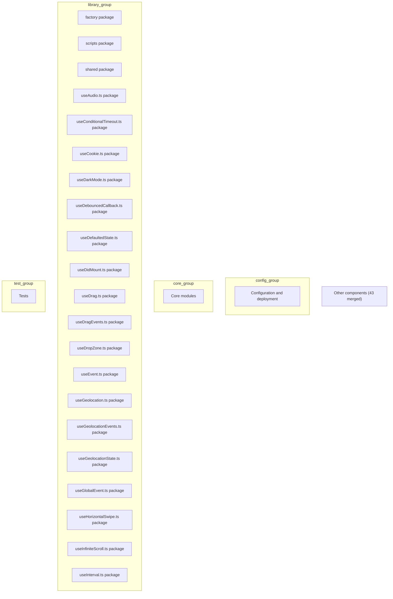

# Architecture report: antonioru/beautiful-react-hooks

> Automated static analysis. **Observed** = directly seen in files/imports/AST; **Inferred** = interpretation from that evidence. Repository code was not executed.

## 1. Repository at a glance

| Item | Value |
| --- | --- |
| Repository | antonioru/beautiful-react-hooks |
| Description | 🔥 A collection of beautiful and (hopefully) useful React hooks to speed-up your components and hooks development 🔥 |
| Language | JavaScript |
| Stars | 8339 |
| Licence | MIT |
| Analysed commit / branch | ee987048b0c138d51bff59f92bc9d5f1bafddbfb / master |
| Framework(s) | React |
| Files analysed | 258 |
| Components | 67 |

## 2. Architecture in one minute

antonioru/beautiful-react-hooks - 🔥 A collection of beautiful and (hopefully) useful React hooks to speed-up your components and hooks development 🔥. This repository was analysed statically from 258 file(s) (0 Python). Detected technologies (observed from imports/manifests): GitHub Actions, React, React Router, TypeScript, webpack. Files are grouped into 67 component(s): Configuration and deployment, Core modules, factory package, scripts package, shared package, Tests, useAudio.ts package, useConditionalTimeout.ts package. Findings below distinguish observed facts from inferred interpretation.

## 3. High-level block diagram

## 4. Main components

### Configuration and deployment (`config`)

- **Kind:** config
- **Status:** Observed
- **Confidence:** 0.85
- **Responsibility:** Groups 5 file(s) under configuration and deployment (observed from repository paths and static analysis).
- **Paths:** `package.json`, `tsconfig.cjs.json`, `tsconfig.esm.json`, `tsconfig.json`, `tsconfig.types.json`
- **Evidence:** [package.json](https://github.com/antonioru/beautiful-react-hooks/blob/ee987048b0c138d51bff59f92bc9d5f1bafddbfb/package.json); [tsconfig.cjs.json](https://github.com/antonioru/beautiful-react-hooks/blob/ee987048b0c138d51bff59f92bc9d5f1bafddbfb/tsconfig.cjs.json); [tsconfig.esm.json](https://github.com/antonioru/beautiful-react-hooks/blob/ee987048b0c138d51bff59f92bc9d5f1bafddbfb/tsconfig.esm.json); [tsconfig.json](https://github.com/antonioru/beautiful-react-hooks/blob/ee987048b0c138d51bff59f92bc9d5f1bafddbfb/tsconfig.json); [tsconfig.types.json](https://github.com/antonioru/beautiful-react-hooks/blob/ee987048b0c138d51bff59f92bc9d5f1bafddbfb/tsconfig.types.json)

### Core modules (`core`)

- **Kind:** core
- **Status:** Observed
- **Confidence:** 0.85
- **Responsibility:** Groups 2 file(s) under core modules (observed from repository paths and static analysis).
- **Paths:** `babel.config.js`, `styleguide.config.js`
- **Evidence:** [babel.config.js](https://github.com/antonioru/beautiful-react-hooks/blob/ee987048b0c138d51bff59f92bc9d5f1bafddbfb/babel.config.js); [styleguide.config.js](https://github.com/antonioru/beautiful-react-hooks/blob/ee987048b0c138d51bff59f92bc9d5f1bafddbfb/styleguide.config.js)

### factory package (`factory`)

- **Kind:** library
- **Status:** Observed
- **Confidence:** 0.85
- **Responsibility:** Groups 2 file(s) under factory package (observed from repository paths and static analysis).
- **Paths:** `src/factory/createHandlerSetter.ts`, `src/factory/createStorageHook.ts`
- **Evidence:** [src/factory/createHandlerSetter.ts](https://github.com/antonioru/beautiful-react-hooks/blob/ee987048b0c138d51bff59f92bc9d5f1bafddbfb/src/factory/createHandlerSetter.ts); [src/factory/createStorageHook.ts](https://github.com/antonioru/beautiful-react-hooks/blob/ee987048b0c138d51bff59f92bc9d5f1bafddbfb/src/factory/createStorageHook.ts)

### scripts package (`scripts`)

- **Kind:** library
- **Status:** Observed
- **Confidence:** 0.85
- **Responsibility:** Groups 4 file(s) under scripts package (observed from repository paths and static analysis).
- **Paths:** `scripts/commit-version.sh`, `scripts/generate-doc-append-types.js`, `scripts/generate-exports.js`, `scripts/update-version.js`
- **Evidence:** [scripts/commit-version.sh](https://github.com/antonioru/beautiful-react-hooks/blob/ee987048b0c138d51bff59f92bc9d5f1bafddbfb/scripts/commit-version.sh); [scripts/generate-doc-append-types.js](https://github.com/antonioru/beautiful-react-hooks/blob/ee987048b0c138d51bff59f92bc9d5f1bafddbfb/scripts/generate-doc-append-types.js); [scripts/generate-exports.js](https://github.com/antonioru/beautiful-react-hooks/blob/ee987048b0c138d51bff59f92bc9d5f1bafddbfb/scripts/generate-exports.js); [scripts/update-version.js](https://github.com/antonioru/beautiful-react-hooks/blob/ee987048b0c138d51bff59f92bc9d5f1bafddbfb/scripts/update-version.js)

### shared package (`shared`)

- **Kind:** library
- **Status:** Observed
- **Confidence:** 0.85
- **Responsibility:** Groups 11 file(s) under shared package (observed from repository paths and static analysis).
- **Paths:** `src/shared/geolocationUtils.ts`, `src/shared/isAPISupported.ts`, `src/shared/isClient.ts`, `src/shared/isDevelopment.ts`, `src/shared/isFunction.ts`, `src/shared/noop.ts`, `src/shared/safeHasOwnProperty.ts`, `src/shared/safelyParseJson.ts`, `src/shared/swipeUtils.ts`, `src/shared/types.ts`, `src/shared/warnOnce.ts`
- **Evidence:** [src/shared/geolocationUtils.ts](https://github.com/antonioru/beautiful-react-hooks/blob/ee987048b0c138d51bff59f92bc9d5f1bafddbfb/src/shared/geolocationUtils.ts); [src/shared/isAPISupported.ts](https://github.com/antonioru/beautiful-react-hooks/blob/ee987048b0c138d51bff59f92bc9d5f1bafddbfb/src/shared/isAPISupported.ts); [src/shared/isClient.ts](https://github.com/antonioru/beautiful-react-hooks/blob/ee987048b0c138d51bff59f92bc9d5f1bafddbfb/src/shared/isClient.ts); [src/shared/isDevelopment.ts](https://github.com/antonioru/beautiful-react-hooks/blob/ee987048b0c138d51bff59f92bc9d5f1bafddbfb/src/shared/isDevelopment.ts); [src/shared/isFunction.ts](https://github.com/antonioru/beautiful-react-hooks/blob/ee987048b0c138d51bff59f92bc9d5f1bafddbfb/src/shared/isFunction.ts); [src/shared/noop.ts](https://github.com/antonioru/beautiful-react-hooks/blob/ee987048b0c138d51bff59f92bc9d5f1bafddbfb/src/shared/noop.ts); [src/shared/safeHasOwnProperty.ts](https://github.com/antonioru/beautiful-react-hooks/blob/ee987048b0c138d51bff59f92bc9d5f1bafddbfb/src/shared/safeHasOwnProperty.ts); [src/shared/safelyParseJson.ts](https://github.com/antonioru/beautiful-react-hooks/blob/ee987048b0c138d51bff59f92bc9d5f1bafddbfb/src/shared/safelyParseJson.ts)

### Tests (`tests`)

- **Kind:** test
- **Status:** Observed
- **Confidence:** 0.85
- **Responsibility:** Groups 78 file(s) under tests (observed from repository paths and static analysis).
- **Paths:** `test/_setup.js`, `test/geolocationUtils.spec.js`, `test/isAPISupported.spec.js`, `test/isClient.spec.js`, `test/mocks/AudioApi.mock.js`, `test/mocks/CookieStoreApi.mock.js`, `test/mocks/GeoLocationApi.mock.js`, `test/mocks/IntersectionObserver.mock.js`, `test/mocks/MatchMediaQueryList.mock.js`, `test/mocks/ResizeObserver.mock.js`, `test/mocks/SpeechSynthesis.mock.js`, `test/mocks/SpeechSynthesisUtterance.mock.js`, `test/safeHasOwnProperty.spec.js`, `test/useAudio.spec.js`, `test/useConditionalTimeout.spec.js`, `test/useCookie.spec.js`, `test/useDarkMode.spec.js`, `test/useDebouncedCallback.spec.js`, `test/useDefaultedState.spec.js`, `test/useDidMount.spec.js`, `test/useDrag.spec.js`, `test/useDragEvents.spec.js`, `test/useDropZone.spec.js`, `test/useEvent.spec.js`, `test/useGeolocation.spec.js`, `test/useGeolocationEvents.spec.js`, `test/useGeolocationState.spec.js`, `test/useGlobalEvent.spec.js`, `test/useHandlerSetter.spec.js`, `test/useInfiniteScroll.spec.js`, `test/useInterval.spec.js`, `test/useIsFirstRender.spec.js`, `test/useLifecycle.spec.js`, `test/useLocalStorage.spec.js`, `test/useLongPress.spec.js`, `test/useMediaQuery.spec.js`, `test/useMouse.spec.js`, `test/useMouseEvents.spec.js`, `test/useMouseState.spec.js`, `test/useMutableState.spec.js`, `test/useMutationObserver.spec.js`, `test/useObjectState.spec.js`, `test/useObservable.spec.js`, `test/useOnlineState.spec.js`, `test/usePreviousValue.spec.js`, `test/useQueryParam.spec.js`, `test/useQueryParams.spec.js`, `test/useRenderInfo.spec.js`, `test/useRequestAnimationFrame.spec.js`, `test/useResizeObserver.spec.js`, `test/useSearchQuery.spec.js`, `test/useSessionStorage.spec.js`, `test/useSpeechRecognition.spec.js`, `test/useSpeechSynthesis.spec.js`, `test/useStorage.spec.js`, `test/useSwipe.spec.js`, `test/useSwipeEvents.spec.js`, `test/useSystemVoices.spec.js`, `test/useThrottledCallback.spec.js`, `test/useTimeout.spec.js`, `test/useToggle.spec.js`, `test/useTouchEvents.spec.js`, `test/useTouchState.spec.js`, `test/useURLSearchParams.spec.js`, `test/useUnmount.spec.js`, `test/useUpdateEffect.spec.js`, `test/useValidatedState.spec.js`, `test/useValueHistory.spec.js`, `test/useViewportSpy.spec.js`, `test/useViewportState.spec.js`, `test/useWillUnmount.spec.js`, `test/useWindowResize.spec.js`, `test/useWindowScroll.spec.js`, `test/utils/ReactRouterWrapper.js`, `test/utils/assertFunction.js`, `test/utils/assertHook.js`, `test/utils/promiseDelay.js`, `test/warnOnce.spec.js`
- **Evidence:** [test/_setup.js](https://github.com/antonioru/beautiful-react-hooks/blob/ee987048b0c138d51bff59f92bc9d5f1bafddbfb/test/_setup.js); [test/geolocationUtils.spec.js](https://github.com/antonioru/beautiful-react-hooks/blob/ee987048b0c138d51bff59f92bc9d5f1bafddbfb/test/geolocationUtils.spec.js); [test/isAPISupported.spec.js](https://github.com/antonioru/beautiful-react-hooks/blob/ee987048b0c138d51bff59f92bc9d5f1bafddbfb/test/isAPISupported.spec.js); [test/isClient.spec.js](https://github.com/antonioru/beautiful-react-hooks/blob/ee987048b0c138d51bff59f92bc9d5f1bafddbfb/test/isClient.spec.js); [test/mocks/AudioApi.mock.js](https://github.com/antonioru/beautiful-react-hooks/blob/ee987048b0c138d51bff59f92bc9d5f1bafddbfb/test/mocks/AudioApi.mock.js); [test/mocks/CookieStoreApi.mock.js](https://github.com/antonioru/beautiful-react-hooks/blob/ee987048b0c138d51bff59f92bc9d5f1bafddbfb/test/mocks/CookieStoreApi.mock.js); [test/mocks/GeoLocationApi.mock.js](https://github.com/antonioru/beautiful-react-hooks/blob/ee987048b0c138d51bff59f92bc9d5f1bafddbfb/test/mocks/GeoLocationApi.mock.js); [test/mocks/IntersectionObserver.mock.js](https://github.com/antonioru/beautiful-react-hooks/blob/ee987048b0c138d51bff59f92bc9d5f1bafddbfb/test/mocks/IntersectionObserver.mock.js)

### useAudio.ts package (`useaudio_ts`)

- **Kind:** library
- **Status:** Observed
- **Confidence:** 0.85
- **Responsibility:** Groups 1 file(s) under useaudio.ts package (observed from repository paths and static analysis).
- **Paths:** `src/useAudio.ts`
- **Evidence:** [src/useAudio.ts](https://github.com/antonioru/beautiful-react-hooks/blob/ee987048b0c138d51bff59f92bc9d5f1bafddbfb/src/useAudio.ts)

### useConditionalTimeout.ts package (`useconditionaltimeout_ts`)

- **Kind:** library
- **Status:** Observed
- **Confidence:** 0.85
- **Responsibility:** Groups 1 file(s) under useconditionaltimeout.ts package (observed from repository paths and static analysis).
- **Paths:** `src/useConditionalTimeout.ts`
- **Evidence:** [src/useConditionalTimeout.ts](https://github.com/antonioru/beautiful-react-hooks/blob/ee987048b0c138d51bff59f92bc9d5f1bafddbfb/src/useConditionalTimeout.ts)

### useCookie.ts package (`usecookie_ts`)

- **Kind:** library
- **Status:** Observed
- **Confidence:** 0.85
- **Responsibility:** Groups 1 file(s) under usecookie.ts package (observed from repository paths and static analysis).
- **Paths:** `src/useCookie.ts`
- **Evidence:** [src/useCookie.ts](https://github.com/antonioru/beautiful-react-hooks/blob/ee987048b0c138d51bff59f92bc9d5f1bafddbfb/src/useCookie.ts)

### useDarkMode.ts package (`usedarkmode_ts`)

- **Kind:** library
- **Status:** Observed
- **Confidence:** 0.85
- **Responsibility:** Groups 1 file(s) under usedarkmode.ts package (observed from repository paths and static analysis).
- **Paths:** `src/useDarkMode.ts`
- **Evidence:** [src/useDarkMode.ts](https://github.com/antonioru/beautiful-react-hooks/blob/ee987048b0c138d51bff59f92bc9d5f1bafddbfb/src/useDarkMode.ts)

### useDebouncedCallback.ts package (`usedebouncedcallback_ts`)

- **Kind:** library
- **Status:** Observed
- **Confidence:** 0.85
- **Responsibility:** Groups 1 file(s) under usedebouncedcallback.ts package (observed from repository paths and static analysis).
- **Paths:** `src/useDebouncedCallback.ts`
- **Evidence:** [src/useDebouncedCallback.ts](https://github.com/antonioru/beautiful-react-hooks/blob/ee987048b0c138d51bff59f92bc9d5f1bafddbfb/src/useDebouncedCallback.ts)

### useDefaultedState.ts package (`usedefaultedstate_ts`)

- **Kind:** library
- **Status:** Observed
- **Confidence:** 0.85
- **Responsibility:** Groups 1 file(s) under usedefaultedstate.ts package (observed from repository paths and static analysis).
- **Paths:** `src/useDefaultedState.ts`
- **Evidence:** [src/useDefaultedState.ts](https://github.com/antonioru/beautiful-react-hooks/blob/ee987048b0c138d51bff59f92bc9d5f1bafddbfb/src/useDefaultedState.ts)

### useDidMount.ts package (`usedidmount_ts`)

- **Kind:** library
- **Status:** Observed
- **Confidence:** 0.85
- **Responsibility:** Groups 1 file(s) under usedidmount.ts package (observed from repository paths and static analysis).
- **Paths:** `src/useDidMount.ts`
- **Evidence:** [src/useDidMount.ts](https://github.com/antonioru/beautiful-react-hooks/blob/ee987048b0c138d51bff59f92bc9d5f1bafddbfb/src/useDidMount.ts)

### useDrag.ts package (`usedrag_ts`)

- **Kind:** library
- **Status:** Observed
- **Confidence:** 0.85
- **Responsibility:** Groups 1 file(s) under usedrag.ts package (observed from repository paths and static analysis).
- **Paths:** `src/useDrag.ts`
- **Evidence:** [src/useDrag.ts](https://github.com/antonioru/beautiful-react-hooks/blob/ee987048b0c138d51bff59f92bc9d5f1bafddbfb/src/useDrag.ts)

### useDragEvents.ts package (`usedragevents_ts`)

- **Kind:** library
- **Status:** Observed
- **Confidence:** 0.85
- **Responsibility:** Groups 1 file(s) under usedragevents.ts package (observed from repository paths and static analysis).
- **Paths:** `src/useDragEvents.ts`
- **Evidence:** [src/useDragEvents.ts](https://github.com/antonioru/beautiful-react-hooks/blob/ee987048b0c138d51bff59f92bc9d5f1bafddbfb/src/useDragEvents.ts)

### useDropZone.ts package (`usedropzone_ts`)

- **Kind:** library
- **Status:** Observed
- **Confidence:** 0.85
- **Responsibility:** Groups 1 file(s) under usedropzone.ts package (observed from repository paths and static analysis).
- **Paths:** `src/useDropZone.ts`
- **Evidence:** [src/useDropZone.ts](https://github.com/antonioru/beautiful-react-hooks/blob/ee987048b0c138d51bff59f92bc9d5f1bafddbfb/src/useDropZone.ts)

### useEvent.ts package (`useevent_ts`)

- **Kind:** library
- **Status:** Observed
- **Confidence:** 0.85
- **Responsibility:** Groups 1 file(s) under useevent.ts package (observed from repository paths and static analysis).
- **Paths:** `src/useEvent.ts`
- **Evidence:** [src/useEvent.ts](https://github.com/antonioru/beautiful-react-hooks/blob/ee987048b0c138d51bff59f92bc9d5f1bafddbfb/src/useEvent.ts)

### useGeolocation.ts package (`usegeolocation_ts`)

- **Kind:** library
- **Status:** Observed
- **Confidence:** 0.85
- **Responsibility:** Groups 1 file(s) under usegeolocation.ts package (observed from repository paths and static analysis).
- **Paths:** `src/useGeolocation.ts`
- **Evidence:** [src/useGeolocation.ts](https://github.com/antonioru/beautiful-react-hooks/blob/ee987048b0c138d51bff59f92bc9d5f1bafddbfb/src/useGeolocation.ts)

### useGeolocationEvents.ts package (`usegeolocationevents_ts`)

- **Kind:** library
- **Status:** Observed
- **Confidence:** 0.85
- **Responsibility:** Groups 1 file(s) under usegeolocationevents.ts package (observed from repository paths and static analysis).
- **Paths:** `src/useGeolocationEvents.ts`
- **Evidence:** [src/useGeolocationEvents.ts](https://github.com/antonioru/beautiful-react-hooks/blob/ee987048b0c138d51bff59f92bc9d5f1bafddbfb/src/useGeolocationEvents.ts)

### useGeolocationState.ts package (`usegeolocationstate_ts`)

- **Kind:** library
- **Status:** Observed
- **Confidence:** 0.85
- **Responsibility:** Groups 1 file(s) under usegeolocationstate.ts package (observed from repository paths and static analysis).
- **Paths:** `src/useGeolocationState.ts`
- **Evidence:** [src/useGeolocationState.ts](https://github.com/antonioru/beautiful-react-hooks/blob/ee987048b0c138d51bff59f92bc9d5f1bafddbfb/src/useGeolocationState.ts)

### useGlobalEvent.ts package (`useglobalevent_ts`)

- **Kind:** library
- **Status:** Observed
- **Confidence:** 0.85
- **Responsibility:** Groups 1 file(s) under useglobalevent.ts package (observed from repository paths and static analysis).
- **Paths:** `src/useGlobalEvent.ts`
- **Evidence:** [src/useGlobalEvent.ts](https://github.com/antonioru/beautiful-react-hooks/blob/ee987048b0c138d51bff59f92bc9d5f1bafddbfb/src/useGlobalEvent.ts)

### useHorizontalSwipe.ts package (`usehorizontalswipe_ts`)

- **Kind:** library
- **Status:** Observed
- **Confidence:** 0.85
- **Responsibility:** Groups 1 file(s) under usehorizontalswipe.ts package (observed from repository paths and static analysis).
- **Paths:** `src/useHorizontalSwipe.ts`
- **Evidence:** [src/useHorizontalSwipe.ts](https://github.com/antonioru/beautiful-react-hooks/blob/ee987048b0c138d51bff59f92bc9d5f1bafddbfb/src/useHorizontalSwipe.ts)

### useInfiniteScroll.ts package (`useinfinitescroll_ts`)

- **Kind:** library
- **Status:** Observed
- **Confidence:** 0.85
- **Responsibility:** Groups 1 file(s) under useinfinitescroll.ts package (observed from repository paths and static analysis).
- **Paths:** `src/useInfiniteScroll.ts`
- **Evidence:** [src/useInfiniteScroll.ts](https://github.com/antonioru/beautiful-react-hooks/blob/ee987048b0c138d51bff59f92bc9d5f1bafddbfb/src/useInfiniteScroll.ts)

### useInterval.ts package (`useinterval_ts`)

- **Kind:** library
- **Status:** Observed
- **Confidence:** 0.85
- **Responsibility:** Groups 1 file(s) under useinterval.ts package (observed from repository paths and static analysis).
- **Paths:** `src/useInterval.ts`
- **Evidence:** [src/useInterval.ts](https://github.com/antonioru/beautiful-react-hooks/blob/ee987048b0c138d51bff59f92bc9d5f1bafddbfb/src/useInterval.ts)

### useIsFirstRender.ts package (`useisfirstrender_ts`)

- **Kind:** library
- **Status:** Observed
- **Confidence:** 0.85
- **Responsibility:** Groups 1 file(s) under useisfirstrender.ts package (observed from repository paths and static analysis).
- **Paths:** `src/useIsFirstRender.ts`
- **Evidence:** [src/useIsFirstRender.ts](https://github.com/antonioru/beautiful-react-hooks/blob/ee987048b0c138d51bff59f92bc9d5f1bafddbfb/src/useIsFirstRender.ts)

### useLifecycle.ts package (`uselifecycle_ts`)

- **Kind:** library
- **Status:** Observed
- **Confidence:** 0.85
- **Responsibility:** Groups 1 file(s) under uselifecycle.ts package (observed from repository paths and static analysis).
- **Paths:** `src/useLifecycle.ts`
- **Evidence:** [src/useLifecycle.ts](https://github.com/antonioru/beautiful-react-hooks/blob/ee987048b0c138d51bff59f92bc9d5f1bafddbfb/src/useLifecycle.ts)

### useLocalStorage.ts package (`uselocalstorage_ts`)

- **Kind:** library
- **Status:** Observed
- **Confidence:** 0.85
- **Responsibility:** Groups 1 file(s) under uselocalstorage.ts package (observed from repository paths and static analysis).
- **Paths:** `src/useLocalStorage.ts`
- **Evidence:** [src/useLocalStorage.ts](https://github.com/antonioru/beautiful-react-hooks/blob/ee987048b0c138d51bff59f92bc9d5f1bafddbfb/src/useLocalStorage.ts)

### useLongPress.ts package (`uselongpress_ts`)

- **Kind:** library
- **Status:** Observed
- **Confidence:** 0.85
- **Responsibility:** Groups 1 file(s) under uselongpress.ts package (observed from repository paths and static analysis).
- **Paths:** `src/useLongPress.ts`
- **Evidence:** [src/useLongPress.ts](https://github.com/antonioru/beautiful-react-hooks/blob/ee987048b0c138d51bff59f92bc9d5f1bafddbfb/src/useLongPress.ts)

### useMediaQuery.ts package (`usemediaquery_ts`)

- **Kind:** library
- **Status:** Observed
- **Confidence:** 0.85
- **Responsibility:** Groups 1 file(s) under usemediaquery.ts package (observed from repository paths and static analysis).
- **Paths:** `src/useMediaQuery.ts`
- **Evidence:** [src/useMediaQuery.ts](https://github.com/antonioru/beautiful-react-hooks/blob/ee987048b0c138d51bff59f92bc9d5f1bafddbfb/src/useMediaQuery.ts)

### useMouse.ts package (`usemouse_ts`)

- **Kind:** library
- **Status:** Observed
- **Confidence:** 0.85
- **Responsibility:** Groups 1 file(s) under usemouse.ts package (observed from repository paths and static analysis).
- **Paths:** `src/useMouse.ts`
- **Evidence:** [src/useMouse.ts](https://github.com/antonioru/beautiful-react-hooks/blob/ee987048b0c138d51bff59f92bc9d5f1bafddbfb/src/useMouse.ts)

### useMouseEvents.ts package (`usemouseevents_ts`)

- **Kind:** library
- **Status:** Observed
- **Confidence:** 0.85
- **Responsibility:** Groups 1 file(s) under usemouseevents.ts package (observed from repository paths and static analysis).
- **Paths:** `src/useMouseEvents.ts`
- **Evidence:** [src/useMouseEvents.ts](https://github.com/antonioru/beautiful-react-hooks/blob/ee987048b0c138d51bff59f92bc9d5f1bafddbfb/src/useMouseEvents.ts)

### useMouseState.ts package (`usemousestate_ts`)

- **Kind:** library
- **Status:** Observed
- **Confidence:** 0.85
- **Responsibility:** Groups 1 file(s) under usemousestate.ts package (observed from repository paths and static analysis).
- **Paths:** `src/useMouseState.ts`
- **Evidence:** [src/useMouseState.ts](https://github.com/antonioru/beautiful-react-hooks/blob/ee987048b0c138d51bff59f92bc9d5f1bafddbfb/src/useMouseState.ts)

### useMutableState.ts package (`usemutablestate_ts`)

- **Kind:** library
- **Status:** Observed
- **Confidence:** 0.85
- **Responsibility:** Groups 1 file(s) under usemutablestate.ts package (observed from repository paths and static analysis).
- **Paths:** `src/useMutableState.ts`
- **Evidence:** [src/useMutableState.ts](https://github.com/antonioru/beautiful-react-hooks/blob/ee987048b0c138d51bff59f92bc9d5f1bafddbfb/src/useMutableState.ts)

### useMutationObserver.ts package (`usemutationobserver_ts`)

- **Kind:** library
- **Status:** Observed
- **Confidence:** 0.85
- **Responsibility:** Groups 1 file(s) under usemutationobserver.ts package (observed from repository paths and static analysis).
- **Paths:** `src/useMutationObserver.ts`
- **Evidence:** [src/useMutationObserver.ts](https://github.com/antonioru/beautiful-react-hooks/blob/ee987048b0c138d51bff59f92bc9d5f1bafddbfb/src/useMutationObserver.ts)

### useObjectState.ts package (`useobjectstate_ts`)

- **Kind:** library
- **Status:** Observed
- **Confidence:** 0.85
- **Responsibility:** Groups 1 file(s) under useobjectstate.ts package (observed from repository paths and static analysis).
- **Paths:** `src/useObjectState.ts`
- **Evidence:** [src/useObjectState.ts](https://github.com/antonioru/beautiful-react-hooks/blob/ee987048b0c138d51bff59f92bc9d5f1bafddbfb/src/useObjectState.ts)

### useObservable.ts package (`useobservable_ts`)

- **Kind:** library
- **Status:** Observed
- **Confidence:** 0.85
- **Responsibility:** Groups 1 file(s) under useobservable.ts package (observed from repository paths and static analysis).
- **Paths:** `src/useObservable.ts`
- **Evidence:** [src/useObservable.ts](https://github.com/antonioru/beautiful-react-hooks/blob/ee987048b0c138d51bff59f92bc9d5f1bafddbfb/src/useObservable.ts)

### useOnlineState.ts package (`useonlinestate_ts`)

- **Kind:** library
- **Status:** Observed
- **Confidence:** 0.85
- **Responsibility:** Groups 1 file(s) under useonlinestate.ts package (observed from repository paths and static analysis).
- **Paths:** `src/useOnlineState.ts`
- **Evidence:** [src/useOnlineState.ts](https://github.com/antonioru/beautiful-react-hooks/blob/ee987048b0c138d51bff59f92bc9d5f1bafddbfb/src/useOnlineState.ts)

### usePreviousValue.ts package (`usepreviousvalue_ts`)

- **Kind:** library
- **Status:** Observed
- **Confidence:** 0.85
- **Responsibility:** Groups 1 file(s) under usepreviousvalue.ts package (observed from repository paths and static analysis).
- **Paths:** `src/usePreviousValue.ts`
- **Evidence:** [src/usePreviousValue.ts](https://github.com/antonioru/beautiful-react-hooks/blob/ee987048b0c138d51bff59f92bc9d5f1bafddbfb/src/usePreviousValue.ts)

### useQueryParam.ts package (`usequeryparam_ts`)

- **Kind:** library
- **Status:** Observed
- **Confidence:** 0.85
- **Responsibility:** Groups 1 file(s) under usequeryparam.ts package (observed from repository paths and static analysis).
- **Paths:** `src/useQueryParam.ts`
- **Evidence:** [src/useQueryParam.ts](https://github.com/antonioru/beautiful-react-hooks/blob/ee987048b0c138d51bff59f92bc9d5f1bafddbfb/src/useQueryParam.ts)

### useQueryParams.ts package (`usequeryparams_ts`)

- **Kind:** library
- **Status:** Observed
- **Confidence:** 0.85
- **Responsibility:** Groups 1 file(s) under usequeryparams.ts package (observed from repository paths and static analysis).
- **Paths:** `src/useQueryParams.ts`
- **Evidence:** [src/useQueryParams.ts](https://github.com/antonioru/beautiful-react-hooks/blob/ee987048b0c138d51bff59f92bc9d5f1bafddbfb/src/useQueryParams.ts)

### useRenderInfo.ts package (`userenderinfo_ts`)

- **Kind:** library
- **Status:** Observed
- **Confidence:** 0.85
- **Responsibility:** Groups 1 file(s) under userenderinfo.ts package (observed from repository paths and static analysis).
- **Paths:** `src/useRenderInfo.ts`
- **Evidence:** [src/useRenderInfo.ts](https://github.com/antonioru/beautiful-react-hooks/blob/ee987048b0c138d51bff59f92bc9d5f1bafddbfb/src/useRenderInfo.ts)

### useRequestAnimationFrame.ts package (`userequestanimationframe_ts`)

- **Kind:** library
- **Status:** Observed
- **Confidence:** 0.85
- **Responsibility:** Groups 1 file(s) under userequestanimationframe.ts package (observed from repository paths and static analysis).
- **Paths:** `src/useRequestAnimationFrame.ts`
- **Evidence:** [src/useRequestAnimationFrame.ts](https://github.com/antonioru/beautiful-react-hooks/blob/ee987048b0c138d51bff59f92bc9d5f1bafddbfb/src/useRequestAnimationFrame.ts)

### useResizeObserver.ts package (`useresizeobserver_ts`)

- **Kind:** library
- **Status:** Observed
- **Confidence:** 0.85
- **Responsibility:** Groups 1 file(s) under useresizeobserver.ts package (observed from repository paths and static analysis).
- **Paths:** `src/useResizeObserver.ts`
- **Evidence:** [src/useResizeObserver.ts](https://github.com/antonioru/beautiful-react-hooks/blob/ee987048b0c138d51bff59f92bc9d5f1bafddbfb/src/useResizeObserver.ts)

### useSearchQuery.ts package (`usesearchquery_ts`)

- **Kind:** library
- **Status:** Observed
- **Confidence:** 0.85
- **Responsibility:** Groups 1 file(s) under usesearchquery.ts package (observed from repository paths and static analysis).
- **Paths:** `src/useSearchQuery.ts`
- **Evidence:** [src/useSearchQuery.ts](https://github.com/antonioru/beautiful-react-hooks/blob/ee987048b0c138d51bff59f92bc9d5f1bafddbfb/src/useSearchQuery.ts)

### useSessionStorage.ts package (`usesessionstorage_ts`)

- **Kind:** library
- **Status:** Observed
- **Confidence:** 0.85
- **Responsibility:** Groups 1 file(s) under usesessionstorage.ts package (observed from repository paths and static analysis).
- **Paths:** `src/useSessionStorage.ts`
- **Evidence:** [src/useSessionStorage.ts](https://github.com/antonioru/beautiful-react-hooks/blob/ee987048b0c138d51bff59f92bc9d5f1bafddbfb/src/useSessionStorage.ts)

### useSpeechRecognition.ts package (`usespeechrecognition_ts`)

- **Kind:** library
- **Status:** Observed
- **Confidence:** 0.85
- **Responsibility:** Groups 1 file(s) under usespeechrecognition.ts package (observed from repository paths and static analysis).
- **Paths:** `src/useSpeechRecognition.ts`
- **Evidence:** [src/useSpeechRecognition.ts](https://github.com/antonioru/beautiful-react-hooks/blob/ee987048b0c138d51bff59f92bc9d5f1bafddbfb/src/useSpeechRecognition.ts)

### useSpeechSynthesis.ts package (`usespeechsynthesis_ts`)

- **Kind:** library
- **Status:** Observed
- **Confidence:** 0.85
- **Responsibility:** Groups 1 file(s) under usespeechsynthesis.ts package (observed from repository paths and static analysis).
- **Paths:** `src/useSpeechSynthesis.ts`
- **Evidence:** [src/useSpeechSynthesis.ts](https://github.com/antonioru/beautiful-react-hooks/blob/ee987048b0c138d51bff59f92bc9d5f1bafddbfb/src/useSpeechSynthesis.ts)

### useSwipe.ts package (`useswipe_ts`)

- **Kind:** library
- **Status:** Observed
- **Confidence:** 0.85
- **Responsibility:** Groups 1 file(s) under useswipe.ts package (observed from repository paths and static analysis).
- **Paths:** `src/useSwipe.ts`
- **Evidence:** [src/useSwipe.ts](https://github.com/antonioru/beautiful-react-hooks/blob/ee987048b0c138d51bff59f92bc9d5f1bafddbfb/src/useSwipe.ts)

### useSwipeEvents.ts package (`useswipeevents_ts`)

- **Kind:** library
- **Status:** Observed
- **Confidence:** 0.85
- **Responsibility:** Groups 1 file(s) under useswipeevents.ts package (observed from repository paths and static analysis).
- **Paths:** `src/useSwipeEvents.ts`
- **Evidence:** [src/useSwipeEvents.ts](https://github.com/antonioru/beautiful-react-hooks/blob/ee987048b0c138d51bff59f92bc9d5f1bafddbfb/src/useSwipeEvents.ts)

### useSystemVoices.ts package (`usesystemvoices_ts`)

- **Kind:** library
- **Status:** Observed
- **Confidence:** 0.85
- **Responsibility:** Groups 1 file(s) under usesystemvoices.ts package (observed from repository paths and static analysis).
- **Paths:** `src/useSystemVoices.ts`
- **Evidence:** [src/useSystemVoices.ts](https://github.com/antonioru/beautiful-react-hooks/blob/ee987048b0c138d51bff59f92bc9d5f1bafddbfb/src/useSystemVoices.ts)

### useThrottledCallback.ts package (`usethrottledcallback_ts`)

- **Kind:** library
- **Status:** Observed
- **Confidence:** 0.85
- **Responsibility:** Groups 1 file(s) under usethrottledcallback.ts package (observed from repository paths and static analysis).
- **Paths:** `src/useThrottledCallback.ts`
- **Evidence:** [src/useThrottledCallback.ts](https://github.com/antonioru/beautiful-react-hooks/blob/ee987048b0c138d51bff59f92bc9d5f1bafddbfb/src/useThrottledCallback.ts)

### useTimeout.ts package (`usetimeout_ts`)

- **Kind:** library
- **Status:** Observed
- **Confidence:** 0.85
- **Responsibility:** Groups 1 file(s) under usetimeout.ts package (observed from repository paths and static analysis).
- **Paths:** `src/useTimeout.ts`
- **Evidence:** [src/useTimeout.ts](https://github.com/antonioru/beautiful-react-hooks/blob/ee987048b0c138d51bff59f92bc9d5f1bafddbfb/src/useTimeout.ts)

### useToggle.ts package (`usetoggle_ts`)

- **Kind:** library
- **Status:** Observed
- **Confidence:** 0.85
- **Responsibility:** Groups 1 file(s) under usetoggle.ts package (observed from repository paths and static analysis).
- **Paths:** `src/useToggle.ts`
- **Evidence:** [src/useToggle.ts](https://github.com/antonioru/beautiful-react-hooks/blob/ee987048b0c138d51bff59f92bc9d5f1bafddbfb/src/useToggle.ts)

### useTouch.ts package (`usetouch_ts`)

- **Kind:** library
- **Status:** Observed
- **Confidence:** 0.85
- **Responsibility:** Groups 1 file(s) under usetouch.ts package (observed from repository paths and static analysis).
- **Paths:** `src/useTouch.ts`
- **Evidence:** [src/useTouch.ts](https://github.com/antonioru/beautiful-react-hooks/blob/ee987048b0c138d51bff59f92bc9d5f1bafddbfb/src/useTouch.ts)

### useTouchEvents.ts package (`usetouchevents_ts`)

- **Kind:** library
- **Status:** Observed
- **Confidence:** 0.85
- **Responsibility:** Groups 1 file(s) under usetouchevents.ts package (observed from repository paths and static analysis).
- **Paths:** `src/useTouchEvents.ts`
- **Evidence:** [src/useTouchEvents.ts](https://github.com/antonioru/beautiful-react-hooks/blob/ee987048b0c138d51bff59f92bc9d5f1bafddbfb/src/useTouchEvents.ts)

### useTouchState.ts package (`usetouchstate_ts`)

- **Kind:** library
- **Status:** Observed
- **Confidence:** 0.85
- **Responsibility:** Groups 1 file(s) under usetouchstate.ts package (observed from repository paths and static analysis).
- **Paths:** `src/useTouchState.ts`
- **Evidence:** [src/useTouchState.ts](https://github.com/antonioru/beautiful-react-hooks/blob/ee987048b0c138d51bff59f92bc9d5f1bafddbfb/src/useTouchState.ts)

### useUnmount.ts package (`useunmount_ts`)

- **Kind:** library
- **Status:** Observed
- **Confidence:** 0.85
- **Responsibility:** Groups 1 file(s) under useunmount.ts package (observed from repository paths and static analysis).
- **Paths:** `src/useUnmount.ts`
- **Evidence:** [src/useUnmount.ts](https://github.com/antonioru/beautiful-react-hooks/blob/ee987048b0c138d51bff59f92bc9d5f1bafddbfb/src/useUnmount.ts)

### useUpdateEffect.ts package (`useupdateeffect_ts`)

- **Kind:** library
- **Status:** Observed
- **Confidence:** 0.85
- **Responsibility:** Groups 1 file(s) under useupdateeffect.ts package (observed from repository paths and static analysis).
- **Paths:** `src/useUpdateEffect.ts`
- **Evidence:** [src/useUpdateEffect.ts](https://github.com/antonioru/beautiful-react-hooks/blob/ee987048b0c138d51bff59f92bc9d5f1bafddbfb/src/useUpdateEffect.ts)

### useURLSearchParams.ts package (`useurlsearchparams_ts`)

- **Kind:** library
- **Status:** Observed
- **Confidence:** 0.85
- **Responsibility:** Groups 1 file(s) under useurlsearchparams.ts package (observed from repository paths and static analysis).
- **Paths:** `src/useURLSearchParams.ts`
- **Evidence:** [src/useURLSearchParams.ts](https://github.com/antonioru/beautiful-react-hooks/blob/ee987048b0c138d51bff59f92bc9d5f1bafddbfb/src/useURLSearchParams.ts)

### useValidatedState.ts package (`usevalidatedstate_ts`)

- **Kind:** library
- **Status:** Observed
- **Confidence:** 0.85
- **Responsibility:** Groups 1 file(s) under usevalidatedstate.ts package (observed from repository paths and static analysis).
- **Paths:** `src/useValidatedState.ts`
- **Evidence:** [src/useValidatedState.ts](https://github.com/antonioru/beautiful-react-hooks/blob/ee987048b0c138d51bff59f92bc9d5f1bafddbfb/src/useValidatedState.ts)

### useValueHistory.ts package (`usevaluehistory_ts`)

- **Kind:** library
- **Status:** Observed
- **Confidence:** 0.85
- **Responsibility:** Groups 1 file(s) under usevaluehistory.ts package (observed from repository paths and static analysis).
- **Paths:** `src/useValueHistory.ts`
- **Evidence:** [src/useValueHistory.ts](https://github.com/antonioru/beautiful-react-hooks/blob/ee987048b0c138d51bff59f92bc9d5f1bafddbfb/src/useValueHistory.ts)

### useVerticalSwipe.ts package (`useverticalswipe_ts`)

- **Kind:** library
- **Status:** Observed
- **Confidence:** 0.85
- **Responsibility:** Groups 1 file(s) under useverticalswipe.ts package (observed from repository paths and static analysis).
- **Paths:** `src/useVerticalSwipe.ts`
- **Evidence:** [src/useVerticalSwipe.ts](https://github.com/antonioru/beautiful-react-hooks/blob/ee987048b0c138d51bff59f92bc9d5f1bafddbfb/src/useVerticalSwipe.ts)

### useViewportSpy.ts package (`useviewportspy_ts`)

- **Kind:** library
- **Status:** Observed
- **Confidence:** 0.85
- **Responsibility:** Groups 1 file(s) under useviewportspy.ts package (observed from repository paths and static analysis).
- **Paths:** `src/useViewportSpy.ts`
- **Evidence:** [src/useViewportSpy.ts](https://github.com/antonioru/beautiful-react-hooks/blob/ee987048b0c138d51bff59f92bc9d5f1bafddbfb/src/useViewportSpy.ts)

### useViewportState.ts package (`useviewportstate_ts`)

- **Kind:** library
- **Status:** Observed
- **Confidence:** 0.85
- **Responsibility:** Groups 1 file(s) under useviewportstate.ts package (observed from repository paths and static analysis).
- **Paths:** `src/useViewportState.ts`
- **Evidence:** [src/useViewportState.ts](https://github.com/antonioru/beautiful-react-hooks/blob/ee987048b0c138d51bff59f92bc9d5f1bafddbfb/src/useViewportState.ts)

### useWillUnmount.ts package (`usewillunmount_ts`)

- **Kind:** library
- **Status:** Observed
- **Confidence:** 0.85
- **Responsibility:** Groups 1 file(s) under usewillunmount.ts package (observed from repository paths and static analysis).
- **Paths:** `src/useWillUnmount.ts`
- **Evidence:** [src/useWillUnmount.ts](https://github.com/antonioru/beautiful-react-hooks/blob/ee987048b0c138d51bff59f92bc9d5f1bafddbfb/src/useWillUnmount.ts)

### useWindowResize.ts package (`usewindowresize_ts`)

- **Kind:** library
- **Status:** Observed
- **Confidence:** 0.85
- **Responsibility:** Groups 1 file(s) under usewindowresize.ts package (observed from repository paths and static analysis).
- **Paths:** `src/useWindowResize.ts`
- **Evidence:** [src/useWindowResize.ts](https://github.com/antonioru/beautiful-react-hooks/blob/ee987048b0c138d51bff59f92bc9d5f1bafddbfb/src/useWindowResize.ts)

### useWindowScroll.ts package (`usewindowscroll_ts`)

- **Kind:** library
- **Status:** Observed
- **Confidence:** 0.85
- **Responsibility:** Groups 1 file(s) under usewindowscroll.ts package (observed from repository paths and static analysis).
- **Paths:** `src/useWindowScroll.ts`
- **Evidence:** [src/useWindowScroll.ts](https://github.com/antonioru/beautiful-react-hooks/blob/ee987048b0c138d51bff59f92bc9d5f1bafddbfb/src/useWindowScroll.ts)

## 5. Execution flow

No entry point was observed; the startup flow below is therefore limited.

Representative flow (derived from observed entry points and the import graph; steps beyond the entry point are **Inferred**):

1. Execution starts at an observed entry point listed above, if present.
2. No internal import relationships between components were observed.

## 6. Project structure

### `(root)`

- `.eslintignore` - other (24 bytes)
- `.eslintrc.js` - source, JavaScript (1197 bytes)
- `.gitignore` - other (4209 bytes)
- `.huskyrc` - other (51 bytes)
- `.mocharc.json` - config (159 bytes)
- `.nycrc` - other (255 bytes)
- `.releaserc.json` - config (675 bytes)
- `CHANGELOG.md` - docs (15541 bytes)
- `CODE_OF_CONDUCT.md` - docs (3407 bytes)
- `CONTRIBUTING.md` - docs (10602 bytes)
- `HOOK_DOCUMENTATION_TEMPLATE.md` - docs (631 bytes)
- `LICENSE.txt` - docs (1070 bytes)
- `README.md` - docs (7212 bytes)
- `babel.config.js` - source, JavaScript (63 bytes)
- `package.json` - manifest (13794 bytes)
- `styleguide.config.js` - source, JavaScript (1786 bytes)
- `tsconfig.cjs.json` - config (87 bytes)
- `tsconfig.esm.json` - config (137 bytes)
- `tsconfig.json` - config (435 bytes)
- `tsconfig.types.json` - config (144 bytes)

### `.github`

- `.github/ISSUE_TEMPLATE/bug_report.md` - docs (834 bytes)
- `.github/ISSUE_TEMPLATE/feature_request.md` - docs (595 bytes)
- `.github/PULL_REQUEST_TEMPLATE.md` - docs (875 bytes)
- `.github/tests_checker.yml` - config (212 bytes)
- `.github/workflows/branch-tests.yml` - ci, YAML (447 bytes)
- `.github/workflows/ci.yml` - ci, YAML (1457 bytes)

### `docs`

- `docs/Installation.md` - docs (1461 bytes)
- `docs/Introduction.md` - docs (1846 bytes)
- `docs/README.es-ES.md` - docs (6938 bytes)
- `docs/README.it-IT.md` - docs (6967 bytes)
- `docs/README.jp-JP.md` - docs (7772 bytes)
- `docs/README.pl-PL.md` - docs (6877 bytes)
- `docs/README.pt-BR.md` - docs (6929 bytes)
- `docs/README.tr-TR.md` - docs (7590 bytes)
- `docs/README.uk-UA.md` - docs (8574 bytes)
- `docs/README.zh-CN.md` - docs (6736 bytes)
- `docs/useAudio.md` - docs (2911 bytes)
- `docs/useConditionalTimeout.md` - docs (6039 bytes)
- `docs/useCookie.md` - docs (2465 bytes)
- `docs/useDarkMode.md` - docs (1769 bytes)
- `docs/useDebouncedCallback.md` - docs (7426 bytes)
- `docs/useDefaultedState.md` - docs (1504 bytes)
- `docs/useDidMount.md` - docs (3011 bytes)
- `docs/useDrag.md` - docs (2742 bytes)
- `docs/useDragEvents.md` - docs (4992 bytes)
- `docs/useDropZone.md` - docs (2883 bytes)
- `docs/useEvent.md` - docs (3249 bytes)
- `docs/useGeolocation.md` - docs (3899 bytes)
- `docs/useGeolocationEvents.md` - docs (3016 bytes)
- `docs/useGeolocationState.md` - docs (4757 bytes)
- `docs/useGlobalEvent.md` - docs (3132 bytes)
- `docs/useHorizontalSwipe.md` - docs (163 bytes)
- `docs/useInfiniteScroll.md` - docs (3649 bytes)
- `docs/useInterval.md` - docs (4123 bytes)
- `docs/useIsFirstRender.md` - docs (1379 bytes)
- `docs/useLifecycle.md` - docs (4008 bytes)
- `docs/useLocalStorage.md` - docs (2036 bytes)
- `docs/useLongPress.md` - docs (2620 bytes)
- `docs/useMediaQuery.md` - docs (2067 bytes)
- `docs/useMouse.md` - docs (4558 bytes)
- `docs/useMouseEvents.md` - docs (5226 bytes)
- `docs/useMouseState.md` - docs (2672 bytes)
- `docs/useMutableState.md` - docs (998 bytes)
- `docs/useMutationObserver.md` - docs (2240 bytes)
- `docs/useObjectState.md` - docs (1974 bytes)
- `docs/useObservable.md` - docs (3685 bytes)
- `docs/useOnlineState.md` - docs (1676 bytes)
- `docs/usePreviousValue.md` - docs (1332 bytes)
- `docs/useQueryParam.md` - docs (1604 bytes)
- `docs/useQueryParams.md` - docs (1776 bytes)
- `docs/useRenderInfo.md` - docs (2049 bytes)
- `docs/useRequestAnimationFrame.md` - docs (3821 bytes)
- `docs/useResizeObserver.md` - docs (2936 bytes)
- `docs/useSearchQuery.md` - docs (1415 bytes)
- `docs/useSessionStorage.md` - docs (2064 bytes)
- `docs/useSpeechRecognition.md` - docs (1275 bytes)
- `docs/useSpeechSynthesis.md` - docs (4274 bytes)
- `docs/useSwipe.md` - docs (4212 bytes)
- `docs/useSwipeEvents.md` - docs (5015 bytes)
- `docs/useSystemVoices.md` - docs (1850 bytes)
- `docs/useThrottledCallback.md` - docs (6887 bytes)
- `docs/useTimeout.md` - docs (4065 bytes)
- `docs/useToggle.md` - docs (1860 bytes)
- `docs/useTouch.md` - docs (4112 bytes)
- `docs/useTouchEvents.md` - docs (5347 bytes)
- `docs/useTouchState.md` - docs (3121 bytes)
- `docs/useURLSearchParams.md` - docs (1500 bytes)
- `docs/useUnmount.md` - docs (2700 bytes)
- `docs/useUpdateEffect.md` - docs (1509 bytes)
- `docs/useValidatedState.md` - docs (1803 bytes)
- `docs/useValueHistory.md` - docs (1520 bytes)
- `docs/useVerticalSwipe.md` - docs (159 bytes)
- `docs/useViewportSpy.md` - docs (2885 bytes)
- `docs/useViewportState.md` - docs (1686 bytes)
- `docs/useWillUnmount.md` - docs (2728 bytes)
- `docs/useWindowResize.md` - docs (4227 bytes)
- `docs/useWindowScroll.md` - docs (3588 bytes)
- `docs/utils/_CustomLogo.js` - docs (559 bytes)
- `docs/utils/_EmptyComponent.js` - docs (27 bytes)
- `docs/utils/_custom.css` - docs (191 bytes)
- `docs/utils/_setup.js` - docs (212 bytes)
- `docs/utils/_styleguidist.theme.js` - docs (1301 bytes)

### `scripts`

- `scripts/commit-version.sh` - source, Shell (140 bytes)
- `scripts/generate-doc-append-types.js` - source, JavaScript (1293 bytes)
- `scripts/generate-exports.js` - source, JavaScript (846 bytes)
- `scripts/update-version.js` - source, JavaScript (463 bytes)

### `src`

- `src/factory/createHandlerSetter.ts` - source, TypeScript (1359 bytes)
- `src/factory/createStorageHook.ts` - source, TypeScript (2227 bytes)
- `src/shared/geolocationUtils.ts` - source, TypeScript (1477 bytes)
- `src/shared/isAPISupported.ts` - source, TypeScript (223 bytes)
- `src/shared/isClient.ts` - source, TypeScript (248 bytes)
- `src/shared/isDevelopment.ts` - source, TypeScript (196 bytes)
- `src/shared/isFunction.ts` - source, TypeScript (290 bytes)
- `src/shared/noop.ts` - source, TypeScript (193 bytes)
- `src/shared/safeHasOwnProperty.ts` - source, TypeScript (163 bytes)
- `src/shared/safelyParseJson.ts` - source, TypeScript (259 bytes)
- `src/shared/swipeUtils.ts` - source, TypeScript (1056 bytes)
- `src/shared/types.ts` - source, TypeScript (1445 bytes)
- `src/shared/warnOnce.ts` - source, TypeScript (386 bytes)
- `src/useAudio.ts` - source, TypeScript (7411 bytes)
- `src/useConditionalTimeout.ts` - source, TypeScript (2149 bytes)
- `src/useCookie.ts` - source, TypeScript (3396 bytes)
- `src/useDarkMode.ts` - source, TypeScript (1659 bytes)
- `src/useDebouncedCallback.ts` - source, TypeScript (1222 bytes)
- `src/useDefaultedState.ts` - source, TypeScript (674 bytes)
- `src/useDidMount.ts` - source, TypeScript (722 bytes)
- `src/useDrag.ts` - source, TypeScript (1329 bytes)
- `src/useDragEvents.ts` - source, TypeScript (2121 bytes)
- `src/useDropZone.ts` - source, TypeScript (729 bytes)
- `src/useEvent.ts` - source, TypeScript (1284 bytes)
- `src/useGeolocation.ts` - source, TypeScript (798 bytes)
- `src/useGeolocationEvents.ts` - source, TypeScript (2137 bytes)
- `src/useGeolocationState.ts` - source, TypeScript (2759 bytes)
- `src/useGlobalEvent.ts` - source, TypeScript (712 bytes)
- `src/useHorizontalSwipe.ts` - source, TypeScript (564 bytes)
- `src/useInfiniteScroll.ts` - source, TypeScript (1508 bytes)
- `src/useInterval.ts` - source, TypeScript (1668 bytes)
- `src/useIsFirstRender.ts` - source, TypeScript (268 bytes)
- `src/useLifecycle.ts` - source, TypeScript (640 bytes)
- `src/useLocalStorage.ts` - source, TypeScript (188 bytes)
- `src/useLongPress.ts` - source, TypeScript (2114 bytes)
- `src/useMediaQuery.ts` - source, TypeScript (1786 bytes)
- `src/useMouse.ts` - source, TypeScript (614 bytes)
- `src/useMouseEvents.ts` - source, TypeScript (1805 bytes)
- `src/useMouseState.ts` - source, TypeScript (864 bytes)
- `src/useMutableState.ts` - source, TypeScript (706 bytes)
- `src/useMutationObserver.ts` - source, TypeScript (1207 bytes)
- `src/useObjectState.ts` - source, TypeScript (630 bytes)
- `src/useObservable.ts` - source, TypeScript (487 bytes)
- `src/useOnlineState.ts` - source, TypeScript (1090 bytes)
- `src/usePreviousValue.ts` - source, TypeScript (421 bytes)
- `src/useQueryParam.ts` - source, TypeScript (1286 bytes)
- `src/useQueryParams.ts` - source, TypeScript (1361 bytes)
- `src/useRenderInfo.ts` - source, TypeScript (987 bytes)
- `src/useRequestAnimationFrame.ts` - source, TypeScript (1933 bytes)
- `src/useResizeObserver.ts` - source, TypeScript (2175 bytes)
- `src/useSearchQuery.ts` - source, TypeScript (408 bytes)
- `src/useSessionStorage.ts` - source, TypeScript (196 bytes)
- `src/useSpeechRecognition.ts` - source, TypeScript (2378 bytes)
- `src/useSpeechSynthesis.ts` - source, TypeScript (1588 bytes)
- `src/useSwipe.ts` - source, TypeScript (4512 bytes)
- `src/useSwipeEvents.ts` - source, TypeScript (6040 bytes)
- `src/useSystemVoices.ts` - source, TypeScript (316 bytes)
- `src/useThrottledCallback.ts` - source, TypeScript (1205 bytes)
- `src/useTimeout.ts` - source, TypeScript (1622 bytes)
- `src/useToggle.ts` - source, TypeScript (360 bytes)
- `src/useTouch.ts` - source, TypeScript (715 bytes)
- `src/useTouchEvents.ts` - source, TypeScript (1876 bytes)
- `src/useTouchState.ts` - source, TypeScript (809 bytes)
- `src/useURLSearchParams.ts` - source, TypeScript (329 bytes)
- `src/useUnmount.ts` - source, TypeScript (750 bytes)
- `src/useUpdateEffect.ts` - source, TypeScript (492 bytes)
- `src/useValidatedState.ts` - source, TypeScript (848 bytes)
- `src/useValueHistory.ts` - source, TypeScript (620 bytes)
- `src/useVerticalSwipe.ts` - source, TypeScript (667 bytes)
- `src/useViewportSpy.ts` - source, TypeScript (1551 bytes)
- `src/useViewportState.ts` - source, TypeScript (1034 bytes)
- `src/useWillUnmount.ts` - source, TypeScript (754 bytes)
- `src/useWindowResize.ts` - source, TypeScript (240 bytes)
- `src/useWindowScroll.ts` - source, TypeScript (241 bytes)

### `test`

- `test/_setup.js` - test, JavaScript (460 bytes)
- `test/geolocationUtils.spec.js` - test, JavaScript (2115 bytes)
- `test/isAPISupported.spec.js` - test, JavaScript (340 bytes)
- `test/isClient.spec.js` - test, JavaScript (234 bytes)
- `test/mocks/AudioApi.mock.js` - test, JavaScript (451 bytes)
- `test/mocks/CookieStoreApi.mock.js` - test, JavaScript (473 bytes)
- `test/mocks/GeoLocationApi.mock.js` - test, JavaScript (683 bytes)
- `test/mocks/IntersectionObserver.mock.js` - test, JavaScript (506 bytes)
- `test/mocks/MatchMediaQueryList.mock.js` - test, JavaScript (222 bytes)
- `test/mocks/ResizeObserver.mock.js` - test, JavaScript (583 bytes)
- `test/mocks/SpeechSynthesis.mock.js` - test, JavaScript (54 bytes)
- `test/mocks/SpeechSynthesisUtterance.mock.js` - test, JavaScript (178 bytes)
- `test/safeHasOwnProperty.spec.js` - test, JavaScript (712 bytes)
- `test/useAudio.spec.js` - test, JavaScript (2427 bytes)
- `test/useConditionalTimeout.spec.js` - test, JavaScript (3593 bytes)
- `test/useCookie.spec.js` - test, JavaScript (2531 bytes)
- `test/useDarkMode.spec.js` - test, JavaScript (2398 bytes)
- `test/useDebouncedCallback.spec.js` - test, JavaScript (2048 bytes)
- `test/useDefaultedState.spec.js` - test, JavaScript (647 bytes)
- `test/useDidMount.spec.js` - test, JavaScript (913 bytes)
- `test/useDrag.spec.js` - test, JavaScript (495 bytes)
- `test/useDragEvents.spec.js` - test, JavaScript (3139 bytes)
- `test/useDropZone.spec.js` - test, JavaScript (557 bytes)
- `test/useEvent.spec.js` - test, JavaScript (2638 bytes)
- `test/useGeolocation.spec.js` - test, JavaScript (1427 bytes)
- `test/useGeolocationEvents.spec.js` - test, JavaScript (2026 bytes)
- `test/useGeolocationState.spec.js` - test, JavaScript (2910 bytes)
- `test/useGlobalEvent.spec.js` - test, JavaScript (1217 bytes)
- `test/useHandlerSetter.spec.js` - test, JavaScript (1496 bytes)
- `test/useInfiniteScroll.spec.js` - test, JavaScript (500 bytes)
- `test/useInterval.spec.js` - test, JavaScript (1622 bytes)
- `test/useIsFirstRender.spec.js` - test, JavaScript (857 bytes)
- `test/useLifecycle.spec.js` - test, JavaScript (484 bytes)
- `test/useLocalStorage.spec.js` - test, JavaScript (3129 bytes)
- `test/useLongPress.spec.js` - test, JavaScript (696 bytes)
- `test/useMediaQuery.spec.js` - test, JavaScript (953 bytes)
- `test/useMouse.spec.js` - test, JavaScript (1240 bytes)
- `test/useMouseEvents.spec.js` - test, JavaScript (4508 bytes)
- `test/useMouseState.spec.js` - test, JavaScript (974 bytes)
- `test/useMutableState.spec.js` - test, JavaScript (908 bytes)
- `test/useMutationObserver.spec.js` - test, JavaScript (2266 bytes)
- `test/useObjectState.spec.js` - test, JavaScript (829 bytes)
- `test/useObservable.spec.js` - test, JavaScript (763 bytes)
- `test/useOnlineState.spec.js` - test, JavaScript (1344 bytes)
- `test/usePreviousValue.spec.js` - test, JavaScript (1075 bytes)
- `test/useQueryParam.spec.js` - test, JavaScript (670 bytes)
- `test/useQueryParams.spec.js` - test, JavaScript (692 bytes)
- `test/useRenderInfo.spec.js` - test, JavaScript (1295 bytes)
- `test/useRequestAnimationFrame.spec.js` - test, JavaScript (1517 bytes)
- `test/useResizeObserver.spec.js` - test, JavaScript (1964 bytes)
- `test/useSearchQuery.spec.js` - test, JavaScript (664 bytes)
- `test/useSessionStorage.spec.js` - test, JavaScript (3129 bytes)
- `test/useSpeechRecognition.spec.js` - test, JavaScript (1336 bytes)
- `test/useSpeechSynthesis.spec.js` - test, JavaScript (1191 bytes)
- `test/useStorage.spec.js` - test, JavaScript (690 bytes)
- `test/useSwipe.spec.js` - test, JavaScript (1368 bytes)
- `test/useSwipeEvents.spec.js` - test, JavaScript (563 bytes)
- `test/useSystemVoices.spec.js` - test, JavaScript (707 bytes)
- `test/useThrottledCallback.spec.js` - test, JavaScript (1956 bytes)
- `test/useTimeout.spec.js` - test, JavaScript (2202 bytes)
- `test/useToggle.spec.js` - test, JavaScript (1157 bytes)
- `test/useTouchEvents.spec.js` - test, JavaScript (527 bytes)
- `test/useTouchState.spec.js` - test, JavaScript (425 bytes)
- `test/useURLSearchParams.spec.js` - test, JavaScript (564 bytes)
- `test/useUnmount.spec.js` - test, JavaScript (926 bytes)
- `test/useUpdateEffect.spec.js` - test, JavaScript (990 bytes)
- `test/useValidatedState.spec.js` - test, JavaScript (1107 bytes)
- `test/useValueHistory.spec.js` - test, JavaScript (956 bytes)
- `test/useViewportSpy.spec.js` - test, JavaScript (1030 bytes)
- `test/useViewportState.spec.js` - test, JavaScript (534 bytes)
- `test/useWillUnmount.spec.js` - test, JavaScript (951 bytes)
- `test/useWindowResize.spec.js` - test, JavaScript (1092 bytes)
- `test/useWindowScroll.spec.js` - test, JavaScript (1092 bytes)
- `test/utils/ReactRouterWrapper.js` - test, JavaScript (208 bytes)
- `test/utils/assertFunction.js` - test, JavaScript (162 bytes)
- `test/utils/assertHook.js` - test, JavaScript (237 bytes)
- `test/utils/promiseDelay.js` - test, JavaScript (145 bytes)
- `test/warnOnce.spec.js` - test, JavaScript (572 bytes)

## 7. Key dependencies and integrations

| Name | Category | Status | Confidence | Evidence |
| --- | --- | --- | --- | --- |
| GitHub Actions | ci | Observed | 0.90 | [.github/workflows/branch-tests.yml](https://github.com/antonioru/beautiful-react-hooks/blob/ee987048b0c138d51bff59f92bc9d5f1bafddbfb/.github/workflows/branch-tests.yml); [.github/workflows/ci.yml](https://github.com/antonioru/beautiful-react-hooks/blob/ee987048b0c138d51bff59f92bc9d5f1bafddbfb/.github/workflows/ci.yml) |
| React | framework | Observed | 0.90 | [package.json:2](https://github.com/antonioru/beautiful-react-hooks/blob/ee987048b0c138d51bff59f92bc9d5f1bafddbfb/package.json#L2); [package.json:47](https://github.com/antonioru/beautiful-react-hooks/blob/ee987048b0c138d51bff59f92bc9d5f1bafddbfb/package.json#L47) |
| React Router | library | Observed | 0.90 | [package.json:48](https://github.com/antonioru/beautiful-react-hooks/blob/ee987048b0c138d51bff59f92bc9d5f1bafddbfb/package.json#L48) |
| TypeScript | tooling | Observed | 0.85 | [package.json:75](https://github.com/antonioru/beautiful-react-hooks/blob/ee987048b0c138d51bff59f92bc9d5f1bafddbfb/package.json#L75) |
| webpack | tooling | Observed | 0.85 | [package.json:101](https://github.com/antonioru/beautiful-react-hooks/blob/ee987048b0c138d51bff59f92bc9d5f1bafddbfb/package.json#L101) |

## 8. Data and state

No database, cache, queue, or persistent-state usage was observed in the analysed files. State handling, if any, may be in-memory or in files that were not analysed.

## 9. Configuration and deployment clues

- `.github/tests_checker.yml` (config)
- `.github/workflows/branch-tests.yml` (ci)
- `.github/workflows/ci.yml` (ci)
- `.mocharc.json` (config)
- `.releaserc.json` (config)
- `package.json` (manifest)
- `tsconfig.cjs.json` (config)
- `tsconfig.esm.json` (config)
- `tsconfig.json` (config)
- `tsconfig.types.json` (config)

## 10. Design observations

- Tests are present alongside source code (Observed from test file paths).

These observations are interpretations (**Inferred**) of the observed structure, not guarantees about runtime design.

## 11. Limitations and unknowns

- Static analysis only: repository code was not executed, installed, or imported at runtime.
- Components and relationships are inferred from file paths, imports, and AST structure; runtime behaviour, dynamic imports, and reflection may not be visible.
- 1 file(s) were skipped during inventory (1 x likely secret file excluded).
- No clear application entry point was observed in the analysed files.
- Repository text was treated as untrusted data; no instructions found in repository files were followed, and likely secret values were redacted/excluded.
- JavaScript and TypeScript files were inventoried from paths and package manifests. They were not parsed with a full language AST, and repository code was not executed.

## 12. Source references

- [.github/workflows/branch-tests.yml](https://github.com/antonioru/beautiful-react-hooks/blob/ee987048b0c138d51bff59f92bc9d5f1bafddbfb/.github/workflows/branch-tests.yml)
- [.github/workflows/ci.yml](https://github.com/antonioru/beautiful-react-hooks/blob/ee987048b0c138d51bff59f92bc9d5f1bafddbfb/.github/workflows/ci.yml)
- [babel.config.js](https://github.com/antonioru/beautiful-react-hooks/blob/ee987048b0c138d51bff59f92bc9d5f1bafddbfb/babel.config.js)
- [package.json](https://github.com/antonioru/beautiful-react-hooks/blob/ee987048b0c138d51bff59f92bc9d5f1bafddbfb/package.json)
- [package.json:2](https://github.com/antonioru/beautiful-react-hooks/blob/ee987048b0c138d51bff59f92bc9d5f1bafddbfb/package.json#L2)
- [package.json:47](https://github.com/antonioru/beautiful-react-hooks/blob/ee987048b0c138d51bff59f92bc9d5f1bafddbfb/package.json#L47)
- [package.json:48](https://github.com/antonioru/beautiful-react-hooks/blob/ee987048b0c138d51bff59f92bc9d5f1bafddbfb/package.json#L48)
- [package.json:75](https://github.com/antonioru/beautiful-react-hooks/blob/ee987048b0c138d51bff59f92bc9d5f1bafddbfb/package.json#L75)
- [package.json:101](https://github.com/antonioru/beautiful-react-hooks/blob/ee987048b0c138d51bff59f92bc9d5f1bafddbfb/package.json#L101)
- [scripts/commit-version.sh](https://github.com/antonioru/beautiful-react-hooks/blob/ee987048b0c138d51bff59f92bc9d5f1bafddbfb/scripts/commit-version.sh)
- [scripts/generate-doc-append-types.js](https://github.com/antonioru/beautiful-react-hooks/blob/ee987048b0c138d51bff59f92bc9d5f1bafddbfb/scripts/generate-doc-append-types.js)
- [scripts/generate-exports.js](https://github.com/antonioru/beautiful-react-hooks/blob/ee987048b0c138d51bff59f92bc9d5f1bafddbfb/scripts/generate-exports.js)
- [scripts/update-version.js](https://github.com/antonioru/beautiful-react-hooks/blob/ee987048b0c138d51bff59f92bc9d5f1bafddbfb/scripts/update-version.js)
- [src/factory/createHandlerSetter.ts](https://github.com/antonioru/beautiful-react-hooks/blob/ee987048b0c138d51bff59f92bc9d5f1bafddbfb/src/factory/createHandlerSetter.ts)
- [src/factory/createStorageHook.ts](https://github.com/antonioru/beautiful-react-hooks/blob/ee987048b0c138d51bff59f92bc9d5f1bafddbfb/src/factory/createStorageHook.ts)
- [src/shared/geolocationUtils.ts](https://github.com/antonioru/beautiful-react-hooks/blob/ee987048b0c138d51bff59f92bc9d5f1bafddbfb/src/shared/geolocationUtils.ts)
- [src/shared/isAPISupported.ts](https://github.com/antonioru/beautiful-react-hooks/blob/ee987048b0c138d51bff59f92bc9d5f1bafddbfb/src/shared/isAPISupported.ts)
- [src/shared/isClient.ts](https://github.com/antonioru/beautiful-react-hooks/blob/ee987048b0c138d51bff59f92bc9d5f1bafddbfb/src/shared/isClient.ts)
- [src/shared/isDevelopment.ts](https://github.com/antonioru/beautiful-react-hooks/blob/ee987048b0c138d51bff59f92bc9d5f1bafddbfb/src/shared/isDevelopment.ts)
- [src/shared/isFunction.ts](https://github.com/antonioru/beautiful-react-hooks/blob/ee987048b0c138d51bff59f92bc9d5f1bafddbfb/src/shared/isFunction.ts)
- [src/shared/noop.ts](https://github.com/antonioru/beautiful-react-hooks/blob/ee987048b0c138d51bff59f92bc9d5f1bafddbfb/src/shared/noop.ts)
- [src/shared/safeHasOwnProperty.ts](https://github.com/antonioru/beautiful-react-hooks/blob/ee987048b0c138d51bff59f92bc9d5f1bafddbfb/src/shared/safeHasOwnProperty.ts)
- [src/shared/safelyParseJson.ts](https://github.com/antonioru/beautiful-react-hooks/blob/ee987048b0c138d51bff59f92bc9d5f1bafddbfb/src/shared/safelyParseJson.ts)
- [src/useAudio.ts](https://github.com/antonioru/beautiful-react-hooks/blob/ee987048b0c138d51bff59f92bc9d5f1bafddbfb/src/useAudio.ts)
- [src/useConditionalTimeout.ts](https://github.com/antonioru/beautiful-react-hooks/blob/ee987048b0c138d51bff59f92bc9d5f1bafddbfb/src/useConditionalTimeout.ts)
- [src/useCookie.ts](https://github.com/antonioru/beautiful-react-hooks/blob/ee987048b0c138d51bff59f92bc9d5f1bafddbfb/src/useCookie.ts)
- [src/useDarkMode.ts](https://github.com/antonioru/beautiful-react-hooks/blob/ee987048b0c138d51bff59f92bc9d5f1bafddbfb/src/useDarkMode.ts)
- [src/useDebouncedCallback.ts](https://github.com/antonioru/beautiful-react-hooks/blob/ee987048b0c138d51bff59f92bc9d5f1bafddbfb/src/useDebouncedCallback.ts)
- [src/useDefaultedState.ts](https://github.com/antonioru/beautiful-react-hooks/blob/ee987048b0c138d51bff59f92bc9d5f1bafddbfb/src/useDefaultedState.ts)
- [src/useDidMount.ts](https://github.com/antonioru/beautiful-react-hooks/blob/ee987048b0c138d51bff59f92bc9d5f1bafddbfb/src/useDidMount.ts)
- [src/useDrag.ts](https://github.com/antonioru/beautiful-react-hooks/blob/ee987048b0c138d51bff59f92bc9d5f1bafddbfb/src/useDrag.ts)
- [src/useDragEvents.ts](https://github.com/antonioru/beautiful-react-hooks/blob/ee987048b0c138d51bff59f92bc9d5f1bafddbfb/src/useDragEvents.ts)
- [src/useDropZone.ts](https://github.com/antonioru/beautiful-react-hooks/blob/ee987048b0c138d51bff59f92bc9d5f1bafddbfb/src/useDropZone.ts)
- [src/useEvent.ts](https://github.com/antonioru/beautiful-react-hooks/blob/ee987048b0c138d51bff59f92bc9d5f1bafddbfb/src/useEvent.ts)
- [src/useGeolocation.ts](https://github.com/antonioru/beautiful-react-hooks/blob/ee987048b0c138d51bff59f92bc9d5f1bafddbfb/src/useGeolocation.ts)
- [src/useGeolocationEvents.ts](https://github.com/antonioru/beautiful-react-hooks/blob/ee987048b0c138d51bff59f92bc9d5f1bafddbfb/src/useGeolocationEvents.ts)
- [src/useGeolocationState.ts](https://github.com/antonioru/beautiful-react-hooks/blob/ee987048b0c138d51bff59f92bc9d5f1bafddbfb/src/useGeolocationState.ts)
- [src/useGlobalEvent.ts](https://github.com/antonioru/beautiful-react-hooks/blob/ee987048b0c138d51bff59f92bc9d5f1bafddbfb/src/useGlobalEvent.ts)
- [src/useHorizontalSwipe.ts](https://github.com/antonioru/beautiful-react-hooks/blob/ee987048b0c138d51bff59f92bc9d5f1bafddbfb/src/useHorizontalSwipe.ts)
- [src/useInfiniteScroll.ts](https://github.com/antonioru/beautiful-react-hooks/blob/ee987048b0c138d51bff59f92bc9d5f1bafddbfb/src/useInfiniteScroll.ts)
- [src/useInterval.ts](https://github.com/antonioru/beautiful-react-hooks/blob/ee987048b0c138d51bff59f92bc9d5f1bafddbfb/src/useInterval.ts)
- [src/useIsFirstRender.ts](https://github.com/antonioru/beautiful-react-hooks/blob/ee987048b0c138d51bff59f92bc9d5f1bafddbfb/src/useIsFirstRender.ts)
- [src/useLifecycle.ts](https://github.com/antonioru/beautiful-react-hooks/blob/ee987048b0c138d51bff59f92bc9d5f1bafddbfb/src/useLifecycle.ts)
- [src/useLocalStorage.ts](https://github.com/antonioru/beautiful-react-hooks/blob/ee987048b0c138d51bff59f92bc9d5f1bafddbfb/src/useLocalStorage.ts)
- [src/useLongPress.ts](https://github.com/antonioru/beautiful-react-hooks/blob/ee987048b0c138d51bff59f92bc9d5f1bafddbfb/src/useLongPress.ts)
- [src/useMediaQuery.ts](https://github.com/antonioru/beautiful-react-hooks/blob/ee987048b0c138d51bff59f92bc9d5f1bafddbfb/src/useMediaQuery.ts)
- [src/useMouse.ts](https://github.com/antonioru/beautiful-react-hooks/blob/ee987048b0c138d51bff59f92bc9d5f1bafddbfb/src/useMouse.ts)
- [src/useMouseEvents.ts](https://github.com/antonioru/beautiful-react-hooks/blob/ee987048b0c138d51bff59f92bc9d5f1bafddbfb/src/useMouseEvents.ts)
- [src/useMouseState.ts](https://github.com/antonioru/beautiful-react-hooks/blob/ee987048b0c138d51bff59f92bc9d5f1bafddbfb/src/useMouseState.ts)
- [src/useMutableState.ts](https://github.com/antonioru/beautiful-react-hooks/blob/ee987048b0c138d51bff59f92bc9d5f1bafddbfb/src/useMutableState.ts)
- [src/useMutationObserver.ts](https://github.com/antonioru/beautiful-react-hooks/blob/ee987048b0c138d51bff59f92bc9d5f1bafddbfb/src/useMutationObserver.ts)
- [src/useObjectState.ts](https://github.com/antonioru/beautiful-react-hooks/blob/ee987048b0c138d51bff59f92bc9d5f1bafddbfb/src/useObjectState.ts)
- [src/useObservable.ts](https://github.com/antonioru/beautiful-react-hooks/blob/ee987048b0c138d51bff59f92bc9d5f1bafddbfb/src/useObservable.ts)
- [src/useOnlineState.ts](https://github.com/antonioru/beautiful-react-hooks/blob/ee987048b0c138d51bff59f92bc9d5f1bafddbfb/src/useOnlineState.ts)
- [src/usePreviousValue.ts](https://github.com/antonioru/beautiful-react-hooks/blob/ee987048b0c138d51bff59f92bc9d5f1bafddbfb/src/usePreviousValue.ts)
- [src/useQueryParam.ts](https://github.com/antonioru/beautiful-react-hooks/blob/ee987048b0c138d51bff59f92bc9d5f1bafddbfb/src/useQueryParam.ts)
- [src/useQueryParams.ts](https://github.com/antonioru/beautiful-react-hooks/blob/ee987048b0c138d51bff59f92bc9d5f1bafddbfb/src/useQueryParams.ts)
- [src/useRenderInfo.ts](https://github.com/antonioru/beautiful-react-hooks/blob/ee987048b0c138d51bff59f92bc9d5f1bafddbfb/src/useRenderInfo.ts)
- [src/useRequestAnimationFrame.ts](https://github.com/antonioru/beautiful-react-hooks/blob/ee987048b0c138d51bff59f92bc9d5f1bafddbfb/src/useRequestAnimationFrame.ts)
- [src/useResizeObserver.ts](https://github.com/antonioru/beautiful-react-hooks/blob/ee987048b0c138d51bff59f92bc9d5f1bafddbfb/src/useResizeObserver.ts)
- [src/useSearchQuery.ts](https://github.com/antonioru/beautiful-react-hooks/blob/ee987048b0c138d51bff59f92bc9d5f1bafddbfb/src/useSearchQuery.ts)
- [src/useSessionStorage.ts](https://github.com/antonioru/beautiful-react-hooks/blob/ee987048b0c138d51bff59f92bc9d5f1bafddbfb/src/useSessionStorage.ts)
- [src/useSpeechRecognition.ts](https://github.com/antonioru/beautiful-react-hooks/blob/ee987048b0c138d51bff59f92bc9d5f1bafddbfb/src/useSpeechRecognition.ts)
- [src/useSpeechSynthesis.ts](https://github.com/antonioru/beautiful-react-hooks/blob/ee987048b0c138d51bff59f92bc9d5f1bafddbfb/src/useSpeechSynthesis.ts)
- [src/useSwipe.ts](https://github.com/antonioru/beautiful-react-hooks/blob/ee987048b0c138d51bff59f92bc9d5f1bafddbfb/src/useSwipe.ts)
- [src/useSwipeEvents.ts](https://github.com/antonioru/beautiful-react-hooks/blob/ee987048b0c138d51bff59f92bc9d5f1bafddbfb/src/useSwipeEvents.ts)
- [src/useSystemVoices.ts](https://github.com/antonioru/beautiful-react-hooks/blob/ee987048b0c138d51bff59f92bc9d5f1bafddbfb/src/useSystemVoices.ts)
- [src/useThrottledCallback.ts](https://github.com/antonioru/beautiful-react-hooks/blob/ee987048b0c138d51bff59f92bc9d5f1bafddbfb/src/useThrottledCallback.ts)
- [src/useTimeout.ts](https://github.com/antonioru/beautiful-react-hooks/blob/ee987048b0c138d51bff59f92bc9d5f1bafddbfb/src/useTimeout.ts)
- [src/useToggle.ts](https://github.com/antonioru/beautiful-react-hooks/blob/ee987048b0c138d51bff59f92bc9d5f1bafddbfb/src/useToggle.ts)
- [src/useTouch.ts](https://github.com/antonioru/beautiful-react-hooks/blob/ee987048b0c138d51bff59f92bc9d5f1bafddbfb/src/useTouch.ts)
- [src/useTouchEvents.ts](https://github.com/antonioru/beautiful-react-hooks/blob/ee987048b0c138d51bff59f92bc9d5f1bafddbfb/src/useTouchEvents.ts)
- [src/useTouchState.ts](https://github.com/antonioru/beautiful-react-hooks/blob/ee987048b0c138d51bff59f92bc9d5f1bafddbfb/src/useTouchState.ts)
- [src/useURLSearchParams.ts](https://github.com/antonioru/beautiful-react-hooks/blob/ee987048b0c138d51bff59f92bc9d5f1bafddbfb/src/useURLSearchParams.ts)
- [src/useUnmount.ts](https://github.com/antonioru/beautiful-react-hooks/blob/ee987048b0c138d51bff59f92bc9d5f1bafddbfb/src/useUnmount.ts)
- [src/useUpdateEffect.ts](https://github.com/antonioru/beautiful-react-hooks/blob/ee987048b0c138d51bff59f92bc9d5f1bafddbfb/src/useUpdateEffect.ts)
- [src/useValidatedState.ts](https://github.com/antonioru/beautiful-react-hooks/blob/ee987048b0c138d51bff59f92bc9d5f1bafddbfb/src/useValidatedState.ts)
- [src/useValueHistory.ts](https://github.com/antonioru/beautiful-react-hooks/blob/ee987048b0c138d51bff59f92bc9d5f1bafddbfb/src/useValueHistory.ts)
- [src/useVerticalSwipe.ts](https://github.com/antonioru/beautiful-react-hooks/blob/ee987048b0c138d51bff59f92bc9d5f1bafddbfb/src/useVerticalSwipe.ts)
- [src/useViewportSpy.ts](https://github.com/antonioru/beautiful-react-hooks/blob/ee987048b0c138d51bff59f92bc9d5f1bafddbfb/src/useViewportSpy.ts)
- [src/useViewportState.ts](https://github.com/antonioru/beautiful-react-hooks/blob/ee987048b0c138d51bff59f92bc9d5f1bafddbfb/src/useViewportState.ts)
- [src/useWillUnmount.ts](https://github.com/antonioru/beautiful-react-hooks/blob/ee987048b0c138d51bff59f92bc9d5f1bafddbfb/src/useWillUnmount.ts)
- [src/useWindowResize.ts](https://github.com/antonioru/beautiful-react-hooks/blob/ee987048b0c138d51bff59f92bc9d5f1bafddbfb/src/useWindowResize.ts)
- [src/useWindowScroll.ts](https://github.com/antonioru/beautiful-react-hooks/blob/ee987048b0c138d51bff59f92bc9d5f1bafddbfb/src/useWindowScroll.ts)
- [styleguide.config.js](https://github.com/antonioru/beautiful-react-hooks/blob/ee987048b0c138d51bff59f92bc9d5f1bafddbfb/styleguide.config.js)
- [test/_setup.js](https://github.com/antonioru/beautiful-react-hooks/blob/ee987048b0c138d51bff59f92bc9d5f1bafddbfb/test/_setup.js)
- [test/geolocationUtils.spec.js](https://github.com/antonioru/beautiful-react-hooks/blob/ee987048b0c138d51bff59f92bc9d5f1bafddbfb/test/geolocationUtils.spec.js)
- [test/isAPISupported.spec.js](https://github.com/antonioru/beautiful-react-hooks/blob/ee987048b0c138d51bff59f92bc9d5f1bafddbfb/test/isAPISupported.spec.js)
- [test/isClient.spec.js](https://github.com/antonioru/beautiful-react-hooks/blob/ee987048b0c138d51bff59f92bc9d5f1bafddbfb/test/isClient.spec.js)
- [test/mocks/AudioApi.mock.js](https://github.com/antonioru/beautiful-react-hooks/blob/ee987048b0c138d51bff59f92bc9d5f1bafddbfb/test/mocks/AudioApi.mock.js)
- [test/mocks/CookieStoreApi.mock.js](https://github.com/antonioru/beautiful-react-hooks/blob/ee987048b0c138d51bff59f92bc9d5f1bafddbfb/test/mocks/CookieStoreApi.mock.js)
- [test/mocks/GeoLocationApi.mock.js](https://github.com/antonioru/beautiful-react-hooks/blob/ee987048b0c138d51bff59f92bc9d5f1bafddbfb/test/mocks/GeoLocationApi.mock.js)
- [test/mocks/IntersectionObserver.mock.js](https://github.com/antonioru/beautiful-react-hooks/blob/ee987048b0c138d51bff59f92bc9d5f1bafddbfb/test/mocks/IntersectionObserver.mock.js)
- [tsconfig.cjs.json](https://github.com/antonioru/beautiful-react-hooks/blob/ee987048b0c138d51bff59f92bc9d5f1bafddbfb/tsconfig.cjs.json)
- [tsconfig.esm.json](https://github.com/antonioru/beautiful-react-hooks/blob/ee987048b0c138d51bff59f92bc9d5f1bafddbfb/tsconfig.esm.json)
- [tsconfig.json](https://github.com/antonioru/beautiful-react-hooks/blob/ee987048b0c138d51bff59f92bc9d5f1bafddbfb/tsconfig.json)
- [tsconfig.types.json](https://github.com/antonioru/beautiful-react-hooks/blob/ee987048b0c138d51bff59f92bc9d5f1bafddbfb/tsconfig.types.json)
