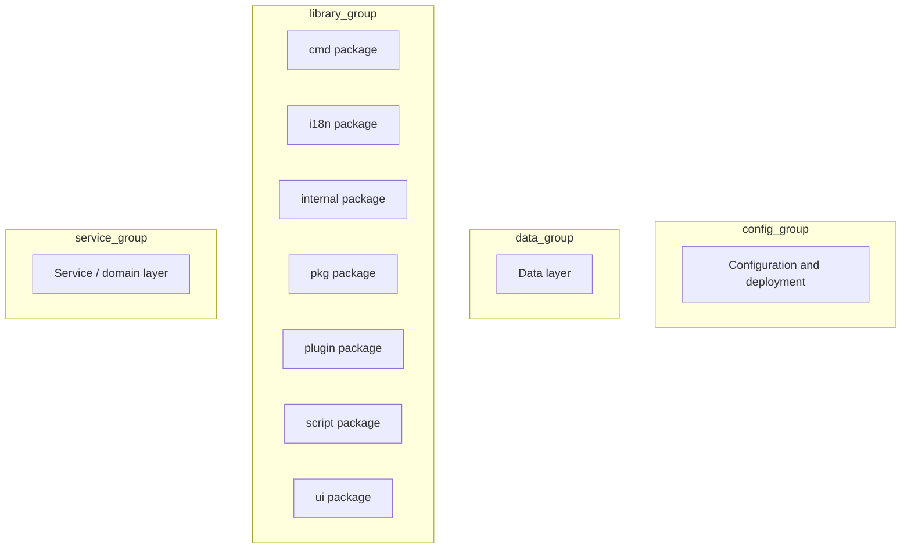

# Architecture report: apache/answer

> Automated static analysis. **Observed** = directly seen in files/imports/AST; **Inferred** = interpretation from that evidence. Repository code was not executed.

## 1. Repository at a glance

| Item | Value |
| --- | --- |
| Repository | apache/answer |
| Description | A Q&A platform software for teams at any scales. Whether it's a community forum, help center, or knowledge management platform, you can always count on Apache Answer. |
| Language | Go |
| Stars | 15712 |
| Licence | Apache-2.0 |
| Analysed commit / branch | 6744295fa888e0621fc9f9a8ace04f1a4daf8554 / main |
| Framework(s) | React |
| Files analysed | 796 |
| Components | 10 |

## 2. Architecture in one minute

apache/answer - A Q&A platform software for teams at any scales. Whether it's a community forum, help center, or knowledge management platform, you can always count on Apache Answer.. This repository was analysed statically from 796 file(s) (0 Python). Detected technologies (observed from imports/manifests): GitHub Actions, React, axios, React Router, Docker, Docker Compose. Files are grouped into 10 component(s): cmd package, Configuration and deployment, Data layer, i18n package, internal package, pkg package, plugin package, script package. Findings below distinguish observed facts from inferred interpretation.

## 3. High-level block diagram

## 4. Main components

### cmd package (`cmd`)

- **Kind:** library
- **Status:** Observed
- **Confidence:** 0.85
- **Responsibility:** Groups 5 file(s) under cmd package (observed from repository paths and static analysis).
- **Paths:** `cmd/answer/main.go`, `cmd/command.go`, `cmd/main.go`, `cmd/wire.go`, `cmd/wire_gen.go`
- **Evidence:** [cmd/answer/main.go](https://github.com/apache/answer/blob/6744295fa888e0621fc9f9a8ace04f1a4daf8554/cmd/answer/main.go); [cmd/command.go](https://github.com/apache/answer/blob/6744295fa888e0621fc9f9a8ace04f1a4daf8554/cmd/command.go); [cmd/main.go](https://github.com/apache/answer/blob/6744295fa888e0621fc9f9a8ace04f1a4daf8554/cmd/main.go); [cmd/wire.go](https://github.com/apache/answer/blob/6744295fa888e0621fc9f9a8ace04f1a4daf8554/cmd/wire.go); [cmd/wire_gen.go](https://github.com/apache/answer/blob/6744295fa888e0621fc9f9a8ace04f1a4daf8554/cmd/wire_gen.go)

### Configuration and deployment (`config`)

- **Kind:** config
- **Status:** Observed
- **Confidence:** 0.85
- **Responsibility:** Groups 71 file(s) under configuration and deployment (observed from repository paths and static analysis).
- **Paths:** `Dockerfile`, `charts/Chart.yaml`, `charts/templates/deployment.yaml`, `charts/templates/hpa.yaml`, `charts/templates/ingress.yaml`, `charts/templates/pvc.yaml`, `charts/templates/service.yaml`, `charts/templates/serviceaccount.yaml`, `charts/values.yaml`, `configs/config.go`, `configs/config.yaml`, `configs/path_ignore.yaml`, `configs/reserved-usernames.json`, `crowdin.yml`, `docker-compose.yaml`, `go.mod`, `i18n/af_ZA.yaml`, `i18n/ar_SA.yaml`, `i18n/az_AZ.yaml`, `i18n/bal_BA.yaml`, `i18n/ban_ID.yaml`, `i18n/bn_BD.yaml`, `i18n/bs_BA.yaml`, `i18n/ca_ES.yaml`, `i18n/cs_CZ.yaml`, `i18n/cy_GB.yaml`, `i18n/da_DK.yaml`, `i18n/de_DE.yaml`, `i18n/el_GR.yaml`, `i18n/en_US.yaml`, `i18n/es_ES.yaml`, `i18n/fa_IR.yaml`, `i18n/fi_FI.yaml`, `i18n/fr_FR.yaml`, `i18n/he_IL.yaml`, `i18n/hi_IN.yaml`, `i18n/hu_HU.yaml`, `i18n/hy_AM.yaml`, `i18n/i18n.yaml`, `i18n/id_ID.yaml`, `i18n/it_IT.yaml`, `i18n/ja_JP.yaml`, `i18n/ko_KR.yaml`, `i18n/ml_IN.yaml`, `i18n/nl_NL.yaml`, `i18n/no_NO.yaml`, `i18n/pl_PL.yaml`, `i18n/pt_BR.yaml`, `i18n/pt_PT.yaml`, `i18n/ro_RO.yaml`, `i18n/ru_RU.yaml`, `i18n/sk_SK.yaml`, `i18n/sq_AL.yaml`, `i18n/sr_SP.yaml`, `i18n/sv_SE.yaml`, `i18n/te_IN.yaml`, `i18n/tr_TR.yaml`, `i18n/uk_UA.yaml`, `i18n/vi_VN.yaml`, `i18n/zh_CN.yaml`, `i18n/zh_TW.yaml`, `internal/base/conf/conf.go`, `internal/repo/config/config_repo.go`, `internal/service/config/config_service.go`, `licenserc.toml`, `ui/.editorconfig`, `ui/.lintstagedrc.json`, `ui/.prettierrc.json`, `ui/package.json`, `ui/pnpm-workspace.yaml`, `ui/public/manifest.json`
- **Evidence:** [Dockerfile](https://github.com/apache/answer/blob/6744295fa888e0621fc9f9a8ace04f1a4daf8554/Dockerfile); [charts/Chart.yaml](https://github.com/apache/answer/blob/6744295fa888e0621fc9f9a8ace04f1a4daf8554/charts/Chart.yaml); [charts/templates/deployment.yaml](https://github.com/apache/answer/blob/6744295fa888e0621fc9f9a8ace04f1a4daf8554/charts/templates/deployment.yaml); [charts/templates/hpa.yaml](https://github.com/apache/answer/blob/6744295fa888e0621fc9f9a8ace04f1a4daf8554/charts/templates/hpa.yaml); [charts/templates/ingress.yaml](https://github.com/apache/answer/blob/6744295fa888e0621fc9f9a8ace04f1a4daf8554/charts/templates/ingress.yaml); [charts/templates/pvc.yaml](https://github.com/apache/answer/blob/6744295fa888e0621fc9f9a8ace04f1a4daf8554/charts/templates/pvc.yaml); [charts/templates/service.yaml](https://github.com/apache/answer/blob/6744295fa888e0621fc9f9a8ace04f1a4daf8554/charts/templates/service.yaml); [charts/templates/serviceaccount.yaml](https://github.com/apache/answer/blob/6744295fa888e0621fc9f9a8ace04f1a4daf8554/charts/templates/serviceaccount.yaml)

### Data layer (`data_layer`)

- **Kind:** data
- **Status:** Observed
- **Confidence:** 0.85
- **Responsibility:** Groups 2 file(s) under data layer (observed from repository paths and static analysis).
- **Paths:** `internal/base/data/config.go`, `internal/base/data/data.go`
- **Evidence:** [internal/base/data/config.go](https://github.com/apache/answer/blob/6744295fa888e0621fc9f9a8ace04f1a4daf8554/internal/base/data/config.go); [internal/base/data/data.go](https://github.com/apache/answer/blob/6744295fa888e0621fc9f9a8ace04f1a4daf8554/internal/base/data/data.go)

### i18n package (`i18n`)

- **Kind:** library
- **Status:** Observed
- **Confidence:** 0.85
- **Responsibility:** Groups 1 file(s) under i18n package (observed from repository paths and static analysis).
- **Paths:** `i18n/i18n.go`
- **Evidence:** [i18n/i18n.go](https://github.com/apache/answer/blob/6744295fa888e0621fc9f9a8ace04f1a4daf8554/i18n/i18n.go)

### internal package (`internal`)

- **Kind:** library
- **Status:** Observed
- **Confidence:** 0.85
- **Responsibility:** Groups 328 file(s) under internal package (observed from repository paths and static analysis).
- **Paths:** `internal/base/constant/acticity.go`, `internal/base/constant/ai_config.go`, `internal/base/constant/cache_key.go`, `internal/base/constant/comment.go`, `internal/base/constant/constant.go`, `internal/base/constant/ctx_flag.go`, `internal/base/constant/email_tpl_key.go`, `internal/base/constant/event.go`, `internal/base/constant/meta.go`, `internal/base/constant/notification.go`, `internal/base/constant/object_type.go`, `internal/base/constant/plugin_config_key.go`, `internal/base/constant/privilege.go`, `internal/base/constant/question.go`, `internal/base/constant/reason.go`, `internal/base/constant/revision.go`, `internal/base/constant/site_info.go`, `internal/base/constant/site_type.go`, `internal/base/constant/upload.go`, `internal/base/constant/user.go`, `internal/base/cron/cron.go`, `internal/base/cron/provider.go`, `internal/base/handler/handler.go`, `internal/base/handler/lang.go`, `internal/base/handler/response.go`, `internal/base/handler/short_id.go`, `internal/base/middleware/accept_language.go`, `internal/base/middleware/api_key_auth.go`, `internal/base/middleware/auth.go`, `internal/base/middleware/avatar.go`, `internal/base/middleware/header.go`, `internal/base/middleware/header_test.go`, `internal/base/middleware/mcp_auth.go`, `internal/base/middleware/provider.go`, `internal/base/middleware/rate_limit.go`, `internal/base/middleware/recovery.go`, `internal/base/middleware/recovery_test.go`, `internal/base/middleware/short_id.go`, `internal/base/middleware/user_center_plugin_auth.go`, `internal/base/middleware/visit_img_auth.go`, `internal/base/middleware/visit_img_auth_test.go`, `internal/base/pager/pager.go`, `internal/base/pager/pagination.go`, `internal/base/path/path.go`, `internal/base/queue/queue.go`, `internal/base/queue/queue_test.go`, `internal/base/reason/privilege.go`, `internal/base/reason/reason.go`, `internal/base/server/config.go`, `internal/base/server/http.go`, `internal/base/server/http_funcmap.go`, `internal/base/server/provider.go`, `internal/base/translator/config.go`, `internal/base/translator/provider.go`, `internal/base/validator/validator.go`, `internal/cli/build.go`, `internal/cli/config.go`, `internal/cli/dump.go`, `internal/cli/i18n.go`, `internal/cli/install.go`, `internal/cli/install_check.go`, `internal/cli/reset_password.go`, `internal/controller/activity_controller.go`, `internal/controller/ai_controller.go`, `internal/controller/ai_conversation_controller.go`, `internal/controller/ai_tools_test.go`, `internal/controller/answer_controller.go`, `internal/controller/badge_controller.go`, `internal/controller/collection_controller.go`, `internal/controller/comment_controller.go`, `internal/controller/connector_controller.go`, `internal/controller/controller.go`, `internal/controller/dashboard_controller.go`, `internal/controller/embed_controller.go`, `internal/controller/follow_controller.go`, `internal/controller/lang_controller.go`, `internal/controller/mcp_controller.go`, `internal/controller/mcp_controller_test.go`, `internal/controller/meta_controller.go`, `internal/controller/notification_controller.go`, `internal/controller/permission_controller.go`, `internal/controller/plugin_captcha_controller.go`, `internal/controller/plugin_sidebar_controller.go`, `internal/controller/plugin_user_center_controller.go`, `internal/controller/question_controller.go`, `internal/controller/question_controller_test.go`, `internal/controller/rank_controller.go`, `internal/controller/reason_controller.go`, `internal/controller/render_controller.go`, `internal/controller/report_controller.go`, `internal/controller/review_controller.go`, `internal/controller/revision_controller.go`, `internal/controller/search_controller.go`, `internal/controller/siteinfo_controller.go`, `internal/controller/tag_controller.go`, `internal/controller/template_controller.go`, `internal/controller/template_controller_test.go`, `internal/controller/template_render/answer.go`, `internal/controller/template_render/comment.go`, `internal/controller/template_render/controller.go`, `internal/controller/template_render/question.go`, `internal/controller/template_render/tags.go`, `internal/controller/template_render/userinfo.go`, `internal/controller/upload_controller.go`, `internal/controller/user_controller.go`, `internal/controller/user_plugin_controller.go`, `internal/controller/vote_controller.go`, `internal/controller_admin/ai_conversation_admin_controller.go`, `internal/controller_admin/badge_controller.go`, `internal/controller_admin/controller.go`, `internal/controller_admin/e_api_key_controller.go`, `internal/controller_admin/plugin_controller.go`, `internal/controller_admin/role_controller.go`, `internal/controller_admin/siteinfo_controller.go`, `internal/controller_admin/theme_controller.go`, `internal/controller_admin/user_backyard_controller.go`, `internal/entity/activity_entity.go`, `internal/entity/ai_conversation.go`, `internal/entity/ai_conversation_record.go`, `internal/entity/answer_entity.go`, `internal/entity/api_key_entity.go`, `internal/entity/auth_user_entity.go`, `internal/entity/badge_award_entity.go`, `internal/entity/badge_entity.go`, `internal/entity/badge_group_entity.go`, `internal/entity/captcha_entity.go`, `internal/entity/collection_entity.go`, `internal/entity/collection_group_entity.go`, `internal/entity/comment_entity.go`, `internal/entity/config_entity.go`, `internal/entity/file_record_entity.go`, `internal/entity/meta_entity.go`, `internal/entity/notification_entity.go`, `internal/entity/plugin_config_entity.go`, `internal/entity/plugin_kv_storage_entity.go`, `internal/entity/plugin_user_config_entity.go`, `internal/entity/power_entity.go`, `internal/entity/question_entity.go`, `internal/entity/question_link_entity.go`, `internal/entity/report_entity.go`, `internal/entity/review_entity.go`, `internal/entity/revision_entity.go`, `internal/entity/role_entity.go`, `internal/entity/role_power_rel_entity.go`, `internal/entity/site_info.go`, `internal/entity/tag_entity.go`, `internal/entity/tag_rel_entity.go`, `internal/entity/uniqid_entity.go`, `internal/entity/user_entity.go`, `internal/entity/user_external_login_entity.go`, `internal/entity/user_notification_config_entity.go`, `internal/entity/user_role_rel_entity.go`, `internal/entity/version_entity.go`, `internal/install/install_controller.go`, `internal/install/install_from_env.go`, `internal/install/install_main.go`, `internal/install/install_req.go`, `internal/install/install_server.go`, `internal/migrations/init.go`, `internal/migrations/init_data.go`, `internal/migrations/migrations.go`, `internal/migrations/v1.go`, `internal/migrations/v10.go`, `internal/migrations/v11.go`, `internal/migrations/v12.go`, `internal/migrations/v13.go`, `internal/migrations/v14.go`, `internal/migrations/v15.go`, `internal/migrations/v16.go`, `internal/migrations/v17.go`, `internal/migrations/v18.go`, `internal/migrations/v19.go`, `internal/migrations/v2.go`, `internal/migrations/v20.go`, `internal/migrations/v21.go`, `internal/migrations/v22.go`, `internal/migrations/v23.go`, `internal/migrations/v24.go`, `internal/migrations/v25.go`, `internal/migrations/v26.go`, `internal/migrations/v27.go`, `internal/migrations/v28.go`, `internal/migrations/v29.go`, `internal/migrations/v3.go`, `internal/migrations/v30.go`, `internal/migrations/v31.go`, `internal/migrations/v32.go`, `internal/migrations/v33.go`, `internal/migrations/v34.go`, `internal/migrations/v34_test.go`, `internal/migrations/v35.go`, `internal/migrations/v35_test.go`, `internal/migrations/v4.go`, `internal/migrations/v5.go`, `internal/migrations/v6.go`, `internal/migrations/v7.go`, `internal/migrations/v8.go`, `internal/migrations/v9.go`, `internal/repo/activity/activity_repo.go`, `internal/repo/activity/answer_repo.go`, `internal/repo/activity/follow_repo.go`, `internal/repo/activity/review_repo.go`, `internal/repo/activity/user_active_repo.go`, `internal/repo/activity/vote_repo.go`, `internal/repo/activity_common/activity_repo.go`, `internal/repo/activity_common/follow.go`, `internal/repo/activity_common/vote.go`, `internal/repo/ai_conversation/ai_conversation_repo.go`, `internal/repo/answer/answer_repo.go`, `internal/repo/api_key/api_key_repo.go`, `internal/repo/auth/auth.go`, `internal/repo/badge/badge_event_rule.go`, `internal/repo/badge/badge_repo.go`, `internal/repo/badge_award/badge_award_repo.go`, `internal/repo/badge_group/badge_group_repo.go`, `internal/repo/captcha/captcha.go`, `internal/repo/collection/collection_group_repo.go`, `internal/repo/collection/collection_repo.go`, `internal/repo/comment/comment_repo.go`, `internal/repo/export/email_repo.go`, `internal/repo/file_record/file_record_repo.go`, `internal/repo/limit/limit.go`, `internal/repo/meta/meta_repo.go`, `internal/repo/notification/notification_repo.go`, `internal/repo/plugin_config/plugin_config_repo.go`, `internal/repo/plugin_config/plugin_user_config_repo.go`, `internal/repo/provider.go`, `internal/repo/question/question_repo.go`, `internal/repo/rank/user_rank_repo.go`, `internal/repo/reason/reason_repo.go`, `internal/repo/repo_test/auth_test.go`, `internal/repo/repo_test/captcha_test.go`, `internal/repo/repo_test/comment_repo_test.go`, `internal/repo/repo_test/email_repo_test.go`, `internal/repo/repo_test/meta_repo_test.go`, `internal/repo/repo_test/notification_repo_test.go`, `internal/repo/repo_test/personal_answer_visibility_test.go`, `internal/repo/repo_test/question_link_security_test.go`, `internal/repo/repo_test/reason_repo_test.go`, `internal/repo/repo_test/recommend_test.go`, `internal/repo/repo_test/repo_main_test.go`, `internal/repo/repo_test/revision_repo_test.go`, `internal/repo/repo_test/siteinfo_repo_test.go`, `internal/repo/repo_test/tag_rel_repo_test.go`, `internal/repo/repo_test/tag_repo_test.go`, `internal/repo/repo_test/user_backyard_repo_test.go`, `internal/repo/repo_test/user_repo_test.go`, `internal/repo/report/report_repo.go`, `internal/repo/review/review_repo.go`, `internal/repo/revision/revision_repo.go`, `internal/repo/role/power_repo.go`, `internal/repo/role/role_power_rel_repo.go`, `internal/repo/role/role_repo.go`, `internal/repo/role/user_role_rel_repo.go`, `internal/repo/search_common/search_repo.go`, `internal/repo/search_sync/search_sync.go`, `internal/repo/site_info/siteinfo_repo.go`, `internal/repo/tag/tag_rel_repo.go`, `internal/repo/tag/tag_repo.go`, `internal/repo/tag_common/tag_common_repo.go`, `internal/repo/tag_common/tagsearch_test.go`, `internal/repo/unique/uniqid_repo.go`, `internal/repo/user/user_backyard_repo.go`, `internal/repo/user/user_repo.go`, `internal/repo/user_external_login/user_external_login_repo.go`, `internal/repo/user_notification_config/user_notification_config_repo.go`, `internal/repo/vector_search_sync/syncer.go`, `internal/router/answer_api_router.go`, `internal/router/config.go`, `internal/router/mcp_router.go`, `internal/router/plugin_api_router.go`, `internal/router/provider.go`, `internal/router/static_router.go`, `internal/router/static_router_test.go`, `internal/router/swagger_router.go`, `internal/router/template_router.go`, `internal/router/ui.go`, `internal/router/ui_test.go`, `internal/schema/activity.go`, `internal/schema/ai_config_schema.go`, `internal/schema/ai_conversation_schema.go`, `internal/schema/answer_activity_schema.go`, `internal/schema/answer_schema.go`, `internal/schema/api_key_schema.go`, `internal/schema/backyard_user_schema.go`, `internal/schema/badge_schema.go`, `internal/schema/collection_group_schema.go`, `internal/schema/comment_schema.go`, `internal/schema/config_schema.go`, `internal/schema/connector_schema.go`, `internal/schema/dashboard_schema.go`, `internal/schema/email_template.go`, `internal/schema/email_template_test.go`, `internal/schema/err_schema.go`, `internal/schema/event_schema.go`, `internal/schema/follow_schema.go`, `internal/schema/forbidden_schema.go`, `internal/schema/mcp_schema.go`, `internal/schema/mcp_tools/mcp_tools.go`, `internal/schema/meta_schema.go`, `internal/schema/new_question_queue_schema.go`, `internal/schema/notification_schema.go`, `internal/schema/permission.go`, `internal/schema/plugin_admin_schema.go`, `internal/schema/plugin_user_center.go`, `internal/schema/plugin_user_schema.go`, `internal/schema/question_schema.go`, `internal/schema/rank_schema.go`, `internal/schema/reason_schema.go`, `internal/schema/render_schema.go`, `internal/schema/report_schema.go`, `internal/schema/review_schema.go`, `internal/schema/revision_schema.go`, `internal/schema/role_schema.go`, `internal/schema/search_schema.go`, `internal/schema/search_schema_test.go`, `internal/schema/simple_obj_info_schema.go`, `internal/schema/siteinfo_schema.go`, `internal/schema/siteinfo_schema_test.go`, `internal/schema/sitemap_schema.go`, `internal/schema/tag_list_schema.go`, `internal/schema/tag_schema.go`, `internal/schema/template_schema.go`, `internal/schema/theme_schema.go`, `internal/schema/user_external_login_schema.go`, `internal/schema/user_notification_schema.go`, `internal/schema/user_schema.go`, `internal/schema/vote_schema.go`
- **Evidence:** [internal/base/constant/acticity.go](https://github.com/apache/answer/blob/6744295fa888e0621fc9f9a8ace04f1a4daf8554/internal/base/constant/acticity.go); [internal/base/constant/ai_config.go](https://github.com/apache/answer/blob/6744295fa888e0621fc9f9a8ace04f1a4daf8554/internal/base/constant/ai_config.go); [internal/base/constant/cache_key.go](https://github.com/apache/answer/blob/6744295fa888e0621fc9f9a8ace04f1a4daf8554/internal/base/constant/cache_key.go); [internal/base/constant/comment.go](https://github.com/apache/answer/blob/6744295fa888e0621fc9f9a8ace04f1a4daf8554/internal/base/constant/comment.go); [internal/base/constant/constant.go](https://github.com/apache/answer/blob/6744295fa888e0621fc9f9a8ace04f1a4daf8554/internal/base/constant/constant.go); [internal/base/constant/ctx_flag.go](https://github.com/apache/answer/blob/6744295fa888e0621fc9f9a8ace04f1a4daf8554/internal/base/constant/ctx_flag.go); [internal/base/constant/email_tpl_key.go](https://github.com/apache/answer/blob/6744295fa888e0621fc9f9a8ace04f1a4daf8554/internal/base/constant/email_tpl_key.go); [internal/base/constant/event.go](https://github.com/apache/answer/blob/6744295fa888e0621fc9f9a8ace04f1a4daf8554/internal/base/constant/event.go)

### pkg package (`pkg`)

- **Kind:** library
- **Status:** Observed
- **Confidence:** 0.85
- **Responsibility:** Groups 34 file(s) under pkg package (observed from repository paths and static analysis).
- **Paths:** `pkg/checker/chinese.go`, `pkg/checker/email.go`, `pkg/checker/email_test.go`, `pkg/checker/file_type.go`, `pkg/checker/file_type_test.go`, `pkg/checker/password.go`, `pkg/checker/path_ignore.go`, `pkg/checker/question_link.go`, `pkg/checker/question_link_test.go`, `pkg/checker/reserved_username.go`, `pkg/checker/url.go`, `pkg/checker/username.go`, `pkg/checker/zero_string.go`, `pkg/converter/array.go`, `pkg/converter/markdown.go`, `pkg/converter/markdown_test.go`, `pkg/converter/str.go`, `pkg/converter/user.go`, `pkg/day/day.go`, `pkg/day/day_test.go`, `pkg/dir/dir.go`, `pkg/display/url.go`, `pkg/display/url_test.go`, `pkg/encryption/md5.go`, `pkg/gravatar/gravatar.go`, `pkg/gravatar/gravatar_test.go`, `pkg/htmltext/htmltext.go`, `pkg/htmltext/htmltext_test.go`, `pkg/obj/obj.go`, `pkg/random/random_username.go`, `pkg/token/token.go`, `pkg/uid/id.go`, `pkg/uid/sid.go`, `pkg/writer/writer.go`
- **Evidence:** [pkg/checker/chinese.go](https://github.com/apache/answer/blob/6744295fa888e0621fc9f9a8ace04f1a4daf8554/pkg/checker/chinese.go); [pkg/checker/email.go](https://github.com/apache/answer/blob/6744295fa888e0621fc9f9a8ace04f1a4daf8554/pkg/checker/email.go); [pkg/checker/email_test.go](https://github.com/apache/answer/blob/6744295fa888e0621fc9f9a8ace04f1a4daf8554/pkg/checker/email_test.go); [pkg/checker/file_type.go](https://github.com/apache/answer/blob/6744295fa888e0621fc9f9a8ace04f1a4daf8554/pkg/checker/file_type.go); [pkg/checker/file_type_test.go](https://github.com/apache/answer/blob/6744295fa888e0621fc9f9a8ace04f1a4daf8554/pkg/checker/file_type_test.go); [pkg/checker/password.go](https://github.com/apache/answer/blob/6744295fa888e0621fc9f9a8ace04f1a4daf8554/pkg/checker/password.go); [pkg/checker/path_ignore.go](https://github.com/apache/answer/blob/6744295fa888e0621fc9f9a8ace04f1a4daf8554/pkg/checker/path_ignore.go); [pkg/checker/question_link.go](https://github.com/apache/answer/blob/6744295fa888e0621fc9f9a8ace04f1a4daf8554/pkg/checker/question_link.go)

### plugin package (`plugin`)

- **Kind:** library
- **Status:** Observed
- **Confidence:** 0.85
- **Responsibility:** Groups 24 file(s) under plugin package (observed from repository paths and static analysis).
- **Paths:** `plugin/agent.go`, `plugin/base.go`, `plugin/cache.go`, `plugin/captcha.go`, `plugin/cdn.go`, `plugin/config.go`, `plugin/connector.go`, `plugin/embed.go`, `plugin/filter.go`, `plugin/importer.go`, `plugin/kv_storage.go`, `plugin/notification.go`, `plugin/parser.go`, `plugin/plugin.go`, `plugin/plugin_test/kv_storage_test.go`, `plugin/plugin_test/plugin_main_test.go`, `plugin/render.go`, `plugin/reviewer.go`, `plugin/search.go`, `plugin/sidebar.go`, `plugin/storage.go`, `plugin/user_center.go`, `plugin/user_config.go`, `plugin/vector_search.go`
- **Evidence:** [plugin/agent.go](https://github.com/apache/answer/blob/6744295fa888e0621fc9f9a8ace04f1a4daf8554/plugin/agent.go); [plugin/base.go](https://github.com/apache/answer/blob/6744295fa888e0621fc9f9a8ace04f1a4daf8554/plugin/base.go); [plugin/cache.go](https://github.com/apache/answer/blob/6744295fa888e0621fc9f9a8ace04f1a4daf8554/plugin/cache.go); [plugin/captcha.go](https://github.com/apache/answer/blob/6744295fa888e0621fc9f9a8ace04f1a4daf8554/plugin/captcha.go); [plugin/cdn.go](https://github.com/apache/answer/blob/6744295fa888e0621fc9f9a8ace04f1a4daf8554/plugin/cdn.go); [plugin/config.go](https://github.com/apache/answer/blob/6744295fa888e0621fc9f9a8ace04f1a4daf8554/plugin/config.go); [plugin/connector.go](https://github.com/apache/answer/blob/6744295fa888e0621fc9f9a8ace04f1a4daf8554/plugin/connector.go); [plugin/embed.go](https://github.com/apache/answer/blob/6744295fa888e0621fc9f9a8ace04f1a4daf8554/plugin/embed.go)

### script package (`script`)

- **Kind:** library
- **Status:** Observed
- **Confidence:** 0.85
- **Responsibility:** Groups 4 file(s) under script package (observed from repository paths and static analysis).
- **Paths:** `script/build_plugin.sh`, `script/check-asf-header.sh`, `script/entrypoint.sh`, `script/gen-api.sh`
- **Evidence:** [script/build_plugin.sh](https://github.com/apache/answer/blob/6744295fa888e0621fc9f9a8ace04f1a4daf8554/script/build_plugin.sh); [script/check-asf-header.sh](https://github.com/apache/answer/blob/6744295fa888e0621fc9f9a8ace04f1a4daf8554/script/check-asf-header.sh); [script/entrypoint.sh](https://github.com/apache/answer/blob/6744295fa888e0621fc9f9a8ace04f1a4daf8554/script/entrypoint.sh); [script/gen-api.sh](https://github.com/apache/answer/blob/6744295fa888e0621fc9f9a8ace04f1a4daf8554/script/gen-api.sh)

### Service / domain layer (`service_layer`)

- **Kind:** service
- **Status:** Observed
- **Confidence:** 0.85
- **Responsibility:** Groups 103 file(s) under service / domain layer (observed from repository paths and static analysis).
- **Paths:** `internal/service/action/captcha_service.go`, `internal/service/action/captcha_strategy.go`, `internal/service/activity/activity.go`, `internal/service/activity/answer_activity_service.go`, `internal/service/activity/review_active.go`, `internal/service/activity/user_active.go`, `internal/service/activity_common/activity.go`, `internal/service/activity_common/follow.go`, `internal/service/activity_common/vote.go`, `internal/service/activity_type/activity_type.go`, `internal/service/activityqueue/activity_queue.go`, `internal/service/ai_conversation/ai_conversation_service.go`, `internal/service/answer_common/answer.go`, `internal/service/apikey/apikey_service.go`, `internal/service/auth/auth.go`, `internal/service/auth/auth_test.go`, `internal/service/auth/user_center_status_test.go`, `internal/service/badge/badge_award_service.go`, `internal/service/badge/badge_event_handler.go`, `internal/service/badge/badge_group_service.go`, `internal/service/badge/badge_service.go`, `internal/service/collection/collection_group_service.go`, `internal/service/collection/collection_service.go`, `internal/service/collection_common/collection.go`, `internal/service/comment/comment_service.go`, `internal/service/comment/comment_service_visibility_test.go`, `internal/service/comment_common/comment_service.go`, `internal/service/content/answer_service.go`, `internal/service/content/answer_service_test.go`, `internal/service/content/question_hottest_service.go`, `internal/service/content/question_service.go`, `internal/service/content/question_service_visibility_test.go`, `internal/service/content/revision_service.go`, `internal/service/content/search_service.go`, `internal/service/content/user_service.go`, `internal/service/content/user_service_test.go`, `internal/service/content/vote_service.go`, `internal/service/dashboard/dashboard_service.go`, `internal/service/dashboard/dashboard_test.go`, `internal/service/embedding/embedding_service.go`, `internal/service/eventqueue/event_queue.go`, `internal/service/export/email_service.go`, `internal/service/feature_toggle/feature_toggle_service.go`, `internal/service/file_record/file_record_service.go`, `internal/service/follow/follow_service.go`, `internal/service/importer/importer_service.go`, `internal/service/importer/importer_service_test.go`, `internal/service/meta/meta_service.go`, `internal/service/meta/meta_service_visibility_test.go`, `internal/service/meta_common/meta_common_service.go`, `internal/service/mock/siteinfo_repo_mock.go`, `internal/service/noticequeue/notice_queue.go`, `internal/service/notification/external_notification.go`, `internal/service/notification/invite_answer_notification.go`, `internal/service/notification/new_answer_notification.go`, `internal/service/notification/new_comment_notification.go`, `internal/service/notification/new_question_email_worker.go`, `internal/service/notification/new_question_email_worker_test.go`, `internal/service/notification/new_question_notification.go`, `internal/service/notification/new_question_notification_interval.go`, `internal/service/notification/new_question_notification_test.go`, `internal/service/notification/notification_service.go`, `internal/service/notification_common/notification.go`, `internal/service/object_info/object_info.go`, `internal/service/permission/answer_permission.go`, `internal/service/permission/comment_permission.go`, `internal/service/permission/permission_name.go`, `internal/service/permission/question_permission.go`, `internal/service/permission/tag_permission.go`, `internal/service/plugin_common/plugin_common_service.go`, `internal/service/provider.go`, `internal/service/question_common/question.go`, `internal/service/rank/rank_service.go`, `internal/service/reason/reason_service.go`, `internal/service/reason_common/reason.go`, `internal/service/report/report_service.go`, `internal/service/report_common/report_common.go`, `internal/service/report_handle/report_handle.go`, `internal/service/review/review_service.go`, `internal/service/revision/revision.go`, `internal/service/revision_common/revision_service.go`, `internal/service/role/power_service.go`, `internal/service/role/role_power_rel_service.go`, `internal/service/role/role_service.go`, `internal/service/role/user_role_rel_service.go`, `internal/service/search_common/search.go`, `internal/service/search_parser/search_parser.go`, `internal/service/service_config/service_config.go`, `internal/service/siteinfo/siteinfo_service.go`, `internal/service/siteinfo/siteinfo_service_test.go`, `internal/service/siteinfo_common/siteinfo_service.go`, `internal/service/siteinfo_common/siteinfo_service_test.go`, `internal/service/tag/tag_service.go`, `internal/service/tag_common/tag_common.go`, `internal/service/unique/uniqid_service.go`, `internal/service/uploader/upload.go`, `internal/service/user_admin/user_backyard.go`, `internal/service/user_common/user.go`, `internal/service/user_external_login/user_center_login_service.go`, `internal/service/user_external_login/user_center_login_service_test.go`, `internal/service/user_external_login/user_external_login_service.go`, `internal/service/user_notification_config/user_notification_config_service.go`, `internal/service/vector_sync/vector_sync.go`
- **Evidence:** [internal/service/action/captcha_service.go](https://github.com/apache/answer/blob/6744295fa888e0621fc9f9a8ace04f1a4daf8554/internal/service/action/captcha_service.go); [internal/service/action/captcha_strategy.go](https://github.com/apache/answer/blob/6744295fa888e0621fc9f9a8ace04f1a4daf8554/internal/service/action/captcha_strategy.go); [internal/service/activity/activity.go](https://github.com/apache/answer/blob/6744295fa888e0621fc9f9a8ace04f1a4daf8554/internal/service/activity/activity.go); [internal/service/activity/answer_activity_service.go](https://github.com/apache/answer/blob/6744295fa888e0621fc9f9a8ace04f1a4daf8554/internal/service/activity/answer_activity_service.go); [internal/service/activity/review_active.go](https://github.com/apache/answer/blob/6744295fa888e0621fc9f9a8ace04f1a4daf8554/internal/service/activity/review_active.go); [internal/service/activity/user_active.go](https://github.com/apache/answer/blob/6744295fa888e0621fc9f9a8ace04f1a4daf8554/internal/service/activity/user_active.go); [internal/service/activity_common/activity.go](https://github.com/apache/answer/blob/6744295fa888e0621fc9f9a8ace04f1a4daf8554/internal/service/activity_common/activity.go); [internal/service/activity_common/follow.go](https://github.com/apache/answer/blob/6744295fa888e0621fc9f9a8ace04f1a4daf8554/internal/service/activity_common/follow.go)

### ui package (`ui`)

- **Kind:** library
- **Status:** Observed
- **Confidence:** 0.85
- **Responsibility:** Groups 93 file(s) under ui package (observed from repository paths and static analysis).
- **Paths:** `ui/.eslintrc.js`, `ui/commitlint.config.js`, `ui/scripts/env.js`, `ui/scripts/importPlugins.js`, `ui/scripts/loadPlugins.js`, `ui/scripts/preinstall.js`, `ui/scripts/setup-eslint.js`, `ui/src/App.tsx`, `ui/src/behaviour/useLegalClick.tsx`, `ui/src/common/constants.ts`, `ui/src/common/interface.ts`, `ui/src/common/pattern.ts`, `ui/src/components/AccordionNav/index.tsx`, `ui/src/components/Actions/index.tsx`, `ui/src/components/AdminSideNav/index.tsx`, `ui/src/components/Avatar/index.tsx`, `ui/src/components/BaseUserCard/index.tsx`, `ui/src/components/BrandUpload/index.tsx`, `ui/src/components/BubbleAi/index.tsx`, `ui/src/components/BubbleUser/index.tsx`, `ui/src/components/CardBadge/index.tsx`, `ui/src/components/Comment/components/ActionBar/index.tsx`, `ui/src/components/Comment/components/Form/index.tsx`, `ui/src/components/Comment/components/Reply/index.tsx`, `ui/src/components/Comment/components/index.tsx`, `ui/src/components/Comment/index.tsx`, `ui/src/components/Counts/index.tsx`, `ui/src/components/CustomSidebar/index.tsx`, `ui/src/components/Customize/index.tsx`, `ui/src/components/CustomizeTheme/index.tsx`, `ui/src/components/DiffContent/index.tsx`, `ui/src/components/Editor/EditorContext.ts`, `ui/src/components/Editor/MarkdownEditor.tsx`, `ui/src/components/Editor/Select/index.tsx`, `ui/src/components/Editor/ToolBars/blockquote.tsx`, `ui/src/components/Editor/ToolBars/bold.tsx`, `ui/src/components/Editor/ToolBars/code.tsx`, `ui/src/components/Editor/ToolBars/file.tsx`, `ui/src/components/Editor/ToolBars/heading.tsx`, `ui/src/components/Editor/ToolBars/help.tsx`, `ui/src/components/Editor/ToolBars/hr.tsx`, `ui/src/components/Editor/ToolBars/image.tsx`, `ui/src/components/Editor/ToolBars/indent.tsx`, `ui/src/components/Editor/ToolBars/index.ts`, `ui/src/components/Editor/ToolBars/italic.tsx`, `ui/src/components/Editor/ToolBars/link.tsx`, `ui/src/components/Editor/ToolBars/ol.tsx`, `ui/src/components/Editor/ToolBars/outdent.tsx`, `ui/src/components/Editor/ToolBars/table.tsx`, `ui/src/components/Editor/ToolBars/ul.tsx`, `ui/src/components/Editor/Viewer.tsx`, `ui/src/components/Editor/hooks/useImageUpload.ts`, `ui/src/components/Editor/index.tsx`, `ui/src/components/Editor/toolItem.tsx`, `ui/src/components/Editor/types.ts`, `ui/src/components/Editor/utils/codemirror/adapter.ts`, `ui/src/components/Editor/utils/codemirror/base.ts`, `ui/src/components/Editor/utils/codemirror/commands.ts`, `ui/src/components/Editor/utils/codemirror/events.ts`, `ui/src/components/Editor/utils/index.ts`, `ui/src/components/Empty/index.tsx`, `ui/src/components/FollowingTags/index.tsx`, `ui/src/components/Footer/index.tsx`, `ui/src/components/FormatTime/index.tsx`, `ui/src/components/Header/components/NavItems/index.tsx`, `ui/src/components/Header/components/SearchInput/index.tsx`, `ui/src/components/Header/index.tsx`, `ui/src/components/HighlightText/index.tsx`, `ui/src/components/HotQuestions/index.tsx`, `ui/src/components/HttpErrorContent/index.tsx`, `ui/src/components/Icon/index.tsx`, `ui/src/components/Icon/svg.tsx`, `ui/src/components/ImgViewer/index.tsx`, `ui/src/components/InitialLoadingPlaceholder/index.tsx`, `ui/src/components/Mentions/index.tsx`, `ui/src/components/MobileSideNav/index.tsx`, `ui/src/components/Modal/BadgeModal.tsx`, `ui/src/components/Modal/Confirm.tsx`, `ui/src/components/Modal/LoginToContinueModal.tsx`, `ui/src/components/Modal/Modal.tsx`, `ui/src/components/Modal/index.tsx`, `ui/src/components/Operate/index.tsx`, `ui/src/components/PageTags/index.tsx`, `ui/src/components/Pagination/index.tsx`, `ui/src/components/PinList/index.tsx`, `ui/src/components/PluginRender/index.tsx`, `ui/src/components/QueryGroup/index.tsx`, `ui/src/components/QuestionList/index.tsx`, `ui/src/components/QuestionListLoader/index.tsx`, `ui/src/components/SchemaForm/components/Button.tsx`, `ui/src/components/SchemaForm/components/Check.tsx`, `ui/src/components/SchemaForm/components/Input.tsx`, `ui/src/components/SchemaForm/components/InputGroup.tsx`
- **Evidence:** [ui/.eslintrc.js](https://github.com/apache/answer/blob/6744295fa888e0621fc9f9a8ace04f1a4daf8554/ui/.eslintrc.js); [ui/commitlint.config.js](https://github.com/apache/answer/blob/6744295fa888e0621fc9f9a8ace04f1a4daf8554/ui/commitlint.config.js); [ui/scripts/env.js](https://github.com/apache/answer/blob/6744295fa888e0621fc9f9a8ace04f1a4daf8554/ui/scripts/env.js); [ui/scripts/importPlugins.js](https://github.com/apache/answer/blob/6744295fa888e0621fc9f9a8ace04f1a4daf8554/ui/scripts/importPlugins.js); [ui/scripts/loadPlugins.js](https://github.com/apache/answer/blob/6744295fa888e0621fc9f9a8ace04f1a4daf8554/ui/scripts/loadPlugins.js); [ui/scripts/preinstall.js](https://github.com/apache/answer/blob/6744295fa888e0621fc9f9a8ace04f1a4daf8554/ui/scripts/preinstall.js); [ui/scripts/setup-eslint.js](https://github.com/apache/answer/blob/6744295fa888e0621fc9f9a8ace04f1a4daf8554/ui/scripts/setup-eslint.js); [ui/src/App.tsx](https://github.com/apache/answer/blob/6744295fa888e0621fc9f9a8ace04f1a4daf8554/ui/src/App.tsx)

## 5. Execution flow

**Observed** entry point(s):

- [ui/src/App.tsx](https://github.com/apache/answer/blob/6744295fa888e0621fc9f9a8ace04f1a4daf8554/ui/src/App.tsx)

Representative flow (derived from observed entry points and the import graph; steps beyond the entry point are **Inferred**):

1. Execution starts at an observed entry point listed above, if present.
2. No internal import relationships between components were observed.

## 6. Project structure

### `(root)`

- `.asf.yaml` - config (1655 bytes)
- `.editorconfig` - config (1082 bytes)
- `.env.example` - config (417 bytes)
- `.gitignore` - other (387 bytes)
- `.gitlab-ci.yml` - ci, YAML (1367 bytes)
- `.golangci.yaml` - config (1989 bytes)
- `.goreleaser.yaml` - config (2406 bytes)
- `Dockerfile` - container (2223 bytes)
- `LICENSE` - docs (11357 bytes)
- `Makefile` - other (2117 bytes)
- `NOTICE` - docs (168 bytes)
- `README.md` - docs (2423 bytes)
- `crowdin.yml` - config (875 bytes)
- `docker-compose.yaml` - container (961 bytes)
- `go.mod` - manifest (9241 bytes)
- `go.sum` - other (98720 bytes)
- `licenserc.toml` - config (1119 bytes)

### `.github`

- `.github/ISSUE_TEMPLATE/bug_report.md` - docs (634 bytes)
- `.github/ISSUE_TEMPLATE/config.yml` - config (945 bytes)
- `.github/ISSUE_TEMPLATE/enhancement_request.md` - docs (571 bytes)
- `.github/ISSUE_TEMPLATE/feature_request.md` - docs (551 bytes)
- `.github/PULL_REQUEST_TEMPLATE/pull_request_template.md` - docs (42 bytes)
- `.github/workflows/build-binary-for-release.yml` - ci, YAML (1677 bytes)
- `.github/workflows/build-image-for-latest-release.yml` - ci, YAML (2139 bytes)
- `.github/workflows/build-image-for-manual.yml` - ci, YAML (2178 bytes)
- `.github/workflows/build-image-for-release.yml` - ci, YAML (2171 bytes)
- `.github/workflows/build-image-for-test.yml` - ci, YAML (1862 bytes)
- `.github/workflows/check-asf-header.yml` - ci, YAML (1731 bytes)
- `.github/workflows/lint.yml` - ci, YAML (1721 bytes)

### `.vaunt`

- `.vaunt/config.yaml` - config (1519 bytes)

### `.vscode`

- `.vscode/settings.json` - config (134 bytes)

### `charts`

- `charts/.helmignore` - other (349 bytes)
- `charts/Chart.yaml` - config (922 bytes)
- `charts/README.md` - docs (3547 bytes)
- `charts/templates/_helpers.tpl` - other (2499 bytes)
- `charts/templates/deployment.yaml` - config (4190 bytes)
- `charts/templates/hpa.yaml` - config (1699 bytes)
- `charts/templates/ingress.yaml` - config (2862 bytes)
- `charts/templates/pvc.yaml` - config (1727 bytes)
- `charts/templates/service.yaml` - config (1144 bytes)
- `charts/templates/serviceaccount.yaml` - config (1103 bytes)
- `charts/values.yaml` - config (5053 bytes)

### `cmd`

- `cmd/answer/main.go` - source, Go (1184 bytes)
- `cmd/command.go` - source, Go (11275 bytes)
- `cmd/main.go` - source, Go (3085 bytes)
- `cmd/wire.go` - source, Go (2412 bytes)
- `cmd/wire_gen.go` - source, Go (24623 bytes)

### `configs`

- `configs/config.go` - source, Go (1004 bytes)
- `configs/config.yaml` - config (1283 bytes)
- `configs/path_ignore.yaml` - config (1078 bytes)
- `configs/reserved-usernames.json` - config (6536 bytes)

### `docs`

- `docs/img/logo.svg` - docs (6589 bytes)
- `docs/release/LICENSE` - docs (22114 bytes)
- `docs/release/NOTICE` - docs (168 bytes)
- `docs/release/licenses/LICENSE-JedWatson-classnames.txt` - docs (1077 bytes)
- `docs/release/licenses/LICENSE-Machiel-slugify.txt` - docs (1084 bytes)
- `docs/release/licenses/LICENSE-Masterminds-semver.txt` - docs (1078 bytes)
- `docs/release/licenses/LICENSE-Qix--color.txt` - docs (1058 bytes)
- `docs/release/licenses/LICENSE-anargu-gin-brotli.txt` - docs (1074 bytes)
- `docs/release/licenses/LICENSE-asaskevich-govalidator.txt` - docs (1085 bytes)
- `docs/release/licenses/LICENSE-axios-axios.txt` - docs (1084 bytes)
- `docs/release/licenses/LICENSE-bwmarrin-snowflake.txt` - docs (1288 bytes)
- `docs/release/licenses/LICENSE-codemirror-basic-setup.txt` - docs (1118 bytes)
- `docs/release/licenses/LICENSE-codemirror-lang-markdown.txt` - docs (1118 bytes)
- `docs/release/licenses/LICENSE-codemirror-language-data.txt` - docs (1118 bytes)
- `docs/release/licenses/LICENSE-codemirror-state.txt` - docs (1118 bytes)
- `docs/release/licenses/LICENSE-codemirror-view.txt` - docs (1118 bytes)
- `docs/release/licenses/LICENSE-cznic-sqlite.txt` - docs (1489 bytes)
- `docs/release/licenses/LICENSE-disintegration-imaging.txt` - docs (1082 bytes)
- `docs/release/licenses/LICENSE-emn178-js-sha256.txt` - docs (1076 bytes)
- `docs/release/licenses/LICENSE-facebook-react.txt` - docs (1088 bytes)
- `docs/release/licenses/LICENSE-gin-gonic-gin.txt` - docs (1091 bytes)
- `docs/release/licenses/LICENSE-go-gomail-gomail.txt` - docs (1083 bytes)
- `docs/release/licenses/LICENSE-go-playground-locales.txt` - docs (1079 bytes)
- `docs/release/licenses/LICENSE-go-playground-universal-translator.txt` - docs (1080 bytes)
- `docs/release/licenses/LICENSE-go-playground-validator.txt` - docs (1077 bytes)
- `docs/release/licenses/LICENSE-go-resty-resty.txt` - docs (1130 bytes)
- `docs/release/licenses/LICENSE-go-sql-driver-mysql.txt` - docs (16726 bytes)
- `docs/release/licenses/LICENSE-go-yaml-yaml.txt` - docs (2151 bytes)
- `docs/release/licenses/LICENSE-goccy-go-json.txt` - docs (1072 bytes)
- `docs/release/licenses/LICENSE-golang-org-x.txt` - docs (1478 bytes)
- `docs/release/licenses/LICENSE-google-uuid.txt` - docs (1480 bytes)
- `docs/release/licenses/LICENSE-google-wire.txt` - docs (11358 bytes)
- `docs/release/licenses/LICENSE-grokify-html-strip-tags-go.txt` - docs (1479 bytes)
- `docs/release/licenses/LICENSE-i18next-i18next.txt` - docs (1074 bytes)
- `docs/release/licenses/LICENSE-i18next-react-i18next.txt` - docs (1074 bytes)
- `docs/release/licenses/LICENSE-iamkun-dayjs.txt` - docs (1072 bytes)
- `docs/release/licenses/LICENSE-jinzhu-copier.txt` - docs (1073 bytes)
- `docs/release/licenses/LICENSE-jinzhu-now.txt` - docs (1097 bytes)
- `docs/release/licenses/LICENSE-joho-godotenv.txt` - docs (1068 bytes)
- `docs/release/licenses/LICENSE-jordan-wright-email.txt` - docs (1080 bytes)
- `docs/release/licenses/LICENSE-jxson-front-matter.txt` - docs (1089 bytes)
- `docs/release/licenses/LICENSE-kpdecker-jsdiff.txt` - docs (1573 bytes)
- `docs/release/licenses/LICENSE-lib-pq.txt` - docs (1110 bytes)
- `docs/release/licenses/LICENSE-ljharb-qs.txt` - docs (1600 bytes)
- `docs/release/licenses/LICENSE-lodash-lodash.txt` - docs (1967 bytes)
- `docs/release/licenses/LICENSE-mark3labs-mcp-go.txt` - docs (1071 bytes)
- `docs/release/licenses/LICENSE-markedjs-marked.txt` - docs (2942 bytes)
- `docs/release/licenses/LICENSE-mattn-go-sqlite3.txt` - docs (1085 bytes)
- `docs/release/licenses/LICENSE-microcosm-cc-bluemonday.txt` - docs (1600 bytes)
- `docs/release/licenses/LICENSE-mojocn-base64Captcha.txt` - docs (562 bytes)
- `docs/release/licenses/LICENSE-mozillazg-go-pinyin.txt` - docs (1076 bytes)
- `docs/release/licenses/LICENSE-mozillazg-go-unidecode.txt` - docs (1076 bytes)
- `docs/release/licenses/LICENSE-npm-node-semver.txt` - docs (765 bytes)
- `docs/release/licenses/LICENSE-ory-dockertest.txt` - docs (11357 bytes)
- `docs/release/licenses/LICENSE-pmndrs-zustand.txt` - docs (1070 bytes)
- `docs/release/licenses/LICENSE-react-bootstrap-react-bootstrap.txt` - docs (1132 bytes)
- `docs/release/licenses/LICENSE-remix-run-react-router.txt` - docs (1161 bytes)
- `docs/release/licenses/LICENSE-robfig-cron.txt` - docs (1092 bytes)
- `docs/release/licenses/LICENSE-sashabaranov-go-openai.txt` - docs (11357 bytes)
- `docs/release/licenses/LICENSE-scottleedavis-go-exif-remove.txt` - docs (1072 bytes)
- `docs/release/licenses/LICENSE-segmentfault-pacman.txt` - docs (1097 bytes)
- `docs/release/licenses/LICENSE-soldair-qrcode.txt` - docs (1075 bytes)
- `docs/release/licenses/LICENSE-spf13-cobra.txt` - docs (10140 bytes)
- `docs/release/licenses/LICENSE-staylor-react-helmet-async.txt` - docs (11356 bytes)
- `docs/release/licenses/LICENSE-stretchr-testify.txt` - docs (1103 bytes)
- `docs/release/licenses/LICENSE-sudodoki-copy-to-clipboard.txt` - docs (1090 bytes)
- `docs/release/licenses/LICENSE-swaggo-files.txt` - docs (1063 bytes)
- `docs/release/licenses/LICENSE-swaggo-gin-swagger.txt` - docs (1063 bytes)
- `docs/release/licenses/LICENSE-swaggo-swag.txt` - docs (1066 bytes)
- `docs/release/licenses/LICENSE-tidwall-gjson.txt` - docs (1077 bytes)
- `docs/release/licenses/LICENSE-twbs-bootstrap.txt` - docs (1093 bytes)
- `docs/release/licenses/LICENSE-twbs-icons.txt` - docs (1093 bytes)
- `docs/release/licenses/LICENSE-uber-go-mock.txt` - docs (11358 bytes)
- `docs/release/licenses/LICENSE-uuidjs-uuid.txt` - docs (1109 bytes)
- `docs/release/licenses/LICENSE-vercel-swr.txt` - docs (1069 bytes)
- `docs/release/licenses/LICENSE-xorm.txt` - docs (1498 bytes)
- `docs/release/licenses/LICENSE-yuin-goldmark.txt` - docs (1071 bytes)
- `docs/release/licenses/LIcENSE-Bunlong-next-share.txt` - docs (1074 bytes)

### `i18n`

- `i18n/af_ZA.yaml` - config (43566 bytes)
- `i18n/ar_SA.yaml` - config (43554 bytes)
- `i18n/az_AZ.yaml` - config (43296 bytes)
- `i18n/bal_BA.yaml` - config (43296 bytes)
- `i18n/ban_ID.yaml` - config (43296 bytes)
- `i18n/bn_BD.yaml` - config (43296 bytes)
- `i18n/bs_BA.yaml` - config (43296 bytes)
- `i18n/ca_ES.yaml` - config (43554 bytes)
- `i18n/cs_CZ.yaml` - config (80607 bytes)
- `i18n/cy_GB.yaml` - config (79757 bytes)
- `i18n/da_DK.yaml` - config (82913 bytes)
- `i18n/de_DE.yaml` - config (88513 bytes)
- `i18n/el_GR.yaml` - config (43554 bytes)
- `i18n/en_US.yaml` - config (79907 bytes)
- `i18n/es_ES.yaml` - config (87566 bytes)
- `i18n/fa_IR.yaml` - config (95884 bytes)
- `i18n/fi_FI.yaml` - config (43554 bytes)
- `i18n/fr_FR.yaml` - config (89456 bytes)
- `i18n/he_IL.yaml` - config (43554 bytes)
- `i18n/hi_IN.yaml` - config (79286 bytes)
- `i18n/hu_HU.yaml` - config (43554 bytes)
- `i18n/hy_AM.yaml` - config (43296 bytes)
- `i18n/i18n.go` - source, Go (876 bytes)
- `i18n/i18n.yaml` - config (1729 bytes)
- `i18n/id_ID.yaml` - config (80291 bytes)
- `i18n/it_IT.yaml` - config (85749 bytes)
- `i18n/ja_JP.yaml` - config (95526 bytes)
- `i18n/ko_KR.yaml` - config (90344 bytes)
- `i18n/ml_IN.yaml` - config (79276 bytes)
- `i18n/nl_NL.yaml` - config (43554 bytes)
- `i18n/no_NO.yaml` - config (43579 bytes)
- `i18n/pl_PL.yaml` - config (84870 bytes)
- `i18n/pt_BR.yaml` - config (47570 bytes)
- `i18n/pt_PT.yaml` - config (85434 bytes)
- `i18n/ro_RO.yaml` - config (85931 bytes)
- `i18n/ru_RU.yaml` - config (120627 bytes)
- `i18n/sk_SK.yaml` - config (82387 bytes)
- `i18n/sq_AL.yaml` - config (43296 bytes)
- `i18n/sr_SP.yaml` - config (43554 bytes)
- `i18n/sv_SE.yaml` - config (79716 bytes)
- `i18n/te_IN.yaml` - config (79783 bytes)
- `i18n/tr_TR.yaml` - config (85495 bytes)
- `i18n/uk_UA.yaml` - config (116939 bytes)
- `i18n/vi_VN.yaml` - config (95518 bytes)
- `i18n/zh_CN.yaml` - config (77522 bytes)
- `i18n/zh_TW.yaml` - config (78988 bytes)

### `internal`

- `internal/base/conf/conf.go` - source, Go (3939 bytes)
- `internal/base/constant/acticity.go` - source, Go (2960 bytes)
- `internal/base/constant/ai_config.go` - source, Go (2971 bytes)
- `internal/base/constant/cache_key.go` - source, Go (3019 bytes)
- `internal/base/constant/comment.go` - source, Go (891 bytes)
- `internal/base/constant/constant.go` - source, Go (1598 bytes)
- `internal/base/constant/ctx_flag.go` - source, Go (1086 bytes)
- `internal/base/constant/email_tpl_key.go` - source, Go (1786 bytes)
- `internal/base/constant/event.go` - source, Go (2682 bytes)
- `internal/base/constant/meta.go` - source, Go (880 bytes)
- `internal/base/constant/notification.go` - source, Go (4521 bytes)
- `internal/base/constant/object_type.go` - source, Go (1704 bytes)
- `internal/base/constant/plugin_config_key.go` - source, Go (869 bytes)
- `internal/base/constant/privilege.go` - source, Go (4522 bytes)
- `internal/base/constant/question.go` - source, Go (1043 bytes)
- `internal/base/constant/reason.go` - source, Go (1736 bytes)
- `internal/base/constant/revision.go` - source, Go (1533 bytes)
- `internal/base/constant/site_info.go` - source, Go (1818 bytes)
- `internal/base/constant/site_type.go` - source, Go (1661 bytes)
- `internal/base/constant/upload.go` - source, Go (1034 bytes)
- `internal/base/constant/user.go` - source, Go (1408 bytes)
- `internal/base/cron/cron.go` - source, Go (3705 bytes)
- `internal/base/cron/provider.go` - source, Go (963 bytes)
- `internal/base/data/config.go` - source, Go (1500 bytes)
- `internal/base/data/data.go` - source, Go (3808 bytes)
- `internal/base/handler/handler.go` - source, Go (2801 bytes)
- `internal/base/handler/lang.go` - source, Go (1467 bytes)
- `internal/base/handler/response.go` - source, Go (1922 bytes)
- `internal/base/handler/short_id.go` - source, Go (1454 bytes)
- `internal/base/middleware/accept_language.go` - source, Go (1963 bytes)
- `internal/base/middleware/api_key_auth.go` - source, Go (1671 bytes)
- `internal/base/middleware/auth.go` - source, Go (9534 bytes)
- `internal/base/middleware/avatar.go` - source, Go (2721 bytes)
- `internal/base/middleware/header.go` - source, Go (1470 bytes)
- `internal/base/middleware/header_test.go` - source, Go (1553 bytes)
- `internal/base/middleware/mcp_auth.go` - source, Go (1608 bytes)
- `internal/base/middleware/provider.go` - source, Go (1043 bytes)
- `internal/base/middleware/rate_limit.go` - source, Go (2531 bytes)
- `internal/base/middleware/recovery.go` - source, Go (1872 bytes)
- `internal/base/middleware/recovery_test.go` - source, Go (3574 bytes)
- `internal/base/middleware/short_id.go` - source, Go (1541 bytes)
- `internal/base/middleware/user_center_plugin_auth.go` - source, Go (1358 bytes)
- `internal/base/middleware/visit_img_auth.go` - source, Go (1943 bytes)
- `internal/base/middleware/visit_img_auth_test.go` - source, Go (5780 bytes)
- `internal/base/pager/pager.go` - source, Go (1331 bytes)
- `internal/base/pager/pagination.go` - source, Go (1856 bytes)
- `internal/base/path/path.go` - source, Go (1649 bytes)
- `internal/base/queue/queue.go` - source, Go (3483 bytes)
- `internal/base/queue/queue_test.go` - source, Go (6102 bytes)
- `internal/base/reason/privilege.go` - source, Go (2767 bytes)
- `internal/base/reason/reason.go` - source, Go (7244 bytes)
- `internal/base/server/config.go` - source, Go (1115 bytes)
- `internal/base/server/http.go` - source, Go (4491 bytes)
- `internal/base/server/http_funcmap.go` - source, Go (4750 bytes)
- `internal/base/server/provider.go` - source, Go (944 bytes)
- `internal/base/translator/config.go` - source, Go (952 bytes)
- `internal/base/translator/provider.go` - source, Go (8716 bytes)
- `internal/base/validator/validator.go` - source, Go (9104 bytes)
- `internal/cli/build.go` - source, Go (18780 bytes)
- `internal/cli/config.go` - source, Go (3483 bytes)
- `internal/cli/dump.go` - source, Go (1374 bytes)
- `internal/cli/i18n.go` - source, Go (4819 bytes)
- `internal/cli/install.go` - source, Go (3753 bytes)
- `internal/cli/install_check.go` - source, Go (2232 bytes)
- `internal/cli/reset_password.go` - source, Go (7818 bytes)
- `internal/controller/activity_controller.go` - source, Go (3275 bytes)
- `internal/controller/ai_controller.go` - source, Go (25926 bytes)
- `internal/controller/ai_conversation_controller.go` - source, Go (4264 bytes)
- `internal/controller/ai_tools_test.go` - source, Go (3367 bytes)
- `internal/controller/answer_controller.go` - source, Go (14567 bytes)
- `internal/controller/badge_controller.go` - source, Go (5007 bytes)
- `internal/controller/collection_controller.go` - source, Go (2180 bytes)
- `internal/controller/comment_controller.go` - source, Go (10900 bytes)
- `internal/controller/connector_controller.go` - source, Go (11651 bytes)
- `internal/controller/controller.go` - source, Go (1730 bytes)
- `internal/controller/dashboard_controller.go` - source, Go (1688 bytes)
- `internal/controller/embed_controller.go` - source, Go (1610 bytes)
- `internal/controller/follow_controller.go` - source, Go (2893 bytes)
- `internal/controller/lang_controller.go` - source, Go (3119 bytes)
- `internal/controller/mcp_controller.go` - source, Go (17771 bytes)
- `internal/controller/mcp_controller_test.go` - source, Go (1923 bytes)
- `internal/controller/meta_controller.go` - source, Go (2793 bytes)
- `internal/controller/notification_controller.go` - source, Go (5678 bytes)
- `internal/controller/permission_controller.go` - source, Go (3025 bytes)
- `internal/controller/plugin_captcha_controller.go` - source, Go (1639 bytes)
- `internal/controller/plugin_sidebar_controller.go` - source, Go (1592 bytes)
- `internal/controller/plugin_user_center_controller.go` - source, Go (7009 bytes)
- `internal/controller/question_controller.go` - source, Go (33885 bytes)
- `internal/controller/question_controller_test.go` - source, Go (1817 bytes)
- `internal/controller/rank_controller.go` - source, Go (2096 bytes)
- `internal/controller/reason_controller.go` - source, Go (2028 bytes)
- `internal/controller/render_controller.go` - source, Go (1576 bytes)
- `internal/controller/report_controller.go` - source, Go (5200 bytes)
- `internal/controller/review_controller.go` - source, Go (3604 bytes)
- `internal/controller/revision_controller.go` - source, Go (7260 bytes)
- `internal/controller/search_controller.go` - source, Go (3803 bytes)
- `internal/controller/siteinfo_controller.go` - source, Go (5508 bytes)
- `internal/controller/tag_controller.go` - source, Go (11408 bytes)
- `internal/controller/template_controller.go` - source, Go (21580 bytes)
- `internal/controller/template_controller_test.go` - source, Go (3329 bytes)
- `internal/controller/template_render/answer.go` - source, Go (1237 bytes)
- `internal/controller/template_render/comment.go` - source, Go (1592 bytes)
- `internal/controller/template_render/controller.go` - source, Go (3913 bytes)
- `internal/controller/template_render/question.go` - source, Go (4329 bytes)
- `internal/controller/template_render/tags.go` - source, Go (1930 bytes)
- `internal/controller/template_render/userinfo.go` - source, Go (1129 bytes)
- `internal/controller/upload_controller.go` - source, Go (3680 bytes)
- `internal/controller/user_controller.go` - source, Go (26143 bytes)
- `internal/controller/user_plugin_controller.go` - source, Go (4985 bytes)
- `internal/controller/vote_controller.go` - source, Go (6277 bytes)
- `internal/controller_admin/ai_conversation_admin_controller.go` - source, Go (4302 bytes)
- `internal/controller_admin/badge_controller.go` - source, Go (2733 bytes)
- `internal/controller_admin/controller.go` - source, Go (1156 bytes)
- `internal/controller_admin/e_api_key_controller.go` - source, Go (3625 bytes)
- `internal/controller_admin/plugin_controller.go` - source, Go (6872 bytes)
- `internal/controller_admin/role_controller.go` - source, Go (1767 bytes)
- `internal/controller_admin/siteinfo_controller.go` - source, Go (22994 bytes)
- `internal/controller_admin/theme_controller.go` - source, Go (1479 bytes)
- `internal/controller_admin/user_backyard_controller.go` - source, Go (8166 bytes)
- `internal/entity/activity_entity.go` - source, Go (2298 bytes)
- `internal/entity/ai_conversation.go` - source, Go (1479 bytes)
- `internal/entity/ai_conversation_record.go` - source, Go (1821 bytes)
- `internal/entity/answer_entity.go` - source, Go (2870 bytes)
- `internal/entity/api_key_entity.go` - source, Go (1655 bytes)
- `internal/entity/auth_user_entity.go` - source, Go (1134 bytes)
- `internal/entity/badge_award_entity.go` - source, Go (2287 bytes)
- `internal/entity/badge_entity.go` - source, Go (2468 bytes)
- `internal/entity/badge_group_entity.go` - source, Go (1372 bytes)
- `internal/entity/captcha_entity.go` - source, Go (1490 bytes)
- `internal/entity/collection_entity.go` - source, Go (1736 bytes)
- `internal/entity/collection_group_entity.go` - source, Go (1506 bytes)
- `internal/entity/comment_entity.go` - source, Go (3054 bytes)
- `internal/entity/config_entity.go` - source, Go (1915 bytes)
- `internal/entity/file_record_entity.go` - source, Go (1711 bytes)
- `internal/entity/meta_entity.go` - source, Go (1645 bytes)
- `internal/entity/notification_entity.go` - source, Go (1636 bytes)
- `internal/entity/plugin_config_entity.go` - source, Go (1159 bytes)
- `internal/entity/plugin_kv_storage_entity.go` - source, Go (1286 bytes)
- `internal/entity/plugin_user_config_entity.go` - source, Go (1267 bytes)
- `internal/entity/power_entity.go` - source, Go (1368 bytes)
- `internal/entity/question_entity.go` - source, Go (4277 bytes)
- `internal/entity/question_link_entity.go` - source, Go (1599 bytes)
- `internal/entity/report_entity.go` - source, Go (2053 bytes)
- `internal/entity/review_entity.go` - source, Go (1740 bytes)
- `internal/entity/revision_entity.go` - source, Go (2122 bytes)
- `internal/entity/role_entity.go` - source, Go (1286 bytes)
- `internal/entity/role_power_rel_entity.go` - source, Go (1327 bytes)
- `internal/entity/site_info.go` - source, Go (1345 bytes)
- `internal/entity/tag_entity.go` - source, Go (2325 bytes)
- `internal/entity/tag_rel_entity.go` - source, Go (1464 bytes)
- `internal/entity/uniqid_entity.go` - source, Go (1079 bytes)
- `internal/entity/user_entity.go` - source, Go (3514 bytes)
- `internal/entity/user_external_login_entity.go` - source, Go (1469 bytes)
- `internal/entity/user_notification_config_entity.go` - source, Go (1541 bytes)
- `internal/entity/user_role_rel_entity.go` - source, Go (1306 bytes)
- `internal/entity/version_entity.go` - source, Go (1090 bytes)
- `internal/install/install_controller.go` - source, Go (8028 bytes)
- `internal/install/install_from_env.go` - source, Go (4638 bytes)
- `internal/install/install_main.go` - source, Go (1767 bytes)
- `internal/install/install_req.go` - source, Go (5525 bytes)
- `internal/install/install_server.go` - source, Go (2860 bytes)
- `internal/migrations/init.go` - source, Go (18446 bytes)
- `internal/migrations/init_data.go` - source, Go (28505 bytes)
- `internal/migrations/migrations.go` - source, Go (8132 bytes)
- `internal/migrations/v1.go` - source, Go (1205 bytes)
- `internal/migrations/v10.go` - source, Go (2762 bytes)
- `internal/migrations/v11.go` - source, Go (2110 bytes)
- `internal/migrations/v12.go` - source, Go (3367 bytes)
- `internal/migrations/v13.go` - source, Go (14366 bytes)
- `internal/migrations/v14.go` - source, Go (2008 bytes)
- `internal/migrations/v15.go` - source, Go (1045 bytes)
- `internal/migrations/v16.go` - source, Go (1699 bytes)
- `internal/migrations/v17.go` - source, Go (3231 bytes)
- `internal/migrations/v18.go` - source, Go (2827 bytes)
- `internal/migrations/v19.go` - source, Go (1234 bytes)
- `internal/migrations/v2.go` - source, Go (1290 bytes)
- `internal/migrations/v20.go` - source, Go (1480 bytes)
- `internal/migrations/v21.go` - source, Go (1072 bytes)
- `internal/migrations/v22.go` - source, Go (2249 bytes)
- `internal/migrations/v23.go` - source, Go (1041 bytes)
- `internal/migrations/v24.go` - source, Go (2729 bytes)
- `internal/migrations/v25.go` - source, Go (2065 bytes)
- `internal/migrations/v26.go` - source, Go (1041 bytes)
- `internal/migrations/v27.go` - source, Go (2627 bytes)
- `internal/migrations/v28.go` - source, Go (2662 bytes)
- `internal/migrations/v29.go` - source, Go (1180 bytes)
- `internal/migrations/v3.go` - source, Go (9956 bytes)
- `internal/migrations/v30.go` - source, Go (11866 bytes)
- `internal/migrations/v31.go` - source, Go (3896 bytes)
- `internal/migrations/v32.go` - source, Go (1244 bytes)
- `internal/migrations/v33.go` - source, Go (1477 bytes)
- `internal/migrations/v34.go` - source, Go (2712 bytes)
- `internal/migrations/v34_test.go` - source, Go (5074 bytes)
- `internal/migrations/v35.go` - source, Go (2194 bytes)
- `internal/migrations/v35_test.go` - source, Go (2867 bytes)
- `internal/migrations/v4.go` - source, Go (10494 bytes)
- `internal/migrations/v5.go` - source, Go (2111 bytes)
- `internal/migrations/v6.go` - source, Go (4764 bytes)
- `internal/migrations/v7.go` - source, Go (1629 bytes)
- `internal/migrations/v8.go` - source, Go (5416 bytes)
- `internal/migrations/v9.go` - source, Go (1327 bytes)
- `internal/repo/activity/activity_repo.go` - source, Go (2585 bytes)
- `internal/repo/activity/answer_repo.go` - source, Go (10294 bytes)
- `internal/repo/activity/follow_repo.go` - source, Go (5271 bytes)
- `internal/repo/activity/review_repo.go` - source, Go (3620 bytes)
- `internal/repo/activity/user_active_repo.go` - source, Go (3330 bytes)
- `internal/repo/activity/vote_repo.go` - source, Go (15083 bytes)
- `internal/repo/activity_common/activity_repo.go` - source, Go (6371 bytes)
- `internal/repo/activity_common/follow.go` - source, Go (8646 bytes)
- `internal/repo/activity_common/vote.go` - source, Go (2588 bytes)
- `internal/repo/ai_conversation/ai_conversation_repo.go` - source, Go (8455 bytes)
- `internal/repo/answer/answer_repo.go` - source, Go (18774 bytes)
- `internal/repo/api_key/api_key_repo.go` - source, Go (2965 bytes)
- `internal/repo/auth/auth.go` - source, Go (8411 bytes)
- `internal/repo/badge/badge_event_rule.go` - source, Go (8655 bytes)
- `internal/repo/badge/badge_repo.go` - source, Go (5022 bytes)
- `internal/repo/badge_award/badge_award_repo.go` - source, Go (7215 bytes)
- `internal/repo/badge_group/badge_group_repo.go` - source, Go (1619 bytes)
- `internal/repo/captcha/captcha.go` - source, Go (3571 bytes)
- `internal/repo/collection/collection_group_repo.go` - source, Go (5321 bytes)
- `internal/repo/collection/collection_repo.go` - source, Go (7622 bytes)
- `internal/repo/comment/comment_repo.go` - source, Go (5921 bytes)
- `internal/repo/config/config_repo.go` - source, Go (4389 bytes)
- `internal/repo/export/email_repo.go` - source, Go (3322 bytes)
- `internal/repo/file_record/file_record_repo.go` - source, Go (3368 bytes)
- `internal/repo/limit/limit.go` - source, Go (2034 bytes)
- `internal/repo/meta/meta_repo.go` - source, Go (3820 bytes)
- `internal/repo/notification/notification_repo.go` - source, Go (5673 bytes)
- `internal/repo/plugin_config/plugin_config_repo.go` - source, Go (2321 bytes)
- `internal/repo/plugin_config/plugin_user_config_repo.go` - source, Go (3496 bytes)
- `internal/repo/provider.go` - source, Go (4183 bytes)
- `internal/repo/question/question_repo.go` - source, Go (30068 bytes)
- `internal/repo/rank/user_rank_repo.go` - source, Go (6889 bytes)
- `internal/repo/reason/reason_repo.go` - source, Go (2109 bytes)
- `internal/repo/repo_test/auth_test.go` - source, Go (3578 bytes)
- `internal/repo/repo_test/captcha_test.go` - source, Go (1859 bytes)
- `internal/repo/repo_test/comment_repo_test.go` - source, Go (3973 bytes)
- `internal/repo/repo_test/email_repo_test.go` - source, Go (1452 bytes)
- `internal/repo/repo_test/meta_repo_test.go` - source, Go (3133 bytes)
- `internal/repo/repo_test/notification_repo_test.go` - source, Go (4316 bytes)
- `internal/repo/repo_test/personal_answer_visibility_test.go` - source, Go (3316 bytes)
- `internal/repo/repo_test/question_link_security_test.go` - source, Go (3358 bytes)
- `internal/repo/repo_test/reason_repo_test.go` - source, Go (1425 bytes)
- `internal/repo/repo_test/recommend_test.go` - source, Go (7086 bytes)
- `internal/repo/repo_test/repo_main_test.go` - source, Go (5983 bytes)
- `internal/repo/repo_test/revision_repo_test.go` - source, Go (3630 bytes)
- `internal/repo/repo_test/siteinfo_repo_test.go` - source, Go (1744 bytes)
- `internal/repo/repo_test/tag_rel_repo_test.go` - source, Go (3701 bytes)
- `internal/repo/repo_test/tag_repo_test.go` - source, Go (6980 bytes)
- `internal/repo/repo_test/user_backyard_repo_test.go` - source, Go (2760 bytes)
- `internal/repo/repo_test/user_repo_test.go` - source, Go (4444 bytes)
- `internal/repo/report/report_repo.go` - source, Go (3425 bytes)
- `internal/repo/review/review_repo.go` - source, Go (3533 bytes)
- `internal/repo/revision/revision_repo.go` - source, Go (8311 bytes)
- `internal/repo/role/power_repo.go` - source, Go (1624 bytes)
- `internal/repo/role/role_power_rel_repo.go` - source, Go (1726 bytes)
- `internal/repo/role/role_repo.go` - source, Go (1969 bytes)
- `internal/repo/role/user_role_rel_repo.go` - source, Go (3345 bytes)
- `internal/repo/search_common/search_repo.go` - source, Go (17792 bytes)
- `internal/repo/search_sync/search_sync.go` - source, Go (4677 bytes)
- `internal/repo/site_info/siteinfo_repo.go` - source, Go (3742 bytes)
- `internal/repo/tag/tag_rel_repo.go` - source, Go (9324 bytes)
- `internal/repo/tag/tag_repo.go` - source, Go (4744 bytes)
- `internal/repo/tag_common/tag_common_repo.go` - source, Go (10113 bytes)
- `internal/repo/tag_common/tagsearch_test.go` - source, Go (1456 bytes)
- `internal/repo/unique/uniqid_repo.go` - source, Go (1862 bytes)
- `internal/repo/user/user_backyard_repo.go` - source, Go (6663 bytes)
- `internal/repo/user/user_repo.go` - source, Go (13389 bytes)
- `internal/repo/user_external_login/user_external_login_repo.go` - source, Go (6155 bytes)
- `internal/repo/user_notification_config/user_notification_config_repo.go` - source, Go (4881 bytes)
- `internal/repo/vector_search_sync/syncer.go` - source, Go (8044 bytes)
- `internal/router/answer_api_router.go` - source, Go (20195 bytes)
- `internal/router/config.go` - source, Go (1201 bytes)
- `internal/router/mcp_router.go` - source, Go (1825 bytes)
- `internal/router/plugin_api_router.go` - source, Go (3794 bytes)
- `internal/router/provider.go` - source, Go (1045 bytes)
- `internal/router/static_router.go` - source, Go (3102 bytes)
- `internal/router/static_router_test.go` - source, Go (1582 bytes)
- `internal/router/swagger_router.go` - source, Go (1736 bytes)
- `internal/router/template_router.go` - source, Go (2971 bytes)
- `internal/router/ui.go` - source, Go (5093 bytes)
- `internal/router/ui_test.go` - source, Go (1656 bytes)
- `internal/schema/activity.go` - source, Go (4203 bytes)
- `internal/schema/ai_config_schema.go` - source, Go (1607 bytes)
- `internal/schema/ai_conversation_schema.go` - source, Go (4736 bytes)
- `internal/schema/answer_activity_schema.go` - source, Go (1582 bytes)
- `internal/schema/answer_schema.go` - source, Go (6081 bytes)
- `internal/schema/api_key_schema.go` - source, Go (1940 bytes)
- `internal/schema/backyard_user_schema.go` - source, Go (8607 bytes)
- `internal/schema/badge_schema.go` - source, Go (4688 bytes)
- `internal/schema/collection_group_schema.go` - source, Go (2956 bytes)
- `internal/schema/comment_schema.go` - source, Go (8346 bytes)
- `internal/schema/config_schema.go` - source, Go (2846 bytes)
- `internal/schema/connector_schema.go` - source, Go (1154 bytes)
- `internal/schema/dashboard_schema.go` - source, Go (2683 bytes)
- `internal/schema/email_template.go` - source, Go (3961 bytes)
- `internal/schema/email_template_test.go` - source, Go (1665 bytes)
- `internal/schema/err_schema.go` - source, Go (1037 bytes)
- `internal/schema/event_schema.go` - source, Go (2643 bytes)
- `internal/schema/follow_schema.go` - source, Go (1626 bytes)
- `internal/schema/forbidden_schema.go` - source, Go (1129 bytes)
- `internal/schema/mcp_schema.go` - source, Go (7116 bytes)
- `internal/schema/mcp_tools/mcp_tools.go` - source, Go (4149 bytes)
- `internal/schema/meta_schema.go` - source, Go (3697 bytes)
- `internal/schema/new_question_queue_schema.go` - source, Go (2206 bytes)
- `internal/schema/notification_schema.go` - source, Go (5961 bytes)
- `internal/schema/permission.go` - source, Go (2249 bytes)
- `internal/schema/plugin_admin_schema.go` - source, Go (5757 bytes)
- `internal/schema/plugin_user_center.go` - source, Go (1929 bytes)
- `internal/schema/plugin_user_schema.go` - source, Go (3576 bytes)
- `internal/schema/question_schema.go` - source, Go (18083 bytes)
- `internal/schema/rank_schema.go` - source, Go (1797 bytes)
- `internal/schema/reason_schema.go` - source, Go (2036 bytes)
- `internal/schema/render_schema.go` - source, Go (925 bytes)
- `internal/schema/report_schema.go` - source, Go (4572 bytes)
- `internal/schema/review_schema.go` - source, Go (3056 bytes)
- `internal/schema/revision_schema.go` - source, Go (4372 bytes)
- `internal/schema/role_schema.go` - source, Go (994 bytes)
- `internal/schema/search_schema.go` - source, Go (5964 bytes)
- `internal/schema/search_schema_test.go` - source, Go (1442 bytes)
- `internal/schema/simple_obj_info_schema.go` - source, Go (5720 bytes)
- `internal/schema/siteinfo_schema.go` - source, Go (23064 bytes)
- `internal/schema/siteinfo_schema_test.go` - source, Go (2414 bytes)
- `internal/schema/sitemap_schema.go` - source, Go (1189 bytes)
- `internal/schema/tag_list_schema.go` - source, Go (3063 bytes)
- `internal/schema/tag_schema.go` - source, Go (9535 bytes)
- `internal/schema/template_schema.go` - source, Go (2335 bytes)
- `internal/schema/theme_schema.go` - source, Go (912 bytes)
- `internal/schema/user_external_login_schema.go` - source, Go (4189 bytes)
- `internal/schema/user_notification_schema.go` - source, Go (3262 bytes)
- `internal/schema/user_schema.go` - source, Go (14296 bytes)
- `internal/schema/vote_schema.go` - source, Go (2646 bytes)
- `internal/service/action/captcha_service.go` - source, Go (4886 bytes)
- `internal/service/action/captcha_strategy.go` - source, Go (6603 bytes)
- `internal/service/activity/activity.go` - source, Go (15064 bytes)
- `internal/service/activity/answer_activity_service.go` - source, Go (4473 bytes)
- `internal/service/activity/review_active.go` - source, Go (1038 bytes)
- `internal/service/activity/user_active.go` - source, Go (983 bytes)
- `internal/service/activity_common/activity.go` - source, Go (3566 bytes)
- `internal/service/activity_common/follow.go` - source, Go (1311 bytes)
- `internal/service/activity_common/vote.go` - source, Go (1075 bytes)
- `internal/service/activity_type/activity_type.go` - source, Go (2446 bytes)
- `internal/service/activityqueue/activity_queue.go` - source, Go (1071 bytes)
- `internal/service/ai_conversation/ai_conversation_service.go` - source, Go (12702 bytes)
- `internal/service/answer_common/answer.go` - source, Go (5347 bytes)
- `internal/service/apikey/apikey_service.go` - source, Go (3615 bytes)
- `internal/service/auth/auth.go` - source, Go (7512 bytes)
- `internal/service/auth/auth_test.go` - source, Go (3499 bytes)
- `internal/service/auth/user_center_status_test.go` - source, Go (3982 bytes)
- `internal/service/badge/badge_award_service.go` - source, Go (9326 bytes)
- `internal/service/badge/badge_event_handler.go` - source, Go (2391 bytes)
- `internal/service/badge/badge_group_service.go` - source, Go (1281 bytes)
- `internal/service/badge/badge_service.go` - source, Go (9469 bytes)
- `internal/service/collection/collection_group_service.go` - source, Go (3453 bytes)
- `internal/service/collection/collection_service.go` - source, Go (2801 bytes)
- `internal/service/collection_common/collection.go` - source, Go (2862 bytes)
- `internal/service/comment/comment_service.go` - source, Go (26125 bytes)
- `internal/service/comment/comment_service_visibility_test.go` - source, Go (4095 bytes)
- `internal/service/comment_common/comment_service.go` - source, Go (2253 bytes)
- `internal/service/config/config_service.go` - source, Go (3682 bytes)
- `internal/service/content/answer_service.go` - source, Go (30023 bytes)
- `internal/service/content/answer_service_test.go` - source, Go (2377 bytes)
- `internal/service/content/question_hottest_service.go` - source, Go (2557 bytes)
- `internal/service/content/question_service.go` - source, Go (60249 bytes)
- `internal/service/content/question_service_visibility_test.go` - source, Go (6645 bytes)
- `internal/service/content/revision_service.go` - source, Go (18365 bytes)
- `internal/service/content/search_service.go` - source, Go (3489 bytes)
- `internal/service/content/user_service.go` - source, Go (36014 bytes)
- `internal/service/content/user_service_test.go` - source, Go (6049 bytes)
- `internal/service/content/vote_service.go` - source, Go (10736 bytes)
- `internal/service/dashboard/dashboard_service.go` - source, Go (12607 bytes)
- `internal/service/dashboard/dashboard_test.go` - source, Go (827 bytes)
- `internal/service/embedding/embedding_service.go` - source, Go (2198 bytes)
- `internal/service/eventqueue/event_queue.go` - source, Go (1059 bytes)
- `internal/service/export/email_service.go` - source, Go (13375 bytes)
- `internal/service/feature_toggle/feature_toggle_service.go` - source, Go (3646 bytes)
- `internal/service/file_record/file_record_service.go` - source, Go (6944 bytes)
- `internal/service/follow/follow_service.go` - source, Go (3350 bytes)
- `internal/service/importer/importer_service.go` - source, Go (5607 bytes)
- `internal/service/importer/importer_service_test.go` - source, Go (1412 bytes)
- `internal/service/meta/meta_service.go` - source, Go (7625 bytes)
- `internal/service/meta/meta_service_visibility_test.go` - source, Go (4456 bytes)
- `internal/service/meta_common/meta_common_service.go` - source, Go (3314 bytes)
- `internal/service/mock/siteinfo_repo_mock.go` - source, Go (18180 bytes)
- `internal/service/noticequeue/notice_queue.go` - source, Go (1278 bytes)
- `internal/service/notification/external_notification.go` - source, Go (4461 bytes)
- `internal/service/notification/invite_answer_notification.go` - source, Go (2775 bytes)
- `internal/service/notification/new_answer_notification.go` - source, Go (2746 bytes)
- `internal/service/notification/new_comment_notification.go` - source, Go (2751 bytes)
- `internal/service/notification/new_question_email_worker.go` - source, Go (8278 bytes)
- `internal/service/notification/new_question_email_worker_test.go` - source, Go (18929 bytes)
- `internal/service/notification/new_question_notification.go` - source, Go (11423 bytes)
- `internal/service/notification/new_question_notification_interval.go` - source, Go (1938 bytes)
- `internal/service/notification/new_question_notification_test.go` - source, Go (24472 bytes)
- `internal/service/notification/notification_service.go` - source, Go (10545 bytes)
- `internal/service/notification_common/notification.go` - source, Go (16338 bytes)
- `internal/service/object_info/object_info.go` - source, Go (9393 bytes)
- `internal/service/permission/answer_permission.go` - source, Go (2216 bytes)
- `internal/service/permission/comment_permission.go` - source, Go (2059 bytes)
- `internal/service/permission/permission_name.go` - source, Go (3553 bytes)
- `internal/service/permission/question_permission.go` - source, Go (3938 bytes)
- `internal/service/permission/tag_permission.go` - source, Go (2590 bytes)
- `internal/service/plugin_common/plugin_common_service.go` - source, Go (7477 bytes)
- `internal/service/provider.go` - source, Go (5815 bytes)
- `internal/service/question_common/question.go` - source, Go (31690 bytes)
- `internal/service/rank/rank_service.go` - source, Go (10500 bytes)
- `internal/service/reason/reason_service.go` - source, Go (1340 bytes)
- `internal/service/reason_common/reason.go` - source, Go (1030 bytes)
- `internal/service/report/report_service.go` - source, Go (8435 bytes)
- `internal/service/report_common/report_common.go` - source, Go (1423 bytes)
- `internal/service/report_handle/report_handle.go` - source, Go (4693 bytes)
- `internal/service/review/review_service.go` - source, Go (26498 bytes)
- `internal/service/revision/revision.go` - source, Go (2055 bytes)
- `internal/service/revision_common/revision_service.go` - source, Go (3264 bytes)
- `internal/service/role/power_service.go` - source, Go (1042 bytes)
- `internal/service/role/role_power_rel_service.go` - source, Go (1990 bytes)
- `internal/service/role/role_service.go` - source, Go (3308 bytes)
- `internal/service/role/user_role_rel_service.go` - source, Go (3986 bytes)
- `internal/service/search_common/search.go` - source, Go (1658 bytes)
- `internal/service/search_parser/search_parser.go` - source, Go (8144 bytes)
- `internal/service/service_config/service_config.go` - source, Go (1424 bytes)
- `internal/service/siteinfo/siteinfo_service.go` - source, Go (25080 bytes)
- `internal/service/siteinfo/siteinfo_service_test.go` - source, Go (2965 bytes)
- `internal/service/siteinfo_common/siteinfo_service.go` - source, Go (12169 bytes)
- `internal/service/siteinfo_common/siteinfo_service_test.go` - source, Go (3236 bytes)
- `internal/service/tag/tag_service.go` - source, Go (15048 bytes)
- `internal/service/tag_common/tag_common.go` - source, Go (29811 bytes)
- `internal/service/unique/uniqid_service.go` - source, Go (995 bytes)
- `internal/service/uploader/upload.go` - source, Go (13727 bytes)
- `internal/service/user_admin/user_backyard.go` - source, Go (22275 bytes)
- `internal/service/user_common/user.go` - source, Go (9643 bytes)
- `internal/service/user_external_login/user_center_login_service.go` - source, Go (11287 bytes)
- `internal/service/user_external_login/user_center_login_service_test.go` - source, Go (5127 bytes)
- `internal/service/user_external_login/user_external_login_service.go` - source, Go (18230 bytes)
- `internal/service/user_notification_config/user_notification_config_service.go` - source, Go (4243 bytes)
- `internal/service/vector_sync/vector_sync.go` - source, Go (3047 bytes)

### `pkg`

- `pkg/checker/chinese.go` - source, Go (975 bytes)
- `pkg/checker/email.go` - source, Go (1144 bytes)
- `pkg/checker/email_test.go` - source, Go (1923 bytes)
- `pkg/checker/file_type.go` - source, Go (4711 bytes)
- `pkg/checker/file_type_test.go` - source, Go (1219 bytes)
- `pkg/checker/password.go` - source, Go (1889 bytes)
- `pkg/checker/path_ignore.go` - source, Go (1664 bytes)
- `pkg/checker/question_link.go` - source, Go (3685 bytes)
- `pkg/checker/question_link_test.go` - source, Go (5750 bytes)
- `pkg/checker/reserved_username.go` - source, Go (1903 bytes)
- `pkg/checker/url.go` - source, Go (1160 bytes)
- `pkg/checker/username.go` - source, Go (998 bytes)
- `pkg/checker/zero_string.go` - source, Go (1201 bytes)
- `pkg/converter/array.go` - source, Go (1392 bytes)
- `pkg/converter/markdown.go` - source, Go (6132 bytes)
- `pkg/converter/markdown_test.go` - source, Go (2922 bytes)
- `pkg/converter/str.go` - source, Go (1759 bytes)
- `pkg/converter/user.go` - source, Go (1302 bytes)
- `pkg/day/day.go` - source, Go (4252 bytes)
- `pkg/day/day_test.go` - source, Go (2727 bytes)
- `pkg/dir/dir.go` - source, Go (2192 bytes)
- `pkg/display/url.go` - source, Go (2327 bytes)
- `pkg/display/url_test.go` - source, Go (4078 bytes)
- `pkg/encryption/md5.go` - source, Go (1005 bytes)
- `pkg/gravatar/gravatar.go` - source, Go (1549 bytes)
- `pkg/gravatar/gravatar_test.go` - source, Go (3183 bytes)
- `pkg/htmltext/htmltext.go` - source, Go (6493 bytes)
- `pkg/htmltext/htmltext_test.go` - source, Go (9606 bytes)
- `pkg/obj/obj.go` - source, Go (1868 bytes)
- `pkg/random/random_username.go` - source, Go (1099 bytes)
- `pkg/token/token.go` - source, Go (966 bytes)
- `pkg/uid/id.go` - source, Go (1479 bytes)
- `pkg/uid/sid.go` - source, Go (3418 bytes)
- `pkg/writer/writer.go` - source, Go (1535 bytes)

### `plugin`

- `plugin/agent.go` - source, Go (1537 bytes)
- `plugin/base.go` - source, Go (1244 bytes)
- `plugin/cache.go` - source, Go (1590 bytes)
- `plugin/captcha.go` - source, Go (2552 bytes)
- `plugin/cdn.go` - source, Go (1600 bytes)
- `plugin/config.go` - source, Go (4642 bytes)
- `plugin/connector.go` - source, Go (2591 bytes)
- `plugin/embed.go` - source, Go (1189 bytes)
- `plugin/filter.go` - source, Go (1023 bytes)
- `plugin/importer.go` - source, Go (1649 bytes)
- `plugin/kv_storage.go` - source, Go (9260 bytes)
- `plugin/notification.go` - source, Go (4537 bytes)
- `plugin/parser.go` - source, Go (1022 bytes)
- `plugin/plugin.go` - source, Go (6127 bytes)
- `plugin/plugin_test/kv_storage_test.go` - source, Go (12108 bytes)
- `plugin/plugin_test/plugin_main_test.go` - source, Go (5994 bytes)
- `plugin/render.go` - source, Go (1174 bytes)
- `plugin/reviewer.go` - source, Go (2451 bytes)
- `plugin/search.go` - source, Go (4105 bytes)
- `plugin/sidebar.go` - source, Go (1199 bytes)
- `plugin/storage.go` - source, Go (2692 bytes)
- `plugin/user_center.go` - source, Go (4416 bytes)
- `plugin/user_config.go` - source, Go (1967 bytes)
- `plugin/vector_search.go` - source, Go (7410 bytes)

### `script`

- `script/build_plugin.sh` - source, Shell (1235 bytes)
- `script/check-asf-header.sh` - source, Shell (1213 bytes)
- `script/entrypoint.sh` - source, Shell (873 bytes)
- `script/gen-api.sh` - source, Shell (850 bytes)
- `script/plugin_list` - other (216 bytes)

### `ui`

- `ui/.browserslistrc` - other (141 bytes)
- `ui/.editorconfig` - config (1053 bytes)
- `ui/.eslintignore` - other (117 bytes)
- `ui/.eslintrc.js` - source, JavaScript (3403 bytes)
- `ui/.gitignore` - other (478 bytes)
- `ui/.lintstagedrc.json` - config (129 bytes)
- `ui/.prettierrc.json` - config (169 bytes)
- `ui/commitlint.config.js` - source, JavaScript (879 bytes)
- `ui/index.html` - other (5628 bytes)
- `ui/package.json` - manifest (3097 bytes)
- `ui/pnpm-workspace.yaml` - config (847 bytes)
- `ui/public/manifest.json` - config (293 bytes)
- `ui/public/robots.txt` - docs (889 bytes)
- `ui/scripts/env.js` - source, JavaScript (1377 bytes)
- `ui/scripts/importPlugins.js` - source, JavaScript (2294 bytes)
- `ui/scripts/loadPlugins.js` - source, JavaScript (2672 bytes)
- `ui/scripts/preinstall.js` - source, JavaScript (1220 bytes)
- `ui/scripts/setup-eslint.js` - source, JavaScript (4750 bytes)
- `ui/src/App.tsx` - source, TypeScript (1355 bytes)
- `ui/src/assets/images/default-avatar.svg` - other (1358 bytes)
- `ui/src/behaviour/useLegalClick.tsx` - source, TypeScript (1674 bytes)
- `ui/src/common/_variable.scss` - other (988 bytes)
- `ui/src/common/color.scss` - other (3796 bytes)
- `ui/src/common/constants.ts` - source, TypeScript (29937 bytes)
- `ui/src/common/interface.ts` - source, TypeScript (18043 bytes)
- `ui/src/common/pattern.ts` - source, TypeScript (1268 bytes)
- `ui/src/common/sideNavLayout.scss` - other (1239 bytes)
- `ui/src/components/AccordionNav/index.css` - other (1305 bytes)
- `ui/src/components/AccordionNav/index.tsx` - source, TypeScript (6984 bytes)
- `ui/src/components/Actions/index.tsx` - source, TypeScript (5265 bytes)
- `ui/src/components/AdminSideNav/index.tsx` - source, TypeScript (2741 bytes)
- `ui/src/components/Avatar/index.tsx` - source, TypeScript (1981 bytes)
- `ui/src/components/BaseUserCard/index.tsx` - source, TypeScript (2717 bytes)
- `ui/src/components/BrandUpload/index.tsx` - source, TypeScript (2297 bytes)
- `ui/src/components/BubbleAi/index.tsx` - source, TypeScript (11207 bytes)
- `ui/src/components/BubbleUser/index.scss` - other (991 bytes)
- `ui/src/components/BubbleUser/index.tsx` - source, TypeScript (1191 bytes)
- `ui/src/components/CardBadge/index.scss` - other (896 bytes)
- `ui/src/components/CardBadge/index.tsx` - source, TypeScript (3016 bytes)
- `ui/src/components/Comment/components/ActionBar/index.tsx` - source, TypeScript (3629 bytes)
- `ui/src/components/Comment/components/Form/index.tsx` - source, TypeScript (3697 bytes)
- `ui/src/components/Comment/components/Reply/index.tsx` - source, TypeScript (3281 bytes)
- `ui/src/components/Comment/components/index.tsx` - source, TypeScript (938 bytes)
- `ui/src/components/Comment/index.scss` - other (1315 bytes)
- `ui/src/components/Comment/index.tsx` - source, TypeScript (14740 bytes)
- `ui/src/components/Counts/index.tsx` - source, TypeScript (3174 bytes)
- `ui/src/components/CustomSidebar/index.tsx` - source, TypeScript (1108 bytes)
- `ui/src/components/Customize/index.tsx` - source, TypeScript (5123 bytes)
- `ui/src/components/CustomizeTheme/index.tsx` - source, TypeScript (6244 bytes)
- `ui/src/components/DiffContent/index.tsx` - source, TypeScript (3829 bytes)
- `ui/src/components/Editor/EditorContext.ts` - source, TypeScript (943 bytes)
- `ui/src/components/Editor/MarkdownEditor.tsx` - source, TypeScript (2494 bytes)
- `ui/src/components/Editor/Select/index.tsx` - source, TypeScript (2916 bytes)
- `ui/src/components/Editor/ToolBars/blockquote.tsx` - source, TypeScript (1385 bytes)
- `ui/src/components/Editor/ToolBars/bold.tsx` - source, TypeScript (1393 bytes)
- `ui/src/components/Editor/ToolBars/code.tsx` - source, TypeScript (6221 bytes)
- `ui/src/components/Editor/ToolBars/file.tsx` - source, TypeScript (3813 bytes)
- `ui/src/components/Editor/ToolBars/heading.tsx` - source, TypeScript (3325 bytes)
- `ui/src/components/Editor/ToolBars/help.tsx` - source, TypeScript (1272 bytes)
- `ui/src/components/Editor/ToolBars/hr.tsx` - source, TypeScript (1340 bytes)
- `ui/src/components/Editor/ToolBars/image.tsx` - source, TypeScript (11627 bytes)
- `ui/src/components/Editor/ToolBars/indent.tsx` - source, TypeScript (1314 bytes)
- `ui/src/components/Editor/ToolBars/index.ts` - source, TypeScript (1385 bytes)
- `ui/src/components/Editor/ToolBars/italic.tsx` - source, TypeScript (1405 bytes)
- `ui/src/components/Editor/ToolBars/link.tsx` - source, TypeScript (4174 bytes)
- `ui/src/components/Editor/ToolBars/ol.tsx` - source, TypeScript (1353 bytes)
- `ui/src/components/Editor/ToolBars/outdent.tsx` - source, TypeScript (1346 bytes)
- `ui/src/components/Editor/ToolBars/table.tsx` - source, TypeScript (1310 bytes)
- `ui/src/components/Editor/ToolBars/ul.tsx` - source, TypeScript (1357 bytes)
- `ui/src/components/Editor/Viewer.tsx` - source, TypeScript (2400 bytes)
- `ui/src/components/Editor/hooks/useImageUpload.ts` - source, TypeScript (4027 bytes)
- `ui/src/components/Editor/index.scss` - other (4067 bytes)
- `ui/src/components/Editor/index.tsx` - source, TypeScript (6067 bytes)
- `ui/src/components/Editor/toolItem.tsx` - source, TypeScript (2764 bytes)
- `ui/src/components/Editor/types.ts` - source, TypeScript (3338 bytes)
- `ui/src/components/Editor/utils/codemirror/adapter.ts` - source, TypeScript (2141 bytes)
- `ui/src/components/Editor/utils/codemirror/base.ts` - source, TypeScript (3681 bytes)
- `ui/src/components/Editor/utils/codemirror/commands.ts` - source, TypeScript (8288 bytes)
- `ui/src/components/Editor/utils/codemirror/events.ts` - source, TypeScript (2939 bytes)
- `ui/src/components/Editor/utils/index.ts` - source, TypeScript (7263 bytes)
- `ui/src/components/Empty/index.tsx` - source, TypeScript (1244 bytes)
- `ui/src/components/FollowingTags/index.tsx` - source, TypeScript (3365 bytes)
- `ui/src/components/Footer/index.tsx` - source, TypeScript (2313 bytes)
- `ui/src/components/FormatTime/index.tsx` - source, TypeScript (2376 bytes)
- `ui/src/components/Header/components/NavItems/index.tsx` - source, TypeScript (5799 bytes)
- `ui/src/components/Header/components/SearchInput/index.tsx` - source, TypeScript (2504 bytes)
- `ui/src/components/Header/index.scss` - other (3465 bytes)
- `ui/src/components/Header/index.tsx` - source, TypeScript (7293 bytes)
- `ui/src/components/HighlightText/index.scss` - other (850 bytes)
- `ui/src/components/HighlightText/index.tsx` - source, TypeScript (1488 bytes)
- `ui/src/components/HotQuestions/index.tsx` - source, TypeScript (2600 bytes)
- `ui/src/components/HttpErrorContent/index.tsx` - source, TypeScript (2262 bytes)
- `ui/src/components/Icon/index.tsx` - source, TypeScript (1370 bytes)
- `ui/src/components/Icon/svg.tsx` - source, TypeScript (1188 bytes)
- `ui/src/components/ImgViewer/index.css` - other (951 bytes)
- `ui/src/components/ImgViewer/index.tsx` - source, TypeScript (2959 bytes)
- `ui/src/components/InitialLoadingPlaceholder/index.scss` - other (1519 bytes)
- `ui/src/components/InitialLoadingPlaceholder/index.tsx` - source, TypeScript (1167 bytes)
- `ui/src/components/Mentions/index.scss` - other (914 bytes)
- `ui/src/components/Mentions/index.tsx` - source, TypeScript (4900 bytes)
- `ui/src/components/MobileSideNav/index.scss` - other (1009 bytes)
- `ui/src/components/MobileSideNav/index.tsx` - source, TypeScript (1435 bytes)
- `ui/src/components/Modal/BadgeModal.tsx` - source, TypeScript (4598 bytes)
- `ui/src/components/Modal/Confirm.tsx` - source, TypeScript (2101 bytes)
- `ui/src/components/Modal/LoginToContinueModal.tsx` - source, TypeScript (2599 bytes)
- `ui/src/components/Modal/Modal.tsx` - source, TypeScript (3176 bytes)
- `ui/src/components/Modal/index.tsx` - source, TypeScript (1252 bytes)
- `ui/src/components/Modal/login.scss` - other (895 bytes)
- `ui/src/components/Operate/index.tsx` - source, TypeScript (11298 bytes)
- `ui/src/components/PageTags/index.tsx` - source, TypeScript (4232 bytes)
- `ui/src/components/Pagination/index.tsx` - source, TypeScript (5658 bytes)
- `ui/src/components/PinList/index.tsx` - source, TypeScript (2703 bytes)
- `ui/src/components/PluginRender/index.tsx` - source, TypeScript (4710 bytes)
- `ui/src/components/QueryGroup/index.scss` - other (1006 bytes)
- `ui/src/components/QueryGroup/index.tsx` - source, TypeScript (5251 bytes)
- `ui/src/components/QuestionList/index.tsx` - source, TypeScript (7957 bytes)
- `ui/src/components/QuestionListLoader/index.tsx` - source, TypeScript (2075 bytes)
- `ui/src/components/SchemaForm/README.md` - docs (6565 bytes)
- `ui/src/components/SchemaForm/components/Button.tsx` - source, TypeScript (4208 bytes)
- `ui/src/components/SchemaForm/components/Check.tsx` - source, TypeScript (2444 bytes)
- `ui/src/components/SchemaForm/components/Input.tsx` - source, TypeScript (2613 bytes)
- `ui/src/components/SchemaForm/components/InputGroup.tsx` - source, TypeScript (2593 bytes)

## 7. Key dependencies and integrations

| Name | Category | Status | Confidence | Evidence |
| --- | --- | --- | --- | --- |
| GitHub Actions | ci | Observed | 0.90 | [.github/workflows/build-binary-for-release.yml](https://github.com/apache/answer/blob/6744295fa888e0621fc9f9a8ace04f1a4daf8554/.github/workflows/build-binary-for-release.yml); [.github/workflows/build-image-for-latest-release.yml](https://github.com/apache/answer/blob/6744295fa888e0621fc9f9a8ace04f1a4daf8554/.github/workflows/build-image-for-latest-release.yml); [.github/workflows/build-image-for-manual.yml](https://github.com/apache/answer/blob/6744295fa888e0621fc9f9a8ace04f1a4daf8554/.github/workflows/build-image-for-manual.yml); [.github/workflows/build-image-for-release.yml](https://github.com/apache/answer/blob/6744295fa888e0621fc9f9a8ace04f1a4daf8554/.github/workflows/build-image-for-release.yml) |
| React | framework | Observed | 0.90 | [ui/package.json:42](https://github.com/apache/answer/blob/6744295fa888e0621fc9f9a8ace04f1a4daf8554/ui/package.json#L42); [ui/package.json:44](https://github.com/apache/answer/blob/6744295fa888e0621fc9f9a8ace04f1a4daf8554/ui/package.json#L44) |
| axios | library | Observed | 0.85 | [ui/package.json:25](https://github.com/apache/answer/blob/6744295fa888e0621fc9f9a8ace04f1a4daf8554/ui/package.json#L25) |
| React Router | library | Observed | 0.85 | [ui/package.json:47](https://github.com/apache/answer/blob/6744295fa888e0621fc9f9a8ace04f1a4daf8554/ui/package.json#L47) |
| Docker | tooling | Observed | 0.90 | [.github/workflows/build-image-for-latest-release.yml:18](https://github.com/apache/answer/blob/6744295fa888e0621fc9f9a8ace04f1a4daf8554/.github/workflows/build-image-for-latest-release.yml#L18); [.github/workflows/build-image-for-manual.yml:18](https://github.com/apache/answer/blob/6744295fa888e0621fc9f9a8ace04f1a4daf8554/.github/workflows/build-image-for-manual.yml#L18); [.github/workflows/build-image-for-release.yml:18](https://github.com/apache/answer/blob/6744295fa888e0621fc9f9a8ace04f1a4daf8554/.github/workflows/build-image-for-release.yml#L18); [.github/workflows/build-image-for-test.yml:18](https://github.com/apache/answer/blob/6744295fa888e0621fc9f9a8ace04f1a4daf8554/.github/workflows/build-image-for-test.yml#L18) |
| Docker Compose | tooling | Observed | 0.85 | [docker-compose.yaml](https://github.com/apache/answer/blob/6744295fa888e0621fc9f9a8ace04f1a4daf8554/docker-compose.yaml) |
| TypeScript | tooling | Observed | 0.85 | [ui/package.json:65](https://github.com/apache/answer/blob/6744295fa888e0621fc9f9a8ace04f1a4daf8554/ui/package.json#L65) |
| Vite | tooling | Observed | 0.85 | [ui/package.json:7](https://github.com/apache/answer/blob/6744295fa888e0621fc9f9a8ace04f1a4daf8554/ui/package.json#L7) |

## 8. Data and state

- Data component `data_layer` (Observed): Groups 2 file(s) under data layer (observed from repository paths and static analysis).

## 9. Configuration and deployment clues

- `.asf.yaml` (config)
- `.editorconfig` (config)
- `.env.example` (config)
- `.github/ISSUE_TEMPLATE/config.yml` (config)
- `.github/workflows/build-binary-for-release.yml` (ci)
- `.github/workflows/build-image-for-latest-release.yml` (ci)
- `.github/workflows/build-image-for-manual.yml` (ci)
- `.github/workflows/build-image-for-release.yml` (ci)
- `.github/workflows/build-image-for-test.yml` (ci)
- `.github/workflows/check-asf-header.yml` (ci)
- `.github/workflows/lint.yml` (ci)
- `.gitlab-ci.yml` (ci)
- `.golangci.yaml` (config)
- `.goreleaser.yaml` (config)
- `.vaunt/config.yaml` (config)
- `.vscode/settings.json` (config)
- `Dockerfile` (container)
- `charts/Chart.yaml` (config)
- `charts/templates/deployment.yaml` (config)
- `charts/templates/hpa.yaml` (config)
- `charts/templates/ingress.yaml` (config)
- `charts/templates/pvc.yaml` (config)
- `charts/templates/service.yaml` (config)
- `charts/templates/serviceaccount.yaml` (config)
- `charts/values.yaml` (config)
- `configs/config.yaml` (config)
- `configs/path_ignore.yaml` (config)
- `configs/reserved-usernames.json` (config)
- `crowdin.yml` (config)
- `docker-compose.yaml` (container)
- `go.mod` (manifest)
- `i18n/af_ZA.yaml` (config)
- `i18n/ar_SA.yaml` (config)
- `i18n/az_AZ.yaml` (config)
- `i18n/bal_BA.yaml` (config)
- `i18n/ban_ID.yaml` (config)
- `i18n/bn_BD.yaml` (config)
- `i18n/bs_BA.yaml` (config)
- `i18n/ca_ES.yaml` (config)
- `i18n/cs_CZ.yaml` (config)
- `i18n/cy_GB.yaml` (config)
- `i18n/da_DK.yaml` (config)
- `i18n/de_DE.yaml` (config)
- `i18n/el_GR.yaml` (config)
- `i18n/en_US.yaml` (config)
- `i18n/es_ES.yaml` (config)
- `i18n/fa_IR.yaml` (config)
- `i18n/fi_FI.yaml` (config)
- `i18n/fr_FR.yaml` (config)
- `i18n/he_IL.yaml` (config)
- `i18n/hi_IN.yaml` (config)
- `i18n/hu_HU.yaml` (config)
- `i18n/hy_AM.yaml` (config)
- `i18n/i18n.yaml` (config)
- `i18n/id_ID.yaml` (config)
- `i18n/it_IT.yaml` (config)
- `i18n/ja_JP.yaml` (config)
- `i18n/ko_KR.yaml` (config)
- `i18n/ml_IN.yaml` (config)
- `i18n/nl_NL.yaml` (config)
- `i18n/no_NO.yaml` (config)
- `i18n/pl_PL.yaml` (config)
- `i18n/pt_BR.yaml` (config)
- `i18n/pt_PT.yaml` (config)
- `i18n/ro_RO.yaml` (config)
- `i18n/ru_RU.yaml` (config)
- `i18n/sk_SK.yaml` (config)
- `i18n/sq_AL.yaml` (config)
- `i18n/sr_SP.yaml` (config)
- `i18n/sv_SE.yaml` (config)
- `i18n/te_IN.yaml` (config)
- `i18n/tr_TR.yaml` (config)
- `i18n/uk_UA.yaml` (config)
- `i18n/vi_VN.yaml` (config)
- `i18n/zh_CN.yaml` (config)
- `i18n/zh_TW.yaml` (config)
- `licenserc.toml` (config)
- `ui/.editorconfig` (config)
- `ui/.lintstagedrc.json` (config)
- `ui/.prettierrc.json` (config)
- `ui/package.json` (manifest)
- `ui/pnpm-workspace.yaml` (config)
- `ui/public/manifest.json` (config)

Environment variable *names* seen in example env files (values never recorded):

- `.env.example`: `ADMIN_EMAIL`, `ADMIN_NAME`, `ADMIN_PASSWORD`, `AUTO_INSTALL`, `CONTACT_EMAIL`, `DB_FILE`, `DB_HOST`, `DB_NAME`, `DB_PASSWORD`, `DB_TYPE`, `DB_USERNAME`, `EXTERNAL_CONTENT_DISPLAY`, `INSTALL_PORT`, `LANGUAGE`, `LOG_LEVEL`, `LOG_PATH`, `SITE_ADDR`, `SITE_NAME`, `SITE_URL`, `SWAGGER_ADDRESS_PORT`, `SWAGGER_HOST`

## 10. Design observations

- Data-related code is grouped separately, suggesting a data-layer boundary (Inferred).
- Service/domain code is distinct from entry and data code, suggesting layered separation (Inferred).

These observations are interpretations (**Inferred**) of the observed structure, not guarantees about runtime design.

## 11. Limitations and unknowns

- Static analysis only: repository code was not executed, installed, or imported at runtime.
- Components and relationships are inferred from file paths, imports, and AST structure; runtime behaviour, dynamic imports, and reflection may not be visible.
- 4 file(s) were skipped during inventory (3 x likely secret file excluded; 1 x vendored/generated directory excluded).
- No clear application entry point was observed in the analysed files.
- Repository text was treated as untrusted data; no instructions found in repository files were followed, and likely secret values were redacted/excluded.
- JavaScript and TypeScript files were inventoried from paths and package manifests. They were not parsed with a full language AST, and repository code was not executed.

## 12. Source references

- [.github/workflows/build-binary-for-release.yml](https://github.com/apache/answer/blob/6744295fa888e0621fc9f9a8ace04f1a4daf8554/.github/workflows/build-binary-for-release.yml)
- [.github/workflows/build-image-for-latest-release.yml](https://github.com/apache/answer/blob/6744295fa888e0621fc9f9a8ace04f1a4daf8554/.github/workflows/build-image-for-latest-release.yml)
- [.github/workflows/build-image-for-latest-release.yml:18](https://github.com/apache/answer/blob/6744295fa888e0621fc9f9a8ace04f1a4daf8554/.github/workflows/build-image-for-latest-release.yml#L18)
- [.github/workflows/build-image-for-manual.yml](https://github.com/apache/answer/blob/6744295fa888e0621fc9f9a8ace04f1a4daf8554/.github/workflows/build-image-for-manual.yml)
- [.github/workflows/build-image-for-manual.yml:18](https://github.com/apache/answer/blob/6744295fa888e0621fc9f9a8ace04f1a4daf8554/.github/workflows/build-image-for-manual.yml#L18)
- [.github/workflows/build-image-for-release.yml](https://github.com/apache/answer/blob/6744295fa888e0621fc9f9a8ace04f1a4daf8554/.github/workflows/build-image-for-release.yml)
- [.github/workflows/build-image-for-release.yml:18](https://github.com/apache/answer/blob/6744295fa888e0621fc9f9a8ace04f1a4daf8554/.github/workflows/build-image-for-release.yml#L18)
- [.github/workflows/build-image-for-test.yml](https://github.com/apache/answer/blob/6744295fa888e0621fc9f9a8ace04f1a4daf8554/.github/workflows/build-image-for-test.yml)
- [.github/workflows/build-image-for-test.yml:18](https://github.com/apache/answer/blob/6744295fa888e0621fc9f9a8ace04f1a4daf8554/.github/workflows/build-image-for-test.yml#L18)
- [.github/workflows/check-asf-header.yml](https://github.com/apache/answer/blob/6744295fa888e0621fc9f9a8ace04f1a4daf8554/.github/workflows/check-asf-header.yml)
- [.github/workflows/lint.yml](https://github.com/apache/answer/blob/6744295fa888e0621fc9f9a8ace04f1a4daf8554/.github/workflows/lint.yml)
- [Dockerfile](https://github.com/apache/answer/blob/6744295fa888e0621fc9f9a8ace04f1a4daf8554/Dockerfile)
- [charts/Chart.yaml](https://github.com/apache/answer/blob/6744295fa888e0621fc9f9a8ace04f1a4daf8554/charts/Chart.yaml)
- [charts/templates/deployment.yaml](https://github.com/apache/answer/blob/6744295fa888e0621fc9f9a8ace04f1a4daf8554/charts/templates/deployment.yaml)
- [charts/templates/hpa.yaml](https://github.com/apache/answer/blob/6744295fa888e0621fc9f9a8ace04f1a4daf8554/charts/templates/hpa.yaml)
- [charts/templates/ingress.yaml](https://github.com/apache/answer/blob/6744295fa888e0621fc9f9a8ace04f1a4daf8554/charts/templates/ingress.yaml)
- [charts/templates/pvc.yaml](https://github.com/apache/answer/blob/6744295fa888e0621fc9f9a8ace04f1a4daf8554/charts/templates/pvc.yaml)
- [charts/templates/service.yaml](https://github.com/apache/answer/blob/6744295fa888e0621fc9f9a8ace04f1a4daf8554/charts/templates/service.yaml)
- [charts/templates/serviceaccount.yaml](https://github.com/apache/answer/blob/6744295fa888e0621fc9f9a8ace04f1a4daf8554/charts/templates/serviceaccount.yaml)
- [cmd/answer/main.go](https://github.com/apache/answer/blob/6744295fa888e0621fc9f9a8ace04f1a4daf8554/cmd/answer/main.go)
- [cmd/command.go](https://github.com/apache/answer/blob/6744295fa888e0621fc9f9a8ace04f1a4daf8554/cmd/command.go)
- [cmd/main.go](https://github.com/apache/answer/blob/6744295fa888e0621fc9f9a8ace04f1a4daf8554/cmd/main.go)
- [cmd/wire.go](https://github.com/apache/answer/blob/6744295fa888e0621fc9f9a8ace04f1a4daf8554/cmd/wire.go)
- [cmd/wire_gen.go](https://github.com/apache/answer/blob/6744295fa888e0621fc9f9a8ace04f1a4daf8554/cmd/wire_gen.go)
- [docker-compose.yaml](https://github.com/apache/answer/blob/6744295fa888e0621fc9f9a8ace04f1a4daf8554/docker-compose.yaml)
- [i18n/i18n.go](https://github.com/apache/answer/blob/6744295fa888e0621fc9f9a8ace04f1a4daf8554/i18n/i18n.go)
- [internal/base/constant/acticity.go](https://github.com/apache/answer/blob/6744295fa888e0621fc9f9a8ace04f1a4daf8554/internal/base/constant/acticity.go)
- [internal/base/constant/ai_config.go](https://github.com/apache/answer/blob/6744295fa888e0621fc9f9a8ace04f1a4daf8554/internal/base/constant/ai_config.go)
- [internal/base/constant/cache_key.go](https://github.com/apache/answer/blob/6744295fa888e0621fc9f9a8ace04f1a4daf8554/internal/base/constant/cache_key.go)
- [internal/base/constant/comment.go](https://github.com/apache/answer/blob/6744295fa888e0621fc9f9a8ace04f1a4daf8554/internal/base/constant/comment.go)
- [internal/base/constant/constant.go](https://github.com/apache/answer/blob/6744295fa888e0621fc9f9a8ace04f1a4daf8554/internal/base/constant/constant.go)
- [internal/base/constant/ctx_flag.go](https://github.com/apache/answer/blob/6744295fa888e0621fc9f9a8ace04f1a4daf8554/internal/base/constant/ctx_flag.go)
- [internal/base/constant/email_tpl_key.go](https://github.com/apache/answer/blob/6744295fa888e0621fc9f9a8ace04f1a4daf8554/internal/base/constant/email_tpl_key.go)
- [internal/base/constant/event.go](https://github.com/apache/answer/blob/6744295fa888e0621fc9f9a8ace04f1a4daf8554/internal/base/constant/event.go)
- [internal/base/data/config.go](https://github.com/apache/answer/blob/6744295fa888e0621fc9f9a8ace04f1a4daf8554/internal/base/data/config.go)
- [internal/base/data/data.go](https://github.com/apache/answer/blob/6744295fa888e0621fc9f9a8ace04f1a4daf8554/internal/base/data/data.go)
- [internal/service/action/captcha_service.go](https://github.com/apache/answer/blob/6744295fa888e0621fc9f9a8ace04f1a4daf8554/internal/service/action/captcha_service.go)
- [internal/service/action/captcha_strategy.go](https://github.com/apache/answer/blob/6744295fa888e0621fc9f9a8ace04f1a4daf8554/internal/service/action/captcha_strategy.go)
- [internal/service/activity/activity.go](https://github.com/apache/answer/blob/6744295fa888e0621fc9f9a8ace04f1a4daf8554/internal/service/activity/activity.go)
- [internal/service/activity/answer_activity_service.go](https://github.com/apache/answer/blob/6744295fa888e0621fc9f9a8ace04f1a4daf8554/internal/service/activity/answer_activity_service.go)
- [internal/service/activity/review_active.go](https://github.com/apache/answer/blob/6744295fa888e0621fc9f9a8ace04f1a4daf8554/internal/service/activity/review_active.go)
- [internal/service/activity/user_active.go](https://github.com/apache/answer/blob/6744295fa888e0621fc9f9a8ace04f1a4daf8554/internal/service/activity/user_active.go)
- [internal/service/activity_common/activity.go](https://github.com/apache/answer/blob/6744295fa888e0621fc9f9a8ace04f1a4daf8554/internal/service/activity_common/activity.go)
- [internal/service/activity_common/follow.go](https://github.com/apache/answer/blob/6744295fa888e0621fc9f9a8ace04f1a4daf8554/internal/service/activity_common/follow.go)
- [pkg/checker/chinese.go](https://github.com/apache/answer/blob/6744295fa888e0621fc9f9a8ace04f1a4daf8554/pkg/checker/chinese.go)
- [pkg/checker/email.go](https://github.com/apache/answer/blob/6744295fa888e0621fc9f9a8ace04f1a4daf8554/pkg/checker/email.go)
- [pkg/checker/email_test.go](https://github.com/apache/answer/blob/6744295fa888e0621fc9f9a8ace04f1a4daf8554/pkg/checker/email_test.go)
- [pkg/checker/file_type.go](https://github.com/apache/answer/blob/6744295fa888e0621fc9f9a8ace04f1a4daf8554/pkg/checker/file_type.go)
- [pkg/checker/file_type_test.go](https://github.com/apache/answer/blob/6744295fa888e0621fc9f9a8ace04f1a4daf8554/pkg/checker/file_type_test.go)
- [pkg/checker/password.go](https://github.com/apache/answer/blob/6744295fa888e0621fc9f9a8ace04f1a4daf8554/pkg/checker/password.go)
- [pkg/checker/path_ignore.go](https://github.com/apache/answer/blob/6744295fa888e0621fc9f9a8ace04f1a4daf8554/pkg/checker/path_ignore.go)
- [pkg/checker/question_link.go](https://github.com/apache/answer/blob/6744295fa888e0621fc9f9a8ace04f1a4daf8554/pkg/checker/question_link.go)
- [plugin/agent.go](https://github.com/apache/answer/blob/6744295fa888e0621fc9f9a8ace04f1a4daf8554/plugin/agent.go)
- [plugin/base.go](https://github.com/apache/answer/blob/6744295fa888e0621fc9f9a8ace04f1a4daf8554/plugin/base.go)
- [plugin/cache.go](https://github.com/apache/answer/blob/6744295fa888e0621fc9f9a8ace04f1a4daf8554/plugin/cache.go)
- [plugin/captcha.go](https://github.com/apache/answer/blob/6744295fa888e0621fc9f9a8ace04f1a4daf8554/plugin/captcha.go)
- [plugin/cdn.go](https://github.com/apache/answer/blob/6744295fa888e0621fc9f9a8ace04f1a4daf8554/plugin/cdn.go)
- [plugin/config.go](https://github.com/apache/answer/blob/6744295fa888e0621fc9f9a8ace04f1a4daf8554/plugin/config.go)
- [plugin/connector.go](https://github.com/apache/answer/blob/6744295fa888e0621fc9f9a8ace04f1a4daf8554/plugin/connector.go)
- [plugin/embed.go](https://github.com/apache/answer/blob/6744295fa888e0621fc9f9a8ace04f1a4daf8554/plugin/embed.go)
- [script/build_plugin.sh](https://github.com/apache/answer/blob/6744295fa888e0621fc9f9a8ace04f1a4daf8554/script/build_plugin.sh)
- [script/check-asf-header.sh](https://github.com/apache/answer/blob/6744295fa888e0621fc9f9a8ace04f1a4daf8554/script/check-asf-header.sh)
- [script/entrypoint.sh](https://github.com/apache/answer/blob/6744295fa888e0621fc9f9a8ace04f1a4daf8554/script/entrypoint.sh)
- [script/gen-api.sh](https://github.com/apache/answer/blob/6744295fa888e0621fc9f9a8ace04f1a4daf8554/script/gen-api.sh)
- [ui/.eslintrc.js](https://github.com/apache/answer/blob/6744295fa888e0621fc9f9a8ace04f1a4daf8554/ui/.eslintrc.js)
- [ui/commitlint.config.js](https://github.com/apache/answer/blob/6744295fa888e0621fc9f9a8ace04f1a4daf8554/ui/commitlint.config.js)
- [ui/package.json:7](https://github.com/apache/answer/blob/6744295fa888e0621fc9f9a8ace04f1a4daf8554/ui/package.json#L7)
- [ui/package.json:25](https://github.com/apache/answer/blob/6744295fa888e0621fc9f9a8ace04f1a4daf8554/ui/package.json#L25)
- [ui/package.json:42](https://github.com/apache/answer/blob/6744295fa888e0621fc9f9a8ace04f1a4daf8554/ui/package.json#L42)
- [ui/package.json:44](https://github.com/apache/answer/blob/6744295fa888e0621fc9f9a8ace04f1a4daf8554/ui/package.json#L44)
- [ui/package.json:47](https://github.com/apache/answer/blob/6744295fa888e0621fc9f9a8ace04f1a4daf8554/ui/package.json#L47)
- [ui/package.json:65](https://github.com/apache/answer/blob/6744295fa888e0621fc9f9a8ace04f1a4daf8554/ui/package.json#L65)
- [ui/scripts/env.js](https://github.com/apache/answer/blob/6744295fa888e0621fc9f9a8ace04f1a4daf8554/ui/scripts/env.js)
- [ui/scripts/importPlugins.js](https://github.com/apache/answer/blob/6744295fa888e0621fc9f9a8ace04f1a4daf8554/ui/scripts/importPlugins.js)
- [ui/scripts/loadPlugins.js](https://github.com/apache/answer/blob/6744295fa888e0621fc9f9a8ace04f1a4daf8554/ui/scripts/loadPlugins.js)
- [ui/scripts/preinstall.js](https://github.com/apache/answer/blob/6744295fa888e0621fc9f9a8ace04f1a4daf8554/ui/scripts/preinstall.js)
- [ui/scripts/setup-eslint.js](https://github.com/apache/answer/blob/6744295fa888e0621fc9f9a8ace04f1a4daf8554/ui/scripts/setup-eslint.js)
- [ui/src/App.tsx](https://github.com/apache/answer/blob/6744295fa888e0621fc9f9a8ace04f1a4daf8554/ui/src/App.tsx)
