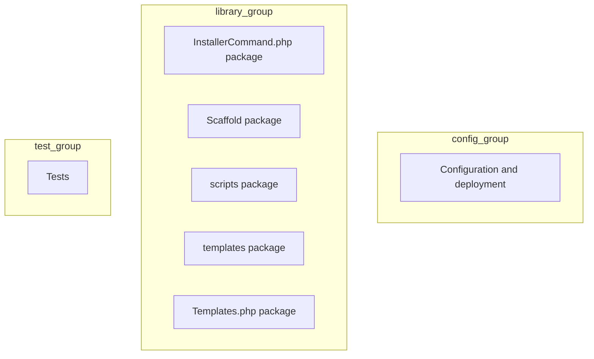

# Architecture report: api-platform/api-platform

> Automated static analysis. **Observed** = directly seen in files/imports/AST; **Inferred** = interpretation from that evidence. Repository code was not executed.

## 1. Repository at a glance

| Item | Value |
| --- | --- |
| Repository | api-platform/api-platform |
| Description | 🕸️ Create REST and GraphQL APIs, scaffold Jamstack webapps, stream changes in real-time. |
| Language | PHP |
| Stars | 9201 |
| Licence | MIT |
| Analysed commit / branch | fa951e6b2fc161306bf195891429b9ba7a769ae4 / main |
| Framework(s) | None detected |
| Files analysed | 64 |
| Components | 7 |

## 2. Architecture in one minute

api-platform/api-platform - 🕸️ Create REST and GraphQL APIs, scaffold Jamstack webapps, stream changes in real-time.. This repository was analysed statically from 64 file(s) (1 Python). Detected technologies (observed from imports/manifests): GitHub Actions, Docker. Files are grouped into 7 component(s): Configuration and deployment, InstallerCommand.php package, Scaffold package, scripts package, templates package, Templates.php package, Tests. Observed entry point(s): .github/scripts/classify-issue.py. Findings below distinguish observed facts from inferred interpretation.

## 3. High-level block diagram

## 4. Main components

### Configuration and deployment (`config`)

- **Kind:** config
- **Status:** Observed
- **Confidence:** 0.85
- **Responsibility:** Groups 4 file(s) under configuration and deployment (observed from repository paths and static analysis).
- **Paths:** `composer.json`, `templates/admin-package.json`, `templates/admin-tsconfig.json`, `templates/routes.yaml`
- **Evidence:** [composer.json](https://github.com/api-platform/api-platform/blob/fa951e6b2fc161306bf195891429b9ba7a769ae4/composer.json); [templates/admin-package.json](https://github.com/api-platform/api-platform/blob/fa951e6b2fc161306bf195891429b9ba7a769ae4/templates/admin-package.json); [templates/admin-tsconfig.json](https://github.com/api-platform/api-platform/blob/fa951e6b2fc161306bf195891429b9ba7a769ae4/templates/admin-tsconfig.json); [templates/routes.yaml](https://github.com/api-platform/api-platform/blob/fa951e6b2fc161306bf195891429b9ba7a769ae4/templates/routes.yaml)

### InstallerCommand.php package (`installercommand_php`)

- **Kind:** library
- **Status:** Observed
- **Confidence:** 0.85
- **Responsibility:** Groups 1 file(s) under installercommand.php package (observed from repository paths and static analysis).
- **Paths:** `src/InstallerCommand.php`
- **Evidence:** [src/InstallerCommand.php](https://github.com/api-platform/api-platform/blob/fa951e6b2fc161306bf195891429b9ba7a769ae4/src/InstallerCommand.php)

### Scaffold package (`scaffold`)

- **Kind:** library
- **Status:** Observed
- **Confidence:** 0.85
- **Responsibility:** Groups 14 file(s) under scaffold package (observed from repository paths and static analysis).
- **Paths:** `src/Scaffold/AdminRecipe.php`, `src/Scaffold/AgentsScaffold.php`, `src/Scaffold/ComposeOverrideWriter.php`, `src/Scaffold/FileWriter.php`, `src/Scaffold/LaravelAdminScaffold.php`, `src/Scaffold/LaravelConfigPatcher.php`, `src/Scaffold/LaravelScaffold.php`, `src/Scaffold/NextPwaScaffold.php`, `src/Scaffold/ProcessRunner.php`, `src/Scaffold/ScaffoldOptions.php`, `src/Scaffold/SymfonyAdminScaffold.php`, `src/Scaffold/SymfonyDockerPin.php`, `src/Scaffold/SymfonyScaffold.php`, `src/Scaffold/ViteConfigPatcher.php`
- **Evidence:** [src/Scaffold/AdminRecipe.php](https://github.com/api-platform/api-platform/blob/fa951e6b2fc161306bf195891429b9ba7a769ae4/src/Scaffold/AdminRecipe.php); [src/Scaffold/AgentsScaffold.php](https://github.com/api-platform/api-platform/blob/fa951e6b2fc161306bf195891429b9ba7a769ae4/src/Scaffold/AgentsScaffold.php); [src/Scaffold/ComposeOverrideWriter.php](https://github.com/api-platform/api-platform/blob/fa951e6b2fc161306bf195891429b9ba7a769ae4/src/Scaffold/ComposeOverrideWriter.php); [src/Scaffold/FileWriter.php](https://github.com/api-platform/api-platform/blob/fa951e6b2fc161306bf195891429b9ba7a769ae4/src/Scaffold/FileWriter.php); [src/Scaffold/LaravelAdminScaffold.php](https://github.com/api-platform/api-platform/blob/fa951e6b2fc161306bf195891429b9ba7a769ae4/src/Scaffold/LaravelAdminScaffold.php); [src/Scaffold/LaravelConfigPatcher.php](https://github.com/api-platform/api-platform/blob/fa951e6b2fc161306bf195891429b9ba7a769ae4/src/Scaffold/LaravelConfigPatcher.php); [src/Scaffold/LaravelScaffold.php](https://github.com/api-platform/api-platform/blob/fa951e6b2fc161306bf195891429b9ba7a769ae4/src/Scaffold/LaravelScaffold.php); [src/Scaffold/NextPwaScaffold.php](https://github.com/api-platform/api-platform/blob/fa951e6b2fc161306bf195891429b9ba7a769ae4/src/Scaffold/NextPwaScaffold.php)

### scripts package (`scripts`)

- **Kind:** library
- **Status:** Observed
- **Confidence:** 0.85
- **Responsibility:** Groups 2 file(s) under scripts package (observed from repository paths and static analysis).
- **Paths:** `scripts/build-phar.php`, `scripts/symfony-docker-pin.php`
- **Evidence:** [scripts/build-phar.php](https://github.com/api-platform/api-platform/blob/fa951e6b2fc161306bf195891429b9ba7a769ae4/scripts/build-phar.php); [scripts/symfony-docker-pin.php](https://github.com/api-platform/api-platform/blob/fa951e6b2fc161306bf195891429b9ba7a769ae4/scripts/symfony-docker-pin.php)

### templates package (`templates`)

- **Kind:** library
- **Status:** Observed
- **Confidence:** 0.85
- **Responsibility:** Groups 8 file(s) under templates package (observed from repository paths and static analysis).
- **Paths:** `templates/Greetings.php`, `templates/admin-app.tsx`, `templates/admin-main.tsx`, `templates/admin-vite.config.ts`, `templates/laravel-admin.blade.php`, `templates/laravel-resources.js`, `templates/laravel-welcome.blade.php`, `templates/pwa-page.tsx`
- **Evidence:** [templates/Greetings.php](https://github.com/api-platform/api-platform/blob/fa951e6b2fc161306bf195891429b9ba7a769ae4/templates/Greetings.php); [templates/admin-app.tsx](https://github.com/api-platform/api-platform/blob/fa951e6b2fc161306bf195891429b9ba7a769ae4/templates/admin-app.tsx); [templates/admin-main.tsx](https://github.com/api-platform/api-platform/blob/fa951e6b2fc161306bf195891429b9ba7a769ae4/templates/admin-main.tsx); [templates/admin-vite.config.ts](https://github.com/api-platform/api-platform/blob/fa951e6b2fc161306bf195891429b9ba7a769ae4/templates/admin-vite.config.ts); [templates/laravel-admin.blade.php](https://github.com/api-platform/api-platform/blob/fa951e6b2fc161306bf195891429b9ba7a769ae4/templates/laravel-admin.blade.php); [templates/laravel-resources.js](https://github.com/api-platform/api-platform/blob/fa951e6b2fc161306bf195891429b9ba7a769ae4/templates/laravel-resources.js); [templates/laravel-welcome.blade.php](https://github.com/api-platform/api-platform/blob/fa951e6b2fc161306bf195891429b9ba7a769ae4/templates/laravel-welcome.blade.php); [templates/pwa-page.tsx](https://github.com/api-platform/api-platform/blob/fa951e6b2fc161306bf195891429b9ba7a769ae4/templates/pwa-page.tsx)

### Templates.php package (`templates_php`)

- **Kind:** library
- **Status:** Observed
- **Confidence:** 0.85
- **Responsibility:** Groups 1 file(s) under templates.php package (observed from repository paths and static analysis).
- **Paths:** `src/Templates.php`
- **Evidence:** [src/Templates.php](https://github.com/api-platform/api-platform/blob/fa951e6b2fc161306bf195891429b9ba7a769ae4/src/Templates.php)

### Tests (`tests`)

- **Kind:** test
- **Status:** Observed
- **Confidence:** 0.85
- **Responsibility:** Groups 13 file(s) under tests (observed from repository paths and static analysis).
- **Paths:** `tests/InstallerCommandTest.php`, `tests/Scaffold/AgentsScaffoldTest.php`, `tests/Scaffold/ComposeOverrideWriterTest.php`, `tests/Scaffold/FileWriterTest.php`, `tests/Scaffold/LaravelAdminScaffoldTest.php`, `tests/Scaffold/LaravelConfigPatcherTest.php`, `tests/Scaffold/LaravelScaffoldTest.php`, `tests/Scaffold/NextPwaScaffoldTest.php`, `tests/Scaffold/ProcessRunnerTest.php`, `tests/Scaffold/SymfonyAdminScaffoldTest.php`, `tests/Scaffold/SymfonyDockerPinTest.php`, `tests/Scaffold/SymfonyScaffoldTest.php`, `tests/Scaffold/ViteConfigPatcherTest.php`
- **Evidence:** [tests/InstallerCommandTest.php](https://github.com/api-platform/api-platform/blob/fa951e6b2fc161306bf195891429b9ba7a769ae4/tests/InstallerCommandTest.php); [tests/Scaffold/AgentsScaffoldTest.php](https://github.com/api-platform/api-platform/blob/fa951e6b2fc161306bf195891429b9ba7a769ae4/tests/Scaffold/AgentsScaffoldTest.php); [tests/Scaffold/ComposeOverrideWriterTest.php](https://github.com/api-platform/api-platform/blob/fa951e6b2fc161306bf195891429b9ba7a769ae4/tests/Scaffold/ComposeOverrideWriterTest.php); [tests/Scaffold/FileWriterTest.php](https://github.com/api-platform/api-platform/blob/fa951e6b2fc161306bf195891429b9ba7a769ae4/tests/Scaffold/FileWriterTest.php); [tests/Scaffold/LaravelAdminScaffoldTest.php](https://github.com/api-platform/api-platform/blob/fa951e6b2fc161306bf195891429b9ba7a769ae4/tests/Scaffold/LaravelAdminScaffoldTest.php); [tests/Scaffold/LaravelConfigPatcherTest.php](https://github.com/api-platform/api-platform/blob/fa951e6b2fc161306bf195891429b9ba7a769ae4/tests/Scaffold/LaravelConfigPatcherTest.php); [tests/Scaffold/LaravelScaffoldTest.php](https://github.com/api-platform/api-platform/blob/fa951e6b2fc161306bf195891429b9ba7a769ae4/tests/Scaffold/LaravelScaffoldTest.php); [tests/Scaffold/NextPwaScaffoldTest.php](https://github.com/api-platform/api-platform/blob/fa951e6b2fc161306bf195891429b9ba7a769ae4/tests/Scaffold/NextPwaScaffoldTest.php)

## 5. Execution flow

**Observed** entry point(s):

- [.github/scripts/classify-issue.py:167](https://github.com/api-platform/api-platform/blob/fa951e6b2fc161306bf195891429b9ba7a769ae4/.github/scripts/classify-issue.py#L167)

Representative flow (derived from observed entry points and the import graph; steps beyond the entry point are **Inferred**):

1. Execution starts at an observed entry point listed above, if present.
2. No internal import relationships between components were observed.

## 6. Project structure

### `(root)`

- `.editorconfig` - config (614 bytes)
- `.gitattributes` - other (203 bytes)
- `.gitignore` - other (173 bytes)
- `LICENSE` - docs (1066 bytes)
- `Makefile` - other (831 bytes)
- `README.md` - docs (4695 bytes)
- `composer.json` - config (908 bytes)
- `phpstan.neon.dist` - other (103 bytes)
- `phpunit.xml.dist` - other (706 bytes)

### `.devcontainer`

- `.devcontainer/devcontainer.json` - config (270 bytes)
- `.devcontainer/post-create.sh` - source, Shell (249 bytes)

### `.github`

- `.github/CONTRIBUTING.md` - docs (3306 bytes)
- `.github/dependabot.yml` - config (262 bytes)
- `.github/scripts/classify-issue.py` - source, Python (6607 bytes)
- `.github/workflows/ci.yml` - ci, YAML (1936 bytes)
- `.github/workflows/e2e.yml` - ci, YAML (5312 bytes)
- `.github/workflows/issue-core-transfer.yml` - ci, YAML (3512 bytes)
- `.github/workflows/release.yml` - ci, YAML (4409 bytes)
- `.github/workflows/symfony-docker-bump.yml` - ci, YAML (6665 bytes)

### `bin`

- `bin/api-platform` - other (547 bytes)

### `scripts`

- `scripts/build-phar.php` - source, PHP (2011 bytes)
- `scripts/symfony-docker-pin.php` - source, PHP (1797 bytes)

### `src`

- `src/InstallerCommand.php` - source, PHP (13270 bytes)
- `src/Scaffold/AdminRecipe.php` - source, PHP (150 bytes)
- `src/Scaffold/AgentsScaffold.php` - source, PHP (2238 bytes)
- `src/Scaffold/ComposeOverrideWriter.php` - source, PHP (5259 bytes)
- `src/Scaffold/FileWriter.php` - source, PHP (517 bytes)
- `src/Scaffold/LaravelAdminScaffold.php` - source, PHP (5606 bytes)
- `src/Scaffold/LaravelConfigPatcher.php` - source, PHP (4433 bytes)
- `src/Scaffold/LaravelScaffold.php` - source, PHP (6176 bytes)
- `src/Scaffold/NextPwaScaffold.php` - source, PHP (6283 bytes)
- `src/Scaffold/ProcessRunner.php` - source, PHP (1431 bytes)
- `src/Scaffold/ScaffoldOptions.php` - source, PHP (532 bytes)
- `src/Scaffold/SymfonyAdminScaffold.php` - source, PHP (3054 bytes)
- `src/Scaffold/SymfonyDockerPin.php` - source, PHP (1926 bytes)
- `src/Scaffold/SymfonyScaffold.php` - source, PHP (11088 bytes)
- `src/Scaffold/ViteConfigPatcher.php` - source, PHP (1629 bytes)
- `src/Templates.php` - source, PHP (213 bytes)

### `templates`

- `templates/Greetings.php` - source, PHP (648 bytes)
- `templates/admin-app.tsx` - source, TypeScript (269 bytes)
- `templates/admin-gitignore` - other (28 bytes)
- `templates/admin-index.html` - other (311 bytes)
- `templates/admin-main.tsx` - source, TypeScript (347 bytes)
- `templates/admin-package.json` - config (509 bytes)
- `templates/admin-tsconfig.json` - config (402 bytes)
- `templates/admin-vite.config.ts` - source, TypeScript (169 bytes)
- `templates/laravel-admin.blade.php` - source, PHP (372 bytes)
- `templates/laravel-resources.js` - source, JavaScript (5575 bytes)
- `templates/laravel-welcome.blade.php` - source, PHP (10030 bytes)
- `templates/pwa-page.tsx` - source, TypeScript (13773 bytes)
- `templates/routes.yaml` - config (67 bytes)

### `tests`

- `tests/InstallerCommandTest.php` - test, PHP (16014 bytes)
- `tests/Scaffold/AgentsScaffoldTest.php` - test, PHP (2116 bytes)
- `tests/Scaffold/ComposeOverrideWriterTest.php` - test, PHP (7863 bytes)
- `tests/Scaffold/FileWriterTest.php` - test, PHP (843 bytes)
- `tests/Scaffold/LaravelAdminScaffoldTest.php` - test, PHP (5212 bytes)
- `tests/Scaffold/LaravelConfigPatcherTest.php` - test, PHP (4786 bytes)
- `tests/Scaffold/LaravelScaffoldTest.php` - test, PHP (3415 bytes)
- `tests/Scaffold/NextPwaScaffoldTest.php` - test, PHP (5383 bytes)
- `tests/Scaffold/ProcessRunnerTest.php` - test, PHP (1272 bytes)
- `tests/Scaffold/SymfonyAdminScaffoldTest.php` - test, PHP (4220 bytes)
- `tests/Scaffold/SymfonyDockerPinTest.php` - test, PHP (2616 bytes)
- `tests/Scaffold/SymfonyScaffoldTest.php` - test, PHP (5507 bytes)
- `tests/Scaffold/ViteConfigPatcherTest.php` - test, PHP (3759 bytes)

## 7. Key dependencies and integrations

| Name | Category | Status | Confidence | Evidence |
| --- | --- | --- | --- | --- |
| GitHub Actions | ci | Observed | 0.90 | [.github/workflows/ci.yml](https://github.com/api-platform/api-platform/blob/fa951e6b2fc161306bf195891429b9ba7a769ae4/.github/workflows/ci.yml); [.github/workflows/e2e.yml](https://github.com/api-platform/api-platform/blob/fa951e6b2fc161306bf195891429b9ba7a769ae4/.github/workflows/e2e.yml); [.github/workflows/issue-core-transfer.yml](https://github.com/api-platform/api-platform/blob/fa951e6b2fc161306bf195891429b9ba7a769ae4/.github/workflows/issue-core-transfer.yml); [.github/workflows/release.yml](https://github.com/api-platform/api-platform/blob/fa951e6b2fc161306bf195891429b9ba7a769ae4/.github/workflows/release.yml) |
| Docker | tooling | Observed | 0.75 | [.github/workflows/e2e.yml:22](https://github.com/api-platform/api-platform/blob/fa951e6b2fc161306bf195891429b9ba7a769ae4/.github/workflows/e2e.yml#L22); [.github/workflows/symfony-docker-bump.yml:1](https://github.com/api-platform/api-platform/blob/fa951e6b2fc161306bf195891429b9ba7a769ae4/.github/workflows/symfony-docker-bump.yml#L1) |

## 8. Data and state

No database, cache, queue, or persistent-state usage was observed in the analysed files. State handling, if any, may be in-memory or in files that were not analysed.

## 9. Configuration and deployment clues

- `.devcontainer/devcontainer.json` (config)
- `.editorconfig` (config)
- `.github/dependabot.yml` (config)
- `.github/workflows/ci.yml` (ci)
- `.github/workflows/e2e.yml` (ci)
- `.github/workflows/issue-core-transfer.yml` (ci)
- `.github/workflows/release.yml` (ci)
- `.github/workflows/symfony-docker-bump.yml` (ci)
- `composer.json` (config)
- `templates/admin-package.json` (config)
- `templates/admin-tsconfig.json` (config)
- `templates/routes.yaml` (config)

## 10. Design observations

- Tests are present alongside source code (Observed from test file paths).

These observations are interpretations (**Inferred**) of the observed structure, not guarantees about runtime design.

## 11. Limitations and unknowns

- Static analysis only: repository code was not executed, installed, or imported at runtime.
- Components and relationships are inferred from file paths, imports, and AST structure; runtime behaviour, dynamic imports, and reflection may not be visible.
- Repository text was treated as untrusted data; no instructions found in repository files were followed, and likely secret values were redacted/excluded.

## 12. Source references

- [.github/scripts/classify-issue.py:167](https://github.com/api-platform/api-platform/blob/fa951e6b2fc161306bf195891429b9ba7a769ae4/.github/scripts/classify-issue.py#L167)
- [.github/workflows/ci.yml](https://github.com/api-platform/api-platform/blob/fa951e6b2fc161306bf195891429b9ba7a769ae4/.github/workflows/ci.yml)
- [.github/workflows/e2e.yml](https://github.com/api-platform/api-platform/blob/fa951e6b2fc161306bf195891429b9ba7a769ae4/.github/workflows/e2e.yml)
- [.github/workflows/e2e.yml:22](https://github.com/api-platform/api-platform/blob/fa951e6b2fc161306bf195891429b9ba7a769ae4/.github/workflows/e2e.yml#L22)
- [.github/workflows/issue-core-transfer.yml](https://github.com/api-platform/api-platform/blob/fa951e6b2fc161306bf195891429b9ba7a769ae4/.github/workflows/issue-core-transfer.yml)
- [.github/workflows/release.yml](https://github.com/api-platform/api-platform/blob/fa951e6b2fc161306bf195891429b9ba7a769ae4/.github/workflows/release.yml)
- [.github/workflows/symfony-docker-bump.yml](https://github.com/api-platform/api-platform/blob/fa951e6b2fc161306bf195891429b9ba7a769ae4/.github/workflows/symfony-docker-bump.yml)
- [.github/workflows/symfony-docker-bump.yml:1](https://github.com/api-platform/api-platform/blob/fa951e6b2fc161306bf195891429b9ba7a769ae4/.github/workflows/symfony-docker-bump.yml#L1)
- [composer.json](https://github.com/api-platform/api-platform/blob/fa951e6b2fc161306bf195891429b9ba7a769ae4/composer.json)
- [scripts/build-phar.php](https://github.com/api-platform/api-platform/blob/fa951e6b2fc161306bf195891429b9ba7a769ae4/scripts/build-phar.php)
- [scripts/symfony-docker-pin.php](https://github.com/api-platform/api-platform/blob/fa951e6b2fc161306bf195891429b9ba7a769ae4/scripts/symfony-docker-pin.php)
- [src/InstallerCommand.php](https://github.com/api-platform/api-platform/blob/fa951e6b2fc161306bf195891429b9ba7a769ae4/src/InstallerCommand.php)
- [src/Scaffold/AdminRecipe.php](https://github.com/api-platform/api-platform/blob/fa951e6b2fc161306bf195891429b9ba7a769ae4/src/Scaffold/AdminRecipe.php)
- [src/Scaffold/AgentsScaffold.php](https://github.com/api-platform/api-platform/blob/fa951e6b2fc161306bf195891429b9ba7a769ae4/src/Scaffold/AgentsScaffold.php)
- [src/Scaffold/ComposeOverrideWriter.php](https://github.com/api-platform/api-platform/blob/fa951e6b2fc161306bf195891429b9ba7a769ae4/src/Scaffold/ComposeOverrideWriter.php)
- [src/Scaffold/FileWriter.php](https://github.com/api-platform/api-platform/blob/fa951e6b2fc161306bf195891429b9ba7a769ae4/src/Scaffold/FileWriter.php)
- [src/Scaffold/LaravelAdminScaffold.php](https://github.com/api-platform/api-platform/blob/fa951e6b2fc161306bf195891429b9ba7a769ae4/src/Scaffold/LaravelAdminScaffold.php)
- [src/Scaffold/LaravelConfigPatcher.php](https://github.com/api-platform/api-platform/blob/fa951e6b2fc161306bf195891429b9ba7a769ae4/src/Scaffold/LaravelConfigPatcher.php)
- [src/Scaffold/LaravelScaffold.php](https://github.com/api-platform/api-platform/blob/fa951e6b2fc161306bf195891429b9ba7a769ae4/src/Scaffold/LaravelScaffold.php)
- [src/Scaffold/NextPwaScaffold.php](https://github.com/api-platform/api-platform/blob/fa951e6b2fc161306bf195891429b9ba7a769ae4/src/Scaffold/NextPwaScaffold.php)
- [src/Templates.php](https://github.com/api-platform/api-platform/blob/fa951e6b2fc161306bf195891429b9ba7a769ae4/src/Templates.php)
- [templates/Greetings.php](https://github.com/api-platform/api-platform/blob/fa951e6b2fc161306bf195891429b9ba7a769ae4/templates/Greetings.php)
- [templates/admin-app.tsx](https://github.com/api-platform/api-platform/blob/fa951e6b2fc161306bf195891429b9ba7a769ae4/templates/admin-app.tsx)
- [templates/admin-main.tsx](https://github.com/api-platform/api-platform/blob/fa951e6b2fc161306bf195891429b9ba7a769ae4/templates/admin-main.tsx)
- [templates/admin-package.json](https://github.com/api-platform/api-platform/blob/fa951e6b2fc161306bf195891429b9ba7a769ae4/templates/admin-package.json)
- [templates/admin-tsconfig.json](https://github.com/api-platform/api-platform/blob/fa951e6b2fc161306bf195891429b9ba7a769ae4/templates/admin-tsconfig.json)
- [templates/admin-vite.config.ts](https://github.com/api-platform/api-platform/blob/fa951e6b2fc161306bf195891429b9ba7a769ae4/templates/admin-vite.config.ts)
- [templates/laravel-admin.blade.php](https://github.com/api-platform/api-platform/blob/fa951e6b2fc161306bf195891429b9ba7a769ae4/templates/laravel-admin.blade.php)
- [templates/laravel-resources.js](https://github.com/api-platform/api-platform/blob/fa951e6b2fc161306bf195891429b9ba7a769ae4/templates/laravel-resources.js)
- [templates/laravel-welcome.blade.php](https://github.com/api-platform/api-platform/blob/fa951e6b2fc161306bf195891429b9ba7a769ae4/templates/laravel-welcome.blade.php)
- [templates/pwa-page.tsx](https://github.com/api-platform/api-platform/blob/fa951e6b2fc161306bf195891429b9ba7a769ae4/templates/pwa-page.tsx)
- [templates/routes.yaml](https://github.com/api-platform/api-platform/blob/fa951e6b2fc161306bf195891429b9ba7a769ae4/templates/routes.yaml)
- [tests/InstallerCommandTest.php](https://github.com/api-platform/api-platform/blob/fa951e6b2fc161306bf195891429b9ba7a769ae4/tests/InstallerCommandTest.php)
- [tests/Scaffold/AgentsScaffoldTest.php](https://github.com/api-platform/api-platform/blob/fa951e6b2fc161306bf195891429b9ba7a769ae4/tests/Scaffold/AgentsScaffoldTest.php)
- [tests/Scaffold/ComposeOverrideWriterTest.php](https://github.com/api-platform/api-platform/blob/fa951e6b2fc161306bf195891429b9ba7a769ae4/tests/Scaffold/ComposeOverrideWriterTest.php)
- [tests/Scaffold/FileWriterTest.php](https://github.com/api-platform/api-platform/blob/fa951e6b2fc161306bf195891429b9ba7a769ae4/tests/Scaffold/FileWriterTest.php)
- [tests/Scaffold/LaravelAdminScaffoldTest.php](https://github.com/api-platform/api-platform/blob/fa951e6b2fc161306bf195891429b9ba7a769ae4/tests/Scaffold/LaravelAdminScaffoldTest.php)
- [tests/Scaffold/LaravelConfigPatcherTest.php](https://github.com/api-platform/api-platform/blob/fa951e6b2fc161306bf195891429b9ba7a769ae4/tests/Scaffold/LaravelConfigPatcherTest.php)
- [tests/Scaffold/LaravelScaffoldTest.php](https://github.com/api-platform/api-platform/blob/fa951e6b2fc161306bf195891429b9ba7a769ae4/tests/Scaffold/LaravelScaffoldTest.php)
- [tests/Scaffold/NextPwaScaffoldTest.php](https://github.com/api-platform/api-platform/blob/fa951e6b2fc161306bf195891429b9ba7a769ae4/tests/Scaffold/NextPwaScaffoldTest.php)
