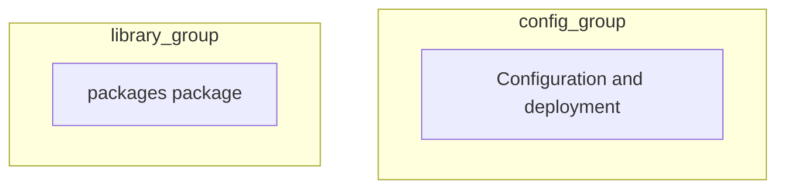

# Architecture report: apollographql/react-apollo

> Automated static analysis. **Observed** = directly seen in files/imports/AST; **Inferred** = interpretation from that evidence. Repository code was not executed.

## 1. Repository at a glance

| Item | Value |
| --- | --- |
| Repository | apollographql/react-apollo |
| Description | :recycle: React integration for Apollo Client |
| Language | JavaScript |
| Stars | 6789 |
| Licence | MIT |
| Analysed commit / branch | 70e692dbf421b3c4c4ed106e3fcb54a5a27c2cc3 / master |
| Framework(s) | None detected |
| Files analysed | 39 |
| Components | 2 |

## 2. Architecture in one minute

apollographql/react-apollo - :recycle: React integration for Apollo Client. This repository was analysed statically from 39 file(s) (0 Python). Detected technologies (observed from imports/manifests): TypeScript. Files are grouped into 2 component(s): Configuration and deployment, packages package. Findings below distinguish observed facts from inferred interpretation.

## 3. High-level block diagram

## 4. Main components

### Configuration and deployment (`config`)

- **Kind:** config
- **Status:** Observed
- **Confidence:** 0.85
- **Responsibility:** Groups 8 file(s) under configuration and deployment (observed from repository paths and static analysis).
- **Paths:** `lerna.json`, `package.json`, `packages/components/package.json`, `packages/hoc/package.json`, `packages/hooks/package.json`, `packages/ssr/package.json`, `packages/testing/package.json`, `tsconfig.json`
- **Evidence:** [lerna.json](https://github.com/apollographql/react-apollo/blob/70e692dbf421b3c4c4ed106e3fcb54a5a27c2cc3/lerna.json); [package.json](https://github.com/apollographql/react-apollo/blob/70e692dbf421b3c4c4ed106e3fcb54a5a27c2cc3/package.json); [packages/components/package.json](https://github.com/apollographql/react-apollo/blob/70e692dbf421b3c4c4ed106e3fcb54a5a27c2cc3/packages/components/package.json); [packages/hoc/package.json](https://github.com/apollographql/react-apollo/blob/70e692dbf421b3c4c4ed106e3fcb54a5a27c2cc3/packages/hoc/package.json); [packages/hooks/package.json](https://github.com/apollographql/react-apollo/blob/70e692dbf421b3c4c4ed106e3fcb54a5a27c2cc3/packages/hooks/package.json); [packages/ssr/package.json](https://github.com/apollographql/react-apollo/blob/70e692dbf421b3c4c4ed106e3fcb54a5a27c2cc3/packages/ssr/package.json); [packages/testing/package.json](https://github.com/apollographql/react-apollo/blob/70e692dbf421b3c4c4ed106e3fcb54a5a27c2cc3/packages/testing/package.json); [tsconfig.json](https://github.com/apollographql/react-apollo/blob/70e692dbf421b3c4c4ed106e3fcb54a5a27c2cc3/tsconfig.json)

### packages package (`packages`)

- **Kind:** library
- **Status:** Observed
- **Confidence:** 0.85
- **Responsibility:** Groups 14 file(s) under packages package (observed from repository paths and static analysis).
- **Paths:** `packages/components/index.d.ts`, `packages/components/index.esm.js`, `packages/components/index.js`, `packages/hoc/index.d.ts`, `packages/hoc/index.esm.js`, `packages/hoc/index.js`, `packages/hooks/index.d.ts`, `packages/hooks/index.esm.js`, `packages/hooks/index.js`, `packages/ssr/index.d.ts`, `packages/ssr/index.esm.js`, `packages/ssr/index.js`, `packages/testing/index.d.ts`, `packages/testing/index.js`
- **Evidence:** [packages/components/index.d.ts](https://github.com/apollographql/react-apollo/blob/70e692dbf421b3c4c4ed106e3fcb54a5a27c2cc3/packages/components/index.d.ts); [packages/components/index.esm.js](https://github.com/apollographql/react-apollo/blob/70e692dbf421b3c4c4ed106e3fcb54a5a27c2cc3/packages/components/index.esm.js); [packages/components/index.js](https://github.com/apollographql/react-apollo/blob/70e692dbf421b3c4c4ed106e3fcb54a5a27c2cc3/packages/components/index.js); [packages/hoc/index.d.ts](https://github.com/apollographql/react-apollo/blob/70e692dbf421b3c4c4ed106e3fcb54a5a27c2cc3/packages/hoc/index.d.ts); [packages/hoc/index.esm.js](https://github.com/apollographql/react-apollo/blob/70e692dbf421b3c4c4ed106e3fcb54a5a27c2cc3/packages/hoc/index.esm.js); [packages/hoc/index.js](https://github.com/apollographql/react-apollo/blob/70e692dbf421b3c4c4ed106e3fcb54a5a27c2cc3/packages/hoc/index.js); [packages/hooks/index.d.ts](https://github.com/apollographql/react-apollo/blob/70e692dbf421b3c4c4ed106e3fcb54a5a27c2cc3/packages/hooks/index.d.ts); [packages/hooks/index.esm.js](https://github.com/apollographql/react-apollo/blob/70e692dbf421b3c4c4ed106e3fcb54a5a27c2cc3/packages/hooks/index.esm.js)

## 5. Execution flow

**Observed** entry point(s):

- [packages/components/index.js](https://github.com/apollographql/react-apollo/blob/70e692dbf421b3c4c4ed106e3fcb54a5a27c2cc3/packages/components/index.js)
- [packages/hoc/index.js](https://github.com/apollographql/react-apollo/blob/70e692dbf421b3c4c4ed106e3fcb54a5a27c2cc3/packages/hoc/index.js)
- [packages/hooks/index.js](https://github.com/apollographql/react-apollo/blob/70e692dbf421b3c4c4ed106e3fcb54a5a27c2cc3/packages/hooks/index.js)
- [packages/ssr/index.js](https://github.com/apollographql/react-apollo/blob/70e692dbf421b3c4c4ed106e3fcb54a5a27c2cc3/packages/ssr/index.js)
- [packages/testing/index.js](https://github.com/apollographql/react-apollo/blob/70e692dbf421b3c4c4ed106e3fcb54a5a27c2cc3/packages/testing/index.js)

Representative flow (derived from observed entry points and the import graph; steps beyond the entry point are **Inferred**):

1. Execution starts at an observed entry point listed above, if present.
2. No internal import relationships between components were observed.

## 6. Project structure

### `(root)`

- `.gitignore` - other (103 bytes)
- `.gitleaks.toml` - config (167 bytes)
- `COLLABORATORS.md` - docs (2083 bytes)
- `CONTRIBUTING.md` - docs (8750 bytes)
- `Changelog.md` - docs (75632 bytes)
- `LICENSE` - docs (1098 bytes)
- `README.md` - docs (2348 bytes)
- `lerna.json` - config (61 bytes)
- `package.json` - manifest (795 bytes)
- `tsconfig.json` - config (523 bytes)

### `.github`

- `.github/ISSUE_TEMPLATE/bug.md` - docs (1961 bytes)
- `.github/ISSUE_TEMPLATE/feature-request.md` - docs (410 bytes)
- `.github/ISSUE_TEMPLATE/question-discussion.md` - docs (513 bytes)
- `.github/PULL_REQUEST_TEMPLATE.md` - docs (1143 bytes)

### `.vscode`

- `.vscode/settings.json` - config (65 bytes)

### `packages`

- `packages/components/README.md` - docs (1111 bytes)
- `packages/components/index.d.ts` - source, TypeScript (81 bytes)
- `packages/components/index.esm.js` - source, JavaScript (81 bytes)
- `packages/components/index.js` - source, JavaScript (103 bytes)
- `packages/components/package.json` - manifest (607 bytes)
- `packages/hoc/README.md` - docs (1066 bytes)
- `packages/hoc/index.d.ts` - source, TypeScript (74 bytes)
- `packages/hoc/index.esm.js` - source, JavaScript (74 bytes)
- `packages/hoc/index.js` - source, JavaScript (96 bytes)
- `packages/hoc/package.json` - manifest (582 bytes)
- `packages/hooks/README.md` - docs (1130 bytes)
- `packages/hooks/index.d.ts` - source, TypeScript (32 bytes)
- `packages/hooks/index.esm.js` - source, JavaScript (32 bytes)
- `packages/hooks/index.js` - source, JavaScript (44 bytes)
- `packages/hooks/package.json` - manifest (559 bytes)
- `packages/ssr/README.md` - docs (1083 bytes)
- `packages/ssr/index.d.ts` - source, TypeScript (42 bytes)
- `packages/ssr/index.esm.js` - source, JavaScript (42 bytes)
- `packages/ssr/index.js` - source, JavaScript (54 bytes)
- `packages/ssr/package.json` - manifest (609 bytes)
- `packages/testing/README.md` - docs (1067 bytes)
- `packages/testing/index.d.ts` - source, TypeScript (40 bytes)
- `packages/testing/index.js` - source, JavaScript (52 bytes)
- `packages/testing/package.json` - manifest (547 bytes)

## 7. Key dependencies and integrations

| Name | Category | Status | Confidence | Evidence |
| --- | --- | --- | --- | --- |
| TypeScript | tooling | Observed | 0.85 | [package.json:21](https://github.com/apollographql/react-apollo/blob/70e692dbf421b3c4c4ed106e3fcb54a5a27c2cc3/package.json#L21) |

## 8. Data and state

No database, cache, queue, or persistent-state usage was observed in the analysed files. State handling, if any, may be in-memory or in files that were not analysed.

## 9. Configuration and deployment clues

- `.gitleaks.toml` (config)
- `.vscode/settings.json` (config)
- `lerna.json` (config)
- `package.json` (manifest)
- `packages/components/package.json` (manifest)
- `packages/hoc/package.json` (manifest)
- `packages/hooks/package.json` (manifest)
- `packages/ssr/package.json` (manifest)
- `packages/testing/package.json` (manifest)
- `tsconfig.json` (config)

## 10. Design observations

- No strong design patterns could be established from the available evidence.

These observations are interpretations (**Inferred**) of the observed structure, not guarantees about runtime design.

## 11. Limitations and unknowns

- Static analysis only: repository code was not executed, installed, or imported at runtime.
- Components and relationships are inferred from file paths, imports, and AST structure; runtime behaviour, dynamic imports, and reflection may not be visible.
- 1 file(s) were skipped during inventory (1 x lockfile excluded).
- No clear application entry point was observed in the analysed files.
- Repository text was treated as untrusted data; no instructions found in repository files were followed, and likely secret values were redacted/excluded.
- JavaScript and TypeScript files were inventoried from paths and package manifests. They were not parsed with a full language AST, and repository code was not executed.
- The GitHub repository was marked archived at selection time.

## 12. Source references

- [lerna.json](https://github.com/apollographql/react-apollo/blob/70e692dbf421b3c4c4ed106e3fcb54a5a27c2cc3/lerna.json)
- [package.json](https://github.com/apollographql/react-apollo/blob/70e692dbf421b3c4c4ed106e3fcb54a5a27c2cc3/package.json)
- [package.json:21](https://github.com/apollographql/react-apollo/blob/70e692dbf421b3c4c4ed106e3fcb54a5a27c2cc3/package.json#L21)
- [packages/components/index.d.ts](https://github.com/apollographql/react-apollo/blob/70e692dbf421b3c4c4ed106e3fcb54a5a27c2cc3/packages/components/index.d.ts)
- [packages/components/index.esm.js](https://github.com/apollographql/react-apollo/blob/70e692dbf421b3c4c4ed106e3fcb54a5a27c2cc3/packages/components/index.esm.js)
- [packages/components/index.js](https://github.com/apollographql/react-apollo/blob/70e692dbf421b3c4c4ed106e3fcb54a5a27c2cc3/packages/components/index.js)
- [packages/components/package.json](https://github.com/apollographql/react-apollo/blob/70e692dbf421b3c4c4ed106e3fcb54a5a27c2cc3/packages/components/package.json)
- [packages/hoc/index.d.ts](https://github.com/apollographql/react-apollo/blob/70e692dbf421b3c4c4ed106e3fcb54a5a27c2cc3/packages/hoc/index.d.ts)
- [packages/hoc/index.esm.js](https://github.com/apollographql/react-apollo/blob/70e692dbf421b3c4c4ed106e3fcb54a5a27c2cc3/packages/hoc/index.esm.js)
- [packages/hoc/index.js](https://github.com/apollographql/react-apollo/blob/70e692dbf421b3c4c4ed106e3fcb54a5a27c2cc3/packages/hoc/index.js)
- [packages/hoc/package.json](https://github.com/apollographql/react-apollo/blob/70e692dbf421b3c4c4ed106e3fcb54a5a27c2cc3/packages/hoc/package.json)
- [packages/hooks/index.d.ts](https://github.com/apollographql/react-apollo/blob/70e692dbf421b3c4c4ed106e3fcb54a5a27c2cc3/packages/hooks/index.d.ts)
- [packages/hooks/index.esm.js](https://github.com/apollographql/react-apollo/blob/70e692dbf421b3c4c4ed106e3fcb54a5a27c2cc3/packages/hooks/index.esm.js)
- [packages/hooks/index.js](https://github.com/apollographql/react-apollo/blob/70e692dbf421b3c4c4ed106e3fcb54a5a27c2cc3/packages/hooks/index.js)
- [packages/hooks/package.json](https://github.com/apollographql/react-apollo/blob/70e692dbf421b3c4c4ed106e3fcb54a5a27c2cc3/packages/hooks/package.json)
- [packages/ssr/index.js](https://github.com/apollographql/react-apollo/blob/70e692dbf421b3c4c4ed106e3fcb54a5a27c2cc3/packages/ssr/index.js)
- [packages/ssr/package.json](https://github.com/apollographql/react-apollo/blob/70e692dbf421b3c4c4ed106e3fcb54a5a27c2cc3/packages/ssr/package.json)
- [packages/testing/index.js](https://github.com/apollographql/react-apollo/blob/70e692dbf421b3c4c4ed106e3fcb54a5a27c2cc3/packages/testing/index.js)
- [packages/testing/package.json](https://github.com/apollographql/react-apollo/blob/70e692dbf421b3c4c4ed106e3fcb54a5a27c2cc3/packages/testing/package.json)
- [tsconfig.json](https://github.com/apollographql/react-apollo/blob/70e692dbf421b3c4c4ed106e3fcb54a5a27c2cc3/tsconfig.json)
