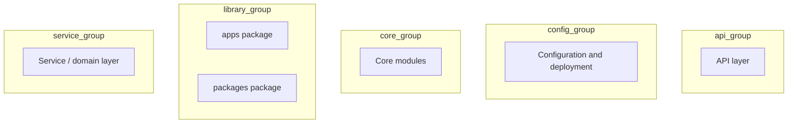

# Architecture report: arikchakma/maily.to

> Automated static analysis. **Observed** = directly seen in files/imports/AST; **Inferred** = interpretation from that evidence. Repository code was not executed.

## 1. Repository at a glance

| Item | Value |
| --- | --- |
| Repository | arikchakma/maily.to |
| Description | Craft beautiful emails effortlessly with Maily, the powerful email editor that ensures impeccable communication across all major clients. |
| Language | TypeScript |
| Stars | 4000 |
| Licence | MIT |
| Analysed commit / branch | 042d13169b39e0ae8c692a25693bebdbb9b894c0 / main |
| Framework(s) | React |
| Files analysed | 247 |
| Components | 6 |

## 2. Architecture in one minute

arikchakma/maily.to - Craft beautiful emails effortlessly with Maily, the powerful email editor that ensures impeccable communication across all major clients.. This repository was analysed statically from 247 file(s) (0 Python). Detected technologies (observed from imports/manifests): React, React Router, Tailwind CSS, TypeScript, Vite, Vitest. Files are grouped into 6 component(s): API layer, apps package, Configuration and deployment, Core modules, packages package, Service / domain layer. Findings below distinguish observed facts from inferred interpretation.

## 3. High-level block diagram

## 4. Main components

### API layer (`api_layer`)

- **Kind:** api
- **Status:** Observed
- **Confidence:** 0.85
- **Responsibility:** Groups 16 file(s) under api layer (observed from repository paths and static analysis).
- **Paths:** `apps/web/app/routes/_index.tsx`, `apps/web/app/routes/_skeleton.[_p].editor.tsx`, `apps/web/app/routes/api.v1.config.ts`, `apps/web/app/routes/api.v1.emails.preview.ts`, `apps/web/app/routes/api.v1.emails.send.ts`, `apps/web/app/routes/api.v1.templates.$templateId.duplicate.ts`, `apps/web/app/routes/api.v1.templates.$templateId.ts`, `apps/web/app/routes/api.v1.templates._index.ts`, `apps/web/app/routes/auth.callback.ts`, `apps/web/app/routes/auth.confirm.ts`, `apps/web/app/routes/auth.logout.ts`, `apps/web/app/routes/login.tsx`, `apps/web/app/routes/playground.tsx`, `apps/web/app/routes/templates.$templateId.tsx`, `apps/web/app/routes/templates._index.tsx`, `apps/web/app/routes/templates.tsx`
- **Evidence:** [apps/web/app/routes/_index.tsx](https://github.com/arikchakma/maily.to/blob/042d13169b39e0ae8c692a25693bebdbb9b894c0/apps/web/app/routes/_index.tsx); [apps/web/app/routes/_skeleton.[_p].editor.tsx](https://github.com/arikchakma/maily.to/blob/042d13169b39e0ae8c692a25693bebdbb9b894c0/apps/web/app/routes/_skeleton.%5B_p%5D.editor.tsx); [apps/web/app/routes/api.v1.config.ts](https://github.com/arikchakma/maily.to/blob/042d13169b39e0ae8c692a25693bebdbb9b894c0/apps/web/app/routes/api.v1.config.ts); [apps/web/app/routes/api.v1.emails.preview.ts](https://github.com/arikchakma/maily.to/blob/042d13169b39e0ae8c692a25693bebdbb9b894c0/apps/web/app/routes/api.v1.emails.preview.ts); [apps/web/app/routes/api.v1.emails.send.ts](https://github.com/arikchakma/maily.to/blob/042d13169b39e0ae8c692a25693bebdbb9b894c0/apps/web/app/routes/api.v1.emails.send.ts); [apps/web/app/routes/api.v1.templates.$templateId.duplicate.ts](https://github.com/arikchakma/maily.to/blob/042d13169b39e0ae8c692a25693bebdbb9b894c0/apps/web/app/routes/api.v1.templates.%24templateId.duplicate.ts); [apps/web/app/routes/api.v1.templates.$templateId.ts](https://github.com/arikchakma/maily.to/blob/042d13169b39e0ae8c692a25693bebdbb9b894c0/apps/web/app/routes/api.v1.templates.%24templateId.ts); [apps/web/app/routes/api.v1.templates._index.ts](https://github.com/arikchakma/maily.to/blob/042d13169b39e0ae8c692a25693bebdbb9b894c0/apps/web/app/routes/api.v1.templates._index.ts)

### apps package (`apps`)

- **Kind:** library
- **Status:** Observed
- **Confidence:** 0.85
- **Responsibility:** Groups 45 file(s) under apps package (observed from repository paths and static analysis).
- **Paths:** `apps/web/app/components/api-key-config-dialog.tsx`, `apps/web/app/components/auth/email-login.tsx`, `apps/web/app/components/auth/github-login.tsx`, `apps/web/app/components/auth/google-login.tsx`, `apps/web/app/components/auth/logout-button.tsx`, `apps/web/app/components/copy-email-html.tsx`, `apps/web/app/components/delete-email-dialog.tsx`, `apps/web/app/components/email-editor-sandbox.tsx`, `apps/web/app/components/email-editor.tsx`, `apps/web/app/components/email-preview-iframe.tsx`, `apps/web/app/components/google-analytics.tsx`, `apps/web/app/components/icons.tsx`, `apps/web/app/components/navigation-loader.tsx`, `apps/web/app/components/preview-email-dialog.tsx`, `apps/web/app/components/preview-text-info.tsx`, `apps/web/app/components/skeleton/color-picker.tsx`, `apps/web/app/components/skeleton/select-native.tsx`, `apps/web/app/components/ui/button.tsx`, `apps/web/app/components/ui/dialog.tsx`, `apps/web/app/components/ui/input.tsx`, `apps/web/app/components/ui/label.tsx`, `apps/web/app/components/ui/popover.tsx`, `apps/web/app/components/ui/select.tsx`, `apps/web/app/components/ui/tooltip.tsx`, `apps/web/app/hooks/use-copy-to-clipboard.ts`, `apps/web/app/hooks/use-debounce-value.ts`, `apps/web/app/hooks/use-interval.ts`, `apps/web/app/lib/api-config.server.ts`, `apps/web/app/lib/classname.ts`, `apps/web/app/lib/detect-browser.ts`, `apps/web/app/lib/errors.ts`, `apps/web/app/lib/http.ts`, `apps/web/app/lib/jwt.ts`, `apps/web/app/lib/merge-meta.ts`, `apps/web/app/lib/metadata.ts`, `apps/web/app/lib/query-client.ts`, `apps/web/app/lib/response.ts`, `apps/web/app/lib/supabase/server.ts`, `apps/web/app/root.tsx`, `apps/web/app/routes.ts`, `apps/web/app/scripts/generate-metadata-files.ts`, `apps/web/app/types/database.ts`, `apps/web/react-router.config.ts`, `apps/web/vite-env.d.ts`, `apps/web/vite.config.ts`
- **Evidence:** [apps/web/app/components/api-key-config-dialog.tsx](https://github.com/arikchakma/maily.to/blob/042d13169b39e0ae8c692a25693bebdbb9b894c0/apps/web/app/components/api-key-config-dialog.tsx); [apps/web/app/components/auth/email-login.tsx](https://github.com/arikchakma/maily.to/blob/042d13169b39e0ae8c692a25693bebdbb9b894c0/apps/web/app/components/auth/email-login.tsx); [apps/web/app/components/auth/github-login.tsx](https://github.com/arikchakma/maily.to/blob/042d13169b39e0ae8c692a25693bebdbb9b894c0/apps/web/app/components/auth/github-login.tsx); [apps/web/app/components/auth/google-login.tsx](https://github.com/arikchakma/maily.to/blob/042d13169b39e0ae8c692a25693bebdbb9b894c0/apps/web/app/components/auth/google-login.tsx); [apps/web/app/components/auth/logout-button.tsx](https://github.com/arikchakma/maily.to/blob/042d13169b39e0ae8c692a25693bebdbb9b894c0/apps/web/app/components/auth/logout-button.tsx); [apps/web/app/components/copy-email-html.tsx](https://github.com/arikchakma/maily.to/blob/042d13169b39e0ae8c692a25693bebdbb9b894c0/apps/web/app/components/copy-email-html.tsx); [apps/web/app/components/delete-email-dialog.tsx](https://github.com/arikchakma/maily.to/blob/042d13169b39e0ae8c692a25693bebdbb9b894c0/apps/web/app/components/delete-email-dialog.tsx); [apps/web/app/components/email-editor-sandbox.tsx](https://github.com/arikchakma/maily.to/blob/042d13169b39e0ae8c692a25693bebdbb9b894c0/apps/web/app/components/email-editor-sandbox.tsx)

### Configuration and deployment (`config`)

- **Kind:** config
- **Status:** Observed
- **Confidence:** 0.85
- **Responsibility:** Groups 19 file(s) under configuration and deployment (observed from repository paths and static analysis).
- **Paths:** `apps/web/.env.example`, `apps/web/app/lib/default-editor-json.json`, `apps/web/package.json`, `apps/web/tsconfig.json`, `package.json`, `packages/core/package.json`, `packages/core/tsconfig.json`, `packages/render/package.json`, `packages/render/tsconfig.json`, `packages/shared/package.json`, `packages/shared/tsconfig.json`, `packages/tsconfig/base.json`, `packages/tsconfig/library.json`, `packages/tsconfig/nextjs.json`, `packages/tsconfig/package.json`, `packages/tsconfig/react-library.json`, `pnpm-workspace.yaml`, `tsconfig.json`, `turbo.json`
- **Evidence:** [apps/web/.env.example](https://github.com/arikchakma/maily.to/blob/042d13169b39e0ae8c692a25693bebdbb9b894c0/apps/web/.env.example); [apps/web/app/lib/default-editor-json.json](https://github.com/arikchakma/maily.to/blob/042d13169b39e0ae8c692a25693bebdbb9b894c0/apps/web/app/lib/default-editor-json.json); [apps/web/package.json](https://github.com/arikchakma/maily.to/blob/042d13169b39e0ae8c692a25693bebdbb9b894c0/apps/web/package.json); [apps/web/tsconfig.json](https://github.com/arikchakma/maily.to/blob/042d13169b39e0ae8c692a25693bebdbb9b894c0/apps/web/tsconfig.json); [package.json](https://github.com/arikchakma/maily.to/blob/042d13169b39e0ae8c692a25693bebdbb9b894c0/package.json); [packages/core/package.json](https://github.com/arikchakma/maily.to/blob/042d13169b39e0ae8c692a25693bebdbb9b894c0/packages/core/package.json); [packages/core/tsconfig.json](https://github.com/arikchakma/maily.to/blob/042d13169b39e0ae8c692a25693bebdbb9b894c0/packages/core/tsconfig.json); [packages/render/package.json](https://github.com/arikchakma/maily.to/blob/042d13169b39e0ae8c692a25693bebdbb9b894c0/packages/render/package.json)

### Core modules (`core`)

- **Kind:** core
- **Status:** Observed
- **Confidence:** 0.85
- **Responsibility:** Groups 1 file(s) under core modules (observed from repository paths and static analysis).
- **Paths:** `vitest.config.ts`
- **Evidence:** [vitest.config.ts](https://github.com/arikchakma/maily.to/blob/042d13169b39e0ae8c692a25693bebdbb9b894c0/vitest.config.ts)

### packages package (`packages`)

- **Kind:** library
- **Status:** Observed
- **Confidence:** 0.85
- **Responsibility:** Groups 13 file(s) under packages package (observed from repository paths and static analysis).
- **Paths:** `packages/render/src/index.ts`, `packages/render/src/maily.tsx`, `packages/render/src/meta.tsx`, `packages/render/src/preheader.ts`, `packages/render/src/render.test.ts`, `packages/render/src/render.ts`, `packages/render/src/utils.ts`, `packages/render/tsdown.config.ts`, `packages/shared/src/css-variables.ts`, `packages/shared/src/font.ts`, `packages/shared/src/index.ts`, `packages/shared/src/theme.ts`, `packages/shared/tsdown.config.ts`
- **Evidence:** [packages/render/src/index.ts](https://github.com/arikchakma/maily.to/blob/042d13169b39e0ae8c692a25693bebdbb9b894c0/packages/render/src/index.ts); [packages/render/src/maily.tsx](https://github.com/arikchakma/maily.to/blob/042d13169b39e0ae8c692a25693bebdbb9b894c0/packages/render/src/maily.tsx); [packages/render/src/meta.tsx](https://github.com/arikchakma/maily.to/blob/042d13169b39e0ae8c692a25693bebdbb9b894c0/packages/render/src/meta.tsx); [packages/render/src/preheader.ts](https://github.com/arikchakma/maily.to/blob/042d13169b39e0ae8c692a25693bebdbb9b894c0/packages/render/src/preheader.ts); [packages/render/src/render.test.ts](https://github.com/arikchakma/maily.to/blob/042d13169b39e0ae8c692a25693bebdbb9b894c0/packages/render/src/render.test.ts); [packages/render/src/render.ts](https://github.com/arikchakma/maily.to/blob/042d13169b39e0ae8c692a25693bebdbb9b894c0/packages/render/src/render.ts); [packages/render/src/utils.ts](https://github.com/arikchakma/maily.to/blob/042d13169b39e0ae8c692a25693bebdbb9b894c0/packages/render/src/utils.ts); [packages/render/tsdown.config.ts](https://github.com/arikchakma/maily.to/blob/042d13169b39e0ae8c692a25693bebdbb9b894c0/packages/render/tsdown.config.ts)

### Service / domain layer (`service_layer`)

- **Kind:** service
- **Status:** Observed
- **Confidence:** 0.85
- **Responsibility:** Groups 129 file(s) under service / domain layer (observed from repository paths and static analysis).
- **Paths:** `packages/core/.prettierrc.cjs`, `packages/core/postcss.config.cjs`, `packages/core/src/blocks.ts`, `packages/core/src/blocks/button.tsx`, `packages/core/src/blocks/code.tsx`, `packages/core/src/blocks/footers.tsx`, `packages/core/src/blocks/headers.tsx`, `packages/core/src/blocks/image.tsx`, `packages/core/src/blocks/layout.tsx`, `packages/core/src/blocks/list.tsx`, `packages/core/src/blocks/types.ts`, `packages/core/src/blocks/typography.tsx`, `packages/core/src/editor/components/alignment-switch.tsx`, `packages/core/src/editor/components/base-button.tsx`, `packages/core/src/editor/components/bubble-menu-button.tsx`, `packages/core/src/editor/components/column-menu/columns-bubble-menu-content.tsx`, `packages/core/src/editor/components/column-menu/columns-bubble-menu.tsx`, `packages/core/src/editor/components/column-menu/columns-width-config.tsx`, `packages/core/src/editor/components/column-menu/columns-width.tsx`, `packages/core/src/editor/components/column-menu/use-columns-state.tsx`, `packages/core/src/editor/components/content-menu.tsx`, `packages/core/src/editor/components/editor-menu-bar.tsx`, `packages/core/src/editor/components/html-menu/html-menu.tsx`, `packages/core/src/editor/components/html-menu/use-html-state.ts`, `packages/core/src/editor/components/icons/border-color.tsx`, `packages/core/src/editor/components/icons/grid-lines.tsx`, `packages/core/src/editor/components/icons/logo-with-cover-image.tsx`, `packages/core/src/editor/components/icons/logo-with-text-horizon.tsx`, `packages/core/src/editor/components/icons/logo-with-text-vertical.tsx`, `packages/core/src/editor/components/icons/margin-icon.tsx`, `packages/core/src/editor/components/icons/padding-icon.tsx`, `packages/core/src/editor/components/icons/text-direction-icon.tsx`, `packages/core/src/editor/components/image-menu/image-bubble-menu.tsx`, `packages/core/src/editor/components/image-menu/image-size.tsx`, `packages/core/src/editor/components/image-menu/lock-aspect-ratio-button.tsx`, `packages/core/src/editor/components/image-menu/use-image-state.tsx`, `packages/core/src/editor/components/inline-image-menu/inline-image-bubble-menu.tsx`, `packages/core/src/editor/components/inline-image-menu/use-inline-image-state.tsx`, `packages/core/src/editor/components/input.tsx`, `packages/core/src/editor/components/popover.tsx`, `packages/core/src/editor/components/repeat-menu/repeat-bubble-menu.tsx`, `packages/core/src/editor/components/repeat-menu/use-repeat-state.ts`, `packages/core/src/editor/components/section-menu/section-bubble-menu.tsx`, `packages/core/src/editor/components/section-menu/use-section-state.tsx`, `packages/core/src/editor/components/show-popover.tsx`, `packages/core/src/editor/components/spacer-menu/spacer-bubble-menu.tsx`, `packages/core/src/editor/components/spacer-menu/use-spacer-state.ts`, `packages/core/src/editor/components/text-direction-switch.tsx`, `packages/core/src/editor/components/text-menu/text-bubble-content.tsx`, `packages/core/src/editor/components/text-menu/text-bubble-menu.tsx`, `packages/core/src/editor/components/text-menu/turn-into-block.tsx`, `packages/core/src/editor/components/text-menu/use-text-menu-state.tsx`, `packages/core/src/editor/components/text-menu/use-turn-into-block-options.tsx`, `packages/core/src/editor/components/textarea.tsx`, `packages/core/src/editor/components/ui/color-picker.tsx`, `packages/core/src/editor/components/ui/divider.tsx`, `packages/core/src/editor/components/ui/dropdown-menu.tsx`, `packages/core/src/editor/components/ui/edge-spacing-controls.tsx`, `packages/core/src/editor/components/ui/input-autocomplete.tsx`, `packages/core/src/editor/components/ui/link-input-popover.tsx`, `packages/core/src/editor/components/ui/number-input.tsx`, `packages/core/src/editor/components/ui/select.tsx`, `packages/core/src/editor/components/ui/tooltip.tsx`, `packages/core/src/editor/components/variable-menu/variable-bubble-menu.tsx`, `packages/core/src/editor/components/vertical-alignment-switch.tsx`, `packages/core/src/editor/extensions/color.ts`, `packages/core/src/editor/extensions/horizontal-rule.tsx`, `packages/core/src/editor/extensions/image-upload/image-upload.ts`, `packages/core/src/editor/extensions/index.tsx`, `packages/core/src/editor/extensions/link-card.ts`, `packages/core/src/editor/extensions/maily-kit.tsx`, `packages/core/src/editor/extensions/placeholder.ts`, `packages/core/src/editor/extensions/selection/selection.ts`, `packages/core/src/editor/extensions/slash-command/default-slash-commands.tsx`, `packages/core/src/editor/extensions/slash-command/slash-command-item.tsx`, `packages/core/src/editor/extensions/slash-command/slash-command-search.tsx`, `packages/core/src/editor/extensions/slash-command/slash-command-view.tsx`, `packages/core/src/editor/extensions/slash-command/slash-command.ts`, `packages/core/src/editor/extensions/tailing-node/tailing-node.ts`, `packages/core/src/editor/index.tsx`, `packages/core/src/editor/nodes/button/button-label-input.tsx`, `packages/core/src/editor/nodes/button/button-view.tsx`, `packages/core/src/editor/nodes/button/button.tsx`, `packages/core/src/editor/nodes/columns/column.ts`, `packages/core/src/editor/nodes/columns/columns.ts`, `packages/core/src/editor/nodes/footer.ts`, `packages/core/src/editor/nodes/heading/heading.ts`, `packages/core/src/editor/nodes/html/html-view.tsx`, `packages/core/src/editor/nodes/html/html.tsx`, `packages/core/src/editor/nodes/image/image-view.tsx`, `packages/core/src/editor/nodes/image/image.ts`, `packages/core/src/editor/nodes/inline-image/inline-image.tsx`, `packages/core/src/editor/nodes/link-card.tsx`, `packages/core/src/editor/nodes/link.ts`, `packages/core/src/editor/nodes/logo/logo-view.tsx`, `packages/core/src/editor/nodes/logo/logo.ts`, `packages/core/src/editor/nodes/paragraph/paragraph.ts`, `packages/core/src/editor/nodes/repeat/repeat-view.tsx`, `packages/core/src/editor/nodes/repeat/repeat.ts`, `packages/core/src/editor/nodes/section/section.ts`, `packages/core/src/editor/nodes/spacer.ts`, `packages/core/src/editor/nodes/variable/variable-suggestions-popover.tsx`, `packages/core/src/editor/nodes/variable/variable-suggestions.tsx`, `packages/core/src/editor/nodes/variable/variable-view.tsx`, `packages/core/src/editor/nodes/variable/variable.ts`, `packages/core/src/editor/plugins/drag-handle/drag-handle-plugin.ts`, `packages/core/src/editor/plugins/drag-handle/drag-handle.tsx`, `packages/core/src/editor/plugins/image-upload/image-upload-plugin.ts`, `packages/core/src/editor/provider.tsx`, `packages/core/src/editor/utils/aspect-ratio.ts`, `packages/core/src/editor/utils/border-radius.ts`, `packages/core/src/editor/utils/classname.ts`, `packages/core/src/editor/utils/columns.ts`, `packages/core/src/editor/utils/constants.ts`, `packages/core/src/editor/utils/delete-node.ts`, `packages/core/src/editor/utils/get-render-container.ts`, `packages/core/src/editor/utils/is-custom-node-selected.ts`, `packages/core/src/editor/utils/is-text-selected.ts`, `packages/core/src/editor/utils/node-options.ts`, `packages/core/src/editor/utils/replace-deprecated.ts`, `packages/core/src/editor/utils/spacing.ts`, `packages/core/src/editor/utils/update-attribute.ts`, `packages/core/src/editor/utils/update-scroll-view.ts`, `packages/core/src/editor/utils/use-event.ts`, `packages/core/src/editor/utils/use-outside-click.ts`, `packages/core/src/editor/utils/variable.ts`, `packages/core/src/extensions.ts`, `packages/core/src/index.ts`, `packages/core/tsup.config.ts`
- **Evidence:** [packages/core/.prettierrc.cjs](https://github.com/arikchakma/maily.to/blob/042d13169b39e0ae8c692a25693bebdbb9b894c0/packages/core/.prettierrc.cjs); [packages/core/postcss.config.cjs](https://github.com/arikchakma/maily.to/blob/042d13169b39e0ae8c692a25693bebdbb9b894c0/packages/core/postcss.config.cjs); [packages/core/src/blocks.ts](https://github.com/arikchakma/maily.to/blob/042d13169b39e0ae8c692a25693bebdbb9b894c0/packages/core/src/blocks.ts); [packages/core/src/blocks/button.tsx](https://github.com/arikchakma/maily.to/blob/042d13169b39e0ae8c692a25693bebdbb9b894c0/packages/core/src/blocks/button.tsx); [packages/core/src/blocks/code.tsx](https://github.com/arikchakma/maily.to/blob/042d13169b39e0ae8c692a25693bebdbb9b894c0/packages/core/src/blocks/code.tsx); [packages/core/src/blocks/footers.tsx](https://github.com/arikchakma/maily.to/blob/042d13169b39e0ae8c692a25693bebdbb9b894c0/packages/core/src/blocks/footers.tsx); [packages/core/src/blocks/headers.tsx](https://github.com/arikchakma/maily.to/blob/042d13169b39e0ae8c692a25693bebdbb9b894c0/packages/core/src/blocks/headers.tsx); [packages/core/src/blocks/image.tsx](https://github.com/arikchakma/maily.to/blob/042d13169b39e0ae8c692a25693bebdbb9b894c0/packages/core/src/blocks/image.tsx)

## 5. Execution flow

**Observed** entry point(s):

- [packages/core/src/index.ts](https://github.com/arikchakma/maily.to/blob/042d13169b39e0ae8c692a25693bebdbb9b894c0/packages/core/src/index.ts)
- [packages/render/src/index.ts](https://github.com/arikchakma/maily.to/blob/042d13169b39e0ae8c692a25693bebdbb9b894c0/packages/render/src/index.ts)
- [packages/shared/src/index.ts](https://github.com/arikchakma/maily.to/blob/042d13169b39e0ae8c692a25693bebdbb9b894c0/packages/shared/src/index.ts)

Representative flow (derived from observed entry points and the import graph; steps beyond the entry point are **Inferred**):

1. Execution starts at an observed entry point listed above, if present.
2. No internal import relationships between components were observed.

## 6. Project structure

### `(root)`

- `.gitignore` - other (400 bytes)
- `.prettierignore` - other (54 bytes)
- `.prettierrc.cjs` - source, JavaScript (230 bytes)
- `license` - docs (1066 bytes)
- `package.json` - manifest (846 bytes)
- `pnpm-workspace.yaml` - config (40 bytes)
- `readme.md` - docs (3411 bytes)
- `tsconfig.json` - config (122 bytes)
- `turbo.json` - config (955 bytes)
- `vitest.config.ts` - source, TypeScript (179 bytes)

### `.github`

- `.github/FUNDING.yml` - config (47 bytes)

### `.vscode`

- `.vscode/settings.json` - config (662 bytes)

### `apps`

- `apps/web/.env.example` - config (99 bytes)
- `apps/web/.gitignore` - other (124 bytes)
- `apps/web/app/app.css` - other (564 bytes)
- `apps/web/app/components/api-key-config-dialog.tsx` - source, TypeScript (4925 bytes)
- `apps/web/app/components/auth/email-login.tsx` - source, TypeScript (1594 bytes)
- `apps/web/app/components/auth/github-login.tsx` - source, TypeScript (772 bytes)
- `apps/web/app/components/auth/google-login.tsx` - source, TypeScript (772 bytes)
- `apps/web/app/components/auth/logout-button.tsx` - source, TypeScript (711 bytes)
- `apps/web/app/components/copy-email-html.tsx` - source, TypeScript (3378 bytes)
- `apps/web/app/components/delete-email-dialog.tsx` - source, TypeScript (3003 bytes)
- `apps/web/app/components/email-editor-sandbox.tsx` - source, TypeScript (11939 bytes)
- `apps/web/app/components/email-editor.tsx` - source, TypeScript (1741 bytes)
- `apps/web/app/components/email-preview-iframe.tsx` - source, TypeScript (2662 bytes)
- `apps/web/app/components/google-analytics.tsx` - source, TypeScript (524 bytes)
- `apps/web/app/components/icons.tsx` - source, TypeScript (5286 bytes)
- `apps/web/app/components/navigation-loader.tsx` - source, TypeScript (532 bytes)
- `apps/web/app/components/preview-email-dialog.tsx` - source, TypeScript (3632 bytes)
- `apps/web/app/components/preview-text-info.tsx` - source, TypeScript (733 bytes)
- `apps/web/app/components/skeleton/color-picker.tsx` - source, TypeScript (1971 bytes)
- `apps/web/app/components/skeleton/select-native.tsx` - source, TypeScript (1312 bytes)
- `apps/web/app/components/ui/button.tsx` - source, TypeScript (1762 bytes)
- `apps/web/app/components/ui/dialog.tsx` - source, TypeScript (3475 bytes)
- `apps/web/app/components/ui/input.tsx` - source, TypeScript (806 bytes)
- `apps/web/app/components/ui/label.tsx` - source, TypeScript (723 bytes)
- `apps/web/app/components/ui/popover.tsx` - source, TypeScript (1250 bytes)
- `apps/web/app/components/ui/select.tsx` - source, TypeScript (2116 bytes)
- `apps/web/app/components/ui/tooltip.tsx` - source, TypeScript (877 bytes)
- `apps/web/app/hooks/use-copy-to-clipboard.ts` - source, TypeScript (1076 bytes)
- `apps/web/app/hooks/use-debounce-value.ts` - source, TypeScript (530 bytes)
- `apps/web/app/hooks/use-interval.ts` - source, TypeScript (737 bytes)
- `apps/web/app/lib/api-config.server.ts` - source, TypeScript (222 bytes)
- `apps/web/app/lib/classname.ts` - source, TypeScript (169 bytes)
- `apps/web/app/lib/default-editor-json.json` - config (2451 bytes)
- `apps/web/app/lib/detect-browser.ts` - source, TypeScript (1091 bytes)
- `apps/web/app/lib/errors.ts` - source, TypeScript (310 bytes)
- `apps/web/app/lib/http.ts` - source, TypeScript (3180 bytes)
- `apps/web/app/lib/jwt.ts` - source, TypeScript (284 bytes)
- `apps/web/app/lib/merge-meta.ts` - source, TypeScript (2492 bytes)
- `apps/web/app/lib/metadata.ts` - source, TypeScript (7327 bytes)
- `apps/web/app/lib/query-client.ts` - source, TypeScript (170 bytes)
- `apps/web/app/lib/response.ts` - source, TypeScript (414 bytes)
- `apps/web/app/lib/supabase/server.ts` - source, TypeScript (1024 bytes)
- `apps/web/app/root.tsx` - source, TypeScript (4107 bytes)
- `apps/web/app/routes.ts` - source, TypeScript (167 bytes)
- `apps/web/app/routes/_index.tsx` - source, TypeScript (8484 bytes)
- `apps/web/app/routes/_skeleton.[_p].editor.tsx` - source, TypeScript (20909 bytes)
- `apps/web/app/routes/api.v1.config.ts` - source, TypeScript (1369 bytes)
- `apps/web/app/routes/api.v1.emails.preview.ts` - source, TypeScript (2372 bytes)
- `apps/web/app/routes/api.v1.emails.send.ts` - source, TypeScript (1975 bytes)
- `apps/web/app/routes/api.v1.templates.$templateId.duplicate.ts` - source, TypeScript (1922 bytes)
- `apps/web/app/routes/api.v1.templates.$templateId.ts` - source, TypeScript (2548 bytes)
- `apps/web/app/routes/api.v1.templates._index.ts` - source, TypeScript (1496 bytes)
- `apps/web/app/routes/auth.callback.ts` - source, TypeScript (815 bytes)
- `apps/web/app/routes/auth.confirm.ts` - source, TypeScript (1022 bytes)
- `apps/web/app/routes/auth.logout.ts` - source, TypeScript (557 bytes)
- `apps/web/app/routes/login.tsx` - source, TypeScript (6087 bytes)
- `apps/web/app/routes/playground.tsx` - source, TypeScript (1978 bytes)
- `apps/web/app/routes/templates.$templateId.tsx` - source, TypeScript (1960 bytes)
- `apps/web/app/routes/templates._index.tsx` - source, TypeScript (2083 bytes)
- `apps/web/app/routes/templates.tsx` - source, TypeScript (5403 bytes)
- `apps/web/app/scripts/generate-metadata-files.ts` - source, TypeScript (906 bytes)
- `apps/web/app/types/database.ts` - source, TypeScript (1352 bytes)
- `apps/web/package.json` - manifest (1841 bytes)
- `apps/web/public/arrow.svg` - other (356 bytes)
- `apps/web/public/brand/icon.svg` - other (11613 bytes)
- `apps/web/public/brand/logo.svg` - other (14712 bytes)
- `apps/web/public/favicon.svg` - other (457 bytes)
- `apps/web/public/grid.svg` - other (170 bytes)
- `apps/web/public/robots.txt` - docs (76 bytes)
- `apps/web/public/sitemap.xml` - other (263 bytes)
- `apps/web/public/star.svg` - other (335 bytes)
- `apps/web/react-router.config.ts` - source, TypeScript (194 bytes)
- `apps/web/readme.md` - docs (0 bytes)
- `apps/web/tsconfig.json` - config (597 bytes)
- `apps/web/vite-env.d.ts` - source, TypeScript (313 bytes)
- `apps/web/vite.config.ts` - source, TypeScript (389 bytes)

### `packages`

- `packages/core/.prettierrc.cjs` - source, JavaScript (186 bytes)
- `packages/core/package.json` - manifest (5425 bytes)
- `packages/core/postcss.config.cjs` - source, JavaScript (366 bytes)
- `packages/core/readme.md` - docs (9091 bytes)
- `packages/core/src/blocks.ts` - source, TypeScript (296 bytes)
- `packages/core/src/blocks/button.tsx` - source, TypeScript (943 bytes)
- `packages/core/src/blocks/code.tsx` - source, TypeScript (498 bytes)
- `packages/core/src/blocks/footers.tsx` - source, TypeScript (7568 bytes)
- `packages/core/src/blocks/headers.tsx` - source, TypeScript (6038 bytes)
- `packages/core/src/blocks/image.tsx` - source, TypeScript (1628 bytes)
- `packages/core/src/blocks/layout.tsx` - source, TypeScript (1870 bytes)
- `packages/core/src/blocks/list.tsx` - source, TypeScript (753 bytes)
- `packages/core/src/blocks/types.ts` - source, TypeScript (754 bytes)
- `packages/core/src/blocks/typography.tsx` - source, TypeScript (2878 bytes)
- `packages/core/src/editor/components/alignment-switch.tsx` - source, TypeScript (2705 bytes)
- `packages/core/src/editor/components/base-button.tsx` - source, TypeScript (2096 bytes)
- `packages/core/src/editor/components/bubble-menu-button.tsx` - source, TypeScript (1321 bytes)
- `packages/core/src/editor/components/column-menu/columns-bubble-menu-content.tsx` - source, TypeScript (3060 bytes)
- `packages/core/src/editor/components/column-menu/columns-bubble-menu.tsx` - source, TypeScript (1755 bytes)
- `packages/core/src/editor/components/column-menu/columns-width-config.tsx` - source, TypeScript (4422 bytes)
- `packages/core/src/editor/components/column-menu/columns-width.tsx` - source, TypeScript (1276 bytes)
- `packages/core/src/editor/components/column-menu/use-columns-state.tsx` - source, TypeScript (872 bytes)
- `packages/core/src/editor/components/content-menu.tsx` - source, TypeScript (6238 bytes)
- `packages/core/src/editor/components/editor-menu-bar.tsx` - source, TypeScript (4464 bytes)
- `packages/core/src/editor/components/html-menu/html-menu.tsx` - source, TypeScript (4137 bytes)
- `packages/core/src/editor/components/html-menu/use-html-state.ts` - source, TypeScript (489 bytes)
- `packages/core/src/editor/components/icons/border-color.tsx` - source, TypeScript (592 bytes)
- `packages/core/src/editor/components/icons/grid-lines.tsx` - source, TypeScript (565 bytes)
- `packages/core/src/editor/components/icons/logo-with-cover-image.tsx` - source, TypeScript (3629 bytes)
- `packages/core/src/editor/components/icons/logo-with-text-horizon.tsx` - source, TypeScript (3303 bytes)
- `packages/core/src/editor/components/icons/logo-with-text-vertical.tsx` - source, TypeScript (3302 bytes)
- `packages/core/src/editor/components/icons/margin-icon.tsx` - source, TypeScript (976 bytes)
- `packages/core/src/editor/components/icons/padding-icon.tsx` - source, TypeScript (1124 bytes)
- `packages/core/src/editor/components/icons/text-direction-icon.tsx` - source, TypeScript (1016 bytes)
- `packages/core/src/editor/components/image-menu/image-bubble-menu.tsx` - source, TypeScript (5948 bytes)
- `packages/core/src/editor/components/image-menu/image-size.tsx` - source, TypeScript (1156 bytes)
- `packages/core/src/editor/components/image-menu/lock-aspect-ratio-button.tsx` - source, TypeScript (1086 bytes)
- `packages/core/src/editor/components/image-menu/use-image-state.tsx` - source, TypeScript (1398 bytes)
- `packages/core/src/editor/components/inline-image-menu/inline-image-bubble-menu.tsx` - source, TypeScript (3042 bytes)
- `packages/core/src/editor/components/inline-image-menu/use-inline-image-state.tsx` - source, TypeScript (1017 bytes)
- `packages/core/src/editor/components/input.tsx` - source, TypeScript (1061 bytes)
- `packages/core/src/editor/components/popover.tsx` - source, TypeScript (1329 bytes)
- `packages/core/src/editor/components/repeat-menu/repeat-bubble-menu.tsx` - source, TypeScript (5709 bytes)
- `packages/core/src/editor/components/repeat-menu/use-repeat-state.ts` - source, TypeScript (495 bytes)
- `packages/core/src/editor/components/section-menu/section-bubble-menu.tsx` - source, TypeScript (9073 bytes)
- `packages/core/src/editor/components/section-menu/use-section-state.tsx` - source, TypeScript (1928 bytes)
- `packages/core/src/editor/components/show-popover.tsx` - source, TypeScript (4707 bytes)
- `packages/core/src/editor/components/spacer-menu/spacer-bubble-menu.tsx` - source, TypeScript (2192 bytes)
- `packages/core/src/editor/components/spacer-menu/use-spacer-state.ts` - source, TypeScript (381 bytes)
- `packages/core/src/editor/components/text-direction-switch.tsx` - source, TypeScript (2581 bytes)
- `packages/core/src/editor/components/text-menu/text-bubble-content.tsx` - source, TypeScript (5024 bytes)
- `packages/core/src/editor/components/text-menu/text-bubble-menu.tsx` - source, TypeScript (3251 bytes)
- `packages/core/src/editor/components/text-menu/turn-into-block.tsx` - source, TypeScript (3101 bytes)
- `packages/core/src/editor/components/text-menu/use-text-menu-state.tsx` - source, TypeScript (2025 bytes)
- `packages/core/src/editor/components/text-menu/use-turn-into-block-options.tsx` - source, TypeScript (3645 bytes)
- `packages/core/src/editor/components/textarea.tsx` - source, TypeScript (948 bytes)
- `packages/core/src/editor/components/ui/color-picker.tsx` - source, TypeScript (4186 bytes)
- `packages/core/src/editor/components/ui/divider.tsx` - source, TypeScript (415 bytes)
- `packages/core/src/editor/components/ui/dropdown-menu.tsx` - source, TypeScript (5084 bytes)
- `packages/core/src/editor/components/ui/edge-spacing-controls.tsx` - source, TypeScript (3186 bytes)
- `packages/core/src/editor/components/ui/input-autocomplete.tsx` - source, TypeScript (3425 bytes)
- `packages/core/src/editor/components/ui/link-input-popover.tsx` - source, TypeScript (5646 bytes)
- `packages/core/src/editor/components/ui/number-input.tsx` - source, TypeScript (1918 bytes)
- `packages/core/src/editor/components/ui/select.tsx` - source, TypeScript (2697 bytes)
- `packages/core/src/editor/components/ui/tooltip.tsx` - source, TypeScript (1425 bytes)
- `packages/core/src/editor/components/variable-menu/variable-bubble-menu.tsx` - source, TypeScript (1231 bytes)
- `packages/core/src/editor/components/vertical-alignment-switch.tsx` - source, TypeScript (1231 bytes)
- `packages/core/src/editor/extensions/color.ts` - source, TypeScript (296 bytes)
- `packages/core/src/editor/extensions/horizontal-rule.tsx` - source, TypeScript (765 bytes)
- `packages/core/src/editor/extensions/image-upload/image-upload.ts` - source, TypeScript (1351 bytes)
- `packages/core/src/editor/extensions/index.tsx` - source, TypeScript (1324 bytes)
- `packages/core/src/editor/extensions/link-card.ts` - source, TypeScript (1602 bytes)
- `packages/core/src/editor/extensions/maily-kit.tsx` - source, TypeScript (4707 bytes)
- `packages/core/src/editor/extensions/placeholder.ts` - source, TypeScript (570 bytes)
- `packages/core/src/editor/extensions/selection/selection.ts` - source, TypeScript (1032 bytes)
- `packages/core/src/editor/extensions/slash-command/default-slash-commands.tsx` - source, TypeScript (2069 bytes)
- `packages/core/src/editor/extensions/slash-command/slash-command-item.tsx` - source, TypeScript (4553 bytes)
- `packages/core/src/editor/extensions/slash-command/slash-command-search.tsx` - source, TypeScript (3967 bytes)
- `packages/core/src/editor/extensions/slash-command/slash-command-view.tsx` - source, TypeScript (10952 bytes)
- `packages/core/src/editor/extensions/slash-command/slash-command.ts` - source, TypeScript (655 bytes)
- `packages/core/src/editor/extensions/tailing-node/tailing-node.ts` - source, TypeScript (2048 bytes)
- `packages/core/src/editor/index.tsx` - source, TypeScript (5220 bytes)
- `packages/core/src/editor/nodes/button/button-label-input.tsx` - source, TypeScript (2866 bytes)
- `packages/core/src/editor/nodes/button/button-view.tsx` - source, TypeScript (11037 bytes)
- `packages/core/src/editor/nodes/button/button.tsx` - source, TypeScript (5920 bytes)
- `packages/core/src/editor/nodes/columns/column.ts` - source, TypeScript (3002 bytes)
- `packages/core/src/editor/nodes/columns/columns.ts` - source, TypeScript (3020 bytes)
- `packages/core/src/editor/nodes/footer.ts` - source, TypeScript (2238 bytes)
- `packages/core/src/editor/nodes/heading/heading.ts` - source, TypeScript (1442 bytes)
- `packages/core/src/editor/nodes/html/html-view.tsx` - source, TypeScript (2960 bytes)
- `packages/core/src/editor/nodes/html/html.tsx` - source, TypeScript (4201 bytes)
- `packages/core/src/editor/nodes/image/image-view.tsx` - source, TypeScript (11970 bytes)
- `packages/core/src/editor/nodes/image/image.ts` - source, TypeScript (3407 bytes)
- `packages/core/src/editor/nodes/inline-image/inline-image.tsx` - source, TypeScript (3256 bytes)
- `packages/core/src/editor/nodes/link-card.tsx` - source, TypeScript (6701 bytes)
- `packages/core/src/editor/nodes/link.ts` - source, TypeScript (617 bytes)
- `packages/core/src/editor/nodes/logo/logo-view.tsx` - source, TypeScript (5671 bytes)
- `packages/core/src/editor/nodes/logo/logo.ts` - source, TypeScript (3867 bytes)
- `packages/core/src/editor/nodes/paragraph/paragraph.ts` - source, TypeScript (2071 bytes)
- `packages/core/src/editor/nodes/repeat/repeat-view.tsx` - source, TypeScript (1003 bytes)
- `packages/core/src/editor/nodes/repeat/repeat.ts` - source, TypeScript (2434 bytes)
- `packages/core/src/editor/nodes/section/section.ts` - source, TypeScript (8842 bytes)
- `packages/core/src/editor/nodes/spacer.ts` - source, TypeScript (2744 bytes)
- `packages/core/src/editor/nodes/variable/variable-suggestions-popover.tsx` - source, TypeScript (5459 bytes)
- `packages/core/src/editor/nodes/variable/variable-suggestions.tsx` - source, TypeScript (3784 bytes)
- `packages/core/src/editor/nodes/variable/variable-view.tsx` - source, TypeScript (6059 bytes)
- `packages/core/src/editor/nodes/variable/variable.ts` - source, TypeScript (7119 bytes)
- `packages/core/src/editor/plugins/drag-handle/drag-handle-plugin.ts` - source, TypeScript (16200 bytes)
- `packages/core/src/editor/plugins/drag-handle/drag-handle.tsx` - source, TypeScript (1638 bytes)
- `packages/core/src/editor/plugins/image-upload/image-upload-plugin.ts` - source, TypeScript (3779 bytes)
- `packages/core/src/editor/provider.tsx` - source, TypeScript (1008 bytes)
- `packages/core/src/editor/utils/aspect-ratio.ts` - source, TypeScript (945 bytes)
- `packages/core/src/editor/utils/border-radius.ts` - source, TypeScript (255 bytes)
- `packages/core/src/editor/utils/classname.ts` - source, TypeScript (241 bytes)
- `packages/core/src/editor/utils/columns.ts` - source, TypeScript (10539 bytes)
- `packages/core/src/editor/utils/constants.ts` - source, TypeScript (148 bytes)
- `packages/core/src/editor/utils/delete-node.ts` - source, TypeScript (497 bytes)
- `packages/core/src/editor/utils/get-render-container.ts` - source, TypeScript (1112 bytes)
- `packages/core/src/editor/utils/is-custom-node-selected.ts` - source, TypeScript (1040 bytes)
- `packages/core/src/editor/utils/is-text-selected.ts` - source, TypeScript (598 bytes)
- `packages/core/src/editor/utils/node-options.ts` - source, TypeScript (714 bytes)
- `packages/core/src/editor/utils/replace-deprecated.ts` - source, TypeScript (1130 bytes)
- `packages/core/src/editor/utils/spacing.ts` - source, TypeScript (339 bytes)
- `packages/core/src/editor/utils/update-attribute.ts` - source, TypeScript (1735 bytes)
- `packages/core/src/editor/utils/update-scroll-view.ts` - source, TypeScript (491 bytes)
- `packages/core/src/editor/utils/use-event.ts` - source, TypeScript (486 bytes)
- `packages/core/src/editor/utils/use-outside-click.ts` - source, TypeScript (710 bytes)
- `packages/core/src/editor/utils/variable.ts` - source, TypeScript (1033 bytes)
- `packages/core/src/extensions.ts` - source, TypeScript (1047 bytes)
- `packages/core/src/index.ts` - source, TypeScript (62 bytes)
- `packages/core/src/styles/_editor.css` - other (8916 bytes)
- `packages/core/src/styles/index.css` - other (1590 bytes)
- `packages/core/tsconfig.json` - config (207 bytes)
- `packages/core/tsup.config.ts` - source, TypeScript (751 bytes)
- `packages/render/.babelrc` - other (41 bytes)
- `packages/render/package.json` - manifest (1588 bytes)
- `packages/render/readme.md` - docs (2295 bytes)
- `packages/render/src/index.ts` - source, TypeScript (100 bytes)
- `packages/render/src/maily.tsx` - source, TypeScript (48064 bytes)
- `packages/render/src/meta.tsx` - source, TypeScript (1764 bytes)
- `packages/render/src/preheader.ts` - source, TypeScript (1474 bytes)
- `packages/render/src/render.test.ts` - source, TypeScript (14167 bytes)
- `packages/render/src/render.ts` - source, TypeScript (441 bytes)
- `packages/render/src/utils.ts` - source, TypeScript (151 bytes)
- `packages/render/tsconfig.json` - config (115 bytes)
- `packages/render/tsdown.config.ts` - source, TypeScript (213 bytes)
- `packages/shared/package.json` - manifest (975 bytes)
- `packages/shared/readme.md` - docs (859 bytes)
- `packages/shared/src/css-variables.ts` - source, TypeScript (3406 bytes)
- `packages/shared/src/font.ts` - source, TypeScript (735 bytes)
- `packages/shared/src/index.ts` - source, TypeScript (82 bytes)
- `packages/shared/src/theme.ts` - source, TypeScript (5295 bytes)
- `packages/shared/tsconfig.json` - config (202 bytes)
- `packages/shared/tsdown.config.ts` - source, TypeScript (176 bytes)
- `packages/tsconfig/base.json` - config (580 bytes)
- `packages/tsconfig/library.json` - config (515 bytes)
- `packages/tsconfig/nextjs.json` - config (580 bytes)
- `packages/tsconfig/package.json` - manifest (115 bytes)
- `packages/tsconfig/react-library.json` - config (290 bytes)

## 7. Key dependencies and integrations

| Name | Category | Status | Confidence | Evidence |
| --- | --- | --- | --- | --- |
| React | framework | Observed | 0.90 | [apps/web/package.json:6](https://github.com/arikchakma/maily.to/blob/042d13169b39e0ae8c692a25693bebdbb9b894c0/apps/web/package.json#L6); [apps/web/package.json:35](https://github.com/arikchakma/maily.to/blob/042d13169b39e0ae8c692a25693bebdbb9b894c0/apps/web/package.json#L35); [packages/core/package.json:142](https://github.com/arikchakma/maily.to/blob/042d13169b39e0ae8c692a25693bebdbb9b894c0/packages/core/package.json#L142); [packages/render/package.json:42](https://github.com/arikchakma/maily.to/blob/042d13169b39e0ae8c692a25693bebdbb9b894c0/packages/render/package.json#L42) |
| React Router | library | Observed | 0.85 | [apps/web/package.json:6](https://github.com/arikchakma/maily.to/blob/042d13169b39e0ae8c692a25693bebdbb9b894c0/apps/web/package.json#L6) |
| Tailwind CSS | library | Observed | 0.90 | [apps/web/package.json:46](https://github.com/arikchakma/maily.to/blob/042d13169b39e0ae8c692a25693bebdbb9b894c0/apps/web/package.json#L46); [packages/core/package.json:153](https://github.com/arikchakma/maily.to/blob/042d13169b39e0ae8c692a25693bebdbb9b894c0/packages/core/package.json#L153) |
| TypeScript | tooling | Observed | 0.90 | [apps/web/package.json:57](https://github.com/arikchakma/maily.to/blob/042d13169b39e0ae8c692a25693bebdbb9b894c0/apps/web/package.json#L57); [packages/core/package.json:195](https://github.com/arikchakma/maily.to/blob/042d13169b39e0ae8c692a25693bebdbb9b894c0/packages/core/package.json#L195); [packages/render/package.json:55](https://github.com/arikchakma/maily.to/blob/042d13169b39e0ae8c692a25693bebdbb9b894c0/packages/render/package.json#L55); [packages/shared/package.json:38](https://github.com/arikchakma/maily.to/blob/042d13169b39e0ae8c692a25693bebdbb9b894c0/packages/shared/package.json#L38) |
| Vite | tooling | Observed | 0.90 | [apps/web/package.json:46](https://github.com/arikchakma/maily.to/blob/042d13169b39e0ae8c692a25693bebdbb9b894c0/apps/web/package.json#L46); [package.json:28](https://github.com/arikchakma/maily.to/blob/042d13169b39e0ae8c692a25693bebdbb9b894c0/package.json#L28) |
| Vitest | tooling | Observed | 0.85 | [package.json:29](https://github.com/arikchakma/maily.to/blob/042d13169b39e0ae8c692a25693bebdbb9b894c0/package.json#L29) |

## 8. Data and state

No database, cache, queue, or persistent-state usage was observed in the analysed files. State handling, if any, may be in-memory or in files that were not analysed.

## 9. Configuration and deployment clues

- `.github/FUNDING.yml` (config)
- `.vscode/settings.json` (config)
- `apps/web/.env.example` (config)
- `apps/web/app/lib/default-editor-json.json` (config)
- `apps/web/package.json` (manifest)
- `apps/web/tsconfig.json` (config)
- `package.json` (manifest)
- `packages/core/package.json` (manifest)
- `packages/core/tsconfig.json` (config)
- `packages/render/package.json` (manifest)
- `packages/render/tsconfig.json` (config)
- `packages/shared/package.json` (manifest)
- `packages/shared/tsconfig.json` (config)
- `packages/tsconfig/base.json` (config)
- `packages/tsconfig/library.json` (config)
- `packages/tsconfig/nextjs.json` (config)
- `packages/tsconfig/package.json` (manifest)
- `packages/tsconfig/react-library.json` (config)
- `pnpm-workspace.yaml` (config)
- `tsconfig.json` (config)
- `turbo.json` (config)

Environment variable *names* seen in example env files (values never recorded):

- `apps/web/.env.example`: `VITE_APP_URL`, `VITE_GA_TRACKING_ID`, `VITE_SUPABASE_ANON_KEY`, `VITE_SUPABASE_URL`

## 10. Design observations

- An entry/API layer is separated from other code (Inferred from paths and decorators).
- Service/domain code is distinct from entry and data code, suggesting layered separation (Inferred).

These observations are interpretations (**Inferred**) of the observed structure, not guarantees about runtime design.

## 11. Limitations and unknowns

- Static analysis only: repository code was not executed, installed, or imported at runtime.
- Components and relationships are inferred from file paths, imports, and AST structure; runtime behaviour, dynamic imports, and reflection may not be visible.
- 1 file(s) were skipped during inventory (1 x likely secret file excluded).
- No clear application entry point was observed in the analysed files.
- Repository text was treated as untrusted data; no instructions found in repository files were followed, and likely secret values were redacted/excluded.
- JavaScript and TypeScript files were inventoried from paths and package manifests. They were not parsed with a full language AST, and repository code was not executed.

## 12. Source references

- [apps/web/.env.example](https://github.com/arikchakma/maily.to/blob/042d13169b39e0ae8c692a25693bebdbb9b894c0/apps/web/.env.example)
- [apps/web/app/components/api-key-config-dialog.tsx](https://github.com/arikchakma/maily.to/blob/042d13169b39e0ae8c692a25693bebdbb9b894c0/apps/web/app/components/api-key-config-dialog.tsx)
- [apps/web/app/components/auth/email-login.tsx](https://github.com/arikchakma/maily.to/blob/042d13169b39e0ae8c692a25693bebdbb9b894c0/apps/web/app/components/auth/email-login.tsx)
- [apps/web/app/components/auth/github-login.tsx](https://github.com/arikchakma/maily.to/blob/042d13169b39e0ae8c692a25693bebdbb9b894c0/apps/web/app/components/auth/github-login.tsx)
- [apps/web/app/components/auth/google-login.tsx](https://github.com/arikchakma/maily.to/blob/042d13169b39e0ae8c692a25693bebdbb9b894c0/apps/web/app/components/auth/google-login.tsx)
- [apps/web/app/components/auth/logout-button.tsx](https://github.com/arikchakma/maily.to/blob/042d13169b39e0ae8c692a25693bebdbb9b894c0/apps/web/app/components/auth/logout-button.tsx)
- [apps/web/app/components/copy-email-html.tsx](https://github.com/arikchakma/maily.to/blob/042d13169b39e0ae8c692a25693bebdbb9b894c0/apps/web/app/components/copy-email-html.tsx)
- [apps/web/app/components/delete-email-dialog.tsx](https://github.com/arikchakma/maily.to/blob/042d13169b39e0ae8c692a25693bebdbb9b894c0/apps/web/app/components/delete-email-dialog.tsx)
- [apps/web/app/components/email-editor-sandbox.tsx](https://github.com/arikchakma/maily.to/blob/042d13169b39e0ae8c692a25693bebdbb9b894c0/apps/web/app/components/email-editor-sandbox.tsx)
- [apps/web/app/lib/default-editor-json.json](https://github.com/arikchakma/maily.to/blob/042d13169b39e0ae8c692a25693bebdbb9b894c0/apps/web/app/lib/default-editor-json.json)
- [apps/web/app/routes/_index.tsx](https://github.com/arikchakma/maily.to/blob/042d13169b39e0ae8c692a25693bebdbb9b894c0/apps/web/app/routes/_index.tsx)
- [apps/web/app/routes/_skeleton.[_p].editor.tsx](https://github.com/arikchakma/maily.to/blob/042d13169b39e0ae8c692a25693bebdbb9b894c0/apps/web/app/routes/_skeleton.%5B_p%5D.editor.tsx)
- [apps/web/app/routes/api.v1.config.ts](https://github.com/arikchakma/maily.to/blob/042d13169b39e0ae8c692a25693bebdbb9b894c0/apps/web/app/routes/api.v1.config.ts)
- [apps/web/app/routes/api.v1.emails.preview.ts](https://github.com/arikchakma/maily.to/blob/042d13169b39e0ae8c692a25693bebdbb9b894c0/apps/web/app/routes/api.v1.emails.preview.ts)
- [apps/web/app/routes/api.v1.emails.send.ts](https://github.com/arikchakma/maily.to/blob/042d13169b39e0ae8c692a25693bebdbb9b894c0/apps/web/app/routes/api.v1.emails.send.ts)
- [apps/web/app/routes/api.v1.templates.$templateId.duplicate.ts](https://github.com/arikchakma/maily.to/blob/042d13169b39e0ae8c692a25693bebdbb9b894c0/apps/web/app/routes/api.v1.templates.%24templateId.duplicate.ts)
- [apps/web/app/routes/api.v1.templates.$templateId.ts](https://github.com/arikchakma/maily.to/blob/042d13169b39e0ae8c692a25693bebdbb9b894c0/apps/web/app/routes/api.v1.templates.%24templateId.ts)
- [apps/web/app/routes/api.v1.templates._index.ts](https://github.com/arikchakma/maily.to/blob/042d13169b39e0ae8c692a25693bebdbb9b894c0/apps/web/app/routes/api.v1.templates._index.ts)
- [apps/web/package.json](https://github.com/arikchakma/maily.to/blob/042d13169b39e0ae8c692a25693bebdbb9b894c0/apps/web/package.json)
- [apps/web/package.json:6](https://github.com/arikchakma/maily.to/blob/042d13169b39e0ae8c692a25693bebdbb9b894c0/apps/web/package.json#L6)
- [apps/web/package.json:35](https://github.com/arikchakma/maily.to/blob/042d13169b39e0ae8c692a25693bebdbb9b894c0/apps/web/package.json#L35)
- [apps/web/package.json:46](https://github.com/arikchakma/maily.to/blob/042d13169b39e0ae8c692a25693bebdbb9b894c0/apps/web/package.json#L46)
- [apps/web/package.json:57](https://github.com/arikchakma/maily.to/blob/042d13169b39e0ae8c692a25693bebdbb9b894c0/apps/web/package.json#L57)
- [apps/web/tsconfig.json](https://github.com/arikchakma/maily.to/blob/042d13169b39e0ae8c692a25693bebdbb9b894c0/apps/web/tsconfig.json)
- [package.json](https://github.com/arikchakma/maily.to/blob/042d13169b39e0ae8c692a25693bebdbb9b894c0/package.json)
- [package.json:28](https://github.com/arikchakma/maily.to/blob/042d13169b39e0ae8c692a25693bebdbb9b894c0/package.json#L28)
- [package.json:29](https://github.com/arikchakma/maily.to/blob/042d13169b39e0ae8c692a25693bebdbb9b894c0/package.json#L29)
- [packages/core/.prettierrc.cjs](https://github.com/arikchakma/maily.to/blob/042d13169b39e0ae8c692a25693bebdbb9b894c0/packages/core/.prettierrc.cjs)
- [packages/core/package.json](https://github.com/arikchakma/maily.to/blob/042d13169b39e0ae8c692a25693bebdbb9b894c0/packages/core/package.json)
- [packages/core/package.json:142](https://github.com/arikchakma/maily.to/blob/042d13169b39e0ae8c692a25693bebdbb9b894c0/packages/core/package.json#L142)
- [packages/core/package.json:153](https://github.com/arikchakma/maily.to/blob/042d13169b39e0ae8c692a25693bebdbb9b894c0/packages/core/package.json#L153)
- [packages/core/package.json:195](https://github.com/arikchakma/maily.to/blob/042d13169b39e0ae8c692a25693bebdbb9b894c0/packages/core/package.json#L195)
- [packages/core/postcss.config.cjs](https://github.com/arikchakma/maily.to/blob/042d13169b39e0ae8c692a25693bebdbb9b894c0/packages/core/postcss.config.cjs)
- [packages/core/src/blocks.ts](https://github.com/arikchakma/maily.to/blob/042d13169b39e0ae8c692a25693bebdbb9b894c0/packages/core/src/blocks.ts)
- [packages/core/src/blocks/button.tsx](https://github.com/arikchakma/maily.to/blob/042d13169b39e0ae8c692a25693bebdbb9b894c0/packages/core/src/blocks/button.tsx)
- [packages/core/src/blocks/code.tsx](https://github.com/arikchakma/maily.to/blob/042d13169b39e0ae8c692a25693bebdbb9b894c0/packages/core/src/blocks/code.tsx)
- [packages/core/src/blocks/footers.tsx](https://github.com/arikchakma/maily.to/blob/042d13169b39e0ae8c692a25693bebdbb9b894c0/packages/core/src/blocks/footers.tsx)
- [packages/core/src/blocks/headers.tsx](https://github.com/arikchakma/maily.to/blob/042d13169b39e0ae8c692a25693bebdbb9b894c0/packages/core/src/blocks/headers.tsx)
- [packages/core/src/blocks/image.tsx](https://github.com/arikchakma/maily.to/blob/042d13169b39e0ae8c692a25693bebdbb9b894c0/packages/core/src/blocks/image.tsx)
- [packages/core/src/index.ts](https://github.com/arikchakma/maily.to/blob/042d13169b39e0ae8c692a25693bebdbb9b894c0/packages/core/src/index.ts)
- [packages/core/tsconfig.json](https://github.com/arikchakma/maily.to/blob/042d13169b39e0ae8c692a25693bebdbb9b894c0/packages/core/tsconfig.json)
- [packages/render/package.json](https://github.com/arikchakma/maily.to/blob/042d13169b39e0ae8c692a25693bebdbb9b894c0/packages/render/package.json)
- [packages/render/package.json:42](https://github.com/arikchakma/maily.to/blob/042d13169b39e0ae8c692a25693bebdbb9b894c0/packages/render/package.json#L42)
- [packages/render/package.json:55](https://github.com/arikchakma/maily.to/blob/042d13169b39e0ae8c692a25693bebdbb9b894c0/packages/render/package.json#L55)
- [packages/render/src/index.ts](https://github.com/arikchakma/maily.to/blob/042d13169b39e0ae8c692a25693bebdbb9b894c0/packages/render/src/index.ts)
- [packages/render/src/maily.tsx](https://github.com/arikchakma/maily.to/blob/042d13169b39e0ae8c692a25693bebdbb9b894c0/packages/render/src/maily.tsx)
- [packages/render/src/meta.tsx](https://github.com/arikchakma/maily.to/blob/042d13169b39e0ae8c692a25693bebdbb9b894c0/packages/render/src/meta.tsx)
- [packages/render/src/preheader.ts](https://github.com/arikchakma/maily.to/blob/042d13169b39e0ae8c692a25693bebdbb9b894c0/packages/render/src/preheader.ts)
- [packages/render/src/render.test.ts](https://github.com/arikchakma/maily.to/blob/042d13169b39e0ae8c692a25693bebdbb9b894c0/packages/render/src/render.test.ts)
- [packages/render/src/render.ts](https://github.com/arikchakma/maily.to/blob/042d13169b39e0ae8c692a25693bebdbb9b894c0/packages/render/src/render.ts)
- [packages/render/src/utils.ts](https://github.com/arikchakma/maily.to/blob/042d13169b39e0ae8c692a25693bebdbb9b894c0/packages/render/src/utils.ts)
- [packages/render/tsdown.config.ts](https://github.com/arikchakma/maily.to/blob/042d13169b39e0ae8c692a25693bebdbb9b894c0/packages/render/tsdown.config.ts)
- [packages/shared/package.json:38](https://github.com/arikchakma/maily.to/blob/042d13169b39e0ae8c692a25693bebdbb9b894c0/packages/shared/package.json#L38)
- [packages/shared/src/index.ts](https://github.com/arikchakma/maily.to/blob/042d13169b39e0ae8c692a25693bebdbb9b894c0/packages/shared/src/index.ts)
- [vitest.config.ts](https://github.com/arikchakma/maily.to/blob/042d13169b39e0ae8c692a25693bebdbb9b894c0/vitest.config.ts)
