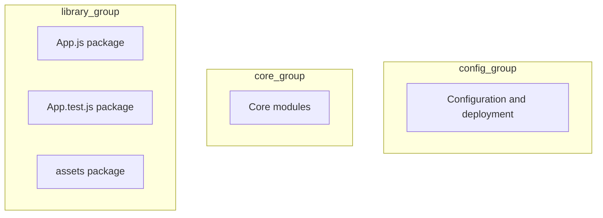

# Architecture report: ashutosh1919/masterPortfolio

> Automated static analysis. **Observed** = directly seen in files/imports/AST; **Inferred** = interpretation from that evidence. Repository code was not executed.

## 1. Repository at a glance

| Item | Value |
| --- | --- |
| Repository | ashutosh1919/masterPortfolio |
| Description | 🔥 The Complete Customizable Software Developer Portfolio Template which lets you showcase your work and provides each and every detail about you as Software Developer. |
| Language | JavaScript |
| Stars | 4230 |
| Licence | MIT |
| Analysed commit / branch | 33b04a568a92a44e538a1795d8eab742dac47d81 / master |
| Framework(s) | React |
| Files analysed | 793 |
| Components | 5 |

## 2. Architecture in one minute

ashutosh1919/masterPortfolio - 🔥 The Complete Customizable Software Developer Portfolio Template which lets you showcase your work and provides each and every detail about you as Software Developer.. This repository was analysed statically from 793 file(s) (0 Python). Detected technologies (observed from imports/manifests): GitHub Actions, React, React Router, Docker, Docker Compose. Files are grouped into 5 component(s): App.js package, App.test.js package, assets package, Configuration and deployment, Core modules. Findings below distinguish observed facts from inferred interpretation.

## 3. High-level block diagram

## 4. Main components

### App.js package (`app_js`)

- **Kind:** library
- **Status:** Observed
- **Confidence:** 0.85
- **Responsibility:** Groups 1 file(s) under app.js package (observed from repository paths and static analysis).
- **Paths:** `src/App.js`
- **Evidence:** [src/App.js](https://github.com/ashutosh1919/masterPortfolio/blob/33b04a568a92a44e538a1795d8eab742dac47d81/src/App.js)

### App.test.js package (`app_test_js`)

- **Kind:** library
- **Status:** Observed
- **Confidence:** 0.85
- **Responsibility:** Groups 1 file(s) under app.test.js package (observed from repository paths and static analysis).
- **Paths:** `src/App.test.js`
- **Evidence:** [src/App.test.js](https://github.com/ashutosh1919/masterPortfolio/blob/33b04a568a92a44e538a1795d8eab742dac47d81/src/App.test.js)

### assets package (`assets`)

- **Kind:** library
- **Status:** Observed
- **Confidence:** 0.85
- **Responsibility:** Groups 4 file(s) under assets package (observed from repository paths and static analysis).
- **Paths:** `src/assets/font-awesome/js/conflict-detection.js`, `src/assets/font-awesome/js/fontawesome.js`, `src/assets/font-awesome/js/regular.js`, `src/assets/font-awesome/js/v4-shims.js`
- **Evidence:** [src/assets/font-awesome/js/conflict-detection.js](https://github.com/ashutosh1919/masterPortfolio/blob/33b04a568a92a44e538a1795d8eab742dac47d81/src/assets/font-awesome/js/conflict-detection.js); [src/assets/font-awesome/js/fontawesome.js](https://github.com/ashutosh1919/masterPortfolio/blob/33b04a568a92a44e538a1795d8eab742dac47d81/src/assets/font-awesome/js/fontawesome.js); [src/assets/font-awesome/js/regular.js](https://github.com/ashutosh1919/masterPortfolio/blob/33b04a568a92a44e538a1795d8eab742dac47d81/src/assets/font-awesome/js/regular.js); [src/assets/font-awesome/js/v4-shims.js](https://github.com/ashutosh1919/masterPortfolio/blob/33b04a568a92a44e538a1795d8eab742dac47d81/src/assets/font-awesome/js/v4-shims.js)

### Configuration and deployment (`config`)

- **Kind:** config
- **Status:** Observed
- **Confidence:** 0.85
- **Responsibility:** Groups 8 file(s) under configuration and deployment (observed from repository paths and static analysis).
- **Paths:** `Dockerfile`, `docker-compose.yaml`, `package.json`, `public/manifest.json`, `src/assets/font-awesome/metadata/categories.yml`, `src/assets/font-awesome/metadata/shims.json`, `src/assets/font-awesome/metadata/shims.yml`, `src/assets/font-awesome/metadata/sponsors.yml`
- **Evidence:** [Dockerfile](https://github.com/ashutosh1919/masterPortfolio/blob/33b04a568a92a44e538a1795d8eab742dac47d81/Dockerfile); [docker-compose.yaml](https://github.com/ashutosh1919/masterPortfolio/blob/33b04a568a92a44e538a1795d8eab742dac47d81/docker-compose.yaml); [package.json](https://github.com/ashutosh1919/masterPortfolio/blob/33b04a568a92a44e538a1795d8eab742dac47d81/package.json); [public/manifest.json](https://github.com/ashutosh1919/masterPortfolio/blob/33b04a568a92a44e538a1795d8eab742dac47d81/public/manifest.json); [src/assets/font-awesome/metadata/categories.yml](https://github.com/ashutosh1919/masterPortfolio/blob/33b04a568a92a44e538a1795d8eab742dac47d81/src/assets/font-awesome/metadata/categories.yml); [src/assets/font-awesome/metadata/shims.json](https://github.com/ashutosh1919/masterPortfolio/blob/33b04a568a92a44e538a1795d8eab742dac47d81/src/assets/font-awesome/metadata/shims.json); [src/assets/font-awesome/metadata/shims.yml](https://github.com/ashutosh1919/masterPortfolio/blob/33b04a568a92a44e538a1795d8eab742dac47d81/src/assets/font-awesome/metadata/shims.yml); [src/assets/font-awesome/metadata/sponsors.yml](https://github.com/ashutosh1919/masterPortfolio/blob/33b04a568a92a44e538a1795d8eab742dac47d81/src/assets/font-awesome/metadata/sponsors.yml)

### Core modules (`core`)

- **Kind:** core
- **Status:** Observed
- **Confidence:** 0.85
- **Responsibility:** Groups 1 file(s) under core modules (observed from repository paths and static analysis).
- **Paths:** `git_data_fetcher.mjs`
- **Evidence:** [git_data_fetcher.mjs](https://github.com/ashutosh1919/masterPortfolio/blob/33b04a568a92a44e538a1795d8eab742dac47d81/git_data_fetcher.mjs)

## 5. Execution flow

**Observed** entry point(s):

- [src/App.js](https://github.com/ashutosh1919/masterPortfolio/blob/33b04a568a92a44e538a1795d8eab742dac47d81/src/App.js)

Representative flow (derived from observed entry points and the import graph; steps beyond the entry point are **Inferred**):

1. Execution starts at an observed entry point listed above, if present.
2. No internal import relationships between components were observed.

## 6. Project structure

### `(root)`

- `.all-contributorsrc` - other (10403 bytes)
- `.gitignore` - other (324 bytes)
- `.prettierignore` - other (47 bytes)
- `.prettierrc.json` - config (3 bytes)
- `CNAME` - other (21 bytes)
- `CODE_OF_CONDUCT.md` - docs (3364 bytes)
- `CONTRIBUTING.md` - docs (2718 bytes)
- `Dockerfile` - container (211 bytes)
- `LICENSE` - docs (1075 bytes)
- `README.md` - docs (30151 bytes)
- `docker-compose.yaml` - container (264 bytes)
- `env.example` - other (53 bytes)
- `git_data_fetcher.mjs` - source, JavaScript (6880 bytes)
- `package.json` - manifest (1598 bytes)

### `.github`

- `.github/FUNDING.yml` - config (67 bytes)
- `.github/workflows/nodejs.yml` - ci, YAML (533 bytes)
- `.github/workflows/pullRequestsDataFetcher.yml` - ci, YAML (1307 bytes)

### `public`

- `public/404.html` - other (1891 bytes)
- `public/index.html` - other (6005 bytes)
- `public/manifest.json` - config (920 bytes)
- `public/robots.txt` - docs (57 bytes)
- `public/sitemap.xml` - other (1060 bytes)

### `src`

- `src/App.css` - other (1197 bytes)
- `src/App.js` - source, JavaScript (446 bytes)
- `src/App.test.js` - source, JavaScript (248 bytes)
- `src/assets/font-awesome/LICENSE.txt` - docs (1548 bytes)
- `src/assets/font-awesome/css/all.css` - other (70480 bytes)
- `src/assets/font-awesome/css/brands.css` - other (730 bytes)
- `src/assets/font-awesome/css/fontawesome.css` - other (68817 bytes)
- `src/assets/font-awesome/css/regular.css` - other (749 bytes)
- `src/assets/font-awesome/css/solid.css` - other (742 bytes)
- `src/assets/font-awesome/css/svg-with-js.css` - other (7766 bytes)
- `src/assets/font-awesome/css/v4-shims.css` - other (41218 bytes)
- `src/assets/font-awesome/js/conflict-detection.js` - source, JavaScript (35492 bytes)
- `src/assets/font-awesome/js/fontawesome.js` - source, JavaScript (83009 bytes)
- `src/assets/font-awesome/js/regular.js` - source, JavaScript (112626 bytes)
- `src/assets/font-awesome/js/v4-shims.js` - source, JavaScript (19267 bytes)
- `src/assets/font-awesome/less/_animated.less` - other (297 bytes)
- `src/assets/font-awesome/less/_bordered-pulled.less` - other (445 bytes)
- `src/assets/font-awesome/less/_core.less` - other (297 bytes)
- `src/assets/font-awesome/less/_fixed-width.less` - other (119 bytes)
- `src/assets/font-awesome/less/_icons.less` - other (97403 bytes)
- `src/assets/font-awesome/less/_larger.less` - other (457 bytes)
- `src/assets/font-awesome/less/_list.less` - other (328 bytes)
- `src/assets/font-awesome/less/_mixins.less` - other (1239 bytes)
- `src/assets/font-awesome/less/_rotated-flipped.less` - other (779 bytes)
- `src/assets/font-awesome/less/_screen-reader.less` - other (122 bytes)
- `src/assets/font-awesome/less/_shims.less` - other (61157 bytes)
- `src/assets/font-awesome/less/_stacked.less` - other (484 bytes)
- `src/assets/font-awesome/less/_variables.less` - other (39876 bytes)
- `src/assets/font-awesome/less/brands.less` - other (800 bytes)
- `src/assets/font-awesome/less/fontawesome.less` - other (505 bytes)
- `src/assets/font-awesome/less/regular.less` - other (819 bytes)
- `src/assets/font-awesome/less/solid.less` - other (812 bytes)
- `src/assets/font-awesome/less/v4-shims.less` - other (236 bytes)
- `src/assets/font-awesome/metadata/categories.yml` - config (39206 bytes)
- `src/assets/font-awesome/metadata/shims.json` - config (26713 bytes)
- `src/assets/font-awesome/metadata/shims.yml` - config (4624 bytes)
- `src/assets/font-awesome/metadata/sponsors.yml` - config (11873 bytes)
- `src/assets/font-awesome/scss/_animated.scss` - other (300 bytes)
- `src/assets/font-awesome/scss/_bordered-pulled.scss` - other (451 bytes)
- `src/assets/font-awesome/scss/_core.scss` - other (332 bytes)
- `src/assets/font-awesome/scss/_fixed-width.scss` - other (121 bytes)
- `src/assets/font-awesome/scss/_icons.scss` - other (115522 bytes)
- `src/assets/font-awesome/scss/_larger.scss` - other (396 bytes)
- `src/assets/font-awesome/scss/_list.scss` - other (328 bytes)
- `src/assets/font-awesome/scss/_mixins.scss` - other (1265 bytes)
- `src/assets/font-awesome/scss/_rotated-flipped.scss` - other (841 bytes)
- `src/assets/font-awesome/scss/_screen-reader.scss` - other (134 bytes)
- `src/assets/font-awesome/scss/_shims.scss` - other (65751 bytes)
- `src/assets/font-awesome/scss/_stacked.scss` - other (507 bytes)
- `src/assets/font-awesome/scss/_variables.scss` - other (37305 bytes)
- `src/assets/font-awesome/scss/brands.scss` - other (800 bytes)
- `src/assets/font-awesome/scss/fontawesome.scss` - other (433 bytes)
- `src/assets/font-awesome/scss/regular.scss` - other (819 bytes)
- `src/assets/font-awesome/scss/solid.scss` - other (812 bytes)
- `src/assets/font-awesome/scss/v4-shims.scss` - other (224 bytes)
- `src/assets/font-awesome/sprites/regular.svg` - other (106634 bytes)
- `src/assets/font-awesome/svgs/brands/500px.svg` - other (1245 bytes)
- `src/assets/font-awesome/svgs/brands/accessible-icon.svg` - other (775 bytes)
- `src/assets/font-awesome/svgs/brands/accusoft.svg` - other (852 bytes)
- `src/assets/font-awesome/svgs/brands/acquisitions-incorporated.svg` - other (1391 bytes)
- `src/assets/font-awesome/svgs/brands/adn.svg` - other (267 bytes)
- `src/assets/font-awesome/svgs/brands/adobe.svg` - other (187 bytes)
- `src/assets/font-awesome/svgs/brands/adversal.svg` - other (1306 bytes)
- `src/assets/font-awesome/svgs/brands/affiliatetheme.svg` - other (404 bytes)
- `src/assets/font-awesome/svgs/brands/airbnb.svg` - other (849 bytes)
- `src/assets/font-awesome/svgs/brands/algolia.svg` - other (907 bytes)
- `src/assets/font-awesome/svgs/brands/alipay.svg` - other (745 bytes)
- `src/assets/font-awesome/svgs/brands/amazon-pay.svg` - other (3466 bytes)
- `src/assets/font-awesome/svgs/brands/amazon.svg` - other (720 bytes)
- `src/assets/font-awesome/svgs/brands/amilia.svg` - other (605 bytes)
- `src/assets/font-awesome/svgs/brands/android.svg` - other (907 bytes)
- `src/assets/font-awesome/svgs/brands/angellist.svg` - other (1382 bytes)
- `src/assets/font-awesome/svgs/brands/angrycreative.svg` - other (1951 bytes)
- `src/assets/font-awesome/svgs/brands/angular.svg` - other (239 bytes)
- `src/assets/font-awesome/svgs/brands/app-store-ios.svg` - other (726 bytes)
- `src/assets/font-awesome/svgs/brands/app-store.svg` - other (858 bytes)
- `src/assets/font-awesome/svgs/brands/apper.svg` - other (1729 bytes)
- `src/assets/font-awesome/svgs/brands/apple-pay.svg` - other (1190 bytes)
- `src/assets/font-awesome/svgs/brands/apple.svg` - other (515 bytes)
- `src/assets/font-awesome/svgs/brands/artstation.svg` - other (273 bytes)
- `src/assets/font-awesome/svgs/brands/asymmetrik.svg` - other (764 bytes)
- `src/assets/font-awesome/svgs/brands/atlassian.svg` - other (366 bytes)
- `src/assets/font-awesome/svgs/brands/audible.svg` - other (574 bytes)
- `src/assets/font-awesome/svgs/brands/autoprefixer.svg` - other (279 bytes)
- `src/assets/font-awesome/svgs/brands/avianex.svg` - other (571 bytes)
- `src/assets/font-awesome/svgs/brands/aviato.svg` - other (2177 bytes)
- `src/assets/font-awesome/svgs/brands/aws.svg` - other (2310 bytes)
- `src/assets/font-awesome/svgs/brands/bandcamp.svg` - other (192 bytes)
- `src/assets/font-awesome/svgs/brands/battle-net.svg` - other (2573 bytes)
- `src/assets/font-awesome/svgs/brands/behance-square.svg` - other (783 bytes)
- `src/assets/font-awesome/svgs/brands/behance.svg` - other (684 bytes)
- `src/assets/font-awesome/svgs/brands/bimobject.svg` - other (485 bytes)
- `src/assets/font-awesome/svgs/brands/bitbucket.svg` - other (306 bytes)
- `src/assets/font-awesome/svgs/brands/bitcoin.svg` - other (1165 bytes)
- `src/assets/font-awesome/svgs/brands/bity.svg` - other (759 bytes)
- `src/assets/font-awesome/svgs/brands/black-tie.svg` - other (177 bytes)
- `src/assets/font-awesome/svgs/brands/blackberry.svg` - other (676 bytes)
- `src/assets/font-awesome/svgs/brands/blogger-b.svg` - other (900 bytes)
- `src/assets/font-awesome/svgs/brands/blogger.svg` - other (1199 bytes)
- `src/assets/font-awesome/svgs/brands/bluetooth-b.svg` - other (371 bytes)
- `src/assets/font-awesome/svgs/brands/bluetooth.svg` - other (370 bytes)
- `src/assets/font-awesome/svgs/brands/bootstrap.svg` - other (606 bytes)
- `src/assets/font-awesome/svgs/brands/btc.svg` - other (758 bytes)
- `src/assets/font-awesome/svgs/brands/buffer.svg` - other (719 bytes)
- `src/assets/font-awesome/svgs/brands/buromobelexperte.svg` - other (474 bytes)
- `src/assets/font-awesome/svgs/brands/buy-n-large.svg` - other (856 bytes)
- `src/assets/font-awesome/svgs/brands/buysellads.svg` - other (297 bytes)
- `src/assets/font-awesome/svgs/brands/canadian-maple-leaf.svg` - other (866 bytes)
- `src/assets/font-awesome/svgs/brands/cc-amazon-pay.svg` - other (3428 bytes)
- `src/assets/font-awesome/svgs/brands/cc-amex.svg` - other (3197 bytes)
- `src/assets/font-awesome/svgs/brands/cc-apple-pay.svg` - other (1285 bytes)
- `src/assets/font-awesome/svgs/brands/cc-diners-club.svg` - other (600 bytes)
- `src/assets/font-awesome/svgs/brands/cc-discover.svg` - other (1237 bytes)
- `src/assets/font-awesome/svgs/brands/cc-jcb.svg` - other (779 bytes)
- `src/assets/font-awesome/svgs/brands/cc-mastercard.svg` - other (3020 bytes)
- `src/assets/font-awesome/svgs/brands/cc-paypal.svg` - other (1762 bytes)
- `src/assets/font-awesome/svgs/brands/cc-stripe.svg` - other (1288 bytes)
- `src/assets/font-awesome/svgs/brands/cc-visa.svg` - other (934 bytes)
- `src/assets/font-awesome/svgs/brands/centercode.svg` - other (455 bytes)
- `src/assets/font-awesome/svgs/brands/centos.svg` - other (913 bytes)
- `src/assets/font-awesome/svgs/brands/chrome.svg` - other (577 bytes)
- `src/assets/font-awesome/svgs/brands/chromecast.svg` - other (474 bytes)
- `src/assets/font-awesome/svgs/brands/cloudscale.svg` - other (631 bytes)
- `src/assets/font-awesome/svgs/brands/cloudsmith.svg` - other (294 bytes)
- `src/assets/font-awesome/svgs/brands/cloudversify.svg` - other (1362 bytes)
- `src/assets/font-awesome/svgs/brands/codepen.svg` - other (745 bytes)
- `src/assets/font-awesome/svgs/brands/codiepie.svg` - other (537 bytes)
- `src/assets/font-awesome/svgs/brands/confluence.svg` - other (592 bytes)
- `src/assets/font-awesome/svgs/brands/connectdevelop.svg` - other (3122 bytes)
- `src/assets/font-awesome/svgs/brands/contao.svg` - other (552 bytes)
- `src/assets/font-awesome/svgs/brands/cotton-bureau.svg` - other (1290 bytes)
- `src/assets/font-awesome/svgs/brands/cpanel.svg` - other (1431 bytes)
- `src/assets/font-awesome/svgs/brands/creative-commons-by.svg` - other (579 bytes)
- `src/assets/font-awesome/svgs/brands/creative-commons-nc-eu.svg` - other (824 bytes)
- `src/assets/font-awesome/svgs/brands/creative-commons-nc-jp.svg` - other (582 bytes)
- `src/assets/font-awesome/svgs/brands/creative-commons-nc.svg` - other (742 bytes)
- `src/assets/font-awesome/svgs/brands/creative-commons-nd.svg` - other (386 bytes)
- `src/assets/font-awesome/svgs/brands/creative-commons-pd-alt.svg` - other (618 bytes)
- `src/assets/font-awesome/svgs/brands/creative-commons-pd.svg` - other (658 bytes)
- `src/assets/font-awesome/svgs/brands/creative-commons-remix.svg` - other (648 bytes)
- `src/assets/font-awesome/svgs/brands/creative-commons-sa.svg` - other (586 bytes)
- `src/assets/font-awesome/svgs/brands/creative-commons-sampling-plus.svg` - other (1171 bytes)
- `src/assets/font-awesome/svgs/brands/creative-commons-sampling.svg` - other (1235 bytes)
- `src/assets/font-awesome/svgs/brands/creative-commons-share.svg` - other (625 bytes)
- `src/assets/font-awesome/svgs/brands/creative-commons-zero.svg` - other (664 bytes)
- `src/assets/font-awesome/svgs/brands/creative-commons.svg` - other (962 bytes)
- `src/assets/font-awesome/svgs/brands/critical-role.svg` - other (7133 bytes)
- `src/assets/font-awesome/svgs/brands/css3-alt.svg` - other (317 bytes)
- `src/assets/font-awesome/svgs/brands/css3.svg` - other (207 bytes)
- `src/assets/font-awesome/svgs/brands/cuttlefish.svg` - other (330 bytes)
- `src/assets/font-awesome/svgs/brands/d-and-d-beyond.svg` - other (3996 bytes)
- `src/assets/font-awesome/svgs/brands/d-and-d.svg` - other (4519 bytes)
- `src/assets/font-awesome/svgs/brands/dashcube.svg` - other (320 bytes)
- `src/assets/font-awesome/svgs/brands/delicious.svg` - other (546 bytes)
- `src/assets/font-awesome/svgs/brands/deploydog.svg` - other (844 bytes)
- `src/assets/font-awesome/svgs/brands/deskpro.svg` - other (687 bytes)
- `src/assets/font-awesome/svgs/brands/dev.svg` - other (765 bytes)
- `src/assets/font-awesome/svgs/brands/deviantart.svg` - other (252 bytes)
- `src/assets/font-awesome/svgs/brands/dhl.svg` - other (839 bytes)
- `src/assets/font-awesome/svgs/brands/diaspora.svg` - other (486 bytes)
- `src/assets/font-awesome/svgs/brands/digg.svg` - other (384 bytes)
- `src/assets/font-awesome/svgs/brands/digital-ocean.svg` - other (376 bytes)
- `src/assets/font-awesome/svgs/brands/discord.svg` - other (1218 bytes)
- `src/assets/font-awesome/svgs/brands/discourse.svg` - other (343 bytes)
- `src/assets/font-awesome/svgs/brands/dochub.svg` - other (267 bytes)
- `src/assets/font-awesome/svgs/brands/docker.svg` - other (663 bytes)
- `src/assets/font-awesome/svgs/brands/draft2digital.svg` - other (779 bytes)
- `src/assets/font-awesome/svgs/brands/dribbble-square.svg` - other (921 bytes)
- `src/assets/font-awesome/svgs/brands/dribbble.svg` - other (1131 bytes)
- `src/assets/font-awesome/svgs/brands/dropbox.svg` - other (310 bytes)
- `src/assets/font-awesome/svgs/brands/drupal.svg` - other (771 bytes)
- `src/assets/font-awesome/svgs/brands/dyalog.svg` - other (260 bytes)
- `src/assets/font-awesome/svgs/brands/earlybirds.svg` - other (1927 bytes)
- `src/assets/font-awesome/svgs/brands/ebay.svg` - other (1097 bytes)
- `src/assets/font-awesome/svgs/brands/edge.svg` - other (615 bytes)
- `src/assets/font-awesome/svgs/brands/elementor.svg` - other (326 bytes)
- `src/assets/font-awesome/svgs/brands/ello.svg` - other (428 bytes)
- `src/assets/font-awesome/svgs/brands/ember.svg` - other (1933 bytes)
- `src/assets/font-awesome/svgs/brands/empire.svg` - other (1847 bytes)
- `src/assets/font-awesome/svgs/brands/envira.svg` - other (366 bytes)
- `src/assets/font-awesome/svgs/brands/erlang.svg` - other (432 bytes)
- `src/assets/font-awesome/svgs/brands/ethereum.svg` - other (175 bytes)
- `src/assets/font-awesome/svgs/brands/etsy.svg` - other (662 bytes)
- `src/assets/font-awesome/svgs/brands/evernote.svg` - other (1009 bytes)
- `src/assets/font-awesome/svgs/brands/expeditedssl.svg` - other (962 bytes)
- `src/assets/font-awesome/svgs/brands/facebook-f.svg` - other (252 bytes)
- `src/assets/font-awesome/svgs/brands/facebook-messenger.svg` - other (554 bytes)
- `src/assets/font-awesome/svgs/brands/facebook-square.svg` - other (338 bytes)
- `src/assets/font-awesome/svgs/brands/facebook.svg` - other (344 bytes)
- `src/assets/font-awesome/svgs/brands/fantasy-flight-games.svg` - other (1139 bytes)
- `src/assets/font-awesome/svgs/brands/fedex.svg` - other (819 bytes)
- `src/assets/font-awesome/svgs/brands/fedora.svg` - other (2243 bytes)
- `src/assets/font-awesome/svgs/brands/figma.svg` - other (263 bytes)
- `src/assets/font-awesome/svgs/brands/firefox.svg` - other (2632 bytes)
- `src/assets/font-awesome/svgs/brands/first-order-alt.svg` - other (1530 bytes)
- `src/assets/font-awesome/svgs/brands/first-order.svg` - other (1242 bytes)
- `src/assets/font-awesome/svgs/brands/firstdraft.svg` - other (267 bytes)
- `src/assets/font-awesome/svgs/brands/flickr.svg` - other (379 bytes)
- `src/assets/font-awesome/svgs/brands/flipboard.svg` - other (156 bytes)
- `src/assets/font-awesome/svgs/brands/fly.svg` - other (740 bytes)
- `src/assets/font-awesome/svgs/brands/font-awesome-alt.svg` - other (814 bytes)
- `src/assets/font-awesome/svgs/brands/font-awesome-flag.svg` - other (657 bytes)
- `src/assets/font-awesome/svgs/brands/font-awesome-logo-full.svg` - other (2994 bytes)
- `src/assets/font-awesome/svgs/brands/font-awesome.svg` - other (699 bytes)
- `src/assets/font-awesome/svgs/brands/fonticons-fi.svg` - other (614 bytes)
- `src/assets/font-awesome/svgs/brands/fonticons.svg` - other (640 bytes)
- `src/assets/font-awesome/svgs/brands/fort-awesome-alt.svg` - other (3691 bytes)
- `src/assets/font-awesome/svgs/brands/fort-awesome.svg` - other (1019 bytes)
- `src/assets/font-awesome/svgs/brands/forumbee.svg` - other (617 bytes)
- `src/assets/font-awesome/svgs/brands/foursquare.svg` - other (623 bytes)
- `src/assets/font-awesome/svgs/brands/free-code-camp.svg` - other (1312 bytes)
- `src/assets/font-awesome/svgs/brands/freebsd.svg` - other (596 bytes)
- `src/assets/font-awesome/svgs/brands/fulcrum.svg` - other (339 bytes)
- `src/assets/font-awesome/svgs/brands/galactic-republic.svg` - other (1603 bytes)
- `src/assets/font-awesome/svgs/brands/galactic-senate.svg` - other (2684 bytes)
- `src/assets/font-awesome/svgs/brands/get-pocket.svg` - other (424 bytes)
- `src/assets/font-awesome/svgs/brands/gg-circle.svg` - other (410 bytes)
- `src/assets/font-awesome/svgs/brands/gg.svg` - other (341 bytes)
- `src/assets/font-awesome/svgs/brands/git-alt.svg` - other (538 bytes)
- `src/assets/font-awesome/svgs/brands/git-square.svg` - other (1216 bytes)
- `src/assets/font-awesome/svgs/brands/git.svg` - other (1099 bytes)
- `src/assets/font-awesome/svgs/brands/github-alt.svg` - other (880 bytes)
- `src/assets/font-awesome/svgs/brands/github-square.svg` - other (1494 bytes)
- `src/assets/font-awesome/svgs/brands/github.svg` - other (1384 bytes)
- `src/assets/font-awesome/svgs/brands/gitkraken.svg` - other (1354 bytes)
- `src/assets/font-awesome/svgs/brands/gitlab.svg` - other (354 bytes)
- `src/assets/font-awesome/svgs/brands/gitter.svg` - other (194 bytes)
- `src/assets/font-awesome/svgs/brands/glide-g.svg` - other (758 bytes)
- `src/assets/font-awesome/svgs/brands/glide.svg` - other (855 bytes)
- `src/assets/font-awesome/svgs/brands/gofore.svg` - other (440 bytes)
- `src/assets/font-awesome/svgs/brands/goodreads-g.svg` - other (723 bytes)
- `src/assets/font-awesome/svgs/brands/goodreads.svg` - other (811 bytes)
- `src/assets/font-awesome/svgs/brands/google-drive.svg` - other (217 bytes)
- `src/assets/font-awesome/svgs/brands/google-play.svg` - other (326 bytes)
- `src/assets/font-awesome/svgs/brands/google-plus-g.svg` - other (557 bytes)
- `src/assets/font-awesome/svgs/brands/google-plus-square.svg` - other (498 bytes)
- `src/assets/font-awesome/svgs/brands/google-plus.svg` - other (501 bytes)
- `src/assets/font-awesome/svgs/brands/google-wallet.svg` - other (598 bytes)
- `src/assets/font-awesome/svgs/brands/google.svg` - other (327 bytes)
- `src/assets/font-awesome/svgs/brands/gratipay.svg` - other (333 bytes)
- `src/assets/font-awesome/svgs/brands/grav.svg` - other (1628 bytes)
- `src/assets/font-awesome/svgs/brands/gripfire.svg` - other (690 bytes)
- `src/assets/font-awesome/svgs/brands/grunt.svg` - other (5490 bytes)
- `src/assets/font-awesome/svgs/brands/gulp.svg` - other (2601 bytes)
- `src/assets/font-awesome/svgs/brands/hacker-news-square.svg` - other (346 bytes)
- `src/assets/font-awesome/svgs/brands/hacker-news.svg` - other (260 bytes)
- `src/assets/font-awesome/svgs/brands/hackerrank.svg` - other (843 bytes)
- `src/assets/font-awesome/svgs/brands/hips.svg` - other (1445 bytes)
- `src/assets/font-awesome/svgs/brands/hire-a-helper.svg` - other (1062 bytes)
- `src/assets/font-awesome/svgs/brands/hooli.svg` - other (1486 bytes)
- `src/assets/font-awesome/svgs/brands/hornbill.svg` - other (1094 bytes)
- `src/assets/font-awesome/svgs/brands/hotjar.svg` - other (350 bytes)
- `src/assets/font-awesome/svgs/brands/houzz.svg` - other (142 bytes)
- `src/assets/font-awesome/svgs/brands/html5.svg` - other (279 bytes)
- `src/assets/font-awesome/svgs/brands/hubspot.svg` - other (832 bytes)
- `src/assets/font-awesome/svgs/brands/imdb.svg` - other (753 bytes)
- `src/assets/font-awesome/svgs/brands/instagram.svg` - other (1002 bytes)
- `src/assets/font-awesome/svgs/brands/intercom.svg` - other (662 bytes)
- `src/assets/font-awesome/svgs/brands/internet-explorer.svg` - other (937 bytes)
- `src/assets/font-awesome/svgs/brands/invision.svg` - other (683 bytes)
- `src/assets/font-awesome/svgs/brands/ioxhost.svg` - other (703 bytes)
- `src/assets/font-awesome/svgs/brands/itch-io.svg` - other (1265 bytes)
- `src/assets/font-awesome/svgs/brands/itunes-note.svg` - other (662 bytes)
- `src/assets/font-awesome/svgs/brands/itunes.svg` - other (952 bytes)
- `src/assets/font-awesome/svgs/brands/java.svg` - other (1182 bytes)
- `src/assets/font-awesome/svgs/brands/jedi-order.svg` - other (736 bytes)
- `src/assets/font-awesome/svgs/brands/jenkins.svg` - other (4341 bytes)
- `src/assets/font-awesome/svgs/brands/jira.svg` - other (299 bytes)
- `src/assets/font-awesome/svgs/brands/joget.svg` - other (877 bytes)
- `src/assets/font-awesome/svgs/brands/joomla.svg` - other (1145 bytes)
- `src/assets/font-awesome/svgs/brands/js-square.svg` - other (697 bytes)
- `src/assets/font-awesome/svgs/brands/js.svg` - other (611 bytes)
- `src/assets/font-awesome/svgs/brands/jsfiddle.svg` - other (1903 bytes)
- `src/assets/font-awesome/svgs/brands/kaggle.svg` - other (318 bytes)
- `src/assets/font-awesome/svgs/brands/keybase.svg` - other (1565 bytes)
- `src/assets/font-awesome/svgs/brands/keycdn.svg` - other (1519 bytes)
- `src/assets/font-awesome/svgs/brands/kickstarter-k.svg` - other (372 bytes)
- `src/assets/font-awesome/svgs/brands/kickstarter.svg` - other (469 bytes)
- `src/assets/font-awesome/svgs/brands/korvue.svg` - other (330 bytes)
- `src/assets/font-awesome/svgs/brands/laravel.svg` - other (1709 bytes)
- `src/assets/font-awesome/svgs/brands/lastfm-square.svg` - other (737 bytes)
- `src/assets/font-awesome/svgs/brands/lastfm.svg` - other (649 bytes)
- `src/assets/font-awesome/svgs/brands/leanpub.svg` - other (1163 bytes)
- `src/assets/font-awesome/svgs/brands/less.svg` - other (1840 bytes)
- `src/assets/font-awesome/svgs/brands/line.svg` - other (1205 bytes)
- `src/assets/font-awesome/svgs/brands/linkedin-in.svg` - other (380 bytes)
- `src/assets/font-awesome/svgs/brands/linkedin.svg` - other (504 bytes)
- `src/assets/font-awesome/svgs/brands/linode.svg` - other (1337 bytes)
- `src/assets/font-awesome/svgs/brands/linux.svg` - other (3568 bytes)
- `src/assets/font-awesome/svgs/brands/lyft.svg` - other (675 bytes)
- `src/assets/font-awesome/svgs/brands/magento.svg` - other (279 bytes)
- `src/assets/font-awesome/svgs/brands/mailchimp.svg` - other (3137 bytes)
- `src/assets/font-awesome/svgs/brands/mandalorian.svg` - other (5988 bytes)
- `src/assets/font-awesome/svgs/brands/markdown.svg` - other (359 bytes)
- `src/assets/font-awesome/svgs/brands/mastodon.svg` - other (695 bytes)
- `src/assets/font-awesome/svgs/brands/maxcdn.svg` - other (300 bytes)
- `src/assets/font-awesome/svgs/brands/mdb.svg` - other (633 bytes)
- `src/assets/font-awesome/svgs/brands/medapps.svg` - other (896 bytes)
- `src/assets/font-awesome/svgs/brands/medium-m.svg` - other (413 bytes)
- `src/assets/font-awesome/svgs/brands/medium.svg` - other (416 bytes)
- `src/assets/font-awesome/svgs/brands/medrt.svg` - other (836 bytes)
- `src/assets/font-awesome/svgs/brands/meetup.svg` - other (2132 bytes)
- `src/assets/font-awesome/svgs/brands/megaport.svg` - other (429 bytes)
- `src/assets/font-awesome/svgs/brands/mendeley.svg` - other (736 bytes)
- `src/assets/font-awesome/svgs/brands/microsoft.svg` - other (187 bytes)
- `src/assets/font-awesome/svgs/brands/mix.svg` - other (224 bytes)
- `src/assets/font-awesome/svgs/brands/mixcloud.svg` - other (1375 bytes)
- `src/assets/font-awesome/svgs/brands/mizuni.svg` - other (437 bytes)
- `src/assets/font-awesome/svgs/brands/modx.svg` - other (248 bytes)
- `src/assets/font-awesome/svgs/brands/monero.svg` - other (294 bytes)
- `src/assets/font-awesome/svgs/brands/napster.svg` - other (980 bytes)
- `src/assets/font-awesome/svgs/brands/neos.svg` - other (439 bytes)
- `src/assets/font-awesome/svgs/brands/nimblr.svg` - other (554 bytes)
- `src/assets/font-awesome/svgs/brands/node-js.svg` - other (1164 bytes)
- `src/assets/font-awesome/svgs/brands/node.svg` - other (3117 bytes)
- `src/assets/font-awesome/svgs/brands/npm.svg` - other (254 bytes)
- `src/assets/font-awesome/svgs/brands/ns8.svg` - other (1026 bytes)
- `src/assets/font-awesome/svgs/brands/nutritionix.svg` - other (1498 bytes)
- `src/assets/font-awesome/svgs/brands/odnoklassniki-square.svg` - other (768 bytes)
- `src/assets/font-awesome/svgs/brands/odnoklassniki.svg` - other (663 bytes)
- `src/assets/font-awesome/svgs/brands/old-republic.svg` - other (11219 bytes)
- `src/assets/font-awesome/svgs/brands/opencart.svg` - other (426 bytes)
- `src/assets/font-awesome/svgs/brands/openid.svg` - other (334 bytes)
- `src/assets/font-awesome/svgs/brands/opera.svg` - other (494 bytes)
- `src/assets/font-awesome/svgs/brands/optin-monster.svg` - other (4751 bytes)
- `src/assets/font-awesome/svgs/brands/orcid.svg` - other (443 bytes)
- `src/assets/font-awesome/svgs/brands/osi.svg` - other (955 bytes)
- `src/assets/font-awesome/svgs/brands/page4.svg` - other (804 bytes)
- `src/assets/font-awesome/svgs/brands/pagelines.svg` - other (564 bytes)
- `src/assets/font-awesome/svgs/brands/palfed.svg` - other (842 bytes)
- `src/assets/font-awesome/svgs/brands/patreon.svg` - other (237 bytes)
- `src/assets/font-awesome/svgs/brands/paypal.svg` - other (633 bytes)
- `src/assets/font-awesome/svgs/brands/penny-arcade.svg` - other (1202 bytes)
- `src/assets/font-awesome/svgs/brands/periscope.svg` - other (608 bytes)
- `src/assets/font-awesome/svgs/brands/phabricator.svg` - other (1028 bytes)
- `src/assets/font-awesome/svgs/brands/phoenix-framework.svg` - other (2492 bytes)
- `src/assets/font-awesome/svgs/brands/phoenix-squadron.svg` - other (1597 bytes)
- `src/assets/font-awesome/svgs/brands/php.svg` - other (852 bytes)
- `src/assets/font-awesome/svgs/brands/pied-piper-alt.svg` - other (1672 bytes)
- `src/assets/font-awesome/svgs/brands/pied-piper-hat.svg` - other (620 bytes)
- `src/assets/font-awesome/svgs/brands/pied-piper-pp.svg` - other (742 bytes)
- `src/assets/font-awesome/svgs/brands/pied-piper.svg` - other (363 bytes)
- `src/assets/font-awesome/svgs/brands/pinterest-p.svg` - other (575 bytes)
- `src/assets/font-awesome/svgs/brands/pinterest-square.svg` - other (709 bytes)
- `src/assets/font-awesome/svgs/brands/pinterest.svg` - other (746 bytes)
- `src/assets/font-awesome/svgs/brands/playstation.svg` - other (674 bytes)
- `src/assets/font-awesome/svgs/brands/product-hunt.svg` - other (328 bytes)
- `src/assets/font-awesome/svgs/brands/pushed.svg` - other (543 bytes)
- `src/assets/font-awesome/svgs/brands/python.svg` - other (844 bytes)
- `src/assets/font-awesome/svgs/brands/qq.svg` - other (647 bytes)
- `src/assets/font-awesome/svgs/brands/quinscape.svg` - other (410 bytes)
- `src/assets/font-awesome/svgs/brands/quora.svg` - other (572 bytes)
- `src/assets/font-awesome/svgs/brands/r-project.svg` - other (625 bytes)
- `src/assets/font-awesome/svgs/brands/raspberry-pi.svg` - other (3819 bytes)
- `src/assets/font-awesome/svgs/brands/ravelry.svg` - other (1302 bytes)
- `src/assets/font-awesome/svgs/brands/react.svg` - other (2908 bytes)
- `src/assets/font-awesome/svgs/brands/reacteurope.svg` - other (5488 bytes)
- `src/assets/font-awesome/svgs/brands/readme.svg` - other (1063 bytes)
- `src/assets/font-awesome/svgs/brands/rebel.svg` - other (631 bytes)
- `src/assets/font-awesome/svgs/brands/red-river.svg` - other (489 bytes)
- `src/assets/font-awesome/svgs/brands/reddit-alien.svg` - other (926 bytes)
- `src/assets/font-awesome/svgs/brands/reddit-square.svg` - other (1037 bytes)
- `src/assets/font-awesome/svgs/brands/reddit.svg` - other (988 bytes)
- `src/assets/font-awesome/svgs/brands/redhat.svg` - other (643 bytes)
- `src/assets/font-awesome/svgs/brands/renren.svg` - other (412 bytes)
- `src/assets/font-awesome/svgs/brands/replyd.svg` - other (1297 bytes)
- `src/assets/font-awesome/svgs/brands/researchgate.svg` - other (812 bytes)
- `src/assets/font-awesome/svgs/brands/resolving.svg` - other (553 bytes)
- `src/assets/font-awesome/svgs/brands/rev.svg` - other (443 bytes)
- `src/assets/font-awesome/svgs/brands/rocketchat.svg` - other (938 bytes)
- `src/assets/font-awesome/svgs/brands/rockrms.svg` - other (343 bytes)
- `src/assets/font-awesome/svgs/brands/safari.svg` - other (1346 bytes)
- `src/assets/font-awesome/svgs/brands/salesforce.svg` - other (4278 bytes)
- `src/assets/font-awesome/svgs/brands/sass.svg` - other (3087 bytes)
- `src/assets/font-awesome/svgs/brands/schlix.svg` - other (864 bytes)
- `src/assets/font-awesome/svgs/brands/scribd.svg` - other (737 bytes)
- `src/assets/font-awesome/svgs/brands/searchengin.svg` - other (757 bytes)
- `src/assets/font-awesome/svgs/brands/sellcast.svg` - other (830 bytes)
- `src/assets/font-awesome/svgs/brands/sellsy.svg` - other (1210 bytes)
- `src/assets/font-awesome/svgs/brands/servicestack.svg` - other (250 bytes)
- `src/assets/font-awesome/svgs/brands/shirtsinbulk.svg` - other (1588 bytes)
- `src/assets/font-awesome/svgs/brands/shopware.svg` - other (591 bytes)
- `src/assets/font-awesome/svgs/brands/simplybuilt.svg` - other (533 bytes)
- `src/assets/font-awesome/svgs/brands/sistrix.svg` - other (357 bytes)
- `src/assets/font-awesome/svgs/brands/sith.svg` - other (826 bytes)
- `src/assets/font-awesome/svgs/brands/sketch.svg` - other (410 bytes)
- `src/assets/font-awesome/svgs/brands/skyatlas.svg` - other (739 bytes)
- `src/assets/font-awesome/svgs/brands/skype.svg` - other (785 bytes)
- `src/assets/font-awesome/svgs/brands/slack-hash.svg` - other (771 bytes)
- `src/assets/font-awesome/svgs/brands/slack.svg` - other (1069 bytes)
- `src/assets/font-awesome/svgs/brands/slideshare.svg` - other (862 bytes)
- `src/assets/font-awesome/svgs/brands/snapchat-ghost.svg` - other (1482 bytes)
- `src/assets/font-awesome/svgs/brands/snapchat-square.svg` - other (1090 bytes)
- `src/assets/font-awesome/svgs/brands/snapchat.svg` - other (1055 bytes)
- `src/assets/font-awesome/svgs/brands/soundcloud.svg` - other (2188 bytes)
- `src/assets/font-awesome/svgs/brands/sourcetree.svg` - other (334 bytes)
- `src/assets/font-awesome/svgs/brands/speakap.svg` - other (635 bytes)
- `src/assets/font-awesome/svgs/brands/speaker-deck.svg` - other (440 bytes)
- `src/assets/font-awesome/svgs/brands/spotify.svg` - other (869 bytes)
- `src/assets/font-awesome/svgs/brands/squarespace.svg` - other (1185 bytes)
- `src/assets/font-awesome/svgs/brands/stack-exchange.svg` - other (300 bytes)
- `src/assets/font-awesome/svgs/brands/stack-overflow.svg` - other (299 bytes)
- `src/assets/font-awesome/svgs/brands/stackpath.svg` - other (786 bytes)
- `src/assets/font-awesome/svgs/brands/staylinked.svg` - other (795 bytes)
- `src/assets/font-awesome/svgs/brands/steam-square.svg` - other (829 bytes)
- `src/assets/font-awesome/svgs/brands/steam-symbol.svg` - other (694 bytes)
- `src/assets/font-awesome/svgs/brands/steam.svg` - other (812 bytes)
- `src/assets/font-awesome/svgs/brands/sticker-mule.svg` - other (1635 bytes)
- `src/assets/font-awesome/svgs/brands/strava.svg` - other (184 bytes)
- `src/assets/font-awesome/svgs/brands/stripe-s.svg` - other (383 bytes)
- `src/assets/font-awesome/svgs/brands/stripe.svg` - other (1199 bytes)
- `src/assets/font-awesome/svgs/brands/studiovinari.svg` - other (567 bytes)
- `src/assets/font-awesome/svgs/brands/stumbleupon-circle.svg` - other (587 bytes)
- `src/assets/font-awesome/svgs/brands/stumbleupon.svg` - other (498 bytes)
- `src/assets/font-awesome/svgs/brands/superpowers.svg` - other (400 bytes)
- `src/assets/font-awesome/svgs/brands/supple.svg` - other (1712 bytes)
- `src/assets/font-awesome/svgs/brands/suse.svg` - other (1289 bytes)
- `src/assets/font-awesome/svgs/brands/swift.svg` - other (1553 bytes)
- `src/assets/font-awesome/svgs/brands/symfony.svg` - other (1183 bytes)
- `src/assets/font-awesome/svgs/brands/teamspeak.svg` - other (1075 bytes)
- `src/assets/font-awesome/svgs/brands/telegram-plane.svg` - other (320 bytes)
- `src/assets/font-awesome/svgs/brands/telegram.svg` - other (376 bytes)
- `src/assets/font-awesome/svgs/brands/tencent-weibo.svg` - other (496 bytes)
- `src/assets/font-awesome/svgs/brands/the-red-yeti.svg` - other (6169 bytes)
- `src/assets/font-awesome/svgs/brands/themeco.svg` - other (756 bytes)
- `src/assets/font-awesome/svgs/brands/themeisle.svg` - other (3279 bytes)
- `src/assets/font-awesome/svgs/brands/think-peaks.svg` - other (211 bytes)
- `src/assets/font-awesome/svgs/brands/trade-federation.svg` - other (1378 bytes)
- `src/assets/font-awesome/svgs/brands/trello.svg` - other (484 bytes)
- `src/assets/font-awesome/svgs/brands/tripadvisor.svg` - other (2012 bytes)
- `src/assets/font-awesome/svgs/brands/tumblr-square.svg` - other (557 bytes)
- `src/assets/font-awesome/svgs/brands/tumblr.svg` - other (445 bytes)
- `src/assets/font-awesome/svgs/brands/twitch.svg` - other (261 bytes)
- `src/assets/font-awesome/svgs/brands/twitter-square.svg` - other (671 bytes)
- `src/assets/font-awesome/svgs/brands/twitter.svg` - other (871 bytes)
- `src/assets/font-awesome/svgs/brands/typo3.svg` - other (402 bytes)
- `src/assets/font-awesome/svgs/brands/uber.svg` - other (460 bytes)
- `src/assets/font-awesome/svgs/brands/ubuntu.svg` - other (949 bytes)
- `src/assets/font-awesome/svgs/brands/uikit.svg` - other (235 bytes)
- `src/assets/font-awesome/svgs/brands/umbraco.svg` - other (975 bytes)
- `src/assets/font-awesome/svgs/brands/uniregistry.svg` - other (1048 bytes)
- `src/assets/font-awesome/svgs/brands/untappd.svg` - other (1122 bytes)
- `src/assets/font-awesome/svgs/brands/ups.svg` - other (747 bytes)
- `src/assets/font-awesome/svgs/brands/usb.svg` - other (761 bytes)
- `src/assets/font-awesome/svgs/brands/usps.svg` - other (569 bytes)
- `src/assets/font-awesome/svgs/brands/ussunnah.svg` - other (3256 bytes)
- `src/assets/font-awesome/svgs/brands/vaadin.svg` - other (765 bytes)
- `src/assets/font-awesome/svgs/brands/viacoin.svg` - other (236 bytes)
- `src/assets/font-awesome/svgs/brands/viadeo-square.svg` - other (885 bytes)
- `src/assets/font-awesome/svgs/brands/viadeo.svg` - other (817 bytes)
- `src/assets/font-awesome/svgs/brands/viber.svg` - other (1457 bytes)
- `src/assets/font-awesome/svgs/brands/vimeo-square.svg` - other (552 bytes)
- `src/assets/font-awesome/svgs/brands/vimeo-v.svg` - other (461 bytes)
- `src/assets/font-awesome/svgs/brands/vimeo.svg` - other (575 bytes)
- `src/assets/font-awesome/svgs/brands/vine.svg` - other (501 bytes)
- `src/assets/font-awesome/svgs/brands/vk.svg` - other (689 bytes)
- `src/assets/font-awesome/svgs/brands/vnv.svg` - other (851 bytes)
- `src/assets/font-awesome/svgs/brands/vuejs.svg` - other (200 bytes)
- `src/assets/font-awesome/svgs/brands/waze.svg` - other (1053 bytes)
- `src/assets/font-awesome/svgs/brands/weebly.svg` - other (1008 bytes)
- `src/assets/font-awesome/svgs/brands/weibo.svg` - other (1000 bytes)
- `src/assets/font-awesome/svgs/brands/weixin.svg` - other (948 bytes)
- `src/assets/font-awesome/svgs/brands/whatsapp-square.svg` - other (1028 bytes)
- `src/assets/font-awesome/svgs/brands/whatsapp.svg` - other (966 bytes)
- `src/assets/font-awesome/svgs/brands/whmcs.svg` - other (1258 bytes)
- `src/assets/font-awesome/svgs/brands/wikipedia-w.svg` - other (777 bytes)
- `src/assets/font-awesome/svgs/brands/windows.svg` - other (215 bytes)
- `src/assets/font-awesome/svgs/brands/wix.svg` - other (1228 bytes)
- `src/assets/font-awesome/svgs/brands/wizards-of-the-coast.svg` - other (8139 bytes)
- `src/assets/font-awesome/svgs/brands/wolf-pack-battalion.svg` - other (2472 bytes)
- `src/assets/font-awesome/svgs/brands/wordpress-simple.svg` - other (963 bytes)
- `src/assets/font-awesome/svgs/brands/wordpress.svg` - other (1104 bytes)
- `src/assets/font-awesome/svgs/brands/wpbeginner.svg` - other (578 bytes)
- `src/assets/font-awesome/svgs/brands/wpexplorer.svg` - other (517 bytes)
- `src/assets/font-awesome/svgs/brands/wpforms.svg` - other (590 bytes)
- `src/assets/font-awesome/svgs/brands/wpressr.svg` - other (1212 bytes)
- `src/assets/font-awesome/svgs/brands/xbox.svg` - other (971 bytes)
- `src/assets/font-awesome/svgs/brands/xing-square.svg` - other (550 bytes)
- `src/assets/font-awesome/svgs/brands/xing.svg` - other (459 bytes)
- `src/assets/font-awesome/svgs/brands/y-combinator.svg` - other (209 bytes)
- `src/assets/font-awesome/svgs/brands/yahoo.svg` - other (363 bytes)
- `src/assets/font-awesome/svgs/brands/yammer.svg` - other (695 bytes)
- `src/assets/font-awesome/svgs/brands/yandex-international.svg` - other (156 bytes)
- `src/assets/font-awesome/svgs/brands/yandex.svg` - other (282 bytes)
- `src/assets/font-awesome/svgs/brands/yarn.svg` - other (1412 bytes)
- `src/assets/font-awesome/svgs/brands/yelp.svg` - other (837 bytes)
- `src/assets/font-awesome/svgs/brands/yoast.svg` - other (520 bytes)
- `src/assets/font-awesome/svgs/brands/youtube-square.svg` - other (526 bytes)
- `src/assets/font-awesome/svgs/brands/youtube.svg` - other (550 bytes)
- `src/assets/font-awesome/svgs/brands/zhihu.svg` - other (1544 bytes)
- `src/assets/font-awesome/svgs/regular/address-book.svg` - other (615 bytes)
- `src/assets/font-awesome/svgs/regular/address-card.svg` - other (715 bytes)
- `src/assets/font-awesome/svgs/regular/angry.svg` - other (816 bytes)
- `src/assets/font-awesome/svgs/regular/arrow-alt-circle-down.svg` - other (385 bytes)
- `src/assets/font-awesome/svgs/regular/arrow-alt-circle-left.svg` - other (379 bytes)
- `src/assets/font-awesome/svgs/regular/arrow-alt-circle-right.svg` - other (388 bytes)
- `src/assets/font-awesome/svgs/regular/arrow-alt-circle-up.svg` - other (385 bytes)
- `src/assets/font-awesome/svgs/regular/bell-slash.svg` - other (791 bytes)
- `src/assets/font-awesome/svgs/regular/bell.svg` - other (649 bytes)
- `src/assets/font-awesome/svgs/regular/bookmark.svg` - other (234 bytes)
- `src/assets/font-awesome/svgs/regular/building.svg` - other (877 bytes)
- `src/assets/font-awesome/svgs/regular/calendar-alt.svg` - other (935 bytes)
- `src/assets/font-awesome/svgs/regular/calendar-check.svg` - other (655 bytes)
- `src/assets/font-awesome/svgs/regular/calendar-minus.svg` - other (446 bytes)
- `src/assets/font-awesome/svgs/regular/calendar-plus.svg` - other (550 bytes)
- `src/assets/font-awesome/svgs/regular/calendar-times.svg` - other (645 bytes)
- `src/assets/font-awesome/svgs/regular/calendar.svg` - other (349 bytes)
- `src/assets/font-awesome/svgs/regular/caret-square-down.svg` - other (390 bytes)
- `src/assets/font-awesome/svgs/regular/caret-square-left.svg` - other (388 bytes)
- `src/assets/font-awesome/svgs/regular/caret-square-right.svg` - other (388 bytes)
- `src/assets/font-awesome/svgs/regular/caret-square-up.svg` - other (387 bytes)
- `src/assets/font-awesome/svgs/regular/chart-bar.svg` - other (748 bytes)
- `src/assets/font-awesome/svgs/regular/check-circle.svg` - other (581 bytes)
- `src/assets/font-awesome/svgs/regular/check-square.svg` - other (500 bytes)
- `src/assets/font-awesome/svgs/regular/circle.svg` - other (232 bytes)
- `src/assets/font-awesome/svgs/regular/clipboard.svg` - other (435 bytes)
- `src/assets/font-awesome/svgs/regular/clock.svg` - other (404 bytes)
- `src/assets/font-awesome/svgs/regular/clone.svg` - other (428 bytes)
- `src/assets/font-awesome/svgs/regular/closed-captioning.svg` - other (740 bytes)
- `src/assets/font-awesome/svgs/regular/comment-alt.svg` - other (362 bytes)
- `src/assets/font-awesome/svgs/regular/comment-dots.svg` - other (733 bytes)
- `src/assets/font-awesome/svgs/regular/comment.svg` - other (518 bytes)
- `src/assets/font-awesome/svgs/regular/comments.svg` - other (971 bytes)
- `src/assets/font-awesome/svgs/regular/compass.svg` - other (593 bytes)
- `src/assets/font-awesome/svgs/regular/copy.svg` - other (588 bytes)
- `src/assets/font-awesome/svgs/regular/copyright.svg` - other (784 bytes)
- `src/assets/font-awesome/svgs/regular/credit-card.svg` - other (519 bytes)
- `src/assets/font-awesome/svgs/regular/dizzy.svg` - other (879 bytes)
- `src/assets/font-awesome/svgs/regular/dot-circle.svg` - other (372 bytes)
- `src/assets/font-awesome/svgs/regular/edit.svg` - other (598 bytes)
- `src/assets/font-awesome/svgs/regular/envelope-open.svg` - other (1143 bytes)
- `src/assets/font-awesome/svgs/regular/envelope.svg` - other (574 bytes)
- `src/assets/font-awesome/svgs/regular/eye-slash.svg` - other (864 bytes)
- `src/assets/font-awesome/svgs/regular/eye.svg` - other (509 bytes)
- `src/assets/font-awesome/svgs/regular/file-alt.svg` - other (510 bytes)
- `src/assets/font-awesome/svgs/regular/file-archive.svg` - other (610 bytes)
- `src/assets/font-awesome/svgs/regular/file-audio.svg` - other (684 bytes)
- `src/assets/font-awesome/svgs/regular/file-code.svg` - other (850 bytes)
- `src/assets/font-awesome/svgs/regular/file-excel.svg` - other (672 bytes)
- `src/assets/font-awesome/svgs/regular/file-image.svg` - other (477 bytes)
- `src/assets/font-awesome/svgs/regular/file-pdf.svg` - other (878 bytes)
- `src/assets/font-awesome/svgs/regular/file-powerpoint.svg` - other (530 bytes)
- `src/assets/font-awesome/svgs/regular/file-video.svg` - other (584 bytes)
- `src/assets/font-awesome/svgs/regular/file-word.svg` - other (855 bytes)
- `src/assets/font-awesome/svgs/regular/file.svg` - other (304 bytes)
- `src/assets/font-awesome/svgs/regular/flag.svg` - other (792 bytes)
- `src/assets/font-awesome/svgs/regular/flushed.svg` - other (749 bytes)
- `src/assets/font-awesome/svgs/regular/folder-open.svg` - other (368 bytes)
- `src/assets/font-awesome/svgs/regular/folder.svg` - other (307 bytes)
- `src/assets/font-awesome/svgs/regular/font-awesome-logo-full.svg` - other (2994 bytes)
- `src/assets/font-awesome/svgs/regular/frown-open.svg` - other (541 bytes)
- `src/assets/font-awesome/svgs/regular/frown.svg` - other (598 bytes)
- `src/assets/font-awesome/svgs/regular/futbol.svg` - other (725 bytes)
- `src/assets/font-awesome/svgs/regular/gem.svg` - other (446 bytes)
- `src/assets/font-awesome/svgs/regular/grimace.svg` - other (722 bytes)
- `src/assets/font-awesome/svgs/regular/grin-alt.svg` - other (720 bytes)
- `src/assets/font-awesome/svgs/regular/grin-beam-sweat.svg` - other (1100 bytes)
- `src/assets/font-awesome/svgs/regular/grin-beam.svg` - other (820 bytes)
- `src/assets/font-awesome/svgs/regular/grin-hearts.svg` - other (762 bytes)
- `src/assets/font-awesome/svgs/regular/grin-squint-tears.svg` - other (1386 bytes)
- `src/assets/font-awesome/svgs/regular/grin-squint.svg` - other (770 bytes)
- `src/assets/font-awesome/svgs/regular/grin-stars.svg` - other (839 bytes)
- `src/assets/font-awesome/svgs/regular/grin-tears.svg` - other (1323 bytes)
- `src/assets/font-awesome/svgs/regular/grin-tongue-squint.svg` - other (1033 bytes)
- `src/assets/font-awesome/svgs/regular/grin-tongue-wink.svg` - other (1076 bytes)
- `src/assets/font-awesome/svgs/regular/grin-tongue.svg` - other (806 bytes)
- `src/assets/font-awesome/svgs/regular/grin-wink.svg` - other (721 bytes)
- `src/assets/font-awesome/svgs/regular/grin.svg` - other (542 bytes)
- `src/assets/font-awesome/svgs/regular/hand-lizard.svg` - other (775 bytes)
- `src/assets/font-awesome/svgs/regular/hand-paper.svg` - other (987 bytes)
- `src/assets/font-awesome/svgs/regular/hand-peace.svg` - other (1120 bytes)
- `src/assets/font-awesome/svgs/regular/hand-point-down.svg` - other (1135 bytes)
- `src/assets/font-awesome/svgs/regular/hand-point-left.svg` - other (1139 bytes)
- `src/assets/font-awesome/svgs/regular/hand-point-right.svg` - other (1146 bytes)
- `src/assets/font-awesome/svgs/regular/hand-point-up.svg` - other (1140 bytes)
- `src/assets/font-awesome/svgs/regular/hand-pointer.svg` - other (1398 bytes)
- `src/assets/font-awesome/svgs/regular/hand-rock.svg` - other (1131 bytes)
- `src/assets/font-awesome/svgs/regular/hand-scissors.svg` - other (1121 bytes)
- `src/assets/font-awesome/svgs/regular/hand-spock.svg` - other (1411 bytes)
- `src/assets/font-awesome/svgs/regular/handshake.svg` - other (1133 bytes)
- `src/assets/font-awesome/svgs/regular/hdd.svg` - other (542 bytes)
- `src/assets/font-awesome/svgs/regular/heart.svg` - other (490 bytes)
- `src/assets/font-awesome/svgs/regular/hospital.svg` - other (1065 bytes)
- `src/assets/font-awesome/svgs/regular/hourglass.svg` - other (547 bytes)
- `src/assets/font-awesome/svgs/regular/id-badge.svg` - other (533 bytes)
- `src/assets/font-awesome/svgs/regular/id-card.svg` - other (683 bytes)
- `src/assets/font-awesome/svgs/regular/image.svg` - other (491 bytes)
- `src/assets/font-awesome/svgs/regular/images.svg` - other (644 bytes)
- `src/assets/font-awesome/svgs/regular/keyboard.svg` - other (1666 bytes)
- `src/assets/font-awesome/svgs/regular/kiss-beam.svg` - other (1013 bytes)
- `src/assets/font-awesome/svgs/regular/kiss-wink-heart.svg` - other (1182 bytes)
- `src/assets/font-awesome/svgs/regular/kiss.svg` - other (732 bytes)
- `src/assets/font-awesome/svgs/regular/laugh-beam.svg` - other (795 bytes)
- `src/assets/font-awesome/svgs/regular/laugh-squint.svg` - other (692 bytes)
- `src/assets/font-awesome/svgs/regular/laugh-wink.svg` - other (715 bytes)
- `src/assets/font-awesome/svgs/regular/laugh.svg` - other (595 bytes)
- `src/assets/font-awesome/svgs/regular/lemon.svg` - other (964 bytes)
- `src/assets/font-awesome/svgs/regular/life-ring.svg` - other (737 bytes)
- `src/assets/font-awesome/svgs/regular/lightbulb.svg` - other (856 bytes)
- `src/assets/font-awesome/svgs/regular/list-alt.svg` - other (858 bytes)
- `src/assets/font-awesome/svgs/regular/map.svg` - other (579 bytes)
- `src/assets/font-awesome/svgs/regular/meh-blank.svg` - other (376 bytes)
- `src/assets/font-awesome/svgs/regular/meh-rolling-eyes.svg` - other (826 bytes)
- `src/assets/font-awesome/svgs/regular/meh.svg` - other (464 bytes)
- `src/assets/font-awesome/svgs/regular/minus-square.svg` - other (376 bytes)
- `src/assets/font-awesome/svgs/regular/money-bill-alt.svg` - other (665 bytes)
- `src/assets/font-awesome/svgs/regular/moon.svg` - other (599 bytes)
- `src/assets/font-awesome/svgs/regular/newspaper.svg` - other (946 bytes)
- `src/assets/font-awesome/svgs/regular/object-group.svg` - other (916 bytes)
- `src/assets/font-awesome/svgs/regular/object-ungroup.svg` - other (1110 bytes)
- `src/assets/font-awesome/svgs/regular/paper-plane.svg` - other (441 bytes)
- `src/assets/font-awesome/svgs/regular/pause-circle.svg` - other (432 bytes)
- `src/assets/font-awesome/svgs/regular/play-circle.svg` - other (344 bytes)
- `src/assets/font-awesome/svgs/regular/plus-square.svg` - other (480 bytes)
- `src/assets/font-awesome/svgs/regular/question-circle.svg` - other (829 bytes)
- `src/assets/font-awesome/svgs/regular/registered.svg` - other (734 bytes)
- `src/assets/font-awesome/svgs/regular/sad-cry.svg` - other (863 bytes)
- `src/assets/font-awesome/svgs/regular/sad-tear.svg` - other (661 bytes)
- `src/assets/font-awesome/svgs/regular/save.svg` - other (599 bytes)
- `src/assets/font-awesome/svgs/regular/share-square.svg` - other (1001 bytes)
- `src/assets/font-awesome/svgs/regular/smile-beam.svg` - other (875 bytes)
- `src/assets/font-awesome/svgs/regular/smile-wink.svg` - other (681 bytes)
- `src/assets/font-awesome/svgs/regular/smile.svg` - other (589 bytes)
- `src/assets/font-awesome/svgs/regular/snowflake.svg` - other (1602 bytes)
- `src/assets/font-awesome/svgs/regular/square.svg` - other (272 bytes)
- `src/assets/font-awesome/svgs/regular/star-half.svg` - other (282 bytes)
- `src/assets/font-awesome/svgs/regular/star.svg` - other (448 bytes)
- `src/assets/font-awesome/svgs/regular/sticky-note.svg` - other (343 bytes)
- `src/assets/font-awesome/svgs/regular/stop-circle.svg` - other (337 bytes)
- `src/assets/font-awesome/svgs/regular/sun.svg` - other (952 bytes)
- `src/assets/font-awesome/svgs/regular/surprise.svg` - other (447 bytes)
- `src/assets/font-awesome/svgs/regular/thumbs-down.svg` - other (1051 bytes)
- `src/assets/font-awesome/svgs/regular/thumbs-up.svg` - other (1044 bytes)
- `src/assets/font-awesome/svgs/regular/times-circle.svg` - other (548 bytes)
- `src/assets/font-awesome/svgs/regular/tired.svg` - other (770 bytes)
- `src/assets/font-awesome/svgs/regular/trash-alt.svg` - other (581 bytes)
- `src/assets/font-awesome/svgs/regular/user-circle.svg` - other (665 bytes)
- `src/assets/font-awesome/svgs/regular/user.svg` - other (521 bytes)
- `src/assets/font-awesome/svgs/regular/window-close.svg` - other (603 bytes)
- `src/assets/font-awesome/svgs/regular/window-maximize.svg` - other (240 bytes)
- `src/assets/font-awesome/svgs/regular/window-minimize.svg` - other (168 bytes)
- `src/assets/font-awesome/svgs/regular/window-restore.svg` - other (318 bytes)
- `src/assets/font-awesome/svgs/solid/ad.svg` - other (780 bytes)
- `src/assets/font-awesome/svgs/solid/address-book.svg` - other (593 bytes)
- `src/assets/font-awesome/svgs/solid/address-card.svg` - other (693 bytes)
- `src/assets/font-awesome/svgs/solid/adjust.svg` - other (239 bytes)
- `src/assets/font-awesome/svgs/solid/air-freshener.svg` - other (643 bytes)
- `src/assets/font-awesome/svgs/solid/align-center.svg` - other (551 bytes)
- `src/assets/font-awesome/svgs/solid/align-justify.svg` - other (452 bytes)
- `src/assets/font-awesome/svgs/solid/align-left.svg` - other (559 bytes)
- `src/assets/font-awesome/svgs/solid/align-right.svg` - other (567 bytes)
- `src/assets/font-awesome/svgs/solid/allergies.svg` - other (1005 bytes)
- `src/assets/font-awesome/svgs/solid/ambulance.svg` - other (707 bytes)
- `src/assets/font-awesome/svgs/solid/american-sign-language-interpreting.svg` - other (2169 bytes)
- `src/assets/font-awesome/svgs/solid/anchor.svg` - other (905 bytes)
- `src/assets/font-awesome/svgs/solid/angle-double-down.svg` - other (454 bytes)
- `src/assets/font-awesome/svgs/solid/angle-double-left.svg` - other (456 bytes)
- `src/assets/font-awesome/svgs/solid/angle-double-right.svg` - other (458 bytes)
- `src/assets/font-awesome/svgs/solid/angle-double-up.svg` - other (457 bytes)
- `src/assets/font-awesome/svgs/solid/angle-down.svg` - other (270 bytes)
- `src/assets/font-awesome/svgs/solid/angle-left.svg` - other (268 bytes)
- `src/assets/font-awesome/svgs/solid/angle-right.svg` - other (269 bytes)
- `src/assets/font-awesome/svgs/solid/angle-up.svg` - other (269 bytes)
- `src/assets/font-awesome/svgs/solid/angry.svg` - other (767 bytes)
- `src/assets/font-awesome/svgs/solid/ankh.svg` - other (481 bytes)
- `src/assets/font-awesome/svgs/solid/apple-alt.svg` - other (876 bytes)
- `src/assets/font-awesome/svgs/solid/archive.svg` - other (344 bytes)
- `src/assets/font-awesome/svgs/solid/archway.svg` - other (406 bytes)
- `src/assets/font-awesome/svgs/solid/arrow-alt-circle-down.svg` - other (320 bytes)
- `src/assets/font-awesome/svgs/solid/arrow-alt-circle-left.svg` - other (321 bytes)
- `src/assets/font-awesome/svgs/solid/arrow-alt-circle-right.svg` - other (315 bytes)
- `src/assets/font-awesome/svgs/solid/arrow-alt-circle-up.svg` - other (315 bytes)
- `src/assets/font-awesome/svgs/solid/arrow-circle-down.svg` - other (404 bytes)
- `src/assets/font-awesome/svgs/solid/arrow-circle-left.svg` - other (401 bytes)
- `src/assets/font-awesome/svgs/solid/arrow-circle-right.svg` - other (402 bytes)
- `src/assets/font-awesome/svgs/solid/arrow-circle-up.svg` - other (397 bytes)
- `src/assets/font-awesome/svgs/solid/arrow-down.svg` - other (328 bytes)
- `src/assets/font-awesome/svgs/solid/arrow-left.svg` - other (328 bytes)
- `src/assets/font-awesome/svgs/solid/arrow-right.svg` - other (333 bytes)
- `src/assets/font-awesome/svgs/solid/arrow-up.svg` - other (331 bytes)
- `src/assets/font-awesome/svgs/solid/arrows-alt-h.svg` - other (415 bytes)
- `src/assets/font-awesome/svgs/solid/arrows-alt-v.svg` - other (413 bytes)
- `src/assets/font-awesome/svgs/solid/arrows-alt.svg` - other (759 bytes)
- `src/assets/font-awesome/svgs/solid/assistive-listening-systems.svg` - other (1105 bytes)
- `src/assets/font-awesome/svgs/solid/asterisk.svg` - other (779 bytes)
- `src/assets/font-awesome/svgs/solid/at.svg` - other (977 bytes)
- `src/assets/font-awesome/svgs/solid/atlas.svg` - other (937 bytes)
- `src/assets/font-awesome/svgs/solid/atom.svg` - other (1648 bytes)
- `src/assets/font-awesome/svgs/solid/audio-description.svg` - other (862 bytes)
- `src/assets/font-awesome/svgs/solid/award.svg` - other (1522 bytes)
- `src/assets/font-awesome/svgs/solid/baby-carriage.svg` - other (655 bytes)
- `src/assets/font-awesome/svgs/solid/baby.svg` - other (706 bytes)
- `src/assets/font-awesome/svgs/solid/backspace.svg` - other (655 bytes)
- `src/assets/font-awesome/svgs/solid/backward.svg` - other (307 bytes)
- `src/assets/font-awesome/svgs/solid/bacon.svg` - other (900 bytes)
- `src/assets/font-awesome/svgs/solid/balance-scale-left.svg` - other (908 bytes)
- `src/assets/font-awesome/svgs/solid/balance-scale-right.svg` - other (888 bytes)
- `src/assets/font-awesome/svgs/solid/balance-scale.svg` - other (804 bytes)
- `src/assets/font-awesome/svgs/solid/ban.svg` - other (403 bytes)
- `src/assets/font-awesome/svgs/solid/band-aid.svg` - other (517 bytes)
- `src/assets/font-awesome/svgs/solid/barcode.svg` - other (569 bytes)
- `src/assets/font-awesome/svgs/solid/bars.svg` - other (421 bytes)
- `src/assets/font-awesome/svgs/solid/baseball-ball.svg` - other (751 bytes)
- `src/assets/font-awesome/svgs/solid/basketball-ball.svg` - other (770 bytes)
- `src/assets/font-awesome/svgs/solid/bath.svg` - other (801 bytes)
- `src/assets/font-awesome/svgs/solid/battery-empty.svg` - other (293 bytes)
- `src/assets/font-awesome/svgs/solid/battery-full.svg` - other (316 bytes)
- `src/assets/font-awesome/svgs/solid/battery-half.svg` - other (317 bytes)
- `src/assets/font-awesome/svgs/solid/battery-quarter.svg` - other (317 bytes)
- `src/assets/font-awesome/svgs/solid/battery-three-quarters.svg` - other (317 bytes)
- `src/assets/font-awesome/svgs/solid/bed.svg` - other (383 bytes)
- `src/assets/font-awesome/svgs/solid/beer.svg` - other (589 bytes)
- `src/assets/font-awesome/svgs/solid/bell-slash.svg` - other (695 bytes)
- `src/assets/font-awesome/svgs/solid/bell.svg` - other (477 bytes)
- `src/assets/font-awesome/svgs/solid/bezier-curve.svg` - other (876 bytes)
- `src/assets/font-awesome/svgs/solid/bible.svg` - other (553 bytes)
- `src/assets/font-awesome/svgs/solid/bicycle.svg` - other (1422 bytes)
- `src/assets/font-awesome/svgs/solid/biking.svg` - other (522 bytes)
- `src/assets/font-awesome/svgs/solid/binoculars.svg` - other (527 bytes)
- `src/assets/font-awesome/svgs/solid/biohazard.svg` - other (1521 bytes)
- `src/assets/font-awesome/svgs/solid/birthday-cake.svg` - other (778 bytes)
- `src/assets/font-awesome/svgs/solid/blender-phone.svg` - other (825 bytes)
- `src/assets/font-awesome/svgs/solid/blender.svg` - other (571 bytes)
- `src/assets/font-awesome/svgs/solid/blind.svg` - other (893 bytes)
- `src/assets/font-awesome/svgs/solid/blog.svg` - other (699 bytes)
- `src/assets/font-awesome/svgs/solid/bold.svg` - other (399 bytes)
- `src/assets/font-awesome/svgs/solid/bolt.svg` - other (289 bytes)
- `src/assets/font-awesome/svgs/solid/bomb.svg` - other (922 bytes)
- `src/assets/font-awesome/svgs/solid/bone.svg` - other (695 bytes)
- `src/assets/font-awesome/svgs/solid/bong.svg` - other (835 bytes)
- `src/assets/font-awesome/svgs/solid/book-dead.svg` - other (948 bytes)
- `src/assets/font-awesome/svgs/solid/book-medical.svg` - other (472 bytes)
- `src/assets/font-awesome/svgs/solid/book-open.svg` - other (533 bytes)
- `src/assets/font-awesome/svgs/solid/book-reader.svg` - other (618 bytes)
- `src/assets/font-awesome/svgs/solid/book.svg` - other (518 bytes)
- `src/assets/font-awesome/svgs/solid/bookmark.svg` - other (156 bytes)
- `src/assets/font-awesome/svgs/solid/border-all.svg` - other (249 bytes)
- `src/assets/font-awesome/svgs/solid/border-none.svg` - other (2022 bytes)
- `src/assets/font-awesome/svgs/solid/border-style.svg` - other (847 bytes)
- `src/assets/font-awesome/svgs/solid/bowling-ball.svg` - other (364 bytes)
- `src/assets/font-awesome/svgs/solid/box-open.svg` - other (581 bytes)
- `src/assets/font-awesome/svgs/solid/box.svg` - other (306 bytes)
- `src/assets/font-awesome/svgs/solid/boxes.svg` - other (462 bytes)
- `src/assets/font-awesome/svgs/solid/braille.svg` - other (1058 bytes)
- `src/assets/font-awesome/svgs/solid/brain.svg` - other (745 bytes)
- `src/assets/font-awesome/svgs/solid/bread-slice.svg` - other (240 bytes)
- `src/assets/font-awesome/svgs/solid/briefcase-medical.svg` - other (449 bytes)
- `src/assets/font-awesome/svgs/solid/briefcase.svg` - other (348 bytes)
- `src/assets/font-awesome/svgs/solid/broadcast-tower.svg` - other (1480 bytes)
- `src/assets/font-awesome/svgs/solid/broom.svg` - other (547 bytes)
- `src/assets/font-awesome/svgs/solid/brush.svg` - other (352 bytes)
- `src/assets/font-awesome/svgs/solid/bug.svg` - other (949 bytes)
- `src/assets/font-awesome/svgs/solid/building.svg` - other (964 bytes)
- `src/assets/font-awesome/svgs/solid/bullhorn.svg` - other (736 bytes)
- `src/assets/font-awesome/svgs/solid/bullseye.svg` - other (444 bytes)
- `src/assets/font-awesome/svgs/solid/burn.svg` - other (287 bytes)
- `src/assets/font-awesome/svgs/solid/bus-alt.svg` - other (807 bytes)
- `src/assets/font-awesome/svgs/solid/bus.svg` - other (690 bytes)
- `src/assets/font-awesome/svgs/solid/business-time.svg` - other (686 bytes)
- `src/assets/font-awesome/svgs/solid/calculator.svg` - other (969 bytes)
- `src/assets/font-awesome/svgs/solid/calendar-alt.svg` - other (904 bytes)
- `src/assets/font-awesome/svgs/solid/calendar-check.svg` - other (714 bytes)
- `src/assets/font-awesome/svgs/solid/calendar-day.svg` - other (411 bytes)
- `src/assets/font-awesome/svgs/solid/calendar-minus.svg` - other (489 bytes)
- `src/assets/font-awesome/svgs/solid/calendar-plus.svg` - other (593 bytes)
- `src/assets/font-awesome/svgs/solid/calendar-times.svg` - other (702 bytes)
- `src/assets/font-awesome/svgs/solid/calendar-week.svg` - other (412 bytes)
- `src/assets/font-awesome/svgs/solid/calendar.svg` - other (392 bytes)
- `src/assets/font-awesome/svgs/solid/camera-retro.svg` - other (675 bytes)
- `src/assets/font-awesome/svgs/solid/camera.svg` - other (422 bytes)
- `src/assets/font-awesome/svgs/solid/campground.svg` - other (451 bytes)

## 7. Key dependencies and integrations

| Name | Category | Status | Confidence | Evidence |
| --- | --- | --- | --- | --- |
| GitHub Actions | ci | Observed | 0.90 | [.github/workflows/nodejs.yml](https://github.com/ashutosh1919/masterPortfolio/blob/33b04a568a92a44e538a1795d8eab742dac47d81/.github/workflows/nodejs.yml); [.github/workflows/pullRequestsDataFetcher.yml](https://github.com/ashutosh1919/masterPortfolio/blob/33b04a568a92a44e538a1795d8eab742dac47d81/.github/workflows/pullRequestsDataFetcher.yml) |
| React | framework | Observed | 0.90 | [package.json:7](https://github.com/ashutosh1919/masterPortfolio/blob/33b04a568a92a44e538a1795d8eab742dac47d81/package.json#L7); [package.json:25](https://github.com/ashutosh1919/masterPortfolio/blob/33b04a568a92a44e538a1795d8eab742dac47d81/package.json#L25) |
| React Router | library | Observed | 0.85 | [package.json:29](https://github.com/ashutosh1919/masterPortfolio/blob/33b04a568a92a44e538a1795d8eab742dac47d81/package.json#L29) |
| Docker | tooling | Observed | 0.85 | [Dockerfile](https://github.com/ashutosh1919/masterPortfolio/blob/33b04a568a92a44e538a1795d8eab742dac47d81/Dockerfile) |
| Docker Compose | tooling | Observed | 0.85 | [docker-compose.yaml](https://github.com/ashutosh1919/masterPortfolio/blob/33b04a568a92a44e538a1795d8eab742dac47d81/docker-compose.yaml) |

## 8. Data and state

No database, cache, queue, or persistent-state usage was observed in the analysed files. State handling, if any, may be in-memory or in files that were not analysed.

## 9. Configuration and deployment clues

- `.github/FUNDING.yml` (config)
- `.github/workflows/nodejs.yml` (ci)
- `.github/workflows/pullRequestsDataFetcher.yml` (ci)
- `.prettierrc.json` (config)
- `Dockerfile` (container)
- `docker-compose.yaml` (container)
- `package.json` (manifest)
- `public/manifest.json` (config)
- `src/assets/font-awesome/metadata/categories.yml` (config)
- `src/assets/font-awesome/metadata/shims.json` (config)
- `src/assets/font-awesome/metadata/shims.yml` (config)
- `src/assets/font-awesome/metadata/sponsors.yml` (config)

## 10. Design observations

- No strong design patterns could be established from the available evidence.

These observations are interpretations (**Inferred**) of the observed structure, not guarantees about runtime design.

## 11. Limitations and unknowns

- Static analysis only: repository code was not executed, installed, or imported at runtime.
- Components and relationships are inferred from file paths, imports, and AST structure; runtime behaviour, dynamic imports, and reflection may not be visible.
- 7 file(s) were skipped during inventory (7 x generated/minified file excluded).
- No clear application entry point was observed in the analysed files.
- Repository text was treated as untrusted data; no instructions found in repository files were followed, and likely secret values were redacted/excluded.
- JavaScript and TypeScript files were inventoried from paths and package manifests. They were not parsed with a full language AST, and repository code was not executed.

## 12. Source references

- [.github/workflows/nodejs.yml](https://github.com/ashutosh1919/masterPortfolio/blob/33b04a568a92a44e538a1795d8eab742dac47d81/.github/workflows/nodejs.yml)
- [.github/workflows/pullRequestsDataFetcher.yml](https://github.com/ashutosh1919/masterPortfolio/blob/33b04a568a92a44e538a1795d8eab742dac47d81/.github/workflows/pullRequestsDataFetcher.yml)
- [Dockerfile](https://github.com/ashutosh1919/masterPortfolio/blob/33b04a568a92a44e538a1795d8eab742dac47d81/Dockerfile)
- [docker-compose.yaml](https://github.com/ashutosh1919/masterPortfolio/blob/33b04a568a92a44e538a1795d8eab742dac47d81/docker-compose.yaml)
- [git_data_fetcher.mjs](https://github.com/ashutosh1919/masterPortfolio/blob/33b04a568a92a44e538a1795d8eab742dac47d81/git_data_fetcher.mjs)
- [package.json](https://github.com/ashutosh1919/masterPortfolio/blob/33b04a568a92a44e538a1795d8eab742dac47d81/package.json)
- [package.json:7](https://github.com/ashutosh1919/masterPortfolio/blob/33b04a568a92a44e538a1795d8eab742dac47d81/package.json#L7)
- [package.json:25](https://github.com/ashutosh1919/masterPortfolio/blob/33b04a568a92a44e538a1795d8eab742dac47d81/package.json#L25)
- [package.json:29](https://github.com/ashutosh1919/masterPortfolio/blob/33b04a568a92a44e538a1795d8eab742dac47d81/package.json#L29)
- [public/manifest.json](https://github.com/ashutosh1919/masterPortfolio/blob/33b04a568a92a44e538a1795d8eab742dac47d81/public/manifest.json)
- [src/App.js](https://github.com/ashutosh1919/masterPortfolio/blob/33b04a568a92a44e538a1795d8eab742dac47d81/src/App.js)
- [src/App.test.js](https://github.com/ashutosh1919/masterPortfolio/blob/33b04a568a92a44e538a1795d8eab742dac47d81/src/App.test.js)
- [src/assets/font-awesome/js/conflict-detection.js](https://github.com/ashutosh1919/masterPortfolio/blob/33b04a568a92a44e538a1795d8eab742dac47d81/src/assets/font-awesome/js/conflict-detection.js)
- [src/assets/font-awesome/js/fontawesome.js](https://github.com/ashutosh1919/masterPortfolio/blob/33b04a568a92a44e538a1795d8eab742dac47d81/src/assets/font-awesome/js/fontawesome.js)
- [src/assets/font-awesome/js/regular.js](https://github.com/ashutosh1919/masterPortfolio/blob/33b04a568a92a44e538a1795d8eab742dac47d81/src/assets/font-awesome/js/regular.js)
- [src/assets/font-awesome/js/v4-shims.js](https://github.com/ashutosh1919/masterPortfolio/blob/33b04a568a92a44e538a1795d8eab742dac47d81/src/assets/font-awesome/js/v4-shims.js)
- [src/assets/font-awesome/metadata/categories.yml](https://github.com/ashutosh1919/masterPortfolio/blob/33b04a568a92a44e538a1795d8eab742dac47d81/src/assets/font-awesome/metadata/categories.yml)
- [src/assets/font-awesome/metadata/shims.json](https://github.com/ashutosh1919/masterPortfolio/blob/33b04a568a92a44e538a1795d8eab742dac47d81/src/assets/font-awesome/metadata/shims.json)
- [src/assets/font-awesome/metadata/shims.yml](https://github.com/ashutosh1919/masterPortfolio/blob/33b04a568a92a44e538a1795d8eab742dac47d81/src/assets/font-awesome/metadata/shims.yml)
- [src/assets/font-awesome/metadata/sponsors.yml](https://github.com/ashutosh1919/masterPortfolio/blob/33b04a568a92a44e538a1795d8eab742dac47d81/src/assets/font-awesome/metadata/sponsors.yml)
