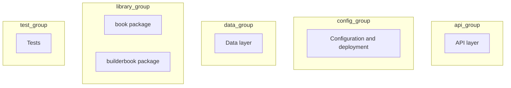

# Architecture report: async-labs/builderbook

> Automated static analysis. **Observed** = directly seen in files/imports/AST; **Inferred** = interpretation from that evidence. Repository code was not executed.

## 1. Repository at a glance

| Item | Value |
| --- | --- |
| Repository | async-labs/builderbook |
| Description | Open source web application to learn JS stack: React, Material-UI, Next.js, Node.js, Express.js, Mongoose, MongoDB database. |
| Language | JavaScript |
| Stars | 3790 |
| Licence | MIT |
| Analysed commit / branch | a71c72e21d8aeb9f00da33d5199b47dd90b7aef0 / master |
| Framework(s) | Express, Next.js, React |
| Files analysed | 607 |
| Components | 6 |

## 2. Architecture in one minute

async-labs/builderbook - Open source web application to learn JS stack: React, Material-UI, Next.js, Node.js, Express.js, Mongoose, MongoDB database.. This repository was analysed statically from 607 file(s) (0 Python). Detected technologies (observed from imports/manifests): MongoDB, Express, Next.js, React, Jest. Files are grouped into 6 component(s): API layer, book package, builderbook package, Configuration and deployment, Data layer, Tests. Findings below distinguish observed facts from inferred interpretation.

## 3. High-level block diagram

## 4. Main components

### API layer (`api_layer`)

- **Kind:** api
- **Status:** Observed
- **Confidence:** 0.85
- **Responsibility:** Groups 92 file(s) under api layer (observed from repository paths and static analysis).
- **Paths:** `book/5-end/lib/api/admin.js`, `book/5-end/lib/api/customer.js`, `book/5-end/lib/api/public.js`, `book/5-end/lib/api/sendRequest.js`, `book/5-end/server/api/admin.js`, `book/5-end/server/api/customer.js`, `book/5-end/server/api/index.js`, `book/5-end/server/api/public.js`, `book/6-begin/lib/api/admin.js`, `book/6-begin/lib/api/customer.js`, `book/6-begin/lib/api/public.js`, `book/6-begin/lib/api/sendRequest.js`, `book/6-begin/server/api/admin.js`, `book/6-begin/server/api/customer.js`, `book/6-begin/server/api/index.js`, `book/6-begin/server/api/public.js`, `book/6-end/lib/api/admin.js`, `book/6-end/lib/api/customer.js`, `book/6-end/lib/api/public.js`, `book/6-end/lib/api/sendRequest.js`, `book/6-end/lib/api/user.js`, `book/6-end/server/api/admin.js`, `book/6-end/server/api/customer.js`, `book/6-end/server/api/index.js`, `book/6-end/server/api/public.js`, `book/7-begin/lib/api/admin.js`, `book/7-begin/lib/api/customer.js`, `book/7-begin/lib/api/public.js`, `book/7-begin/lib/api/sendRequest.js`, `book/7-begin/server/api/admin.js`, `book/7-begin/server/api/customer.js`, `book/7-begin/server/api/index.js`, `book/7-begin/server/api/public.js`, `book/7-end/lib/api/admin.js`, `book/7-end/lib/api/customer.js`, `book/7-end/lib/api/public.js`, `book/7-end/lib/api/sendRequest.js`, `book/7-end/server/api/admin.js`, `book/7-end/server/api/customer.js`, `book/7-end/server/api/index.js`, `book/7-end/server/api/public.js`, `book/8-begin/lib/api/admin.js`, `book/8-begin/lib/api/customer.js`, `book/8-begin/lib/api/public.js`, `book/8-begin/lib/api/sendRequest.js`, `book/8-begin/server/api/admin.js`, `book/8-begin/server/api/customer.js`, `book/8-begin/server/api/index.js`, `book/8-begin/server/api/public.js`, `book/8-end/lib/api/admin.js`, `book/8-end/lib/api/customer.js`, `book/8-end/lib/api/public.js`, `book/8-end/lib/api/sendRequest.js`, `book/8-end/server/api/admin.js`, `book/8-end/server/api/customer.js`, `book/8-end/server/api/index.js`, `book/8-end/server/api/public.js`, `book/9-begin/lib/api/admin.js`, `book/9-begin/lib/api/customer.js`, `book/9-begin/lib/api/public.js`, `book/9-begin/lib/api/sendRequest.js`, `book/9-begin/server/api/admin.js`, `book/9-begin/server/api/customer.js`, `book/9-begin/server/api/index.js`, `book/9-begin/server/api/public.js`, `book/9-end-functional/lib/api/admin.js`, `book/9-end-functional/lib/api/customer.js`, `book/9-end-functional/lib/api/getRootUrl.js`, `book/9-end-functional/lib/api/public.js`, `book/9-end-functional/lib/api/sendRequest.js`, `book/9-end-functional/server/api/admin.js`, `book/9-end-functional/server/api/customer.js`, `book/9-end-functional/server/api/index.js`, `book/9-end-functional/server/api/public.js`, `book/9-end/lib/api/admin.js`, `book/9-end/lib/api/customer.js`, `book/9-end/lib/api/getRootUrl.js`, `book/9-end/lib/api/public.js`, `book/9-end/lib/api/sendRequest.js`, `book/9-end/server/api/admin.js`, `book/9-end/server/api/customer.js`, `book/9-end/server/api/index.js`, `book/9-end/server/api/public.js`, `builderbook/lib/api/admin.js`, `builderbook/lib/api/customer.js`, `builderbook/lib/api/getRootUrl.js`, `builderbook/lib/api/public.js`, `builderbook/lib/api/sendRequest.js`, `builderbook/server/api/admin.js`, `builderbook/server/api/customer.js`, `builderbook/server/api/index.js`, `builderbook/server/api/public.js`
- **Evidence:** [book/5-end/lib/api/admin.js](https://github.com/async-labs/builderbook/blob/a71c72e21d8aeb9f00da33d5199b47dd90b7aef0/book/5-end/lib/api/admin.js); [book/5-end/lib/api/customer.js](https://github.com/async-labs/builderbook/blob/a71c72e21d8aeb9f00da33d5199b47dd90b7aef0/book/5-end/lib/api/customer.js); [book/5-end/lib/api/public.js](https://github.com/async-labs/builderbook/blob/a71c72e21d8aeb9f00da33d5199b47dd90b7aef0/book/5-end/lib/api/public.js); [book/5-end/lib/api/sendRequest.js](https://github.com/async-labs/builderbook/blob/a71c72e21d8aeb9f00da33d5199b47dd90b7aef0/book/5-end/lib/api/sendRequest.js); [book/5-end/server/api/admin.js](https://github.com/async-labs/builderbook/blob/a71c72e21d8aeb9f00da33d5199b47dd90b7aef0/book/5-end/server/api/admin.js); [book/5-end/server/api/customer.js](https://github.com/async-labs/builderbook/blob/a71c72e21d8aeb9f00da33d5199b47dd90b7aef0/book/5-end/server/api/customer.js); [book/5-end/server/api/index.js](https://github.com/async-labs/builderbook/blob/a71c72e21d8aeb9f00da33d5199b47dd90b7aef0/book/5-end/server/api/index.js); [book/5-end/server/api/public.js](https://github.com/async-labs/builderbook/blob/a71c72e21d8aeb9f00da33d5199b47dd90b7aef0/book/5-end/server/api/public.js)

### book package (`book`)

- **Kind:** library
- **Status:** Observed
- **Confidence:** 0.85
- **Responsibility:** Groups 349 file(s) under book package (observed from repository paths and static analysis).
- **Paths:** `book/1-begin/.eslintrc.js`, `book/1-begin/test.jsx`, `book/1-end/.eslintrc.js`, `book/1-end/components/Header.jsx`, `book/1-end/components/SharedStyles.js`, `book/1-end/lib/theme.js`, `book/1-end/pages/_app.jsx`, `book/1-end/pages/_document.jsx`, `book/1-end/pages/index.jsx`, `book/2-begin/.eslintrc.js`, `book/2-begin/components/Header.jsx`, `book/2-begin/components/SharedStyles.js`, `book/2-begin/lib/theme.js`, `book/2-begin/pages/_app.jsx`, `book/2-begin/pages/_document.jsx`, `book/2-begin/pages/index.jsx`, `book/2-end/.eslintrc.js`, `book/2-end/components/Header.jsx`, `book/2-end/components/MenuWithAvatar.jsx`, `book/2-end/components/SharedStyles.js`, `book/2-end/lib/theme.js`, `book/2-end/pages/_app.jsx`, `book/2-end/pages/_document.jsx`, `book/2-end/pages/index.jsx`, `book/2-end/server/server.js`, `book/3-begin/.eslintrc.js`, `book/3-begin/components/Header.jsx`, `book/3-begin/components/MenuWithAvatar.jsx`, `book/3-begin/components/SharedStyles.js`, `book/3-begin/lib/theme.js`, `book/3-begin/pages/_app.jsx`, `book/3-begin/pages/_document.jsx`, `book/3-begin/pages/index.jsx`, `book/3-begin/server/server.js`, `book/3-end/.eslintrc.js`, `book/3-end/components/Header.jsx`, `book/3-end/components/MenuWithAvatar.jsx`, `book/3-end/components/SharedStyles.js`, `book/3-end/lib/theme.js`, `book/3-end/lib/withAuth.jsx`, `book/3-end/pages/_app.jsx`, `book/3-end/pages/_document.jsx`, `book/3-end/pages/index.jsx`, `book/3-end/pages/login.jsx`, `book/3-end/server/google.js`, `book/3-end/server/server.js`, `book/3-end/server/utils/slugify.js`, `book/4-begin/.eslintrc.js`, `book/4-begin/components/Header.jsx`, `book/4-begin/components/MenuWithAvatar.jsx`, `book/4-begin/components/SharedStyles.js`, `book/4-begin/lib/theme.js`, `book/4-begin/lib/withAuth.jsx`, `book/4-begin/pages/_app.jsx`, `book/4-begin/pages/_document.jsx`, `book/4-begin/pages/index.jsx`, `book/4-begin/pages/login.jsx`, `book/4-begin/server/google.js`, `book/4-begin/server/server.js`, `book/4-begin/server/utils/slugify.js`, `book/4-end/.eslintrc.js`, `book/4-end/components/Header.jsx`, `book/4-end/components/MenuWithAvatar.jsx`, `book/4-end/components/Notifier.jsx`, `book/4-end/components/SharedStyles.js`, `book/4-end/lib/notify.js`, `book/4-end/lib/theme.js`, `book/4-end/lib/withAuth.jsx`, `book/4-end/pages/_app.jsx`, `book/4-end/pages/_document.jsx`, `book/4-end/pages/index.jsx`, `book/4-end/pages/login.jsx`, `book/4-end/server/aws-ses.js`, `book/4-end/server/google.js`, `book/4-end/server/server.js`, `book/4-end/server/utils/slugify.js`, `book/5-begin/.eslintrc.js`, `book/5-begin/components/Header.jsx`, `book/5-begin/components/MenuWithAvatar.jsx`, `book/5-begin/components/Notifier.jsx`, `book/5-begin/components/SharedStyles.js`, `book/5-begin/lib/notify.js`, `book/5-begin/lib/theme.js`, `book/5-begin/lib/withAuth.jsx`, `book/5-begin/pages/_app.jsx`, `book/5-begin/pages/_document.jsx`, `book/5-begin/pages/index.jsx`, `book/5-begin/pages/login.jsx`, `book/5-begin/server/aws-ses.js`, `book/5-begin/server/google.js`, `book/5-begin/server/server.js`, `book/5-begin/server/utils/slugify.js`, `book/5-end/.eslintrc.js`, `book/5-end/components/Header.jsx`, `book/5-end/components/MenuWithAvatar.jsx`, `book/5-end/components/Notifier.jsx`, `book/5-end/components/SharedStyles.js`, `book/5-end/lib/notify.js`, `book/5-end/lib/theme.js`, `book/5-end/lib/withAuth.jsx`, `book/5-end/pages/_app.jsx`, `book/5-end/pages/_document.jsx`, `book/5-end/pages/admin/index.jsx`, `book/5-end/pages/index.jsx`, `book/5-end/pages/public/login.jsx`, `book/5-end/pages/public/read-chapter.jsx`, `book/5-end/server/aws-ses.js`, `book/5-end/server/google.js`, `book/5-end/server/server.js`, `book/5-end/server/utils/slugify.js`, `book/6-begin/.eslintrc.js`, `book/6-begin/components/Header.jsx`, `book/6-begin/components/MenuWithAvatar.jsx`, `book/6-begin/components/Notifier.jsx`, `book/6-begin/components/SharedStyles.js`, `book/6-begin/lib/notify.js`, `book/6-begin/lib/theme.js`, `book/6-begin/lib/withAuth.jsx`, `book/6-begin/pages/_app.jsx`, `book/6-begin/pages/_document.jsx`, `book/6-begin/pages/admin/index.jsx`, `book/6-begin/pages/index.jsx`, `book/6-begin/pages/public/login.jsx`, `book/6-begin/pages/public/read-chapter.jsx`, `book/6-begin/server/aws-ses.js`, `book/6-begin/server/google.js`, `book/6-begin/server/server.js`, `book/6-begin/server/utils/slugify.js`, `book/6-end/.eslintrc.js`, `book/6-end/components/Header.jsx`, `book/6-end/components/MenuWithAvatar.jsx`, `book/6-end/components/Notifier.jsx`, `book/6-end/components/SharedStyles.js`, `book/6-end/components/admin/EditBook.jsx`, `book/6-end/lib/notify.js`, `book/6-end/lib/theme.js`, `book/6-end/lib/withAuth.jsx`, `book/6-end/pages/_app.jsx`, `book/6-end/pages/_document.jsx`, `book/6-end/pages/admin/add-book.jsx`, `book/6-end/pages/admin/book-detail.jsx`, `book/6-end/pages/admin/edit-book.jsx`, `book/6-end/pages/admin/index.jsx`, `book/6-end/pages/customer/my-books.jsx`, `book/6-end/pages/index.jsx`, `book/6-end/pages/public/login.jsx`, `book/6-end/pages/public/read-chapter.jsx`, `book/6-end/server/aws-ses.js`, `book/6-end/server/github.js`, `book/6-end/server/google.js`, `book/6-end/server/routesWithSlug.js`, `book/6-end/server/server.js`, `book/6-end/server/utils/slugify.js`, `book/7-begin/.eslintrc.js`, `book/7-begin/components/Header.jsx`, `book/7-begin/components/MenuWithAvatar.jsx`, `book/7-begin/components/Notifier.jsx`, `book/7-begin/components/SharedStyles.js`, `book/7-begin/components/admin/EditBook.jsx`, `book/7-begin/lib/notify.js`, `book/7-begin/lib/theme.js`, `book/7-begin/lib/withAuth.jsx`, `book/7-begin/pages/_app.jsx`, `book/7-begin/pages/_document.jsx`, `book/7-begin/pages/admin/add-book.jsx`, `book/7-begin/pages/admin/book-detail.jsx`, `book/7-begin/pages/admin/edit-book.jsx`, `book/7-begin/pages/admin/index.jsx`, `book/7-begin/pages/customer/my-books.jsx`, `book/7-begin/pages/index.jsx`, `book/7-begin/pages/public/login.jsx`, `book/7-begin/pages/public/read-chapter.jsx`, `book/7-begin/server/aws-ses.js`, `book/7-begin/server/github.js`, `book/7-begin/server/google.js`, `book/7-begin/server/routesWithSlug.js`, `book/7-begin/server/server.js`, `book/7-begin/server/utils/slugify.js`, `book/7-end/.eslintrc.js`, `book/7-end/components/Header.jsx`, `book/7-end/components/MenuWithAvatar.jsx`, `book/7-end/components/Notifier.jsx`, `book/7-end/components/SharedStyles.js`, `book/7-end/components/admin/EditBook.jsx`, `book/7-end/lib/notify.js`, `book/7-end/lib/theme.js`, `book/7-end/lib/withAuth.jsx`, `book/7-end/pages/_app.jsx`, `book/7-end/pages/_document.jsx`, `book/7-end/pages/admin/add-book.jsx`, `book/7-end/pages/admin/book-detail.jsx`, `book/7-end/pages/admin/edit-book.jsx`, `book/7-end/pages/admin/index.jsx`, `book/7-end/pages/customer/my-books.jsx`, `book/7-end/pages/index.jsx`, `book/7-end/pages/public/login.jsx`, `book/7-end/pages/public/read-chapter.jsx`, `book/7-end/server/aws-ses.js`, `book/7-end/server/github.js`, `book/7-end/server/google.js`, `book/7-end/server/routesWithSlug.js`, `book/7-end/server/server.js`, `book/7-end/server/utils/slugify.js`, `book/8-begin/.eslintrc.js`, `book/8-begin/components/Header.jsx`, `book/8-begin/components/MenuWithAvatar.jsx`, `book/8-begin/components/Notifier.jsx`, `book/8-begin/components/SharedStyles.js`, `book/8-begin/components/admin/EditBook.jsx`, `book/8-begin/lib/notify.js`, `book/8-begin/lib/theme.js`, `book/8-begin/lib/withAuth.jsx`, `book/8-begin/pages/_app.jsx`, `book/8-begin/pages/_document.jsx`, `book/8-begin/pages/admin/add-book.jsx`, `book/8-begin/pages/admin/book-detail.jsx`, `book/8-begin/pages/admin/edit-book.jsx`, `book/8-begin/pages/admin/index.jsx`, `book/8-begin/pages/customer/my-books.jsx`, `book/8-begin/pages/index.jsx`, `book/8-begin/pages/public/login.jsx`, `book/8-begin/pages/public/read-chapter.jsx`, `book/8-begin/server/aws-ses.js`, `book/8-begin/server/github.js`, `book/8-begin/server/google.js`, `book/8-begin/server/routesWithSlug.js`, `book/8-begin/server/server.js`, `book/8-begin/server/utils/slugify.js`, `book/8-end/.eslintrc.js`, `book/8-end/components/Header.jsx`, `book/8-end/components/MenuWithAvatar.jsx`, `book/8-end/components/Notifier.jsx`, `book/8-end/components/SharedStyles.js`, `book/8-end/components/admin/EditBook.jsx`, `book/8-end/components/customer/BuyButton.jsx`, `book/8-end/lib/notify.js`, `book/8-end/lib/theme.js`, `book/8-end/lib/withAuth.jsx`, `book/8-end/next.config.js`, `book/8-end/pages/_app.jsx`, `book/8-end/pages/_document.jsx`, `book/8-end/pages/admin/add-book.jsx`, `book/8-end/pages/admin/book-detail.jsx`, `book/8-end/pages/admin/edit-book.jsx`, `book/8-end/pages/admin/index.jsx`, `book/8-end/pages/customer/my-books.jsx`, `book/8-end/pages/index.jsx`, `book/8-end/pages/public/login.jsx`, `book/8-end/pages/public/read-chapter.jsx`, `book/8-end/server/aws-ses.js`, `book/8-end/server/github.js`, `book/8-end/server/google.js`, `book/8-end/server/mailchimp.js`, `book/8-end/server/routesWithSlug.js`, `book/8-end/server/server.js`, `book/8-end/server/stripe.js`, `book/8-end/server/utils/slugify.js`, `book/9-begin/.eslintrc.js`, `book/9-begin/components/Header.jsx`, `book/9-begin/components/MenuWithAvatar.jsx`, `book/9-begin/components/Notifier.jsx`, `book/9-begin/components/SharedStyles.js`, `book/9-begin/components/admin/EditBook.jsx`, `book/9-begin/components/customer/BuyButton.jsx`, `book/9-begin/lib/notify.js`, `book/9-begin/lib/theme.js`, `book/9-begin/lib/withAuth.jsx`, `book/9-begin/next.config.js`, `book/9-begin/pages/_app.jsx`, `book/9-begin/pages/_document.jsx`, `book/9-begin/pages/admin/add-book.jsx`, `book/9-begin/pages/admin/book-detail.jsx`, `book/9-begin/pages/admin/edit-book.jsx`, `book/9-begin/pages/admin/index.jsx`, `book/9-begin/pages/customer/my-books.jsx`, `book/9-begin/pages/index.jsx`, `book/9-begin/pages/public/login.jsx`, `book/9-begin/pages/public/read-chapter.jsx`, `book/9-begin/server/aws-ses.js`, `book/9-begin/server/github.js`, `book/9-begin/server/google.js`, `book/9-begin/server/mailchimp.js`, `book/9-begin/server/routesWithSlug.js`, `book/9-begin/server/server.js`, `book/9-begin/server/stripe.js`, `book/9-begin/server/utils/slugify.js`, `book/9-end-functional/.eslintrc.js`, `book/9-end-functional/components/Header.jsx`, `book/9-end-functional/components/MenuWithAvatar.jsx`, `book/9-end-functional/components/Notifier.jsx`, `book/9-end-functional/components/SharedStyles.js`, `book/9-end-functional/components/admin/EditBook.jsx`, `book/9-end-functional/components/customer/BuyButton.jsx`, `book/9-end-functional/lib/notify.js`, `book/9-end-functional/lib/theme.js`, `book/9-end-functional/lib/withAuth.jsx`, `book/9-end-functional/next.config.js`, `book/9-end-functional/pages/_app.jsx`, `book/9-end-functional/pages/_document.jsx`, `book/9-end-functional/pages/admin/add-book.jsx`, `book/9-end-functional/pages/admin/book-detail.jsx`, `book/9-end-functional/pages/admin/edit-book.jsx`, `book/9-end-functional/pages/admin/index.jsx`, `book/9-end-functional/pages/customer/my-books.jsx`, `book/9-end-functional/pages/index.jsx`, `book/9-end-functional/pages/public/login.jsx`, `book/9-end-functional/pages/public/read-chapter.jsx`, `book/9-end-functional/server/aws-ses.js`, `book/9-end-functional/server/github.js`, `book/9-end-functional/server/google.js`, `book/9-end-functional/server/logger.js`, `book/9-end-functional/server/mailchimp.js`, `book/9-end-functional/server/routesWithSlug.js`, `book/9-end-functional/server/server.js`, `book/9-end-functional/server/sitemapAndRobots.js`, `book/9-end-functional/server/stripe.js`, `book/9-end-functional/server/utils/slugify.js`, `book/9-end/.eslintrc.js`, `book/9-end/components/Header.jsx`, `book/9-end/components/MenuWithAvatar.jsx`, `book/9-end/components/Notifier.jsx`, `book/9-end/components/SharedStyles.js`, `book/9-end/components/admin/EditBook.jsx`, `book/9-end/components/customer/BuyButton.jsx`, `book/9-end/lib/notify.js`, `book/9-end/lib/theme.js`, `book/9-end/lib/withAuth.jsx`, `book/9-end/next.config.js`, `book/9-end/pages/_app.jsx`, `book/9-end/pages/_document.jsx`, `book/9-end/pages/admin/add-book.jsx`, `book/9-end/pages/admin/book-detail.jsx`, `book/9-end/pages/admin/edit-book.jsx`, `book/9-end/pages/admin/index.jsx`, `book/9-end/pages/customer/my-books.jsx`, `book/9-end/pages/index.jsx`, `book/9-end/pages/public/login.jsx`, `book/9-end/pages/public/read-chapter-f.jsx`, `book/9-end/pages/public/read-chapter.jsx`, `book/9-end/server/aws-ses.js`, `book/9-end/server/github.js`, `book/9-end/server/google.js`, `book/9-end/server/logger.js`, `book/9-end/server/mailchimp.js`, `book/9-end/server/routesWithSlug.js`, `book/9-end/server/server.js`, `book/9-end/server/sitemapAndRobots.js`, `book/9-end/server/stripe.js`, `book/9-end/server/utils/slugify.js`
- **Evidence:** [book/1-begin/.eslintrc.js](https://github.com/async-labs/builderbook/blob/a71c72e21d8aeb9f00da33d5199b47dd90b7aef0/book/1-begin/.eslintrc.js); [book/1-begin/test.jsx](https://github.com/async-labs/builderbook/blob/a71c72e21d8aeb9f00da33d5199b47dd90b7aef0/book/1-begin/test.jsx); [book/1-end/.eslintrc.js](https://github.com/async-labs/builderbook/blob/a71c72e21d8aeb9f00da33d5199b47dd90b7aef0/book/1-end/.eslintrc.js); [book/1-end/components/Header.jsx](https://github.com/async-labs/builderbook/blob/a71c72e21d8aeb9f00da33d5199b47dd90b7aef0/book/1-end/components/Header.jsx); [book/1-end/components/SharedStyles.js](https://github.com/async-labs/builderbook/blob/a71c72e21d8aeb9f00da33d5199b47dd90b7aef0/book/1-end/components/SharedStyles.js); [book/1-end/lib/theme.js](https://github.com/async-labs/builderbook/blob/a71c72e21d8aeb9f00da33d5199b47dd90b7aef0/book/1-end/lib/theme.js); [book/1-end/pages/_app.jsx](https://github.com/async-labs/builderbook/blob/a71c72e21d8aeb9f00da33d5199b47dd90b7aef0/book/1-end/pages/_app.jsx); [book/1-end/pages/_document.jsx](https://github.com/async-labs/builderbook/blob/a71c72e21d8aeb9f00da33d5199b47dd90b7aef0/book/1-end/pages/_document.jsx)

### builderbook package (`builderbook`)

- **Kind:** library
- **Status:** Observed
- **Confidence:** 0.85
- **Responsibility:** Groups 31 file(s) under builderbook package (observed from repository paths and static analysis).
- **Paths:** `builderbook/.eslintrc.js`, `builderbook/components/Header.jsx`, `builderbook/components/MenuWithAvatar.jsx`, `builderbook/components/Notifier.jsx`, `builderbook/components/SharedStyles.js`, `builderbook/components/admin/EditBook.jsx`, `builderbook/components/customer/BuyButton.jsx`, `builderbook/lib/notify.js`, `builderbook/lib/theme.js`, `builderbook/lib/withAuth.jsx`, `builderbook/next.config.js`, `builderbook/pages/_app.jsx`, `builderbook/pages/_document.jsx`, `builderbook/pages/admin/add-book.jsx`, `builderbook/pages/admin/book-detail.jsx`, `builderbook/pages/admin/edit-book.jsx`, `builderbook/pages/admin/index.jsx`, `builderbook/pages/customer/my-books.jsx`, `builderbook/pages/index.jsx`, `builderbook/pages/public/login.jsx`, `builderbook/pages/public/read-chapter.jsx`, `builderbook/server/aws-ses.js`, `builderbook/server/github.js`, `builderbook/server/google.js`, `builderbook/server/logger.js`, `builderbook/server/mailchimp.js`, `builderbook/server/routesWithSlug.js`, `builderbook/server/server.js`, `builderbook/server/sitemapAndRobots.js`, `builderbook/server/stripe.js`, `builderbook/server/utils/slugify.js`
- **Evidence:** [builderbook/.eslintrc.js](https://github.com/async-labs/builderbook/blob/a71c72e21d8aeb9f00da33d5199b47dd90b7aef0/builderbook/.eslintrc.js); [builderbook/components/Header.jsx](https://github.com/async-labs/builderbook/blob/a71c72e21d8aeb9f00da33d5199b47dd90b7aef0/builderbook/components/Header.jsx); [builderbook/components/MenuWithAvatar.jsx](https://github.com/async-labs/builderbook/blob/a71c72e21d8aeb9f00da33d5199b47dd90b7aef0/builderbook/components/MenuWithAvatar.jsx); [builderbook/components/Notifier.jsx](https://github.com/async-labs/builderbook/blob/a71c72e21d8aeb9f00da33d5199b47dd90b7aef0/builderbook/components/Notifier.jsx); [builderbook/components/SharedStyles.js](https://github.com/async-labs/builderbook/blob/a71c72e21d8aeb9f00da33d5199b47dd90b7aef0/builderbook/components/SharedStyles.js); [builderbook/components/admin/EditBook.jsx](https://github.com/async-labs/builderbook/blob/a71c72e21d8aeb9f00da33d5199b47dd90b7aef0/builderbook/components/admin/EditBook.jsx); [builderbook/components/customer/BuyButton.jsx](https://github.com/async-labs/builderbook/blob/a71c72e21d8aeb9f00da33d5199b47dd90b7aef0/builderbook/components/customer/BuyButton.jsx); [builderbook/lib/notify.js](https://github.com/async-labs/builderbook/blob/a71c72e21d8aeb9f00da33d5199b47dd90b7aef0/builderbook/lib/notify.js)

### Configuration and deployment (`config`)

- **Kind:** config
- **Status:** Observed
- **Confidence:** 0.85
- **Responsibility:** Groups 27 file(s) under configuration and deployment (observed from repository paths and static analysis).
- **Paths:** `book/1-begin/package.json`, `book/1-end/package.json`, `book/2-begin/package.json`, `book/2-end/package.json`, `book/3-begin/package.json`, `book/3-end/package.json`, `book/4-begin/package.json`, `book/4-end/package.json`, `book/5-begin/package.json`, `book/5-end/package.json`, `book/6-begin/package.json`, `book/6-end/package.json`, `book/7-begin/package.json`, `book/7-end/package.json`, `book/8-begin/package.json`, `book/8-end/package.json`, `book/9-begin/.elasticbeanstalk/config.yml`, `book/9-begin/package.json`, `book/9-end-functional/.elasticbeanstalk/config.yml`, `book/9-end-functional/.env.example`, `book/9-end-functional/package.json`, `book/9-end/.elasticbeanstalk/config.yml`, `book/9-end/package.json`, `book/package.json`, `builderbook/.elasticbeanstalk/config.yml`, `builderbook/.env.example`, `builderbook/package.json`
- **Evidence:** [book/1-begin/package.json](https://github.com/async-labs/builderbook/blob/a71c72e21d8aeb9f00da33d5199b47dd90b7aef0/book/1-begin/package.json); [book/1-end/package.json](https://github.com/async-labs/builderbook/blob/a71c72e21d8aeb9f00da33d5199b47dd90b7aef0/book/1-end/package.json); [book/2-begin/package.json](https://github.com/async-labs/builderbook/blob/a71c72e21d8aeb9f00da33d5199b47dd90b7aef0/book/2-begin/package.json); [book/2-end/package.json](https://github.com/async-labs/builderbook/blob/a71c72e21d8aeb9f00da33d5199b47dd90b7aef0/book/2-end/package.json); [book/3-begin/package.json](https://github.com/async-labs/builderbook/blob/a71c72e21d8aeb9f00da33d5199b47dd90b7aef0/book/3-begin/package.json); [book/3-end/package.json](https://github.com/async-labs/builderbook/blob/a71c72e21d8aeb9f00da33d5199b47dd90b7aef0/book/3-end/package.json); [book/4-begin/package.json](https://github.com/async-labs/builderbook/blob/a71c72e21d8aeb9f00da33d5199b47dd90b7aef0/book/4-begin/package.json); [book/4-end/package.json](https://github.com/async-labs/builderbook/blob/a71c72e21d8aeb9f00da33d5199b47dd90b7aef0/book/4-end/package.json)

### Data layer (`data_layer`)

- **Kind:** data
- **Status:** Observed
- **Confidence:** 0.85
- **Responsibility:** Groups 57 file(s) under data layer (observed from repository paths and static analysis).
- **Paths:** `book/2-end/server/models/User.js`, `book/3-begin/server/models/User.js`, `book/3-end/server/models/User.js`, `book/4-begin/server/models/User.js`, `book/4-end/server/models/EmailTemplate.js`, `book/4-end/server/models/User.js`, `book/5-begin/server/models/EmailTemplate.js`, `book/5-begin/server/models/User.js`, `book/5-end/server/models/Book.js`, `book/5-end/server/models/Chapter.js`, `book/5-end/server/models/EmailTemplate.js`, `book/5-end/server/models/User.js`, `book/6-begin/server/models/Book.js`, `book/6-begin/server/models/Chapter.js`, `book/6-begin/server/models/EmailTemplate.js`, `book/6-begin/server/models/User.js`, `book/6-end/server/models/Book.js`, `book/6-end/server/models/Chapter.js`, `book/6-end/server/models/EmailTemplate.js`, `book/6-end/server/models/User.js`, `book/7-begin/server/models/Book.js`, `book/7-begin/server/models/Chapter.js`, `book/7-begin/server/models/EmailTemplate.js`, `book/7-begin/server/models/User.js`, `book/7-end/server/models/Book.js`, `book/7-end/server/models/Chapter.js`, `book/7-end/server/models/EmailTemplate.js`, `book/7-end/server/models/User.js`, `book/8-begin/server/models/Book.js`, `book/8-begin/server/models/Chapter.js`, `book/8-begin/server/models/EmailTemplate.js`, `book/8-begin/server/models/User.js`, `book/8-end/server/models/Book.js`, `book/8-end/server/models/Chapter.js`, `book/8-end/server/models/EmailTemplate.js`, `book/8-end/server/models/Purchase.js`, `book/8-end/server/models/User.js`, `book/9-begin/server/models/Book.js`, `book/9-begin/server/models/Chapter.js`, `book/9-begin/server/models/EmailTemplate.js`, `book/9-begin/server/models/Purchase.js`, `book/9-begin/server/models/User.js`, `book/9-end-functional/server/models/Book.js`, `book/9-end-functional/server/models/Chapter.js`, `book/9-end-functional/server/models/EmailTemplate.js`, `book/9-end-functional/server/models/Purchase.js`, `book/9-end-functional/server/models/User.js`, `book/9-end/server/models/Book.js`, `book/9-end/server/models/Chapter.js`, `book/9-end/server/models/EmailTemplate.js`, `book/9-end/server/models/Purchase.js`, `book/9-end/server/models/User.js`, `builderbook/server/models/Book.js`, `builderbook/server/models/Chapter.js`, `builderbook/server/models/EmailTemplate.js`, `builderbook/server/models/Purchase.js`, `builderbook/server/models/User.js`
- **Evidence:** [book/2-end/server/models/User.js](https://github.com/async-labs/builderbook/blob/a71c72e21d8aeb9f00da33d5199b47dd90b7aef0/book/2-end/server/models/User.js); [book/3-begin/server/models/User.js](https://github.com/async-labs/builderbook/blob/a71c72e21d8aeb9f00da33d5199b47dd90b7aef0/book/3-begin/server/models/User.js); [book/3-end/server/models/User.js](https://github.com/async-labs/builderbook/blob/a71c72e21d8aeb9f00da33d5199b47dd90b7aef0/book/3-end/server/models/User.js); [book/4-begin/server/models/User.js](https://github.com/async-labs/builderbook/blob/a71c72e21d8aeb9f00da33d5199b47dd90b7aef0/book/4-begin/server/models/User.js); [book/4-end/server/models/EmailTemplate.js](https://github.com/async-labs/builderbook/blob/a71c72e21d8aeb9f00da33d5199b47dd90b7aef0/book/4-end/server/models/EmailTemplate.js); [book/4-end/server/models/User.js](https://github.com/async-labs/builderbook/blob/a71c72e21d8aeb9f00da33d5199b47dd90b7aef0/book/4-end/server/models/User.js); [book/5-begin/server/models/EmailTemplate.js](https://github.com/async-labs/builderbook/blob/a71c72e21d8aeb9f00da33d5199b47dd90b7aef0/book/5-begin/server/models/EmailTemplate.js); [book/5-begin/server/models/User.js](https://github.com/async-labs/builderbook/blob/a71c72e21d8aeb9f00da33d5199b47dd90b7aef0/book/5-begin/server/models/User.js)

### Tests (`tests`)

- **Kind:** test
- **Status:** Observed
- **Confidence:** 0.85
- **Responsibility:** Groups 13 file(s) under tests (observed from repository paths and static analysis).
- **Paths:** `book/4-end/test/server/utils/slugify.test.js`, `book/5-begin/test/server/utils/slugify.test.js`, `book/5-end/test/server/utils/slugify.test.js`, `book/6-begin/test/server/utils/slugify.test.js`, `book/6-end/test/server/utils/slugify.test.js`, `book/7-begin/test/server/utils/slugify.test.js`, `book/7-end/test/server/utils/slugify.test.js`, `book/8-begin/test/server/utils/slugify.test.js`, `book/8-end/test/server/utils/slugify.test.js`, `book/9-begin/test/server/utils/slugify.test.js`, `book/9-end-functional/test/server/utils/slugify.test.js`, `book/9-end/test/server/utils/slugify.test.js`, `builderbook/test/server/utils/slugify.test.js`
- **Evidence:** [book/4-end/test/server/utils/slugify.test.js](https://github.com/async-labs/builderbook/blob/a71c72e21d8aeb9f00da33d5199b47dd90b7aef0/book/4-end/test/server/utils/slugify.test.js); [book/5-begin/test/server/utils/slugify.test.js](https://github.com/async-labs/builderbook/blob/a71c72e21d8aeb9f00da33d5199b47dd90b7aef0/book/5-begin/test/server/utils/slugify.test.js); [book/5-end/test/server/utils/slugify.test.js](https://github.com/async-labs/builderbook/blob/a71c72e21d8aeb9f00da33d5199b47dd90b7aef0/book/5-end/test/server/utils/slugify.test.js); [book/6-begin/test/server/utils/slugify.test.js](https://github.com/async-labs/builderbook/blob/a71c72e21d8aeb9f00da33d5199b47dd90b7aef0/book/6-begin/test/server/utils/slugify.test.js); [book/6-end/test/server/utils/slugify.test.js](https://github.com/async-labs/builderbook/blob/a71c72e21d8aeb9f00da33d5199b47dd90b7aef0/book/6-end/test/server/utils/slugify.test.js); [book/7-begin/test/server/utils/slugify.test.js](https://github.com/async-labs/builderbook/blob/a71c72e21d8aeb9f00da33d5199b47dd90b7aef0/book/7-begin/test/server/utils/slugify.test.js); [book/7-end/test/server/utils/slugify.test.js](https://github.com/async-labs/builderbook/blob/a71c72e21d8aeb9f00da33d5199b47dd90b7aef0/book/7-end/test/server/utils/slugify.test.js); [book/8-begin/test/server/utils/slugify.test.js](https://github.com/async-labs/builderbook/blob/a71c72e21d8aeb9f00da33d5199b47dd90b7aef0/book/8-begin/test/server/utils/slugify.test.js)

## 5. Execution flow

**Observed** entry point(s):

- [book/1-end/pages/index.jsx](https://github.com/async-labs/builderbook/blob/a71c72e21d8aeb9f00da33d5199b47dd90b7aef0/book/1-end/pages/index.jsx)
- [book/2-begin/pages/index.jsx](https://github.com/async-labs/builderbook/blob/a71c72e21d8aeb9f00da33d5199b47dd90b7aef0/book/2-begin/pages/index.jsx)
- [book/2-end/pages/index.jsx](https://github.com/async-labs/builderbook/blob/a71c72e21d8aeb9f00da33d5199b47dd90b7aef0/book/2-end/pages/index.jsx)
- [book/2-end/server/server.js](https://github.com/async-labs/builderbook/blob/a71c72e21d8aeb9f00da33d5199b47dd90b7aef0/book/2-end/server/server.js)
- [book/3-begin/pages/index.jsx](https://github.com/async-labs/builderbook/blob/a71c72e21d8aeb9f00da33d5199b47dd90b7aef0/book/3-begin/pages/index.jsx)
- [book/3-begin/server/server.js](https://github.com/async-labs/builderbook/blob/a71c72e21d8aeb9f00da33d5199b47dd90b7aef0/book/3-begin/server/server.js)
- [book/3-end/pages/index.jsx](https://github.com/async-labs/builderbook/blob/a71c72e21d8aeb9f00da33d5199b47dd90b7aef0/book/3-end/pages/index.jsx)
- [book/3-end/server/server.js](https://github.com/async-labs/builderbook/blob/a71c72e21d8aeb9f00da33d5199b47dd90b7aef0/book/3-end/server/server.js)
- [book/4-begin/pages/index.jsx](https://github.com/async-labs/builderbook/blob/a71c72e21d8aeb9f00da33d5199b47dd90b7aef0/book/4-begin/pages/index.jsx)
- [book/4-begin/server/server.js](https://github.com/async-labs/builderbook/blob/a71c72e21d8aeb9f00da33d5199b47dd90b7aef0/book/4-begin/server/server.js)
- [book/4-end/pages/index.jsx](https://github.com/async-labs/builderbook/blob/a71c72e21d8aeb9f00da33d5199b47dd90b7aef0/book/4-end/pages/index.jsx)
- [book/4-end/server/server.js](https://github.com/async-labs/builderbook/blob/a71c72e21d8aeb9f00da33d5199b47dd90b7aef0/book/4-end/server/server.js)

Representative flow (derived from observed entry points and the import graph; steps beyond the entry point are **Inferred**):

1. Execution starts at an observed entry point listed above, if present.
2. No internal import relationships between components were observed.

## 6. Project structure

### `(root)`

- `.gitignore` - other (181 bytes)
- `.npmignore` - other (160 bytes)
- `CODE-OF-CONDUCT.md` - docs (3217 bytes)
- `LICENSE.md` - docs (1067 bytes)
- `README.md` - docs (29038 bytes)

### `.github`

- `.github/FUNDING.yml` - config (83 bytes)

### `.vscode`

- `.vscode/extensions.json` - config (56 bytes)
- `.vscode/settings.json` - config (1996 bytes)

### `book`

- `book/1-begin/.eslintrc.js` - source, JavaScript (1628 bytes)
- `book/1-begin/.gitignore` - other (93 bytes)
- `book/1-begin/package.json` - manifest (517 bytes)
- `book/1-begin/test.jsx` - source, JavaScript (67 bytes)
- `book/1-end/.eslintrc.js` - source, JavaScript (1628 bytes)
- `book/1-end/.gitignore` - other (98 bytes)
- `book/1-end/components/Header.jsx` - source, JavaScript (562 bytes)
- `book/1-end/components/SharedStyles.js` - source, JavaScript (864 bytes)
- `book/1-end/lib/theme.js` - source, JavaScript (290 bytes)
- `book/1-end/package.json` - manifest (963 bytes)
- `book/1-end/pages/_app.jsx` - source, JavaScript (1305 bytes)
- `book/1-end/pages/_document.jsx` - source, JavaScript (3784 bytes)
- `book/1-end/pages/index.jsx` - source, JavaScript (401 bytes)
- `book/2-begin/.eslintrc.js` - source, JavaScript (1628 bytes)
- `book/2-begin/.gitignore` - other (98 bytes)
- `book/2-begin/components/Header.jsx` - source, JavaScript (562 bytes)
- `book/2-begin/components/SharedStyles.js` - source, JavaScript (864 bytes)
- `book/2-begin/lib/theme.js` - source, JavaScript (290 bytes)
- `book/2-begin/package.json` - manifest (1133 bytes)
- `book/2-begin/pages/_app.jsx` - source, JavaScript (1305 bytes)
- `book/2-begin/pages/_document.jsx` - source, JavaScript (3784 bytes)
- `book/2-begin/pages/index.jsx` - source, JavaScript (306 bytes)
- `book/2-end/.eslintrc.js` - source, JavaScript (1653 bytes)
- `book/2-end/.gitignore` - other (98 bytes)
- `book/2-end/components/Header.jsx` - source, JavaScript (1968 bytes)
- `book/2-end/components/MenuWithAvatar.jsx` - source, JavaScript (2023 bytes)
- `book/2-end/components/SharedStyles.js` - source, JavaScript (864 bytes)
- `book/2-end/lib/theme.js` - source, JavaScript (290 bytes)
- `book/2-end/package.json` - manifest (1193 bytes)
- `book/2-end/pages/_app.jsx` - source, JavaScript (1339 bytes)
- `book/2-end/pages/_document.jsx` - source, JavaScript (3784 bytes)
- `book/2-end/pages/index.jsx` - source, JavaScript (717 bytes)
- `book/2-end/server/models/User.js` - source, JavaScript (680 bytes)
- `book/2-end/server/server.js` - source, JavaScript (1575 bytes)
- `book/3-begin/.eslintrc.js` - source, JavaScript (1653 bytes)
- `book/3-begin/.gitignore` - other (98 bytes)
- `book/3-begin/components/Header.jsx` - source, JavaScript (1968 bytes)
- `book/3-begin/components/MenuWithAvatar.jsx` - source, JavaScript (2023 bytes)
- `book/3-begin/components/SharedStyles.js` - source, JavaScript (864 bytes)
- `book/3-begin/lib/theme.js` - source, JavaScript (290 bytes)
- `book/3-begin/package.json` - manifest (1313 bytes)
- `book/3-begin/pages/_app.jsx` - source, JavaScript (1339 bytes)
- `book/3-begin/pages/_document.jsx` - source, JavaScript (3784 bytes)
- `book/3-begin/pages/index.jsx` - source, JavaScript (717 bytes)
- `book/3-begin/server/models/User.js` - source, JavaScript (680 bytes)
- `book/3-begin/server/server.js` - source, JavaScript (1636 bytes)
- `book/3-end/.eslintrc.js` - source, JavaScript (1653 bytes)
- `book/3-end/.gitignore` - other (98 bytes)
- `book/3-end/components/Header.jsx` - source, JavaScript (1968 bytes)
- `book/3-end/components/MenuWithAvatar.jsx` - source, JavaScript (2023 bytes)
- `book/3-end/components/SharedStyles.js` - source, JavaScript (864 bytes)
- `book/3-end/lib/theme.js` - source, JavaScript (290 bytes)
- `book/3-end/lib/withAuth.jsx` - source, JavaScript (1614 bytes)
- `book/3-end/package.json` - manifest (1284 bytes)
- `book/3-end/pages/_app.jsx` - source, JavaScript (1725 bytes)
- `book/3-end/pages/_document.jsx` - source, JavaScript (3784 bytes)
- `book/3-end/pages/index.jsx` - source, JavaScript (850 bytes)
- `book/3-end/pages/login.jsx` - source, JavaScript (927 bytes)
- `book/3-end/server/google.js` - source, JavaScript (1962 bytes)
- `book/3-end/server/models/User.js` - source, JavaScript (1890 bytes)
- `book/3-end/server/server.js` - source, JavaScript (1625 bytes)
- `book/3-end/server/utils/slugify.js` - source, JavaScript (595 bytes)
- `book/4-begin/.eslintrc.js` - source, JavaScript (1653 bytes)
- `book/4-begin/.gitignore` - other (98 bytes)
- `book/4-begin/components/Header.jsx` - source, JavaScript (1967 bytes)
- `book/4-begin/components/MenuWithAvatar.jsx` - source, JavaScript (2023 bytes)
- `book/4-begin/components/SharedStyles.js` - source, JavaScript (864 bytes)
- `book/4-begin/lib/theme.js` - source, JavaScript (290 bytes)
- `book/4-begin/lib/withAuth.jsx` - source, JavaScript (1614 bytes)
- `book/4-begin/package.json` - manifest (1337 bytes)
- `book/4-begin/pages/_app.jsx` - source, JavaScript (1725 bytes)
- `book/4-begin/pages/_document.jsx` - source, JavaScript (3784 bytes)
- `book/4-begin/pages/index.jsx` - source, JavaScript (850 bytes)
- `book/4-begin/pages/login.jsx` - source, JavaScript (927 bytes)
- `book/4-begin/server/google.js` - source, JavaScript (1964 bytes)
- `book/4-begin/server/models/User.js` - source, JavaScript (1890 bytes)
- `book/4-begin/server/server.js` - source, JavaScript (1377 bytes)
- `book/4-begin/server/utils/slugify.js` - source, JavaScript (595 bytes)
- `book/4-end/.eslintrc.js` - source, JavaScript (1653 bytes)
- `book/4-end/.gitignore` - other (98 bytes)
- `book/4-end/components/Header.jsx` - source, JavaScript (1968 bytes)
- `book/4-end/components/MenuWithAvatar.jsx` - source, JavaScript (2023 bytes)
- `book/4-end/components/Notifier.jsx` - source, JavaScript (1108 bytes)
- `book/4-end/components/SharedStyles.js` - source, JavaScript (864 bytes)
- `book/4-end/lib/notify.js` - source, JavaScript (172 bytes)
- `book/4-end/lib/theme.js` - source, JavaScript (290 bytes)
- `book/4-end/lib/withAuth.jsx` - source, JavaScript (1614 bytes)
- `book/4-end/package.json` - manifest (1422 bytes)
- `book/4-end/pages/_app.jsx` - source, JavaScript (1795 bytes)
- `book/4-end/pages/_document.jsx` - source, JavaScript (3784 bytes)
- `book/4-end/pages/index.jsx` - source, JavaScript (1075 bytes)
- `book/4-end/pages/login.jsx` - source, JavaScript (927 bytes)
- `book/4-end/server/aws-ses.js` - source, JavaScript (851 bytes)
- `book/4-end/server/google.js` - source, JavaScript (1964 bytes)
- `book/4-end/server/models/EmailTemplate.js` - source, JavaScript (1643 bytes)
- `book/4-end/server/models/User.js` - source, JavaScript (2376 bytes)
- `book/4-end/server/server.js` - source, JavaScript (1439 bytes)
- `book/4-end/server/utils/slugify.js` - source, JavaScript (595 bytes)
- `book/4-end/test/server/utils/slugify.test.js` - test, JavaScript (880 bytes)
- `book/5-begin/.eslintrc.js` - source, JavaScript (1653 bytes)
- `book/5-begin/.gitignore` - other (98 bytes)
- `book/5-begin/components/Header.jsx` - source, JavaScript (1967 bytes)
- `book/5-begin/components/MenuWithAvatar.jsx` - source, JavaScript (2023 bytes)
- `book/5-begin/components/Notifier.jsx` - source, JavaScript (1108 bytes)
- `book/5-begin/components/SharedStyles.js` - source, JavaScript (864 bytes)
- `book/5-begin/lib/notify.js` - source, JavaScript (172 bytes)
- `book/5-begin/lib/theme.js` - source, JavaScript (290 bytes)
- `book/5-begin/lib/withAuth.jsx` - source, JavaScript (1614 bytes)
- `book/5-begin/package.json` - manifest (1460 bytes)
- `book/5-begin/pages/_app.jsx` - source, JavaScript (1795 bytes)
- `book/5-begin/pages/_document.jsx` - source, JavaScript (3784 bytes)
- `book/5-begin/pages/index.jsx` - source, JavaScript (850 bytes)
- `book/5-begin/pages/login.jsx` - source, JavaScript (927 bytes)
- `book/5-begin/server/aws-ses.js` - source, JavaScript (851 bytes)
- `book/5-begin/server/google.js` - source, JavaScript (1964 bytes)
- `book/5-begin/server/models/EmailTemplate.js` - source, JavaScript (1643 bytes)
- `book/5-begin/server/models/User.js` - source, JavaScript (2376 bytes)
- `book/5-begin/server/server.js` - source, JavaScript (1411 bytes)
- `book/5-begin/server/utils/slugify.js` - source, JavaScript (595 bytes)
- `book/5-begin/test/server/utils/slugify.test.js` - test, JavaScript (880 bytes)
- `book/5-end/.eslintrc.js` - source, JavaScript (1653 bytes)
- `book/5-end/.gitignore` - other (98 bytes)
- `book/5-end/components/Header.jsx` - source, JavaScript (1968 bytes)
- `book/5-end/components/MenuWithAvatar.jsx` - source, JavaScript (2023 bytes)
- `book/5-end/components/Notifier.jsx` - source, JavaScript (1108 bytes)
- `book/5-end/components/SharedStyles.js` - source, JavaScript (864 bytes)
- `book/5-end/lib/api/admin.js` - source, JavaScript (183 bytes)
- `book/5-end/lib/api/customer.js` - source, JavaScript (0 bytes)
- `book/5-end/lib/api/public.js` - source, JavaScript (305 bytes)
- `book/5-end/lib/api/sendRequest.js` - source, JavaScript (562 bytes)
- `book/5-end/lib/notify.js` - source, JavaScript (172 bytes)
- `book/5-end/lib/theme.js` - source, JavaScript (290 bytes)
- `book/5-end/lib/withAuth.jsx` - source, JavaScript (1614 bytes)
- `book/5-end/package.json` - manifest (1458 bytes)
- `book/5-end/pages/_app.jsx` - source, JavaScript (1795 bytes)
- `book/5-end/pages/_document.jsx` - source, JavaScript (3784 bytes)
- `book/5-end/pages/admin/index.jsx` - source, JavaScript (1428 bytes)
- `book/5-end/pages/index.jsx` - source, JavaScript (850 bytes)
- `book/5-end/pages/public/login.jsx` - source, JavaScript (933 bytes)
- `book/5-end/pages/public/read-chapter.jsx` - source, JavaScript (3711 bytes)
- `book/5-end/server/api/admin.js` - source, JavaScript (486 bytes)
- `book/5-end/server/api/customer.js` - source, JavaScript (233 bytes)
- `book/5-end/server/api/index.js` - source, JavaScript (299 bytes)
- `book/5-end/server/api/public.js` - source, JavaScript (534 bytes)
- `book/5-end/server/aws-ses.js` - source, JavaScript (851 bytes)
- `book/5-end/server/google.js` - source, JavaScript (1969 bytes)
- `book/5-end/server/models/Book.js` - source, JavaScript (1996 bytes)
- `book/5-end/server/models/Chapter.js` - source, JavaScript (1581 bytes)
- `book/5-end/server/models/EmailTemplate.js` - source, JavaScript (1643 bytes)
- `book/5-end/server/models/User.js` - source, JavaScript (2376 bytes)
- `book/5-end/server/server.js` - source, JavaScript (1854 bytes)
- `book/5-end/server/utils/slugify.js` - source, JavaScript (595 bytes)
- `book/5-end/test/server/utils/slugify.test.js` - test, JavaScript (880 bytes)
- `book/6-begin/.eslintrc.js` - source, JavaScript (1653 bytes)
- `book/6-begin/.gitignore` - other (98 bytes)
- `book/6-begin/components/Header.jsx` - source, JavaScript (1987 bytes)
- `book/6-begin/components/MenuWithAvatar.jsx` - source, JavaScript (2023 bytes)
- `book/6-begin/components/Notifier.jsx` - source, JavaScript (1108 bytes)
- `book/6-begin/components/SharedStyles.js` - source, JavaScript (864 bytes)
- `book/6-begin/lib/api/admin.js` - source, JavaScript (183 bytes)
- `book/6-begin/lib/api/customer.js` - source, JavaScript (0 bytes)
- `book/6-begin/lib/api/public.js` - source, JavaScript (305 bytes)
- `book/6-begin/lib/api/sendRequest.js` - source, JavaScript (562 bytes)
- `book/6-begin/lib/notify.js` - source, JavaScript (172 bytes)
- `book/6-begin/lib/theme.js` - source, JavaScript (290 bytes)
- `book/6-begin/lib/withAuth.jsx` - source, JavaScript (1614 bytes)
- `book/6-begin/package.json` - manifest (1698 bytes)
- `book/6-begin/pages/_app.jsx` - source, JavaScript (1795 bytes)
- `book/6-begin/pages/_document.jsx` - source, JavaScript (3784 bytes)
- `book/6-begin/pages/admin/index.jsx` - source, JavaScript (1811 bytes)
- `book/6-begin/pages/index.jsx` - source, JavaScript (850 bytes)
- `book/6-begin/pages/public/login.jsx` - source, JavaScript (933 bytes)
- `book/6-begin/pages/public/read-chapter.jsx` - source, JavaScript (3711 bytes)
- `book/6-begin/server/api/admin.js` - source, JavaScript (486 bytes)
- `book/6-begin/server/api/customer.js` - source, JavaScript (233 bytes)
- `book/6-begin/server/api/index.js` - source, JavaScript (299 bytes)
- `book/6-begin/server/api/public.js` - source, JavaScript (1025 bytes)
- `book/6-begin/server/aws-ses.js` - source, JavaScript (851 bytes)
- `book/6-begin/server/google.js` - source, JavaScript (1969 bytes)
- `book/6-begin/server/models/Book.js` - source, JavaScript (1995 bytes)
- `book/6-begin/server/models/Chapter.js` - source, JavaScript (1597 bytes)
- `book/6-begin/server/models/EmailTemplate.js` - source, JavaScript (1643 bytes)
- `book/6-begin/server/models/User.js` - source, JavaScript (2375 bytes)
- `book/6-begin/server/server.js` - source, JavaScript (1817 bytes)
- `book/6-begin/server/utils/slugify.js` - source, JavaScript (595 bytes)
- `book/6-begin/test/server/utils/slugify.test.js` - test, JavaScript (880 bytes)
- `book/6-end/.eslintrc.js` - source, JavaScript (1690 bytes)
- `book/6-end/.gitignore` - other (98 bytes)
- `book/6-end/components/Header.jsx` - source, JavaScript (2971 bytes)
- `book/6-end/components/MenuWithAvatar.jsx` - source, JavaScript (2023 bytes)
- `book/6-end/components/Notifier.jsx` - source, JavaScript (1108 bytes)
- `book/6-end/components/SharedStyles.js` - source, JavaScript (864 bytes)
- `book/6-end/components/admin/EditBook.jsx` - source, JavaScript (3480 bytes)
- `book/6-end/lib/api/admin.js` - source, JavaScript (978 bytes)
- `book/6-end/lib/api/customer.js` - source, JavaScript (0 bytes)
- `book/6-end/lib/api/public.js` - source, JavaScript (305 bytes)
- `book/6-end/lib/api/sendRequest.js` - source, JavaScript (562 bytes)
- `book/6-end/lib/api/user.js` - source, JavaScript (0 bytes)
- `book/6-end/lib/notify.js` - source, JavaScript (172 bytes)
- `book/6-end/lib/theme.js` - source, JavaScript (290 bytes)
- `book/6-end/lib/withAuth.jsx` - source, JavaScript (1957 bytes)
- `book/6-end/package.json` - manifest (1691 bytes)
- `book/6-end/pages/_app.jsx` - source, JavaScript (1795 bytes)
- `book/6-end/pages/_document.jsx` - source, JavaScript (3784 bytes)
- `book/6-end/pages/admin/add-book.jsx` - source, JavaScript (1155 bytes)
- `book/6-end/pages/admin/book-detail.jsx` - source, JavaScript (2475 bytes)
- `book/6-end/pages/admin/edit-book.jsx` - source, JavaScript (1780 bytes)
- `book/6-end/pages/admin/index.jsx` - source, JavaScript (1811 bytes)
- `book/6-end/pages/customer/my-books.jsx` - source, JavaScript (208 bytes)
- `book/6-end/pages/index.jsx` - source, JavaScript (850 bytes)
- `book/6-end/pages/public/login.jsx` - source, JavaScript (933 bytes)
- `book/6-end/pages/public/read-chapter.jsx` - source, JavaScript (3711 bytes)
- `book/6-end/server/api/admin.js` - source, JavaScript (2256 bytes)
- `book/6-end/server/api/customer.js` - source, JavaScript (233 bytes)
- `book/6-end/server/api/index.js` - source, JavaScript (299 bytes)
- `book/6-end/server/api/public.js` - source, JavaScript (1025 bytes)
- `book/6-end/server/aws-ses.js` - source, JavaScript (851 bytes)
- `book/6-end/server/github.js` - source, JavaScript (4413 bytes)
- `book/6-end/server/google.js` - source, JavaScript (2071 bytes)
- `book/6-end/server/models/Book.js` - source, JavaScript (3766 bytes)
- `book/6-end/server/models/Chapter.js` - source, JavaScript (5567 bytes)
- `book/6-end/server/models/EmailTemplate.js` - source, JavaScript (1643 bytes)
- `book/6-end/server/models/User.js` - source, JavaScript (2626 bytes)
- `book/6-end/server/routesWithSlug.js` - source, JavaScript (580 bytes)
- `book/6-end/server/server.js` - source, JavaScript (1859 bytes)
- `book/6-end/server/utils/slugify.js` - source, JavaScript (595 bytes)
- `book/6-end/test/server/utils/slugify.test.js` - test, JavaScript (880 bytes)
- `book/7-begin/.eslintrc.js` - source, JavaScript (1690 bytes)
- `book/7-begin/.gitignore` - other (98 bytes)
- `book/7-begin/components/Header.jsx` - source, JavaScript (2967 bytes)
- `book/7-begin/components/MenuWithAvatar.jsx` - source, JavaScript (2023 bytes)
- `book/7-begin/components/Notifier.jsx` - source, JavaScript (1108 bytes)
- `book/7-begin/components/SharedStyles.js` - source, JavaScript (864 bytes)
- `book/7-begin/components/admin/EditBook.jsx` - source, JavaScript (3480 bytes)
- `book/7-begin/lib/api/admin.js` - source, JavaScript (978 bytes)
- `book/7-begin/lib/api/customer.js` - source, JavaScript (0 bytes)
- `book/7-begin/lib/api/public.js` - source, JavaScript (429 bytes)
- `book/7-begin/lib/api/sendRequest.js` - source, JavaScript (562 bytes)
- `book/7-begin/lib/notify.js` - source, JavaScript (172 bytes)
- `book/7-begin/lib/theme.js` - source, JavaScript (290 bytes)
- `book/7-begin/lib/withAuth.jsx` - source, JavaScript (1957 bytes)
- `book/7-begin/package.json` - manifest (1693 bytes)
- `book/7-begin/pages/_app.jsx` - source, JavaScript (1795 bytes)
- `book/7-begin/pages/_document.jsx` - source, JavaScript (3784 bytes)
- `book/7-begin/pages/admin/add-book.jsx` - source, JavaScript (1155 bytes)
- `book/7-begin/pages/admin/book-detail.jsx` - source, JavaScript (2475 bytes)
- `book/7-begin/pages/admin/edit-book.jsx` - source, JavaScript (1780 bytes)
- `book/7-begin/pages/admin/index.jsx` - source, JavaScript (1811 bytes)
- `book/7-begin/pages/customer/my-books.jsx` - source, JavaScript (208 bytes)
- `book/7-begin/pages/index.jsx` - source, JavaScript (850 bytes)
- `book/7-begin/pages/public/login.jsx` - source, JavaScript (933 bytes)
- `book/7-begin/pages/public/read-chapter.jsx` - source, JavaScript (3711 bytes)
- `book/7-begin/server/api/admin.js` - source, JavaScript (2256 bytes)
- `book/7-begin/server/api/customer.js` - source, JavaScript (233 bytes)
- `book/7-begin/server/api/index.js` - source, JavaScript (299 bytes)
- `book/7-begin/server/api/public.js` - source, JavaScript (1025 bytes)
- `book/7-begin/server/aws-ses.js` - source, JavaScript (851 bytes)
- `book/7-begin/server/github.js` - source, JavaScript (4491 bytes)
- `book/7-begin/server/google.js` - source, JavaScript (2071 bytes)
- `book/7-begin/server/models/Book.js` - source, JavaScript (3767 bytes)
- `book/7-begin/server/models/Chapter.js` - source, JavaScript (5567 bytes)
- `book/7-begin/server/models/EmailTemplate.js` - source, JavaScript (1643 bytes)
- `book/7-begin/server/models/User.js` - source, JavaScript (2510 bytes)
- `book/7-begin/server/routesWithSlug.js` - source, JavaScript (580 bytes)
- `book/7-begin/server/server.js` - source, JavaScript (1859 bytes)
- `book/7-begin/server/utils/slugify.js` - source, JavaScript (595 bytes)
- `book/7-begin/test/server/utils/slugify.test.js` - test, JavaScript (880 bytes)
- `book/7-end/.eslintrc.js` - source, JavaScript (1690 bytes)
- `book/7-end/.gitignore` - other (98 bytes)
- `book/7-end/components/Header.jsx` - source, JavaScript (3270 bytes)
- `book/7-end/components/MenuWithAvatar.jsx` - source, JavaScript (2023 bytes)
- `book/7-end/components/Notifier.jsx` - source, JavaScript (1108 bytes)
- `book/7-end/components/SharedStyles.js` - source, JavaScript (864 bytes)
- `book/7-end/components/admin/EditBook.jsx` - source, JavaScript (3480 bytes)
- `book/7-end/lib/api/admin.js` - source, JavaScript (978 bytes)
- `book/7-end/lib/api/customer.js` - source, JavaScript (0 bytes)
- `book/7-end/lib/api/public.js` - source, JavaScript (429 bytes)
- `book/7-end/lib/api/sendRequest.js` - source, JavaScript (562 bytes)
- `book/7-end/lib/notify.js` - source, JavaScript (172 bytes)
- `book/7-end/lib/theme.js` - source, JavaScript (290 bytes)
- `book/7-end/lib/withAuth.jsx` - source, JavaScript (1957 bytes)
- `book/7-end/package.json` - manifest (1695 bytes)
- `book/7-end/pages/_app.jsx` - source, JavaScript (1824 bytes)
- `book/7-end/pages/_document.jsx` - source, JavaScript (3784 bytes)
- `book/7-end/pages/admin/add-book.jsx` - source, JavaScript (1155 bytes)
- `book/7-end/pages/admin/book-detail.jsx` - source, JavaScript (2475 bytes)
- `book/7-end/pages/admin/edit-book.jsx` - source, JavaScript (1780 bytes)
- `book/7-end/pages/admin/index.jsx` - source, JavaScript (1811 bytes)
- `book/7-end/pages/customer/my-books.jsx` - source, JavaScript (208 bytes)
- `book/7-end/pages/index.jsx` - source, JavaScript (850 bytes)
- `book/7-end/pages/public/login.jsx` - source, JavaScript (933 bytes)
- `book/7-end/pages/public/read-chapter.jsx` - source, JavaScript (9407 bytes)
- `book/7-end/server/api/admin.js` - source, JavaScript (2256 bytes)
- `book/7-end/server/api/customer.js` - source, JavaScript (233 bytes)
- `book/7-end/server/api/index.js` - source, JavaScript (299 bytes)
- `book/7-end/server/api/public.js` - source, JavaScript (1025 bytes)
- `book/7-end/server/aws-ses.js` - source, JavaScript (851 bytes)
- `book/7-end/server/github.js` - source, JavaScript (4491 bytes)
- `book/7-end/server/google.js` - source, JavaScript (2072 bytes)
- `book/7-end/server/models/Book.js` - source, JavaScript (3767 bytes)
- `book/7-end/server/models/Chapter.js` - source, JavaScript (5567 bytes)
- `book/7-end/server/models/EmailTemplate.js` - source, JavaScript (1643 bytes)
- `book/7-end/server/models/User.js` - source, JavaScript (2510 bytes)
- `book/7-end/server/routesWithSlug.js` - source, JavaScript (580 bytes)
- `book/7-end/server/server.js` - source, JavaScript (1859 bytes)
- `book/7-end/server/utils/slugify.js` - source, JavaScript (595 bytes)
- `book/7-end/test/server/utils/slugify.test.js` - test, JavaScript (880 bytes)
- `book/8-begin/.eslintrc.js` - source, JavaScript (1690 bytes)
- `book/8-begin/.gitignore` - other (98 bytes)
- `book/8-begin/components/Header.jsx` - source, JavaScript (3271 bytes)
- `book/8-begin/components/MenuWithAvatar.jsx` - source, JavaScript (2023 bytes)
- `book/8-begin/components/Notifier.jsx` - source, JavaScript (1108 bytes)
- `book/8-begin/components/SharedStyles.js` - source, JavaScript (864 bytes)
- `book/8-begin/components/admin/EditBook.jsx` - source, JavaScript (3480 bytes)
- `book/8-begin/lib/api/admin.js` - source, JavaScript (978 bytes)
- `book/8-begin/lib/api/customer.js` - source, JavaScript (0 bytes)
- `book/8-begin/lib/api/public.js` - source, JavaScript (429 bytes)
- `book/8-begin/lib/api/sendRequest.js` - source, JavaScript (562 bytes)
- `book/8-begin/lib/notify.js` - source, JavaScript (172 bytes)
- `book/8-begin/lib/theme.js` - source, JavaScript (290 bytes)
- `book/8-begin/lib/withAuth.jsx` - source, JavaScript (1957 bytes)
- `book/8-begin/package.json` - manifest (1831 bytes)
- `book/8-begin/pages/_app.jsx` - source, JavaScript (1824 bytes)
- `book/8-begin/pages/_document.jsx` - source, JavaScript (3784 bytes)
- `book/8-begin/pages/admin/add-book.jsx` - source, JavaScript (1155 bytes)
- `book/8-begin/pages/admin/book-detail.jsx` - source, JavaScript (2475 bytes)
- `book/8-begin/pages/admin/edit-book.jsx` - source, JavaScript (1780 bytes)
- `book/8-begin/pages/admin/index.jsx` - source, JavaScript (1811 bytes)
- `book/8-begin/pages/customer/my-books.jsx` - source, JavaScript (208 bytes)
- `book/8-begin/pages/index.jsx` - source, JavaScript (850 bytes)
- `book/8-begin/pages/public/login.jsx` - source, JavaScript (933 bytes)
- `book/8-begin/pages/public/read-chapter.jsx` - source, JavaScript (9375 bytes)
- `book/8-begin/server/api/admin.js` - source, JavaScript (2256 bytes)
- `book/8-begin/server/api/customer.js` - source, JavaScript (233 bytes)
- `book/8-begin/server/api/index.js` - source, JavaScript (299 bytes)
- `book/8-begin/server/api/public.js` - source, JavaScript (1025 bytes)
- `book/8-begin/server/aws-ses.js` - source, JavaScript (851 bytes)
- `book/8-begin/server/github.js` - source, JavaScript (4491 bytes)
- `book/8-begin/server/google.js` - source, JavaScript (2071 bytes)
- `book/8-begin/server/models/Book.js` - source, JavaScript (3767 bytes)
- `book/8-begin/server/models/Chapter.js` - source, JavaScript (5567 bytes)
- `book/8-begin/server/models/EmailTemplate.js` - source, JavaScript (1643 bytes)
- `book/8-begin/server/models/User.js` - source, JavaScript (2510 bytes)
- `book/8-begin/server/routesWithSlug.js` - source, JavaScript (580 bytes)
- `book/8-begin/server/server.js` - source, JavaScript (1859 bytes)
- `book/8-begin/server/utils/slugify.js` - source, JavaScript (595 bytes)
- `book/8-begin/test/server/utils/slugify.test.js` - test, JavaScript (880 bytes)
- `book/8-end/.eslintrc.js` - source, JavaScript (1690 bytes)
- `book/8-end/.gitignore` - other (98 bytes)
- `book/8-end/components/Header.jsx` - source, JavaScript (3585 bytes)
- `book/8-end/components/MenuWithAvatar.jsx` - source, JavaScript (2023 bytes)
- `book/8-end/components/Notifier.jsx` - source, JavaScript (1108 bytes)
- `book/8-end/components/SharedStyles.js` - source, JavaScript (831 bytes)
- `book/8-end/components/admin/EditBook.jsx` - source, JavaScript (3480 bytes)
- `book/8-end/components/customer/BuyButton.jsx` - source, JavaScript (3132 bytes)
- `book/8-end/lib/api/admin.js` - source, JavaScript (978 bytes)
- `book/8-end/lib/api/customer.js` - source, JavaScript (413 bytes)
- `book/8-end/lib/api/public.js` - source, JavaScript (429 bytes)
- `book/8-end/lib/api/sendRequest.js` - source, JavaScript (538 bytes)
- `book/8-end/lib/notify.js` - source, JavaScript (172 bytes)
- `book/8-end/lib/theme.js` - source, JavaScript (290 bytes)
- `book/8-end/lib/withAuth.jsx` - source, JavaScript (1957 bytes)
- `book/8-end/next.config.js` - source, JavaScript (66 bytes)
- `book/8-end/package.json` - manifest (1829 bytes)
- `book/8-end/pages/_app.jsx` - source, JavaScript (1824 bytes)
- `book/8-end/pages/_document.jsx` - source, JavaScript (3784 bytes)
- `book/8-end/pages/admin/add-book.jsx` - source, JavaScript (1155 bytes)
- `book/8-end/pages/admin/book-detail.jsx` - source, JavaScript (2475 bytes)
- `book/8-end/pages/admin/edit-book.jsx` - source, JavaScript (1780 bytes)
- `book/8-end/pages/admin/index.jsx` - source, JavaScript (1811 bytes)
- `book/8-end/pages/customer/my-books.jsx` - source, JavaScript (1907 bytes)
- `book/8-end/pages/index.jsx` - source, JavaScript (850 bytes)
- `book/8-end/pages/public/login.jsx` - source, JavaScript (1402 bytes)
- `book/8-end/pages/public/read-chapter.jsx` - source, JavaScript (10978 bytes)
- `book/8-end/server/api/admin.js` - source, JavaScript (2254 bytes)
- `book/8-end/server/api/customer.js` - source, JavaScript (1487 bytes)
- `book/8-end/server/api/index.js` - source, JavaScript (299 bytes)
- `book/8-end/server/api/public.js` - source, JavaScript (992 bytes)
- `book/8-end/server/aws-ses.js` - source, JavaScript (851 bytes)
- `book/8-end/server/github.js` - source, JavaScript (4491 bytes)
- `book/8-end/server/google.js` - source, JavaScript (2777 bytes)
- `book/8-end/server/mailchimp.js` - source, JavaScript (977 bytes)
- `book/8-end/server/models/Book.js` - source, JavaScript (4864 bytes)
- `book/8-end/server/models/Chapter.js` - source, JavaScript (5928 bytes)
- `book/8-end/server/models/EmailTemplate.js` - source, JavaScript (1643 bytes)
- `book/8-end/server/models/Purchase.js` - source, JavaScript (650 bytes)
- `book/8-end/server/models/User.js` - source, JavaScript (2853 bytes)
- `book/8-end/server/routesWithSlug.js` - source, JavaScript (602 bytes)
- `book/8-end/server/server.js` - source, JavaScript (2124 bytes)
- `book/8-end/server/stripe.js` - source, JavaScript (3128 bytes)
- `book/8-end/server/utils/slugify.js` - source, JavaScript (595 bytes)
- `book/8-end/test/server/utils/slugify.test.js` - test, JavaScript (880 bytes)
- `book/9-begin/.elasticbeanstalk/config.yml` - config (478 bytes)
- `book/9-begin/.eslintrc.js` - source, JavaScript (1690 bytes)
- `book/9-begin/.gitignore` - other (98 bytes)
- `book/9-begin/components/Header.jsx` - source, JavaScript (3585 bytes)
- `book/9-begin/components/MenuWithAvatar.jsx` - source, JavaScript (2023 bytes)
- `book/9-begin/components/Notifier.jsx` - source, JavaScript (1108 bytes)
- `book/9-begin/components/SharedStyles.js` - source, JavaScript (831 bytes)
- `book/9-begin/components/admin/EditBook.jsx` - source, JavaScript (3480 bytes)
- `book/9-begin/components/customer/BuyButton.jsx` - source, JavaScript (3132 bytes)
- `book/9-begin/lib/api/admin.js` - source, JavaScript (978 bytes)
- `book/9-begin/lib/api/customer.js` - source, JavaScript (413 bytes)
- `book/9-begin/lib/api/public.js` - source, JavaScript (429 bytes)
- `book/9-begin/lib/api/sendRequest.js` - source, JavaScript (538 bytes)
- `book/9-begin/lib/notify.js` - source, JavaScript (172 bytes)
- `book/9-begin/lib/theme.js` - source, JavaScript (290 bytes)
- `book/9-begin/lib/withAuth.jsx` - source, JavaScript (1957 bytes)
- `book/9-begin/next.config.js` - source, JavaScript (66 bytes)
- `book/9-begin/package.json` - manifest (1857 bytes)
- `book/9-begin/pages/_app.jsx` - source, JavaScript (1824 bytes)
- `book/9-begin/pages/_document.jsx` - source, JavaScript (3784 bytes)
- `book/9-begin/pages/admin/add-book.jsx` - source, JavaScript (1155 bytes)
- `book/9-begin/pages/admin/book-detail.jsx` - source, JavaScript (2475 bytes)
- `book/9-begin/pages/admin/edit-book.jsx` - source, JavaScript (1780 bytes)
- `book/9-begin/pages/admin/index.jsx` - source, JavaScript (1811 bytes)
- `book/9-begin/pages/customer/my-books.jsx` - source, JavaScript (1907 bytes)
- `book/9-begin/pages/index.jsx` - source, JavaScript (850 bytes)
- `book/9-begin/pages/public/login.jsx` - source, JavaScript (1402 bytes)
- `book/9-begin/pages/public/read-chapter.jsx` - source, JavaScript (11039 bytes)
- `book/9-begin/server/api/admin.js` - source, JavaScript (2284 bytes)
- `book/9-begin/server/api/customer.js` - source, JavaScript (1487 bytes)
- `book/9-begin/server/api/index.js` - source, JavaScript (299 bytes)
- `book/9-begin/server/api/public.js` - source, JavaScript (992 bytes)
- `book/9-begin/server/aws-ses.js` - source, JavaScript (851 bytes)
- `book/9-begin/server/github.js` - source, JavaScript (4491 bytes)
- `book/9-begin/server/google.js` - source, JavaScript (2777 bytes)
- `book/9-begin/server/mailchimp.js` - source, JavaScript (977 bytes)
- `book/9-begin/server/models/Book.js` - source, JavaScript (4864 bytes)
- `book/9-begin/server/models/Chapter.js` - source, JavaScript (5928 bytes)
- `book/9-begin/server/models/EmailTemplate.js` - source, JavaScript (1663 bytes)
- `book/9-begin/server/models/Purchase.js` - source, JavaScript (650 bytes)
- `book/9-begin/server/models/User.js` - source, JavaScript (2853 bytes)
- `book/9-begin/server/routesWithSlug.js` - source, JavaScript (602 bytes)
- `book/9-begin/server/server.js` - source, JavaScript (2124 bytes)
- `book/9-begin/server/stripe.js` - source, JavaScript (3194 bytes)
- `book/9-begin/server/utils/slugify.js` - source, JavaScript (595 bytes)
- `book/9-begin/test/server/utils/slugify.test.js` - test, JavaScript (880 bytes)
- `book/9-end-functional/.elasticbeanstalk/config.yml` - config (477 bytes)
- `book/9-end-functional/.env.example` - config (1101 bytes)
- `book/9-end-functional/.eslintrc.js` - source, JavaScript (1690 bytes)
- `book/9-end-functional/.gitignore` - other (98 bytes)
- `book/9-end-functional/components/Header.jsx` - source, JavaScript (3506 bytes)
- `book/9-end-functional/components/MenuWithAvatar.jsx` - source, JavaScript (2023 bytes)
- `book/9-end-functional/components/Notifier.jsx` - source, JavaScript (1108 bytes)
- `book/9-end-functional/components/SharedStyles.js` - source, JavaScript (402 bytes)
- `book/9-end-functional/components/admin/EditBook.jsx` - source, JavaScript (3537 bytes)
- `book/9-end-functional/components/customer/BuyButton.jsx` - source, JavaScript (3121 bytes)
- `book/9-end-functional/lib/api/admin.js` - source, JavaScript (978 bytes)
- `book/9-end-functional/lib/api/customer.js` - source, JavaScript (413 bytes)
- `book/9-end-functional/lib/api/getRootUrl.js` - source, JavaScript (240 bytes)
- `book/9-end-functional/lib/api/public.js` - source, JavaScript (429 bytes)
- `book/9-end-functional/lib/api/sendRequest.js` - source, JavaScript (496 bytes)
- `book/9-end-functional/lib/notify.js` - source, JavaScript (172 bytes)
- `book/9-end-functional/lib/theme.js` - source, JavaScript (419 bytes)
- `book/9-end-functional/lib/withAuth.jsx` - source, JavaScript (1957 bytes)
- `book/9-end-functional/next.config.js` - source, JavaScript (66 bytes)
- `book/9-end-functional/package.json` - manifest (2008 bytes)
- `book/9-end-functional/pages/_app.jsx` - source, JavaScript (2034 bytes)
- `book/9-end-functional/pages/_document.jsx` - source, JavaScript (3882 bytes)
- `book/9-end-functional/pages/admin/add-book.jsx` - source, JavaScript (1114 bytes)
- `book/9-end-functional/pages/admin/book-detail.jsx` - source, JavaScript (2454 bytes)
- `book/9-end-functional/pages/admin/edit-book.jsx` - source, JavaScript (1670 bytes)
- `book/9-end-functional/pages/admin/index.jsx` - source, JavaScript (2081 bytes)
- `book/9-end-functional/pages/customer/my-books.jsx` - source, JavaScript (1869 bytes)
- `book/9-end-functional/pages/index.jsx` - source, JavaScript (850 bytes)
- `book/9-end-functional/pages/public/login.jsx` - source, JavaScript (1329 bytes)
- `book/9-end-functional/pages/public/read-chapter.jsx` - source, JavaScript (10931 bytes)
- `book/9-end-functional/public/fonts/cdn.css` - other (999 bytes)
- `book/9-end-functional/public/fonts/server.css` - other (829 bytes)
- `book/9-end-functional/public/robots.txt` - docs (138 bytes)
- `book/9-end-functional/server/api/admin.js` - source, JavaScript (2406 bytes)
- `book/9-end-functional/server/api/customer.js` - source, JavaScript (1519 bytes)
- `book/9-end-functional/server/api/index.js` - source, JavaScript (299 bytes)
- `book/9-end-functional/server/api/public.js` - source, JavaScript (992 bytes)
- `book/9-end-functional/server/aws-ses.js` - source, JavaScript (851 bytes)
- `book/9-end-functional/server/github.js` - source, JavaScript (4480 bytes)
- `book/9-end-functional/server/google.js` - source, JavaScript (2783 bytes)
- `book/9-end-functional/server/logger.js` - source, JavaScript (305 bytes)
- `book/9-end-functional/server/mailchimp.js` - source, JavaScript (977 bytes)
- `book/9-end-functional/server/models/Book.js` - source, JavaScript (4893 bytes)
- `book/9-end-functional/server/models/Chapter.js` - source, JavaScript (5708 bytes)
- `book/9-end-functional/server/models/EmailTemplate.js` - source, JavaScript (1643 bytes)
- `book/9-end-functional/server/models/Purchase.js` - source, JavaScript (650 bytes)
- `book/9-end-functional/server/models/User.js` - source, JavaScript (2888 bytes)
- `book/9-end-functional/server/routesWithSlug.js` - source, JavaScript (602 bytes)
- `book/9-end-functional/server/server.js` - source, JavaScript (2946 bytes)
- `book/9-end-functional/server/sitemapAndRobots.js` - source, JavaScript (1779 bytes)
- `book/9-end-functional/server/stripe.js` - source, JavaScript (3111 bytes)
- `book/9-end-functional/server/utils/slugify.js` - source, JavaScript (595 bytes)
- `book/9-end-functional/test/server/utils/slugify.test.js` - test, JavaScript (880 bytes)
- `book/9-end/.elasticbeanstalk/config.yml` - config (477 bytes)
- `book/9-end/.eslintrc.js` - source, JavaScript (1690 bytes)
- `book/9-end/.gitignore` - other (98 bytes)
- `book/9-end/components/Header.jsx` - source, JavaScript (3506 bytes)
- `book/9-end/components/MenuWithAvatar.jsx` - source, JavaScript (2023 bytes)
- `book/9-end/components/Notifier.jsx` - source, JavaScript (1108 bytes)
- `book/9-end/components/SharedStyles.js` - source, JavaScript (402 bytes)
- `book/9-end/components/admin/EditBook.jsx` - source, JavaScript (3537 bytes)
- `book/9-end/components/customer/BuyButton.jsx` - source, JavaScript (3121 bytes)
- `book/9-end/lib/api/admin.js` - source, JavaScript (978 bytes)
- `book/9-end/lib/api/customer.js` - source, JavaScript (413 bytes)
- `book/9-end/lib/api/getRootUrl.js` - source, JavaScript (240 bytes)
- `book/9-end/lib/api/public.js` - source, JavaScript (429 bytes)
- `book/9-end/lib/api/sendRequest.js` - source, JavaScript (496 bytes)
- `book/9-end/lib/notify.js` - source, JavaScript (172 bytes)
- `book/9-end/lib/theme.js` - source, JavaScript (419 bytes)
- `book/9-end/lib/withAuth.jsx` - source, JavaScript (2007 bytes)
- `book/9-end/next.config.js` - source, JavaScript (66 bytes)
- `book/9-end/package.json` - manifest (2065 bytes)
- `book/9-end/pages/_app.jsx` - source, JavaScript (2188 bytes)
- `book/9-end/pages/_document.jsx` - source, JavaScript (4149 bytes)
- `book/9-end/pages/admin/add-book.jsx` - source, JavaScript (1155 bytes)
- `book/9-end/pages/admin/book-detail.jsx` - source, JavaScript (2612 bytes)
- `book/9-end/pages/admin/edit-book.jsx` - source, JavaScript (1780 bytes)
- `book/9-end/pages/admin/index.jsx` - source, JavaScript (2023 bytes)
- `book/9-end/pages/customer/my-books.jsx` - source, JavaScript (1907 bytes)
- `book/9-end/pages/index.jsx` - source, JavaScript (850 bytes)
- `book/9-end/pages/public/login.jsx` - source, JavaScript (1329 bytes)
- `book/9-end/pages/public/read-chapter-f.jsx` - source, JavaScript (10096 bytes)
- `book/9-end/pages/public/read-chapter.jsx` - source, JavaScript (11376 bytes)
- `book/9-end/public/fonts/cdn.css` - other (999 bytes)
- `book/9-end/public/fonts/server.css` - other (829 bytes)
- `book/9-end/public/robots.txt` - docs (138 bytes)
- `book/9-end/server/api/admin.js` - source, JavaScript (2318 bytes)
- `book/9-end/server/api/customer.js` - source, JavaScript (1523 bytes)
- `book/9-end/server/api/index.js` - source, JavaScript (299 bytes)
- `book/9-end/server/api/public.js` - source, JavaScript (992 bytes)
- `book/9-end/server/aws-ses.js` - source, JavaScript (851 bytes)
- `book/9-end/server/github.js` - source, JavaScript (4480 bytes)
- `book/9-end/server/google.js` - source, JavaScript (2783 bytes)
- `book/9-end/server/logger.js` - source, JavaScript (305 bytes)
- `book/9-end/server/mailchimp.js` - source, JavaScript (977 bytes)
- `book/9-end/server/models/Book.js` - source, JavaScript (4900 bytes)
- `book/9-end/server/models/Chapter.js` - source, JavaScript (5707 bytes)
- `book/9-end/server/models/EmailTemplate.js` - source, JavaScript (1643 bytes)
- `book/9-end/server/models/Purchase.js` - source, JavaScript (650 bytes)
- `book/9-end/server/models/User.js` - source, JavaScript (2888 bytes)
- `book/9-end/server/routesWithSlug.js` - source, JavaScript (824 bytes)
- `book/9-end/server/server.js` - source, JavaScript (2954 bytes)
- `book/9-end/server/sitemapAndRobots.js` - source, JavaScript (1779 bytes)
- `book/9-end/server/stripe.js` - source, JavaScript (3111 bytes)
- `book/9-end/server/utils/slugify.js` - source, JavaScript (595 bytes)
- `book/9-end/test/server/utils/slugify.test.js` - test, JavaScript (880 bytes)
- `book/README.md` - docs (2240 bytes)
- `book/package.json` - manifest (8907 bytes)

### `builderbook`

- `builderbook/.elasticbeanstalk/config.yml` - config (477 bytes)
- `builderbook/.env.example` - config (1122 bytes)
- `builderbook/.eslintrc.js` - source, JavaScript (1487 bytes)
- `builderbook/.gitignore` - other (98 bytes)
- `builderbook/components/Header.jsx` - source, JavaScript (3502 bytes)
- `builderbook/components/MenuWithAvatar.jsx` - source, JavaScript (2023 bytes)
- `builderbook/components/Notifier.jsx` - source, JavaScript (1108 bytes)
- `builderbook/components/SharedStyles.js` - source, JavaScript (402 bytes)
- `builderbook/components/admin/EditBook.jsx` - source, JavaScript (3537 bytes)
- `builderbook/components/customer/BuyButton.jsx` - source, JavaScript (3121 bytes)
- `builderbook/lib/api/admin.js` - source, JavaScript (978 bytes)
- `builderbook/lib/api/customer.js` - source, JavaScript (413 bytes)
- `builderbook/lib/api/getRootUrl.js` - source, JavaScript (240 bytes)
- `builderbook/lib/api/public.js` - source, JavaScript (429 bytes)
- `builderbook/lib/api/sendRequest.js` - source, JavaScript (496 bytes)
- `builderbook/lib/notify.js` - source, JavaScript (172 bytes)
- `builderbook/lib/theme.js` - source, JavaScript (419 bytes)
- `builderbook/lib/withAuth.jsx` - source, JavaScript (1957 bytes)
- `builderbook/next.config.js` - source, JavaScript (559 bytes)
- `builderbook/package.json` - manifest (2005 bytes)
- `builderbook/pages/_app.jsx` - source, JavaScript (2030 bytes)
- `builderbook/pages/_document.jsx` - source, JavaScript (3878 bytes)
- `builderbook/pages/admin/add-book.jsx` - source, JavaScript (1110 bytes)
- `builderbook/pages/admin/book-detail.jsx` - source, JavaScript (2450 bytes)
- `builderbook/pages/admin/edit-book.jsx` - source, JavaScript (1666 bytes)
- `builderbook/pages/admin/index.jsx` - source, JavaScript (2073 bytes)
- `builderbook/pages/customer/my-books.jsx` - source, JavaScript (1865 bytes)
- `builderbook/pages/index.jsx` - source, JavaScript (850 bytes)
- `builderbook/pages/public/login.jsx` - source, JavaScript (1325 bytes)
- `builderbook/pages/public/read-chapter.jsx` - source, JavaScript (10927 bytes)
- `builderbook/public/fonts/cdn.css` - other (999 bytes)
- `builderbook/public/fonts/server.css` - other (829 bytes)
- `builderbook/public/robots.txt` - docs (138 bytes)
- `builderbook/server/api/admin.js` - source, JavaScript (2406 bytes)
- `builderbook/server/api/customer.js` - source, JavaScript (1519 bytes)
- `builderbook/server/api/index.js` - source, JavaScript (299 bytes)
- `builderbook/server/api/public.js` - source, JavaScript (992 bytes)
- `builderbook/server/aws-ses.js` - source, JavaScript (851 bytes)
- `builderbook/server/github.js` - source, JavaScript (4480 bytes)
- `builderbook/server/google.js` - source, JavaScript (2783 bytes)
- `builderbook/server/logger.js` - source, JavaScript (305 bytes)
- `builderbook/server/mailchimp.js` - source, JavaScript (977 bytes)
- `builderbook/server/models/Book.js` - source, JavaScript (4893 bytes)
- `builderbook/server/models/Chapter.js` - source, JavaScript (5707 bytes)
- `builderbook/server/models/EmailTemplate.js` - source, JavaScript (1643 bytes)
- `builderbook/server/models/Purchase.js` - source, JavaScript (650 bytes)
- `builderbook/server/models/User.js` - source, JavaScript (2888 bytes)
- `builderbook/server/routesWithSlug.js` - source, JavaScript (602 bytes)
- `builderbook/server/server.js` - source, JavaScript (2946 bytes)
- `builderbook/server/sitemapAndRobots.js` - source, JavaScript (1779 bytes)
- `builderbook/server/stripe.js` - source, JavaScript (3111 bytes)
- `builderbook/server/utils/slugify.js` - source, JavaScript (595 bytes)
- `builderbook/test/server/utils/slugify.test.js` - test, JavaScript (880 bytes)

## 7. Key dependencies and integrations

| Name | Category | Status | Confidence | Evidence |
| --- | --- | --- | --- | --- |
| MongoDB | database | Observed | 0.90 | [book/2-begin/package.json:22](https://github.com/async-labs/builderbook/blob/a71c72e21d8aeb9f00da33d5199b47dd90b7aef0/book/2-begin/package.json#L22); [book/2-end/package.json:23](https://github.com/async-labs/builderbook/blob/a71c72e21d8aeb9f00da33d5199b47dd90b7aef0/book/2-end/package.json#L23); [book/3-begin/package.json:24](https://github.com/async-labs/builderbook/blob/a71c72e21d8aeb9f00da33d5199b47dd90b7aef0/book/3-begin/package.json#L24); [book/3-end/package.json:23](https://github.com/async-labs/builderbook/blob/a71c72e21d8aeb9f00da33d5199b47dd90b7aef0/book/3-end/package.json#L23) |
| Express | framework | Observed | 0.90 | [book/2-begin/package.json:20](https://github.com/async-labs/builderbook/blob/a71c72e21d8aeb9f00da33d5199b47dd90b7aef0/book/2-begin/package.json#L20); [book/2-end/package.json:7](https://github.com/async-labs/builderbook/blob/a71c72e21d8aeb9f00da33d5199b47dd90b7aef0/book/2-end/package.json#L7); [book/3-begin/package.json:7](https://github.com/async-labs/builderbook/blob/a71c72e21d8aeb9f00da33d5199b47dd90b7aef0/book/3-begin/package.json#L7); [book/3-end/package.json:20](https://github.com/async-labs/builderbook/blob/a71c72e21d8aeb9f00da33d5199b47dd90b7aef0/book/3-end/package.json#L20) |
| Next.js | framework | Observed | 0.90 | [book/1-begin/package.json:6](https://github.com/async-labs/builderbook/blob/a71c72e21d8aeb9f00da33d5199b47dd90b7aef0/book/1-begin/package.json#L6); [book/1-end/package.json:6](https://github.com/async-labs/builderbook/blob/a71c72e21d8aeb9f00da33d5199b47dd90b7aef0/book/1-end/package.json#L6); [book/2-begin/package.json:6](https://github.com/async-labs/builderbook/blob/a71c72e21d8aeb9f00da33d5199b47dd90b7aef0/book/2-begin/package.json#L6); [book/2-end/package.json:6](https://github.com/async-labs/builderbook/blob/a71c72e21d8aeb9f00da33d5199b47dd90b7aef0/book/2-end/package.json#L6) |
| React | framework | Observed | 0.90 | [book/1-begin/package.json:12](https://github.com/async-labs/builderbook/blob/a71c72e21d8aeb9f00da33d5199b47dd90b7aef0/book/1-begin/package.json#L12); [book/1-begin/package.json:20](https://github.com/async-labs/builderbook/blob/a71c72e21d8aeb9f00da33d5199b47dd90b7aef0/book/1-begin/package.json#L20); [book/1-end/package.json:13](https://github.com/async-labs/builderbook/blob/a71c72e21d8aeb9f00da33d5199b47dd90b7aef0/book/1-end/package.json#L13); [book/1-end/package.json:21](https://github.com/async-labs/builderbook/blob/a71c72e21d8aeb9f00da33d5199b47dd90b7aef0/book/1-end/package.json#L21) |
| Jest | tooling | Observed | 0.90 | [book/4-begin/package.json:44](https://github.com/async-labs/builderbook/blob/a71c72e21d8aeb9f00da33d5199b47dd90b7aef0/book/4-begin/package.json#L44); [book/4-end/package.json:10](https://github.com/async-labs/builderbook/blob/a71c72e21d8aeb9f00da33d5199b47dd90b7aef0/book/4-end/package.json#L10); [book/5-begin/package.json:10](https://github.com/async-labs/builderbook/blob/a71c72e21d8aeb9f00da33d5199b47dd90b7aef0/book/5-begin/package.json#L10); [book/5-end/package.json:10](https://github.com/async-labs/builderbook/blob/a71c72e21d8aeb9f00da33d5199b47dd90b7aef0/book/5-end/package.json#L10) |

## 8. Data and state

- **MongoDB** (Observed, confidence 0.90) - evidence: [book/2-begin/package.json:22](https://github.com/async-labs/builderbook/blob/a71c72e21d8aeb9f00da33d5199b47dd90b7aef0/book/2-begin/package.json#L22); [book/2-end/package.json:23](https://github.com/async-labs/builderbook/blob/a71c72e21d8aeb9f00da33d5199b47dd90b7aef0/book/2-end/package.json#L23); [book/3-begin/package.json:24](https://github.com/async-labs/builderbook/blob/a71c72e21d8aeb9f00da33d5199b47dd90b7aef0/book/3-begin/package.json#L24); [book/3-end/package.json:23](https://github.com/async-labs/builderbook/blob/a71c72e21d8aeb9f00da33d5199b47dd90b7aef0/book/3-end/package.json#L23)
- Data component `data_layer` (Observed): Groups 57 file(s) under data layer (observed from repository paths and static analysis).

## 9. Configuration and deployment clues

- `.github/FUNDING.yml` (config)
- `.vscode/extensions.json` (config)
- `.vscode/settings.json` (config)
- `book/1-begin/package.json` (manifest)
- `book/1-end/package.json` (manifest)
- `book/2-begin/package.json` (manifest)
- `book/2-end/package.json` (manifest)
- `book/3-begin/package.json` (manifest)
- `book/3-end/package.json` (manifest)
- `book/4-begin/package.json` (manifest)
- `book/4-end/package.json` (manifest)
- `book/5-begin/package.json` (manifest)
- `book/5-end/package.json` (manifest)
- `book/6-begin/package.json` (manifest)
- `book/6-end/package.json` (manifest)
- `book/7-begin/package.json` (manifest)
- `book/7-end/package.json` (manifest)
- `book/8-begin/package.json` (manifest)
- `book/8-end/package.json` (manifest)
- `book/9-begin/.elasticbeanstalk/config.yml` (config)
- `book/9-begin/package.json` (manifest)
- `book/9-end-functional/.elasticbeanstalk/config.yml` (config)
- `book/9-end-functional/.env.example` (config)
- `book/9-end-functional/package.json` (manifest)
- `book/9-end/.elasticbeanstalk/config.yml` (config)
- `book/9-end/package.json` (manifest)
- `book/package.json` (manifest)
- `builderbook/.elasticbeanstalk/config.yml` (config)
- `builderbook/.env.example` (config)
- `builderbook/package.json` (manifest)

Environment variable *names* seen in example env files (values never recorded):

- `book/9-end-functional/.env.example`: `AWS_ACCESSKEYID`, `AWS_REGION`, `AWS_SECRETACCESSKEY`, `COOKIE_DOMAIN`, `EMAIL_ADDRESS_FROM`, `GITHUB_LIVE_CLIENTID`, `GITHUB_LIVE_SECRETKEY`, `GITHUB_TEST_CLIENTID`, `GITHUB_TEST_SECRETKEY`, `GOOGLE_CLIENTID`, `GOOGLE_CLIENTSECRET`, `MAILCHIMP_API_KEY`, `MAILCHIMP_PURCHASED_LIST_ID`, `MAILCHIMP_REGION`, `MAILCHIMP_SIGNEDUP_LIST_ID`, `MONGO_URL`, `MONGO_URL_TEST`, `NEXT_PUBLIC_GA_MEASUREMENT_ID`, `NEXT_PUBLIC_PRODUCTION_URL_APP`, `NEXT_PUBLIC_STRIPE_LIVE_PUBLISHABLEKEY`, `NEXT_PUBLIC_STRIPE_TEST_PUBLISHABLEKEY`, `NEXT_PUBLIC_URL_APP`, `SESSION_SECRET`, `STRIPE_LIVE_DEMO_BOOK_PRICE_ID`, `STRIPE_LIVE_SECOND_BOOK_PRICE_ID`, `STRIPE_LIVE_SECRETKEY`, `STRIPE_TEST_DEMO_BOOK_PRICE_ID`, `STRIPE_TEST_SECOND_BOOK_PRICE_ID`, `STRIPE_TEST_SECRETKEY`
- `builderbook/.env.example`: `AWS_ACCESSKEYID`, `AWS_REGION`, `AWS_SECRETACCESSKEY`, `COOKIE_DOMAIN`, `EMAIL_ADDRESS_FROM`, `GITHUB_LIVE_CLIENTID`, `GITHUB_LIVE_SECRETKEY`, `GITHUB_TEST_CLIENTID`, `GITHUB_TEST_SECRETKEY`, `GOOGLE_CLIENTID`, `GOOGLE_CLIENTSECRET`, `MAILCHIMP_API_KEY`, `MAILCHIMP_PURCHASED_LIST_ID`, `MAILCHIMP_REGION`, `MAILCHIMP_SIGNEDUP_LIST_ID`, `MONGO_URL`, `MONGO_URL_TEST`, `NEXT_PUBLIC_GA_MEASUREMENT_ID`, `NEXT_PUBLIC_PRODUCTION_URL_APP`, `NEXT_PUBLIC_STRIPE_LIVE_PUBLISHABLEKEY`, `NEXT_PUBLIC_STRIPE_TEST_PUBLISHABLEKEY`, `NEXT_PUBLIC_URL_APP`, `SESSION_SECRET`, `STRIPE_LIVE_DEMO_BOOK_PRICE_ID`, `STRIPE_LIVE_SECOND_BOOK_PRICE_ID`, `STRIPE_LIVE_SECRETKEY`, `STRIPE_TEST_DEMO_BOOK_PRICE_ID`, `STRIPE_TEST_SECOND_BOOK_PRICE_ID`, `STRIPE_TEST_SECRETKEY`

## 10. Design observations

- An entry/API layer is separated from other code (Inferred from paths and decorators).
- Data-related code is grouped separately, suggesting a data-layer boundary (Inferred).
- Tests are present alongside source code (Observed from test file paths).

These observations are interpretations (**Inferred**) of the observed structure, not guarantees about runtime design.

## 11. Limitations and unknowns

- Static analysis only: repository code was not executed, installed, or imported at runtime.
- Components and relationships are inferred from file paths, imports, and AST structure; runtime behaviour, dynamic imports, and reflection may not be visible.
- 7 file(s) were skipped during inventory (7 x lockfile excluded).
- No clear application entry point was observed in the analysed files.
- Repository text was treated as untrusted data; no instructions found in repository files were followed, and likely secret values were redacted/excluded.
- JavaScript and TypeScript files were inventoried from paths and package manifests. They were not parsed with a full language AST, and repository code was not executed.

## 12. Source references

- [book/1-begin/.eslintrc.js](https://github.com/async-labs/builderbook/blob/a71c72e21d8aeb9f00da33d5199b47dd90b7aef0/book/1-begin/.eslintrc.js)
- [book/1-begin/package.json](https://github.com/async-labs/builderbook/blob/a71c72e21d8aeb9f00da33d5199b47dd90b7aef0/book/1-begin/package.json)
- [book/1-begin/package.json:6](https://github.com/async-labs/builderbook/blob/a71c72e21d8aeb9f00da33d5199b47dd90b7aef0/book/1-begin/package.json#L6)
- [book/1-begin/package.json:12](https://github.com/async-labs/builderbook/blob/a71c72e21d8aeb9f00da33d5199b47dd90b7aef0/book/1-begin/package.json#L12)
- [book/1-begin/package.json:20](https://github.com/async-labs/builderbook/blob/a71c72e21d8aeb9f00da33d5199b47dd90b7aef0/book/1-begin/package.json#L20)
- [book/1-begin/test.jsx](https://github.com/async-labs/builderbook/blob/a71c72e21d8aeb9f00da33d5199b47dd90b7aef0/book/1-begin/test.jsx)
- [book/1-end/.eslintrc.js](https://github.com/async-labs/builderbook/blob/a71c72e21d8aeb9f00da33d5199b47dd90b7aef0/book/1-end/.eslintrc.js)
- [book/1-end/components/Header.jsx](https://github.com/async-labs/builderbook/blob/a71c72e21d8aeb9f00da33d5199b47dd90b7aef0/book/1-end/components/Header.jsx)
- [book/1-end/components/SharedStyles.js](https://github.com/async-labs/builderbook/blob/a71c72e21d8aeb9f00da33d5199b47dd90b7aef0/book/1-end/components/SharedStyles.js)
- [book/1-end/lib/theme.js](https://github.com/async-labs/builderbook/blob/a71c72e21d8aeb9f00da33d5199b47dd90b7aef0/book/1-end/lib/theme.js)
- [book/1-end/package.json](https://github.com/async-labs/builderbook/blob/a71c72e21d8aeb9f00da33d5199b47dd90b7aef0/book/1-end/package.json)
- [book/1-end/package.json:6](https://github.com/async-labs/builderbook/blob/a71c72e21d8aeb9f00da33d5199b47dd90b7aef0/book/1-end/package.json#L6)
- [book/1-end/package.json:13](https://github.com/async-labs/builderbook/blob/a71c72e21d8aeb9f00da33d5199b47dd90b7aef0/book/1-end/package.json#L13)
- [book/1-end/package.json:21](https://github.com/async-labs/builderbook/blob/a71c72e21d8aeb9f00da33d5199b47dd90b7aef0/book/1-end/package.json#L21)
- [book/1-end/pages/_app.jsx](https://github.com/async-labs/builderbook/blob/a71c72e21d8aeb9f00da33d5199b47dd90b7aef0/book/1-end/pages/_app.jsx)
- [book/1-end/pages/_document.jsx](https://github.com/async-labs/builderbook/blob/a71c72e21d8aeb9f00da33d5199b47dd90b7aef0/book/1-end/pages/_document.jsx)
- [book/1-end/pages/index.jsx](https://github.com/async-labs/builderbook/blob/a71c72e21d8aeb9f00da33d5199b47dd90b7aef0/book/1-end/pages/index.jsx)
- [book/2-begin/package.json](https://github.com/async-labs/builderbook/blob/a71c72e21d8aeb9f00da33d5199b47dd90b7aef0/book/2-begin/package.json)
- [book/2-begin/package.json:6](https://github.com/async-labs/builderbook/blob/a71c72e21d8aeb9f00da33d5199b47dd90b7aef0/book/2-begin/package.json#L6)
- [book/2-begin/package.json:13](https://github.com/async-labs/builderbook/blob/a71c72e21d8aeb9f00da33d5199b47dd90b7aef0/book/2-begin/package.json#L13)
- [book/2-begin/package.json:20](https://github.com/async-labs/builderbook/blob/a71c72e21d8aeb9f00da33d5199b47dd90b7aef0/book/2-begin/package.json#L20)
- [book/2-begin/package.json:22](https://github.com/async-labs/builderbook/blob/a71c72e21d8aeb9f00da33d5199b47dd90b7aef0/book/2-begin/package.json#L22)
- [book/2-begin/package.json:26](https://github.com/async-labs/builderbook/blob/a71c72e21d8aeb9f00da33d5199b47dd90b7aef0/book/2-begin/package.json#L26)
- [book/2-begin/pages/index.jsx](https://github.com/async-labs/builderbook/blob/a71c72e21d8aeb9f00da33d5199b47dd90b7aef0/book/2-begin/pages/index.jsx)
- [book/2-end/package.json](https://github.com/async-labs/builderbook/blob/a71c72e21d8aeb9f00da33d5199b47dd90b7aef0/book/2-end/package.json)
- [book/2-end/package.json:6](https://github.com/async-labs/builderbook/blob/a71c72e21d8aeb9f00da33d5199b47dd90b7aef0/book/2-end/package.json#L6)
- [book/2-end/package.json:7](https://github.com/async-labs/builderbook/blob/a71c72e21d8aeb9f00da33d5199b47dd90b7aef0/book/2-end/package.json#L7)
- [book/2-end/package.json:14](https://github.com/async-labs/builderbook/blob/a71c72e21d8aeb9f00da33d5199b47dd90b7aef0/book/2-end/package.json#L14)
- [book/2-end/package.json:23](https://github.com/async-labs/builderbook/blob/a71c72e21d8aeb9f00da33d5199b47dd90b7aef0/book/2-end/package.json#L23)
- [book/2-end/package.json:27](https://github.com/async-labs/builderbook/blob/a71c72e21d8aeb9f00da33d5199b47dd90b7aef0/book/2-end/package.json#L27)
- [book/2-end/pages/index.jsx](https://github.com/async-labs/builderbook/blob/a71c72e21d8aeb9f00da33d5199b47dd90b7aef0/book/2-end/pages/index.jsx)
- [book/2-end/server/models/User.js](https://github.com/async-labs/builderbook/blob/a71c72e21d8aeb9f00da33d5199b47dd90b7aef0/book/2-end/server/models/User.js)
- [book/2-end/server/server.js](https://github.com/async-labs/builderbook/blob/a71c72e21d8aeb9f00da33d5199b47dd90b7aef0/book/2-end/server/server.js)
- [book/3-begin/package.json](https://github.com/async-labs/builderbook/blob/a71c72e21d8aeb9f00da33d5199b47dd90b7aef0/book/3-begin/package.json)
- [book/3-begin/package.json:6](https://github.com/async-labs/builderbook/blob/a71c72e21d8aeb9f00da33d5199b47dd90b7aef0/book/3-begin/package.json#L6)
- [book/3-begin/package.json:7](https://github.com/async-labs/builderbook/blob/a71c72e21d8aeb9f00da33d5199b47dd90b7aef0/book/3-begin/package.json#L7)
- [book/3-begin/package.json:24](https://github.com/async-labs/builderbook/blob/a71c72e21d8aeb9f00da33d5199b47dd90b7aef0/book/3-begin/package.json#L24)
- [book/3-begin/pages/index.jsx](https://github.com/async-labs/builderbook/blob/a71c72e21d8aeb9f00da33d5199b47dd90b7aef0/book/3-begin/pages/index.jsx)
- [book/3-begin/server/models/User.js](https://github.com/async-labs/builderbook/blob/a71c72e21d8aeb9f00da33d5199b47dd90b7aef0/book/3-begin/server/models/User.js)
- [book/3-begin/server/server.js](https://github.com/async-labs/builderbook/blob/a71c72e21d8aeb9f00da33d5199b47dd90b7aef0/book/3-begin/server/server.js)
- [book/3-end/package.json](https://github.com/async-labs/builderbook/blob/a71c72e21d8aeb9f00da33d5199b47dd90b7aef0/book/3-end/package.json)
- [book/3-end/package.json:7](https://github.com/async-labs/builderbook/blob/a71c72e21d8aeb9f00da33d5199b47dd90b7aef0/book/3-end/package.json#L7)
- [book/3-end/package.json:20](https://github.com/async-labs/builderbook/blob/a71c72e21d8aeb9f00da33d5199b47dd90b7aef0/book/3-end/package.json#L20)
- [book/3-end/package.json:23](https://github.com/async-labs/builderbook/blob/a71c72e21d8aeb9f00da33d5199b47dd90b7aef0/book/3-end/package.json#L23)
- [book/3-end/pages/index.jsx](https://github.com/async-labs/builderbook/blob/a71c72e21d8aeb9f00da33d5199b47dd90b7aef0/book/3-end/pages/index.jsx)
- [book/3-end/server/models/User.js](https://github.com/async-labs/builderbook/blob/a71c72e21d8aeb9f00da33d5199b47dd90b7aef0/book/3-end/server/models/User.js)
- [book/3-end/server/server.js](https://github.com/async-labs/builderbook/blob/a71c72e21d8aeb9f00da33d5199b47dd90b7aef0/book/3-end/server/server.js)
- [book/4-begin/package.json](https://github.com/async-labs/builderbook/blob/a71c72e21d8aeb9f00da33d5199b47dd90b7aef0/book/4-begin/package.json)
- [book/4-begin/package.json:7](https://github.com/async-labs/builderbook/blob/a71c72e21d8aeb9f00da33d5199b47dd90b7aef0/book/4-begin/package.json#L7)
- [book/4-begin/package.json:21](https://github.com/async-labs/builderbook/blob/a71c72e21d8aeb9f00da33d5199b47dd90b7aef0/book/4-begin/package.json#L21)
- [book/4-begin/package.json:24](https://github.com/async-labs/builderbook/blob/a71c72e21d8aeb9f00da33d5199b47dd90b7aef0/book/4-begin/package.json#L24)
- [book/4-begin/package.json:44](https://github.com/async-labs/builderbook/blob/a71c72e21d8aeb9f00da33d5199b47dd90b7aef0/book/4-begin/package.json#L44)
- [book/4-begin/pages/index.jsx](https://github.com/async-labs/builderbook/blob/a71c72e21d8aeb9f00da33d5199b47dd90b7aef0/book/4-begin/pages/index.jsx)
- [book/4-begin/server/models/User.js](https://github.com/async-labs/builderbook/blob/a71c72e21d8aeb9f00da33d5199b47dd90b7aef0/book/4-begin/server/models/User.js)
- [book/4-begin/server/server.js](https://github.com/async-labs/builderbook/blob/a71c72e21d8aeb9f00da33d5199b47dd90b7aef0/book/4-begin/server/server.js)
- [book/4-end/package.json](https://github.com/async-labs/builderbook/blob/a71c72e21d8aeb9f00da33d5199b47dd90b7aef0/book/4-end/package.json)
- [book/4-end/package.json:7](https://github.com/async-labs/builderbook/blob/a71c72e21d8aeb9f00da33d5199b47dd90b7aef0/book/4-end/package.json#L7)
- [book/4-end/package.json:10](https://github.com/async-labs/builderbook/blob/a71c72e21d8aeb9f00da33d5199b47dd90b7aef0/book/4-end/package.json#L10)
- [book/4-end/package.json:25](https://github.com/async-labs/builderbook/blob/a71c72e21d8aeb9f00da33d5199b47dd90b7aef0/book/4-end/package.json#L25)
- [book/4-end/package.json:28](https://github.com/async-labs/builderbook/blob/a71c72e21d8aeb9f00da33d5199b47dd90b7aef0/book/4-end/package.json#L28)
- [book/4-end/pages/index.jsx](https://github.com/async-labs/builderbook/blob/a71c72e21d8aeb9f00da33d5199b47dd90b7aef0/book/4-end/pages/index.jsx)
- [book/4-end/server/models/EmailTemplate.js](https://github.com/async-labs/builderbook/blob/a71c72e21d8aeb9f00da33d5199b47dd90b7aef0/book/4-end/server/models/EmailTemplate.js)
- [book/4-end/server/models/User.js](https://github.com/async-labs/builderbook/blob/a71c72e21d8aeb9f00da33d5199b47dd90b7aef0/book/4-end/server/models/User.js)
- [book/4-end/server/server.js](https://github.com/async-labs/builderbook/blob/a71c72e21d8aeb9f00da33d5199b47dd90b7aef0/book/4-end/server/server.js)
- [book/4-end/test/server/utils/slugify.test.js](https://github.com/async-labs/builderbook/blob/a71c72e21d8aeb9f00da33d5199b47dd90b7aef0/book/4-end/test/server/utils/slugify.test.js)
- [book/5-begin/package.json:10](https://github.com/async-labs/builderbook/blob/a71c72e21d8aeb9f00da33d5199b47dd90b7aef0/book/5-begin/package.json#L10)
- [book/5-begin/package.json:25](https://github.com/async-labs/builderbook/blob/a71c72e21d8aeb9f00da33d5199b47dd90b7aef0/book/5-begin/package.json#L25)
- [book/5-begin/package.json:29](https://github.com/async-labs/builderbook/blob/a71c72e21d8aeb9f00da33d5199b47dd90b7aef0/book/5-begin/package.json#L29)
- [book/5-begin/server/models/EmailTemplate.js](https://github.com/async-labs/builderbook/blob/a71c72e21d8aeb9f00da33d5199b47dd90b7aef0/book/5-begin/server/models/EmailTemplate.js)
- [book/5-begin/server/models/User.js](https://github.com/async-labs/builderbook/blob/a71c72e21d8aeb9f00da33d5199b47dd90b7aef0/book/5-begin/server/models/User.js)
- [book/5-begin/test/server/utils/slugify.test.js](https://github.com/async-labs/builderbook/blob/a71c72e21d8aeb9f00da33d5199b47dd90b7aef0/book/5-begin/test/server/utils/slugify.test.js)
- [book/5-end/lib/api/admin.js](https://github.com/async-labs/builderbook/blob/a71c72e21d8aeb9f00da33d5199b47dd90b7aef0/book/5-end/lib/api/admin.js)
- [book/5-end/lib/api/customer.js](https://github.com/async-labs/builderbook/blob/a71c72e21d8aeb9f00da33d5199b47dd90b7aef0/book/5-end/lib/api/customer.js)
- [book/5-end/lib/api/public.js](https://github.com/async-labs/builderbook/blob/a71c72e21d8aeb9f00da33d5199b47dd90b7aef0/book/5-end/lib/api/public.js)
- [book/5-end/lib/api/sendRequest.js](https://github.com/async-labs/builderbook/blob/a71c72e21d8aeb9f00da33d5199b47dd90b7aef0/book/5-end/lib/api/sendRequest.js)
- [book/5-end/package.json:10](https://github.com/async-labs/builderbook/blob/a71c72e21d8aeb9f00da33d5199b47dd90b7aef0/book/5-end/package.json#L10)
- [book/5-end/package.json:25](https://github.com/async-labs/builderbook/blob/a71c72e21d8aeb9f00da33d5199b47dd90b7aef0/book/5-end/package.json#L25)
- [book/5-end/package.json:29](https://github.com/async-labs/builderbook/blob/a71c72e21d8aeb9f00da33d5199b47dd90b7aef0/book/5-end/package.json#L29)
- [book/5-end/server/api/admin.js](https://github.com/async-labs/builderbook/blob/a71c72e21d8aeb9f00da33d5199b47dd90b7aef0/book/5-end/server/api/admin.js)
- [book/5-end/server/api/customer.js](https://github.com/async-labs/builderbook/blob/a71c72e21d8aeb9f00da33d5199b47dd90b7aef0/book/5-end/server/api/customer.js)
- [book/5-end/server/api/index.js](https://github.com/async-labs/builderbook/blob/a71c72e21d8aeb9f00da33d5199b47dd90b7aef0/book/5-end/server/api/index.js)
- [book/5-end/server/api/public.js](https://github.com/async-labs/builderbook/blob/a71c72e21d8aeb9f00da33d5199b47dd90b7aef0/book/5-end/server/api/public.js)
- [book/5-end/test/server/utils/slugify.test.js](https://github.com/async-labs/builderbook/blob/a71c72e21d8aeb9f00da33d5199b47dd90b7aef0/book/5-end/test/server/utils/slugify.test.js)
- [book/6-begin/package.json:10](https://github.com/async-labs/builderbook/blob/a71c72e21d8aeb9f00da33d5199b47dd90b7aef0/book/6-begin/package.json#L10)
- [book/6-begin/test/server/utils/slugify.test.js](https://github.com/async-labs/builderbook/blob/a71c72e21d8aeb9f00da33d5199b47dd90b7aef0/book/6-begin/test/server/utils/slugify.test.js)
- [book/6-end/package.json:10](https://github.com/async-labs/builderbook/blob/a71c72e21d8aeb9f00da33d5199b47dd90b7aef0/book/6-end/package.json#L10)
- [book/6-end/test/server/utils/slugify.test.js](https://github.com/async-labs/builderbook/blob/a71c72e21d8aeb9f00da33d5199b47dd90b7aef0/book/6-end/test/server/utils/slugify.test.js)
- [book/7-begin/package.json:10](https://github.com/async-labs/builderbook/blob/a71c72e21d8aeb9f00da33d5199b47dd90b7aef0/book/7-begin/package.json#L10)
- [book/7-begin/test/server/utils/slugify.test.js](https://github.com/async-labs/builderbook/blob/a71c72e21d8aeb9f00da33d5199b47dd90b7aef0/book/7-begin/test/server/utils/slugify.test.js)
- [book/7-end/package.json:10](https://github.com/async-labs/builderbook/blob/a71c72e21d8aeb9f00da33d5199b47dd90b7aef0/book/7-end/package.json#L10)
- [book/7-end/test/server/utils/slugify.test.js](https://github.com/async-labs/builderbook/blob/a71c72e21d8aeb9f00da33d5199b47dd90b7aef0/book/7-end/test/server/utils/slugify.test.js)
- [book/8-begin/test/server/utils/slugify.test.js](https://github.com/async-labs/builderbook/blob/a71c72e21d8aeb9f00da33d5199b47dd90b7aef0/book/8-begin/test/server/utils/slugify.test.js)
- [builderbook/.eslintrc.js](https://github.com/async-labs/builderbook/blob/a71c72e21d8aeb9f00da33d5199b47dd90b7aef0/builderbook/.eslintrc.js)
- [builderbook/components/Header.jsx](https://github.com/async-labs/builderbook/blob/a71c72e21d8aeb9f00da33d5199b47dd90b7aef0/builderbook/components/Header.jsx)
- [builderbook/components/MenuWithAvatar.jsx](https://github.com/async-labs/builderbook/blob/a71c72e21d8aeb9f00da33d5199b47dd90b7aef0/builderbook/components/MenuWithAvatar.jsx)
- [builderbook/components/Notifier.jsx](https://github.com/async-labs/builderbook/blob/a71c72e21d8aeb9f00da33d5199b47dd90b7aef0/builderbook/components/Notifier.jsx)
- [builderbook/components/SharedStyles.js](https://github.com/async-labs/builderbook/blob/a71c72e21d8aeb9f00da33d5199b47dd90b7aef0/builderbook/components/SharedStyles.js)
- [builderbook/components/admin/EditBook.jsx](https://github.com/async-labs/builderbook/blob/a71c72e21d8aeb9f00da33d5199b47dd90b7aef0/builderbook/components/admin/EditBook.jsx)
- [builderbook/components/customer/BuyButton.jsx](https://github.com/async-labs/builderbook/blob/a71c72e21d8aeb9f00da33d5199b47dd90b7aef0/builderbook/components/customer/BuyButton.jsx)
- [builderbook/lib/notify.js](https://github.com/async-labs/builderbook/blob/a71c72e21d8aeb9f00da33d5199b47dd90b7aef0/builderbook/lib/notify.js)
