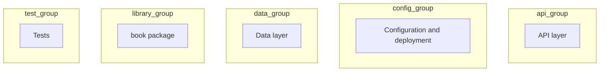

# Architecture report: async-labs/saas

> Automated static analysis. **Observed** = directly seen in files/imports/AST; **Inferred** = interpretation from that evidence. Repository code was not executed.

## 1. Repository at a glance

| Item | Value |
| --- | --- |
| Repository | async-labs/saas |
| Description | Build your own SaaS business with SaaS boilerplate. Productive stack: React, Material-UI, Next, MobX, WebSockets, Express, Node, Mongoose, MongoDB. Written with TypeScript. |
| Language | TypeScript |
| Stars | 4535 |
| Licence | MIT |
| Analysed commit / branch | 4b27b6a0a4bb876562da6de93f0c0dd509fd5ffe / master |
| Framework(s) | Express, Next.js, React |
| Files analysed | 777 |
| Components | 5 |

## 2. Architecture in one minute

async-labs/saas - Build your own SaaS business with SaaS boilerplate. Productive stack: React, Material-UI, Next, MobX, WebSockets, Express, Node, Mongoose, MongoDB. Written with TypeScript.. This repository was analysed statically from 777 file(s) (0 Python). Detected technologies (observed from imports/manifests): MongoDB, Express, Next.js, React, Jest, TypeScript. Files are grouped into 5 component(s): API layer, book package, Configuration and deployment, Data layer, Tests. Findings below distinguish observed facts from inferred interpretation.

## 3. High-level block diagram

## 4. Main components

### API layer (`api_layer`)

- **Kind:** api
- **Status:** Observed
- **Confidence:** 0.85
- **Responsibility:** Groups 183 file(s) under api layer (observed from repository paths and static analysis).
- **Paths:** `book/10-begin/api/.eslintrc.js`, `book/10-begin/api/server/api/index.ts`, `book/10-begin/api/server/api/public.ts`, `book/10-begin/api/server/api/team-leader.ts`, `book/10-begin/api/server/api/team-member.ts`, `book/10-begin/api/server/aws-s3.ts`, `book/10-begin/api/server/aws-ses.ts`, `book/10-begin/api/server/google-auth.ts`, `book/10-begin/api/server/mailchimp.ts`, `book/10-begin/api/server/models/Discussion.ts`, `book/10-begin/api/server/models/EmailTemplate.ts`, `book/10-begin/api/server/models/Invitation.ts`, `book/10-begin/api/server/models/Post.ts`, `book/10-begin/api/server/models/Team.ts`, `book/10-begin/api/server/models/User.ts`, `book/10-begin/api/server/passwordless-auth.ts`, `book/10-begin/api/server/passwordless-token-mongostore.ts`, `book/10-begin/api/server/server.ts`, `book/10-begin/api/server/sockets.ts`, `book/10-begin/api/server/stripe.ts`, `book/10-begin/api/server/utils/slugify.ts`, `book/10-begin/api/server/utils/sum.ts`, `book/10-begin/app/lib/api/makeQueryString.ts`, `book/10-begin/app/lib/api/public.ts`, `book/10-begin/app/lib/api/sendRequestAndGetResponse.ts`, `book/10-begin/app/lib/api/team-leader.ts`, `book/10-begin/app/lib/api/team-member.ts`, `book/10-end-functional/api/.eslintrc.js`, `book/10-end-functional/api/server/api/index.ts`, `book/10-end-functional/api/server/api/public.ts`, `book/10-end-functional/api/server/api/team-leader.ts`, `book/10-end-functional/api/server/api/team-member.ts`, `book/10-end-functional/api/server/aws-s3.ts`, `book/10-end-functional/api/server/aws-ses.ts`, `book/10-end-functional/api/server/google-auth.ts`, `book/10-end-functional/api/server/logger.ts`, `book/10-end-functional/api/server/mailchimp.ts`, `book/10-end-functional/api/server/models/Discussion.ts`, `book/10-end-functional/api/server/models/EmailTemplate.ts`, `book/10-end-functional/api/server/models/Invitation.ts`, `book/10-end-functional/api/server/models/Post.ts`, `book/10-end-functional/api/server/models/Team.ts`, `book/10-end-functional/api/server/models/User.ts`, `book/10-end-functional/api/server/passwordless-auth.ts`, `book/10-end-functional/api/server/passwordless-token-mongostore.ts`, `book/10-end-functional/api/server/server.ts`, `book/10-end-functional/api/server/sockets.ts`, `book/10-end-functional/api/server/stripe.ts`, `book/10-end-functional/api/server/utils/slugify.ts`, `book/10-end-functional/api/server/utils/sum.ts`, `book/10-end-functional/app/lib/api/makeQueryString.ts`, `book/10-end-functional/app/lib/api/public.ts`, `book/10-end-functional/app/lib/api/sendRequestAndGetResponse.ts`, `book/10-end-functional/app/lib/api/team-leader.ts`, `book/10-end-functional/app/lib/api/team-member.ts`, `book/10-end/api/.eslintrc.js`, `book/10-end/api/server/api/index.ts`, `book/10-end/api/server/api/public.ts`, `book/10-end/api/server/api/team-leader.ts`, `book/10-end/api/server/api/team-member.ts`, `book/10-end/api/server/aws-s3.ts`, `book/10-end/api/server/aws-ses.ts`, `book/10-end/api/server/google-auth.ts`, `book/10-end/api/server/logger.ts`, `book/10-end/api/server/mailchimp.ts`, `book/10-end/api/server/models/Discussion.ts`, `book/10-end/api/server/models/EmailTemplate.ts`, `book/10-end/api/server/models/Invitation.ts`, `book/10-end/api/server/models/Post.ts`, `book/10-end/api/server/models/Team.ts`, `book/10-end/api/server/models/User.ts`, `book/10-end/api/server/passwordless-auth.ts`, `book/10-end/api/server/passwordless-token-mongostore.ts`, `book/10-end/api/server/server.ts`, `book/10-end/api/server/sockets.ts`, `book/10-end/api/server/stripe.ts`, `book/10-end/api/server/utils/slugify.ts`, `book/10-end/api/server/utils/sum.ts`, `book/10-end/app/lib/api/makeQueryString.ts`, `book/10-end/app/lib/api/public.ts`, `book/10-end/app/lib/api/sendRequestAndGetResponse.ts`, `book/10-end/app/lib/api/team-leader.ts`, `book/10-end/app/lib/api/team-member.ts`, `book/3-end/api/.eslintrc.js`, `book/3-end/api/server/server.ts`, `book/3-end/app/lib/api/public.ts`, `book/3-end/app/lib/api/sendRequestAndGetResponse.ts`, `book/4-begin/api/.eslintrc.js`, `book/4-begin/api/server/server.ts`, `book/4-begin/app/lib/api/public.ts`, `book/4-begin/app/lib/api/sendRequestAndGetResponse.ts`, `book/4-end/api/.eslintrc.js`, `book/4-end/api/server/api/index.ts`, `book/4-end/api/server/api/public.ts`, `book/4-end/api/server/api/team-member.ts`, `book/4-end/api/server/aws-s3.ts`, `book/4-end/api/server/models/User.ts`, `book/4-end/api/server/server.ts`, `book/4-end/api/server/utils/slugify.ts`, `book/4-end/api/server/utils/sum.ts`, `book/4-end/app/lib/api/public.ts`, `book/4-end/app/lib/api/sendRequestAndGetResponse.ts`, `book/4-end/app/lib/api/team-member.ts`, `book/5-begin/api/.eslintrc.js`, `book/5-begin/api/server/api/index.ts`, `book/5-begin/api/server/api/public.ts`, `book/5-begin/api/server/api/team-member.ts`, `book/5-begin/api/server/aws-s3.ts`, `book/5-begin/api/server/models/User.ts`, `book/5-begin/api/server/server.ts`, `book/5-begin/api/server/utils/slugify.ts`, `book/5-begin/api/server/utils/sum.ts`, `book/5-begin/app/lib/api/public.ts`, `book/5-begin/app/lib/api/sendRequestAndGetResponse.ts`, `book/5-begin/app/lib/api/team-member.ts`, `book/5-end/api/.eslintrc.js`, `book/5-end/api/server/api/index.ts`, `book/5-end/api/server/api/public.ts`, `book/5-end/api/server/api/team-member.ts`, `book/5-end/api/server/aws-s3.ts`, `book/5-end/api/server/google-auth.ts`, `book/5-end/api/server/models/User.ts`, `book/5-end/api/server/server.ts`, `book/5-end/api/server/utils/slugify.ts`, `book/5-end/api/server/utils/sum.ts`, `book/5-end/app/lib/api/public.ts`, `book/5-end/app/lib/api/sendRequestAndGetResponse.ts`, `book/5-end/app/lib/api/team-member.ts`, `book/6-begin/api/.eslintrc.js`, `book/6-begin/api/server/api/index.ts`, `book/6-begin/api/server/api/public.ts`, `book/6-begin/api/server/api/team-member.ts`, `book/6-begin/api/server/aws-s3.ts`, `book/6-begin/api/server/google-auth.ts`, `book/6-begin/api/server/models/User.ts`, `book/6-begin/api/server/server.ts`, `book/6-begin/api/server/utils/slugify.ts`, `book/6-begin/api/server/utils/sum.ts`, `book/6-begin/app/lib/api/public.ts`, `book/6-begin/app/lib/api/sendRequestAndGetResponse.ts`, `book/6-begin/app/lib/api/team-member.ts`, `book/6-end/api/.eslintrc.js`, `book/6-end/api/server/api/index.ts`, `book/6-end/api/server/api/public.ts`, `book/6-end/api/server/api/team-member.ts`, `book/6-end/api/server/aws-s3.ts`, `book/6-end/api/server/aws-ses.ts`, `book/6-end/api/server/google-auth.ts`, `book/6-end/api/server/mailchimp.ts`, `book/6-end/api/server/models/EmailTemplate.ts`, `book/6-end/api/server/models/User.ts`, `book/6-end/api/server/passwordless-auth.ts`, `book/6-end/api/server/passwordless-token-mongostore.ts`, `book/6-end/api/server/server.ts`, `book/6-end/api/server/utils/slugify.ts`, `book/6-end/api/server/utils/sum.ts`, `book/6-end/app/lib/api/public.ts`, `book/6-end/app/lib/api/sendRequestAndGetResponse.ts`, `book/6-end/app/lib/api/team-member.ts`, `book/7-begin/api/.eslintrc.js`, `book/7-begin/api/server/api/index.ts`, `book/7-begin/api/server/api/public.ts`, `book/7-begin/api/server/api/team-member.ts`, `book/7-begin/api/server/aws-s3.ts`, `book/7-begin/api/server/aws-ses.ts`, `book/7-begin/api/server/google-auth.ts`, `book/7-begin/api/server/mailchimp.ts`, `book/7-begin/api/server/models/EmailTemplate.ts`, `book/7-begin/api/server/models/User.ts`, `book/7-begin/api/server/passwordless-auth.ts`, `book/7-begin/api/server/passwordless-token-mongostore.ts`, `book/7-begin/api/server/server.ts`, `book/7-begin/api/server/utils/slugify.ts`, `book/7-begin/api/server/utils/sum.ts`, `book/7-begin/app/lib/api/public.ts`, `book/7-begin/app/lib/api/sendRequestAndGetResponse.ts`, `book/7-begin/app/lib/api/team-member.ts`, `book/7-end/api/.eslintrc.js`, `book/7-end/api/server/api/index.ts`, `book/7-end/api/server/api/public.ts`, `book/7-end/api/server/api/team-leader.ts`, `book/7-end/api/server/api/team-member.ts`, `book/7-end/api/server/aws-s3.ts`
- **Evidence:** [book/10-begin/api/.eslintrc.js](https://github.com/async-labs/saas/blob/4b27b6a0a4bb876562da6de93f0c0dd509fd5ffe/book/10-begin/api/.eslintrc.js); [book/10-begin/api/server/api/index.ts](https://github.com/async-labs/saas/blob/4b27b6a0a4bb876562da6de93f0c0dd509fd5ffe/book/10-begin/api/server/api/index.ts); [book/10-begin/api/server/api/public.ts](https://github.com/async-labs/saas/blob/4b27b6a0a4bb876562da6de93f0c0dd509fd5ffe/book/10-begin/api/server/api/public.ts); [book/10-begin/api/server/api/team-leader.ts](https://github.com/async-labs/saas/blob/4b27b6a0a4bb876562da6de93f0c0dd509fd5ffe/book/10-begin/api/server/api/team-leader.ts); [book/10-begin/api/server/api/team-member.ts](https://github.com/async-labs/saas/blob/4b27b6a0a4bb876562da6de93f0c0dd509fd5ffe/book/10-begin/api/server/api/team-member.ts); [book/10-begin/api/server/aws-s3.ts](https://github.com/async-labs/saas/blob/4b27b6a0a4bb876562da6de93f0c0dd509fd5ffe/book/10-begin/api/server/aws-s3.ts); [book/10-begin/api/server/aws-ses.ts](https://github.com/async-labs/saas/blob/4b27b6a0a4bb876562da6de93f0c0dd509fd5ffe/book/10-begin/api/server/aws-ses.ts); [book/10-begin/api/server/google-auth.ts](https://github.com/async-labs/saas/blob/4b27b6a0a4bb876562da6de93f0c0dd509fd5ffe/book/10-begin/api/server/google-auth.ts)

### book package (`book`)

- **Kind:** library
- **Status:** Observed
- **Confidence:** 0.85
- **Responsibility:** Groups 352 file(s) under book package (observed from repository paths and static analysis).
- **Paths:** `book/1-end/app/.eslintrc.js`, `book/1-end/app/next-env.d.ts`, `book/1-end/app/next.config.js`, `book/1-end/app/pages/_app.tsx`, `book/1-end/app/pages/_document.tsx`, `book/1-end/app/pages/index.tsx`, `book/1-end/app/server/app.ts`, `book/10-begin/app/.eslintrc.js`, `book/10-begin/app/components/common/Confirmer.tsx`, `book/10-begin/app/components/common/LoginButton.tsx`, `book/10-begin/app/components/common/MemberChooser.tsx`, `book/10-begin/app/components/common/MenuWithLinks.tsx`, `book/10-begin/app/components/common/MenuWithMenuItems.tsx`, `book/10-begin/app/components/common/Notifier.tsx`, `book/10-begin/app/components/discussions/CreateDiscussionForm.tsx`, `book/10-begin/app/components/discussions/DiscussionActionMenu.tsx`, `book/10-begin/app/components/discussions/DiscussionList.tsx`, `book/10-begin/app/components/discussions/DiscussionListItem.tsx`, `book/10-begin/app/components/discussions/EditDiscussionForm.tsx`, `book/10-begin/app/components/layout/index.tsx`, `book/10-begin/app/components/posts/PostContent.tsx`, `book/10-begin/app/components/posts/PostDetail.tsx`, `book/10-begin/app/components/posts/PostEditor.tsx`, `book/10-begin/app/components/posts/PostForm.tsx`, `book/10-begin/app/components/teams/InviteMember.tsx`, `book/10-begin/app/lib/confirm.ts`, `book/10-begin/app/lib/isMobile.ts`, `book/10-begin/app/lib/notify.ts`, `book/10-begin/app/lib/resizeImage.ts`, `book/10-begin/app/lib/sharedStyles.ts`, `book/10-begin/app/lib/store/discussion.ts`, `book/10-begin/app/lib/store/index.ts`, `book/10-begin/app/lib/store/invitation.ts`, `book/10-begin/app/lib/store/post.ts`, `book/10-begin/app/lib/store/team.ts`, `book/10-begin/app/lib/store/user.ts`, `book/10-begin/app/lib/theme.ts`, `book/10-begin/app/lib/withAuth.tsx`, `book/10-begin/app/next-env.d.ts`, `book/10-begin/app/next.config.js`, `book/10-begin/app/pages/_app.tsx`, `book/10-begin/app/pages/_document.tsx`, `book/10-begin/app/pages/billing.tsx`, `book/10-begin/app/pages/create-team.tsx`, `book/10-begin/app/pages/discussion.tsx`, `book/10-begin/app/pages/invitation.tsx`, `book/10-begin/app/pages/login.tsx`, `book/10-begin/app/pages/team-settings.tsx`, `book/10-begin/app/pages/your-settings.tsx`, `book/10-begin/app/server/server.ts`, `book/10-begin/lambda/.eslintrc.js`, `book/10-begin/lambda/handler.ts`, `book/10-end-functional/app/.eslintrc.js`, `book/10-end-functional/app/components/common/Confirmer.tsx`, `book/10-end-functional/app/components/common/LoginButton.tsx`, `book/10-end-functional/app/components/common/MemberChooser.tsx`, `book/10-end-functional/app/components/common/MenuWithLinks.tsx`, `book/10-end-functional/app/components/common/MenuWithMenuItems.tsx`, `book/10-end-functional/app/components/common/Notifier.tsx`, `book/10-end-functional/app/components/discussions/CreateDiscussionForm.tsx`, `book/10-end-functional/app/components/discussions/DiscussionActionMenu.tsx`, `book/10-end-functional/app/components/discussions/DiscussionList.tsx`, `book/10-end-functional/app/components/discussions/DiscussionListItem.tsx`, `book/10-end-functional/app/components/discussions/EditDiscussionForm.tsx`, `book/10-end-functional/app/components/layout/index.tsx`, `book/10-end-functional/app/components/posts/PostContent.tsx`, `book/10-end-functional/app/components/posts/PostDetail.tsx`, `book/10-end-functional/app/components/posts/PostEditor.tsx`, `book/10-end-functional/app/components/posts/PostForm.tsx`, `book/10-end-functional/app/components/teams/InviteMember.tsx`, `book/10-end-functional/app/lib/confirm.ts`, `book/10-end-functional/app/lib/gtag.ts`, `book/10-end-functional/app/lib/isMobile.ts`, `book/10-end-functional/app/lib/notify.ts`, `book/10-end-functional/app/lib/resizeImage.ts`, `book/10-end-functional/app/lib/sharedStyles.ts`, `book/10-end-functional/app/lib/store/discussion.ts`, `book/10-end-functional/app/lib/store/index.ts`, `book/10-end-functional/app/lib/store/invitation.ts`, `book/10-end-functional/app/lib/store/post.ts`, `book/10-end-functional/app/lib/store/team.ts`, `book/10-end-functional/app/lib/store/user.ts`, `book/10-end-functional/app/lib/theme.ts`, `book/10-end-functional/app/lib/withAuth.tsx`, `book/10-end-functional/app/next-env.d.ts`, `book/10-end-functional/app/next.config.js`, `book/10-end-functional/app/pages/_app.tsx`, `book/10-end-functional/app/pages/_document.tsx`, `book/10-end-functional/app/pages/billing.tsx`, `book/10-end-functional/app/pages/create-team.tsx`, `book/10-end-functional/app/pages/discussion.tsx`, `book/10-end-functional/app/pages/invitation.tsx`, `book/10-end-functional/app/pages/login-cached.tsx`, `book/10-end-functional/app/pages/login.tsx`, `book/10-end-functional/app/pages/team-settings.tsx`, `book/10-end-functional/app/pages/your-settings.tsx`, `book/10-end-functional/app/server/routesWithCache.ts`, `book/10-end-functional/app/server/server.ts`, `book/10-end-functional/app/server/setupSitemapAndRobots.ts`, `book/10-end-functional/lambda/.eslintrc.js`, `book/10-end-functional/lambda/handler.ts`, `book/10-end/app/.eslintrc.js`, `book/10-end/app/components/common/Confirmer.tsx`, `book/10-end/app/components/common/LoginButton.tsx`, `book/10-end/app/components/common/MemberChooser.tsx`, `book/10-end/app/components/common/MenuWithLinks.tsx`, `book/10-end/app/components/common/MenuWithMenuItems.tsx`, `book/10-end/app/components/common/Notifier.tsx`, `book/10-end/app/components/discussions/CreateDiscussionForm.tsx`, `book/10-end/app/components/discussions/DiscussionActionMenu.tsx`, `book/10-end/app/components/discussions/DiscussionList.tsx`, `book/10-end/app/components/discussions/DiscussionListItem.tsx`, `book/10-end/app/components/discussions/EditDiscussionForm.tsx`, `book/10-end/app/components/layout/index.tsx`, `book/10-end/app/components/posts/PostContent.tsx`, `book/10-end/app/components/posts/PostDetail.tsx`, `book/10-end/app/components/posts/PostEditor.tsx`, `book/10-end/app/components/posts/PostForm.tsx`, `book/10-end/app/components/teams/InviteMember.tsx`, `book/10-end/app/lib/confirm.ts`, `book/10-end/app/lib/gtag.ts`, `book/10-end/app/lib/isMobile.ts`, `book/10-end/app/lib/notify.ts`, `book/10-end/app/lib/resizeImage.ts`, `book/10-end/app/lib/sharedStyles.ts`, `book/10-end/app/lib/store/discussion.ts`, `book/10-end/app/lib/store/index.ts`, `book/10-end/app/lib/store/invitation.ts`, `book/10-end/app/lib/store/post.ts`, `book/10-end/app/lib/store/team.ts`, `book/10-end/app/lib/store/user.ts`, `book/10-end/app/lib/theme.ts`, `book/10-end/app/lib/withAuth.tsx`, `book/10-end/app/next-env.d.ts`, `book/10-end/app/next.config.js`, `book/10-end/app/pages/_app.tsx`, `book/10-end/app/pages/_document.tsx`, `book/10-end/app/pages/billing.tsx`, `book/10-end/app/pages/create-team.tsx`, `book/10-end/app/pages/discussion-f.tsx`, `book/10-end/app/pages/discussion.tsx`, `book/10-end/app/pages/invitation.tsx`, `book/10-end/app/pages/login-cached.tsx`, `book/10-end/app/pages/login.tsx`, `book/10-end/app/pages/team-settings.tsx`, `book/10-end/app/pages/your-settings.tsx`, `book/10-end/app/server/routesWithCache.ts`, `book/10-end/app/server/server.ts`, `book/10-end/app/server/setupSitemapAndRobots.ts`, `book/10-end/lambda/.eslintrc.js`, `book/10-end/lambda/handler.ts`, `book/2-begin/app/.eslintrc.js`, `book/2-begin/app/next-env.d.ts`, `book/2-begin/app/next.config.js`, `book/2-begin/app/pages/_app.tsx`, `book/2-begin/app/pages/_document.tsx`, `book/2-begin/app/pages/index.tsx`, `book/2-begin/app/server/app.ts`, `book/2-end/app/.eslintrc.js`, `book/2-end/app/components/common/Confirmer.tsx`, `book/2-end/app/components/common/MenuWithLinks.tsx`, `book/2-end/app/components/common/Notifier.tsx`, `book/2-end/app/components/layout/index.tsx`, `book/2-end/app/lib/confirm.ts`, `book/2-end/app/lib/isMobile.ts`, `book/2-end/app/lib/notify.ts`, `book/2-end/app/lib/sharedStyles.ts`, `book/2-end/app/lib/theme.ts`, `book/2-end/app/next-env.d.ts`, `book/2-end/app/next.config.js`, `book/2-end/app/pages/_app.tsx`, `book/2-end/app/pages/_document.tsx`, `book/2-end/app/pages/csr-page.tsx`, `book/2-end/app/pages/index.tsx`, `book/2-end/app/server/app.ts`, `book/3-begin/app/.eslintrc.js`, `book/3-begin/app/components/common/Confirmer.tsx`, `book/3-begin/app/components/common/MenuWithLinks.tsx`, `book/3-begin/app/components/common/Notifier.tsx`, `book/3-begin/app/components/layout/index.tsx`, `book/3-begin/app/lib/confirm.ts`, `book/3-begin/app/lib/isMobile.ts`, `book/3-begin/app/lib/notify.ts`, `book/3-begin/app/lib/sharedStyles.ts`, `book/3-begin/app/lib/theme.ts`, `book/3-begin/app/next-env.d.ts`, `book/3-begin/app/next.config.js`, `book/3-begin/app/pages/_app.tsx`, `book/3-begin/app/pages/_document.tsx`, `book/3-begin/app/pages/csr-page.tsx`, `book/3-begin/app/pages/index.tsx`, `book/3-begin/app/server/app.ts`, `book/3-end/app/.eslintrc.js`, `book/3-end/app/components/common/Confirmer.tsx`, `book/3-end/app/components/common/MenuWithLinks.tsx`, `book/3-end/app/components/common/Notifier.tsx`, `book/3-end/app/components/layout/index.tsx`, `book/3-end/app/lib/confirm.ts`, `book/3-end/app/lib/isMobile.ts`, `book/3-end/app/lib/notify.ts`, `book/3-end/app/lib/sharedStyles.ts`, `book/3-end/app/lib/theme.ts`, `book/3-end/app/next-env.d.ts`, `book/3-end/app/next.config.js`, `book/3-end/app/pages/_app.tsx`, `book/3-end/app/pages/_document.tsx`, `book/3-end/app/pages/csr-page.tsx`, `book/3-end/app/pages/index.tsx`, `book/3-end/app/server/server.ts`, `book/4-begin/app/.eslintrc.js`, `book/4-begin/app/components/common/Confirmer.tsx`, `book/4-begin/app/components/common/MenuWithLinks.tsx`, `book/4-begin/app/components/common/Notifier.tsx`, `book/4-begin/app/components/layout/index.tsx`, `book/4-begin/app/lib/confirm.ts`, `book/4-begin/app/lib/isMobile.ts`, `book/4-begin/app/lib/notify.ts`, `book/4-begin/app/lib/sharedStyles.ts`, `book/4-begin/app/lib/theme.ts`, `book/4-begin/app/next-env.d.ts`, `book/4-begin/app/next.config.js`, `book/4-begin/app/pages/_app.tsx`, `book/4-begin/app/pages/_document.tsx`, `book/4-begin/app/pages/csr-page.tsx`, `book/4-begin/app/pages/index.tsx`, `book/4-begin/app/server/server.ts`, `book/4-end/app/.eslintrc.js`, `book/4-end/app/components/common/Confirmer.tsx`, `book/4-end/app/components/common/MenuWithLinks.tsx`, `book/4-end/app/components/common/Notifier.tsx`, `book/4-end/app/components/layout/index.tsx`, `book/4-end/app/lib/confirm.ts`, `book/4-end/app/lib/isMobile.ts`, `book/4-end/app/lib/notify.ts`, `book/4-end/app/lib/resizeImage.ts`, `book/4-end/app/lib/sharedStyles.ts`, `book/4-end/app/lib/theme.ts`, `book/4-end/app/next-env.d.ts`, `book/4-end/app/next.config.js`, `book/4-end/app/pages/_app.tsx`, `book/4-end/app/pages/_document.tsx`, `book/4-end/app/pages/csr-page.tsx`, `book/4-end/app/pages/index.tsx`, `book/4-end/app/pages/your-settings.tsx`, `book/4-end/app/server/server.ts`, `book/5-begin/app/.eslintrc.js`, `book/5-begin/app/components/common/Confirmer.tsx`, `book/5-begin/app/components/common/MenuWithLinks.tsx`, `book/5-begin/app/components/common/Notifier.tsx`, `book/5-begin/app/components/layout/index.tsx`, `book/5-begin/app/lib/confirm.ts`, `book/5-begin/app/lib/isMobile.ts`, `book/5-begin/app/lib/notify.ts`, `book/5-begin/app/lib/resizeImage.ts`, `book/5-begin/app/lib/sharedStyles.ts`, `book/5-begin/app/lib/theme.ts`, `book/5-begin/app/next-env.d.ts`, `book/5-begin/app/next.config.js`, `book/5-begin/app/pages/_app.tsx`, `book/5-begin/app/pages/_document.tsx`, `book/5-begin/app/pages/csr-page.tsx`, `book/5-begin/app/pages/index.tsx`, `book/5-begin/app/pages/your-settings.tsx`, `book/5-begin/app/server/server.ts`, `book/5-end/app/.eslintrc.js`, `book/5-end/app/components/common/Confirmer.tsx`, `book/5-end/app/components/common/LoginButton.tsx`, `book/5-end/app/components/common/MenuWithLinks.tsx`, `book/5-end/app/components/common/Notifier.tsx`, `book/5-end/app/components/layout/index.tsx`, `book/5-end/app/lib/confirm.ts`, `book/5-end/app/lib/isMobile.ts`, `book/5-end/app/lib/notify.ts`, `book/5-end/app/lib/resizeImage.ts`, `book/5-end/app/lib/sharedStyles.ts`, `book/5-end/app/lib/theme.ts`, `book/5-end/app/lib/withAuth.tsx`, `book/5-end/app/next-env.d.ts`, `book/5-end/app/next.config.js`, `book/5-end/app/pages/_app.tsx`, `book/5-end/app/pages/_document.tsx`, `book/5-end/app/pages/csr-page.tsx`, `book/5-end/app/pages/index.tsx`, `book/5-end/app/pages/login.tsx`, `book/5-end/app/pages/your-settings.tsx`, `book/5-end/app/server/server.ts`, `book/6-begin/app/.eslintrc.js`, `book/6-begin/app/components/common/Confirmer.tsx`, `book/6-begin/app/components/common/LoginButton.tsx`, `book/6-begin/app/components/common/MenuWithLinks.tsx`, `book/6-begin/app/components/common/Notifier.tsx`, `book/6-begin/app/components/layout/index.tsx`, `book/6-begin/app/lib/confirm.ts`, `book/6-begin/app/lib/isMobile.ts`, `book/6-begin/app/lib/notify.ts`, `book/6-begin/app/lib/resizeImage.ts`, `book/6-begin/app/lib/sharedStyles.ts`, `book/6-begin/app/lib/theme.ts`, `book/6-begin/app/lib/withAuth.tsx`, `book/6-begin/app/next-env.d.ts`, `book/6-begin/app/next.config.js`, `book/6-begin/app/pages/_app.tsx`, `book/6-begin/app/pages/_document.tsx`, `book/6-begin/app/pages/csr-page.tsx`, `book/6-begin/app/pages/index.tsx`, `book/6-begin/app/pages/login.tsx`, `book/6-begin/app/pages/your-settings.tsx`, `book/6-begin/app/server/server.ts`, `book/6-end/app/.eslintrc.js`, `book/6-end/app/components/common/Confirmer.tsx`, `book/6-end/app/components/common/LoginButton.tsx`, `book/6-end/app/components/common/MenuWithLinks.tsx`, `book/6-end/app/components/common/Notifier.tsx`, `book/6-end/app/components/layout/index.tsx`, `book/6-end/app/lib/confirm.ts`, `book/6-end/app/lib/isMobile.ts`, `book/6-end/app/lib/notify.ts`, `book/6-end/app/lib/resizeImage.ts`, `book/6-end/app/lib/sharedStyles.ts`, `book/6-end/app/lib/theme.ts`, `book/6-end/app/lib/withAuth.tsx`, `book/6-end/app/next-env.d.ts`, `book/6-end/app/next.config.js`, `book/6-end/app/pages/_app.tsx`, `book/6-end/app/pages/_document.tsx`, `book/6-end/app/pages/csr-page.tsx`, `book/6-end/app/pages/index.tsx`, `book/6-end/app/pages/login.tsx`, `book/6-end/app/pages/your-settings.tsx`, `book/6-end/app/server/server.ts`, `book/7-begin/app/.eslintrc.js`, `book/7-begin/app/components/common/Confirmer.tsx`, `book/7-begin/app/components/common/LoginButton.tsx`, `book/7-begin/app/components/common/MenuWithLinks.tsx`, `book/7-begin/app/components/common/Notifier.tsx`, `book/7-begin/app/components/layout/index.tsx`, `book/7-begin/app/lib/confirm.ts`, `book/7-begin/app/lib/isMobile.ts`, `book/7-begin/app/lib/notify.ts`, `book/7-begin/app/lib/resizeImage.ts`, `book/7-begin/app/lib/sharedStyles.ts`, `book/7-begin/app/lib/theme.ts`, `book/7-begin/app/lib/withAuth.tsx`, `book/7-begin/app/next-env.d.ts`, `book/7-begin/app/next.config.js`, `book/7-begin/app/pages/_app.tsx`, `book/7-begin/app/pages/_document.tsx`, `book/7-begin/app/pages/csr-page.tsx`, `book/7-begin/app/pages/index.tsx`, `book/7-begin/app/pages/login.tsx`, `book/7-begin/app/pages/your-settings.tsx`, `book/7-begin/app/server/server.ts`
- **Evidence:** [book/1-end/app/.eslintrc.js](https://github.com/async-labs/saas/blob/4b27b6a0a4bb876562da6de93f0c0dd509fd5ffe/book/1-end/app/.eslintrc.js); [book/1-end/app/next-env.d.ts](https://github.com/async-labs/saas/blob/4b27b6a0a4bb876562da6de93f0c0dd509fd5ffe/book/1-end/app/next-env.d.ts); [book/1-end/app/next.config.js](https://github.com/async-labs/saas/blob/4b27b6a0a4bb876562da6de93f0c0dd509fd5ffe/book/1-end/app/next.config.js); [book/1-end/app/pages/_app.tsx](https://github.com/async-labs/saas/blob/4b27b6a0a4bb876562da6de93f0c0dd509fd5ffe/book/1-end/app/pages/_app.tsx); [book/1-end/app/pages/_document.tsx](https://github.com/async-labs/saas/blob/4b27b6a0a4bb876562da6de93f0c0dd509fd5ffe/book/1-end/app/pages/_document.tsx); [book/1-end/app/pages/index.tsx](https://github.com/async-labs/saas/blob/4b27b6a0a4bb876562da6de93f0c0dd509fd5ffe/book/1-end/app/pages/index.tsx); [book/1-end/app/server/app.ts](https://github.com/async-labs/saas/blob/4b27b6a0a4bb876562da6de93f0c0dd509fd5ffe/book/1-end/app/server/app.ts); [book/10-begin/app/.eslintrc.js](https://github.com/async-labs/saas/blob/4b27b6a0a4bb876562da6de93f0c0dd509fd5ffe/book/10-begin/app/.eslintrc.js)

### Configuration and deployment (`config`)

- **Kind:** config
- **Status:** Observed
- **Confidence:** 0.85
- **Responsibility:** Groups 115 file(s) under configuration and deployment (observed from repository paths and static analysis).
- **Paths:** `book/1-end/app/package.json`, `book/1-end/app/tsconfig.json`, `book/1-end/app/tsconfig.server.json`, `book/10-begin/api/nodemon.json`, `book/10-begin/api/package.json`, `book/10-begin/api/tsconfig.json`, `book/10-begin/api/tsconfig.server.json`, `book/10-begin/app/nodemon.json`, `book/10-begin/app/package.json`, `book/10-begin/app/tsconfig.json`, `book/10-begin/app/tsconfig.server.json`, `book/10-begin/lambda/package.json`, `book/10-begin/lambda/serverless.yml`, `book/10-begin/lambda/tsconfig.json`, `book/10-end-functional/api/.elasticbeanstalk/config.yml`, `book/10-end-functional/api/.env.example`, `book/10-end-functional/api/nodemon.json`, `book/10-end-functional/api/package.json`, `book/10-end-functional/api/tsconfig.json`, `book/10-end-functional/app/.elasticbeanstalk/config.yml`, `book/10-end-functional/app/.env.example`, `book/10-end-functional/app/nodemon.json`, `book/10-end-functional/app/package.json`, `book/10-end-functional/app/tsconfig.json`, `book/10-end-functional/app/tsconfig.server.json`, `book/10-end-functional/lambda/package.json`, `book/10-end-functional/lambda/serverless.yml`, `book/10-end-functional/lambda/tsconfig.json`, `book/10-end/api/.elasticbeanstalk/config.yml`, `book/10-end/api/nodemon.json`, `book/10-end/api/package.json`, `book/10-end/api/tsconfig.json`, `book/10-end/app/.elasticbeanstalk/config.yml`, `book/10-end/app/nodemon.json`, `book/10-end/app/package.json`, `book/10-end/app/tsconfig.json`, `book/10-end/app/tsconfig.server.json`, `book/10-end/lambda/package.json`, `book/10-end/lambda/serverless.yml`, `book/10-end/lambda/tsconfig.json`, `book/2-begin/app/package.json`, `book/2-begin/app/tsconfig.json`, `book/2-begin/app/tsconfig.server.json`, `book/2-end/app/package.json`, `book/2-end/app/tsconfig.json`, `book/2-end/app/tsconfig.server.json`, `book/3-begin/app/package.json`, `book/3-begin/app/tsconfig.json`, `book/3-begin/app/tsconfig.server.json`, `book/3-end/api/nodemon.json`, `book/3-end/api/package.json`, `book/3-end/api/tsconfig.json`, `book/3-end/api/tsconfig.server.json`, `book/3-end/app/nodemon.json`, `book/3-end/app/package.json`, `book/3-end/app/tsconfig.json`, `book/3-end/app/tsconfig.server.json`, `book/4-begin/api/nodemon.json`, `book/4-begin/api/package.json`, `book/4-begin/api/tsconfig.json`, `book/4-begin/api/tsconfig.server.json`, `book/4-begin/app/nodemon.json`, `book/4-begin/app/package.json`, `book/4-begin/app/tsconfig.json`, `book/4-begin/app/tsconfig.server.json`, `book/4-end/api/nodemon.json`, `book/4-end/api/package.json`, `book/4-end/api/tsconfig.json`, `book/4-end/api/tsconfig.server.json`, `book/4-end/app/nodemon.json`, `book/4-end/app/package.json`, `book/4-end/app/tsconfig.json`, `book/4-end/app/tsconfig.server.json`, `book/5-begin/api/nodemon.json`, `book/5-begin/api/package.json`, `book/5-begin/api/tsconfig.json`, `book/5-begin/api/tsconfig.server.json`, `book/5-begin/app/nodemon.json`, `book/5-begin/app/package.json`, `book/5-begin/app/tsconfig.json`, `book/5-begin/app/tsconfig.server.json`, `book/5-end/api/nodemon.json`, `book/5-end/api/package.json`, `book/5-end/api/tsconfig.json`, `book/5-end/api/tsconfig.server.json`, `book/5-end/app/nodemon.json`, `book/5-end/app/package.json`, `book/5-end/app/tsconfig.json`, `book/5-end/app/tsconfig.server.json`, `book/6-begin/api/nodemon.json`, `book/6-begin/api/package.json`, `book/6-begin/api/tsconfig.json`, `book/6-begin/api/tsconfig.server.json`, `book/6-begin/app/nodemon.json`, `book/6-begin/app/package.json`, `book/6-begin/app/tsconfig.json`, `book/6-begin/app/tsconfig.server.json`, `book/6-end/api/nodemon.json`, `book/6-end/api/package.json`, `book/6-end/api/tsconfig.json`, `book/6-end/api/tsconfig.server.json`, `book/6-end/app/nodemon.json`, `book/6-end/app/package.json`, `book/6-end/app/tsconfig.json`, `book/6-end/app/tsconfig.server.json`, `book/7-begin/api/nodemon.json`, `book/7-begin/api/package.json`, `book/7-begin/api/tsconfig.json`, `book/7-begin/api/tsconfig.server.json`, `book/7-begin/app/nodemon.json`, `book/7-begin/app/package.json`, `book/7-begin/app/tsconfig.json`, `book/7-begin/app/tsconfig.server.json`, `book/7-end/api/nodemon.json`, `book/7-end/api/package.json`
- **Evidence:** [book/1-end/app/package.json](https://github.com/async-labs/saas/blob/4b27b6a0a4bb876562da6de93f0c0dd509fd5ffe/book/1-end/app/package.json); [book/1-end/app/tsconfig.json](https://github.com/async-labs/saas/blob/4b27b6a0a4bb876562da6de93f0c0dd509fd5ffe/book/1-end/app/tsconfig.json); [book/1-end/app/tsconfig.server.json](https://github.com/async-labs/saas/blob/4b27b6a0a4bb876562da6de93f0c0dd509fd5ffe/book/1-end/app/tsconfig.server.json); [book/10-begin/api/nodemon.json](https://github.com/async-labs/saas/blob/4b27b6a0a4bb876562da6de93f0c0dd509fd5ffe/book/10-begin/api/nodemon.json); [book/10-begin/api/package.json](https://github.com/async-labs/saas/blob/4b27b6a0a4bb876562da6de93f0c0dd509fd5ffe/book/10-begin/api/package.json); [book/10-begin/api/tsconfig.json](https://github.com/async-labs/saas/blob/4b27b6a0a4bb876562da6de93f0c0dd509fd5ffe/book/10-begin/api/tsconfig.json); [book/10-begin/api/tsconfig.server.json](https://github.com/async-labs/saas/blob/4b27b6a0a4bb876562da6de93f0c0dd509fd5ffe/book/10-begin/api/tsconfig.server.json); [book/10-begin/app/nodemon.json](https://github.com/async-labs/saas/blob/4b27b6a0a4bb876562da6de93f0c0dd509fd5ffe/book/10-begin/app/nodemon.json)

### Data layer (`data_layer`)

- **Kind:** data
- **Status:** Inferred
- **Confidence:** 0.70
- **Responsibility:** Groups 0 file(s) under data layer (observed from repository paths and static analysis).
- **Evidence:** [book/10-begin/api/package.json:29](https://github.com/async-labs/saas/blob/4b27b6a0a4bb876562da6de93f0c0dd509fd5ffe/book/10-begin/api/package.json#L29); [book/10-begin/lambda/package.json:21](https://github.com/async-labs/saas/blob/4b27b6a0a4bb876562da6de93f0c0dd509fd5ffe/book/10-begin/lambda/package.json#L21); [book/10-end-functional/api/.env.example:2](https://github.com/async-labs/saas/blob/4b27b6a0a4bb876562da6de93f0c0dd509fd5ffe/book/10-end-functional/api/.env.example#L2); [book/10-end-functional/api/package.json:38](https://github.com/async-labs/saas/blob/4b27b6a0a4bb876562da6de93f0c0dd509fd5ffe/book/10-end-functional/api/package.json#L38); [book/10-end-functional/lambda/package.json:20](https://github.com/async-labs/saas/blob/4b27b6a0a4bb876562da6de93f0c0dd509fd5ffe/book/10-end-functional/lambda/package.json#L20); [book/10-end/api/package.json:38](https://github.com/async-labs/saas/blob/4b27b6a0a4bb876562da6de93f0c0dd509fd5ffe/book/10-end/api/package.json#L38)

### Tests (`tests`)

- **Kind:** test
- **Status:** Observed
- **Confidence:** 0.85
- **Responsibility:** Groups 18 file(s) under tests (observed from repository paths and static analysis).
- **Paths:** `book/10-begin/api/test/server/utils/slugify.test.ts`, `book/10-begin/api/test/server/utils/sum.test.ts`, `book/10-end-functional/api/test/server/utils/slugify.test.ts`, `book/10-end-functional/api/test/server/utils/sum.test.ts`, `book/10-end/api/test/server/utils/slugify.test.ts`, `book/10-end/api/test/server/utils/sum.test.ts`, `book/4-end/api/test/server/utils/slugify.test.ts`, `book/4-end/api/test/server/utils/sum.test.ts`, `book/5-begin/api/test/server/utils/slugify.test.ts`, `book/5-begin/api/test/server/utils/sum.test.ts`, `book/5-end/api/test/server/utils/slugify.test.ts`, `book/5-end/api/test/server/utils/sum.test.ts`, `book/6-begin/api/test/server/utils/slugify.test.ts`, `book/6-begin/api/test/server/utils/sum.test.ts`, `book/6-end/api/test/server/utils/slugify.test.ts`, `book/6-end/api/test/server/utils/sum.test.ts`, `book/7-begin/api/test/server/utils/slugify.test.ts`, `book/7-begin/api/test/server/utils/sum.test.ts`
- **Evidence:** [book/10-begin/api/test/server/utils/slugify.test.ts](https://github.com/async-labs/saas/blob/4b27b6a0a4bb876562da6de93f0c0dd509fd5ffe/book/10-begin/api/test/server/utils/slugify.test.ts); [book/10-begin/api/test/server/utils/sum.test.ts](https://github.com/async-labs/saas/blob/4b27b6a0a4bb876562da6de93f0c0dd509fd5ffe/book/10-begin/api/test/server/utils/sum.test.ts); [book/10-end-functional/api/test/server/utils/slugify.test.ts](https://github.com/async-labs/saas/blob/4b27b6a0a4bb876562da6de93f0c0dd509fd5ffe/book/10-end-functional/api/test/server/utils/slugify.test.ts); [book/10-end-functional/api/test/server/utils/sum.test.ts](https://github.com/async-labs/saas/blob/4b27b6a0a4bb876562da6de93f0c0dd509fd5ffe/book/10-end-functional/api/test/server/utils/sum.test.ts); [book/10-end/api/test/server/utils/slugify.test.ts](https://github.com/async-labs/saas/blob/4b27b6a0a4bb876562da6de93f0c0dd509fd5ffe/book/10-end/api/test/server/utils/slugify.test.ts); [book/10-end/api/test/server/utils/sum.test.ts](https://github.com/async-labs/saas/blob/4b27b6a0a4bb876562da6de93f0c0dd509fd5ffe/book/10-end/api/test/server/utils/sum.test.ts); [book/4-end/api/test/server/utils/slugify.test.ts](https://github.com/async-labs/saas/blob/4b27b6a0a4bb876562da6de93f0c0dd509fd5ffe/book/4-end/api/test/server/utils/slugify.test.ts); [book/4-end/api/test/server/utils/sum.test.ts](https://github.com/async-labs/saas/blob/4b27b6a0a4bb876562da6de93f0c0dd509fd5ffe/book/4-end/api/test/server/utils/sum.test.ts)

## 5. Execution flow

No entry point was observed; the startup flow below is therefore limited.

Representative flow (derived from observed entry points and the import graph; steps beyond the entry point are **Inferred**):

1. Execution starts at an observed entry point listed above, if present.
2. No internal import relationships between components were observed.

## 6. Project structure

### `(root)`

- `.gitignore` - other (51 bytes)
- `LICENSE.md` - docs (1062 bytes)
- `README.md` - docs (18339 bytes)

### `.github`

- `.github/FUNDING.yml` - config (88 bytes)

### `.vscode`

- `.vscode/extensions.json` - config (52 bytes)
- `.vscode/settings.json` - config (3450 bytes)

### `book`

- `book/.note` - other (1196 bytes)
- `book/1-begin/.gitignore` - other (17 bytes)
- `book/1-end/.gitignore` - other (17 bytes)
- `book/1-end/app/.eslintignore` - other (37 bytes)
- `book/1-end/app/.eslintrc.js` - source, JavaScript (824 bytes)
- `book/1-end/app/.gitignore` - other (155 bytes)
- `book/1-end/app/README.md` - docs (5 bytes)
- `book/1-end/app/next-env.d.ts` - source, TypeScript (201 bytes)
- `book/1-end/app/next.config.js` - source, JavaScript (116 bytes)
- `book/1-end/app/package.json` - manifest (749 bytes)
- `book/1-end/app/pages/_app.tsx` - source, TypeScript (222 bytes)
- `book/1-end/app/pages/_document.tsx` - source, TypeScript (549 bytes)
- `book/1-end/app/pages/index.tsx` - source, TypeScript (399 bytes)
- `book/1-end/app/server/app.ts` - source, TypeScript (60 bytes)
- `book/1-end/app/tsconfig.json` - config (940 bytes)
- `book/1-end/app/tsconfig.server.json` - config (337 bytes)
- `book/10-begin/.gitignore` - other (17 bytes)
- `book/10-begin/api/.eslintignore` - other (37 bytes)
- `book/10-begin/api/.eslintrc.js` - source, JavaScript (675 bytes)
- `book/10-begin/api/.gitignore` - other (155 bytes)
- `book/10-begin/api/nodemon.json` - config (93 bytes)
- `book/10-begin/api/package.json` - manifest (1635 bytes)
- `book/10-begin/api/server/api/index.ts` - source, TypeScript (567 bytes)
- `book/10-begin/api/server/api/public.ts` - source, TypeScript (844 bytes)
- `book/10-begin/api/server/api/team-leader.ts` - source, TypeScript (3544 bytes)
- `book/10-begin/api/server/api/team-member.ts` - source, TypeScript (6435 bytes)
- `book/10-begin/api/server/aws-s3.ts` - source, TypeScript (1195 bytes)
- `book/10-begin/api/server/aws-ses.ts` - source, TypeScript (872 bytes)
- `book/10-begin/api/server/google-auth.ts` - source, TypeScript (3208 bytes)
- `book/10-begin/api/server/mailchimp.ts` - source, TypeScript (893 bytes)
- `book/10-begin/api/server/models/Discussion.ts` - source, TypeScript (4651 bytes)
- `book/10-begin/api/server/models/EmailTemplate.ts` - source, TypeScript (3050 bytes)
- `book/10-begin/api/server/models/Invitation.ts` - source, TypeScript (4940 bytes)
- `book/10-begin/api/server/models/Post.ts` - source, TypeScript (5056 bytes)
- `book/10-begin/api/server/models/Team.ts` - source, TypeScript (6997 bytes)
- `book/10-begin/api/server/models/User.ts` - source, TypeScript (11385 bytes)
- `book/10-begin/api/server/passwordless-auth.ts` - source, TypeScript (3577 bytes)
- `book/10-begin/api/server/passwordless-token-mongostore.ts` - source, TypeScript (3473 bytes)
- `book/10-begin/api/server/server.ts` - source, TypeScript (1782 bytes)
- `book/10-begin/api/server/sockets.ts` - source, TypeScript (4177 bytes)
- `book/10-begin/api/server/stripe.ts` - source, TypeScript (5839 bytes)
- `book/10-begin/api/server/utils/slugify.ts` - source, TypeScript (994 bytes)
- `book/10-begin/api/server/utils/sum.ts` - source, TypeScript (56 bytes)
- `book/10-begin/api/test/server/utils/slugify.test.ts` - test, TypeScript (1559 bytes)
- `book/10-begin/api/test/server/utils/sum.test.ts` - test, TypeScript (202 bytes)
- `book/10-begin/api/tsconfig.json` - config (555 bytes)
- `book/10-begin/api/tsconfig.server.json` - config (199 bytes)
- `book/10-begin/app/.babelrc` - other (117 bytes)
- `book/10-begin/app/.eslintignore` - other (37 bytes)
- `book/10-begin/app/.eslintrc.js` - source, JavaScript (873 bytes)
- `book/10-begin/app/.gitignore` - other (155 bytes)
- `book/10-begin/app/README.md` - docs (5 bytes)
- `book/10-begin/app/components/common/Confirmer.tsx` - source, TypeScript (1926 bytes)
- `book/10-begin/app/components/common/LoginButton.tsx` - source, TypeScript (2276 bytes)
- `book/10-begin/app/components/common/MemberChooser.tsx` - source, TypeScript (1842 bytes)
- `book/10-begin/app/components/common/MenuWithLinks.tsx` - source, TypeScript (2416 bytes)
- `book/10-begin/app/components/common/MenuWithMenuItems.tsx` - source, TypeScript (1712 bytes)
- `book/10-begin/app/components/common/Notifier.tsx` - source, TypeScript (1076 bytes)
- `book/10-begin/app/components/discussions/CreateDiscussionForm.tsx` - source, TypeScript (7745 bytes)
- `book/10-begin/app/components/discussions/DiscussionActionMenu.tsx` - source, TypeScript (4214 bytes)
- `book/10-begin/app/components/discussions/DiscussionList.tsx` - source, TypeScript (2542 bytes)
- `book/10-begin/app/components/discussions/DiscussionListItem.tsx` - source, TypeScript (2151 bytes)
- `book/10-begin/app/components/discussions/EditDiscussionForm.tsx` - source, TypeScript (5899 bytes)
- `book/10-begin/app/components/layout/index.tsx` - source, TypeScript (11840 bytes)
- `book/10-begin/app/components/posts/PostContent.tsx` - source, TypeScript (388 bytes)
- `book/10-begin/app/components/posts/PostDetail.tsx` - source, TypeScript (4699 bytes)
- `book/10-begin/app/components/posts/PostEditor.tsx` - source, TypeScript (8784 bytes)
- `book/10-begin/app/components/posts/PostForm.tsx` - source, TypeScript (5558 bytes)
- `book/10-begin/app/components/teams/InviteMember.tsx` - source, TypeScript (2679 bytes)
- `book/10-begin/app/lib/api/makeQueryString.ts` - source, TypeScript (244 bytes)
- `book/10-begin/app/lib/api/public.ts` - source, TypeScript (861 bytes)
- `book/10-begin/app/lib/api/sendRequestAndGetResponse.ts` - source, TypeScript (1345 bytes)
- `book/10-begin/app/lib/api/team-leader.ts` - source, TypeScript (1453 bytes)
- `book/10-begin/app/lib/api/team-member.ts` - source, TypeScript (2877 bytes)
- `book/10-begin/app/lib/confirm.ts` - source, TypeScript (280 bytes)
- `book/10-begin/app/lib/isMobile.ts` - source, TypeScript (769 bytes)
- `book/10-begin/app/lib/notify.ts` - source, TypeScript (179 bytes)
- `book/10-begin/app/lib/resizeImage.ts` - source, TypeScript (1291 bytes)
- `book/10-begin/app/lib/sharedStyles.ts` - source, TypeScript (495 bytes)
- `book/10-begin/app/lib/store/discussion.ts` - source, TypeScript (6849 bytes)
- `book/10-begin/app/lib/store/index.ts` - source, TypeScript (4297 bytes)
- `book/10-begin/app/lib/store/invitation.ts` - source, TypeScript (204 bytes)
- `book/10-begin/app/lib/store/post.ts` - source, TypeScript (1810 bytes)
- `book/10-begin/app/lib/store/team.ts` - source, TypeScript (8846 bytes)
- `book/10-begin/app/lib/store/user.ts` - source, TypeScript (2752 bytes)
- `book/10-begin/app/lib/theme.ts` - source, TypeScript (690 bytes)
- `book/10-begin/app/lib/withAuth.tsx` - source, TypeScript (2000 bytes)
- `book/10-begin/app/next-env.d.ts` - source, TypeScript (213 bytes)
- `book/10-begin/app/next.config.js` - source, JavaScript (116 bytes)
- `book/10-begin/app/nodemon.json` - config (93 bytes)
- `book/10-begin/app/package.json` - manifest (1423 bytes)
- `book/10-begin/app/pages/_app.tsx` - source, TypeScript (3410 bytes)
- `book/10-begin/app/pages/_document.tsx` - source, TypeScript (3120 bytes)
- `book/10-begin/app/pages/billing.tsx` - source, TypeScript (9032 bytes)
- `book/10-begin/app/pages/create-team.tsx` - source, TypeScript (5823 bytes)
- `book/10-begin/app/pages/discussion.tsx` - source, TypeScript (8937 bytes)
- `book/10-begin/app/pages/invitation.tsx` - source, TypeScript (2900 bytes)
- `book/10-begin/app/pages/login.tsx` - source, TypeScript (947 bytes)
- `book/10-begin/app/pages/team-settings.tsx` - source, TypeScript (11601 bytes)
- `book/10-begin/app/pages/your-settings.tsx` - source, TypeScript (5689 bytes)
- `book/10-begin/app/server/server.ts` - source, TypeScript (1652 bytes)
- `book/10-begin/app/tsconfig.json` - config (940 bytes)
- `book/10-begin/app/tsconfig.server.json` - config (337 bytes)
- `book/10-begin/lambda/.eslintignore` - other (37 bytes)
- `book/10-begin/lambda/.eslintrc.js` - source, JavaScript (633 bytes)
- `book/10-begin/lambda/.gitignore` - other (185 bytes)
- `book/10-begin/lambda/handler.ts` - source, TypeScript (2372 bytes)
- `book/10-begin/lambda/package.json` - manifest (1540 bytes)
- `book/10-begin/lambda/serverless.yml` - config (585 bytes)
- `book/10-begin/lambda/tsconfig.json` - config (575 bytes)
- `book/10-end-functional/.gitignore` - other (17 bytes)
- `book/10-end-functional/api/.elasticbeanstalk/config.yml` - config (490 bytes)
- `book/10-end-functional/api/.env.example` - config (970 bytes)
- `book/10-end-functional/api/.eslintignore` - other (37 bytes)
- `book/10-end-functional/api/.eslintrc.js` - source, JavaScript (675 bytes)
- `book/10-end-functional/api/.gitignore` - other (155 bytes)
- `book/10-end-functional/api/nodemon.json` - config (86 bytes)
- `book/10-end-functional/api/package.json` - manifest (1940 bytes)
- `book/10-end-functional/api/server/api/index.ts` - source, TypeScript (567 bytes)
- `book/10-end-functional/api/server/api/public.ts` - source, TypeScript (847 bytes)
- `book/10-end-functional/api/server/api/team-leader.ts` - source, TypeScript (3544 bytes)
- `book/10-end-functional/api/server/api/team-member.ts` - source, TypeScript (6499 bytes)
- `book/10-end-functional/api/server/aws-s3.ts` - source, TypeScript (1285 bytes)
- `book/10-end-functional/api/server/aws-ses.ts` - source, TypeScript (872 bytes)
- `book/10-end-functional/api/server/google-auth.ts` - source, TypeScript (3355 bytes)
- `book/10-end-functional/api/server/logger.ts` - source, TypeScript (273 bytes)
- `book/10-end-functional/api/server/mailchimp.ts` - source, TypeScript (949 bytes)
- `book/10-end-functional/api/server/models/Discussion.ts` - source, TypeScript (4651 bytes)
- `book/10-end-functional/api/server/models/EmailTemplate.ts` - source, TypeScript (3136 bytes)
- `book/10-end-functional/api/server/models/Invitation.ts` - source, TypeScript (5051 bytes)
- `book/10-end-functional/api/server/models/Post.ts` - source, TypeScript (5056 bytes)
- `book/10-end-functional/api/server/models/Team.ts` - source, TypeScript (6960 bytes)
- `book/10-end-functional/api/server/models/User.ts` - source, TypeScript (11411 bytes)
- `book/10-end-functional/api/server/passwordless-auth.ts` - source, TypeScript (3958 bytes)
- `book/10-end-functional/api/server/passwordless-token-mongostore.ts` - source, TypeScript (3475 bytes)
- `book/10-end-functional/api/server/server.ts` - source, TypeScript (2585 bytes)
- `book/10-end-functional/api/server/sockets.ts` - source, TypeScript (4452 bytes)
- `book/10-end-functional/api/server/stripe.ts` - source, TypeScript (6504 bytes)
- `book/10-end-functional/api/server/utils/slugify.ts` - source, TypeScript (1122 bytes)
- `book/10-end-functional/api/server/utils/sum.ts` - source, TypeScript (56 bytes)
- `book/10-end-functional/api/static/robots.txt` - docs (68 bytes)
- `book/10-end-functional/api/test/server/utils/slugify.test.ts` - test, TypeScript (1593 bytes)
- `book/10-end-functional/api/test/server/utils/sum.test.ts` - test, TypeScript (202 bytes)
- `book/10-end-functional/api/tsconfig.json` - config (647 bytes)
- `book/10-end-functional/app/.babelrc` - other (269 bytes)
- `book/10-end-functional/app/.elasticbeanstalk/config.yml` - config (490 bytes)
- `book/10-end-functional/app/.env.example` - config (453 bytes)
- `book/10-end-functional/app/.eslintignore` - other (37 bytes)
- `book/10-end-functional/app/.eslintrc.js` - source, JavaScript (874 bytes)
- `book/10-end-functional/app/.gitignore` - other (155 bytes)
- `book/10-end-functional/app/components/common/Confirmer.tsx` - source, TypeScript (1926 bytes)
- `book/10-end-functional/app/components/common/LoginButton.tsx` - source, TypeScript (2439 bytes)
- `book/10-end-functional/app/components/common/MemberChooser.tsx` - source, TypeScript (1858 bytes)
- `book/10-end-functional/app/components/common/MenuWithLinks.tsx` - source, TypeScript (2400 bytes)
- `book/10-end-functional/app/components/common/MenuWithMenuItems.tsx` - source, TypeScript (1760 bytes)
- `book/10-end-functional/app/components/common/Notifier.tsx` - source, TypeScript (1090 bytes)
- `book/10-end-functional/app/components/discussions/CreateDiscussionForm.tsx` - source, TypeScript (8104 bytes)
- `book/10-end-functional/app/components/discussions/DiscussionActionMenu.tsx` - source, TypeScript (4331 bytes)
- `book/10-end-functional/app/components/discussions/DiscussionList.tsx` - source, TypeScript (2544 bytes)
- `book/10-end-functional/app/components/discussions/DiscussionListItem.tsx` - source, TypeScript (2174 bytes)
- `book/10-end-functional/app/components/discussions/EditDiscussionForm.tsx` - source, TypeScript (6011 bytes)
- `book/10-end-functional/app/components/layout/index.tsx` - source, TypeScript (13295 bytes)
- `book/10-end-functional/app/components/posts/PostContent.tsx` - source, TypeScript (454 bytes)
- `book/10-end-functional/app/components/posts/PostDetail.tsx` - source, TypeScript (4771 bytes)
- `book/10-end-functional/app/components/posts/PostEditor.tsx` - source, TypeScript (9010 bytes)
- `book/10-end-functional/app/components/posts/PostForm.tsx` - source, TypeScript (5758 bytes)
- `book/10-end-functional/app/components/teams/InviteMember.tsx` - source, TypeScript (2648 bytes)
- `book/10-end-functional/app/lib/api/makeQueryString.ts` - source, TypeScript (244 bytes)
- `book/10-end-functional/app/lib/api/public.ts` - source, TypeScript (861 bytes)
- `book/10-end-functional/app/lib/api/sendRequestAndGetResponse.ts` - source, TypeScript (1480 bytes)
- `book/10-end-functional/app/lib/api/team-leader.ts` - source, TypeScript (1453 bytes)
- `book/10-end-functional/app/lib/api/team-member.ts` - source, TypeScript (2889 bytes)
- `book/10-end-functional/app/lib/confirm.ts` - source, TypeScript (280 bytes)
- `book/10-end-functional/app/lib/gtag.ts` - source, TypeScript (507 bytes)
- `book/10-end-functional/app/lib/isMobile.ts` - source, TypeScript (771 bytes)
- `book/10-end-functional/app/lib/notify.ts` - source, TypeScript (179 bytes)
- `book/10-end-functional/app/lib/resizeImage.ts` - source, TypeScript (1291 bytes)
- `book/10-end-functional/app/lib/sharedStyles.ts` - source, TypeScript (449 bytes)
- `book/10-end-functional/app/lib/store/discussion.ts` - source, TypeScript (6938 bytes)
- `book/10-end-functional/app/lib/store/index.ts` - source, TypeScript (3957 bytes)
- `book/10-end-functional/app/lib/store/invitation.ts` - source, TypeScript (204 bytes)
- `book/10-end-functional/app/lib/store/post.ts` - source, TypeScript (1858 bytes)
- `book/10-end-functional/app/lib/store/team.ts` - source, TypeScript (8956 bytes)
- `book/10-end-functional/app/lib/store/user.ts` - source, TypeScript (2816 bytes)
- `book/10-end-functional/app/lib/theme.ts` - source, TypeScript (797 bytes)
- `book/10-end-functional/app/lib/withAuth.tsx` - source, TypeScript (2300 bytes)
- `book/10-end-functional/app/next-env.d.ts` - source, TypeScript (213 bytes)
- `book/10-end-functional/app/next.config.js` - source, JavaScript (116 bytes)
- `book/10-end-functional/app/nodemon.json` - config (93 bytes)
- `book/10-end-functional/app/package.json` - manifest (1932 bytes)
- `book/10-end-functional/app/pages/_app.tsx` - source, TypeScript (3948 bytes)
- `book/10-end-functional/app/pages/_document.tsx` - source, TypeScript (4622 bytes)
- `book/10-end-functional/app/pages/billing.tsx` - source, TypeScript (9068 bytes)
- `book/10-end-functional/app/pages/create-team.tsx` - source, TypeScript (5632 bytes)
- `book/10-end-functional/app/pages/discussion.tsx` - source, TypeScript (9087 bytes)
- `book/10-end-functional/app/pages/invitation.tsx` - source, TypeScript (3218 bytes)
- `book/10-end-functional/app/pages/login-cached.tsx` - source, TypeScript (1089 bytes)
- `book/10-end-functional/app/pages/login.tsx` - source, TypeScript (1089 bytes)
- `book/10-end-functional/app/pages/team-settings.tsx` - source, TypeScript (11134 bytes)
- `book/10-end-functional/app/pages/your-settings.tsx` - source, TypeScript (7446 bytes)
- `book/10-end-functional/app/public/fonts/cdn.css` - other (987 bytes)
- `book/10-end-functional/app/public/fonts/server.css` - other (805 bytes)
- `book/10-end-functional/app/server/robots.txt` - docs (67 bytes)
- `book/10-end-functional/app/server/routesWithCache.ts` - source, TypeScript (920 bytes)
- `book/10-end-functional/app/server/server.ts` - source, TypeScript (2777 bytes)
- `book/10-end-functional/app/server/setupSitemapAndRobots.ts` - source, TypeScript (1179 bytes)
- `book/10-end-functional/app/tsconfig.json` - config (1015 bytes)
- `book/10-end-functional/app/tsconfig.server.json` - config (337 bytes)
- `book/10-end-functional/lambda/.eslintignore` - other (37 bytes)
- `book/10-end-functional/lambda/.eslintrc.js` - source, JavaScript (683 bytes)
- `book/10-end-functional/lambda/.gitignore` - other (185 bytes)
- `book/10-end-functional/lambda/handler.ts` - source, TypeScript (2635 bytes)
- `book/10-end-functional/lambda/package.json` - manifest (1531 bytes)
- `book/10-end-functional/lambda/serverless.yml` - config (620 bytes)
- `book/10-end-functional/lambda/symlink` - other (93 bytes)
- `book/10-end-functional/lambda/tsconfig.json` - config (575 bytes)
- `book/10-end/.gitignore` - other (17 bytes)
- `book/10-end/api/.elasticbeanstalk/config.yml` - config (490 bytes)
- `book/10-end/api/.eslintignore` - other (37 bytes)
- `book/10-end/api/.eslintrc.js` - source, JavaScript (675 bytes)
- `book/10-end/api/.gitignore` - other (155 bytes)
- `book/10-end/api/nodemon.json` - config (86 bytes)
- `book/10-end/api/package.json` - manifest (1940 bytes)
- `book/10-end/api/server/api/index.ts` - source, TypeScript (567 bytes)
- `book/10-end/api/server/api/public.ts` - source, TypeScript (844 bytes)
- `book/10-end/api/server/api/team-leader.ts` - source, TypeScript (3544 bytes)
- `book/10-end/api/server/api/team-member.ts` - source, TypeScript (6457 bytes)
- `book/10-end/api/server/aws-s3.ts` - source, TypeScript (1285 bytes)
- `book/10-end/api/server/aws-ses.ts` - source, TypeScript (872 bytes)
- `book/10-end/api/server/google-auth.ts` - source, TypeScript (3355 bytes)
- `book/10-end/api/server/logger.ts` - source, TypeScript (273 bytes)
- `book/10-end/api/server/mailchimp.ts` - source, TypeScript (1006 bytes)
- `book/10-end/api/server/models/Discussion.ts` - source, TypeScript (4651 bytes)
- `book/10-end/api/server/models/EmailTemplate.ts` - source, TypeScript (3050 bytes)
- `book/10-end/api/server/models/Invitation.ts` - source, TypeScript (5051 bytes)
- `book/10-end/api/server/models/Post.ts` - source, TypeScript (5056 bytes)
- `book/10-end/api/server/models/Team.ts` - source, TypeScript (6997 bytes)
- `book/10-end/api/server/models/User.ts` - source, TypeScript (11385 bytes)
- `book/10-end/api/server/passwordless-auth.ts` - source, TypeScript (3958 bytes)
- `book/10-end/api/server/passwordless-token-mongostore.ts` - source, TypeScript (3475 bytes)
- `book/10-end/api/server/server.ts` - source, TypeScript (2633 bytes)
- `book/10-end/api/server/sockets.ts` - source, TypeScript (4177 bytes)
- `book/10-end/api/server/stripe.ts` - source, TypeScript (6504 bytes)
- `book/10-end/api/server/utils/slugify.ts` - source, TypeScript (1122 bytes)
- `book/10-end/api/server/utils/sum.ts` - source, TypeScript (56 bytes)
- `book/10-end/api/static/robots.txt` - docs (68 bytes)
- `book/10-end/api/test/server/utils/slugify.test.ts` - test, TypeScript (1559 bytes)
- `book/10-end/api/test/server/utils/sum.test.ts` - test, TypeScript (202 bytes)
- `book/10-end/api/tsconfig.json` - config (647 bytes)
- `book/10-end/app/.babelrc` - other (269 bytes)
- `book/10-end/app/.elasticbeanstalk/config.yml` - config (490 bytes)
- `book/10-end/app/.eslintignore` - other (37 bytes)
- `book/10-end/app/.eslintrc.js` - source, JavaScript (874 bytes)
- `book/10-end/app/.gitignore` - other (155 bytes)
- `book/10-end/app/components/common/Confirmer.tsx` - source, TypeScript (1926 bytes)
- `book/10-end/app/components/common/LoginButton.tsx` - source, TypeScript (2425 bytes)
- `book/10-end/app/components/common/MemberChooser.tsx` - source, TypeScript (1858 bytes)
- `book/10-end/app/components/common/MenuWithLinks.tsx` - source, TypeScript (2400 bytes)
- `book/10-end/app/components/common/MenuWithMenuItems.tsx` - source, TypeScript (1760 bytes)
- `book/10-end/app/components/common/Notifier.tsx` - source, TypeScript (1090 bytes)
- `book/10-end/app/components/discussions/CreateDiscussionForm.tsx` - source, TypeScript (8065 bytes)
- `book/10-end/app/components/discussions/DiscussionActionMenu.tsx` - source, TypeScript (4331 bytes)
- `book/10-end/app/components/discussions/DiscussionList.tsx` - source, TypeScript (2544 bytes)
- `book/10-end/app/components/discussions/DiscussionListItem.tsx` - source, TypeScript (2171 bytes)
- `book/10-end/app/components/discussions/EditDiscussionForm.tsx` - source, TypeScript (6011 bytes)
- `book/10-end/app/components/layout/index.tsx` - source, TypeScript (12647 bytes)
- `book/10-end/app/components/posts/PostContent.tsx` - source, TypeScript (454 bytes)
- `book/10-end/app/components/posts/PostDetail.tsx` - source, TypeScript (4768 bytes)
- `book/10-end/app/components/posts/PostEditor.tsx` - source, TypeScript (9010 bytes)
- `book/10-end/app/components/posts/PostForm.tsx` - source, TypeScript (5775 bytes)
- `book/10-end/app/components/teams/InviteMember.tsx` - source, TypeScript (2748 bytes)
- `book/10-end/app/lib/api/makeQueryString.ts` - source, TypeScript (244 bytes)
- `book/10-end/app/lib/api/public.ts` - source, TypeScript (861 bytes)
- `book/10-end/app/lib/api/sendRequestAndGetResponse.ts` - source, TypeScript (1480 bytes)
- `book/10-end/app/lib/api/team-leader.ts` - source, TypeScript (1453 bytes)
- `book/10-end/app/lib/api/team-member.ts` - source, TypeScript (2889 bytes)
- `book/10-end/app/lib/confirm.ts` - source, TypeScript (280 bytes)
- `book/10-end/app/lib/gtag.ts` - source, TypeScript (507 bytes)
- `book/10-end/app/lib/isMobile.ts` - source, TypeScript (771 bytes)
- `book/10-end/app/lib/notify.ts` - source, TypeScript (179 bytes)
- `book/10-end/app/lib/resizeImage.ts` - source, TypeScript (1291 bytes)
- `book/10-end/app/lib/sharedStyles.ts` - source, TypeScript (449 bytes)
- `book/10-end/app/lib/store/discussion.ts` - source, TypeScript (6935 bytes)
- `book/10-end/app/lib/store/index.ts` - source, TypeScript (3957 bytes)
- `book/10-end/app/lib/store/invitation.ts` - source, TypeScript (204 bytes)
- `book/10-end/app/lib/store/post.ts` - source, TypeScript (1858 bytes)
- `book/10-end/app/lib/store/team.ts` - source, TypeScript (8956 bytes)
- `book/10-end/app/lib/store/user.ts` - source, TypeScript (2816 bytes)
- `book/10-end/app/lib/theme.ts` - source, TypeScript (797 bytes)
- `book/10-end/app/lib/withAuth.tsx` - source, TypeScript (2294 bytes)
- `book/10-end/app/next-env.d.ts` - source, TypeScript (213 bytes)
- `book/10-end/app/next.config.js` - source, JavaScript (116 bytes)
- `book/10-end/app/nodemon.json` - config (93 bytes)
- `book/10-end/app/package.json` - manifest (1932 bytes)
- `book/10-end/app/pages/_app.tsx` - source, TypeScript (3981 bytes)
- `book/10-end/app/pages/_document.tsx` - source, TypeScript (5045 bytes)
- `book/10-end/app/pages/billing.tsx` - source, TypeScript (9139 bytes)
- `book/10-end/app/pages/create-team.tsx` - source, TypeScript (6025 bytes)
- `book/10-end/app/pages/discussion-f.tsx` - source, TypeScript (9088 bytes)
- `book/10-end/app/pages/discussion.tsx` - source, TypeScript (9332 bytes)
- `book/10-end/app/pages/invitation.tsx` - source, TypeScript (3123 bytes)
- `book/10-end/app/pages/login-cached.tsx` - source, TypeScript (984 bytes)
- `book/10-end/app/pages/login.tsx` - source, TypeScript (983 bytes)
- `book/10-end/app/pages/team-settings.tsx` - source, TypeScript (11816 bytes)
- `book/10-end/app/pages/your-settings.tsx` - source, TypeScript (8079 bytes)
- `book/10-end/app/public/fonts/cdn.css` - other (987 bytes)
- `book/10-end/app/public/fonts/server.css` - other (805 bytes)
- `book/10-end/app/server/robots.txt` - docs (67 bytes)
- `book/10-end/app/server/routesWithCache.ts` - source, TypeScript (920 bytes)
- `book/10-end/app/server/server.ts` - source, TypeScript (3153 bytes)
- `book/10-end/app/server/setupSitemapAndRobots.ts` - source, TypeScript (1199 bytes)
- `book/10-end/app/tsconfig.json` - config (1015 bytes)
- `book/10-end/app/tsconfig.server.json` - config (337 bytes)
- `book/10-end/lambda/.eslintignore` - other (37 bytes)
- `book/10-end/lambda/.eslintrc.js` - source, JavaScript (683 bytes)
- `book/10-end/lambda/.gitignore` - other (185 bytes)
- `book/10-end/lambda/handler.ts` - source, TypeScript (2437 bytes)
- `book/10-end/lambda/package.json` - manifest (1531 bytes)
- `book/10-end/lambda/serverless.yml` - config (620 bytes)
- `book/10-end/lambda/tsconfig.json` - config (575 bytes)
- `book/2-begin/.gitignore` - other (17 bytes)
- `book/2-begin/app/.eslintignore` - other (37 bytes)
- `book/2-begin/app/.eslintrc.js` - source, JavaScript (824 bytes)
- `book/2-begin/app/.gitignore` - other (155 bytes)
- `book/2-begin/app/README.md` - docs (5 bytes)
- `book/2-begin/app/next-env.d.ts` - source, TypeScript (213 bytes)
- `book/2-begin/app/next.config.js` - source, JavaScript (116 bytes)
- `book/2-begin/app/package.json` - manifest (751 bytes)
- `book/2-begin/app/pages/_app.tsx` - source, TypeScript (222 bytes)
- `book/2-begin/app/pages/_document.tsx` - source, TypeScript (549 bytes)
- `book/2-begin/app/pages/index.tsx` - source, TypeScript (399 bytes)
- `book/2-begin/app/server/app.ts` - source, TypeScript (60 bytes)
- `book/2-begin/app/tsconfig.json` - config (940 bytes)
- `book/2-begin/app/tsconfig.server.json` - config (337 bytes)
- `book/2-end/.gitignore` - other (17 bytes)
- `book/2-end/app/.eslintignore` - other (37 bytes)
- `book/2-end/app/.eslintrc.js` - source, JavaScript (873 bytes)
- `book/2-end/app/.gitignore` - other (155 bytes)
- `book/2-end/app/README.md` - docs (5 bytes)
- `book/2-end/app/components/common/Confirmer.tsx` - source, TypeScript (1926 bytes)
- `book/2-end/app/components/common/MenuWithLinks.tsx` - source, TypeScript (2009 bytes)
- `book/2-end/app/components/common/Notifier.tsx` - source, TypeScript (1076 bytes)
- `book/2-end/app/components/layout/index.tsx` - source, TypeScript (8242 bytes)
- `book/2-end/app/lib/confirm.ts` - source, TypeScript (280 bytes)
- `book/2-end/app/lib/isMobile.ts` - source, TypeScript (764 bytes)
- `book/2-end/app/lib/notify.ts` - source, TypeScript (179 bytes)
- `book/2-end/app/lib/sharedStyles.ts` - source, TypeScript (495 bytes)
- `book/2-end/app/lib/theme.ts` - source, TypeScript (690 bytes)
- `book/2-end/app/next-env.d.ts` - source, TypeScript (213 bytes)
- `book/2-end/app/next.config.js` - source, JavaScript (98 bytes)
- `book/2-end/app/package.json` - manifest (903 bytes)
- `book/2-end/app/pages/_app.tsx` - source, TypeScript (1368 bytes)
- `book/2-end/app/pages/_document.tsx` - source, TypeScript (2739 bytes)
- `book/2-end/app/pages/csr-page.tsx` - source, TypeScript (526 bytes)
- `book/2-end/app/pages/index.tsx` - source, TypeScript (1638 bytes)
- `book/2-end/app/server/app.ts` - source, TypeScript (60 bytes)
- `book/2-end/app/tsconfig.json` - config (940 bytes)
- `book/2-end/app/tsconfig.server.json` - config (337 bytes)
- `book/3-begin/.gitignore` - other (17 bytes)
- `book/3-begin/app/.eslintignore` - other (37 bytes)
- `book/3-begin/app/.eslintrc.js` - source, JavaScript (873 bytes)
- `book/3-begin/app/.gitignore` - other (155 bytes)
- `book/3-begin/app/README.md` - docs (5 bytes)
- `book/3-begin/app/components/common/Confirmer.tsx` - source, TypeScript (1926 bytes)
- `book/3-begin/app/components/common/MenuWithLinks.tsx` - source, TypeScript (2009 bytes)
- `book/3-begin/app/components/common/Notifier.tsx` - source, TypeScript (1076 bytes)
- `book/3-begin/app/components/layout/index.tsx` - source, TypeScript (8242 bytes)
- `book/3-begin/app/lib/confirm.ts` - source, TypeScript (280 bytes)
- `book/3-begin/app/lib/isMobile.ts` - source, TypeScript (764 bytes)
- `book/3-begin/app/lib/notify.ts` - source, TypeScript (179 bytes)
- `book/3-begin/app/lib/sharedStyles.ts` - source, TypeScript (495 bytes)
- `book/3-begin/app/lib/theme.ts` - source, TypeScript (690 bytes)
- `book/3-begin/app/next-env.d.ts` - source, TypeScript (213 bytes)
- `book/3-begin/app/next.config.js` - source, JavaScript (98 bytes)
- `book/3-begin/app/package.json` - manifest (903 bytes)
- `book/3-begin/app/pages/_app.tsx` - source, TypeScript (1368 bytes)
- `book/3-begin/app/pages/_document.tsx` - source, TypeScript (2739 bytes)
- `book/3-begin/app/pages/csr-page.tsx` - source, TypeScript (526 bytes)
- `book/3-begin/app/pages/index.tsx` - source, TypeScript (1638 bytes)
- `book/3-begin/app/server/app.ts` - source, TypeScript (60 bytes)
- `book/3-begin/app/tsconfig.json` - config (940 bytes)
- `book/3-begin/app/tsconfig.server.json` - config (337 bytes)
- `book/3-end/.gitignore` - other (17 bytes)
- `book/3-end/api/.eslintignore` - other (37 bytes)
- `book/3-end/api/.eslintrc.js` - source, JavaScript (675 bytes)
- `book/3-end/api/.gitignore` - other (155 bytes)
- `book/3-end/api/nodemon.json` - config (93 bytes)
- `book/3-end/api/package.json` - manifest (664 bytes)
- `book/3-end/api/server/server.ts` - source, TypeScript (547 bytes)
- `book/3-end/api/tsconfig.json` - config (555 bytes)
- `book/3-end/api/tsconfig.server.json` - config (199 bytes)
- `book/3-end/app/.eslintignore` - other (37 bytes)
- `book/3-end/app/.eslintrc.js` - source, JavaScript (873 bytes)
- `book/3-end/app/.gitignore` - other (155 bytes)
- `book/3-end/app/README.md` - docs (5 bytes)
- `book/3-end/app/components/common/Confirmer.tsx` - source, TypeScript (1926 bytes)
- `book/3-end/app/components/common/MenuWithLinks.tsx` - source, TypeScript (2009 bytes)
- `book/3-end/app/components/common/Notifier.tsx` - source, TypeScript (1076 bytes)
- `book/3-end/app/components/layout/index.tsx` - source, TypeScript (8245 bytes)
- `book/3-end/app/lib/api/public.ts` - source, TypeScript (245 bytes)
- `book/3-end/app/lib/api/sendRequestAndGetResponse.ts` - source, TypeScript (1033 bytes)
- `book/3-end/app/lib/confirm.ts` - source, TypeScript (280 bytes)
- `book/3-end/app/lib/isMobile.ts` - source, TypeScript (769 bytes)
- `book/3-end/app/lib/notify.ts` - source, TypeScript (179 bytes)
- `book/3-end/app/lib/sharedStyles.ts` - source, TypeScript (495 bytes)
- `book/3-end/app/lib/theme.ts` - source, TypeScript (690 bytes)
- `book/3-end/app/next-env.d.ts` - source, TypeScript (201 bytes)
- `book/3-end/app/next.config.js` - source, JavaScript (116 bytes)
- `book/3-end/app/nodemon.json` - config (93 bytes)
- `book/3-end/app/package.json` - manifest (1071 bytes)
- `book/3-end/app/pages/_app.tsx` - source, TypeScript (1371 bytes)
- `book/3-end/app/pages/_document.tsx` - source, TypeScript (2739 bytes)
- `book/3-end/app/pages/csr-page.tsx` - source, TypeScript (526 bytes)
- `book/3-end/app/pages/index.tsx` - source, TypeScript (1964 bytes)
- `book/3-end/app/server/server.ts` - source, TypeScript (818 bytes)
- `book/3-end/app/tsconfig.json` - config (940 bytes)
- `book/3-end/app/tsconfig.server.json` - config (337 bytes)
- `book/4-begin/.gitignore` - other (17 bytes)
- `book/4-begin/api/.eslintignore` - other (37 bytes)
- `book/4-begin/api/.eslintrc.js` - source, JavaScript (675 bytes)
- `book/4-begin/api/.gitignore` - other (155 bytes)
- `book/4-begin/api/nodemon.json` - config (93 bytes)
- `book/4-begin/api/package.json` - manifest (666 bytes)
- `book/4-begin/api/server/server.ts` - source, TypeScript (547 bytes)
- `book/4-begin/api/tsconfig.json` - config (555 bytes)
- `book/4-begin/api/tsconfig.server.json` - config (199 bytes)
- `book/4-begin/app/.eslintignore` - other (37 bytes)
- `book/4-begin/app/.eslintrc.js` - source, JavaScript (873 bytes)
- `book/4-begin/app/.gitignore` - other (155 bytes)
- `book/4-begin/app/README.md` - docs (5 bytes)
- `book/4-begin/app/components/common/Confirmer.tsx` - source, TypeScript (1926 bytes)
- `book/4-begin/app/components/common/MenuWithLinks.tsx` - source, TypeScript (2009 bytes)
- `book/4-begin/app/components/common/Notifier.tsx` - source, TypeScript (1076 bytes)
- `book/4-begin/app/components/layout/index.tsx` - source, TypeScript (8245 bytes)
- `book/4-begin/app/lib/api/public.ts` - source, TypeScript (245 bytes)
- `book/4-begin/app/lib/api/sendRequestAndGetResponse.ts` - source, TypeScript (1033 bytes)
- `book/4-begin/app/lib/confirm.ts` - source, TypeScript (280 bytes)
- `book/4-begin/app/lib/isMobile.ts` - source, TypeScript (769 bytes)
- `book/4-begin/app/lib/notify.ts` - source, TypeScript (179 bytes)
- `book/4-begin/app/lib/sharedStyles.ts` - source, TypeScript (495 bytes)
- `book/4-begin/app/lib/theme.ts` - source, TypeScript (690 bytes)
- `book/4-begin/app/next-env.d.ts` - source, TypeScript (201 bytes)
- `book/4-begin/app/next.config.js` - source, JavaScript (116 bytes)
- `book/4-begin/app/nodemon.json` - config (93 bytes)
- `book/4-begin/app/package.json` - manifest (1073 bytes)
- `book/4-begin/app/pages/_app.tsx` - source, TypeScript (1371 bytes)
- `book/4-begin/app/pages/_document.tsx` - source, TypeScript (2739 bytes)
- `book/4-begin/app/pages/csr-page.tsx` - source, TypeScript (526 bytes)
- `book/4-begin/app/pages/index.tsx` - source, TypeScript (1964 bytes)
- `book/4-begin/app/server/server.ts` - source, TypeScript (818 bytes)
- `book/4-begin/app/tsconfig.json` - config (940 bytes)
- `book/4-begin/app/tsconfig.server.json` - config (337 bytes)
- `book/4-end/.gitignore` - other (17 bytes)
- `book/4-end/api/.eslintignore` - other (37 bytes)
- `book/4-end/api/.eslintrc.js` - source, JavaScript (675 bytes)
- `book/4-end/api/.gitignore` - other (155 bytes)
- `book/4-end/api/nodemon.json` - config (93 bytes)
- `book/4-end/api/package.json` - manifest (1071 bytes)
- `book/4-end/api/server/api/index.ts` - source, TypeScript (459 bytes)
- `book/4-end/api/server/api/public.ts` - source, TypeScript (921 bytes)
- `book/4-end/api/server/api/team-member.ts` - source, TypeScript (559 bytes)
- `book/4-end/api/server/aws-s3.ts` - source, TypeScript (1158 bytes)
- `book/4-end/api/server/models/User.ts` - source, TypeScript (1830 bytes)
- `book/4-end/api/server/server.ts` - source, TypeScript (597 bytes)
- `book/4-end/api/server/utils/slugify.ts` - source, TypeScript (710 bytes)
- `book/4-end/api/server/utils/sum.ts` - source, TypeScript (56 bytes)
- `book/4-end/api/test/server/utils/slugify.test.ts` - test, TypeScript (1559 bytes)
- `book/4-end/api/test/server/utils/sum.test.ts` - test, TypeScript (202 bytes)
- `book/4-end/api/tsconfig.json` - config (555 bytes)
- `book/4-end/api/tsconfig.server.json` - config (199 bytes)
- `book/4-end/app/.eslintignore` - other (37 bytes)
- `book/4-end/app/.eslintrc.js` - source, JavaScript (873 bytes)
- `book/4-end/app/.gitignore` - other (155 bytes)
- `book/4-end/app/README.md` - docs (5 bytes)
- `book/4-end/app/components/common/Confirmer.tsx` - source, TypeScript (1926 bytes)
- `book/4-end/app/components/common/MenuWithLinks.tsx` - source, TypeScript (2009 bytes)
- `book/4-end/app/components/common/Notifier.tsx` - source, TypeScript (1076 bytes)
- `book/4-end/app/components/layout/index.tsx` - source, TypeScript (8245 bytes)
- `book/4-end/app/lib/api/public.ts` - source, TypeScript (552 bytes)
- `book/4-end/app/lib/api/sendRequestAndGetResponse.ts` - source, TypeScript (1222 bytes)
- `book/4-end/app/lib/api/team-member.ts` - source, TypeScript (585 bytes)
- `book/4-end/app/lib/confirm.ts` - source, TypeScript (280 bytes)
- `book/4-end/app/lib/isMobile.ts` - source, TypeScript (769 bytes)
- `book/4-end/app/lib/notify.ts` - source, TypeScript (179 bytes)
- `book/4-end/app/lib/resizeImage.ts` - source, TypeScript (1291 bytes)
- `book/4-end/app/lib/sharedStyles.ts` - source, TypeScript (495 bytes)
- `book/4-end/app/lib/theme.ts` - source, TypeScript (690 bytes)
- `book/4-end/app/next-env.d.ts` - source, TypeScript (213 bytes)
- `book/4-end/app/next.config.js` - source, JavaScript (116 bytes)
- `book/4-end/app/nodemon.json` - config (93 bytes)
- `book/4-end/app/package.json` - manifest (1032 bytes)
- `book/4-end/app/pages/_app.tsx` - source, TypeScript (1371 bytes)
- `book/4-end/app/pages/_document.tsx` - source, TypeScript (2739 bytes)
- `book/4-end/app/pages/csr-page.tsx` - source, TypeScript (526 bytes)
- `book/4-end/app/pages/index.tsx` - source, TypeScript (2075 bytes)
- `book/4-end/app/pages/your-settings.tsx` - source, TypeScript (5465 bytes)
- `book/4-end/app/server/server.ts` - source, TypeScript (818 bytes)
- `book/4-end/app/tsconfig.json` - config (940 bytes)
- `book/4-end/app/tsconfig.server.json` - config (337 bytes)
- `book/5-begin/.gitignore` - other (17 bytes)
- `book/5-begin/api/.eslintignore` - other (37 bytes)
- `book/5-begin/api/.eslintrc.js` - source, JavaScript (675 bytes)
- `book/5-begin/api/.gitignore` - other (155 bytes)
- `book/5-begin/api/nodemon.json` - config (93 bytes)
- `book/5-begin/api/package.json` - manifest (1073 bytes)
- `book/5-begin/api/server/api/index.ts` - source, TypeScript (459 bytes)
- `book/5-begin/api/server/api/public.ts` - source, TypeScript (921 bytes)
- `book/5-begin/api/server/api/team-member.ts` - source, TypeScript (559 bytes)
- `book/5-begin/api/server/aws-s3.ts` - source, TypeScript (1158 bytes)
- `book/5-begin/api/server/models/User.ts` - source, TypeScript (1830 bytes)
- `book/5-begin/api/server/server.ts` - source, TypeScript (597 bytes)
- `book/5-begin/api/server/utils/slugify.ts` - source, TypeScript (710 bytes)
- `book/5-begin/api/server/utils/sum.ts` - source, TypeScript (56 bytes)
- `book/5-begin/api/test/server/utils/slugify.test.ts` - test, TypeScript (1559 bytes)
- `book/5-begin/api/test/server/utils/sum.test.ts` - test, TypeScript (202 bytes)
- `book/5-begin/api/tsconfig.json` - config (555 bytes)
- `book/5-begin/api/tsconfig.server.json` - config (199 bytes)
- `book/5-begin/app/.eslintignore` - other (37 bytes)
- `book/5-begin/app/.eslintrc.js` - source, JavaScript (873 bytes)
- `book/5-begin/app/.gitignore` - other (155 bytes)
- `book/5-begin/app/README.md` - docs (5 bytes)
- `book/5-begin/app/components/common/Confirmer.tsx` - source, TypeScript (1926 bytes)
- `book/5-begin/app/components/common/MenuWithLinks.tsx` - source, TypeScript (2009 bytes)
- `book/5-begin/app/components/common/Notifier.tsx` - source, TypeScript (1076 bytes)
- `book/5-begin/app/components/layout/index.tsx` - source, TypeScript (8245 bytes)
- `book/5-begin/app/lib/api/public.ts` - source, TypeScript (552 bytes)
- `book/5-begin/app/lib/api/sendRequestAndGetResponse.ts` - source, TypeScript (1222 bytes)
- `book/5-begin/app/lib/api/team-member.ts` - source, TypeScript (585 bytes)
- `book/5-begin/app/lib/confirm.ts` - source, TypeScript (280 bytes)
- `book/5-begin/app/lib/isMobile.ts` - source, TypeScript (769 bytes)
- `book/5-begin/app/lib/notify.ts` - source, TypeScript (179 bytes)
- `book/5-begin/app/lib/resizeImage.ts` - source, TypeScript (1291 bytes)
- `book/5-begin/app/lib/sharedStyles.ts` - source, TypeScript (495 bytes)
- `book/5-begin/app/lib/theme.ts` - source, TypeScript (690 bytes)
- `book/5-begin/app/next-env.d.ts` - source, TypeScript (213 bytes)
- `book/5-begin/app/next.config.js` - source, JavaScript (116 bytes)
- `book/5-begin/app/nodemon.json` - config (93 bytes)
- `book/5-begin/app/package.json` - manifest (1034 bytes)
- `book/5-begin/app/pages/_app.tsx` - source, TypeScript (1371 bytes)
- `book/5-begin/app/pages/_document.tsx` - source, TypeScript (2739 bytes)
- `book/5-begin/app/pages/csr-page.tsx` - source, TypeScript (526 bytes)
- `book/5-begin/app/pages/index.tsx` - source, TypeScript (2075 bytes)
- `book/5-begin/app/pages/your-settings.tsx` - source, TypeScript (5465 bytes)
- `book/5-begin/app/server/server.ts` - source, TypeScript (818 bytes)
- `book/5-begin/app/tsconfig.json` - config (940 bytes)
- `book/5-begin/app/tsconfig.server.json` - config (337 bytes)
- `book/5-end/.gitignore` - other (17 bytes)
- `book/5-end/api/.eslintignore` - other (37 bytes)
- `book/5-end/api/.eslintrc.js` - source, JavaScript (675 bytes)
- `book/5-end/api/.gitignore` - other (155 bytes)
- `book/5-end/api/nodemon.json` - config (93 bytes)
- `book/5-end/api/package.json` - manifest (1315 bytes)
- `book/5-end/api/server/api/index.ts` - source, TypeScript (459 bytes)
- `book/5-end/api/server/api/public.ts` - source, TypeScript (853 bytes)
- `book/5-end/api/server/api/team-member.ts` - source, TypeScript (559 bytes)
- `book/5-end/api/server/aws-s3.ts` - source, TypeScript (1158 bytes)
- `book/5-end/api/server/google-auth.ts` - source, TypeScript (2218 bytes)
- `book/5-end/api/server/models/User.ts` - source, TypeScript (3723 bytes)
- `book/5-end/api/server/server.ts` - source, TypeScript (1373 bytes)
- `book/5-end/api/server/utils/slugify.ts` - source, TypeScript (710 bytes)
- `book/5-end/api/server/utils/sum.ts` - source, TypeScript (56 bytes)
- `book/5-end/api/test/server/utils/slugify.test.ts` - test, TypeScript (1559 bytes)
- `book/5-end/api/test/server/utils/sum.test.ts` - test, TypeScript (202 bytes)
- `book/5-end/api/tsconfig.json` - config (555 bytes)
- `book/5-end/api/tsconfig.server.json` - config (199 bytes)
- `book/5-end/app/.eslintignore` - other (37 bytes)
- `book/5-end/app/.eslintrc.js` - source, JavaScript (873 bytes)
- `book/5-end/app/.gitignore` - other (155 bytes)
- `book/5-end/app/README.md` - docs (5 bytes)
- `book/5-end/app/components/common/Confirmer.tsx` - source, TypeScript (1926 bytes)
- `book/5-end/app/components/common/LoginButton.tsx` - source, TypeScript (594 bytes)
- `book/5-end/app/components/common/MenuWithLinks.tsx` - source, TypeScript (2416 bytes)
- `book/5-end/app/components/common/Notifier.tsx` - source, TypeScript (1076 bytes)
- `book/5-end/app/components/layout/index.tsx` - source, TypeScript (8411 bytes)
- `book/5-end/app/lib/api/public.ts` - source, TypeScript (552 bytes)
- `book/5-end/app/lib/api/sendRequestAndGetResponse.ts` - source, TypeScript (1223 bytes)
- `book/5-end/app/lib/api/team-member.ts` - source, TypeScript (585 bytes)
- `book/5-end/app/lib/confirm.ts` - source, TypeScript (280 bytes)
- `book/5-end/app/lib/isMobile.ts` - source, TypeScript (769 bytes)
- `book/5-end/app/lib/notify.ts` - source, TypeScript (179 bytes)
- `book/5-end/app/lib/resizeImage.ts` - source, TypeScript (1291 bytes)
- `book/5-end/app/lib/sharedStyles.ts` - source, TypeScript (495 bytes)
- `book/5-end/app/lib/theme.ts` - source, TypeScript (690 bytes)
- `book/5-end/app/lib/withAuth.tsx` - source, TypeScript (1820 bytes)
- `book/5-end/app/next-env.d.ts` - source, TypeScript (213 bytes)
- `book/5-end/app/next.config.js` - source, JavaScript (116 bytes)
- `book/5-end/app/nodemon.json` - config (93 bytes)
- `book/5-end/app/package.json` - manifest (1063 bytes)
- `book/5-end/app/pages/_app.tsx` - source, TypeScript (1443 bytes)
- `book/5-end/app/pages/_document.tsx` - source, TypeScript (2739 bytes)
- `book/5-end/app/pages/csr-page.tsx` - source, TypeScript (526 bytes)
- `book/5-end/app/pages/index.tsx` - source, TypeScript (2095 bytes)
- `book/5-end/app/pages/login.tsx` - source, TypeScript (947 bytes)
- `book/5-end/app/pages/your-settings.tsx` - source, TypeScript (5674 bytes)
- `book/5-end/app/server/server.ts` - source, TypeScript (818 bytes)
- `book/5-end/app/tsconfig.json` - config (940 bytes)
- `book/5-end/app/tsconfig.server.json` - config (337 bytes)
- `book/6-begin/.gitignore` - other (17 bytes)
- `book/6-begin/api/.eslintignore` - other (37 bytes)
- `book/6-begin/api/.eslintrc.js` - source, JavaScript (675 bytes)
- `book/6-begin/api/.gitignore` - other (155 bytes)
- `book/6-begin/api/nodemon.json` - config (93 bytes)
- `book/6-begin/api/package.json` - manifest (1317 bytes)
- `book/6-begin/api/server/api/index.ts` - source, TypeScript (459 bytes)
- `book/6-begin/api/server/api/public.ts` - source, TypeScript (853 bytes)
- `book/6-begin/api/server/api/team-member.ts` - source, TypeScript (559 bytes)
- `book/6-begin/api/server/aws-s3.ts` - source, TypeScript (1158 bytes)
- `book/6-begin/api/server/google-auth.ts` - source, TypeScript (2218 bytes)
- `book/6-begin/api/server/models/User.ts` - source, TypeScript (3723 bytes)
- `book/6-begin/api/server/server.ts` - source, TypeScript (1373 bytes)
- `book/6-begin/api/server/utils/slugify.ts` - source, TypeScript (710 bytes)
- `book/6-begin/api/server/utils/sum.ts` - source, TypeScript (56 bytes)
- `book/6-begin/api/test/server/utils/slugify.test.ts` - test, TypeScript (1559 bytes)
- `book/6-begin/api/test/server/utils/sum.test.ts` - test, TypeScript (202 bytes)
- `book/6-begin/api/tsconfig.json` - config (555 bytes)
- `book/6-begin/api/tsconfig.server.json` - config (199 bytes)
- `book/6-begin/app/.eslintignore` - other (37 bytes)
- `book/6-begin/app/.eslintrc.js` - source, JavaScript (873 bytes)
- `book/6-begin/app/.gitignore` - other (155 bytes)
- `book/6-begin/app/README.md` - docs (5 bytes)
- `book/6-begin/app/components/common/Confirmer.tsx` - source, TypeScript (1926 bytes)
- `book/6-begin/app/components/common/LoginButton.tsx` - source, TypeScript (594 bytes)
- `book/6-begin/app/components/common/MenuWithLinks.tsx` - source, TypeScript (2416 bytes)
- `book/6-begin/app/components/common/Notifier.tsx` - source, TypeScript (1076 bytes)
- `book/6-begin/app/components/layout/index.tsx` - source, TypeScript (8411 bytes)
- `book/6-begin/app/lib/api/public.ts` - source, TypeScript (552 bytes)
- `book/6-begin/app/lib/api/sendRequestAndGetResponse.ts` - source, TypeScript (1223 bytes)
- `book/6-begin/app/lib/api/team-member.ts` - source, TypeScript (585 bytes)
- `book/6-begin/app/lib/confirm.ts` - source, TypeScript (280 bytes)
- `book/6-begin/app/lib/isMobile.ts` - source, TypeScript (769 bytes)
- `book/6-begin/app/lib/notify.ts` - source, TypeScript (179 bytes)
- `book/6-begin/app/lib/resizeImage.ts` - source, TypeScript (1291 bytes)
- `book/6-begin/app/lib/sharedStyles.ts` - source, TypeScript (495 bytes)
- `book/6-begin/app/lib/theme.ts` - source, TypeScript (690 bytes)
- `book/6-begin/app/lib/withAuth.tsx` - source, TypeScript (1820 bytes)
- `book/6-begin/app/next-env.d.ts` - source, TypeScript (213 bytes)
- `book/6-begin/app/next.config.js` - source, JavaScript (116 bytes)
- `book/6-begin/app/nodemon.json` - config (93 bytes)
- `book/6-begin/app/package.json` - manifest (1065 bytes)
- `book/6-begin/app/pages/_app.tsx` - source, TypeScript (1443 bytes)
- `book/6-begin/app/pages/_document.tsx` - source, TypeScript (2739 bytes)
- `book/6-begin/app/pages/csr-page.tsx` - source, TypeScript (526 bytes)
- `book/6-begin/app/pages/index.tsx` - source, TypeScript (2095 bytes)
- `book/6-begin/app/pages/login.tsx` - source, TypeScript (947 bytes)
- `book/6-begin/app/pages/your-settings.tsx` - source, TypeScript (5674 bytes)
- `book/6-begin/app/server/server.ts` - source, TypeScript (818 bytes)
- `book/6-begin/app/tsconfig.json` - config (940 bytes)
- `book/6-begin/app/tsconfig.server.json` - config (337 bytes)
- `book/6-end/.gitignore` - other (17 bytes)
- `book/6-end/api/.eslintignore` - other (37 bytes)
- `book/6-end/api/.eslintrc.js` - source, JavaScript (675 bytes)
- `book/6-end/api/.gitignore` - other (155 bytes)
- `book/6-end/api/nodemon.json` - config (93 bytes)
- `book/6-end/api/package.json` - manifest (1470 bytes)
- `book/6-end/api/server/api/index.ts` - source, TypeScript (459 bytes)
- `book/6-end/api/server/api/public.ts` - source, TypeScript (853 bytes)
- `book/6-end/api/server/api/team-member.ts` - source, TypeScript (740 bytes)
- `book/6-end/api/server/aws-s3.ts` - source, TypeScript (1158 bytes)
- `book/6-end/api/server/aws-ses.ts` - source, TypeScript (872 bytes)
- `book/6-end/api/server/google-auth.ts` - source, TypeScript (2235 bytes)
- `book/6-end/api/server/mailchimp.ts` - source, TypeScript (893 bytes)
- `book/6-end/api/server/models/EmailTemplate.ts` - source, TypeScript (2434 bytes)
- `book/6-end/api/server/models/User.ts` - source, TypeScript (5763 bytes)
- `book/6-end/api/server/passwordless-auth.ts` - source, TypeScript (2660 bytes)
- `book/6-end/api/server/passwordless-token-mongostore.ts` - source, TypeScript (3473 bytes)
- `book/6-end/api/server/server.ts` - source, TypeScript (1461 bytes)
- `book/6-end/api/server/utils/slugify.ts` - source, TypeScript (710 bytes)
- `book/6-end/api/server/utils/sum.ts` - source, TypeScript (56 bytes)
- `book/6-end/api/test/server/utils/slugify.test.ts` - test, TypeScript (1559 bytes)
- `book/6-end/api/test/server/utils/sum.test.ts` - test, TypeScript (202 bytes)
- `book/6-end/api/tsconfig.json` - config (555 bytes)
- `book/6-end/api/tsconfig.server.json` - config (199 bytes)
- `book/6-end/app/.eslintignore` - other (37 bytes)
- `book/6-end/app/.eslintrc.js` - source, JavaScript (873 bytes)
- `book/6-end/app/.gitignore` - other (155 bytes)
- `book/6-end/app/README.md` - docs (5 bytes)
- `book/6-end/app/components/common/Confirmer.tsx` - source, TypeScript (1926 bytes)
- `book/6-end/app/components/common/LoginButton.tsx` - source, TypeScript (1962 bytes)
- `book/6-end/app/components/common/MenuWithLinks.tsx` - source, TypeScript (2416 bytes)
- `book/6-end/app/components/common/Notifier.tsx` - source, TypeScript (1076 bytes)
- `book/6-end/app/components/layout/index.tsx` - source, TypeScript (8411 bytes)
- `book/6-end/app/lib/api/public.ts` - source, TypeScript (731 bytes)
- `book/6-end/app/lib/api/sendRequestAndGetResponse.ts` - source, TypeScript (1223 bytes)
- `book/6-end/app/lib/api/team-member.ts` - source, TypeScript (585 bytes)
- `book/6-end/app/lib/confirm.ts` - source, TypeScript (280 bytes)
- `book/6-end/app/lib/isMobile.ts` - source, TypeScript (769 bytes)
- `book/6-end/app/lib/notify.ts` - source, TypeScript (179 bytes)
- `book/6-end/app/lib/resizeImage.ts` - source, TypeScript (1291 bytes)
- `book/6-end/app/lib/sharedStyles.ts` - source, TypeScript (495 bytes)
- `book/6-end/app/lib/theme.ts` - source, TypeScript (690 bytes)
- `book/6-end/app/lib/withAuth.tsx` - source, TypeScript (1820 bytes)
- `book/6-end/app/next-env.d.ts` - source, TypeScript (213 bytes)
- `book/6-end/app/next.config.js` - source, JavaScript (116 bytes)
- `book/6-end/app/nodemon.json` - config (93 bytes)
- `book/6-end/app/package.json` - manifest (1106 bytes)
- `book/6-end/app/pages/_app.tsx` - source, TypeScript (1443 bytes)
- `book/6-end/app/pages/_document.tsx` - source, TypeScript (2739 bytes)
- `book/6-end/app/pages/csr-page.tsx` - source, TypeScript (526 bytes)
- `book/6-end/app/pages/index.tsx` - source, TypeScript (2095 bytes)
- `book/6-end/app/pages/login.tsx` - source, TypeScript (947 bytes)
- `book/6-end/app/pages/your-settings.tsx` - source, TypeScript (5674 bytes)
- `book/6-end/app/server/server.ts` - source, TypeScript (818 bytes)
- `book/6-end/app/tsconfig.json` - config (940 bytes)
- `book/6-end/app/tsconfig.server.json` - config (337 bytes)
- `book/7-begin/.gitignore` - other (17 bytes)
- `book/7-begin/api/.eslintignore` - other (37 bytes)
- `book/7-begin/api/.eslintrc.js` - source, JavaScript (675 bytes)
- `book/7-begin/api/.gitignore` - other (155 bytes)
- `book/7-begin/api/nodemon.json` - config (93 bytes)
- `book/7-begin/api/package.json` - manifest (1472 bytes)
- `book/7-begin/api/server/api/index.ts` - source, TypeScript (459 bytes)
- `book/7-begin/api/server/api/public.ts` - source, TypeScript (853 bytes)
- `book/7-begin/api/server/api/team-member.ts` - source, TypeScript (740 bytes)
- `book/7-begin/api/server/aws-s3.ts` - source, TypeScript (1158 bytes)
- `book/7-begin/api/server/aws-ses.ts` - source, TypeScript (872 bytes)
- `book/7-begin/api/server/google-auth.ts` - source, TypeScript (2235 bytes)
- `book/7-begin/api/server/mailchimp.ts` - source, TypeScript (893 bytes)
- `book/7-begin/api/server/models/EmailTemplate.ts` - source, TypeScript (2434 bytes)
- `book/7-begin/api/server/models/User.ts` - source, TypeScript (5763 bytes)
- `book/7-begin/api/server/passwordless-auth.ts` - source, TypeScript (2660 bytes)
- `book/7-begin/api/server/passwordless-token-mongostore.ts` - source, TypeScript (3473 bytes)
- `book/7-begin/api/server/server.ts` - source, TypeScript (1461 bytes)
- `book/7-begin/api/server/utils/slugify.ts` - source, TypeScript (710 bytes)
- `book/7-begin/api/server/utils/sum.ts` - source, TypeScript (56 bytes)
- `book/7-begin/api/test/server/utils/slugify.test.ts` - test, TypeScript (1559 bytes)
- `book/7-begin/api/test/server/utils/sum.test.ts` - test, TypeScript (202 bytes)
- `book/7-begin/api/tsconfig.json` - config (555 bytes)
- `book/7-begin/api/tsconfig.server.json` - config (199 bytes)
- `book/7-begin/app/.eslintignore` - other (37 bytes)
- `book/7-begin/app/.eslintrc.js` - source, JavaScript (873 bytes)
- `book/7-begin/app/.gitignore` - other (155 bytes)
- `book/7-begin/app/README.md` - docs (5 bytes)
- `book/7-begin/app/components/common/Confirmer.tsx` - source, TypeScript (1926 bytes)
- `book/7-begin/app/components/common/LoginButton.tsx` - source, TypeScript (1962 bytes)
- `book/7-begin/app/components/common/MenuWithLinks.tsx` - source, TypeScript (2416 bytes)
- `book/7-begin/app/components/common/Notifier.tsx` - source, TypeScript (1076 bytes)
- `book/7-begin/app/components/layout/index.tsx` - source, TypeScript (8411 bytes)
- `book/7-begin/app/lib/api/public.ts` - source, TypeScript (731 bytes)
- `book/7-begin/app/lib/api/sendRequestAndGetResponse.ts` - source, TypeScript (1223 bytes)
- `book/7-begin/app/lib/api/team-member.ts` - source, TypeScript (585 bytes)
- `book/7-begin/app/lib/confirm.ts` - source, TypeScript (280 bytes)
- `book/7-begin/app/lib/isMobile.ts` - source, TypeScript (769 bytes)
- `book/7-begin/app/lib/notify.ts` - source, TypeScript (179 bytes)
- `book/7-begin/app/lib/resizeImage.ts` - source, TypeScript (1291 bytes)
- `book/7-begin/app/lib/sharedStyles.ts` - source, TypeScript (495 bytes)
- `book/7-begin/app/lib/theme.ts` - source, TypeScript (690 bytes)
- `book/7-begin/app/lib/withAuth.tsx` - source, TypeScript (1820 bytes)
- `book/7-begin/app/next-env.d.ts` - source, TypeScript (213 bytes)
- `book/7-begin/app/next.config.js` - source, JavaScript (116 bytes)
- `book/7-begin/app/nodemon.json` - config (93 bytes)
- `book/7-begin/app/package.json` - manifest (1108 bytes)
- `book/7-begin/app/pages/_app.tsx` - source, TypeScript (1443 bytes)
- `book/7-begin/app/pages/_document.tsx` - source, TypeScript (2739 bytes)
- `book/7-begin/app/pages/csr-page.tsx` - source, TypeScript (526 bytes)
- `book/7-begin/app/pages/index.tsx` - source, TypeScript (2095 bytes)
- `book/7-begin/app/pages/login.tsx` - source, TypeScript (947 bytes)
- `book/7-begin/app/pages/your-settings.tsx` - source, TypeScript (5674 bytes)
- `book/7-begin/app/server/server.ts` - source, TypeScript (818 bytes)
- `book/7-begin/app/tsconfig.json` - config (940 bytes)
- `book/7-begin/app/tsconfig.server.json` - config (337 bytes)
- `book/7-end/.gitignore` - other (17 bytes)
- `book/7-end/api/.eslintignore` - other (37 bytes)
- `book/7-end/api/.eslintrc.js` - source, JavaScript (675 bytes)
- `book/7-end/api/.gitignore` - other (155 bytes)
- `book/7-end/api/nodemon.json` - config (93 bytes)
- `book/7-end/api/package.json` - manifest (1470 bytes)
- `book/7-end/api/server/api/index.ts` - source, TypeScript (567 bytes)
- `book/7-end/api/server/api/public.ts` - source, TypeScript (844 bytes)
- `book/7-end/api/server/api/team-leader.ts` - source, TypeScript (1928 bytes)
- `book/7-end/api/server/api/team-member.ts` - source, TypeScript (2826 bytes)
- `book/7-end/api/server/aws-s3.ts` - source, TypeScript (1195 bytes)

## 7. Key dependencies and integrations

| Name | Category | Status | Confidence | Evidence |
| --- | --- | --- | --- | --- |
| MongoDB | database | Observed | 0.90 | [book/10-begin/api/package.json:29](https://github.com/async-labs/saas/blob/4b27b6a0a4bb876562da6de93f0c0dd509fd5ffe/book/10-begin/api/package.json#L29); [book/10-begin/lambda/package.json:21](https://github.com/async-labs/saas/blob/4b27b6a0a4bb876562da6de93f0c0dd509fd5ffe/book/10-begin/lambda/package.json#L21); [book/10-end-functional/api/.env.example:2](https://github.com/async-labs/saas/blob/4b27b6a0a4bb876562da6de93f0c0dd509fd5ffe/book/10-end-functional/api/.env.example#L2); [book/10-end-functional/api/package.json:38](https://github.com/async-labs/saas/blob/4b27b6a0a4bb876562da6de93f0c0dd509fd5ffe/book/10-end-functional/api/package.json#L38) |
| Express | framework | Observed | 0.90 | [book/10-begin/api/package.json:23](https://github.com/async-labs/saas/blob/4b27b6a0a4bb876562da6de93f0c0dd509fd5ffe/book/10-begin/api/package.json#L23); [book/10-begin/app/package.json:18](https://github.com/async-labs/saas/blob/4b27b6a0a4bb876562da6de93f0c0dd509fd5ffe/book/10-begin/app/package.json#L18); [book/10-begin/lambda/package.json:15](https://github.com/async-labs/saas/blob/4b27b6a0a4bb876562da6de93f0c0dd509fd5ffe/book/10-begin/lambda/package.json#L15); [book/10-end-functional/api/package.json:31](https://github.com/async-labs/saas/blob/4b27b6a0a4bb876562da6de93f0c0dd509fd5ffe/book/10-end-functional/api/package.json#L31) |
| Next.js | framework | Observed | 0.90 | [book/1-end/app/package.json:6](https://github.com/async-labs/saas/blob/4b27b6a0a4bb876562da6de93f0c0dd509fd5ffe/book/1-end/app/package.json#L6); [book/10-begin/app/package.json:7](https://github.com/async-labs/saas/blob/4b27b6a0a4bb876562da6de93f0c0dd509fd5ffe/book/10-begin/app/package.json#L7); [book/10-end-functional/app/package.json:13](https://github.com/async-labs/saas/blob/4b27b6a0a4bb876562da6de93f0c0dd509fd5ffe/book/10-end-functional/app/package.json#L13); [book/10-end/app/package.json:13](https://github.com/async-labs/saas/blob/4b27b6a0a4bb876562da6de93f0c0dd509fd5ffe/book/10-end/app/package.json#L13) |
| React | framework | Observed | 0.90 | [book/1-end/app/package.json:13](https://github.com/async-labs/saas/blob/4b27b6a0a4bb876562da6de93f0c0dd509fd5ffe/book/1-end/app/package.json#L13); [book/1-end/app/package.json:14](https://github.com/async-labs/saas/blob/4b27b6a0a4bb876562da6de93f0c0dd509fd5ffe/book/1-end/app/package.json#L14); [book/10-begin/app/package.json:11](https://github.com/async-labs/saas/blob/4b27b6a0a4bb876562da6de93f0c0dd509fd5ffe/book/10-begin/app/package.json#L11); [book/10-begin/app/package.json:29](https://github.com/async-labs/saas/blob/4b27b6a0a4bb876562da6de93f0c0dd509fd5ffe/book/10-begin/app/package.json#L29) |
| Jest | tooling | Observed | 0.90 | [book/10-begin/api/package.json:8](https://github.com/async-labs/saas/blob/4b27b6a0a4bb876562da6de93f0c0dd509fd5ffe/book/10-begin/api/package.json#L8); [book/10-begin/lambda/package.json:36](https://github.com/async-labs/saas/blob/4b27b6a0a4bb876562da6de93f0c0dd509fd5ffe/book/10-begin/lambda/package.json#L36); [book/10-end-functional/api/package.json:12](https://github.com/async-labs/saas/blob/4b27b6a0a4bb876562da6de93f0c0dd509fd5ffe/book/10-end-functional/api/package.json#L12); [book/10-end-functional/lambda/package.json:36](https://github.com/async-labs/saas/blob/4b27b6a0a4bb876562da6de93f0c0dd509fd5ffe/book/10-end-functional/lambda/package.json#L36) |
| TypeScript | tooling | Observed | 0.90 | [book/1-end/app/package.json:15](https://github.com/async-labs/saas/blob/4b27b6a0a4bb876562da6de93f0c0dd509fd5ffe/book/1-end/app/package.json#L15); [book/10-begin/api/package.json:37](https://github.com/async-labs/saas/blob/4b27b6a0a4bb876562da6de93f0c0dd509fd5ffe/book/10-begin/api/package.json#L37); [book/10-begin/app/package.json:32](https://github.com/async-labs/saas/blob/4b27b6a0a4bb876562da6de93f0c0dd509fd5ffe/book/10-begin/app/package.json#L32); [book/10-begin/lambda/package.json:29](https://github.com/async-labs/saas/blob/4b27b6a0a4bb876562da6de93f0c0dd509fd5ffe/book/10-begin/lambda/package.json#L29) |

## 8. Data and state

- **MongoDB** (Observed, confidence 0.90) - evidence: [book/10-begin/api/package.json:29](https://github.com/async-labs/saas/blob/4b27b6a0a4bb876562da6de93f0c0dd509fd5ffe/book/10-begin/api/package.json#L29); [book/10-begin/lambda/package.json:21](https://github.com/async-labs/saas/blob/4b27b6a0a4bb876562da6de93f0c0dd509fd5ffe/book/10-begin/lambda/package.json#L21); [book/10-end-functional/api/.env.example:2](https://github.com/async-labs/saas/blob/4b27b6a0a4bb876562da6de93f0c0dd509fd5ffe/book/10-end-functional/api/.env.example#L2); [book/10-end-functional/api/package.json:38](https://github.com/async-labs/saas/blob/4b27b6a0a4bb876562da6de93f0c0dd509fd5ffe/book/10-end-functional/api/package.json#L38)
- Data component `data_layer` (Inferred): Groups 0 file(s) under data layer (observed from repository paths and static analysis).

## 9. Configuration and deployment clues

- `.github/FUNDING.yml` (config)
- `.vscode/extensions.json` (config)
- `.vscode/settings.json` (config)
- `book/1-end/app/package.json` (manifest)
- `book/1-end/app/tsconfig.json` (config)
- `book/1-end/app/tsconfig.server.json` (config)
- `book/10-begin/api/nodemon.json` (config)
- `book/10-begin/api/package.json` (manifest)
- `book/10-begin/api/tsconfig.json` (config)
- `book/10-begin/api/tsconfig.server.json` (config)
- `book/10-begin/app/nodemon.json` (config)
- `book/10-begin/app/package.json` (manifest)
- `book/10-begin/app/tsconfig.json` (config)
- `book/10-begin/app/tsconfig.server.json` (config)
- `book/10-begin/lambda/package.json` (manifest)
- `book/10-begin/lambda/serverless.yml` (config)
- `book/10-begin/lambda/tsconfig.json` (config)
- `book/10-end-functional/api/.elasticbeanstalk/config.yml` (config)
- `book/10-end-functional/api/.env.example` (config)
- `book/10-end-functional/api/nodemon.json` (config)
- `book/10-end-functional/api/package.json` (manifest)
- `book/10-end-functional/api/tsconfig.json` (config)
- `book/10-end-functional/app/.elasticbeanstalk/config.yml` (config)
- `book/10-end-functional/app/.env.example` (config)
- `book/10-end-functional/app/nodemon.json` (config)
- `book/10-end-functional/app/package.json` (manifest)
- `book/10-end-functional/app/tsconfig.json` (config)
- `book/10-end-functional/app/tsconfig.server.json` (config)
- `book/10-end-functional/lambda/package.json` (manifest)
- `book/10-end-functional/lambda/serverless.yml` (config)
- `book/10-end-functional/lambda/tsconfig.json` (config)
- `book/10-end/api/.elasticbeanstalk/config.yml` (config)
- `book/10-end/api/nodemon.json` (config)
- `book/10-end/api/package.json` (manifest)
- `book/10-end/api/tsconfig.json` (config)
- `book/10-end/app/.elasticbeanstalk/config.yml` (config)
- `book/10-end/app/nodemon.json` (config)
- `book/10-end/app/package.json` (manifest)
- `book/10-end/app/tsconfig.json` (config)
- `book/10-end/app/tsconfig.server.json` (config)
- `book/10-end/lambda/package.json` (manifest)
- `book/10-end/lambda/serverless.yml` (config)
- `book/10-end/lambda/tsconfig.json` (config)
- `book/2-begin/app/package.json` (manifest)
- `book/2-begin/app/tsconfig.json` (config)
- `book/2-begin/app/tsconfig.server.json` (config)
- `book/2-end/app/package.json` (manifest)
- `book/2-end/app/tsconfig.json` (config)
- `book/2-end/app/tsconfig.server.json` (config)
- `book/3-begin/app/package.json` (manifest)
- `book/3-begin/app/tsconfig.json` (config)
- `book/3-begin/app/tsconfig.server.json` (config)
- `book/3-end/api/nodemon.json` (config)
- `book/3-end/api/package.json` (manifest)
- `book/3-end/api/tsconfig.json` (config)
- `book/3-end/api/tsconfig.server.json` (config)
- `book/3-end/app/nodemon.json` (config)
- `book/3-end/app/package.json` (manifest)
- `book/3-end/app/tsconfig.json` (config)
- `book/3-end/app/tsconfig.server.json` (config)
- `book/4-begin/api/nodemon.json` (config)
- `book/4-begin/api/package.json` (manifest)
- `book/4-begin/api/tsconfig.json` (config)
- `book/4-begin/api/tsconfig.server.json` (config)
- `book/4-begin/app/nodemon.json` (config)
- `book/4-begin/app/package.json` (manifest)
- `book/4-begin/app/tsconfig.json` (config)
- `book/4-begin/app/tsconfig.server.json` (config)
- `book/4-end/api/nodemon.json` (config)
- `book/4-end/api/package.json` (manifest)
- `book/4-end/api/tsconfig.json` (config)
- `book/4-end/api/tsconfig.server.json` (config)
- `book/4-end/app/nodemon.json` (config)
- `book/4-end/app/package.json` (manifest)
- `book/4-end/app/tsconfig.json` (config)
- `book/4-end/app/tsconfig.server.json` (config)
- `book/5-begin/api/nodemon.json` (config)
- `book/5-begin/api/package.json` (manifest)
- `book/5-begin/api/tsconfig.json` (config)
- `book/5-begin/api/tsconfig.server.json` (config)
- `book/5-begin/app/nodemon.json` (config)
- `book/5-begin/app/package.json` (manifest)
- `book/5-begin/app/tsconfig.json` (config)
- `book/5-begin/app/tsconfig.server.json` (config)
- `book/5-end/api/nodemon.json` (config)
- `book/5-end/api/package.json` (manifest)
- `book/5-end/api/tsconfig.json` (config)
- `book/5-end/api/tsconfig.server.json` (config)
- `book/5-end/app/nodemon.json` (config)
- `book/5-end/app/package.json` (manifest)
- `book/5-end/app/tsconfig.json` (config)
- `book/5-end/app/tsconfig.server.json` (config)
- `book/6-begin/api/nodemon.json` (config)
- `book/6-begin/api/package.json` (manifest)
- `book/6-begin/api/tsconfig.json` (config)
- `book/6-begin/api/tsconfig.server.json` (config)
- `book/6-begin/app/nodemon.json` (config)
- `book/6-begin/app/package.json` (manifest)
- `book/6-begin/app/tsconfig.json` (config)
- `book/6-begin/app/tsconfig.server.json` (config)
- `book/6-end/api/nodemon.json` (config)
- `book/6-end/api/package.json` (manifest)
- `book/6-end/api/tsconfig.json` (config)
- `book/6-end/api/tsconfig.server.json` (config)
- `book/6-end/app/nodemon.json` (config)
- `book/6-end/app/package.json` (manifest)
- `book/6-end/app/tsconfig.json` (config)
- `book/6-end/app/tsconfig.server.json` (config)
- `book/7-begin/api/nodemon.json` (config)
- `book/7-begin/api/package.json` (manifest)
- `book/7-begin/api/tsconfig.json` (config)
- `book/7-begin/api/tsconfig.server.json` (config)
- `book/7-begin/app/nodemon.json` (config)
- `book/7-begin/app/package.json` (manifest)
- `book/7-begin/app/tsconfig.json` (config)
- `book/7-begin/app/tsconfig.server.json` (config)
- `book/7-end/api/nodemon.json` (config)
- `book/7-end/api/package.json` (manifest)

Environment variable *names* seen in example env files (values never recorded):

- `book/10-end-functional/api/.env.example`: `AWS_ACCESSKEYID`, `AWS_REGION`, `AWS_SECRETACCESSKEY`, `COOKIE_DOMAIN`, `EMAIL_SUPPORT_FROM_ADDRESS`, `GOOGLE_CLIENTID`, `GOOGLE_CLIENTSECRET`, `MAILCHIMP_API_KEY`, `MAILCHIMP_REGION`, `MAILCHIMP_SAAS_ALL_LIST_ID`, `MONGO_URL`, `MONGO_URL_TEST`, `PRODUCTION_URL_API`, `PRODUCTION_URL_APP`, `SESSION_NAME`, `SESSION_SECRET`, `STRIPE_LIVE_ENDPOINTSECRET`, `STRIPE_LIVE_PLANID`, `STRIPE_LIVE_SECRETKEY`, `STRIPE_TEST_PLANID`, `STRIPE_TEST_SECRETKEY`, `URL_API`, `URL_APP`
- `book/10-end-functional/app/.env.example`: `NEXT_PUBLIC_API_GATEWAY_ENDPOINT`, `NEXT_PUBLIC_BUCKET_FOR_POSTS`, `NEXT_PUBLIC_BUCKET_FOR_TEAM_AVATARS`, `NEXT_PUBLIC_BUCKET_FOR_TEAM_LOGOS`, `NEXT_PUBLIC_GA_MEASUREMENT_ID`, `NEXT_PUBLIC_PRODUCTION_URL_API`, `NEXT_PUBLIC_PRODUCTION_URL_APP`, `NEXT_PUBLIC_STRIPE_LIVE_PUBLISHABLEKEY`, `NEXT_PUBLIC_STRIPE_TEST_PUBLISHABLEKEY`, `NEXT_PUBLIC_URL_API`, `NEXT_PUBLIC_URL_APP`

## 10. Design observations

- An entry/API layer is separated from other code (Inferred from paths and decorators).
- Data-related code is grouped separately, suggesting a data-layer boundary (Inferred).
- Tests are present alongside source code (Observed from test file paths).

These observations are interpretations (**Inferred**) of the observed structure, not guarantees about runtime design.

## 11. Limitations and unknowns

- Static analysis only: repository code was not executed, installed, or imported at runtime.
- Components and relationships are inferred from file paths, imports, and AST structure; runtime behaviour, dynamic imports, and reflection may not be visible.
- 23 file(s) were skipped during inventory (23 x lockfile excluded).
- No clear application entry point was observed in the analysed files.
- Repository text was treated as untrusted data; no instructions found in repository files were followed, and likely secret values were redacted/excluded.
- JavaScript and TypeScript files were inventoried from paths and package manifests. They were not parsed with a full language AST, and repository code was not executed.

## 12. Source references

- [book/1-end/app/.eslintrc.js](https://github.com/async-labs/saas/blob/4b27b6a0a4bb876562da6de93f0c0dd509fd5ffe/book/1-end/app/.eslintrc.js)
- [book/1-end/app/next-env.d.ts](https://github.com/async-labs/saas/blob/4b27b6a0a4bb876562da6de93f0c0dd509fd5ffe/book/1-end/app/next-env.d.ts)
- [book/1-end/app/next.config.js](https://github.com/async-labs/saas/blob/4b27b6a0a4bb876562da6de93f0c0dd509fd5ffe/book/1-end/app/next.config.js)
- [book/1-end/app/package.json](https://github.com/async-labs/saas/blob/4b27b6a0a4bb876562da6de93f0c0dd509fd5ffe/book/1-end/app/package.json)
- [book/1-end/app/package.json:6](https://github.com/async-labs/saas/blob/4b27b6a0a4bb876562da6de93f0c0dd509fd5ffe/book/1-end/app/package.json#L6)
- [book/1-end/app/package.json:13](https://github.com/async-labs/saas/blob/4b27b6a0a4bb876562da6de93f0c0dd509fd5ffe/book/1-end/app/package.json#L13)
- [book/1-end/app/package.json:14](https://github.com/async-labs/saas/blob/4b27b6a0a4bb876562da6de93f0c0dd509fd5ffe/book/1-end/app/package.json#L14)
- [book/1-end/app/package.json:15](https://github.com/async-labs/saas/blob/4b27b6a0a4bb876562da6de93f0c0dd509fd5ffe/book/1-end/app/package.json#L15)
- [book/1-end/app/pages/_app.tsx](https://github.com/async-labs/saas/blob/4b27b6a0a4bb876562da6de93f0c0dd509fd5ffe/book/1-end/app/pages/_app.tsx)
- [book/1-end/app/pages/_document.tsx](https://github.com/async-labs/saas/blob/4b27b6a0a4bb876562da6de93f0c0dd509fd5ffe/book/1-end/app/pages/_document.tsx)
- [book/1-end/app/pages/index.tsx](https://github.com/async-labs/saas/blob/4b27b6a0a4bb876562da6de93f0c0dd509fd5ffe/book/1-end/app/pages/index.tsx)
- [book/1-end/app/server/app.ts](https://github.com/async-labs/saas/blob/4b27b6a0a4bb876562da6de93f0c0dd509fd5ffe/book/1-end/app/server/app.ts)
- [book/1-end/app/tsconfig.json](https://github.com/async-labs/saas/blob/4b27b6a0a4bb876562da6de93f0c0dd509fd5ffe/book/1-end/app/tsconfig.json)
- [book/1-end/app/tsconfig.server.json](https://github.com/async-labs/saas/blob/4b27b6a0a4bb876562da6de93f0c0dd509fd5ffe/book/1-end/app/tsconfig.server.json)
- [book/10-begin/api/.eslintrc.js](https://github.com/async-labs/saas/blob/4b27b6a0a4bb876562da6de93f0c0dd509fd5ffe/book/10-begin/api/.eslintrc.js)
- [book/10-begin/api/nodemon.json](https://github.com/async-labs/saas/blob/4b27b6a0a4bb876562da6de93f0c0dd509fd5ffe/book/10-begin/api/nodemon.json)
- [book/10-begin/api/package.json](https://github.com/async-labs/saas/blob/4b27b6a0a4bb876562da6de93f0c0dd509fd5ffe/book/10-begin/api/package.json)
- [book/10-begin/api/package.json:8](https://github.com/async-labs/saas/blob/4b27b6a0a4bb876562da6de93f0c0dd509fd5ffe/book/10-begin/api/package.json#L8)
- [book/10-begin/api/package.json:23](https://github.com/async-labs/saas/blob/4b27b6a0a4bb876562da6de93f0c0dd509fd5ffe/book/10-begin/api/package.json#L23)
- [book/10-begin/api/package.json:29](https://github.com/async-labs/saas/blob/4b27b6a0a4bb876562da6de93f0c0dd509fd5ffe/book/10-begin/api/package.json#L29)
- [book/10-begin/api/package.json:37](https://github.com/async-labs/saas/blob/4b27b6a0a4bb876562da6de93f0c0dd509fd5ffe/book/10-begin/api/package.json#L37)
- [book/10-begin/api/server/api/index.ts](https://github.com/async-labs/saas/blob/4b27b6a0a4bb876562da6de93f0c0dd509fd5ffe/book/10-begin/api/server/api/index.ts)
- [book/10-begin/api/server/api/public.ts](https://github.com/async-labs/saas/blob/4b27b6a0a4bb876562da6de93f0c0dd509fd5ffe/book/10-begin/api/server/api/public.ts)
- [book/10-begin/api/server/api/team-leader.ts](https://github.com/async-labs/saas/blob/4b27b6a0a4bb876562da6de93f0c0dd509fd5ffe/book/10-begin/api/server/api/team-leader.ts)
- [book/10-begin/api/server/api/team-member.ts](https://github.com/async-labs/saas/blob/4b27b6a0a4bb876562da6de93f0c0dd509fd5ffe/book/10-begin/api/server/api/team-member.ts)
- [book/10-begin/api/server/aws-s3.ts](https://github.com/async-labs/saas/blob/4b27b6a0a4bb876562da6de93f0c0dd509fd5ffe/book/10-begin/api/server/aws-s3.ts)
- [book/10-begin/api/server/aws-ses.ts](https://github.com/async-labs/saas/blob/4b27b6a0a4bb876562da6de93f0c0dd509fd5ffe/book/10-begin/api/server/aws-ses.ts)
- [book/10-begin/api/server/google-auth.ts](https://github.com/async-labs/saas/blob/4b27b6a0a4bb876562da6de93f0c0dd509fd5ffe/book/10-begin/api/server/google-auth.ts)
- [book/10-begin/api/test/server/utils/slugify.test.ts](https://github.com/async-labs/saas/blob/4b27b6a0a4bb876562da6de93f0c0dd509fd5ffe/book/10-begin/api/test/server/utils/slugify.test.ts)
- [book/10-begin/api/test/server/utils/sum.test.ts](https://github.com/async-labs/saas/blob/4b27b6a0a4bb876562da6de93f0c0dd509fd5ffe/book/10-begin/api/test/server/utils/sum.test.ts)
- [book/10-begin/api/tsconfig.json](https://github.com/async-labs/saas/blob/4b27b6a0a4bb876562da6de93f0c0dd509fd5ffe/book/10-begin/api/tsconfig.json)
- [book/10-begin/api/tsconfig.server.json](https://github.com/async-labs/saas/blob/4b27b6a0a4bb876562da6de93f0c0dd509fd5ffe/book/10-begin/api/tsconfig.server.json)
- [book/10-begin/app/.eslintrc.js](https://github.com/async-labs/saas/blob/4b27b6a0a4bb876562da6de93f0c0dd509fd5ffe/book/10-begin/app/.eslintrc.js)
- [book/10-begin/app/nodemon.json](https://github.com/async-labs/saas/blob/4b27b6a0a4bb876562da6de93f0c0dd509fd5ffe/book/10-begin/app/nodemon.json)
- [book/10-begin/app/package.json:7](https://github.com/async-labs/saas/blob/4b27b6a0a4bb876562da6de93f0c0dd509fd5ffe/book/10-begin/app/package.json#L7)
- [book/10-begin/app/package.json:11](https://github.com/async-labs/saas/blob/4b27b6a0a4bb876562da6de93f0c0dd509fd5ffe/book/10-begin/app/package.json#L11)
- [book/10-begin/app/package.json:18](https://github.com/async-labs/saas/blob/4b27b6a0a4bb876562da6de93f0c0dd509fd5ffe/book/10-begin/app/package.json#L18)
- [book/10-begin/app/package.json:29](https://github.com/async-labs/saas/blob/4b27b6a0a4bb876562da6de93f0c0dd509fd5ffe/book/10-begin/app/package.json#L29)
- [book/10-begin/app/package.json:32](https://github.com/async-labs/saas/blob/4b27b6a0a4bb876562da6de93f0c0dd509fd5ffe/book/10-begin/app/package.json#L32)
- [book/10-begin/lambda/package.json:15](https://github.com/async-labs/saas/blob/4b27b6a0a4bb876562da6de93f0c0dd509fd5ffe/book/10-begin/lambda/package.json#L15)
- [book/10-begin/lambda/package.json:21](https://github.com/async-labs/saas/blob/4b27b6a0a4bb876562da6de93f0c0dd509fd5ffe/book/10-begin/lambda/package.json#L21)
- [book/10-begin/lambda/package.json:29](https://github.com/async-labs/saas/blob/4b27b6a0a4bb876562da6de93f0c0dd509fd5ffe/book/10-begin/lambda/package.json#L29)
- [book/10-begin/lambda/package.json:36](https://github.com/async-labs/saas/blob/4b27b6a0a4bb876562da6de93f0c0dd509fd5ffe/book/10-begin/lambda/package.json#L36)
- [book/10-end-functional/api/.env.example:2](https://github.com/async-labs/saas/blob/4b27b6a0a4bb876562da6de93f0c0dd509fd5ffe/book/10-end-functional/api/.env.example#L2)
- [book/10-end-functional/api/package.json:12](https://github.com/async-labs/saas/blob/4b27b6a0a4bb876562da6de93f0c0dd509fd5ffe/book/10-end-functional/api/package.json#L12)
- [book/10-end-functional/api/package.json:31](https://github.com/async-labs/saas/blob/4b27b6a0a4bb876562da6de93f0c0dd509fd5ffe/book/10-end-functional/api/package.json#L31)
- [book/10-end-functional/api/package.json:38](https://github.com/async-labs/saas/blob/4b27b6a0a4bb876562da6de93f0c0dd509fd5ffe/book/10-end-functional/api/package.json#L38)
- [book/10-end-functional/api/package.json:46](https://github.com/async-labs/saas/blob/4b27b6a0a4bb876562da6de93f0c0dd509fd5ffe/book/10-end-functional/api/package.json#L46)
- [book/10-end-functional/api/test/server/utils/slugify.test.ts](https://github.com/async-labs/saas/blob/4b27b6a0a4bb876562da6de93f0c0dd509fd5ffe/book/10-end-functional/api/test/server/utils/slugify.test.ts)
- [book/10-end-functional/api/test/server/utils/sum.test.ts](https://github.com/async-labs/saas/blob/4b27b6a0a4bb876562da6de93f0c0dd509fd5ffe/book/10-end-functional/api/test/server/utils/sum.test.ts)
- [book/10-end-functional/app/package.json:13](https://github.com/async-labs/saas/blob/4b27b6a0a4bb876562da6de93f0c0dd509fd5ffe/book/10-end-functional/app/package.json#L13)
- [book/10-end-functional/app/package.json:18](https://github.com/async-labs/saas/blob/4b27b6a0a4bb876562da6de93f0c0dd509fd5ffe/book/10-end-functional/app/package.json#L18)
- [book/10-end-functional/app/package.json:25](https://github.com/async-labs/saas/blob/4b27b6a0a4bb876562da6de93f0c0dd509fd5ffe/book/10-end-functional/app/package.json#L25)
- [book/10-end-functional/app/package.json:38](https://github.com/async-labs/saas/blob/4b27b6a0a4bb876562da6de93f0c0dd509fd5ffe/book/10-end-functional/app/package.json#L38)
- [book/10-end-functional/app/package.json:42](https://github.com/async-labs/saas/blob/4b27b6a0a4bb876562da6de93f0c0dd509fd5ffe/book/10-end-functional/app/package.json#L42)
- [book/10-end-functional/lambda/package.json:14](https://github.com/async-labs/saas/blob/4b27b6a0a4bb876562da6de93f0c0dd509fd5ffe/book/10-end-functional/lambda/package.json#L14)
- [book/10-end-functional/lambda/package.json:20](https://github.com/async-labs/saas/blob/4b27b6a0a4bb876562da6de93f0c0dd509fd5ffe/book/10-end-functional/lambda/package.json#L20)
- [book/10-end-functional/lambda/package.json:28](https://github.com/async-labs/saas/blob/4b27b6a0a4bb876562da6de93f0c0dd509fd5ffe/book/10-end-functional/lambda/package.json#L28)
- [book/10-end-functional/lambda/package.json:36](https://github.com/async-labs/saas/blob/4b27b6a0a4bb876562da6de93f0c0dd509fd5ffe/book/10-end-functional/lambda/package.json#L36)
- [book/10-end/api/package.json:12](https://github.com/async-labs/saas/blob/4b27b6a0a4bb876562da6de93f0c0dd509fd5ffe/book/10-end/api/package.json#L12)
- [book/10-end/api/package.json:31](https://github.com/async-labs/saas/blob/4b27b6a0a4bb876562da6de93f0c0dd509fd5ffe/book/10-end/api/package.json#L31)
- [book/10-end/api/package.json:38](https://github.com/async-labs/saas/blob/4b27b6a0a4bb876562da6de93f0c0dd509fd5ffe/book/10-end/api/package.json#L38)
- [book/10-end/api/package.json:46](https://github.com/async-labs/saas/blob/4b27b6a0a4bb876562da6de93f0c0dd509fd5ffe/book/10-end/api/package.json#L46)
- [book/10-end/api/test/server/utils/slugify.test.ts](https://github.com/async-labs/saas/blob/4b27b6a0a4bb876562da6de93f0c0dd509fd5ffe/book/10-end/api/test/server/utils/slugify.test.ts)
- [book/10-end/api/test/server/utils/sum.test.ts](https://github.com/async-labs/saas/blob/4b27b6a0a4bb876562da6de93f0c0dd509fd5ffe/book/10-end/api/test/server/utils/sum.test.ts)
- [book/10-end/app/package.json:13](https://github.com/async-labs/saas/blob/4b27b6a0a4bb876562da6de93f0c0dd509fd5ffe/book/10-end/app/package.json#L13)
- [book/10-end/app/package.json:18](https://github.com/async-labs/saas/blob/4b27b6a0a4bb876562da6de93f0c0dd509fd5ffe/book/10-end/app/package.json#L18)
- [book/10-end/app/package.json:25](https://github.com/async-labs/saas/blob/4b27b6a0a4bb876562da6de93f0c0dd509fd5ffe/book/10-end/app/package.json#L25)
- [book/10-end/app/package.json:38](https://github.com/async-labs/saas/blob/4b27b6a0a4bb876562da6de93f0c0dd509fd5ffe/book/10-end/app/package.json#L38)
- [book/10-end/lambda/package.json:20](https://github.com/async-labs/saas/blob/4b27b6a0a4bb876562da6de93f0c0dd509fd5ffe/book/10-end/lambda/package.json#L20)
- [book/10-end/lambda/package.json:36](https://github.com/async-labs/saas/blob/4b27b6a0a4bb876562da6de93f0c0dd509fd5ffe/book/10-end/lambda/package.json#L36)
- [book/2-begin/app/package.json:6](https://github.com/async-labs/saas/blob/4b27b6a0a4bb876562da6de93f0c0dd509fd5ffe/book/2-begin/app/package.json#L6)
- [book/2-end/app/package.json:6](https://github.com/async-labs/saas/blob/4b27b6a0a4bb876562da6de93f0c0dd509fd5ffe/book/2-end/app/package.json#L6)
- [book/3-begin/app/package.json:6](https://github.com/async-labs/saas/blob/4b27b6a0a4bb876562da6de93f0c0dd509fd5ffe/book/3-begin/app/package.json#L6)
- [book/3-end/app/package.json:7](https://github.com/async-labs/saas/blob/4b27b6a0a4bb876562da6de93f0c0dd509fd5ffe/book/3-end/app/package.json#L7)
- [book/4-end/api/package.json:8](https://github.com/async-labs/saas/blob/4b27b6a0a4bb876562da6de93f0c0dd509fd5ffe/book/4-end/api/package.json#L8)
- [book/4-end/api/package.json:23](https://github.com/async-labs/saas/blob/4b27b6a0a4bb876562da6de93f0c0dd509fd5ffe/book/4-end/api/package.json#L23)
- [book/4-end/api/test/server/utils/slugify.test.ts](https://github.com/async-labs/saas/blob/4b27b6a0a4bb876562da6de93f0c0dd509fd5ffe/book/4-end/api/test/server/utils/slugify.test.ts)
- [book/4-end/api/test/server/utils/sum.test.ts](https://github.com/async-labs/saas/blob/4b27b6a0a4bb876562da6de93f0c0dd509fd5ffe/book/4-end/api/test/server/utils/sum.test.ts)
- [book/5-begin/api/package.json:8](https://github.com/async-labs/saas/blob/4b27b6a0a4bb876562da6de93f0c0dd509fd5ffe/book/5-begin/api/package.json#L8)
