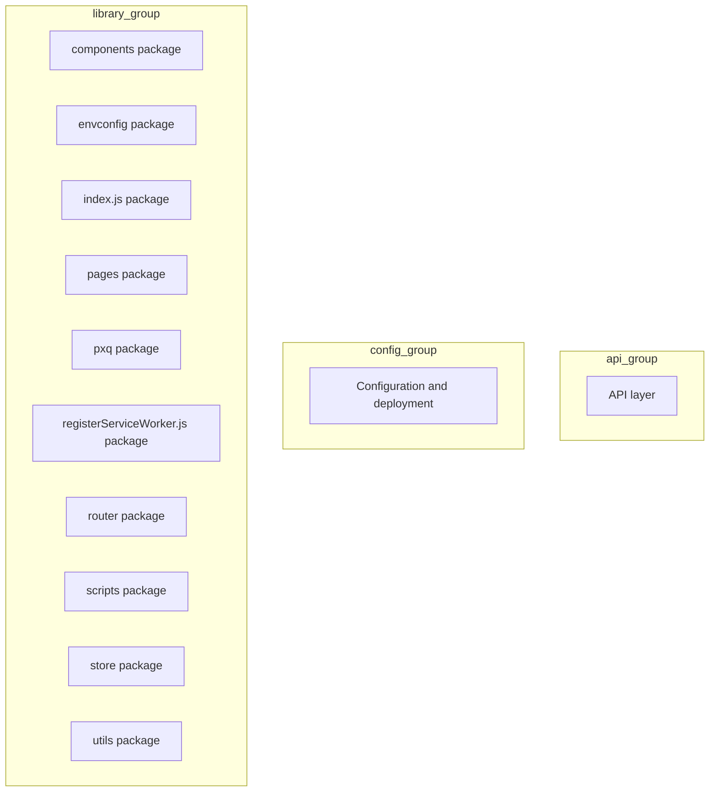

# Architecture report: bailicangdu/react-pxq

> Automated static analysis. **Observed** = directly seen in files/imports/AST; **Inferred** = interpretation from that evidence. Repository code was not executed.

## 1. Repository at a glance

| Item | Value |
| --- | --- |
| Repository | bailicangdu/react-pxq |
| Description | 一个 react + redux 的完整项目 和 个人总结 |
| Language | JavaScript |
| Stars | 7494 |
| Licence | MIT |
| Analysed commit / branch | 553e42f41b9ed4ad0d30216aedf7e3fb7c06fc3e / master |
| Framework(s) | React |
| Files analysed | 71 |
| Components | 12 |

## 2. Architecture in one minute

bailicangdu/react-pxq - 一个 react + redux 的完整项目 和 个人总结. This repository was analysed statically from 71 file(s) (0 Python). Detected technologies (observed from imports/manifests): React, axios, React Router, Redux, Jest, webpack. Files are grouped into 12 component(s): API layer, components package, Configuration and deployment, envconfig package, index.js package, pages package, pxq package, registerServiceWorker.js package. Findings below distinguish observed facts from inferred interpretation.

## 3. High-level block diagram

## 4. Main components

### API layer (`api_layer`)

- **Kind:** api
- **Status:** Observed
- **Confidence:** 0.85
- **Responsibility:** Groups 2 file(s) under api layer (observed from repository paths and static analysis).
- **Paths:** `src/api/api.js`, `src/api/server.js`
- **Evidence:** [src/api/api.js](https://github.com/bailicangdu/react-pxq/blob/553e42f41b9ed4ad0d30216aedf7e3fb7c06fc3e/src/api/api.js); [src/api/server.js](https://github.com/bailicangdu/react-pxq/blob/553e42f41b9ed4ad0d30216aedf7e3fb7c06fc3e/src/api/server.js)

### components package (`components`)

- **Kind:** library
- **Status:** Observed
- **Confidence:** 0.85
- **Responsibility:** Groups 3 file(s) under components package (observed from repository paths and static analysis).
- **Paths:** `src/components/TouchableOpacity/TouchableOpacity.jsx`, `src/components/alert/alert.jsx`, `src/components/header/header.jsx`
- **Evidence:** [src/components/TouchableOpacity/TouchableOpacity.jsx](https://github.com/bailicangdu/react-pxq/blob/553e42f41b9ed4ad0d30216aedf7e3fb7c06fc3e/src/components/TouchableOpacity/TouchableOpacity.jsx); [src/components/alert/alert.jsx](https://github.com/bailicangdu/react-pxq/blob/553e42f41b9ed4ad0d30216aedf7e3fb7c06fc3e/src/components/alert/alert.jsx); [src/components/header/header.jsx](https://github.com/bailicangdu/react-pxq/blob/553e42f41b9ed4ad0d30216aedf7e3fb7c06fc3e/src/components/header/header.jsx)

### Configuration and deployment (`config`)

- **Kind:** config
- **Status:** Observed
- **Confidence:** 0.85
- **Responsibility:** Groups 13 file(s) under configuration and deployment (observed from repository paths and static analysis).
- **Paths:** `config/env.js`, `config/jest/babelTransform.js`, `config/jest/cssTransform.js`, `config/jest/fileTransform.js`, `config/paths.js`, `config/polyfills.js`, `config/webpack.config.dev.js`, `config/webpack.config.prod.js`, `config/webpackDevServer.config.js`, `package.json`, `public/manifest.json`, `pxq/asset-manifest.json`, `pxq/manifest.json`
- **Evidence:** [config/env.js](https://github.com/bailicangdu/react-pxq/blob/553e42f41b9ed4ad0d30216aedf7e3fb7c06fc3e/config/env.js); [config/jest/babelTransform.js](https://github.com/bailicangdu/react-pxq/blob/553e42f41b9ed4ad0d30216aedf7e3fb7c06fc3e/config/jest/babelTransform.js); [config/jest/cssTransform.js](https://github.com/bailicangdu/react-pxq/blob/553e42f41b9ed4ad0d30216aedf7e3fb7c06fc3e/config/jest/cssTransform.js); [config/jest/fileTransform.js](https://github.com/bailicangdu/react-pxq/blob/553e42f41b9ed4ad0d30216aedf7e3fb7c06fc3e/config/jest/fileTransform.js); [config/paths.js](https://github.com/bailicangdu/react-pxq/blob/553e42f41b9ed4ad0d30216aedf7e3fb7c06fc3e/config/paths.js); [config/polyfills.js](https://github.com/bailicangdu/react-pxq/blob/553e42f41b9ed4ad0d30216aedf7e3fb7c06fc3e/config/polyfills.js); [config/webpack.config.dev.js](https://github.com/bailicangdu/react-pxq/blob/553e42f41b9ed4ad0d30216aedf7e3fb7c06fc3e/config/webpack.config.dev.js); [config/webpack.config.prod.js](https://github.com/bailicangdu/react-pxq/blob/553e42f41b9ed4ad0d30216aedf7e3fb7c06fc3e/config/webpack.config.prod.js)

### envconfig package (`envconfig`)

- **Kind:** library
- **Status:** Observed
- **Confidence:** 0.85
- **Responsibility:** Groups 1 file(s) under envconfig package (observed from repository paths and static analysis).
- **Paths:** `src/envconfig/envconfig.js`
- **Evidence:** [src/envconfig/envconfig.js](https://github.com/bailicangdu/react-pxq/blob/553e42f41b9ed4ad0d30216aedf7e3fb7c06fc3e/src/envconfig/envconfig.js)

### index.js package (`index_js`)

- **Kind:** library
- **Status:** Observed
- **Confidence:** 0.85
- **Responsibility:** Groups 1 file(s) under index.js package (observed from repository paths and static analysis).
- **Paths:** `src/index.js`
- **Evidence:** [src/index.js](https://github.com/bailicangdu/react-pxq/blob/553e42f41b9ed4ad0d30216aedf7e3fb7c06fc3e/src/index.js)

### pages package (`pages`)

- **Kind:** library
- **Status:** Observed
- **Confidence:** 0.85
- **Responsibility:** Groups 6 file(s) under pages package (observed from repository paths and static analysis).
- **Paths:** `src/pages/balance/balance.jsx`, `src/pages/helpcenter/helpcenter.jsx`, `src/pages/home/home.jsx`, `src/pages/production/production.jsx`, `src/pages/record/components/recordList.jsx`, `src/pages/record/record.jsx`
- **Evidence:** [src/pages/balance/balance.jsx](https://github.com/bailicangdu/react-pxq/blob/553e42f41b9ed4ad0d30216aedf7e3fb7c06fc3e/src/pages/balance/balance.jsx); [src/pages/helpcenter/helpcenter.jsx](https://github.com/bailicangdu/react-pxq/blob/553e42f41b9ed4ad0d30216aedf7e3fb7c06fc3e/src/pages/helpcenter/helpcenter.jsx); [src/pages/home/home.jsx](https://github.com/bailicangdu/react-pxq/blob/553e42f41b9ed4ad0d30216aedf7e3fb7c06fc3e/src/pages/home/home.jsx); [src/pages/production/production.jsx](https://github.com/bailicangdu/react-pxq/blob/553e42f41b9ed4ad0d30216aedf7e3fb7c06fc3e/src/pages/production/production.jsx); [src/pages/record/components/recordList.jsx](https://github.com/bailicangdu/react-pxq/blob/553e42f41b9ed4ad0d30216aedf7e3fb7c06fc3e/src/pages/record/components/recordList.jsx); [src/pages/record/record.jsx](https://github.com/bailicangdu/react-pxq/blob/553e42f41b9ed4ad0d30216aedf7e3fb7c06fc3e/src/pages/record/record.jsx)

### pxq package (`pxq`)

- **Kind:** library
- **Status:** Observed
- **Confidence:** 0.85
- **Responsibility:** Groups 5 file(s) under pxq package (observed from repository paths and static analysis).
- **Paths:** `pxq/service-worker.js`, `pxq/static/js/0.c353ab85.chunk.js`, `pxq/static/js/1.af913d75.chunk.js`, `pxq/static/js/2.a96eb65f.chunk.js`, `pxq/static/js/3.ff2875c3.chunk.js`
- **Evidence:** [pxq/service-worker.js](https://github.com/bailicangdu/react-pxq/blob/553e42f41b9ed4ad0d30216aedf7e3fb7c06fc3e/pxq/service-worker.js); [pxq/static/js/0.c353ab85.chunk.js](https://github.com/bailicangdu/react-pxq/blob/553e42f41b9ed4ad0d30216aedf7e3fb7c06fc3e/pxq/static/js/0.c353ab85.chunk.js); [pxq/static/js/1.af913d75.chunk.js](https://github.com/bailicangdu/react-pxq/blob/553e42f41b9ed4ad0d30216aedf7e3fb7c06fc3e/pxq/static/js/1.af913d75.chunk.js); [pxq/static/js/2.a96eb65f.chunk.js](https://github.com/bailicangdu/react-pxq/blob/553e42f41b9ed4ad0d30216aedf7e3fb7c06fc3e/pxq/static/js/2.a96eb65f.chunk.js); [pxq/static/js/3.ff2875c3.chunk.js](https://github.com/bailicangdu/react-pxq/blob/553e42f41b9ed4ad0d30216aedf7e3fb7c06fc3e/pxq/static/js/3.ff2875c3.chunk.js)

### registerServiceWorker.js package (`registerserviceworker_js`)

- **Kind:** library
- **Status:** Observed
- **Confidence:** 0.85
- **Responsibility:** Groups 1 file(s) under registerserviceworker.js package (observed from repository paths and static analysis).
- **Paths:** `src/registerServiceWorker.js`
- **Evidence:** [src/registerServiceWorker.js](https://github.com/bailicangdu/react-pxq/blob/553e42f41b9ed4ad0d30216aedf7e3fb7c06fc3e/src/registerServiceWorker.js)

### router package (`router`)

- **Kind:** library
- **Status:** Observed
- **Confidence:** 0.85
- **Responsibility:** Groups 1 file(s) under router package (observed from repository paths and static analysis).
- **Paths:** `src/router/index.js`
- **Evidence:** [src/router/index.js](https://github.com/bailicangdu/react-pxq/blob/553e42f41b9ed4ad0d30216aedf7e3fb7c06fc3e/src/router/index.js)

### scripts package (`scripts`)

- **Kind:** library
- **Status:** Observed
- **Confidence:** 0.85
- **Responsibility:** Groups 6 file(s) under scripts package (observed from repository paths and static analysis).
- **Paths:** `scripts/build.js`, `scripts/eject.js`, `scripts/init.js`, `scripts/start.js`, `scripts/test.js`, `scripts/utils/createJestConfig.js`
- **Evidence:** [scripts/build.js](https://github.com/bailicangdu/react-pxq/blob/553e42f41b9ed4ad0d30216aedf7e3fb7c06fc3e/scripts/build.js); [scripts/eject.js](https://github.com/bailicangdu/react-pxq/blob/553e42f41b9ed4ad0d30216aedf7e3fb7c06fc3e/scripts/eject.js); [scripts/init.js](https://github.com/bailicangdu/react-pxq/blob/553e42f41b9ed4ad0d30216aedf7e3fb7c06fc3e/scripts/init.js); [scripts/start.js](https://github.com/bailicangdu/react-pxq/blob/553e42f41b9ed4ad0d30216aedf7e3fb7c06fc3e/scripts/start.js); [scripts/test.js](https://github.com/bailicangdu/react-pxq/blob/553e42f41b9ed4ad0d30216aedf7e3fb7c06fc3e/scripts/test.js); [scripts/utils/createJestConfig.js](https://github.com/bailicangdu/react-pxq/blob/553e42f41b9ed4ad0d30216aedf7e3fb7c06fc3e/scripts/utils/createJestConfig.js)

### store package (`store`)

- **Kind:** library
- **Status:** Observed
- **Confidence:** 0.85
- **Responsibility:** Groups 7 file(s) under store package (observed from repository paths and static analysis).
- **Paths:** `src/store/home/action-type.js`, `src/store/home/action.js`, `src/store/home/reducer.js`, `src/store/production/action-type.js`, `src/store/production/action.js`, `src/store/production/reducer.js`, `src/store/store.js`
- **Evidence:** [src/store/home/action-type.js](https://github.com/bailicangdu/react-pxq/blob/553e42f41b9ed4ad0d30216aedf7e3fb7c06fc3e/src/store/home/action-type.js); [src/store/home/action.js](https://github.com/bailicangdu/react-pxq/blob/553e42f41b9ed4ad0d30216aedf7e3fb7c06fc3e/src/store/home/action.js); [src/store/home/reducer.js](https://github.com/bailicangdu/react-pxq/blob/553e42f41b9ed4ad0d30216aedf7e3fb7c06fc3e/src/store/home/reducer.js); [src/store/production/action-type.js](https://github.com/bailicangdu/react-pxq/blob/553e42f41b9ed4ad0d30216aedf7e3fb7c06fc3e/src/store/production/action-type.js); [src/store/production/action.js](https://github.com/bailicangdu/react-pxq/blob/553e42f41b9ed4ad0d30216aedf7e3fb7c06fc3e/src/store/production/action.js); [src/store/production/reducer.js](https://github.com/bailicangdu/react-pxq/blob/553e42f41b9ed4ad0d30216aedf7e3fb7c06fc3e/src/store/production/reducer.js); [src/store/store.js](https://github.com/bailicangdu/react-pxq/blob/553e42f41b9ed4ad0d30216aedf7e3fb7c06fc3e/src/store/store.js)

### utils package (`utils`)

- **Kind:** library
- **Status:** Observed
- **Confidence:** 0.85
- **Responsibility:** Groups 3 file(s) under utils package (observed from repository paths and static analysis).
- **Paths:** `src/utils/asyncComponent.jsx`, `src/utils/mixin.js`, `src/utils/setRem.js`
- **Evidence:** [src/utils/asyncComponent.jsx](https://github.com/bailicangdu/react-pxq/blob/553e42f41b9ed4ad0d30216aedf7e3fb7c06fc3e/src/utils/asyncComponent.jsx); [src/utils/mixin.js](https://github.com/bailicangdu/react-pxq/blob/553e42f41b9ed4ad0d30216aedf7e3fb7c06fc3e/src/utils/mixin.js); [src/utils/setRem.js](https://github.com/bailicangdu/react-pxq/blob/553e42f41b9ed4ad0d30216aedf7e3fb7c06fc3e/src/utils/setRem.js)

## 5. Execution flow

**Observed** entry point(s):

- [src/api/server.js](https://github.com/bailicangdu/react-pxq/blob/553e42f41b9ed4ad0d30216aedf7e3fb7c06fc3e/src/api/server.js)
- [src/index.js](https://github.com/bailicangdu/react-pxq/blob/553e42f41b9ed4ad0d30216aedf7e3fb7c06fc3e/src/index.js)
- [src/router/index.js](https://github.com/bailicangdu/react-pxq/blob/553e42f41b9ed4ad0d30216aedf7e3fb7c06fc3e/src/router/index.js)

Representative flow (derived from observed entry points and the import graph; steps beyond the entry point are **Inferred**):

1. Execution starts at an observed entry point listed above, if present.
2. No internal import relationships between components were observed.

## 6. Project structure

### `(root)`

- `.babelrc` - other (66 bytes)
- `.gitignore` - other (325 bytes)
- `LICENSE` - docs (1062 bytes)
- `README.md` - docs (25884 bytes)
- `package.json` - manifest (3020 bytes)

### `bin`

- `bin/react-scripts` - other (1785 bytes)

### `config`

- `config/env.js` - source, JavaScript (3667 bytes)
- `config/jest/babelTransform.js` - source, JavaScript (390 bytes)
- `config/jest/cssTransform.js` - source, JavaScript (553 bytes)
- `config/jest/fileTransform.js` - source, JavaScript (544 bytes)
- `config/paths.js` - source, JavaScript (4409 bytes)
- `config/polyfills.js` - source, JavaScript (1089 bytes)
- `config/webpack.config.dev.js` - source, JavaScript (14608 bytes)
- `config/webpack.config.prod.js` - source, JavaScript (16875 bytes)
- `config/webpackDevServer.config.js` - source, JavaScript (5699 bytes)

### `public`

- `public/index.html` - other (1904 bytes)
- `public/manifest.json` - config (317 bytes)

### `pxq`

- `pxq/asset-manifest.json` - config (618 bytes)
- `pxq/index.html` - other (843 bytes)
- `pxq/manifest.json` - config (317 bytes)
- `pxq/service-worker.js` - source, JavaScript (3713 bytes)
- `pxq/static/css/main.fc2ff5ec.css` - other (10997 bytes)
- `pxq/static/js/0.c353ab85.chunk.js` - source, JavaScript (11703 bytes)
- `pxq/static/js/1.af913d75.chunk.js` - source, JavaScript (6819 bytes)
- `pxq/static/js/2.a96eb65f.chunk.js` - source, JavaScript (3523 bytes)
- `pxq/static/js/3.ff2875c3.chunk.js` - source, JavaScript (6349 bytes)
- `pxq/static/media/iconfont.6924d946.svg` - other (12697 bytes)

### `scripts`

- `scripts/build.js` - source, JavaScript (5269 bytes)
- `scripts/eject.js` - source, JavaScript (8424 bytes)
- `scripts/init.js` - source, JavaScript (5815 bytes)
- `scripts/start.js` - source, JavaScript (3396 bytes)
- `scripts/test.js` - source, JavaScript (1427 bytes)
- `scripts/utils/createJestConfig.js` - source, JavaScript (3250 bytes)

### `src`

- `src/api/api.js` - source, JavaScript (2770 bytes)
- `src/api/server.js` - source, JavaScript (1690 bytes)
- `src/assets/iconfonts/iconfont.css` - other (5229 bytes)
- `src/assets/iconfonts/iconfont.svg` - other (12697 bytes)
- `src/components/TouchableOpacity/TouchableOpacity.jsx` - source, JavaScript (905 bytes)
- `src/components/TouchableOpacity/TouchableOpacity.less` - other (128 bytes)
- `src/components/alert/alert.jsx` - source, JavaScript (1472 bytes)
- `src/components/alert/alert.less` - other (670 bytes)
- `src/components/header/header.jsx` - source, JavaScript (2153 bytes)
- `src/components/header/header.less` - other (1210 bytes)
- `src/envconfig/envconfig.js` - source, JavaScript (233 bytes)
- `src/index.js` - source, JavaScript (894 bytes)
- `src/pages/balance/balance.jsx` - source, JavaScript (2902 bytes)
- `src/pages/balance/balance.less` - other (581 bytes)
- `src/pages/helpcenter/helpcenter.jsx` - source, JavaScript (1127 bytes)
- `src/pages/helpcenter/helpcenter.less` - other (234 bytes)
- `src/pages/home/home.jsx` - source, JavaScript (5762 bytes)
- `src/pages/home/home.less` - other (1367 bytes)
- `src/pages/production/production.jsx` - source, JavaScript (2635 bytes)
- `src/pages/production/production.less` - other (862 bytes)
- `src/pages/record/components/recordList.jsx` - source, JavaScript (2004 bytes)
- `src/pages/record/components/recordList.less` - other (662 bytes)
- `src/pages/record/record.jsx` - source, JavaScript (2373 bytes)
- `src/pages/record/record.less` - other (681 bytes)
- `src/registerServiceWorker.js` - source, JavaScript (4021 bytes)
- `src/router/index.js` - source, JavaScript (1178 bytes)
- `src/store/home/action-type.js` - source, JavaScript (169 bytes)
- `src/store/home/action.js` - source, JavaScript (391 bytes)
- `src/store/home/reducer.js` - source, JavaScript (550 bytes)
- `src/store/production/action-type.js` - source, JavaScript (253 bytes)
- `src/store/production/action.js` - source, JavaScript (880 bytes)
- `src/store/production/reducer.js` - source, JavaScript (1937 bytes)
- `src/store/store.js` - source, JavaScript (315 bytes)
- `src/style/base.css` - other (1408 bytes)
- `src/style/mixin.less` - other (1524 bytes)
- `src/utils/asyncComponent.jsx` - source, JavaScript (525 bytes)
- `src/utils/mixin.js` - source, JavaScript (782 bytes)
- `src/utils/setRem.js` - source, JavaScript (299 bytes)

## 7. Key dependencies and integrations

| Name | Category | Status | Confidence | Evidence |
| --- | --- | --- | --- | --- |
| React | framework | Observed | 0.90 | [package.json:10](https://github.com/bailicangdu/react-pxq/blob/553e42f41b9ed4ad0d30216aedf7e3fb7c06fc3e/package.json#L10); [package.json:12](https://github.com/bailicangdu/react-pxq/blob/553e42f41b9ed4ad0d30216aedf7e3fb7c06fc3e/package.json#L12) |
| axios | library | Observed | 0.85 | [package.json:6](https://github.com/bailicangdu/react-pxq/blob/553e42f41b9ed4ad0d30216aedf7e3fb7c06fc3e/package.json#L6) |
| React Router | library | Observed | 0.85 | [package.json:14](https://github.com/bailicangdu/react-pxq/blob/553e42f41b9ed4ad0d30216aedf7e3fb7c06fc3e/package.json#L14) |
| Redux | library | Observed | 0.85 | [package.json:13](https://github.com/bailicangdu/react-pxq/blob/553e42f41b9ed4ad0d30216aedf7e3fb7c06fc3e/package.json#L13) |
| Jest | tooling | Observed | 0.85 | [package.json:24](https://github.com/bailicangdu/react-pxq/blob/553e42f41b9ed4ad0d30216aedf7e3fb7c06fc3e/package.json#L24) |
| webpack | tooling | Observed | 0.85 | [package.json:77](https://github.com/bailicangdu/react-pxq/blob/553e42f41b9ed4ad0d30216aedf7e3fb7c06fc3e/package.json#L77) |

## 8. Data and state

No database, cache, queue, or persistent-state usage was observed in the analysed files. State handling, if any, may be in-memory or in files that were not analysed.

## 9. Configuration and deployment clues

- `package.json` (manifest)
- `public/manifest.json` (config)
- `pxq/asset-manifest.json` (config)
- `pxq/manifest.json` (config)

## 10. Design observations

- An entry/API layer is separated from other code (Inferred from paths and decorators).

These observations are interpretations (**Inferred**) of the observed structure, not guarantees about runtime design.

## 11. Limitations and unknowns

- Static analysis only: repository code was not executed, installed, or imported at runtime.
- Components and relationships are inferred from file paths, imports, and AST structure; runtime behaviour, dynamic imports, and reflection may not be visible.
- No clear application entry point was observed in the analysed files.
- Repository text was treated as untrusted data; no instructions found in repository files were followed, and likely secret values were redacted/excluded.
- JavaScript and TypeScript files were inventoried from paths and package manifests. They were not parsed with a full language AST, and repository code was not executed.

## 12. Source references

- [config/env.js](https://github.com/bailicangdu/react-pxq/blob/553e42f41b9ed4ad0d30216aedf7e3fb7c06fc3e/config/env.js)
- [config/jest/babelTransform.js](https://github.com/bailicangdu/react-pxq/blob/553e42f41b9ed4ad0d30216aedf7e3fb7c06fc3e/config/jest/babelTransform.js)
- [config/jest/cssTransform.js](https://github.com/bailicangdu/react-pxq/blob/553e42f41b9ed4ad0d30216aedf7e3fb7c06fc3e/config/jest/cssTransform.js)
- [config/jest/fileTransform.js](https://github.com/bailicangdu/react-pxq/blob/553e42f41b9ed4ad0d30216aedf7e3fb7c06fc3e/config/jest/fileTransform.js)
- [config/paths.js](https://github.com/bailicangdu/react-pxq/blob/553e42f41b9ed4ad0d30216aedf7e3fb7c06fc3e/config/paths.js)
- [config/polyfills.js](https://github.com/bailicangdu/react-pxq/blob/553e42f41b9ed4ad0d30216aedf7e3fb7c06fc3e/config/polyfills.js)
- [config/webpack.config.dev.js](https://github.com/bailicangdu/react-pxq/blob/553e42f41b9ed4ad0d30216aedf7e3fb7c06fc3e/config/webpack.config.dev.js)
- [config/webpack.config.prod.js](https://github.com/bailicangdu/react-pxq/blob/553e42f41b9ed4ad0d30216aedf7e3fb7c06fc3e/config/webpack.config.prod.js)
- [package.json:6](https://github.com/bailicangdu/react-pxq/blob/553e42f41b9ed4ad0d30216aedf7e3fb7c06fc3e/package.json#L6)
- [package.json:10](https://github.com/bailicangdu/react-pxq/blob/553e42f41b9ed4ad0d30216aedf7e3fb7c06fc3e/package.json#L10)
- [package.json:12](https://github.com/bailicangdu/react-pxq/blob/553e42f41b9ed4ad0d30216aedf7e3fb7c06fc3e/package.json#L12)
- [package.json:13](https://github.com/bailicangdu/react-pxq/blob/553e42f41b9ed4ad0d30216aedf7e3fb7c06fc3e/package.json#L13)
- [package.json:14](https://github.com/bailicangdu/react-pxq/blob/553e42f41b9ed4ad0d30216aedf7e3fb7c06fc3e/package.json#L14)
- [package.json:24](https://github.com/bailicangdu/react-pxq/blob/553e42f41b9ed4ad0d30216aedf7e3fb7c06fc3e/package.json#L24)
- [package.json:77](https://github.com/bailicangdu/react-pxq/blob/553e42f41b9ed4ad0d30216aedf7e3fb7c06fc3e/package.json#L77)
- [pxq/service-worker.js](https://github.com/bailicangdu/react-pxq/blob/553e42f41b9ed4ad0d30216aedf7e3fb7c06fc3e/pxq/service-worker.js)
- [pxq/static/js/0.c353ab85.chunk.js](https://github.com/bailicangdu/react-pxq/blob/553e42f41b9ed4ad0d30216aedf7e3fb7c06fc3e/pxq/static/js/0.c353ab85.chunk.js)
- [pxq/static/js/1.af913d75.chunk.js](https://github.com/bailicangdu/react-pxq/blob/553e42f41b9ed4ad0d30216aedf7e3fb7c06fc3e/pxq/static/js/1.af913d75.chunk.js)
- [pxq/static/js/2.a96eb65f.chunk.js](https://github.com/bailicangdu/react-pxq/blob/553e42f41b9ed4ad0d30216aedf7e3fb7c06fc3e/pxq/static/js/2.a96eb65f.chunk.js)
- [pxq/static/js/3.ff2875c3.chunk.js](https://github.com/bailicangdu/react-pxq/blob/553e42f41b9ed4ad0d30216aedf7e3fb7c06fc3e/pxq/static/js/3.ff2875c3.chunk.js)
- [scripts/build.js](https://github.com/bailicangdu/react-pxq/blob/553e42f41b9ed4ad0d30216aedf7e3fb7c06fc3e/scripts/build.js)
- [scripts/eject.js](https://github.com/bailicangdu/react-pxq/blob/553e42f41b9ed4ad0d30216aedf7e3fb7c06fc3e/scripts/eject.js)
- [scripts/init.js](https://github.com/bailicangdu/react-pxq/blob/553e42f41b9ed4ad0d30216aedf7e3fb7c06fc3e/scripts/init.js)
- [scripts/start.js](https://github.com/bailicangdu/react-pxq/blob/553e42f41b9ed4ad0d30216aedf7e3fb7c06fc3e/scripts/start.js)
- [scripts/test.js](https://github.com/bailicangdu/react-pxq/blob/553e42f41b9ed4ad0d30216aedf7e3fb7c06fc3e/scripts/test.js)
- [scripts/utils/createJestConfig.js](https://github.com/bailicangdu/react-pxq/blob/553e42f41b9ed4ad0d30216aedf7e3fb7c06fc3e/scripts/utils/createJestConfig.js)
- [src/api/api.js](https://github.com/bailicangdu/react-pxq/blob/553e42f41b9ed4ad0d30216aedf7e3fb7c06fc3e/src/api/api.js)
- [src/api/server.js](https://github.com/bailicangdu/react-pxq/blob/553e42f41b9ed4ad0d30216aedf7e3fb7c06fc3e/src/api/server.js)
- [src/components/TouchableOpacity/TouchableOpacity.jsx](https://github.com/bailicangdu/react-pxq/blob/553e42f41b9ed4ad0d30216aedf7e3fb7c06fc3e/src/components/TouchableOpacity/TouchableOpacity.jsx)
- [src/components/alert/alert.jsx](https://github.com/bailicangdu/react-pxq/blob/553e42f41b9ed4ad0d30216aedf7e3fb7c06fc3e/src/components/alert/alert.jsx)
- [src/components/header/header.jsx](https://github.com/bailicangdu/react-pxq/blob/553e42f41b9ed4ad0d30216aedf7e3fb7c06fc3e/src/components/header/header.jsx)
- [src/envconfig/envconfig.js](https://github.com/bailicangdu/react-pxq/blob/553e42f41b9ed4ad0d30216aedf7e3fb7c06fc3e/src/envconfig/envconfig.js)
- [src/index.js](https://github.com/bailicangdu/react-pxq/blob/553e42f41b9ed4ad0d30216aedf7e3fb7c06fc3e/src/index.js)
- [src/pages/balance/balance.jsx](https://github.com/bailicangdu/react-pxq/blob/553e42f41b9ed4ad0d30216aedf7e3fb7c06fc3e/src/pages/balance/balance.jsx)
- [src/pages/helpcenter/helpcenter.jsx](https://github.com/bailicangdu/react-pxq/blob/553e42f41b9ed4ad0d30216aedf7e3fb7c06fc3e/src/pages/helpcenter/helpcenter.jsx)
- [src/pages/home/home.jsx](https://github.com/bailicangdu/react-pxq/blob/553e42f41b9ed4ad0d30216aedf7e3fb7c06fc3e/src/pages/home/home.jsx)
- [src/pages/production/production.jsx](https://github.com/bailicangdu/react-pxq/blob/553e42f41b9ed4ad0d30216aedf7e3fb7c06fc3e/src/pages/production/production.jsx)
- [src/pages/record/components/recordList.jsx](https://github.com/bailicangdu/react-pxq/blob/553e42f41b9ed4ad0d30216aedf7e3fb7c06fc3e/src/pages/record/components/recordList.jsx)
- [src/pages/record/record.jsx](https://github.com/bailicangdu/react-pxq/blob/553e42f41b9ed4ad0d30216aedf7e3fb7c06fc3e/src/pages/record/record.jsx)
- [src/registerServiceWorker.js](https://github.com/bailicangdu/react-pxq/blob/553e42f41b9ed4ad0d30216aedf7e3fb7c06fc3e/src/registerServiceWorker.js)
- [src/router/index.js](https://github.com/bailicangdu/react-pxq/blob/553e42f41b9ed4ad0d30216aedf7e3fb7c06fc3e/src/router/index.js)
- [src/store/home/action-type.js](https://github.com/bailicangdu/react-pxq/blob/553e42f41b9ed4ad0d30216aedf7e3fb7c06fc3e/src/store/home/action-type.js)
- [src/store/home/action.js](https://github.com/bailicangdu/react-pxq/blob/553e42f41b9ed4ad0d30216aedf7e3fb7c06fc3e/src/store/home/action.js)
- [src/store/home/reducer.js](https://github.com/bailicangdu/react-pxq/blob/553e42f41b9ed4ad0d30216aedf7e3fb7c06fc3e/src/store/home/reducer.js)
- [src/store/production/action-type.js](https://github.com/bailicangdu/react-pxq/blob/553e42f41b9ed4ad0d30216aedf7e3fb7c06fc3e/src/store/production/action-type.js)
- [src/store/production/action.js](https://github.com/bailicangdu/react-pxq/blob/553e42f41b9ed4ad0d30216aedf7e3fb7c06fc3e/src/store/production/action.js)
- [src/store/production/reducer.js](https://github.com/bailicangdu/react-pxq/blob/553e42f41b9ed4ad0d30216aedf7e3fb7c06fc3e/src/store/production/reducer.js)
- [src/store/store.js](https://github.com/bailicangdu/react-pxq/blob/553e42f41b9ed4ad0d30216aedf7e3fb7c06fc3e/src/store/store.js)
- [src/utils/asyncComponent.jsx](https://github.com/bailicangdu/react-pxq/blob/553e42f41b9ed4ad0d30216aedf7e3fb7c06fc3e/src/utils/asyncComponent.jsx)
- [src/utils/mixin.js](https://github.com/bailicangdu/react-pxq/blob/553e42f41b9ed4ad0d30216aedf7e3fb7c06fc3e/src/utils/mixin.js)
- [src/utils/setRem.js](https://github.com/bailicangdu/react-pxq/blob/553e42f41b9ed4ad0d30216aedf7e3fb7c06fc3e/src/utils/setRem.js)
