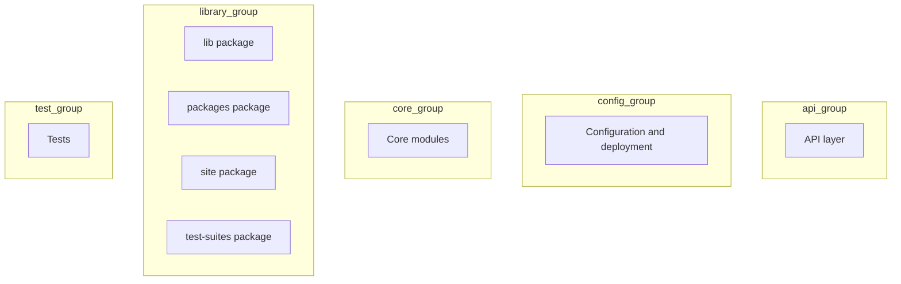

# Architecture report: barvian/number-flow

> Automated static analysis. **Observed** = directly seen in files/imports/AST; **Inferred** = interpretation from that evidence. Repository code was not executed.

## 1. Repository at a glance

| Item | Value |
| --- | --- |
| Repository | barvian/number-flow |
| Description | An animated number component for React, Vue, Svelte, and TS/JS. |
| Language | TypeScript |
| Stars | 7809 |
| Licence | MIT |
| Analysed commit / branch | c5906cf35c86583e756a6b91e043291c10b416e0 / main |
| Framework(s) | Next.js, React, Svelte, Vue |
| Files analysed | 371 |
| Components | 8 |

## 2. Architecture in one minute

barvian/number-flow - An animated number component for React, Vue, Svelte, and TS/JS.. This repository was analysed statically from 371 file(s) (0 Python). Detected technologies (observed from imports/manifests): GitHub Actions, Next.js, React, Svelte, Vue, Tailwind CSS. Files are grouped into 8 component(s): API layer, Configuration and deployment, Core modules, lib package, packages package, site package, test-suites package, Tests. Findings below distinguish observed facts from inferred interpretation.

## 3. High-level block diagram

## 4. Main components

### API layer (`api_layer`)

- **Kind:** api
- **Status:** Observed
- **Confidence:** 0.85
- **Responsibility:** Groups 21 file(s) under api layer (observed from repository paths and static analysis).
- **Paths:** `packages/svelte/src/routes/+layout.svelte`, `packages/svelte/src/routes/+page.svelte`, `packages/svelte/src/routes/can-animate/+page.svelte`, `packages/svelte/src/routes/disable-animated/+page.svelte`, `packages/svelte/src/routes/enable-animated/+page.svelte`, `packages/svelte/src/routes/group-1-unchanged/+page.svelte`, `packages/svelte/src/routes/hashes/+page.server.ts`, `packages/svelte/src/routes/hashes/+page.svelte`, `packages/svelte/src/routes/nonce/+page.server.ts`, `packages/svelte/src/routes/nonce/+page.svelte`, `site/src/components/Tweet/api/get-oembed.ts`, `site/src/components/Tweet/api/get-tweet.ts`, `site/src/components/Tweet/api/index.ts`, `site/src/components/Tweet/api/types/edit.ts`, `site/src/components/Tweet/api/types/entities.ts`, `site/src/components/Tweet/api/types/index.ts`, `site/src/components/Tweet/api/types/media.ts`, `site/src/components/Tweet/api/types/photo.ts`, `site/src/components/Tweet/api/types/tweet.ts`, `site/src/components/Tweet/api/types/user.ts`, `site/src/components/Tweet/api/types/video.ts`
- **Evidence:** [packages/svelte/src/routes/+layout.svelte](https://github.com/barvian/number-flow/blob/c5906cf35c86583e756a6b91e043291c10b416e0/packages/svelte/src/routes/%2Blayout.svelte); [packages/svelte/src/routes/+page.svelte](https://github.com/barvian/number-flow/blob/c5906cf35c86583e756a6b91e043291c10b416e0/packages/svelte/src/routes/%2Bpage.svelte); [packages/svelte/src/routes/can-animate/+page.svelte](https://github.com/barvian/number-flow/blob/c5906cf35c86583e756a6b91e043291c10b416e0/packages/svelte/src/routes/can-animate/%2Bpage.svelte); [packages/svelte/src/routes/disable-animated/+page.svelte](https://github.com/barvian/number-flow/blob/c5906cf35c86583e756a6b91e043291c10b416e0/packages/svelte/src/routes/disable-animated/%2Bpage.svelte); [packages/svelte/src/routes/enable-animated/+page.svelte](https://github.com/barvian/number-flow/blob/c5906cf35c86583e756a6b91e043291c10b416e0/packages/svelte/src/routes/enable-animated/%2Bpage.svelte); [packages/svelte/src/routes/group-1-unchanged/+page.svelte](https://github.com/barvian/number-flow/blob/c5906cf35c86583e756a6b91e043291c10b416e0/packages/svelte/src/routes/group-1-unchanged/%2Bpage.svelte); [packages/svelte/src/routes/hashes/+page.server.ts](https://github.com/barvian/number-flow/blob/c5906cf35c86583e756a6b91e043291c10b416e0/packages/svelte/src/routes/hashes/%2Bpage.server.ts); [packages/svelte/src/routes/hashes/+page.svelte](https://github.com/barvian/number-flow/blob/c5906cf35c86583e756a6b91e043291c10b416e0/packages/svelte/src/routes/hashes/%2Bpage.svelte)

### Configuration and deployment (`config`)

- **Kind:** config
- **Status:** Observed
- **Confidence:** 0.85
- **Responsibility:** Groups 21 file(s) under configuration and deployment (observed from repository paths and static analysis).
- **Paths:** `package.json`, `packages/number-flow/package.json`, `packages/number-flow/tsconfig.build.json`, `packages/number-flow/tsconfig.json`, `packages/react/package.json`, `packages/react/tsconfig.build.json`, `packages/react/tsconfig.json`, `packages/svelte/package.json`, `packages/svelte/tsconfig.json`, `packages/vue/package.json`, `packages/vue/tsconfig.build.json`, `packages/vue/tsconfig.json`, `pnpm-workspace.yaml`, `site/.vscode/extensions.json`, `site/.vscode/launch.json`, `site/blackout.json`, `site/package.json`, `site/tsconfig.json`, `site/whiteout.json`, `tsconfig.build.json`, `tsconfig.json`
- **Evidence:** [package.json](https://github.com/barvian/number-flow/blob/c5906cf35c86583e756a6b91e043291c10b416e0/package.json); [packages/number-flow/package.json](https://github.com/barvian/number-flow/blob/c5906cf35c86583e756a6b91e043291c10b416e0/packages/number-flow/package.json); [packages/number-flow/tsconfig.build.json](https://github.com/barvian/number-flow/blob/c5906cf35c86583e756a6b91e043291c10b416e0/packages/number-flow/tsconfig.build.json); [packages/number-flow/tsconfig.json](https://github.com/barvian/number-flow/blob/c5906cf35c86583e756a6b91e043291c10b416e0/packages/number-flow/tsconfig.json); [packages/react/package.json](https://github.com/barvian/number-flow/blob/c5906cf35c86583e756a6b91e043291c10b416e0/packages/react/package.json); [packages/react/tsconfig.build.json](https://github.com/barvian/number-flow/blob/c5906cf35c86583e756a6b91e043291c10b416e0/packages/react/tsconfig.build.json); [packages/react/tsconfig.json](https://github.com/barvian/number-flow/blob/c5906cf35c86583e756a6b91e043291c10b416e0/packages/react/tsconfig.json); [packages/svelte/package.json](https://github.com/barvian/number-flow/blob/c5906cf35c86583e756a6b91e043291c10b416e0/packages/svelte/package.json)

### Core modules (`core`)

- **Kind:** core
- **Status:** Observed
- **Confidence:** 0.85
- **Responsibility:** Groups 1 file(s) under core modules (observed from repository paths and static analysis).
- **Paths:** `prettier.config.js`
- **Evidence:** [prettier.config.js](https://github.com/barvian/number-flow/blob/c5906cf35c86583e756a6b91e043291c10b416e0/prettier.config.js)

### lib package (`lib`)

- **Kind:** library
- **Status:** Observed
- **Confidence:** 0.85
- **Responsibility:** Groups 1 file(s) under lib package (observed from repository paths and static analysis).
- **Paths:** `lib/playwright.ts`
- **Evidence:** [lib/playwright.ts](https://github.com/barvian/number-flow/blob/c5906cf35c86583e756a6b91e043291c10b416e0/lib/playwright.ts)

### packages package (`packages`)

- **Kind:** library
- **Status:** Observed
- **Confidence:** 0.85
- **Responsibility:** Groups 33 file(s) under packages package (observed from repository paths and static analysis).
- **Paths:** `packages/number-flow/src/csp.ts`, `packages/number-flow/src/env.d.ts`, `packages/number-flow/src/formatter.ts`, `packages/number-flow/src/group.ts`, `packages/number-flow/src/index.ts`, `packages/number-flow/src/lite.ts`, `packages/number-flow/src/plugins/continuous.ts`, `packages/number-flow/src/plugins/index.ts`, `packages/number-flow/src/ssr.ts`, `packages/number-flow/src/styles.ts`, `packages/number-flow/src/util/dom.ts`, `packages/number-flow/src/util/iterable.ts`, `packages/number-flow/src/util/math.ts`, `packages/number-flow/src/util/string.ts`, `packages/number-flow/src/util/types.ts`, `packages/number-flow/vite.config.mjs`, `packages/react/src/NumberFlow.tsx`, `packages/react/src/index.tsx`, `packages/svelte/playwright.config.ts`, `packages/svelte/postcss.config.js`, `packages/svelte/src/app.d.ts`, `packages/svelte/src/lib/NumberFlow.svelte`, `packages/svelte/src/lib/NumberFlowGroup.svelte`, `packages/svelte/src/lib/group.ts`, `packages/svelte/src/lib/index.ts`, `packages/svelte/svelte.config.js`, `packages/svelte/tailwind.config.ts`, `packages/svelte/vite.config.ts`, `packages/vue/src/NumberFlowGroup.vue`, `packages/vue/src/group.ts`, `packages/vue/src/index.ts`, `packages/vue/src/index.vue`, `packages/vue/vite.config.mjs`
- **Evidence:** [packages/number-flow/src/csp.ts](https://github.com/barvian/number-flow/blob/c5906cf35c86583e756a6b91e043291c10b416e0/packages/number-flow/src/csp.ts); [packages/number-flow/src/env.d.ts](https://github.com/barvian/number-flow/blob/c5906cf35c86583e756a6b91e043291c10b416e0/packages/number-flow/src/env.d.ts); [packages/number-flow/src/formatter.ts](https://github.com/barvian/number-flow/blob/c5906cf35c86583e756a6b91e043291c10b416e0/packages/number-flow/src/formatter.ts); [packages/number-flow/src/group.ts](https://github.com/barvian/number-flow/blob/c5906cf35c86583e756a6b91e043291c10b416e0/packages/number-flow/src/group.ts); [packages/number-flow/src/index.ts](https://github.com/barvian/number-flow/blob/c5906cf35c86583e756a6b91e043291c10b416e0/packages/number-flow/src/index.ts); [packages/number-flow/src/lite.ts](https://github.com/barvian/number-flow/blob/c5906cf35c86583e756a6b91e043291c10b416e0/packages/number-flow/src/lite.ts); [packages/number-flow/src/plugins/continuous.ts](https://github.com/barvian/number-flow/blob/c5906cf35c86583e756a6b91e043291c10b416e0/packages/number-flow/src/plugins/continuous.ts); [packages/number-flow/src/plugins/index.ts](https://github.com/barvian/number-flow/blob/c5906cf35c86583e756a6b91e043291c10b416e0/packages/number-flow/src/plugins/index.ts)

### site package (`site`)

- **Kind:** library
- **Status:** Observed
- **Confidence:** 0.85
- **Responsibility:** Groups 85 file(s) under site package (observed from repository paths and static analysis).
- **Paths:** `site/astro.config.mjs`, `site/postcss.config.cjs`, `site/src/components/AnimateHeightFragment.tsx`, `site/src/components/Demo.tsx`, `site/src/components/FrameworkMenu.tsx`, `site/src/components/Freeze.tsx`, `site/src/components/Link.tsx`, `site/src/components/Nav.tsx`, `site/src/components/Snapshotter.tsx`, `site/src/components/Supported.tsx`, `site/src/components/TOC.tsx`, `site/src/components/Tweet/twitter-theme/TweetMediaVideo.tsx`, `site/src/components/Tweet/twitter-theme/components.ts`, `site/src/components/Tweet/twitter-theme/icons/index.ts`, `site/src/components/Tweet/twitter-theme/quoted-tweet/index.ts`, `site/src/components/Tweet/twitter-theme/types.ts`, `site/src/components/Tweet/utils.ts`, `site/src/components/icons/frameworks/react.tsx`, `site/src/components/icons/frameworks/svelte.tsx`, `site/src/components/icons/frameworks/vanilla.tsx`, `site/src/components/icons/frameworks/vue.tsx`, `site/src/context/toc.ts`, `site/src/env.d.ts`, `site/src/hooks/useCycle.ts`, `site/src/lib/dom.ts`, `site/src/lib/framework.ts`, `site/src/lib/spring.ts`, `site/src/lib/stores.ts`, `site/src/lib/types.ts`, `site/src/lib/url.ts`, `site/src/middleware.ts`, `site/src/pages/[...framework]/_Hero.tsx`, `site/src/pages/[...framework]/_demos/Continuous.tsx`, `site/src/pages/[...framework]/_demos/Isolate.tsx`, `site/src/pages/[...framework]/_demos/Styling.tsx`, `site/src/pages/[...framework]/_demos/Suffix.tsx`, `site/src/pages/[...framework]/_demos/TabularNums.tsx`, `site/src/pages/[...framework]/_demos/Timings.tsx`, `site/src/pages/[...framework]/_demos/Trend.tsx`, `site/src/pages/[...framework]/examples/_Activity/index.tsx`, `site/src/pages/[...framework]/examples/_Activity/react/Component.tsx`, `site/src/pages/[...framework]/examples/_Activity/react/index.tsx`, `site/src/pages/[...framework]/examples/_Activity/stores.ts`, `site/src/pages/[...framework]/examples/_Activity/svelte/Component.svelte`, `site/src/pages/[...framework]/examples/_Activity/svelte/index.svelte`, `site/src/pages/[...framework]/examples/_Activity/vue/Component.vue`, `site/src/pages/[...framework]/examples/_Activity/vue/index.vue`, `site/src/pages/[...framework]/examples/_ColoredTrends/Example.tsx`, `site/src/pages/[...framework]/examples/_ColoredTrends/index.tsx`, `site/src/pages/[...framework]/examples/_Countdown/index.tsx`, `site/src/pages/[...framework]/examples/_Countdown/react/Component.tsx`, `site/src/pages/[...framework]/examples/_Countdown/react/index.tsx`, `site/src/pages/[...framework]/examples/_Countdown/stores.ts`, `site/src/pages/[...framework]/examples/_Countdown/svelte/Component.svelte`, `site/src/pages/[...framework]/examples/_Countdown/svelte/index.svelte`, `site/src/pages/[...framework]/examples/_Countdown/vue/Component.vue`, `site/src/pages/[...framework]/examples/_Countdown/vue/index.vue`, `site/src/pages/[...framework]/examples/_Group/index.tsx`, `site/src/pages/[...framework]/examples/_Group/react/Component.tsx`, `site/src/pages/[...framework]/examples/_Group/react/index.tsx`, `site/src/pages/[...framework]/examples/_Group/stores.ts`, `site/src/pages/[...framework]/examples/_Group/svelte/Component.svelte`, `site/src/pages/[...framework]/examples/_Group/svelte/index.svelte`, `site/src/pages/[...framework]/examples/_Group/vue/Component.vue`, `site/src/pages/[...framework]/examples/_Group/vue/index.vue`, `site/src/pages/[...framework]/examples/_Input/react/Component.tsx`, `site/src/pages/[...framework]/examples/_Input/react/index.tsx`, `site/src/pages/[...framework]/examples/_Input/svelte/Component.svelte`, `site/src/pages/[...framework]/examples/_Input/svelte/index.svelte`, `site/src/pages/[...framework]/examples/_Input/vue/Component.vue`, `site/src/pages/[...framework]/examples/_Input/vue/index.vue`, `site/src/pages/[...framework]/examples/_Motion/index.tsx`, `site/src/pages/[...framework]/examples/_Motion/react/Component.tsx`, `site/src/pages/[...framework]/examples/_Motion/react/index.tsx`, `site/src/pages/[...framework]/examples/_Motion/stores.ts`, `site/src/pages/[...framework]/examples/_Slider/react/Component.tsx`, `site/src/pages/[...framework]/examples/_Slider/react/index.tsx`, `site/src/pages/[...framework]/examples/_Slider/svelte/Component.svelte`, `site/src/pages/[...framework]/examples/_Slider/svelte/index.svelte`, `site/src/pages/[...framework]/examples/_Slider/vue/Component.vue`, `site/src/pages/[...framework]/examples/_Slider/vue/index.vue`, `site/src/react.d.ts`, `site/src/stores/url.ts`, `site/svelte.config.mjs`, `site/tailwind.config.ts`
- **Evidence:** [site/astro.config.mjs](https://github.com/barvian/number-flow/blob/c5906cf35c86583e756a6b91e043291c10b416e0/site/astro.config.mjs); [site/postcss.config.cjs](https://github.com/barvian/number-flow/blob/c5906cf35c86583e756a6b91e043291c10b416e0/site/postcss.config.cjs); [site/src/components/AnimateHeightFragment.tsx](https://github.com/barvian/number-flow/blob/c5906cf35c86583e756a6b91e043291c10b416e0/site/src/components/AnimateHeightFragment.tsx); [site/src/components/Demo.tsx](https://github.com/barvian/number-flow/blob/c5906cf35c86583e756a6b91e043291c10b416e0/site/src/components/Demo.tsx); [site/src/components/FrameworkMenu.tsx](https://github.com/barvian/number-flow/blob/c5906cf35c86583e756a6b91e043291c10b416e0/site/src/components/FrameworkMenu.tsx); [site/src/components/Freeze.tsx](https://github.com/barvian/number-flow/blob/c5906cf35c86583e756a6b91e043291c10b416e0/site/src/components/Freeze.tsx); [site/src/components/Link.tsx](https://github.com/barvian/number-flow/blob/c5906cf35c86583e756a6b91e043291c10b416e0/site/src/components/Link.tsx); [site/src/components/Nav.tsx](https://github.com/barvian/number-flow/blob/c5906cf35c86583e756a6b91e043291c10b416e0/site/src/components/Nav.tsx)

### test-suites package (`test_suites`)

- **Kind:** library
- **Status:** Observed
- **Confidence:** 0.85
- **Responsibility:** Groups 9 file(s) under test-suites package (observed from repository paths and static analysis).
- **Paths:** `test-suites/wrapper/animated.test.ts`, `test-suites/wrapper/can-animate.test.ts`, `test-suites/wrapper/group-1-unchanged.test.ts`, `test-suites/wrapper/hashes.test.ts`, `test-suites/wrapper/nonce.test.ts`, `test-suites/wrapper/parts.test.ts`, `test-suites/wrapper/render.test.ts`, `test-suites/wrapper/ssr.test.ts`, `test-suites/wrapper/update.test.ts`
- **Evidence:** [test-suites/wrapper/animated.test.ts](https://github.com/barvian/number-flow/blob/c5906cf35c86583e756a6b91e043291c10b416e0/test-suites/wrapper/animated.test.ts); [test-suites/wrapper/can-animate.test.ts](https://github.com/barvian/number-flow/blob/c5906cf35c86583e756a6b91e043291c10b416e0/test-suites/wrapper/can-animate.test.ts); [test-suites/wrapper/group-1-unchanged.test.ts](https://github.com/barvian/number-flow/blob/c5906cf35c86583e756a6b91e043291c10b416e0/test-suites/wrapper/group-1-unchanged.test.ts); [test-suites/wrapper/hashes.test.ts](https://github.com/barvian/number-flow/blob/c5906cf35c86583e756a6b91e043291c10b416e0/test-suites/wrapper/hashes.test.ts); [test-suites/wrapper/nonce.test.ts](https://github.com/barvian/number-flow/blob/c5906cf35c86583e756a6b91e043291c10b416e0/test-suites/wrapper/nonce.test.ts); [test-suites/wrapper/parts.test.ts](https://github.com/barvian/number-flow/blob/c5906cf35c86583e756a6b91e043291c10b416e0/test-suites/wrapper/parts.test.ts); [test-suites/wrapper/render.test.ts](https://github.com/barvian/number-flow/blob/c5906cf35c86583e756a6b91e043291c10b416e0/test-suites/wrapper/render.test.ts); [test-suites/wrapper/ssr.test.ts](https://github.com/barvian/number-flow/blob/c5906cf35c86583e756a6b91e043291c10b416e0/test-suites/wrapper/ssr.test.ts)

### Tests (`tests`)

- **Kind:** test
- **Status:** Observed
- **Confidence:** 0.85
- **Responsibility:** Groups 65 file(s) under tests (observed from repository paths and static analysis).
- **Paths:** `packages/number-flow/test/apps/astro/.gitignore`, `packages/number-flow/test/apps/astro/README.md`, `packages/number-flow/test/apps/astro/astro.config.mjs`, `packages/number-flow/test/apps/astro/package.json`, `packages/number-flow/test/apps/astro/playwright.config.ts`, `packages/number-flow/test/apps/astro/src/layouts/Layout.astro`, `packages/number-flow/test/apps/astro/src/middleware.ts`, `packages/number-flow/test/apps/astro/src/pages/can-animate.astro`, `packages/number-flow/test/apps/astro/src/pages/disable-animated.astro`, `packages/number-flow/test/apps/astro/src/pages/enable-animated.astro`, `packages/number-flow/test/apps/astro/src/pages/group-1-unchanged.astro`, `packages/number-flow/test/apps/astro/src/pages/hashes.astro`, `packages/number-flow/test/apps/astro/src/pages/index.astro`, `packages/number-flow/test/apps/astro/src/pages/nonce.astro`, `packages/number-flow/test/apps/astro/src/pages/thrashing.astro`, `packages/number-flow/test/apps/astro/src/styles/global.css`, `packages/number-flow/test/apps/astro/tsconfig.json`, `packages/react/test/apps/react-18/.gitignore`, `packages/react/test/apps/react-18/app/can-animate/page.tsx`, `packages/react/test/apps/react-18/app/disable-animated/page.tsx`, `packages/react/test/apps/react-18/app/enable-animated/page.tsx`, `packages/react/test/apps/react-18/app/globals.css`, `packages/react/test/apps/react-18/app/group-1-unchanged/page.tsx`, `packages/react/test/apps/react-18/app/hashes/page.tsx`, `packages/react/test/apps/react-18/app/layout.tsx`, `packages/react/test/apps/react-18/app/nonce/page.tsx`, `packages/react/test/apps/react-18/app/page.tsx`, `packages/react/test/apps/react-18/next.config.mjs`, `packages/react/test/apps/react-18/package.json`, `packages/react/test/apps/react-18/playwright.config.ts`, `packages/react/test/apps/react-18/postcss.config.mjs`, `packages/react/test/apps/react-18/tailwind.config.ts`, `packages/react/test/apps/react-18/tsconfig.json`, `packages/react/test/apps/react-19/.gitignore`, `packages/react/test/apps/react-19/app/can-animate/page.tsx`, `packages/react/test/apps/react-19/app/disable-animated/page.tsx`, `packages/react/test/apps/react-19/app/enable-animated/page.tsx`, `packages/react/test/apps/react-19/app/globals.css`, `packages/react/test/apps/react-19/app/group-1-unchanged/page.tsx`, `packages/react/test/apps/react-19/app/hashes/page.tsx`, `packages/react/test/apps/react-19/app/layout.tsx`, `packages/react/test/apps/react-19/app/nonce/page.tsx`, `packages/react/test/apps/react-19/app/page.tsx`, `packages/react/test/apps/react-19/app/sc/page.tsx`, `packages/react/test/apps/react-19/next.config.ts`, `packages/react/test/apps/react-19/package.json`, `packages/react/test/apps/react-19/playwright.config.ts`, `packages/react/test/apps/react-19/postcss.config.mjs`, `packages/react/test/apps/react-19/tailwind.config.ts`, `packages/react/test/apps/react-19/tsconfig.json`, `packages/vue/test/apps/nuxt3/.gitignore`, `packages/vue/test/apps/nuxt3/README.md`, `packages/vue/test/apps/nuxt3/nuxt.config.ts`, `packages/vue/test/apps/nuxt3/package.json`, `packages/vue/test/apps/nuxt3/playwright.config.ts`, `packages/vue/test/apps/nuxt3/src/assets/css/main.css`, `packages/vue/test/apps/nuxt3/src/pages/can-animate.vue`, `packages/vue/test/apps/nuxt3/src/pages/disable-animated.vue`, `packages/vue/test/apps/nuxt3/src/pages/enable-animated.vue`, `packages/vue/test/apps/nuxt3/src/pages/group-1-unchanged.vue`, `packages/vue/test/apps/nuxt3/src/pages/hashes.vue`, `packages/vue/test/apps/nuxt3/src/pages/index.vue`, `packages/vue/test/apps/nuxt3/src/pages/nonce.vue`, `packages/vue/test/apps/nuxt3/src/server/tsconfig.json`, `packages/vue/test/apps/nuxt3/tsconfig.json`
- **Evidence:** [packages/number-flow/test/apps/astro/.gitignore](https://github.com/barvian/number-flow/blob/c5906cf35c86583e756a6b91e043291c10b416e0/packages/number-flow/test/apps/astro/.gitignore); [packages/number-flow/test/apps/astro/README.md](https://github.com/barvian/number-flow/blob/c5906cf35c86583e756a6b91e043291c10b416e0/packages/number-flow/test/apps/astro/README.md); [packages/number-flow/test/apps/astro/astro.config.mjs](https://github.com/barvian/number-flow/blob/c5906cf35c86583e756a6b91e043291c10b416e0/packages/number-flow/test/apps/astro/astro.config.mjs); [packages/number-flow/test/apps/astro/package.json](https://github.com/barvian/number-flow/blob/c5906cf35c86583e756a6b91e043291c10b416e0/packages/number-flow/test/apps/astro/package.json); [packages/number-flow/test/apps/astro/playwright.config.ts](https://github.com/barvian/number-flow/blob/c5906cf35c86583e756a6b91e043291c10b416e0/packages/number-flow/test/apps/astro/playwright.config.ts); [packages/number-flow/test/apps/astro/src/layouts/Layout.astro](https://github.com/barvian/number-flow/blob/c5906cf35c86583e756a6b91e043291c10b416e0/packages/number-flow/test/apps/astro/src/layouts/Layout.astro); [packages/number-flow/test/apps/astro/src/middleware.ts](https://github.com/barvian/number-flow/blob/c5906cf35c86583e756a6b91e043291c10b416e0/packages/number-flow/test/apps/astro/src/middleware.ts); [packages/number-flow/test/apps/astro/src/pages/can-animate.astro](https://github.com/barvian/number-flow/blob/c5906cf35c86583e756a6b91e043291c10b416e0/packages/number-flow/test/apps/astro/src/pages/can-animate.astro)

## 5. Execution flow

**Observed** entry point(s):

- [packages/number-flow/src/index.ts](https://github.com/barvian/number-flow/blob/c5906cf35c86583e756a6b91e043291c10b416e0/packages/number-flow/src/index.ts)
- [packages/react/src/index.tsx](https://github.com/barvian/number-flow/blob/c5906cf35c86583e756a6b91e043291c10b416e0/packages/react/src/index.tsx)
- [packages/vue/src/index.ts](https://github.com/barvian/number-flow/blob/c5906cf35c86583e756a6b91e043291c10b416e0/packages/vue/src/index.ts)

Representative flow (derived from observed entry points and the import graph; steps beyond the entry point are **Inferred**):

1. Execution starts at an observed entry point listed above, if present.
2. No internal import relationships between components were observed.

## 6. Project structure

### `(root)`

- `.gitattributes` - other (66 bytes)
- `.gitignore` - other (139 bytes)
- `.prettierignore` - other (24 bytes)
- `LICENSE.md` - docs (1072 bytes)
- `README.md` - docs (632 bytes)
- `package.json` - manifest (944 bytes)
- `pnpm-workspace.yaml` - config (141 bytes)
- `prettier.config.js` - source, JavaScript (402 bytes)
- `tsconfig.build.json` - config (278 bytes)
- `tsconfig.json` - config (633 bytes)

### `.changeset`

- `.changeset/README.md` - docs (510 bytes)
- `.changeset/config.json` - config (349 bytes)

### `.github`

- `.github/FUNDING.yml` - config (853 bytes)
- `.github/ISSUE_TEMPLATE/0-bug.yml` - config (3335 bytes)
- `.github/ISSUE_TEMPLATE/1-docs.yml` - config (632 bytes)
- `.github/ISSUE_TEMPLATE/config.yml` - config (798 bytes)
- `.github/workflows/ci.yml` - ci, YAML (1017 bytes)
- `.github/workflows/release.yml` - ci, YAML (999 bytes)

### `.vscode`

- `.vscode/settings.json` - config (54 bytes)

### `lib`

- `lib/playwright.ts` - source, TypeScript (2317 bytes)

### `packages`

- `packages/number-flow/CHANGELOG.md` - docs (5688 bytes)
- `packages/number-flow/README.md` - docs (625 bytes)
- `packages/number-flow/package.json` - manifest (2021 bytes)
- `packages/number-flow/src/csp.ts` - source, TypeScript (233 bytes)
- `packages/number-flow/src/env.d.ts` - source, TypeScript (162 bytes)
- `packages/number-flow/src/formatter.ts` - source, TypeScript (3752 bytes)
- `packages/number-flow/src/group.ts` - source, TypeScript (2150 bytes)
- `packages/number-flow/src/index.ts` - source, TypeScript (2264 bytes)
- `packages/number-flow/src/lite.ts` - source, TypeScript (22528 bytes)
- `packages/number-flow/src/plugins/continuous.ts` - source, TypeScript (1396 bytes)
- `packages/number-flow/src/plugins/index.ts` - source, TypeScript (326 bytes)
- `packages/number-flow/src/ssr.ts` - source, TypeScript (2115 bytes)
- `packages/number-flow/src/styles.ts` - source, TypeScript (6447 bytes)
- `packages/number-flow/src/util/dom.ts` - source, TypeScript (1603 bytes)
- `packages/number-flow/src/util/iterable.ts` - source, TypeScript (242 bytes)
- `packages/number-flow/src/util/math.ts` - source, TypeScript (172 bytes)
- `packages/number-flow/src/util/string.ts` - source, TypeScript (61 bytes)
- `packages/number-flow/src/util/types.ts` - source, TypeScript (61 bytes)
- `packages/number-flow/test/apps/astro/.gitignore` - test (344 bytes)
- `packages/number-flow/test/apps/astro/README.md` - test (2116 bytes)
- `packages/number-flow/test/apps/astro/astro.config.mjs` - test, JavaScript (303 bytes)
- `packages/number-flow/test/apps/astro/package.json` - test (543 bytes)
- `packages/number-flow/test/apps/astro/playwright.config.ts` - test, TypeScript (66 bytes)
- `packages/number-flow/test/apps/astro/src/layouts/Layout.astro` - test (108 bytes)
- `packages/number-flow/test/apps/astro/src/middleware.ts` - test, TypeScript (654 bytes)
- `packages/number-flow/test/apps/astro/src/pages/can-animate.astro` - test (720 bytes)
- `packages/number-flow/test/apps/astro/src/pages/disable-animated.astro` - test (946 bytes)
- `packages/number-flow/test/apps/astro/src/pages/enable-animated.astro` - test (1005 bytes)
- `packages/number-flow/test/apps/astro/src/pages/group-1-unchanged.astro` - test (1125 bytes)
- `packages/number-flow/test/apps/astro/src/pages/hashes.astro` - test (311 bytes)
- `packages/number-flow/test/apps/astro/src/pages/index.astro` - test (2233 bytes)
- `packages/number-flow/test/apps/astro/src/pages/nonce.astro` - test (464 bytes)
- `packages/number-flow/test/apps/astro/src/pages/thrashing.astro` - test (848 bytes)
- `packages/number-flow/test/apps/astro/src/styles/global.css` - test (23 bytes)
- `packages/number-flow/test/apps/astro/tsconfig.json` - test (109 bytes)
- `packages/number-flow/tsconfig.build.json` - config (65 bytes)
- `packages/number-flow/tsconfig.json` - config (200 bytes)
- `packages/number-flow/vite.config.mjs` - source, JavaScript (2094 bytes)
- `packages/react/CHANGELOG.md` - docs (9507 bytes)
- `packages/react/README.md` - docs (649 bytes)
- `packages/react/package.json` - manifest (1535 bytes)
- `packages/react/src/NumberFlow.tsx` - source, TypeScript (7611 bytes)
- `packages/react/src/index.tsx` - source, TypeScript (1124 bytes)
- `packages/react/test/apps/react-18/.gitignore` - test (450 bytes)
- `packages/react/test/apps/react-18/app/can-animate/page.tsx` - test, TypeScript (427 bytes)
- `packages/react/test/apps/react-18/app/disable-animated/page.tsx` - test, TypeScript (1005 bytes)
- `packages/react/test/apps/react-18/app/enable-animated/page.tsx` - test, TypeScript (1004 bytes)
- `packages/react/test/apps/react-18/app/globals.css` - test (59 bytes)
- `packages/react/test/apps/react-18/app/group-1-unchanged/page.tsx` - test, TypeScript (1112 bytes)
- `packages/react/test/apps/react-18/app/hashes/page.tsx` - test, TypeScript (114 bytes)
- `packages/react/test/apps/react-18/app/layout.tsx` - test, TypeScript (464 bytes)
- `packages/react/test/apps/react-18/app/nonce/page.tsx` - test, TypeScript (200 bytes)
- `packages/react/test/apps/react-18/app/page.tsx` - test, TypeScript (1953 bytes)
- `packages/react/test/apps/react-18/next.config.mjs` - test, JavaScript (853 bytes)
- `packages/react/test/apps/react-18/package.json` - test (863 bytes)
- `packages/react/test/apps/react-18/playwright.config.ts` - test, TypeScript (66 bytes)
- `packages/react/test/apps/react-18/postcss.config.mjs` - test, JavaScript (127 bytes)
- `packages/react/test/apps/react-18/tailwind.config.ts` - test, TypeScript (406 bytes)
- `packages/react/test/apps/react-18/tsconfig.json` - test (525 bytes)
- `packages/react/test/apps/react-19/.gitignore` - test (521 bytes)
- `packages/react/test/apps/react-19/app/can-animate/page.tsx` - test, TypeScript (427 bytes)
- `packages/react/test/apps/react-19/app/disable-animated/page.tsx` - test, TypeScript (1005 bytes)
- `packages/react/test/apps/react-19/app/enable-animated/page.tsx` - test, TypeScript (1004 bytes)
- `packages/react/test/apps/react-19/app/globals.css` - test (59 bytes)
- `packages/react/test/apps/react-19/app/group-1-unchanged/page.tsx` - test, TypeScript (1112 bytes)
- `packages/react/test/apps/react-19/app/hashes/page.tsx` - test, TypeScript (114 bytes)
- `packages/react/test/apps/react-19/app/layout.tsx` - test, TypeScript (464 bytes)
- `packages/react/test/apps/react-19/app/nonce/page.tsx` - test, TypeScript (200 bytes)
- `packages/react/test/apps/react-19/app/page.tsx` - test, TypeScript (1953 bytes)
- `packages/react/test/apps/react-19/app/sc/page.tsx` - test, TypeScript (113 bytes)
- `packages/react/test/apps/react-19/next.config.ts` - test, TypeScript (934 bytes)
- `packages/react/test/apps/react-19/package.json` - test (674 bytes)
- `packages/react/test/apps/react-19/playwright.config.ts` - test, TypeScript (66 bytes)
- `packages/react/test/apps/react-19/postcss.config.mjs` - test, JavaScript (127 bytes)
- `packages/react/test/apps/react-19/tailwind.config.ts` - test, TypeScript (358 bytes)
- `packages/react/test/apps/react-19/tsconfig.json` - test (547 bytes)
- `packages/react/tsconfig.build.json` - config (65 bytes)
- `packages/react/tsconfig.json` - config (99 bytes)
- `packages/svelte/.gitignore` - other (290 bytes)
- `packages/svelte/CHANGELOG.md` - docs (8565 bytes)
- `packages/svelte/README.md` - docs (676 bytes)
- `packages/svelte/package.json` - manifest (1880 bytes)
- `packages/svelte/playwright.config.ts` - source, TypeScript (346 bytes)
- `packages/svelte/postcss.config.js` - source, JavaScript (72 bytes)
- `packages/svelte/src/app.css` - other (95 bytes)
- `packages/svelte/src/app.d.ts` - source, TypeScript (273 bytes)
- `packages/svelte/src/app.html` - other (260 bytes)
- `packages/svelte/src/lib/NumberFlow.svelte` - source, Svelte (3604 bytes)
- `packages/svelte/src/lib/NumberFlowGroup.svelte` - source, Svelte (877 bytes)
- `packages/svelte/src/lib/group.ts` - source, TypeScript (499 bytes)
- `packages/svelte/src/lib/index.ts` - source, TypeScript (1261 bytes)
- `packages/svelte/src/routes/+layout.svelte` - source, Svelte (65 bytes)
- `packages/svelte/src/routes/+page.svelte` - source, Svelte (1683 bytes)
- `packages/svelte/src/routes/can-animate/+page.svelte` - source, Svelte (394 bytes)
- `packages/svelte/src/routes/disable-animated/+page.svelte` - source, Svelte (799 bytes)
- `packages/svelte/src/routes/enable-animated/+page.svelte` - source, Svelte (798 bytes)
- `packages/svelte/src/routes/group-1-unchanged/+page.svelte` - source, Svelte (932 bytes)
- `packages/svelte/src/routes/hashes/+page.server.ts` - source, TypeScript (387 bytes)
- `packages/svelte/src/routes/hashes/+page.svelte` - source, Svelte (96 bytes)
- `packages/svelte/src/routes/nonce/+page.server.ts` - source, TypeScript (197 bytes)
- `packages/svelte/src/routes/nonce/+page.svelte` - source, Svelte (159 bytes)
- `packages/svelte/svelte.config.js` - source, JavaScript (658 bytes)
- `packages/svelte/tailwind.config.ts` - source, TypeScript (160 bytes)
- `packages/svelte/tsconfig.json` - config (92 bytes)
- `packages/svelte/vite.config.ts` - source, TypeScript (189 bytes)
- `packages/vue/CHANGELOG.md` - docs (8878 bytes)
- `packages/vue/README.md` - docs (649 bytes)
- `packages/vue/package.json` - manifest (1455 bytes)
- `packages/vue/src/NumberFlowGroup.vue` - source, Vue (866 bytes)
- `packages/vue/src/group.ts` - source, TypeScript (374 bytes)
- `packages/vue/src/index.ts` - source, TypeScript (1422 bytes)
- `packages/vue/src/index.vue` - source, Vue (2633 bytes)
- `packages/vue/test/apps/nuxt3/.gitignore` - test (273 bytes)
- `packages/vue/test/apps/nuxt3/README.md` - test (822 bytes)
- `packages/vue/test/apps/nuxt3/nuxt.config.ts` - test, TypeScript (1088 bytes)
- `packages/vue/test/apps/nuxt3/package.json` - test (754 bytes)
- `packages/vue/test/apps/nuxt3/playwright.config.ts` - test, TypeScript (181 bytes)
- `packages/vue/test/apps/nuxt3/src/assets/css/main.css` - test (23 bytes)
- `packages/vue/test/apps/nuxt3/src/pages/can-animate.vue` - test, Vue (392 bytes)
- `packages/vue/test/apps/nuxt3/src/pages/disable-animated.vue` - test, Vue (864 bytes)
- `packages/vue/test/apps/nuxt3/src/pages/enable-animated.vue` - test, Vue (863 bytes)
- `packages/vue/test/apps/nuxt3/src/pages/group-1-unchanged.vue` - test, Vue (963 bytes)
- `packages/vue/test/apps/nuxt3/src/pages/hashes.vue` - test, Vue (128 bytes)
- `packages/vue/test/apps/nuxt3/src/pages/index.vue` - test, Vue (1813 bytes)
- `packages/vue/test/apps/nuxt3/src/pages/nonce.vue` - test, Vue (194 bytes)
- `packages/vue/test/apps/nuxt3/src/server/tsconfig.json` - test (51 bytes)
- `packages/vue/test/apps/nuxt3/tsconfig.json` - test (92 bytes)
- `packages/vue/tsconfig.build.json` - config (65 bytes)
- `packages/vue/tsconfig.json` - config (129 bytes)
- `packages/vue/vite.config.mjs` - source, JavaScript (1031 bytes)

### `site`

- `site/.gitignore` - other (272 bytes)
- `site/.vscode/extensions.json` - config (85 bytes)
- `site/.vscode/launch.json` - config (188 bytes)
- `site/astro.config.mjs` - source, JavaScript (1758 bytes)
- `site/blackout.json` - config (8171 bytes)
- `site/package.json` - manifest (1788 bytes)
- `site/postcss.config.cjs` - source, JavaScript (131 bytes)
- `site/src/assets/images/logos/aave.svg` - other (2350 bytes)
- `site/src/assets/images/logos/base.svg` - other (1751 bytes)
- `site/src/assets/images/logos/basedash.svg` - other (7854 bytes)
- `site/src/assets/images/logos/clerk.svg` - other (4660 bytes)
- `site/src/assets/images/logos/cursor.svg` - other (2848 bytes)
- `site/src/assets/images/logos/dub.svg` - other (1369 bytes)
- `site/src/assets/images/logos/intercom.svg` - other (8501 bytes)
- `site/src/assets/images/logos/layers.svg` - other (802 bytes)
- `site/src/assets/images/logos/linear.svg` - other (4583 bytes)
- `site/src/assets/images/logos/midday.svg` - other (2730 bytes)
- `site/src/assets/images/logos/opensea.svg` - other (8853 bytes)
- `site/src/assets/images/logos/polymarket.svg` - other (7036 bytes)
- `site/src/assets/images/logos/ramp.svg` - other (1921 bytes)
- `site/src/assets/images/logos/resend.svg` - other (2823 bytes)
- `site/src/assets/images/logos/stripe.svg` - other (2192 bytes)
- `site/src/assets/images/logos/supabase-dark.svg` - other (5837 bytes)
- `site/src/assets/images/logos/supabase-light.svg` - other (5857 bytes)
- `site/src/assets/images/logos/wealthsimple.svg` - other (6689 bytes)
- `site/src/assets/images/logos/whop.svg` - other (2664 bytes)
- `site/src/assets/images/logos/x-ai.svg` - other (722 bytes)
- `site/src/assets/images/logos/x.svg` - other (410 bytes)
- `site/src/assets/main.css` - other (2835 bytes)
- `site/src/components/Alert.astro` - other (215 bytes)
- `site/src/components/AnimateHeightFragment.tsx` - source, TypeScript (1748 bytes)
- `site/src/components/AnimationsOnTheWeb.astro` - other (974 bytes)
- `site/src/components/Code.astro` - other (741 bytes)
- `site/src/components/Comp.mdx` - other (115 bytes)
- `site/src/components/Demo.tsx` - source, TypeScript (8775 bytes)
- `site/src/components/FrameworkMenu.tsx` - source, TypeScript (2529 bytes)
- `site/src/components/Freeze.tsx` - source, TypeScript (1757 bytes)
- `site/src/components/GroupComp.mdx` - other (126 bytes)
- `site/src/components/Heading.astro` - other (412 bytes)
- `site/src/components/Link.astro` - other (137 bytes)
- `site/src/components/Link.tsx` - source, TypeScript (2123 bytes)
- `site/src/components/LogoWall/LogoWall.astro` - other (585 bytes)
- `site/src/components/LogoWall/Wall.astro` - other (2996 bytes)
- `site/src/components/Match.astro` - other (1553 bytes)
- `site/src/components/Meta.astro` - other (88 bytes)
- `site/src/components/Nav.astro` - other (1123 bytes)
- `site/src/components/Nav.tsx` - source, TypeScript (6481 bytes)
- `site/src/components/Note.astro` - other (587 bytes)
- `site/src/components/Pre.astro` - other (160 bytes)
- `site/src/components/Snapshotter.tsx` - source, TypeScript (795 bytes)
- `site/src/components/Supported.tsx` - source, TypeScript (1254 bytes)
- `site/src/components/TOC.astro` - other (226 bytes)
- `site/src/components/TOC.tsx` - source, TypeScript (1943 bytes)
- `site/src/components/Tweet.astro` - other (1304 bytes)
- `site/src/components/Tweet/Tweet.astro` - other (217 bytes)
- `site/src/components/Tweet/TweetContent.astro` - other (373 bytes)
- `site/src/components/Tweet/api/get-oembed.ts` - source, TypeScript (247 bytes)
- `site/src/components/Tweet/api/get-tweet.ts` - source, TypeScript (2046 bytes)
- `site/src/components/Tweet/api/index.ts` - source, TypeScript (96 bytes)
- `site/src/components/Tweet/api/types/edit.ts` - source, TypeScript (146 bytes)
- `site/src/components/Tweet/api/types/entities.ts` - source, TypeScript (663 bytes)
- `site/src/components/Tweet/api/types/index.ts` - source, TypeScript (190 bytes)
- `site/src/components/Tweet/api/types/media.ts` - source, TypeScript (1153 bytes)
- `site/src/components/Tweet/api/types/photo.ts` - source, TypeScript (188 bytes)
- `site/src/components/Tweet/api/types/tweet.ts` - source, TypeScript (1988 bytes)
- `site/src/components/Tweet/api/types/user.ts` - source, TypeScript (246 bytes)
- `site/src/components/Tweet/api/types/video.ts` - source, TypeScript (271 bytes)
- `site/src/components/Tweet/twitter-theme/AvatarImg.astro` - other (111 bytes)
- `site/src/components/Tweet/twitter-theme/EmbeddedTweet.astro` - other (1102 bytes)
- `site/src/components/Tweet/twitter-theme/MediaImg.astro` - other (117 bytes)
- `site/src/components/Tweet/twitter-theme/Skeleton.astro` - other (116 bytes)
- `site/src/components/Tweet/twitter-theme/TweetActions.astro` - other (1670 bytes)
- `site/src/components/Tweet/twitter-theme/TweetBody.astro` - other (849 bytes)
- `site/src/components/Tweet/twitter-theme/TweetContainer.astro` - other (308 bytes)
- `site/src/components/Tweet/twitter-theme/TweetHeader.astro` - other (1971 bytes)
- `site/src/components/Tweet/twitter-theme/TweetInReplyTo.astro` - other (318 bytes)
- `site/src/components/Tweet/twitter-theme/TweetInfo.astro` - other (948 bytes)
- `site/src/components/Tweet/twitter-theme/TweetInfoCreatedAt.astro` - other (524 bytes)
- `site/src/components/Tweet/twitter-theme/TweetLink.astro` - other (180 bytes)
- `site/src/components/Tweet/twitter-theme/TweetMedia.astro` - other (2047 bytes)
- `site/src/components/Tweet/twitter-theme/TweetMediaVideo.astro` - other (647 bytes)
- `site/src/components/Tweet/twitter-theme/TweetMediaVideo.tsx` - source, TypeScript (933 bytes)
- `site/src/components/Tweet/twitter-theme/TweetNotFound.astro` - other (292 bytes)
- `site/src/components/Tweet/twitter-theme/TweetReplies.astro` - other (579 bytes)
- `site/src/components/Tweet/twitter-theme/TweetSkeleton.astro` - other (563 bytes)
- `site/src/components/Tweet/twitter-theme/VerifiedBadge.astro` - other (875 bytes)
- `site/src/components/Tweet/twitter-theme/components.ts` - source, TypeScript (632 bytes)
- `site/src/components/Tweet/twitter-theme/icons/Verified.astro` - other (633 bytes)
- `site/src/components/Tweet/twitter-theme/icons/VerifiedBusiness.astro` - other (1706 bytes)
- `site/src/components/Tweet/twitter-theme/icons/VerifiedGovernment.astro` - other (940 bytes)
- `site/src/components/Tweet/twitter-theme/icons/icons.module.css` - other (163 bytes)
- `site/src/components/Tweet/twitter-theme/icons/index.ts` - source, TypeScript (215 bytes)
- `site/src/components/Tweet/twitter-theme/quoted-tweet/QuotedTweet.astro` - other (595 bytes)
- `site/src/components/Tweet/twitter-theme/quoted-tweet/QuotedTweetBody.astro` - other (272 bytes)
- `site/src/components/Tweet/twitter-theme/quoted-tweet/QuotedTweetContainer.astro` - other (259 bytes)
- `site/src/components/Tweet/twitter-theme/quoted-tweet/QuotedTweetHeader.astro` - other (971 bytes)
- `site/src/components/Tweet/twitter-theme/quoted-tweet/index.ts` - source, TypeScript (123 bytes)
- `site/src/components/Tweet/twitter-theme/quoted-tweet/quoted-tweet-body.module.css` - other (277 bytes)
- `site/src/components/Tweet/twitter-theme/quoted-tweet/quoted-tweet-container.module.css` - other (375 bytes)
- `site/src/components/Tweet/twitter-theme/quoted-tweet/quoted-tweet-header.module.css` - other (741 bytes)
- `site/src/components/Tweet/twitter-theme/skeleton.module.css` - other (409 bytes)
- `site/src/components/Tweet/twitter-theme/theme.css` - other (4513 bytes)
- `site/src/components/Tweet/twitter-theme/tweet-actions.module.css` - other (1900 bytes)
- `site/src/components/Tweet/twitter-theme/tweet-body.module.css` - other (228 bytes)
- `site/src/components/Tweet/twitter-theme/tweet-container.module.css` - other (580 bytes)
- `site/src/components/Tweet/twitter-theme/tweet-header.module.css` - other (1733 bytes)
- `site/src/components/Tweet/twitter-theme/tweet-in-reply-to.module.css` - other (283 bytes)
- `site/src/components/Tweet/twitter-theme/tweet-info-created-at.module.css` - other (220 bytes)
- `site/src/components/Tweet/twitter-theme/tweet-info.module.css` - other (837 bytes)
- `site/src/components/Tweet/twitter-theme/tweet-link.module.css` - other (201 bytes)
- `site/src/components/Tweet/twitter-theme/tweet-media-video.module.css` - other (1515 bytes)
- `site/src/components/Tweet/twitter-theme/tweet-media.module.css` - other (808 bytes)
- `site/src/components/Tweet/twitter-theme/tweet-not-found.module.css` - other (159 bytes)
- `site/src/components/Tweet/twitter-theme/tweet-replies.module.css` - other (715 bytes)
- `site/src/components/Tweet/twitter-theme/tweet-skeleton.module.css` - other (59 bytes)
- `site/src/components/Tweet/twitter-theme/types.ts` - source, TypeScript (587 bytes)
- `site/src/components/Tweet/twitter-theme/verified-badge.module.css` - other (224 bytes)
- `site/src/components/Tweet/utils.ts` - source, TypeScript (6477 bytes)
- `site/src/components/Type.astro` - other (262 bytes)
- `site/src/components/Union.astro` - other (484 bytes)
- `site/src/components/code.module.css` - other (790 bytes)
- `site/src/components/icons/frameworks/react.tsx` - source, TypeScript (439 bytes)
- `site/src/components/icons/frameworks/svelte.tsx` - source, TypeScript (1490 bytes)
- `site/src/components/icons/frameworks/vanilla.tsx` - source, TypeScript (794 bytes)
- `site/src/components/icons/frameworks/vue.tsx` - source, TypeScript (363 bytes)
- `site/src/context/toc.ts` - source, TypeScript (303 bytes)
- `site/src/env.d.ts` - source, TypeScript (128 bytes)
- `site/src/hooks/useCycle.ts` - source, TypeScript (345 bytes)
- `site/src/layouts/Docs.astro` - other (1021 bytes)
- `site/src/layouts/Layout.astro` - other (5197 bytes)
- `site/src/layouts/TOC.astro` - other (265 bytes)
- `site/src/lib/dom.ts` - source, TypeScript (417 bytes)
- `site/src/lib/framework.ts` - source, TypeScript (2585 bytes)
- `site/src/lib/spring.ts` - source, TypeScript (327 bytes)
- `site/src/lib/stores.ts` - source, TypeScript (1047 bytes)
- `site/src/lib/types.ts` - source, TypeScript (110 bytes)
- `site/src/lib/url.ts` - source, TypeScript (697 bytes)
- `site/src/middleware.ts` - source, TypeScript (396 bytes)
- `site/src/pages/[...framework]/_CSP.astro` - other (280 bytes)
- `site/src/pages/[...framework]/_Digits.astro` - other (110 bytes)
- `site/src/pages/[...framework]/_Hero.tsx` - source, TypeScript (3473 bytes)
- `site/src/pages/[...framework]/_Home.astro` - other (1385 bytes)
- `site/src/pages/[...framework]/_csp.txt` - docs (234 bytes)
- `site/src/pages/[...framework]/_demos/Continuous.tsx` - source, TypeScript (972 bytes)
- `site/src/pages/[...framework]/_demos/Isolate.tsx` - source, TypeScript (899 bytes)
- `site/src/pages/[...framework]/_demos/Styling.tsx` - source, TypeScript (801 bytes)
- `site/src/pages/[...framework]/_demos/Suffix.tsx` - source, TypeScript (694 bytes)
- `site/src/pages/[...framework]/_demos/TabularNums.tsx` - source, TypeScript (841 bytes)
- `site/src/pages/[...framework]/_demos/Timings.tsx` - source, TypeScript (4261 bytes)
- `site/src/pages/[...framework]/_demos/Trend.tsx` - source, TypeScript (1886 bytes)
- `site/src/pages/[...framework]/examples/_Activity/index.astro` - other (1050 bytes)
- `site/src/pages/[...framework]/examples/_Activity/index.tsx` - source, TypeScript (242 bytes)
- `site/src/pages/[...framework]/examples/_Activity/react/Component.tsx` - source, TypeScript (3713 bytes)
- `site/src/pages/[...framework]/examples/_Activity/react/index.tsx` - source, TypeScript (678 bytes)
- `site/src/pages/[...framework]/examples/_Activity/stores.ts` - source, TypeScript (1566 bytes)
- `site/src/pages/[...framework]/examples/_Activity/svelte/Component.svelte` - source, Svelte (3362 bytes)
- `site/src/pages/[...framework]/examples/_Activity/svelte/index.svelte` - source, Svelte (511 bytes)
- `site/src/pages/[...framework]/examples/_Activity/vanilla/Component.astro` - other (6296 bytes)
- `site/src/pages/[...framework]/examples/_Activity/vanilla/index.astro` - other (100 bytes)
- `site/src/pages/[...framework]/examples/_Activity/vue/Component.vue` - source, Vue (3229 bytes)
- `site/src/pages/[...framework]/examples/_Activity/vue/index.vue` - source, Vue (677 bytes)
- `site/src/pages/[...framework]/examples/_ColoredTrends/Example.tsx` - source, TypeScript (866 bytes)
- `site/src/pages/[...framework]/examples/_ColoredTrends/index.tsx` - source, TypeScript (529 bytes)
- `site/src/pages/[...framework]/examples/_Countdown/index.astro` - other (1046 bytes)
- `site/src/pages/[...framework]/examples/_Countdown/index.tsx` - source, TypeScript (242 bytes)
- `site/src/pages/[...framework]/examples/_Countdown/react/Component.tsx` - source, TypeScript (830 bytes)
- `site/src/pages/[...framework]/examples/_Countdown/react/index.tsx` - source, TypeScript (227 bytes)
- `site/src/pages/[...framework]/examples/_Countdown/stores.ts` - source, TypeScript (736 bytes)
- `site/src/pages/[...framework]/examples/_Countdown/svelte/Component.svelte` - source, Svelte (809 bytes)
- `site/src/pages/[...framework]/examples/_Countdown/svelte/index.svelte` - source, Svelte (156 bytes)
- `site/src/pages/[...framework]/examples/_Countdown/vanilla/index.astro` - other (1302 bytes)
- `site/src/pages/[...framework]/examples/_Countdown/vue/Component.vue` - source, Vue (893 bytes)
- `site/src/pages/[...framework]/examples/_Countdown/vue/index.vue` - source, Vue (239 bytes)
- `site/src/pages/[...framework]/examples/_Examples.astro` - other (1184 bytes)
- `site/src/pages/[...framework]/examples/_Group/index.astro` - other (1037 bytes)
- `site/src/pages/[...framework]/examples/_Group/index.tsx` - source, TypeScript (258 bytes)
- `site/src/pages/[...framework]/examples/_Group/react/Component.tsx` - source, TypeScript (760 bytes)
- `site/src/pages/[...framework]/examples/_Group/react/index.tsx` - source, TypeScript (269 bytes)
- `site/src/pages/[...framework]/examples/_Group/stores.ts` - source, TypeScript (188 bytes)
- `site/src/pages/[...framework]/examples/_Group/svelte/Component.svelte` - source, Svelte (687 bytes)
- `site/src/pages/[...framework]/examples/_Group/svelte/index.svelte` - source, Svelte (179 bytes)
- `site/src/pages/[...framework]/examples/_Group/vanilla/index.astro` - other (1178 bytes)
- `site/src/pages/[...framework]/examples/_Group/vue/Component.vue` - source, Vue (695 bytes)
- `site/src/pages/[...framework]/examples/_Group/vue/index.vue` - source, Vue (282 bytes)
- `site/src/pages/[...framework]/examples/_Input/index.astro` - other (900 bytes)
- `site/src/pages/[...framework]/examples/_Input/react/Component.tsx` - source, TypeScript (3062 bytes)
- `site/src/pages/[...framework]/examples/_Input/react/index.tsx` - source, TypeScript (222 bytes)
- `site/src/pages/[...framework]/examples/_Input/svelte/Component.svelte` - source, Svelte (2581 bytes)
- `site/src/pages/[...framework]/examples/_Input/svelte/index.svelte` - source, Svelte (78 bytes)
- `site/src/pages/[...framework]/examples/_Input/vue/Component.vue` - source, Vue (2864 bytes)
- `site/src/pages/[...framework]/examples/_Input/vue/index.vue` - source, Vue (104 bytes)
- `site/src/pages/[...framework]/examples/_Motion/index.astro` - other (503 bytes)
- `site/src/pages/[...framework]/examples/_Motion/index.tsx` - source, TypeScript (203 bytes)
- `site/src/pages/[...framework]/examples/_Motion/react/Component.tsx` - source, TypeScript (1588 bytes)
- `site/src/pages/[...framework]/examples/_Motion/react/index.tsx` - source, TypeScript (216 bytes)
- `site/src/pages/[...framework]/examples/_Motion/stores.ts` - source, TypeScript (121 bytes)
- `site/src/pages/[...framework]/examples/_Slider/index.astro` - other (972 bytes)
- `site/src/pages/[...framework]/examples/_Slider/react/Component.tsx` - source, TypeScript (1448 bytes)
- `site/src/pages/[...framework]/examples/_Slider/react/index.tsx` - source, TypeScript (298 bytes)
- `site/src/pages/[...framework]/examples/_Slider/svelte/Component.svelte` - source, Svelte (1352 bytes)
- `site/src/pages/[...framework]/examples/_Slider/svelte/index.svelte` - source, Svelte (118 bytes)
- `site/src/pages/[...framework]/examples/_Slider/vue/Component.vue` - source, Vue (1258 bytes)
- `site/src/pages/[...framework]/examples/_Slider/vue/index.vue` - source, Vue (155 bytes)
- `site/src/pages/[...framework]/examples/index.mdx` - other (1524 bytes)
- `site/src/pages/[...framework]/index.mdx` - other (19656 bytes)
- `site/src/pages/showcase.astro` - other (1339 bytes)
- `site/src/react.d.ts` - source, TypeScript (202 bytes)
- `site/src/stores/url.ts` - source, TypeScript (637 bytes)
- `site/svelte.config.mjs` - source, JavaScript (99 bytes)
- `site/tailwind.config.ts` - source, TypeScript (6389 bytes)
- `site/tsconfig.json` - config (257 bytes)
- `site/whiteout.json` - config (8206 bytes)

### `test-suites`

- `test-suites/wrapper/animated.test.ts` - source, TypeScript (1421 bytes)
- `test-suites/wrapper/can-animate.test.ts` - source, TypeScript (703 bytes)
- `test-suites/wrapper/group-1-unchanged.test.ts` - source, TypeScript (653 bytes)
- `test-suites/wrapper/hashes.test.ts` - source, TypeScript (246 bytes)
- `test-suites/wrapper/nonce.test.ts` - source, TypeScript (410 bytes)
- `test-suites/wrapper/parts.test.ts` - source, TypeScript (885 bytes)
- `test-suites/wrapper/render.test.ts` - source, TypeScript (783 bytes)
- `test-suites/wrapper/ssr.test.ts` - source, TypeScript (420 bytes)
- `test-suites/wrapper/update.test.ts` - source, TypeScript (904 bytes)

## 7. Key dependencies and integrations

| Name | Category | Status | Confidence | Evidence |
| --- | --- | --- | --- | --- |
| GitHub Actions | ci | Observed | 0.90 | [.github/workflows/ci.yml](https://github.com/barvian/number-flow/blob/c5906cf35c86583e756a6b91e043291c10b416e0/.github/workflows/ci.yml); [.github/workflows/release.yml](https://github.com/barvian/number-flow/blob/c5906cf35c86583e756a6b91e043291c10b416e0/.github/workflows/release.yml) |
| Next.js | framework | Observed | 0.90 | [packages/react/test/apps/react-18/package.json:6](https://github.com/barvian/number-flow/blob/c5906cf35c86583e756a6b91e043291c10b416e0/packages/react/test/apps/react-18/package.json#L6); [packages/react/test/apps/react-19/package.json:6](https://github.com/barvian/number-flow/blob/c5906cf35c86583e756a6b91e043291c10b416e0/packages/react/test/apps/react-19/package.json#L6) |
| React | framework | Observed | 0.90 | [packages/react/package.json:2](https://github.com/barvian/number-flow/blob/c5906cf35c86583e756a6b91e043291c10b416e0/packages/react/package.json#L2); [packages/react/package.json:63](https://github.com/barvian/number-flow/blob/c5906cf35c86583e756a6b91e043291c10b416e0/packages/react/package.json#L63); [packages/react/test/apps/react-18/package.json:15](https://github.com/barvian/number-flow/blob/c5906cf35c86583e756a6b91e043291c10b416e0/packages/react/test/apps/react-18/package.json#L15); [packages/react/test/apps/react-18/package.json:18](https://github.com/barvian/number-flow/blob/c5906cf35c86583e756a6b91e043291c10b416e0/packages/react/test/apps/react-18/package.json#L18) |
| Svelte | framework | Observed | 0.90 | [packages/svelte/package.json:2](https://github.com/barvian/number-flow/blob/c5906cf35c86583e756a6b91e043291c10b416e0/packages/svelte/package.json#L2); [site/package.json:16](https://github.com/barvian/number-flow/blob/c5906cf35c86583e756a6b91e043291c10b416e0/site/package.json#L16) |
| Vue | framework | Observed | 0.90 | [packages/vue/package.json:2](https://github.com/barvian/number-flow/blob/c5906cf35c86583e756a6b91e043291c10b416e0/packages/vue/package.json#L2); [packages/vue/test/apps/nuxt3/package.json:15](https://github.com/barvian/number-flow/blob/c5906cf35c86583e756a6b91e043291c10b416e0/packages/vue/test/apps/nuxt3/package.json#L15); [site/package.json:17](https://github.com/barvian/number-flow/blob/c5906cf35c86583e756a6b91e043291c10b416e0/site/package.json#L17) |
| Tailwind CSS | library | Observed | 0.90 | [packages/number-flow/test/apps/astro/package.json:19](https://github.com/barvian/number-flow/blob/c5906cf35c86583e756a6b91e043291c10b416e0/packages/number-flow/test/apps/astro/package.json#L19); [packages/react/test/apps/react-18/package.json:26](https://github.com/barvian/number-flow/blob/c5906cf35c86583e756a6b91e043291c10b416e0/packages/react/test/apps/react-18/package.json#L26); [packages/react/test/apps/react-19/package.json:26](https://github.com/barvian/number-flow/blob/c5906cf35c86583e756a6b91e043291c10b416e0/packages/react/test/apps/react-19/package.json#L26); [packages/svelte/package.json:72](https://github.com/barvian/number-flow/blob/c5906cf35c86583e756a6b91e043291c10b416e0/packages/svelte/package.json#L72) |
| TypeScript | tooling | Observed | 0.90 | [package.json:20](https://github.com/barvian/number-flow/blob/c5906cf35c86583e756a6b91e043291c10b416e0/package.json#L20); [packages/number-flow/package.json:71](https://github.com/barvian/number-flow/blob/c5906cf35c86583e756a6b91e043291c10b416e0/packages/number-flow/package.json#L71); [packages/react/test/apps/react-18/package.json:28](https://github.com/barvian/number-flow/blob/c5906cf35c86583e756a6b91e043291c10b416e0/packages/react/test/apps/react-18/package.json#L28); [packages/react/test/apps/react-19/package.json:27](https://github.com/barvian/number-flow/blob/c5906cf35c86583e756a6b91e043291c10b416e0/packages/react/test/apps/react-19/package.json#L27) |
| Vite | tooling | Observed | 0.90 | [packages/number-flow/package.json:66](https://github.com/barvian/number-flow/blob/c5906cf35c86583e756a6b91e043291c10b416e0/packages/number-flow/package.json#L66); [packages/svelte/package.json:27](https://github.com/barvian/number-flow/blob/c5906cf35c86583e756a6b91e043291c10b416e0/packages/svelte/package.json#L27); [packages/vue/package.json:47](https://github.com/barvian/number-flow/blob/c5906cf35c86583e756a6b91e043291c10b416e0/packages/vue/package.json#L47) |
| Vitest | tooling | Observed | 0.85 | [packages/number-flow/package.json:73](https://github.com/barvian/number-flow/blob/c5906cf35c86583e756a6b91e043291c10b416e0/packages/number-flow/package.json#L73) |
| webpack | tooling | Observed | 0.90 | [packages/react/test/apps/react-18/package.json:29](https://github.com/barvian/number-flow/blob/c5906cf35c86583e756a6b91e043291c10b416e0/packages/react/test/apps/react-18/package.json#L29); [packages/react/test/apps/react-19/package.json:28](https://github.com/barvian/number-flow/blob/c5906cf35c86583e756a6b91e043291c10b416e0/packages/react/test/apps/react-19/package.json#L28) |

## 8. Data and state

No database, cache, queue, or persistent-state usage was observed in the analysed files. State handling, if any, may be in-memory or in files that were not analysed.

## 9. Configuration and deployment clues

- `.changeset/config.json` (config)
- `.github/FUNDING.yml` (config)
- `.github/ISSUE_TEMPLATE/0-bug.yml` (config)
- `.github/ISSUE_TEMPLATE/1-docs.yml` (config)
- `.github/ISSUE_TEMPLATE/config.yml` (config)
- `.github/workflows/ci.yml` (ci)
- `.github/workflows/release.yml` (ci)
- `.vscode/settings.json` (config)
- `package.json` (manifest)
- `packages/number-flow/package.json` (manifest)
- `packages/number-flow/tsconfig.build.json` (config)
- `packages/number-flow/tsconfig.json` (config)
- `packages/react/package.json` (manifest)
- `packages/react/tsconfig.build.json` (config)
- `packages/react/tsconfig.json` (config)
- `packages/svelte/package.json` (manifest)
- `packages/svelte/tsconfig.json` (config)
- `packages/vue/package.json` (manifest)
- `packages/vue/tsconfig.build.json` (config)
- `packages/vue/tsconfig.json` (config)
- `pnpm-workspace.yaml` (config)
- `site/.vscode/extensions.json` (config)
- `site/.vscode/launch.json` (config)
- `site/blackout.json` (config)
- `site/package.json` (manifest)
- `site/tsconfig.json` (config)
- `site/whiteout.json` (config)
- `tsconfig.build.json` (config)
- `tsconfig.json` (config)

## 10. Design observations

- An entry/API layer is separated from other code (Inferred from paths and decorators).
- Tests are present alongside source code (Observed from test file paths).

These observations are interpretations (**Inferred**) of the observed structure, not guarantees about runtime design.

## 11. Limitations and unknowns

- Static analysis only: repository code was not executed, installed, or imported at runtime.
- Components and relationships are inferred from file paths, imports, and AST structure; runtime behaviour, dynamic imports, and reflection may not be visible.
- 2 file(s) were skipped during inventory (2 x likely secret file excluded).
- No clear application entry point was observed in the analysed files.
- Repository text was treated as untrusted data; no instructions found in repository files were followed, and likely secret values were redacted/excluded.
- JavaScript and TypeScript files were inventoried from paths and package manifests. They were not parsed with a full language AST, and repository code was not executed.

## 12. Source references

- [.github/workflows/ci.yml](https://github.com/barvian/number-flow/blob/c5906cf35c86583e756a6b91e043291c10b416e0/.github/workflows/ci.yml)
- [.github/workflows/release.yml](https://github.com/barvian/number-flow/blob/c5906cf35c86583e756a6b91e043291c10b416e0/.github/workflows/release.yml)
- [lib/playwright.ts](https://github.com/barvian/number-flow/blob/c5906cf35c86583e756a6b91e043291c10b416e0/lib/playwright.ts)
- [package.json](https://github.com/barvian/number-flow/blob/c5906cf35c86583e756a6b91e043291c10b416e0/package.json)
- [package.json:20](https://github.com/barvian/number-flow/blob/c5906cf35c86583e756a6b91e043291c10b416e0/package.json#L20)
- [packages/number-flow/package.json](https://github.com/barvian/number-flow/blob/c5906cf35c86583e756a6b91e043291c10b416e0/packages/number-flow/package.json)
- [packages/number-flow/package.json:66](https://github.com/barvian/number-flow/blob/c5906cf35c86583e756a6b91e043291c10b416e0/packages/number-flow/package.json#L66)
- [packages/number-flow/package.json:71](https://github.com/barvian/number-flow/blob/c5906cf35c86583e756a6b91e043291c10b416e0/packages/number-flow/package.json#L71)
- [packages/number-flow/package.json:73](https://github.com/barvian/number-flow/blob/c5906cf35c86583e756a6b91e043291c10b416e0/packages/number-flow/package.json#L73)
- [packages/number-flow/src/csp.ts](https://github.com/barvian/number-flow/blob/c5906cf35c86583e756a6b91e043291c10b416e0/packages/number-flow/src/csp.ts)
- [packages/number-flow/src/env.d.ts](https://github.com/barvian/number-flow/blob/c5906cf35c86583e756a6b91e043291c10b416e0/packages/number-flow/src/env.d.ts)
- [packages/number-flow/src/formatter.ts](https://github.com/barvian/number-flow/blob/c5906cf35c86583e756a6b91e043291c10b416e0/packages/number-flow/src/formatter.ts)
- [packages/number-flow/src/group.ts](https://github.com/barvian/number-flow/blob/c5906cf35c86583e756a6b91e043291c10b416e0/packages/number-flow/src/group.ts)
- [packages/number-flow/src/index.ts](https://github.com/barvian/number-flow/blob/c5906cf35c86583e756a6b91e043291c10b416e0/packages/number-flow/src/index.ts)
- [packages/number-flow/src/lite.ts](https://github.com/barvian/number-flow/blob/c5906cf35c86583e756a6b91e043291c10b416e0/packages/number-flow/src/lite.ts)
- [packages/number-flow/src/plugins/continuous.ts](https://github.com/barvian/number-flow/blob/c5906cf35c86583e756a6b91e043291c10b416e0/packages/number-flow/src/plugins/continuous.ts)
- [packages/number-flow/src/plugins/index.ts](https://github.com/barvian/number-flow/blob/c5906cf35c86583e756a6b91e043291c10b416e0/packages/number-flow/src/plugins/index.ts)
- [packages/number-flow/test/apps/astro/.gitignore](https://github.com/barvian/number-flow/blob/c5906cf35c86583e756a6b91e043291c10b416e0/packages/number-flow/test/apps/astro/.gitignore)
- [packages/number-flow/test/apps/astro/README.md](https://github.com/barvian/number-flow/blob/c5906cf35c86583e756a6b91e043291c10b416e0/packages/number-flow/test/apps/astro/README.md)
- [packages/number-flow/test/apps/astro/astro.config.mjs](https://github.com/barvian/number-flow/blob/c5906cf35c86583e756a6b91e043291c10b416e0/packages/number-flow/test/apps/astro/astro.config.mjs)
- [packages/number-flow/test/apps/astro/package.json](https://github.com/barvian/number-flow/blob/c5906cf35c86583e756a6b91e043291c10b416e0/packages/number-flow/test/apps/astro/package.json)
- [packages/number-flow/test/apps/astro/package.json:19](https://github.com/barvian/number-flow/blob/c5906cf35c86583e756a6b91e043291c10b416e0/packages/number-flow/test/apps/astro/package.json#L19)
- [packages/number-flow/test/apps/astro/playwright.config.ts](https://github.com/barvian/number-flow/blob/c5906cf35c86583e756a6b91e043291c10b416e0/packages/number-flow/test/apps/astro/playwright.config.ts)
- [packages/number-flow/test/apps/astro/src/layouts/Layout.astro](https://github.com/barvian/number-flow/blob/c5906cf35c86583e756a6b91e043291c10b416e0/packages/number-flow/test/apps/astro/src/layouts/Layout.astro)
- [packages/number-flow/test/apps/astro/src/middleware.ts](https://github.com/barvian/number-flow/blob/c5906cf35c86583e756a6b91e043291c10b416e0/packages/number-flow/test/apps/astro/src/middleware.ts)
- [packages/number-flow/test/apps/astro/src/pages/can-animate.astro](https://github.com/barvian/number-flow/blob/c5906cf35c86583e756a6b91e043291c10b416e0/packages/number-flow/test/apps/astro/src/pages/can-animate.astro)
- [packages/number-flow/tsconfig.build.json](https://github.com/barvian/number-flow/blob/c5906cf35c86583e756a6b91e043291c10b416e0/packages/number-flow/tsconfig.build.json)
- [packages/number-flow/tsconfig.json](https://github.com/barvian/number-flow/blob/c5906cf35c86583e756a6b91e043291c10b416e0/packages/number-flow/tsconfig.json)
- [packages/react/package.json](https://github.com/barvian/number-flow/blob/c5906cf35c86583e756a6b91e043291c10b416e0/packages/react/package.json)
- [packages/react/package.json:2](https://github.com/barvian/number-flow/blob/c5906cf35c86583e756a6b91e043291c10b416e0/packages/react/package.json#L2)
- [packages/react/package.json:63](https://github.com/barvian/number-flow/blob/c5906cf35c86583e756a6b91e043291c10b416e0/packages/react/package.json#L63)
- [packages/react/src/index.tsx](https://github.com/barvian/number-flow/blob/c5906cf35c86583e756a6b91e043291c10b416e0/packages/react/src/index.tsx)
- [packages/react/test/apps/react-18/package.json:6](https://github.com/barvian/number-flow/blob/c5906cf35c86583e756a6b91e043291c10b416e0/packages/react/test/apps/react-18/package.json#L6)
- [packages/react/test/apps/react-18/package.json:15](https://github.com/barvian/number-flow/blob/c5906cf35c86583e756a6b91e043291c10b416e0/packages/react/test/apps/react-18/package.json#L15)
- [packages/react/test/apps/react-18/package.json:18](https://github.com/barvian/number-flow/blob/c5906cf35c86583e756a6b91e043291c10b416e0/packages/react/test/apps/react-18/package.json#L18)
- [packages/react/test/apps/react-18/package.json:26](https://github.com/barvian/number-flow/blob/c5906cf35c86583e756a6b91e043291c10b416e0/packages/react/test/apps/react-18/package.json#L26)
- [packages/react/test/apps/react-18/package.json:28](https://github.com/barvian/number-flow/blob/c5906cf35c86583e756a6b91e043291c10b416e0/packages/react/test/apps/react-18/package.json#L28)
- [packages/react/test/apps/react-18/package.json:29](https://github.com/barvian/number-flow/blob/c5906cf35c86583e756a6b91e043291c10b416e0/packages/react/test/apps/react-18/package.json#L29)
- [packages/react/test/apps/react-19/package.json:2](https://github.com/barvian/number-flow/blob/c5906cf35c86583e756a6b91e043291c10b416e0/packages/react/test/apps/react-19/package.json#L2)
- [packages/react/test/apps/react-19/package.json:6](https://github.com/barvian/number-flow/blob/c5906cf35c86583e756a6b91e043291c10b416e0/packages/react/test/apps/react-19/package.json#L6)
- [packages/react/test/apps/react-19/package.json:18](https://github.com/barvian/number-flow/blob/c5906cf35c86583e756a6b91e043291c10b416e0/packages/react/test/apps/react-19/package.json#L18)
- [packages/react/test/apps/react-19/package.json:26](https://github.com/barvian/number-flow/blob/c5906cf35c86583e756a6b91e043291c10b416e0/packages/react/test/apps/react-19/package.json#L26)
- [packages/react/test/apps/react-19/package.json:27](https://github.com/barvian/number-flow/blob/c5906cf35c86583e756a6b91e043291c10b416e0/packages/react/test/apps/react-19/package.json#L27)
- [packages/react/test/apps/react-19/package.json:28](https://github.com/barvian/number-flow/blob/c5906cf35c86583e756a6b91e043291c10b416e0/packages/react/test/apps/react-19/package.json#L28)
- [packages/react/tsconfig.build.json](https://github.com/barvian/number-flow/blob/c5906cf35c86583e756a6b91e043291c10b416e0/packages/react/tsconfig.build.json)
- [packages/react/tsconfig.json](https://github.com/barvian/number-flow/blob/c5906cf35c86583e756a6b91e043291c10b416e0/packages/react/tsconfig.json)
- [packages/svelte/package.json](https://github.com/barvian/number-flow/blob/c5906cf35c86583e756a6b91e043291c10b416e0/packages/svelte/package.json)
- [packages/svelte/package.json:2](https://github.com/barvian/number-flow/blob/c5906cf35c86583e756a6b91e043291c10b416e0/packages/svelte/package.json#L2)
- [packages/svelte/package.json:27](https://github.com/barvian/number-flow/blob/c5906cf35c86583e756a6b91e043291c10b416e0/packages/svelte/package.json#L27)
- [packages/svelte/package.json:72](https://github.com/barvian/number-flow/blob/c5906cf35c86583e756a6b91e043291c10b416e0/packages/svelte/package.json#L72)
- [packages/svelte/package.json:73](https://github.com/barvian/number-flow/blob/c5906cf35c86583e756a6b91e043291c10b416e0/packages/svelte/package.json#L73)
- [packages/svelte/src/routes/+layout.svelte](https://github.com/barvian/number-flow/blob/c5906cf35c86583e756a6b91e043291c10b416e0/packages/svelte/src/routes/%2Blayout.svelte)
- [packages/svelte/src/routes/+page.svelte](https://github.com/barvian/number-flow/blob/c5906cf35c86583e756a6b91e043291c10b416e0/packages/svelte/src/routes/%2Bpage.svelte)
- [packages/svelte/src/routes/can-animate/+page.svelte](https://github.com/barvian/number-flow/blob/c5906cf35c86583e756a6b91e043291c10b416e0/packages/svelte/src/routes/can-animate/%2Bpage.svelte)
- [packages/svelte/src/routes/disable-animated/+page.svelte](https://github.com/barvian/number-flow/blob/c5906cf35c86583e756a6b91e043291c10b416e0/packages/svelte/src/routes/disable-animated/%2Bpage.svelte)
- [packages/svelte/src/routes/enable-animated/+page.svelte](https://github.com/barvian/number-flow/blob/c5906cf35c86583e756a6b91e043291c10b416e0/packages/svelte/src/routes/enable-animated/%2Bpage.svelte)
- [packages/svelte/src/routes/group-1-unchanged/+page.svelte](https://github.com/barvian/number-flow/blob/c5906cf35c86583e756a6b91e043291c10b416e0/packages/svelte/src/routes/group-1-unchanged/%2Bpage.svelte)
- [packages/svelte/src/routes/hashes/+page.server.ts](https://github.com/barvian/number-flow/blob/c5906cf35c86583e756a6b91e043291c10b416e0/packages/svelte/src/routes/hashes/%2Bpage.server.ts)
- [packages/svelte/src/routes/hashes/+page.svelte](https://github.com/barvian/number-flow/blob/c5906cf35c86583e756a6b91e043291c10b416e0/packages/svelte/src/routes/hashes/%2Bpage.svelte)
- [packages/vue/package.json:2](https://github.com/barvian/number-flow/blob/c5906cf35c86583e756a6b91e043291c10b416e0/packages/vue/package.json#L2)
- [packages/vue/package.json:47](https://github.com/barvian/number-flow/blob/c5906cf35c86583e756a6b91e043291c10b416e0/packages/vue/package.json#L47)
- [packages/vue/package.json:59](https://github.com/barvian/number-flow/blob/c5906cf35c86583e756a6b91e043291c10b416e0/packages/vue/package.json#L59)
- [packages/vue/src/index.ts](https://github.com/barvian/number-flow/blob/c5906cf35c86583e756a6b91e043291c10b416e0/packages/vue/src/index.ts)
- [packages/vue/test/apps/nuxt3/package.json:15](https://github.com/barvian/number-flow/blob/c5906cf35c86583e756a6b91e043291c10b416e0/packages/vue/test/apps/nuxt3/package.json#L15)
- [packages/vue/test/apps/nuxt3/package.json:23](https://github.com/barvian/number-flow/blob/c5906cf35c86583e756a6b91e043291c10b416e0/packages/vue/test/apps/nuxt3/package.json#L23)
- [prettier.config.js](https://github.com/barvian/number-flow/blob/c5906cf35c86583e756a6b91e043291c10b416e0/prettier.config.js)
- [site/astro.config.mjs](https://github.com/barvian/number-flow/blob/c5906cf35c86583e756a6b91e043291c10b416e0/site/astro.config.mjs)
- [site/package.json:15](https://github.com/barvian/number-flow/blob/c5906cf35c86583e756a6b91e043291c10b416e0/site/package.json#L15)
- [site/package.json:16](https://github.com/barvian/number-flow/blob/c5906cf35c86583e756a6b91e043291c10b416e0/site/package.json#L16)
- [site/package.json:17](https://github.com/barvian/number-flow/blob/c5906cf35c86583e756a6b91e043291c10b416e0/site/package.json#L17)
- [site/package.json:27](https://github.com/barvian/number-flow/blob/c5906cf35c86583e756a6b91e043291c10b416e0/site/package.json#L27)
- [site/package.json:44](https://github.com/barvian/number-flow/blob/c5906cf35c86583e756a6b91e043291c10b416e0/site/package.json#L44)
- [site/package.json:46](https://github.com/barvian/number-flow/blob/c5906cf35c86583e756a6b91e043291c10b416e0/site/package.json#L46)
- [site/postcss.config.cjs](https://github.com/barvian/number-flow/blob/c5906cf35c86583e756a6b91e043291c10b416e0/site/postcss.config.cjs)
- [site/src/components/AnimateHeightFragment.tsx](https://github.com/barvian/number-flow/blob/c5906cf35c86583e756a6b91e043291c10b416e0/site/src/components/AnimateHeightFragment.tsx)
- [site/src/components/Demo.tsx](https://github.com/barvian/number-flow/blob/c5906cf35c86583e756a6b91e043291c10b416e0/site/src/components/Demo.tsx)
- [site/src/components/FrameworkMenu.tsx](https://github.com/barvian/number-flow/blob/c5906cf35c86583e756a6b91e043291c10b416e0/site/src/components/FrameworkMenu.tsx)
- [site/src/components/Freeze.tsx](https://github.com/barvian/number-flow/blob/c5906cf35c86583e756a6b91e043291c10b416e0/site/src/components/Freeze.tsx)
- [site/src/components/Link.tsx](https://github.com/barvian/number-flow/blob/c5906cf35c86583e756a6b91e043291c10b416e0/site/src/components/Link.tsx)
- [site/src/components/Nav.tsx](https://github.com/barvian/number-flow/blob/c5906cf35c86583e756a6b91e043291c10b416e0/site/src/components/Nav.tsx)
- [test-suites/wrapper/animated.test.ts](https://github.com/barvian/number-flow/blob/c5906cf35c86583e756a6b91e043291c10b416e0/test-suites/wrapper/animated.test.ts)
- [test-suites/wrapper/can-animate.test.ts](https://github.com/barvian/number-flow/blob/c5906cf35c86583e756a6b91e043291c10b416e0/test-suites/wrapper/can-animate.test.ts)
- [test-suites/wrapper/group-1-unchanged.test.ts](https://github.com/barvian/number-flow/blob/c5906cf35c86583e756a6b91e043291c10b416e0/test-suites/wrapper/group-1-unchanged.test.ts)
- [test-suites/wrapper/hashes.test.ts](https://github.com/barvian/number-flow/blob/c5906cf35c86583e756a6b91e043291c10b416e0/test-suites/wrapper/hashes.test.ts)
- [test-suites/wrapper/nonce.test.ts](https://github.com/barvian/number-flow/blob/c5906cf35c86583e756a6b91e043291c10b416e0/test-suites/wrapper/nonce.test.ts)
- [test-suites/wrapper/parts.test.ts](https://github.com/barvian/number-flow/blob/c5906cf35c86583e756a6b91e043291c10b416e0/test-suites/wrapper/parts.test.ts)
- [test-suites/wrapper/render.test.ts](https://github.com/barvian/number-flow/blob/c5906cf35c86583e756a6b91e043291c10b416e0/test-suites/wrapper/render.test.ts)
- [test-suites/wrapper/ssr.test.ts](https://github.com/barvian/number-flow/blob/c5906cf35c86583e756a6b91e043291c10b416e0/test-suites/wrapper/ssr.test.ts)
