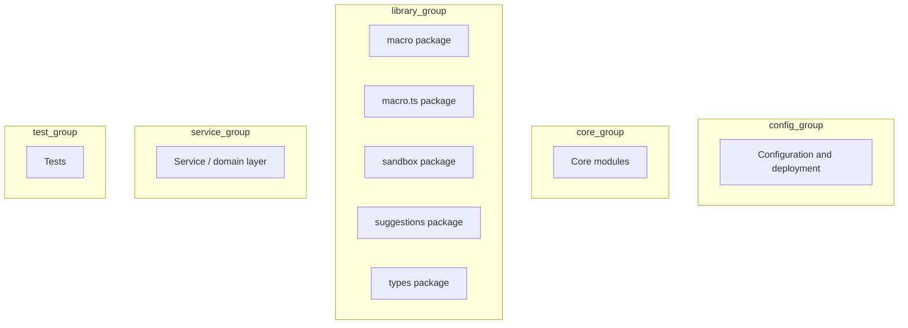

# Architecture report: ben-rogerson/twin.macro

> Automated static analysis. **Observed** = directly seen in files/imports/AST; **Inferred** = interpretation from that evidence. Repository code was not executed.

## 1. Repository at a glance

| Item | Value |
| --- | --- |
| Repository | ben-rogerson/twin.macro |
| Description | 🦹‍♂️ Twin blends the magic of Tailwind with the flexibility of css-in-js (emotion, styled-components, solid-styled-components, stitches and goober) at build time. |
| Language | TypeScript |
| Stars | 8028 |
| Licence | MIT |
| Analysed commit / branch | e1b2f7abe8da358669d0c49995ecda6912cd1476 / master |
| Framework(s) | React |
| Files analysed | 392 |
| Components | 9 |

## 2. Architecture in one minute

ben-rogerson/twin.macro - 🦹‍♂️ Twin blends the magic of Tailwind with the flexibility of css-in-js (emotion, styled-components, solid-styled-components, stitches and goober) at build time.. This repository was analysed statically from 392 file(s) (0 Python). Detected technologies (observed from imports/manifests): GitHub Actions, React, Tailwind CSS, Jest, TypeScript. Files are grouped into 9 component(s): Configuration and deployment, Core modules, macro package, macro.ts package, sandbox package, Service / domain layer, suggestions package, Tests. Findings below distinguish observed facts from inferred interpretation.

## 3. High-level block diagram

## 4. Main components

### Configuration and deployment (`config`)

- **Kind:** config
- **Status:** Observed
- **Confidence:** 0.85
- **Responsibility:** Groups 4 file(s) under configuration and deployment (observed from repository paths and static analysis).
- **Paths:** `package.json`, `tsconfig.json`, `types/tsconfig.base.json`, `types/tsconfig.json`
- **Evidence:** [package.json](https://github.com/ben-rogerson/twin.macro/blob/e1b2f7abe8da358669d0c49995ecda6912cd1476/package.json); [tsconfig.json](https://github.com/ben-rogerson/twin.macro/blob/e1b2f7abe8da358669d0c49995ecda6912cd1476/tsconfig.json); [types/tsconfig.base.json](https://github.com/ben-rogerson/twin.macro/blob/e1b2f7abe8da358669d0c49995ecda6912cd1476/types/tsconfig.base.json); [types/tsconfig.json](https://github.com/ben-rogerson/twin.macro/blob/e1b2f7abe8da358669d0c49995ecda6912cd1476/types/tsconfig.json)

### Core modules (`core`)

- **Kind:** core
- **Status:** Observed
- **Confidence:** 0.85
- **Responsibility:** Groups 1 file(s) under core modules (observed from repository paths and static analysis).
- **Paths:** `jest.config.ts`
- **Evidence:** [jest.config.ts](https://github.com/ben-rogerson/twin.macro/blob/e1b2f7abe8da358669d0c49995ecda6912cd1476/jest.config.ts)

### macro package (`macro`)

- **Kind:** library
- **Status:** Observed
- **Confidence:** 0.85
- **Responsibility:** Groups 15 file(s) under macro package (observed from repository paths and static analysis).
- **Paths:** `src/macro/className.ts`, `src/macro/css.ts`, `src/macro/dataProp.ts`, `src/macro/globalStyles.ts`, `src/macro/lib/astHelpers.ts`, `src/macro/lib/util/get.ts`, `src/macro/lib/util/isEmpty.ts`, `src/macro/lib/validateImports.ts`, `src/macro/screen.ts`, `src/macro/shortCss.ts`, `src/macro/styled.ts`, `src/macro/theme.ts`, `src/macro/tw.ts`, `src/macro/twin.ts`, `src/macro/types/index.ts`
- **Evidence:** [src/macro/className.ts](https://github.com/ben-rogerson/twin.macro/blob/e1b2f7abe8da358669d0c49995ecda6912cd1476/src/macro/className.ts); [src/macro/css.ts](https://github.com/ben-rogerson/twin.macro/blob/e1b2f7abe8da358669d0c49995ecda6912cd1476/src/macro/css.ts); [src/macro/dataProp.ts](https://github.com/ben-rogerson/twin.macro/blob/e1b2f7abe8da358669d0c49995ecda6912cd1476/src/macro/dataProp.ts); [src/macro/globalStyles.ts](https://github.com/ben-rogerson/twin.macro/blob/e1b2f7abe8da358669d0c49995ecda6912cd1476/src/macro/globalStyles.ts); [src/macro/lib/astHelpers.ts](https://github.com/ben-rogerson/twin.macro/blob/e1b2f7abe8da358669d0c49995ecda6912cd1476/src/macro/lib/astHelpers.ts); [src/macro/lib/util/get.ts](https://github.com/ben-rogerson/twin.macro/blob/e1b2f7abe8da358669d0c49995ecda6912cd1476/src/macro/lib/util/get.ts); [src/macro/lib/util/isEmpty.ts](https://github.com/ben-rogerson/twin.macro/blob/e1b2f7abe8da358669d0c49995ecda6912cd1476/src/macro/lib/util/isEmpty.ts); [src/macro/lib/validateImports.ts](https://github.com/ben-rogerson/twin.macro/blob/e1b2f7abe8da358669d0c49995ecda6912cd1476/src/macro/lib/validateImports.ts)

### macro.ts package (`macro_ts`)

- **Kind:** library
- **Status:** Observed
- **Confidence:** 0.85
- **Responsibility:** Groups 1 file(s) under macro.ts package (observed from repository paths and static analysis).
- **Paths:** `src/macro.ts`
- **Evidence:** [src/macro.ts](https://github.com/ben-rogerson/twin.macro/blob/e1b2f7abe8da358669d0c49995ecda6912cd1476/src/macro.ts)

### sandbox package (`sandbox`)

- **Kind:** library
- **Status:** Observed
- **Confidence:** 0.85
- **Responsibility:** Groups 1 file(s) under sandbox package (observed from repository paths and static analysis).
- **Paths:** `sandbox/in.tsx`
- **Evidence:** [sandbox/in.tsx](https://github.com/ben-rogerson/twin.macro/blob/e1b2f7abe8da358669d0c49995ecda6912cd1476/sandbox/in.tsx)

### Service / domain layer (`service_layer`)

- **Kind:** service
- **Status:** Observed
- **Confidence:** 0.85
- **Responsibility:** Groups 30 file(s) under service / domain layer (observed from repository paths and static analysis).
- **Paths:** `src/core/constants.ts`, `src/core/createCoreContext.ts`, `src/core/extractRuleStyles.ts`, `src/core/getGlobalStyles.ts`, `src/core/getStyles.ts`, `src/core/index.ts`, `src/core/lib/configHelpers.ts`, `src/core/lib/convertClassName.ts`, `src/core/lib/createAssert.ts`, `src/core/lib/createTheme.ts`, `src/core/lib/defaultTailwindConfig.ts`, `src/core/lib/expandVariantGroups.ts`, `src/core/lib/getStitchesPath.ts`, `src/core/lib/logging.ts`, `src/core/lib/twinConfig.ts`, `src/core/lib/userPresets.ts`, `src/core/lib/util/camelize.ts`, `src/core/lib/util/deepMerge.ts`, `src/core/lib/util/escapeRegex.ts`, `src/core/lib/util/formatProp.ts`, `src/core/lib/util/get.ts`, `src/core/lib/util/isEmpty.ts`, `src/core/lib/util/isObject.ts`, `src/core/lib/util/isShortCss.ts`, `src/core/lib/util/replaceThemeValue.ts`, `src/core/lib/util/sassifySelector.ts`, `src/core/lib/util/splitOnFirst.ts`, `src/core/lib/util/toArray.ts`, `src/core/lib/util/twImports.ts`, `src/core/types/index.ts`
- **Evidence:** [src/core/constants.ts](https://github.com/ben-rogerson/twin.macro/blob/e1b2f7abe8da358669d0c49995ecda6912cd1476/src/core/constants.ts); [src/core/createCoreContext.ts](https://github.com/ben-rogerson/twin.macro/blob/e1b2f7abe8da358669d0c49995ecda6912cd1476/src/core/createCoreContext.ts); [src/core/extractRuleStyles.ts](https://github.com/ben-rogerson/twin.macro/blob/e1b2f7abe8da358669d0c49995ecda6912cd1476/src/core/extractRuleStyles.ts); [src/core/getGlobalStyles.ts](https://github.com/ben-rogerson/twin.macro/blob/e1b2f7abe8da358669d0c49995ecda6912cd1476/src/core/getGlobalStyles.ts); [src/core/getStyles.ts](https://github.com/ben-rogerson/twin.macro/blob/e1b2f7abe8da358669d0c49995ecda6912cd1476/src/core/getStyles.ts); [src/core/index.ts](https://github.com/ben-rogerson/twin.macro/blob/e1b2f7abe8da358669d0c49995ecda6912cd1476/src/core/index.ts); [src/core/lib/configHelpers.ts](https://github.com/ben-rogerson/twin.macro/blob/e1b2f7abe8da358669d0c49995ecda6912cd1476/src/core/lib/configHelpers.ts); [src/core/lib/convertClassName.ts](https://github.com/ben-rogerson/twin.macro/blob/e1b2f7abe8da358669d0c49995ecda6912cd1476/src/core/lib/convertClassName.ts)

### suggestions package (`suggestions`)

- **Kind:** library
- **Status:** Observed
- **Confidence:** 0.85
- **Responsibility:** Groups 9 file(s) under suggestions package (observed from repository paths and static analysis).
- **Paths:** `src/suggestions/index.ts`, `src/suggestions/lib/colors.ts`, `src/suggestions/lib/extractors.ts`, `src/suggestions/lib/getClassSuggestions.ts`, `src/suggestions/lib/getPackageVersions.ts`, `src/suggestions/lib/makeColor.ts`, `src/suggestions/lib/validateVariants.ts`, `src/suggestions/lib/validators.ts`, `src/suggestions/types/index.ts`
- **Evidence:** [src/suggestions/index.ts](https://github.com/ben-rogerson/twin.macro/blob/e1b2f7abe8da358669d0c49995ecda6912cd1476/src/suggestions/index.ts); [src/suggestions/lib/colors.ts](https://github.com/ben-rogerson/twin.macro/blob/e1b2f7abe8da358669d0c49995ecda6912cd1476/src/suggestions/lib/colors.ts); [src/suggestions/lib/extractors.ts](https://github.com/ben-rogerson/twin.macro/blob/e1b2f7abe8da358669d0c49995ecda6912cd1476/src/suggestions/lib/extractors.ts); [src/suggestions/lib/getClassSuggestions.ts](https://github.com/ben-rogerson/twin.macro/blob/e1b2f7abe8da358669d0c49995ecda6912cd1476/src/suggestions/lib/getClassSuggestions.ts); [src/suggestions/lib/getPackageVersions.ts](https://github.com/ben-rogerson/twin.macro/blob/e1b2f7abe8da358669d0c49995ecda6912cd1476/src/suggestions/lib/getPackageVersions.ts); [src/suggestions/lib/makeColor.ts](https://github.com/ben-rogerson/twin.macro/blob/e1b2f7abe8da358669d0c49995ecda6912cd1476/src/suggestions/lib/makeColor.ts); [src/suggestions/lib/validateVariants.ts](https://github.com/ben-rogerson/twin.macro/blob/e1b2f7abe8da358669d0c49995ecda6912cd1476/src/suggestions/lib/validateVariants.ts); [src/suggestions/lib/validators.ts](https://github.com/ben-rogerson/twin.macro/blob/e1b2f7abe8da358669d0c49995ecda6912cd1476/src/suggestions/lib/validators.ts)

### Tests (`tests`)

- **Kind:** test
- **Status:** Observed
- **Confidence:** 0.85
- **Responsibility:** Groups 305 file(s) under tests (observed from repository paths and static analysis).
- **Paths:** `tests/@applyInPlugins.test.ts`, `tests/__fixtures__/!general.tsx`, `tests/__fixtures__/!important.tsx`, `tests/__fixtures__/!imports.tsx`, `tests/__fixtures__/!namelessImport.tsx`, `tests/__fixtures__/!ordering.tsx`, `tests/__fixtures__/!properties.tsx`, `tests/__fixtures__/!variantGrouping.tsx`, `tests/__fixtures__/!variants.tsx`, `tests/__fixtures__/.eslintrc.js`, `tests/__fixtures__/addBase/addBase.tsx`, `tests/__fixtures__/addBase/tailwind.config.js`, `tests/__fixtures__/arbitraryProperties/arbitraryProperties.tsx`, `tests/__fixtures__/arbitraryVariants/arbitraryVariants.tsx`, `tests/__fixtures__/arbitraryVariants/config.json`, `tests/__fixtures__/autoCssProp/autoCssProp.tsx`, `tests/__fixtures__/colorFunctions/colorFunctions.tsx`, `tests/__fixtures__/colorFunctions/tailwind.config.js`, `tests/__fixtures__/comments/comments.tsx`, `tests/__fixtures__/comments/config.json`, `tests/__fixtures__/config/config.tsx`, `tests/__fixtures__/config/tailwind.config.js`, `tests/__fixtures__/configTS/configTS.tsx`, `tests/__fixtures__/configTS/tailwind.config.ts`, `tests/__fixtures__/content/content.tsx`, `tests/__fixtures__/content/tailwind.config.js`, `tests/__fixtures__/cssPropEmotion/autoCssProp.tsx`, `tests/__fixtures__/cssPropEmotion/autoCssPropWithStyled.tsx`, `tests/__fixtures__/cssPropStyledComponents/autoCssProp.tsx`, `tests/__fixtures__/cssPropStyledComponents/autoCssPropWithStyled.tsx`, `tests/__fixtures__/cssPropStyledComponents/config.json`, `tests/__fixtures__/darkLightModeArray/darkLightModeArray.tsx`, `tests/__fixtures__/darkLightModeArray/tailwind.config.js`, `tests/__fixtures__/directionalBorders/directionalBorders.tsx`, `tests/__fixtures__/fluidContainer/fluidContainer.tsx`, `tests/__fixtures__/fluidContainer/tailwind.config.js`, `tests/__fixtures__/globalStyles/config.json`, `tests/__fixtures__/globalStyles/globalStyles.tsx`, `tests/__fixtures__/globalStyles/tailwind.config.js`, `tests/__fixtures__/group/group.tsx`, `tests/__fixtures__/includeClassNames/config.json`, `tests/__fixtures__/includeClassNames/includeClassNames.tsx`, `tests/__fixtures__/lineClamp/lineClamp.tsx`, `tests/__fixtures__/negative/negative.tsx`, `tests/__fixtures__/negative/tailwind.config.js`, `tests/__fixtures__/peers/peers.tsx`, `tests/__fixtures__/pluginAspectRatio/pluginAspectRatio.tsx`, `tests/__fixtures__/pluginAspectRatio/tailwind.config.js`, `tests/__fixtures__/pluginDaisyUi/pluginDaisyUi.tsx`, `tests/__fixtures__/pluginDaisyUi/tailwind.config.js`, `tests/__fixtures__/pluginExamples/pluginExamples.tsx`, `tests/__fixtures__/pluginExamples/tailwind.config.js`, `tests/__fixtures__/pluginForms/pluginForms.tsx`, `tests/__fixtures__/pluginForms/tailwind.config.js`, `tests/__fixtures__/pluginFormsClassStrategy/pluginTypography.tsx`, `tests/__fixtures__/pluginFormsClassStrategy/tailwind.config.js`, `tests/__fixtures__/pluginGapFallback/pluginGapFallback.tsx`, `tests/__fixtures__/pluginGapFallback/tailwind.config.js`, `tests/__fixtures__/pluginTypography/pluginTypography.tsx`, `tests/__fixtures__/pluginTypography/tailwind.config.js`, `tests/__fixtures__/pluginUserParentSelector/pluginUserParentSelector.tsx`, `tests/__fixtures__/pluginUserParentSelector/tailwind.config.js`, `tests/__fixtures__/plugins/config.json`, `tests/__fixtures__/plugins/plugins.tsx`, `tests/__fixtures__/plugins/tailwind.config.js`, `tests/__fixtures__/prefix/config.json`, `tests/__fixtures__/prefix/prefix.tsx`, `tests/__fixtures__/prefix/tailwind.config.js`, `tests/__fixtures__/preflight/preflight.tsx`, `tests/__fixtures__/preflight/tailwind.config.js`, `tests/__fixtures__/presets/presets.tsx`, `tests/__fixtures__/presets/tailwind.config.js`, `tests/__fixtures__/sassyPseudo/config.json`, `tests/__fixtures__/sassyPseudo/sassyPseudo.tsx`, `tests/__fixtures__/sassyPseudo/tailwind.config.js`, `tests/__fixtures__/screenImport/screenImport.tsx`, `tests/__fixtures__/screenImport/tailwind.config.js`, `tests/__fixtures__/screens/screens.tsx`, `tests/__fixtures__/screens/tailwind.config.js`, `tests/__fixtures__/separator/separator.tsx`, `tests/__fixtures__/separator/tailwind.config.js`, `tests/__fixtures__/shortCss/config.json`, `tests/__fixtures__/shortCss/shortCss.tsx`, `tests/__fixtures__/stitches/config.json`, `tests/__fixtures__/stitches/stitches.config.js`, `tests/__fixtures__/stitches/stitchesDotSyntax.tsx`, `tests/__fixtures__/stitches/stitchesGlobals.tsx`, `tests/__fixtures__/stitches/stitchesImports.tsx`, `tests/__fixtures__/stitches/stitchesProps.tsx`, `tests/__fixtures__/themeValuesToString/tailwind.config.js`, `tests/__fixtures__/themeValuesToString/themeValuesToString.tsx`, `tests/__fixtures__/userPluginOrdering/tailwind.config.js`, `tests/__fixtures__/userPluginOrdering/userPluginOrdering.tsx`, `tests/__fixtures__/utilitiesAccessibility/screenReaders.tsx`, `tests/__fixtures__/utilitiesBackgrounds/backgroundAttachment.tsx`, `tests/__fixtures__/utilitiesBackgrounds/backgroundClip.tsx`, `tests/__fixtures__/utilitiesBackgrounds/backgroundColor.tsx`, `tests/__fixtures__/utilitiesBackgrounds/backgroundImage.tsx`, `tests/__fixtures__/utilitiesBackgrounds/backgroundOpacity.tsx`, `tests/__fixtures__/utilitiesBackgrounds/backgroundOrigin.tsx`, `tests/__fixtures__/utilitiesBackgrounds/backgroundPosition.tsx`, `tests/__fixtures__/utilitiesBackgrounds/backgroundRepeat.tsx`, `tests/__fixtures__/utilitiesBackgrounds/backgroundSize.tsx`, `tests/__fixtures__/utilitiesBackgrounds/gradientColorStops.tsx`, `tests/__fixtures__/utilitiesBackgrounds/tailwind.config.js`, `tests/__fixtures__/utilitiesBorders/borderColor.tsx`, `tests/__fixtures__/utilitiesBorders/borderOpacity.tsx`, `tests/__fixtures__/utilitiesBorders/borderRadius.tsx`, `tests/__fixtures__/utilitiesBorders/borderStyle.tsx`, `tests/__fixtures__/utilitiesBorders/borderWidth.tsx`, `tests/__fixtures__/utilitiesBorders/divideColor.tsx`, `tests/__fixtures__/utilitiesBorders/divideOpacity.tsx`, `tests/__fixtures__/utilitiesBorders/divideStyle.tsx`, `tests/__fixtures__/utilitiesBorders/divideWidth.tsx`, `tests/__fixtures__/utilitiesBorders/outlineColor.tsx`, `tests/__fixtures__/utilitiesBorders/outlineOffset.tsx`, `tests/__fixtures__/utilitiesBorders/outlineStyle.tsx`, `tests/__fixtures__/utilitiesBorders/outlineWidth.tsx`, `tests/__fixtures__/utilitiesBorders/ringColor.tsx`, `tests/__fixtures__/utilitiesBorders/ringMisc.tsx`, `tests/__fixtures__/utilitiesBorders/ringOffsetColor.tsx`, `tests/__fixtures__/utilitiesBorders/ringOffsetWidth.tsx`, `tests/__fixtures__/utilitiesBorders/ringOpacity.tsx`, `tests/__fixtures__/utilitiesBorders/ringWidth.tsx`, `tests/__fixtures__/utilitiesBorders/tailwind.config.js`, `tests/__fixtures__/utilitiesEffects/backgroundBlendMode.tsx`, `tests/__fixtures__/utilitiesEffects/boxShadow.tsx`, `tests/__fixtures__/utilitiesEffects/boxShadowColor.tsx`, `tests/__fixtures__/utilitiesEffects/mixBlendMode.tsx`, `tests/__fixtures__/utilitiesEffects/opacity.tsx`, `tests/__fixtures__/utilitiesFilters/backdropBlur.tsx`, `tests/__fixtures__/utilitiesFilters/backdropBrightness.tsx`, `tests/__fixtures__/utilitiesFilters/backdropContrast.tsx`, `tests/__fixtures__/utilitiesFilters/backdropGrayscale.tsx`, `tests/__fixtures__/utilitiesFilters/backdropHueRotate.tsx`, `tests/__fixtures__/utilitiesFilters/backdropInvert.tsx`, `tests/__fixtures__/utilitiesFilters/backdropOpacity.tsx`, `tests/__fixtures__/utilitiesFilters/backdropSaturate.tsx`, `tests/__fixtures__/utilitiesFilters/backdropSepia.tsx`, `tests/__fixtures__/utilitiesFilters/blur.tsx`, `tests/__fixtures__/utilitiesFilters/brightness.tsx`, `tests/__fixtures__/utilitiesFilters/contrast.tsx`, `tests/__fixtures__/utilitiesFilters/dropShadow.tsx`, `tests/__fixtures__/utilitiesFilters/grayscale.tsx`, `tests/__fixtures__/utilitiesFilters/hueRotate.tsx`, `tests/__fixtures__/utilitiesFilters/invert.tsx`, `tests/__fixtures__/utilitiesFilters/misc.tsx`, `tests/__fixtures__/utilitiesFilters/saturate.tsx`, `tests/__fixtures__/utilitiesFilters/sepia.tsx`, `tests/__fixtures__/utilitiesLayout/aspectRatio.tsx`, `tests/__fixtures__/utilitiesLayout/boxDecorationBreak.tsx`, `tests/__fixtures__/utilitiesLayout/boxSizing.tsx`, `tests/__fixtures__/utilitiesLayout/breakAfter.tsx`, `tests/__fixtures__/utilitiesLayout/breakBefore.tsx`, `tests/__fixtures__/utilitiesLayout/breakInside.tsx`, `tests/__fixtures__/utilitiesLayout/clear.tsx`, `tests/__fixtures__/utilitiesLayout/columns.tsx`, `tests/__fixtures__/utilitiesLayout/container.tsx`, `tests/__fixtures__/utilitiesLayout/display.tsx`, `tests/__fixtures__/utilitiesLayout/float.tsx`, `tests/__fixtures__/utilitiesLayout/isolation.tsx`, `tests/__fixtures__/utilitiesLayout/objectFit.tsx`, `tests/__fixtures__/utilitiesLayout/objectPosition.tsx`, `tests/__fixtures__/utilitiesLayout/overflow.tsx`, `tests/__fixtures__/utilitiesLayout/overscrollBehavior.tsx`, `tests/__fixtures__/utilitiesLayout/position.tsx`, `tests/__fixtures__/utilitiesLayout/tailwind.config.js`, `tests/__fixtures__/utilitiesLayout/topRightBottomLeft.tsx`, `tests/__fixtures__/utilitiesLayout/visibility.tsx`, `tests/__fixtures__/utilitiesLayout/zIndex.tsx`, `tests/__fixtures__/utilitiesSpacing/margin.tsx`, `tests/__fixtures__/utilitiesSpacing/padding.tsx`, `tests/__fixtures__/utilitiesSpacing/spaceBetween.tsx`, `tests/__fixtures__/utilitiesSvg/fill.tsx`, `tests/__fixtures__/utilitiesSvg/stroke.tsx`, `tests/__fixtures__/utilitiesSvg/strokeWidth.tsx`, `tests/__fixtures__/utilitiesSvg/tailwind.config.js`, `tests/__fixtures__/utilitiesTransforms/misc.tsx`, `tests/__fixtures__/utilitiesTransforms/rotate.tsx`, `tests/__fixtures__/utilitiesTransforms/scale.tsx`, `tests/__fixtures__/utilitiesTransforms/skew.tsx`, `tests/__fixtures__/utilitiesTransforms/tailwind.config.js`, `tests/__fixtures__/utilitiesTransforms/transformOrigin.tsx`, `tests/__fixtures__/utilitiesTransforms/translate.tsx`, `tests/__fixtures__/utilitiesTransitionsAnimation/animation.tsx`, `tests/__fixtures__/utilitiesTransitionsAnimation/misc.tsx`, `tests/__fixtures__/utilitiesTransitionsAnimation/transitionDelay.tsx`, `tests/__fixtures__/utilitiesTransitionsAnimation/transitionDuration.tsx`, `tests/__fixtures__/utilitiesTransitionsAnimation/transitionProperty.tsx`, `tests/__fixtures__/utilitiesTransitionsAnimation/transitionTimingFunction.tsx`, `tests/__fixtures__/utiltiesFlexboxGrid/alignContent.tsx`, `tests/__fixtures__/utiltiesFlexboxGrid/alignItems.tsx`, `tests/__fixtures__/utiltiesFlexboxGrid/alignSelf.tsx`, `tests/__fixtures__/utiltiesFlexboxGrid/flex.tsx`, `tests/__fixtures__/utiltiesFlexboxGrid/flexBasis.tsx`, `tests/__fixtures__/utiltiesFlexboxGrid/flexDirection.tsx`, `tests/__fixtures__/utiltiesFlexboxGrid/flexGrow.tsx`, `tests/__fixtures__/utiltiesFlexboxGrid/flexShrink.tsx`, `tests/__fixtures__/utiltiesFlexboxGrid/flexWrap.tsx`, `tests/__fixtures__/utiltiesFlexboxGrid/gap.tsx`, `tests/__fixtures__/utiltiesFlexboxGrid/gridAutoColumns.tsx`, `tests/__fixtures__/utiltiesFlexboxGrid/gridAutoFlow.tsx`, `tests/__fixtures__/utiltiesFlexboxGrid/gridAutoRows.tsx`, `tests/__fixtures__/utiltiesFlexboxGrid/gridColumn.tsx`, `tests/__fixtures__/utiltiesFlexboxGrid/gridRow.tsx`, `tests/__fixtures__/utiltiesFlexboxGrid/gridTemplateColumns.tsx`, `tests/__fixtures__/utiltiesFlexboxGrid/gridTemplateRows.tsx`, `tests/__fixtures__/utiltiesFlexboxGrid/justifyContent.tsx`, `tests/__fixtures__/utiltiesFlexboxGrid/justifyItems.tsx`, `tests/__fixtures__/utiltiesFlexboxGrid/justifySelf.tsx`, `tests/__fixtures__/utiltiesFlexboxGrid/misc.tsx`, `tests/__fixtures__/utiltiesFlexboxGrid/order.tsx`, `tests/__fixtures__/utiltiesFlexboxGrid/placeContent.tsx`, `tests/__fixtures__/utiltiesFlexboxGrid/placeItems.tsx`, `tests/__fixtures__/utiltiesFlexboxGrid/placeSelf.tsx`, `tests/__fixtures__/utiltiesInteractivity/accentColor.tsx`, `tests/__fixtures__/utiltiesInteractivity/appearance.tsx`, `tests/__fixtures__/utiltiesInteractivity/caretColor.tsx`, `tests/__fixtures__/utiltiesInteractivity/cursor.tsx`, `tests/__fixtures__/utiltiesInteractivity/pointerEvents.tsx`, `tests/__fixtures__/utiltiesInteractivity/resize.tsx`, `tests/__fixtures__/utiltiesInteractivity/scrollBehavior.tsx`, `tests/__fixtures__/utiltiesInteractivity/scrollMargin.tsx`, `tests/__fixtures__/utiltiesInteractivity/scrollPadding.tsx`, `tests/__fixtures__/utiltiesInteractivity/scrollSnapAlign.tsx`, `tests/__fixtures__/utiltiesInteractivity/scrollSnapStop.tsx`, `tests/__fixtures__/utiltiesInteractivity/scrollSnapType.tsx`, `tests/__fixtures__/utiltiesInteractivity/tailwind.config.js`, `tests/__fixtures__/utiltiesInteractivity/touchAction.tsx`, `tests/__fixtures__/utiltiesInteractivity/userSelect.tsx`, `tests/__fixtures__/utiltiesInteractivity/willChange.tsx`, `tests/__fixtures__/utiltiesSizing/height.tsx`, `tests/__fixtures__/utiltiesSizing/maxHeight.tsx`, `tests/__fixtures__/utiltiesSizing/maxWidth.tsx`, `tests/__fixtures__/utiltiesSizing/minHeight.tsx`, `tests/__fixtures__/utiltiesSizing/minWidth.tsx`, `tests/__fixtures__/utiltiesSizing/width.tsx`, `tests/__fixtures__/utiltiesTables/borderCollapse.tsx`, `tests/__fixtures__/utiltiesTables/borderSpacing.tsx`, `tests/__fixtures__/utiltiesTables/captionSide.tsx`, `tests/__fixtures__/utiltiesTables/tableLayout.tsx`, `tests/__fixtures__/utiltiesTypography/fontFamily.tsx`, `tests/__fixtures__/utiltiesTypography/fontSize.tsx`, `tests/__fixtures__/utiltiesTypography/fontSmoothing.tsx`, `tests/__fixtures__/utiltiesTypography/fontStyle.tsx`, `tests/__fixtures__/utiltiesTypography/fontVariantNumeric.tsx`, `tests/__fixtures__/utiltiesTypography/fontWeight.tsx`, `tests/__fixtures__/utiltiesTypography/hyphens.tsx`, `tests/__fixtures__/utiltiesTypography/letterSpacing.tsx`, `tests/__fixtures__/utiltiesTypography/lineHeight.tsx`, `tests/__fixtures__/utiltiesTypography/listStyleImage.tsx`, `tests/__fixtures__/utiltiesTypography/listStylePosition.tsx`, `tests/__fixtures__/utiltiesTypography/listStyleType.tsx`, `tests/__fixtures__/utiltiesTypography/placeholderColor.tsx`, `tests/__fixtures__/utiltiesTypography/placeholderOpacity.tsx`, `tests/__fixtures__/utiltiesTypography/tailwind.config.js`, `tests/__fixtures__/utiltiesTypography/textAlign.tsx`, `tests/__fixtures__/utiltiesTypography/textColor.tsx`, `tests/__fixtures__/utiltiesTypography/textDecoration.tsx`, `tests/__fixtures__/utiltiesTypography/textDecorationColor.tsx`, `tests/__fixtures__/utiltiesTypography/textDecorationStyle.tsx`, `tests/__fixtures__/utiltiesTypography/textDecorationThickness.tsx`, `tests/__fixtures__/utiltiesTypography/textIndent.tsx`, `tests/__fixtures__/utiltiesTypography/textOpacity.tsx`, `tests/__fixtures__/utiltiesTypography/textOverflow.tsx`, `tests/__fixtures__/utiltiesTypography/textTransform.tsx`, `tests/__fixtures__/utiltiesTypography/textUnderlineOffset.tsx`, `tests/__fixtures__/utiltiesTypography/verticalAlign.tsx`, `tests/__fixtures__/utiltiesTypography/whitespace.tsx`, `tests/__fixtures__/utiltiesTypography/wordBreak.tsx`, `tests/__fixtures__/variables/tailwind.config.js`, `tests/__fixtures__/variables/variables.tsx`, `tests/__fixtures__/variantOrdering/variantOrdering.tsx`, `tests/__fixtures__/visitedOpacity/visitedOpacity.tsx`, `tests/animations.test.ts`, `tests/arbitraryProperties.test.ts`, `tests/arbitraryValues.test.ts`, `tests/arbitraryVariants.test.ts`, `tests/config.test.ts`, `tests/containerQueries.test.ts`, `tests/dividers.test.ts`, `tests/escaping.test.ts`, `tests/fontSize.test.ts`, `tests/minMaxScreenVariants.test.ts`, `tests/plugin.test.js`, `tests/presetEmotion.test.ts`, `tests/presetGoober.test.ts`, `tests/presetSolid.test.ts`, `tests/presetStitches.test.ts`, `tests/presetStyledComponents.test.ts`, `tests/screens.test.ts`, `tests/stitches.config.js`, `tests/types/index.ts`, `tests/types/types.d.ts`, `tests/util/customMatchers.ts`, `tests/util/run.ts`, `types/tests/__fixtures__/config/tailwind.config.d.ts`, `types/tests/__fixtures__/configTS/tailwind.config.d.ts`, `types/tests/basic/index.tsx`, `types/tests/basic/noDefaultImport.tsx`, `types/tests/basic/tsconfig.json`, `types/tests/emotion/index.tsx`, `types/tests/emotion/tsconfig.json`, `types/tests/styled-components/index.tsx`, `types/tests/styled-components/tsconfig.json`
- **Evidence:** [tests/@applyInPlugins.test.ts](https://github.com/ben-rogerson/twin.macro/blob/e1b2f7abe8da358669d0c49995ecda6912cd1476/tests/%40applyInPlugins.test.ts); [tests/__fixtures__/!general.tsx](https://github.com/ben-rogerson/twin.macro/blob/e1b2f7abe8da358669d0c49995ecda6912cd1476/tests/__fixtures__/%21general.tsx); [tests/__fixtures__/!important.tsx](https://github.com/ben-rogerson/twin.macro/blob/e1b2f7abe8da358669d0c49995ecda6912cd1476/tests/__fixtures__/%21important.tsx); [tests/__fixtures__/!imports.tsx](https://github.com/ben-rogerson/twin.macro/blob/e1b2f7abe8da358669d0c49995ecda6912cd1476/tests/__fixtures__/%21imports.tsx); [tests/__fixtures__/!namelessImport.tsx](https://github.com/ben-rogerson/twin.macro/blob/e1b2f7abe8da358669d0c49995ecda6912cd1476/tests/__fixtures__/%21namelessImport.tsx); [tests/__fixtures__/!ordering.tsx](https://github.com/ben-rogerson/twin.macro/blob/e1b2f7abe8da358669d0c49995ecda6912cd1476/tests/__fixtures__/%21ordering.tsx); [tests/__fixtures__/!properties.tsx](https://github.com/ben-rogerson/twin.macro/blob/e1b2f7abe8da358669d0c49995ecda6912cd1476/tests/__fixtures__/%21properties.tsx); [tests/__fixtures__/!variantGrouping.tsx](https://github.com/ben-rogerson/twin.macro/blob/e1b2f7abe8da358669d0c49995ecda6912cd1476/tests/__fixtures__/%21variantGrouping.tsx)

### types package (`types`)

- **Kind:** library
- **Status:** Observed
- **Confidence:** 0.85
- **Responsibility:** Groups 2 file(s) under types package (observed from repository paths and static analysis).
- **Paths:** `types/index.d.ts`, `types/macro.d.ts`
- **Evidence:** [types/index.d.ts](https://github.com/ben-rogerson/twin.macro/blob/e1b2f7abe8da358669d0c49995ecda6912cd1476/types/index.d.ts); [types/macro.d.ts](https://github.com/ben-rogerson/twin.macro/blob/e1b2f7abe8da358669d0c49995ecda6912cd1476/types/macro.d.ts)

## 5. Execution flow

**Observed** entry point(s):

- [src/core/index.ts](https://github.com/ben-rogerson/twin.macro/blob/e1b2f7abe8da358669d0c49995ecda6912cd1476/src/core/index.ts)
- [src/core/types/index.ts](https://github.com/ben-rogerson/twin.macro/blob/e1b2f7abe8da358669d0c49995ecda6912cd1476/src/core/types/index.ts)
- [src/macro/types/index.ts](https://github.com/ben-rogerson/twin.macro/blob/e1b2f7abe8da358669d0c49995ecda6912cd1476/src/macro/types/index.ts)
- [src/suggestions/index.ts](https://github.com/ben-rogerson/twin.macro/blob/e1b2f7abe8da358669d0c49995ecda6912cd1476/src/suggestions/index.ts)
- [src/suggestions/types/index.ts](https://github.com/ben-rogerson/twin.macro/blob/e1b2f7abe8da358669d0c49995ecda6912cd1476/src/suggestions/types/index.ts)

Representative flow (derived from observed entry points and the import graph; steps beyond the entry point are **Inferred**):

1. Execution starts at an observed entry point listed above, if present.
2. No internal import relationships between components were observed.

## 6. Project structure

### `(root)`

- `.babelrc` - other (131 bytes)
- `.eslintrc.js` - source, JavaScript (2947 bytes)
- `.gitignore` - other (282 bytes)
- `.nvmrc` - other (3 bytes)
- `.prettierrc` - other (179 bytes)
- `CODE_OF_CONDUCT.md` - docs (3355 bytes)
- `LICENSE` - docs (1036 bytes)
- `README.md` - docs (10874 bytes)
- `jest.config.ts` - source, TypeScript (259 bytes)
- `package.json` - manifest (4043 bytes)
- `tsconfig.json` - config (348 bytes)

### `.github`

- `.github/FUNDING.yml` - config (68 bytes)
- `.github/ISSUE_TEMPLATE/bug-report.md` - docs (670 bytes)
- `.github/ISSUE_TEMPLATE/config.yml` - config (264 bytes)
- `.github/logo-dark.svg` - other (2205 bytes)
- `.github/logo-light.svg` - other (2205 bytes)
- `.github/workflows/main.yml` - ci, YAML (275 bytes)

### `docs`

- `docs/advanced-theming.md` - docs (976 bytes)
- `docs/arbitrary-values.md` - docs (2224 bytes)
- `docs/customizing-config.md` - docs (1124 bytes)
- `docs/fonts.md` - docs (2985 bytes)
- `docs/group.md` - docs (4033 bytes)
- `docs/index.md` - docs (454 bytes)
- `docs/options.md` - docs (7799 bytes)
- `docs/prop-styling-guide.md` - docs (10339 bytes)
- `docs/screen-import.md` - docs (1814 bytes)
- `docs/styled-component-guide.md` - docs (11547 bytes)

### `sandbox`

- `sandbox/in.tsx` - source, TypeScript (501 bytes)

### `src`

- `src/core/constants.ts` - source, TypeScript (649 bytes)
- `src/core/createCoreContext.ts` - source, TypeScript (4170 bytes)
- `src/core/extractRuleStyles.ts` - source, TypeScript (8152 bytes)
- `src/core/getGlobalStyles.ts` - source, TypeScript (1861 bytes)
- `src/core/getStyles.ts` - source, TypeScript (8890 bytes)
- `src/core/index.ts` - source, TypeScript (240 bytes)
- `src/core/lib/configHelpers.ts` - source, TypeScript (3639 bytes)
- `src/core/lib/convertClassName.ts` - source, TypeScript (9866 bytes)
- `src/core/lib/createAssert.ts` - source, TypeScript (916 bytes)
- `src/core/lib/createTheme.ts` - source, TypeScript (1794 bytes)
- `src/core/lib/defaultTailwindConfig.ts` - source, TypeScript (4723 bytes)
- `src/core/lib/expandVariantGroups.ts` - source, TypeScript (2858 bytes)
- `src/core/lib/getStitchesPath.ts` - source, TypeScript (1872 bytes)
- `src/core/lib/logging.ts` - source, TypeScript (1442 bytes)
- `src/core/lib/twinConfig.ts` - source, TypeScript (4855 bytes)
- `src/core/lib/userPresets.ts` - source, TypeScript (1323 bytes)
- `src/core/lib/util/camelize.ts` - source, TypeScript (167 bytes)
- `src/core/lib/util/deepMerge.ts` - source, TypeScript (118 bytes)
- `src/core/lib/util/escapeRegex.ts` - source, TypeScript (180 bytes)
- `src/core/lib/util/formatProp.ts` - source, TypeScript (446 bytes)
- `src/core/lib/util/get.ts` - source, TypeScript (104 bytes)
- `src/core/lib/util/isEmpty.ts` - source, TypeScript (256 bytes)
- `src/core/lib/util/isObject.ts` - source, TypeScript (217 bytes)
- `src/core/lib/util/isShortCss.ts` - source, TypeScript (985 bytes)
- `src/core/lib/util/replaceThemeValue.ts` - source, TypeScript (1364 bytes)
- `src/core/lib/util/sassifySelector.ts` - source, TypeScript (3101 bytes)
- `src/core/lib/util/splitOnFirst.ts` - source, TypeScript (252 bytes)
- `src/core/lib/util/toArray.ts` - source, TypeScript (116 bytes)
- `src/core/lib/util/twImports.ts` - source, TypeScript (2269 bytes)
- `src/core/types/index.ts` - source, TypeScript (3995 bytes)
- `src/macro.ts` - source, TypeScript (150 bytes)
- `src/macro/className.ts` - source, TypeScript (3519 bytes)
- `src/macro/css.ts` - source, TypeScript (1551 bytes)
- `src/macro/dataProp.ts` - source, TypeScript (3588 bytes)
- `src/macro/globalStyles.ts` - source, TypeScript (5864 bytes)
- `src/macro/lib/astHelpers.ts` - source, TypeScript (15180 bytes)
- `src/macro/lib/util/get.ts` - source, TypeScript (104 bytes)
- `src/macro/lib/util/isEmpty.ts` - source, TypeScript (265 bytes)
- `src/macro/lib/validateImports.ts` - source, TypeScript (1345 bytes)
- `src/macro/screen.ts` - source, TypeScript (6024 bytes)
- `src/macro/shortCss.ts` - source, TypeScript (4500 bytes)
- `src/macro/styled.ts` - source, TypeScript (2989 bytes)
- `src/macro/theme.ts` - source, TypeScript (1738 bytes)
- `src/macro/tw.ts` - source, TypeScript (8940 bytes)
- `src/macro/twin.ts` - source, TypeScript (3562 bytes)
- `src/macro/types/index.ts` - source, TypeScript (1613 bytes)
- `src/suggestions/index.ts` - source, TypeScript (3655 bytes)
- `src/suggestions/lib/colors.ts` - source, TypeScript (257 bytes)
- `src/suggestions/lib/extractors.ts` - source, TypeScript (665 bytes)
- `src/suggestions/lib/getClassSuggestions.ts` - source, TypeScript (3152 bytes)
- `src/suggestions/lib/getPackageVersions.ts` - source, TypeScript (598 bytes)
- `src/suggestions/lib/makeColor.ts` - source, TypeScript (282 bytes)
- `src/suggestions/lib/validateVariants.ts` - source, TypeScript (1755 bytes)
- `src/suggestions/lib/validators.ts` - source, TypeScript (6022 bytes)
- `src/suggestions/types/index.ts` - source, TypeScript (698 bytes)

### `tests`

- `tests/@applyInPlugins.test.ts` - test, TypeScript (9796 bytes)
- `tests/__fixtures__/!general.tsx` - test, TypeScript (600 bytes)
- `tests/__fixtures__/!important.tsx` - test, TypeScript (1772 bytes)
- `tests/__fixtures__/!imports.tsx` - test, TypeScript (1255 bytes)
- `tests/__fixtures__/!namelessImport.tsx` - test, TypeScript (148 bytes)
- `tests/__fixtures__/!ordering.tsx` - test, TypeScript (322 bytes)
- `tests/__fixtures__/!properties.tsx` - test, TypeScript (568 bytes)
- `tests/__fixtures__/!variantGrouping.tsx` - test, TypeScript (1274 bytes)
- `tests/__fixtures__/!variants.tsx` - test, TypeScript (2823 bytes)
- `tests/__fixtures__/.eslintrc.js` - test, JavaScript (211 bytes)
- `tests/__fixtures__/addBase/addBase.tsx` - test, TypeScript (123 bytes)
- `tests/__fixtures__/addBase/tailwind.config.js` - test, JavaScript (795 bytes)
- `tests/__fixtures__/arbitraryProperties/arbitraryProperties.tsx` - test, TypeScript (275 bytes)
- `tests/__fixtures__/arbitraryVariants/arbitraryVariants.tsx` - test, TypeScript (1405 bytes)
- `tests/__fixtures__/arbitraryVariants/config.json` - test (57 bytes)
- `tests/__fixtures__/autoCssProp/autoCssProp.tsx` - test, TypeScript (120 bytes)
- `tests/__fixtures__/colorFunctions/colorFunctions.tsx` - test, TypeScript (146 bytes)
- `tests/__fixtures__/colorFunctions/tailwind.config.js` - test, JavaScript (639 bytes)
- `tests/__fixtures__/comments/comments.tsx` - test, TypeScript (998 bytes)
- `tests/__fixtures__/comments/config.json` - test (26 bytes)
- `tests/__fixtures__/config/config.tsx` - test, TypeScript (882 bytes)
- `tests/__fixtures__/config/tailwind.config.js` - test, JavaScript (1401 bytes)
- `tests/__fixtures__/configTS/configTS.tsx` - test, TypeScript (116 bytes)
- `tests/__fixtures__/configTS/tailwind.config.ts` - test, TypeScript (155 bytes)
- `tests/__fixtures__/content/content.tsx` - test, TypeScript (357 bytes)
- `tests/__fixtures__/content/tailwind.config.js` - test, JavaScript (136 bytes)
- `tests/__fixtures__/cssPropEmotion/autoCssProp.tsx` - test, TypeScript (85 bytes)
- `tests/__fixtures__/cssPropEmotion/autoCssPropWithStyled.tsx` - test, TypeScript (168 bytes)
- `tests/__fixtures__/cssPropStyledComponents/autoCssProp.tsx` - test, TypeScript (85 bytes)
- `tests/__fixtures__/cssPropStyledComponents/autoCssPropWithStyled.tsx` - test, TypeScript (134 bytes)
- `tests/__fixtures__/cssPropStyledComponents/config.json` - test (60 bytes)
- `tests/__fixtures__/darkLightModeArray/darkLightModeArray.tsx` - test, TypeScript (87 bytes)
- `tests/__fixtures__/darkLightModeArray/tailwind.config.js` - test, JavaScript (97 bytes)
- `tests/__fixtures__/directionalBorders/directionalBorders.tsx` - test, TypeScript (466 bytes)
- `tests/__fixtures__/fluidContainer/fluidContainer.tsx` - test, TypeScript (68 bytes)
- `tests/__fixtures__/fluidContainer/tailwind.config.js` - test, JavaScript (1543 bytes)
- `tests/__fixtures__/globalStyles/config.json` - test (26 bytes)
- `tests/__fixtures__/globalStyles/globalStyles.tsx` - test, TypeScript (266 bytes)
- `tests/__fixtures__/globalStyles/tailwind.config.js` - test, JavaScript (592 bytes)
- `tests/__fixtures__/group/group.tsx` - test, TypeScript (2337 bytes)
- `tests/__fixtures__/includeClassNames/config.json` - test (58 bytes)
- `tests/__fixtures__/includeClassNames/includeClassNames.tsx` - test, TypeScript (2917 bytes)
- `tests/__fixtures__/lineClamp/lineClamp.tsx` - test, TypeScript (164 bytes)
- `tests/__fixtures__/negative/negative.tsx` - test, TypeScript (75 bytes)
- `tests/__fixtures__/negative/tailwind.config.js` - test, JavaScript (70 bytes)
- `tests/__fixtures__/peers/peers.tsx` - test, TypeScript (2258 bytes)
- `tests/__fixtures__/pluginAspectRatio/pluginAspectRatio.tsx` - test, TypeScript (536 bytes)
- `tests/__fixtures__/pluginAspectRatio/tailwind.config.js` - test, JavaScript (132 bytes)
- `tests/__fixtures__/pluginDaisyUi/pluginDaisyUi.tsx` - test, TypeScript (21952 bytes)
- `tests/__fixtures__/pluginDaisyUi/tailwind.config.js` - test, JavaScript (109 bytes)
- `tests/__fixtures__/pluginExamples/pluginExamples.tsx` - test, TypeScript (593 bytes)
- `tests/__fixtures__/pluginExamples/tailwind.config.js` - test, JavaScript (2792 bytes)
- `tests/__fixtures__/pluginForms/pluginForms.tsx` - test, TypeScript (73 bytes)
- `tests/__fixtures__/pluginForms/tailwind.config.js` - test, JavaScript (65 bytes)
- `tests/__fixtures__/pluginFormsClassStrategy/pluginTypography.tsx` - test, TypeScript (145 bytes)
- `tests/__fixtures__/pluginFormsClassStrategy/tailwind.config.js` - test, JavaScript (88 bytes)
- `tests/__fixtures__/pluginGapFallback/pluginGapFallback.tsx` - test, TypeScript (234 bytes)
- `tests/__fixtures__/pluginGapFallback/tailwind.config.js` - test, JavaScript (2412 bytes)
- `tests/__fixtures__/pluginTypography/pluginTypography.tsx` - test, TypeScript (166 bytes)
- `tests/__fixtures__/pluginTypography/tailwind.config.js` - test, JavaScript (1564 bytes)
- `tests/__fixtures__/pluginUserParentSelector/pluginUserParentSelector.tsx` - test, TypeScript (126 bytes)
- `tests/__fixtures__/pluginUserParentSelector/tailwind.config.js` - test, JavaScript (993 bytes)
- `tests/__fixtures__/plugins/config.json` - test (55 bytes)
- `tests/__fixtures__/plugins/plugins.tsx` - test, TypeScript (737 bytes)
- `tests/__fixtures__/plugins/tailwind.config.js` - test, JavaScript (2609 bytes)
- `tests/__fixtures__/prefix/config.json` - test (83 bytes)
- `tests/__fixtures__/prefix/prefix.tsx` - test, TypeScript (982 bytes)
- `tests/__fixtures__/prefix/tailwind.config.js` - test, JavaScript (708 bytes)
- `tests/__fixtures__/preflight/preflight.tsx` - test, TypeScript (69 bytes)
- `tests/__fixtures__/preflight/tailwind.config.js` - test, JavaScript (65 bytes)
- `tests/__fixtures__/presets/presets.tsx` - test, TypeScript (136 bytes)
- `tests/__fixtures__/presets/tailwind.config.js` - test, JavaScript (392 bytes)
- `tests/__fixtures__/sassyPseudo/config.json` - test (54 bytes)
- `tests/__fixtures__/sassyPseudo/sassyPseudo.tsx` - test, TypeScript (198 bytes)
- `tests/__fixtures__/sassyPseudo/tailwind.config.js` - test, JavaScript (491 bytes)
- `tests/__fixtures__/screenImport/screenImport.tsx` - test, TypeScript (2050 bytes)
- `tests/__fixtures__/screenImport/tailwind.config.js` - test, JavaScript (135 bytes)
- `tests/__fixtures__/screens/screens.tsx` - test, TypeScript (141 bytes)
- `tests/__fixtures__/screens/tailwind.config.js` - test, JavaScript (150 bytes)
- `tests/__fixtures__/separator/separator.tsx` - test, TypeScript (97 bytes)
- `tests/__fixtures__/separator/tailwind.config.js` - test, JavaScript (40 bytes)
- `tests/__fixtures__/shortCss/config.json` - test (57 bytes)
- `tests/__fixtures__/shortCss/shortCss.tsx` - test, TypeScript (2201 bytes)
- `tests/__fixtures__/stitches/config.json` - test (97 bytes)
- `tests/__fixtures__/stitches/stitches.config.js` - test, JavaScript (17 bytes)
- `tests/__fixtures__/stitches/stitchesDotSyntax.tsx` - test, TypeScript (167 bytes)
- `tests/__fixtures__/stitches/stitchesGlobals.tsx` - test, TypeScript (184 bytes)
- `tests/__fixtures__/stitches/stitchesImports.tsx` - test, TypeScript (110 bytes)
- `tests/__fixtures__/stitches/stitchesProps.tsx` - test, TypeScript (589 bytes)
- `tests/__fixtures__/themeValuesToString/tailwind.config.js` - test, JavaScript (331 bytes)
- `tests/__fixtures__/themeValuesToString/themeValuesToString.tsx` - test, TypeScript (102 bytes)
- `tests/__fixtures__/userPluginOrdering/tailwind.config.js` - test, JavaScript (1272 bytes)
- `tests/__fixtures__/userPluginOrdering/userPluginOrdering.tsx` - test, TypeScript (55 bytes)
- `tests/__fixtures__/utilitiesAccessibility/screenReaders.tsx` - test, TypeScript (117 bytes)
- `tests/__fixtures__/utilitiesBackgrounds/backgroundAttachment.tsx` - test, TypeScript (136 bytes)
- `tests/__fixtures__/utilitiesBackgrounds/backgroundClip.tsx` - test, TypeScript (166 bytes)
- `tests/__fixtures__/utilitiesBackgrounds/backgroundColor.tsx` - test, TypeScript (4566 bytes)
- `tests/__fixtures__/utilitiesBackgrounds/backgroundImage.tsx` - test, TypeScript (333 bytes)
- `tests/__fixtures__/utilitiesBackgrounds/backgroundOpacity.tsx` - test, TypeScript (492 bytes)
- `tests/__fixtures__/utilitiesBackgrounds/backgroundOrigin.tsx` - test, TypeScript (157 bytes)
- `tests/__fixtures__/utilitiesBackgrounds/backgroundPosition.tsx` - test, TypeScript (317 bytes)
- `tests/__fixtures__/utilitiesBackgrounds/backgroundRepeat.tsx` - test, TypeScript (233 bytes)
- `tests/__fixtures__/utilitiesBackgrounds/backgroundSize.tsx` - test, TypeScript (194 bytes)
- `tests/__fixtures__/utilitiesBackgrounds/gradientColorStops.tsx` - test, TypeScript (13573 bytes)
- `tests/__fixtures__/utilitiesBackgrounds/tailwind.config.js` - test, JavaScript (467 bytes)
- `tests/__fixtures__/utilitiesBorders/borderColor.tsx` - test, TypeScript (36949 bytes)
- `tests/__fixtures__/utilitiesBorders/borderOpacity.tsx` - test, TypeScript (432 bytes)
- `tests/__fixtures__/utilitiesBorders/borderRadius.tsx` - test, TypeScript (1690 bytes)
- `tests/__fixtures__/utilitiesBorders/borderStyle.tsx` - test, TypeScript (192 bytes)
- `tests/__fixtures__/utilitiesBorders/borderWidth.tsx` - test, TypeScript (912 bytes)
- `tests/__fixtures__/utilitiesBorders/divideColor.tsx` - test, TypeScript (4922 bytes)
- `tests/__fixtures__/utilitiesBorders/divideOpacity.tsx` - test, TypeScript (476 bytes)
- `tests/__fixtures__/utilitiesBorders/divideStyle.tsx` - test, TypeScript (174 bytes)
- `tests/__fixtures__/utilitiesBorders/divideWidth.tsx` - test, TypeScript (460 bytes)
- `tests/__fixtures__/utilitiesBorders/outlineColor.tsx` - test, TypeScript (5399 bytes)
- `tests/__fixtures__/utilitiesBorders/outlineOffset.tsx` - test, TypeScript (276 bytes)
- `tests/__fixtures__/utilitiesBorders/outlineStyle.tsx` - test, TypeScript (174 bytes)
- `tests/__fixtures__/utilitiesBorders/outlineWidth.tsx` - test, TypeScript (248 bytes)
- `tests/__fixtures__/utilitiesBorders/ringColor.tsx` - test, TypeScript (4979 bytes)
- `tests/__fixtures__/utilitiesBorders/ringMisc.tsx` - test, TypeScript (594 bytes)
- `tests/__fixtures__/utilitiesBorders/ringOffsetColor.tsx` - test, TypeScript (6720 bytes)
- `tests/__fixtures__/utilitiesBorders/ringOffsetWidth.tsx` - test, TypeScript (290 bytes)
- `tests/__fixtures__/utilitiesBorders/ringOpacity.tsx` - test, TypeScript (473 bytes)
- `tests/__fixtures__/utilitiesBorders/ringWidth.tsx` - test, TypeScript (211 bytes)
- `tests/__fixtures__/utilitiesBorders/tailwind.config.js` - test, JavaScript (467 bytes)
- `tests/__fixtures__/utilitiesEffects/backgroundBlendMode.tsx` - test, TypeScript (448 bytes)
- `tests/__fixtures__/utilitiesEffects/boxShadow.tsx` - test, TypeScript (278 bytes)
- `tests/__fixtures__/utilitiesEffects/boxShadowColor.tsx` - test, TypeScript (4934 bytes)
- `tests/__fixtures__/utilitiesEffects/mixBlendMode.tsx` - test, TypeScript (484 bytes)
- `tests/__fixtures__/utilitiesEffects/opacity.tsx` - test, TypeScript (380 bytes)
- `tests/__fixtures__/utilitiesFilters/backdropBlur.tsx` - test, TypeScript (315 bytes)
- `tests/__fixtures__/utilitiesFilters/backdropBrightness.tsx` - test, TypeScript (350 bytes)
- `tests/__fixtures__/utilitiesFilters/backdropContrast.tsx` - test, TypeScript (335 bytes)
- `tests/__fixtures__/utilitiesFilters/backdropGrayscale.tsx` - test, TypeScript (208 bytes)
- `tests/__fixtures__/utilitiesFilters/backdropHueRotate.tsx` - test, TypeScript (530 bytes)
- `tests/__fixtures__/utilitiesFilters/backdropInvert.tsx` - test, TypeScript (194 bytes)
- `tests/__fixtures__/utilitiesFilters/backdropOpacity.tsx` - test, TypeScript (513 bytes)
- `tests/__fixtures__/utilitiesFilters/backdropSaturate.tsx` - test, TypeScript (284 bytes)
- `tests/__fixtures__/utilitiesFilters/backdropSepia.tsx` - test, TypeScript (189 bytes)
- `tests/__fixtures__/utilitiesFilters/blur.tsx` - test, TypeScript (217 bytes)
- `tests/__fixtures__/utilitiesFilters/brightness.tsx` - test, TypeScript (364 bytes)
- `tests/__fixtures__/utilitiesFilters/contrast.tsx` - test, TypeScript (266 bytes)
- `tests/__fixtures__/utilitiesFilters/dropShadow.tsx` - test, TypeScript (300 bytes)
- `tests/__fixtures__/utilitiesFilters/grayscale.tsx` - test, TypeScript (165 bytes)
- `tests/__fixtures__/utilitiesFilters/hueRotate.tsx` - test, TypeScript (361 bytes)
- `tests/__fixtures__/utilitiesFilters/invert.tsx` - test, TypeScript (150 bytes)
- `tests/__fixtures__/utilitiesFilters/misc.tsx` - test, TypeScript (566 bytes)
- `tests/__fixtures__/utilitiesFilters/saturate.tsx` - test, TypeScript (213 bytes)
- `tests/__fixtures__/utilitiesFilters/sepia.tsx` - test, TypeScript (145 bytes)
- `tests/__fixtures__/utilitiesLayout/aspectRatio.tsx` - test, TypeScript (186 bytes)
- `tests/__fixtures__/utilitiesLayout/boxDecorationBreak.tsx` - test, TypeScript (187 bytes)
- `tests/__fixtures__/utilitiesLayout/boxSizing.tsx` - test, TypeScript (116 bytes)
- `tests/__fixtures__/utilitiesLayout/breakAfter.tsx` - test, TypeScript (263 bytes)
- `tests/__fixtures__/utilitiesLayout/breakBefore.tsx` - test, TypeScript (272 bytes)
- `tests/__fixtures__/utilitiesLayout/breakInside.tsx` - test, TypeScript (190 bytes)
- `tests/__fixtures__/utilitiesLayout/clear.tsx` - test, TypeScript (141 bytes)
- `tests/__fixtures__/utilitiesLayout/columns.tsx` - test, TypeScript (521 bytes)
- `tests/__fixtures__/utilitiesLayout/container.tsx` - test, TypeScript (154 bytes)
- `tests/__fixtures__/utilitiesLayout/display.tsx` - test, TypeScript (385 bytes)
- `tests/__fixtures__/utilitiesLayout/float.tsx` - test, TypeScript (126 bytes)
- `tests/__fixtures__/utilitiesLayout/isolation.tsx` - test, TypeScript (115 bytes)
- `tests/__fixtures__/utilitiesLayout/objectFit.tsx` - test, TypeScript (175 bytes)
- `tests/__fixtures__/utilitiesLayout/objectPosition.tsx` - test, TypeScript (353 bytes)
- `tests/__fixtures__/utilitiesLayout/overflow.tsx` - test, TypeScript (394 bytes)
- `tests/__fixtures__/utilitiesLayout/overscrollBehavior.tsx` - test, TypeScript (295 bytes)
- `tests/__fixtures__/utilitiesLayout/position.tsx` - test, TypeScript (141 bytes)
- `tests/__fixtures__/utilitiesLayout/tailwind.config.js` - test, JavaScript (589 bytes)
- `tests/__fixtures__/utilitiesLayout/topRightBottomLeft.tsx` - test, TypeScript (8365 bytes)
- `tests/__fixtures__/utilitiesLayout/visibility.tsx` - test, TypeScript (135 bytes)
- `tests/__fixtures__/utilitiesLayout/zIndex.tsx` - test, TypeScript (284 bytes)
- `tests/__fixtures__/utilitiesSpacing/margin.tsx` - test, TypeScript (5360 bytes)
- `tests/__fixtures__/utilitiesSpacing/padding.tsx` - test, TypeScript (2579 bytes)
- `tests/__fixtures__/utilitiesSpacing/spaceBetween.tsx` - test, TypeScript (2847 bytes)
- `tests/__fixtures__/utilitiesSvg/fill.tsx` - test, TypeScript (4871 bytes)
- `tests/__fixtures__/utilitiesSvg/stroke.tsx` - test, TypeScript (5432 bytes)
- `tests/__fixtures__/utilitiesSvg/strokeWidth.tsx` - test, TypeScript (318 bytes)
- `tests/__fixtures__/utilitiesSvg/tailwind.config.js` - test, JavaScript (467 bytes)
- `tests/__fixtures__/utilitiesTransforms/misc.tsx` - test, TypeScript (258 bytes)
- `tests/__fixtures__/utilitiesTransforms/rotate.tsx` - test, TypeScript (435 bytes)
- `tests/__fixtures__/utilitiesTransforms/scale.tsx` - test, TypeScript (564 bytes)
- `tests/__fixtures__/utilitiesTransforms/skew.tsx` - test, TypeScript (483 bytes)
- `tests/__fixtures__/utilitiesTransforms/tailwind.config.js` - test, JavaScript (138 bytes)
- `tests/__fixtures__/utilitiesTransforms/transformOrigin.tsx` - test, TypeScript (320 bytes)
- `tests/__fixtures__/utilitiesTransforms/translate.tsx` - test, TypeScript (1812 bytes)
- `tests/__fixtures__/utilitiesTransitionsAnimation/animation.tsx` - test, TypeScript (247 bytes)
- `tests/__fixtures__/utilitiesTransitionsAnimation/misc.tsx` - test, TypeScript (253 bytes)
- `tests/__fixtures__/utilitiesTransitionsAnimation/transitionDelay.tsx` - test, TypeScript (283 bytes)
- `tests/__fixtures__/utilitiesTransitionsAnimation/transitionDuration.tsx` - test, TypeScript (345 bytes)
- `tests/__fixtures__/utilitiesTransitionsAnimation/transitionProperty.tsx` - test, TypeScript (335 bytes)
- `tests/__fixtures__/utilitiesTransitionsAnimation/transitionTimingFunction.tsx` - test, TypeScript (254 bytes)
- `tests/__fixtures__/utiltiesFlexboxGrid/alignContent.tsx` - test, TypeScript (220 bytes)
- `tests/__fixtures__/utiltiesFlexboxGrid/alignItems.tsx` - test, TypeScript (170 bytes)
- `tests/__fixtures__/utiltiesFlexboxGrid/alignSelf.tsx` - test, TypeScript (178 bytes)
- `tests/__fixtures__/utiltiesFlexboxGrid/flex.tsx` - test, TypeScript (201 bytes)
- `tests/__fixtures__/utiltiesFlexboxGrid/flexBasis.tsx` - test, TypeScript (995 bytes)
- `tests/__fixtures__/utiltiesFlexboxGrid/flexDirection.tsx` - test, TypeScript (157 bytes)
- `tests/__fixtures__/utiltiesFlexboxGrid/flexGrow.tsx` - test, TypeScript (247 bytes)
- `tests/__fixtures__/utiltiesFlexboxGrid/flexShrink.tsx` - test, TypeScript (277 bytes)
- `tests/__fixtures__/utiltiesFlexboxGrid/flexWrap.tsx` - test, TypeScript (136 bytes)
- `tests/__fixtures__/utiltiesFlexboxGrid/gap.tsx` - test, TypeScript (1335 bytes)
- `tests/__fixtures__/utiltiesFlexboxGrid/gridAutoColumns.tsx` - test, TypeScript (362 bytes)
- `tests/__fixtures__/utiltiesFlexboxGrid/gridAutoFlow.tsx` - test, TypeScript (173 bytes)
- `tests/__fixtures__/utiltiesFlexboxGrid/gridAutoRows.tsx` - test, TypeScript (262 bytes)
- `tests/__fixtures__/utiltiesFlexboxGrid/gridColumn.tsx` - test, TypeScript (847 bytes)
- `tests/__fixtures__/utiltiesFlexboxGrid/gridRow.tsx` - test, TypeScript (552 bytes)
- `tests/__fixtures__/utiltiesFlexboxGrid/gridTemplateColumns.tsx` - test, TypeScript (397 bytes)
- `tests/__fixtures__/utiltiesFlexboxGrid/gridTemplateRows.tsx` - test, TypeScript (292 bytes)
- `tests/__fixtures__/utiltiesFlexboxGrid/justifyContent.tsx` - test, TypeScript (201 bytes)
- `tests/__fixtures__/utiltiesFlexboxGrid/justifyItems.tsx` - test, TypeScript (185 bytes)
- `tests/__fixtures__/utiltiesFlexboxGrid/justifySelf.tsx` - test, TypeScript (202 bytes)
- `tests/__fixtures__/utiltiesFlexboxGrid/misc.tsx` - test, TypeScript (488 bytes)
- `tests/__fixtures__/utiltiesFlexboxGrid/order.tsx` - test, TypeScript (314 bytes)
- `tests/__fixtures__/utiltiesFlexboxGrid/placeContent.tsx` - test, TypeScript (288 bytes)
- `tests/__fixtures__/utiltiesFlexboxGrid/placeItems.tsx` - test, TypeScript (200 bytes)
- `tests/__fixtures__/utiltiesFlexboxGrid/placeSelf.tsx` - test, TypeScript (190 bytes)
- `tests/__fixtures__/utiltiesInteractivity/accentColor.tsx` - test, TypeScript (4961 bytes)
- `tests/__fixtures__/utiltiesInteractivity/appearance.tsx` - test, TypeScript (105 bytes)
- `tests/__fixtures__/utiltiesInteractivity/caretColor.tsx` - test, TypeScript (5159 bytes)
- `tests/__fixtures__/utiltiesInteractivity/cursor.tsx` - test, TypeScript (852 bytes)
- `tests/__fixtures__/utiltiesInteractivity/pointerEvents.tsx` - test, TypeScript (137 bytes)
- `tests/__fixtures__/utiltiesInteractivity/resize.tsx` - test, TypeScript (134 bytes)
- `tests/__fixtures__/utiltiesInteractivity/scrollBehavior.tsx` - test, TypeScript (124 bytes)
- `tests/__fixtures__/utiltiesInteractivity/scrollMargin.tsx` - test, TypeScript (4322 bytes)
- `tests/__fixtures__/utiltiesInteractivity/scrollPadding.tsx` - test, TypeScript (4176 bytes)
- `tests/__fixtures__/utiltiesInteractivity/scrollSnapAlign.tsx` - test, TypeScript (156 bytes)
- `tests/__fixtures__/utiltiesInteractivity/scrollSnapStop.tsx` - test, TypeScript (123 bytes)
- `tests/__fixtures__/utiltiesInteractivity/scrollSnapType.tsx` - test, TypeScript (179 bytes)
- `tests/__fixtures__/utiltiesInteractivity/tailwind.config.js` - test, JavaScript (467 bytes)
- `tests/__fixtures__/utiltiesInteractivity/touchAction.tsx` - test, TypeScript (268 bytes)
- `tests/__fixtures__/utiltiesInteractivity/userSelect.tsx` - test, TypeScript (149 bytes)
- `tests/__fixtures__/utiltiesInteractivity/willChange.tsx` - test, TypeScript (239 bytes)
- `tests/__fixtures__/utiltiesSizing/height.tsx` - test, TypeScript (787 bytes)
- `tests/__fixtures__/utiltiesSizing/maxHeight.tsx` - test, TypeScript (671 bytes)
- `tests/__fixtures__/utiltiesSizing/maxWidth.tsx` - test, TypeScript (479 bytes)
- `tests/__fixtures__/utiltiesSizing/minHeight.tsx` - test, TypeScript (349 bytes)
- `tests/__fixtures__/utiltiesSizing/minWidth.tsx` - test, TypeScript (328 bytes)
- `tests/__fixtures__/utiltiesSizing/width.tsx` - test, TypeScript (939 bytes)
- `tests/__fixtures__/utiltiesTables/borderCollapse.tsx` - test, TypeScript (130 bytes)
- `tests/__fixtures__/utiltiesTables/borderSpacing.tsx` - test, TypeScript (2554 bytes)
- `tests/__fixtures__/utiltiesTables/captionSide.tsx` - test, TypeScript (122 bytes)
- `tests/__fixtures__/utiltiesTables/tableLayout.tsx` - test, TypeScript (118 bytes)
- `tests/__fixtures__/utiltiesTypography/fontFamily.tsx` - test, TypeScript (247 bytes)
- `tests/__fixtures__/utiltiesTypography/fontSize.tsx` - test, TypeScript (360 bytes)
- `tests/__fixtures__/utiltiesTypography/fontSmoothing.tsx` - test, TypeScript (130 bytes)
- `tests/__fixtures__/utiltiesTypography/fontStyle.tsx` - test, TypeScript (111 bytes)
- `tests/__fixtures__/utiltiesTypography/fontVariantNumeric.tsx` - test, TypeScript (258 bytes)
- `tests/__fixtures__/utiltiesTypography/fontWeight.tsx` - test, TypeScript (274 bytes)
- `tests/__fixtures__/utiltiesTypography/hyphens.tsx` - test, TypeScript (135 bytes)
- `tests/__fixtures__/utiltiesTypography/letterSpacing.tsx` - test, TypeScript (468 bytes)
- `tests/__fixtures__/utiltiesTypography/lineHeight.tsx` - test, TypeScript (387 bytes)
- `tests/__fixtures__/utiltiesTypography/listStyleImage.tsx` - test, TypeScript (147 bytes)
- `tests/__fixtures__/utiltiesTypography/listStylePosition.tsx` - test, TypeScript (127 bytes)
- `tests/__fixtures__/utiltiesTypography/listStyleType.tsx` - test, TypeScript (235 bytes)
- `tests/__fixtures__/utiltiesTypography/placeholderColor.tsx` - test, TypeScript (6489 bytes)
- `tests/__fixtures__/utiltiesTypography/placeholderOpacity.tsx` - test, TypeScript (599 bytes)
- `tests/__fixtures__/utiltiesTypography/tailwind.config.js` - test, JavaScript (1090 bytes)
- `tests/__fixtures__/utiltiesTypography/textAlign.tsx` - test, TypeScript (175 bytes)
- `tests/__fixtures__/utiltiesTypography/textColor.tsx` - test, TypeScript (5097 bytes)
- `tests/__fixtures__/utiltiesTypography/textDecoration.tsx` - test, TypeScript (151 bytes)
- `tests/__fixtures__/utiltiesTypography/textDecorationColor.tsx` - test, TypeScript (6160 bytes)
- `tests/__fixtures__/utiltiesTypography/textDecorationStyle.tsx` - test, TypeScript (203 bytes)
- `tests/__fixtures__/utiltiesTypography/textDecorationThickness.tsx` - test, TypeScript (335 bytes)
- `tests/__fixtures__/utiltiesTypography/textIndent.tsx` - test, TypeScript (1188 bytes)
- `tests/__fixtures__/utiltiesTypography/textOpacity.tsx` - test, TypeScript (433 bytes)
- `tests/__fixtures__/utiltiesTypography/textOverflow.tsx` - test, TypeScript (133 bytes)
- `tests/__fixtures__/utiltiesTypography/textTransform.tsx` - test, TypeScript (148 bytes)
- `tests/__fixtures__/utiltiesTypography/textUnderlineOffset.tsx` - test, TypeScript (403 bytes)
- `tests/__fixtures__/utiltiesTypography/verticalAlign.tsx` - test, TypeScript (250 bytes)
- `tests/__fixtures__/utiltiesTypography/whitespace.tsx` - test, TypeScript (196 bytes)
- `tests/__fixtures__/utiltiesTypography/wordBreak.tsx` - test, TypeScript (147 bytes)
- `tests/__fixtures__/variables/tailwind.config.js` - test, JavaScript (436 bytes)
- `tests/__fixtures__/variables/variables.tsx` - test, TypeScript (210 bytes)
- `tests/__fixtures__/variantOrdering/variantOrdering.tsx` - test, TypeScript (222 bytes)
- `tests/__fixtures__/visitedOpacity/visitedOpacity.tsx` - test, TypeScript (340 bytes)
- `tests/animations.test.ts` - test, TypeScript (6079 bytes)
- `tests/arbitraryProperties.test.ts` - test, TypeScript (5011 bytes)
- `tests/arbitraryValues.test.ts` - test, TypeScript (10674 bytes)
- `tests/arbitraryVariants.test.ts` - test, TypeScript (24966 bytes)
- `tests/config.test.ts` - test, TypeScript (7143 bytes)
- `tests/containerQueries.test.ts` - test, TypeScript (5047 bytes)
- `tests/dividers.test.ts` - test, TypeScript (775 bytes)
- `tests/escaping.test.ts` - test, TypeScript (1087 bytes)
- `tests/fontSize.test.ts` - test, TypeScript (1394 bytes)
- `tests/minMaxScreenVariants.test.ts` - test, TypeScript (3766 bytes)
- `tests/plugin.test.js` - test, JavaScript (1234 bytes)
- `tests/presetEmotion.test.ts` - test, TypeScript (8252 bytes)
- `tests/presetGoober.test.ts` - test, TypeScript (8153 bytes)
- `tests/presetSolid.test.ts` - test, TypeScript (8466 bytes)
- `tests/presetStitches.test.ts` - test, TypeScript (11528 bytes)
- `tests/presetStyledComponents.test.ts` - test, TypeScript (8158 bytes)
- `tests/screens.test.ts` - test, TypeScript (1152 bytes)
- `tests/stitches.config.js` - test, JavaScript (17 bytes)
- `tests/types/index.ts` - test, TypeScript (224 bytes)
- `tests/types/types.d.ts` - test, TypeScript (290 bytes)
- `tests/util/customMatchers.ts` - test, TypeScript (3553 bytes)
- `tests/util/run.ts` - test, TypeScript (1285 bytes)

### `types`

- `types/index.d.ts` - source, TypeScript (4336 bytes)
- `types/macro.d.ts` - source, TypeScript (52 bytes)
- `types/tests/__fixtures__/config/tailwind.config.d.ts` - test, TypeScript (1009 bytes)
- `types/tests/__fixtures__/configTS/tailwind.config.d.ts` - test, TypeScript (127 bytes)
- `types/tests/basic/index.tsx` - test, TypeScript (1260 bytes)
- `types/tests/basic/noDefaultImport.tsx` - test, TypeScript (87 bytes)
- `types/tests/basic/tsconfig.json` - test (95 bytes)
- `types/tests/emotion/index.tsx` - test, TypeScript (864 bytes)
- `types/tests/emotion/tsconfig.json` - test (132 bytes)
- `types/tests/styled-components/index.tsx` - test, TypeScript (759 bytes)
- `types/tests/styled-components/tsconfig.json` - test (116 bytes)
- `types/tsconfig.base.json` - config (308 bytes)
- `types/tsconfig.json` - config (147 bytes)

## 7. Key dependencies and integrations

| Name | Category | Status | Confidence | Evidence |
| --- | --- | --- | --- | --- |
| GitHub Actions | ci | Observed | 0.85 | [.github/workflows/main.yml](https://github.com/ben-rogerson/twin.macro/blob/e1b2f7abe8da358669d0c49995ecda6912cd1476/.github/workflows/main.yml) |
| React | framework | Observed | 0.85 | [package.json:84](https://github.com/ben-rogerson/twin.macro/blob/e1b2f7abe8da358669d0c49995ecda6912cd1476/package.json#L84) |
| Tailwind CSS | library | Observed | 0.85 | [package.json:58](https://github.com/ben-rogerson/twin.macro/blob/e1b2f7abe8da358669d0c49995ecda6912cd1476/package.json#L58) |
| Jest | tooling | Observed | 0.85 | [package.json:14](https://github.com/ben-rogerson/twin.macro/blob/e1b2f7abe8da358669d0c49995ecda6912cd1476/package.json#L14) |
| TypeScript | tooling | Observed | 0.85 | [package.json:83](https://github.com/ben-rogerson/twin.macro/blob/e1b2f7abe8da358669d0c49995ecda6912cd1476/package.json#L83) |

## 8. Data and state

No database, cache, queue, or persistent-state usage was observed in the analysed files. State handling, if any, may be in-memory or in files that were not analysed.

## 9. Configuration and deployment clues

- `.github/FUNDING.yml` (config)
- `.github/ISSUE_TEMPLATE/config.yml` (config)
- `.github/workflows/main.yml` (ci)
- `package.json` (manifest)
- `tsconfig.json` (config)
- `types/tsconfig.base.json` (config)
- `types/tsconfig.json` (config)

## 10. Design observations

- Service/domain code is distinct from entry and data code, suggesting layered separation (Inferred).
- Tests are present alongside source code (Observed from test file paths).

These observations are interpretations (**Inferred**) of the observed structure, not guarantees about runtime design.

## 11. Limitations and unknowns

- Static analysis only: repository code was not executed, installed, or imported at runtime.
- Components and relationships are inferred from file paths, imports, and AST structure; runtime behaviour, dynamic imports, and reflection may not be visible.
- No clear application entry point was observed in the analysed files.
- Repository text was treated as untrusted data; no instructions found in repository files were followed, and likely secret values were redacted/excluded.
- JavaScript and TypeScript files were inventoried from paths and package manifests. They were not parsed with a full language AST, and repository code was not executed.

## 12. Source references

- [.github/workflows/main.yml](https://github.com/ben-rogerson/twin.macro/blob/e1b2f7abe8da358669d0c49995ecda6912cd1476/.github/workflows/main.yml)
- [jest.config.ts](https://github.com/ben-rogerson/twin.macro/blob/e1b2f7abe8da358669d0c49995ecda6912cd1476/jest.config.ts)
- [package.json](https://github.com/ben-rogerson/twin.macro/blob/e1b2f7abe8da358669d0c49995ecda6912cd1476/package.json)
- [package.json:14](https://github.com/ben-rogerson/twin.macro/blob/e1b2f7abe8da358669d0c49995ecda6912cd1476/package.json#L14)
- [package.json:58](https://github.com/ben-rogerson/twin.macro/blob/e1b2f7abe8da358669d0c49995ecda6912cd1476/package.json#L58)
- [package.json:83](https://github.com/ben-rogerson/twin.macro/blob/e1b2f7abe8da358669d0c49995ecda6912cd1476/package.json#L83)
- [package.json:84](https://github.com/ben-rogerson/twin.macro/blob/e1b2f7abe8da358669d0c49995ecda6912cd1476/package.json#L84)
- [sandbox/in.tsx](https://github.com/ben-rogerson/twin.macro/blob/e1b2f7abe8da358669d0c49995ecda6912cd1476/sandbox/in.tsx)
- [src/core/constants.ts](https://github.com/ben-rogerson/twin.macro/blob/e1b2f7abe8da358669d0c49995ecda6912cd1476/src/core/constants.ts)
- [src/core/createCoreContext.ts](https://github.com/ben-rogerson/twin.macro/blob/e1b2f7abe8da358669d0c49995ecda6912cd1476/src/core/createCoreContext.ts)
- [src/core/extractRuleStyles.ts](https://github.com/ben-rogerson/twin.macro/blob/e1b2f7abe8da358669d0c49995ecda6912cd1476/src/core/extractRuleStyles.ts)
- [src/core/getGlobalStyles.ts](https://github.com/ben-rogerson/twin.macro/blob/e1b2f7abe8da358669d0c49995ecda6912cd1476/src/core/getGlobalStyles.ts)
- [src/core/getStyles.ts](https://github.com/ben-rogerson/twin.macro/blob/e1b2f7abe8da358669d0c49995ecda6912cd1476/src/core/getStyles.ts)
- [src/core/index.ts](https://github.com/ben-rogerson/twin.macro/blob/e1b2f7abe8da358669d0c49995ecda6912cd1476/src/core/index.ts)
- [src/core/lib/configHelpers.ts](https://github.com/ben-rogerson/twin.macro/blob/e1b2f7abe8da358669d0c49995ecda6912cd1476/src/core/lib/configHelpers.ts)
- [src/core/lib/convertClassName.ts](https://github.com/ben-rogerson/twin.macro/blob/e1b2f7abe8da358669d0c49995ecda6912cd1476/src/core/lib/convertClassName.ts)
- [src/core/types/index.ts](https://github.com/ben-rogerson/twin.macro/blob/e1b2f7abe8da358669d0c49995ecda6912cd1476/src/core/types/index.ts)
- [src/macro.ts](https://github.com/ben-rogerson/twin.macro/blob/e1b2f7abe8da358669d0c49995ecda6912cd1476/src/macro.ts)
- [src/macro/className.ts](https://github.com/ben-rogerson/twin.macro/blob/e1b2f7abe8da358669d0c49995ecda6912cd1476/src/macro/className.ts)
- [src/macro/css.ts](https://github.com/ben-rogerson/twin.macro/blob/e1b2f7abe8da358669d0c49995ecda6912cd1476/src/macro/css.ts)
- [src/macro/dataProp.ts](https://github.com/ben-rogerson/twin.macro/blob/e1b2f7abe8da358669d0c49995ecda6912cd1476/src/macro/dataProp.ts)
- [src/macro/globalStyles.ts](https://github.com/ben-rogerson/twin.macro/blob/e1b2f7abe8da358669d0c49995ecda6912cd1476/src/macro/globalStyles.ts)
- [src/macro/lib/astHelpers.ts](https://github.com/ben-rogerson/twin.macro/blob/e1b2f7abe8da358669d0c49995ecda6912cd1476/src/macro/lib/astHelpers.ts)
- [src/macro/lib/util/get.ts](https://github.com/ben-rogerson/twin.macro/blob/e1b2f7abe8da358669d0c49995ecda6912cd1476/src/macro/lib/util/get.ts)
- [src/macro/lib/util/isEmpty.ts](https://github.com/ben-rogerson/twin.macro/blob/e1b2f7abe8da358669d0c49995ecda6912cd1476/src/macro/lib/util/isEmpty.ts)
- [src/macro/lib/validateImports.ts](https://github.com/ben-rogerson/twin.macro/blob/e1b2f7abe8da358669d0c49995ecda6912cd1476/src/macro/lib/validateImports.ts)
- [src/macro/types/index.ts](https://github.com/ben-rogerson/twin.macro/blob/e1b2f7abe8da358669d0c49995ecda6912cd1476/src/macro/types/index.ts)
- [src/suggestions/index.ts](https://github.com/ben-rogerson/twin.macro/blob/e1b2f7abe8da358669d0c49995ecda6912cd1476/src/suggestions/index.ts)
- [src/suggestions/lib/colors.ts](https://github.com/ben-rogerson/twin.macro/blob/e1b2f7abe8da358669d0c49995ecda6912cd1476/src/suggestions/lib/colors.ts)
- [src/suggestions/lib/extractors.ts](https://github.com/ben-rogerson/twin.macro/blob/e1b2f7abe8da358669d0c49995ecda6912cd1476/src/suggestions/lib/extractors.ts)
- [src/suggestions/lib/getClassSuggestions.ts](https://github.com/ben-rogerson/twin.macro/blob/e1b2f7abe8da358669d0c49995ecda6912cd1476/src/suggestions/lib/getClassSuggestions.ts)
- [src/suggestions/lib/getPackageVersions.ts](https://github.com/ben-rogerson/twin.macro/blob/e1b2f7abe8da358669d0c49995ecda6912cd1476/src/suggestions/lib/getPackageVersions.ts)
- [src/suggestions/lib/makeColor.ts](https://github.com/ben-rogerson/twin.macro/blob/e1b2f7abe8da358669d0c49995ecda6912cd1476/src/suggestions/lib/makeColor.ts)
- [src/suggestions/lib/validateVariants.ts](https://github.com/ben-rogerson/twin.macro/blob/e1b2f7abe8da358669d0c49995ecda6912cd1476/src/suggestions/lib/validateVariants.ts)
- [src/suggestions/lib/validators.ts](https://github.com/ben-rogerson/twin.macro/blob/e1b2f7abe8da358669d0c49995ecda6912cd1476/src/suggestions/lib/validators.ts)
- [src/suggestions/types/index.ts](https://github.com/ben-rogerson/twin.macro/blob/e1b2f7abe8da358669d0c49995ecda6912cd1476/src/suggestions/types/index.ts)
- [tests/@applyInPlugins.test.ts](https://github.com/ben-rogerson/twin.macro/blob/e1b2f7abe8da358669d0c49995ecda6912cd1476/tests/%40applyInPlugins.test.ts)
- [tests/__fixtures__/!general.tsx](https://github.com/ben-rogerson/twin.macro/blob/e1b2f7abe8da358669d0c49995ecda6912cd1476/tests/__fixtures__/%21general.tsx)
- [tests/__fixtures__/!important.tsx](https://github.com/ben-rogerson/twin.macro/blob/e1b2f7abe8da358669d0c49995ecda6912cd1476/tests/__fixtures__/%21important.tsx)
- [tests/__fixtures__/!imports.tsx](https://github.com/ben-rogerson/twin.macro/blob/e1b2f7abe8da358669d0c49995ecda6912cd1476/tests/__fixtures__/%21imports.tsx)
- [tests/__fixtures__/!namelessImport.tsx](https://github.com/ben-rogerson/twin.macro/blob/e1b2f7abe8da358669d0c49995ecda6912cd1476/tests/__fixtures__/%21namelessImport.tsx)
- [tests/__fixtures__/!ordering.tsx](https://github.com/ben-rogerson/twin.macro/blob/e1b2f7abe8da358669d0c49995ecda6912cd1476/tests/__fixtures__/%21ordering.tsx)
- [tests/__fixtures__/!properties.tsx](https://github.com/ben-rogerson/twin.macro/blob/e1b2f7abe8da358669d0c49995ecda6912cd1476/tests/__fixtures__/%21properties.tsx)
- [tests/__fixtures__/!variantGrouping.tsx](https://github.com/ben-rogerson/twin.macro/blob/e1b2f7abe8da358669d0c49995ecda6912cd1476/tests/__fixtures__/%21variantGrouping.tsx)
- [tsconfig.json](https://github.com/ben-rogerson/twin.macro/blob/e1b2f7abe8da358669d0c49995ecda6912cd1476/tsconfig.json)
- [types/index.d.ts](https://github.com/ben-rogerson/twin.macro/blob/e1b2f7abe8da358669d0c49995ecda6912cd1476/types/index.d.ts)
- [types/macro.d.ts](https://github.com/ben-rogerson/twin.macro/blob/e1b2f7abe8da358669d0c49995ecda6912cd1476/types/macro.d.ts)
- [types/tsconfig.base.json](https://github.com/ben-rogerson/twin.macro/blob/e1b2f7abe8da358669d0c49995ecda6912cd1476/types/tsconfig.base.json)
- [types/tsconfig.json](https://github.com/ben-rogerson/twin.macro/blob/e1b2f7abe8da358669d0c49995ecda6912cd1476/types/tsconfig.json)
