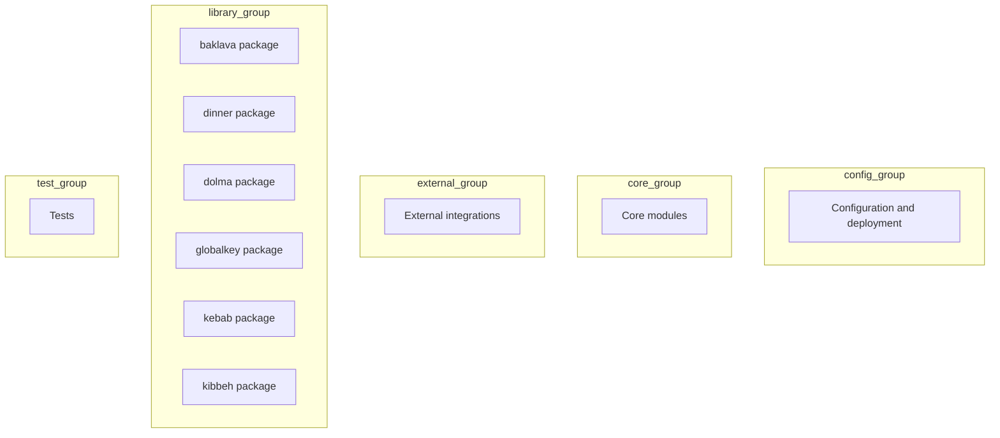

# Architecture report: benawad/dogehouse

> Automated static analysis. **Observed** = directly seen in files/imports/AST; **Inferred** = interpretation from that evidence. Repository code was not executed.

## 1. Repository at a glance

| Item | Value |
| --- | --- |
| Repository | benawad/dogehouse |
| Description | Taking voice conversations to the moon 🚀 |
| Language | TypeScript |
| Stars | 9006 |
| Licence | MIT |
| Analysed commit / branch | 584055ad407bc37fa35cdf36ebb271622e29d436 / staging |
| Framework(s) | Electron, Next.js, React |
| Files analysed | 798 |
| Components | 10 |

## 2. Architecture in one minute

benawad/dogehouse - Taking voice conversations to the moon 🚀. This repository was analysed statically from 798 file(s) (0 Python). Detected technologies (observed from imports/manifests): GitHub Actions, PostgreSQL, Electron, Next.js, React, Tailwind CSS. Files are grouped into 10 component(s): baklava package, Configuration and deployment, Core modules, dinner package, dolma package, External integrations, globalkey package, kebab package. Findings below distinguish observed facts from inferred interpretation.

## 3. High-level block diagram

## 4. Main components

### baklava package (`baklava`)

- **Kind:** library
- **Status:** Observed
- **Confidence:** 0.85
- **Responsibility:** Groups 18 file(s) under baklava package (observed from repository paths and static analysis).
- **Paths:** `baklava/resources/overlay/src/App.js`, `baklava/resources/overlay/src/index.js`, `baklava/resources/overlay/src/reportWebVitals.js`, `baklava/scripts/generateTranslationTypes.ts`, `baklava/scripts/syncTranslations.ts`, `baklava/scripts/traverseTranslations.ts`, `baklava/src/constants.ts`, `baklava/src/dev.ts`, `baklava/src/electron.ts`, `baklava/src/generated/translationKeys.ts`, `baklava/src/types.ts`, `baklava/src/utils/keybinds.ts`, `baklava/src/utils/notifications.ts`, `baklava/src/utils/overlay/index.ts`, `baklava/src/utils/overlay/ipc.ts`, `baklava/src/utils/rpc/index.ts`, `baklava/src/utils/rpc/ipc.ts`, `baklava/src/utils/tray.ts`
- **Evidence:** [baklava/resources/overlay/src/App.js](https://github.com/benawad/dogehouse/blob/584055ad407bc37fa35cdf36ebb271622e29d436/baklava/resources/overlay/src/App.js); [baklava/resources/overlay/src/index.js](https://github.com/benawad/dogehouse/blob/584055ad407bc37fa35cdf36ebb271622e29d436/baklava/resources/overlay/src/index.js); [baklava/resources/overlay/src/reportWebVitals.js](https://github.com/benawad/dogehouse/blob/584055ad407bc37fa35cdf36ebb271622e29d436/baklava/resources/overlay/src/reportWebVitals.js); [baklava/scripts/generateTranslationTypes.ts](https://github.com/benawad/dogehouse/blob/584055ad407bc37fa35cdf36ebb271622e29d436/baklava/scripts/generateTranslationTypes.ts); [baklava/scripts/syncTranslations.ts](https://github.com/benawad/dogehouse/blob/584055ad407bc37fa35cdf36ebb271622e29d436/baklava/scripts/syncTranslations.ts); [baklava/scripts/traverseTranslations.ts](https://github.com/benawad/dogehouse/blob/584055ad407bc37fa35cdf36ebb271622e29d436/baklava/scripts/traverseTranslations.ts); [baklava/src/constants.ts](https://github.com/benawad/dogehouse/blob/584055ad407bc37fa35cdf36ebb271622e29d436/baklava/src/constants.ts); [baklava/src/dev.ts](https://github.com/benawad/dogehouse/blob/584055ad407bc37fa35cdf36ebb271622e29d436/baklava/src/dev.ts)

### Configuration and deployment (`config`)

- **Kind:** config
- **Status:** Observed
- **Confidence:** 0.85
- **Responsibility:** Groups 119 file(s) under configuration and deployment (observed from repository paths and static analysis).
- **Paths:** `baklava/.yarnrc.yml`, `baklava/locales/en/translate.json`, `baklava/package.json`, `baklava/resources/overlay/.yarnrc.yml`, `baklava/resources/overlay/package.json`, `baklava/scripts/tsconfig.json`, `baklava/tsconfig.json`, `dinner/.eslintrc.json`, `dinner/package.json`, `dinner/tsconfig.json`, `docker-compose.local.yml`, `docker-compose.prod.yml`, `docker-compose.yml`, `dolma/.editorconfig`, `dolma/package.json`, `dolma/tsconfig.json`, `globalkey/Cargo.toml`, `globalkey/package.json`, `kebab/.eslintrc.json`, `kebab/examples/bot/package.json`, `kebab/examples/bot/tsconfig.json`, `kebab/examples/chat/package.json`, `kebab/examples/chat/tsconfig.json`, `kebab/examples/create-bot/package.json`, `kebab/examples/create-bot/tsconfig.json`, `kebab/examples/mediasoup-audio/package.json`, `kebab/examples/mediasoup-audio/tsconfig.json`, `kebab/examples/react-chat/package.json`, `kebab/examples/react-chat/public/manifest.json`, `kebab/examples/react-chat/tsconfig.json`, `kebab/package.json`, `kebab/tsconfig.json`, `kibbeh/.env.example`, `kibbeh/.eslintrc.json`, `kibbeh/.stylelintrc.json`, `kibbeh/cypress.json`, `kibbeh/cypress/fixtures/example.json`, `kibbeh/cypress/tsconfig.json`, `kibbeh/package.json`, `kibbeh/public/locales/af/translation.json`, `kibbeh/public/locales/am/translation.json`, `kibbeh/public/locales/ar/translation.json`, `kibbeh/public/locales/az/translation.json`, `kibbeh/public/locales/bg/translation.json`, `kibbeh/public/locales/bn/translation.json`, `kibbeh/public/locales/bottom/translation.json`, `kibbeh/public/locales/cs/translation.json`, `kibbeh/public/locales/da/translation.json`, `kibbeh/public/locales/de-AT/translation.json`, `kibbeh/public/locales/de/translation.json`, `kibbeh/public/locales/el/translation.json`, `kibbeh/public/locales/en-AU/translation.json`, `kibbeh/public/locales/en-C/translation.json`, `kibbeh/public/locales/en-CODE/translation.json`, `kibbeh/public/locales/en-LOLCAT/translation.json`, `kibbeh/public/locales/en-OWO/translation.json`, `kibbeh/public/locales/en-PIGLATIN/translation.json`, `kibbeh/public/locales/en-PIRATE/translation.json`, `kibbeh/public/locales/en/translation.json`, `kibbeh/public/locales/eo/translation.json`, `kibbeh/public/locales/es/translation.json`, `kibbeh/public/locales/et/translation.json`, `kibbeh/public/locales/eu/translation.json`, `kibbeh/public/locales/fa/translation.json`, `kibbeh/public/locales/fi/translation.json`, `kibbeh/public/locales/fr/translation.json`, `kibbeh/public/locales/grc/translation.json`, `kibbeh/public/locales/gsw/translation.json`, `kibbeh/public/locales/he/translation.json`, `kibbeh/public/locales/hi/translation.json`, `kibbeh/public/locales/hr/translation.json`, `kibbeh/public/locales/hu/translation.json`, `kibbeh/public/locales/id/translation.json`, `kibbeh/public/locales/is/translation.json`, `kibbeh/public/locales/it/translation.json`, `kibbeh/public/locales/ja/translation.json`, `kibbeh/public/locales/kk/translation.json`, `kibbeh/public/locales/ko/translation.json`, `kibbeh/public/locales/ku/translation.json`, `kibbeh/public/locales/li/translation.json`, `kibbeh/public/locales/lld/translation.json`, `kibbeh/public/locales/lt/translation.json`, `kibbeh/public/locales/lv/translation.json`, `kibbeh/public/locales/nb/translation.json`, `kibbeh/public/locales/ne/translation.json`, `kibbeh/public/locales/nl/translation.json`, `kibbeh/public/locales/pl/translation.json`, `kibbeh/public/locales/pt-BR/translation.json`, `kibbeh/public/locales/pt-PT/translation.json`, `kibbeh/public/locales/ro/translation.json`, `kibbeh/public/locales/ru/translation.json`, `kibbeh/public/locales/sa/translation.json`, `kibbeh/public/locales/si/translation.json`, `kibbeh/public/locales/sk/translation.json`, `kibbeh/public/locales/sl/translation.json`, `kibbeh/public/locales/so/translation.json`, `kibbeh/public/locales/sq/translation.json`, `kibbeh/public/locales/sr-LATIN/translation.json`, `kibbeh/public/locales/sr/translation.json`, `kibbeh/public/locales/sv/translation.json`, `kibbeh/public/locales/ta/translation.json`, `kibbeh/public/locales/te/translation.json`, `kibbeh/public/locales/th/translation.json`, `kibbeh/public/locales/tl/translation.json`, `kibbeh/public/locales/tp/translation.json`, `kibbeh/public/locales/tr/translation.json`, `kibbeh/public/locales/uk/translation.json`, `kibbeh/public/locales/ur/translation.json`, `kibbeh/public/locales/uz/translation.json`, `kibbeh/public/locales/vi/translation.json`, `kibbeh/public/locales/zh-CN/translation.json`, `kibbeh/public/locales/zh-TW/translation.json`, `kibbeh/public/manifest.json`, `kibbeh/scripts/tsconfig.json`, `kibbeh/src/modules/settings/OverlaySettingsPage.tsx`, `kibbeh/src/modules/settings/PrivacySettingForm.tsx`, `kibbeh/src/modules/settings/PrivacySettingsPage.tsx`, `kibbeh/src/modules/settings/SoundEffectSettingsPage.tsx`, `kibbeh/src/modules/settings/VoiceSettingsPage.tsx`
- **Evidence:** [baklava/.yarnrc.yml](https://github.com/benawad/dogehouse/blob/584055ad407bc37fa35cdf36ebb271622e29d436/baklava/.yarnrc.yml); [baklava/locales/en/translate.json](https://github.com/benawad/dogehouse/blob/584055ad407bc37fa35cdf36ebb271622e29d436/baklava/locales/en/translate.json); [baklava/package.json](https://github.com/benawad/dogehouse/blob/584055ad407bc37fa35cdf36ebb271622e29d436/baklava/package.json); [baklava/resources/overlay/.yarnrc.yml](https://github.com/benawad/dogehouse/blob/584055ad407bc37fa35cdf36ebb271622e29d436/baklava/resources/overlay/.yarnrc.yml); [baklava/resources/overlay/package.json](https://github.com/benawad/dogehouse/blob/584055ad407bc37fa35cdf36ebb271622e29d436/baklava/resources/overlay/package.json); [baklava/scripts/tsconfig.json](https://github.com/benawad/dogehouse/blob/584055ad407bc37fa35cdf36ebb271622e29d436/baklava/scripts/tsconfig.json); [baklava/tsconfig.json](https://github.com/benawad/dogehouse/blob/584055ad407bc37fa35cdf36ebb271622e29d436/baklava/tsconfig.json); [dinner/.eslintrc.json](https://github.com/benawad/dogehouse/blob/584055ad407bc37fa35cdf36ebb271622e29d436/dinner/.eslintrc.json)

### Core modules (`core`)

- **Kind:** core
- **Status:** Observed
- **Confidence:** 0.85
- **Responsibility:** Groups 1 file(s) under core modules (observed from repository paths and static analysis).
- **Paths:** `commitlint.config.js`
- **Evidence:** [commitlint.config.js](https://github.com/benawad/dogehouse/blob/584055ad407bc37fa35cdf36ebb271622e29d436/commitlint.config.js)

### dinner package (`dinner`)

- **Kind:** library
- **Status:** Observed
- **Confidence:** 0.85
- **Responsibility:** Groups 2 file(s) under dinner package (observed from repository paths and static analysis).
- **Paths:** `dinner/src/create-accounts.ts`, `dinner/src/play-audio.ts`
- **Evidence:** [dinner/src/create-accounts.ts](https://github.com/benawad/dogehouse/blob/584055ad407bc37fa35cdf36ebb271622e29d436/dinner/src/create-accounts.ts); [dinner/src/play-audio.ts](https://github.com/benawad/dogehouse/blob/584055ad407bc37fa35cdf36ebb271622e29d436/dinner/src/play-audio.ts)

### dolma package (`dolma`)

- **Kind:** library
- **Status:** Observed
- **Confidence:** 0.85
- **Responsibility:** Groups 15 file(s) under dolma package (observed from repository paths and static analysis).
- **Paths:** `dolma/src/index.ts`, `dolma/src/lib/decode.ts`, `dolma/src/lib/encode.ts`, `dolma/src/lib/filterString.ts`, `dolma/src/lib/filterUnitoken.ts`, `dolma/src/lib/msgToken.ts`, `dolma/src/tokens/index.ts`, `dolma/src/tokens/types/block.ts`, `dolma/src/tokens/types/emoji.ts`, `dolma/src/tokens/types/emote.ts`, `dolma/src/tokens/types/link.ts`, `dolma/src/tokens/types/mention.ts`, `dolma/src/tokens/types/text.ts`, `dolma/src/util/regex.ts`, `dolma/src/util/types/tokenTypes.ts`
- **Evidence:** [dolma/src/index.ts](https://github.com/benawad/dogehouse/blob/584055ad407bc37fa35cdf36ebb271622e29d436/dolma/src/index.ts); [dolma/src/lib/decode.ts](https://github.com/benawad/dogehouse/blob/584055ad407bc37fa35cdf36ebb271622e29d436/dolma/src/lib/decode.ts); [dolma/src/lib/encode.ts](https://github.com/benawad/dogehouse/blob/584055ad407bc37fa35cdf36ebb271622e29d436/dolma/src/lib/encode.ts); [dolma/src/lib/filterString.ts](https://github.com/benawad/dogehouse/blob/584055ad407bc37fa35cdf36ebb271622e29d436/dolma/src/lib/filterString.ts); [dolma/src/lib/filterUnitoken.ts](https://github.com/benawad/dogehouse/blob/584055ad407bc37fa35cdf36ebb271622e29d436/dolma/src/lib/filterUnitoken.ts); [dolma/src/lib/msgToken.ts](https://github.com/benawad/dogehouse/blob/584055ad407bc37fa35cdf36ebb271622e29d436/dolma/src/lib/msgToken.ts); [dolma/src/tokens/index.ts](https://github.com/benawad/dogehouse/blob/584055ad407bc37fa35cdf36ebb271622e29d436/dolma/src/tokens/index.ts); [dolma/src/tokens/types/block.ts](https://github.com/benawad/dogehouse/blob/584055ad407bc37fa35cdf36ebb271622e29d436/dolma/src/tokens/types/block.ts)

### External integrations (`external_integrations`)

- **Kind:** external
- **Status:** Observed
- **Confidence:** 0.85
- **Responsibility:** Groups 18 file(s) under external integrations (observed from repository paths and static analysis).
- **Paths:** `kebab/src/client/http/bot.ts`, `kebab/src/client/http/dev.ts`, `kebab/src/client/http/endpoint.ts`, `kebab/src/client/http/index.ts`, `kebab/src/client/index.ts`, `kebab/src/client/requester/auth.ts`, `kebab/src/client/requester/chat.ts`, `kebab/src/client/requester/index.ts`, `kebab/src/client/requester/misc.ts`, `kebab/src/client/requester/room.ts`, `kebab/src/client/requester/user.ts`, `kebab/src/client/subscriber/index.ts`, `kebab/src/client/subscriber/legacy.ts`, `kebab/src/client/type-util.ts`, `kibbeh/cypress/integration/create-scheduled-room.ts`, `kibbeh/cypress/integration/edit-profile.ts`, `kibbeh/cypress/integration/room-creator.ts`, `kibbeh/cypress/integration/search.ts`
- **Evidence:** [kebab/src/client/http/bot.ts](https://github.com/benawad/dogehouse/blob/584055ad407bc37fa35cdf36ebb271622e29d436/kebab/src/client/http/bot.ts); [kebab/src/client/http/dev.ts](https://github.com/benawad/dogehouse/blob/584055ad407bc37fa35cdf36ebb271622e29d436/kebab/src/client/http/dev.ts); [kebab/src/client/http/endpoint.ts](https://github.com/benawad/dogehouse/blob/584055ad407bc37fa35cdf36ebb271622e29d436/kebab/src/client/http/endpoint.ts); [kebab/src/client/http/index.ts](https://github.com/benawad/dogehouse/blob/584055ad407bc37fa35cdf36ebb271622e29d436/kebab/src/client/http/index.ts); [kebab/src/client/index.ts](https://github.com/benawad/dogehouse/blob/584055ad407bc37fa35cdf36ebb271622e29d436/kebab/src/client/index.ts); [kebab/src/client/requester/auth.ts](https://github.com/benawad/dogehouse/blob/584055ad407bc37fa35cdf36ebb271622e29d436/kebab/src/client/requester/auth.ts); [kebab/src/client/requester/chat.ts](https://github.com/benawad/dogehouse/blob/584055ad407bc37fa35cdf36ebb271622e29d436/kebab/src/client/requester/chat.ts); [kebab/src/client/requester/index.ts](https://github.com/benawad/dogehouse/blob/584055ad407bc37fa35cdf36ebb271622e29d436/kebab/src/client/requester/index.ts)

### globalkey package (`globalkey`)

- **Kind:** library
- **Status:** Observed
- **Confidence:** 0.85
- **Responsibility:** Groups 4 file(s) under globalkey package (observed from repository paths and static analysis).
- **Paths:** `globalkey/index.d.ts`, `globalkey/src/build.rs`, `globalkey/src/lib.rs`, `globalkey/test.js`
- **Evidence:** [globalkey/index.d.ts](https://github.com/benawad/dogehouse/blob/584055ad407bc37fa35cdf36ebb271622e29d436/globalkey/index.d.ts); [globalkey/src/build.rs](https://github.com/benawad/dogehouse/blob/584055ad407bc37fa35cdf36ebb271622e29d436/globalkey/src/build.rs); [globalkey/src/lib.rs](https://github.com/benawad/dogehouse/blob/584055ad407bc37fa35cdf36ebb271622e29d436/globalkey/src/lib.rs); [globalkey/test.js](https://github.com/benawad/dogehouse/blob/584055ad407bc37fa35cdf36ebb271622e29d436/globalkey/test.js)

### kebab package (`kebab`)

- **Kind:** library
- **Status:** Observed
- **Confidence:** 0.85
- **Responsibility:** Groups 26 file(s) under kebab package (observed from repository paths and static analysis).
- **Paths:** `kebab/.prettierrc.js`, `kebab/examples/bot/src/index.ts`, `kebab/examples/chat/src/index.ts`, `kebab/examples/create-bot/src/index.ts`, `kebab/examples/mediasoup-audio/src/index.ts`, `kebab/examples/react-chat/src/App.tsx`, `kebab/examples/react-chat/src/index.tsx`, `kebab/examples/react-chat/src/react-app-env.d.ts`, `kebab/jest.config.js`, `kebab/src/audio/audioWrapper.ts`, `kebab/src/audio/interface.ts`, `kebab/src/audio/mediasoup-client.ts`, `kebab/src/entities.ts`, `kebab/src/http/bot.ts`, `kebab/src/http/index.ts`, `kebab/src/http/raw.ts`, `kebab/src/http/wrapper.ts`, `kebab/src/index.ts`, `kebab/src/pagination.ts`, `kebab/src/util/ast.test.ts`, `kebab/src/util/ast.ts`, `kebab/src/util/index.ts`, `kebab/src/websocket/index.ts`, `kebab/src/websocket/raw.ts`, `kebab/src/websocket/responses.ts`, `kebab/src/websocket/wrapper.ts`
- **Evidence:** [kebab/.prettierrc.js](https://github.com/benawad/dogehouse/blob/584055ad407bc37fa35cdf36ebb271622e29d436/kebab/.prettierrc.js); [kebab/examples/bot/src/index.ts](https://github.com/benawad/dogehouse/blob/584055ad407bc37fa35cdf36ebb271622e29d436/kebab/examples/bot/src/index.ts); [kebab/examples/chat/src/index.ts](https://github.com/benawad/dogehouse/blob/584055ad407bc37fa35cdf36ebb271622e29d436/kebab/examples/chat/src/index.ts); [kebab/examples/create-bot/src/index.ts](https://github.com/benawad/dogehouse/blob/584055ad407bc37fa35cdf36ebb271622e29d436/kebab/examples/create-bot/src/index.ts); [kebab/examples/mediasoup-audio/src/index.ts](https://github.com/benawad/dogehouse/blob/584055ad407bc37fa35cdf36ebb271622e29d436/kebab/examples/mediasoup-audio/src/index.ts); [kebab/examples/react-chat/src/App.tsx](https://github.com/benawad/dogehouse/blob/584055ad407bc37fa35cdf36ebb271622e29d436/kebab/examples/react-chat/src/App.tsx); [kebab/examples/react-chat/src/index.tsx](https://github.com/benawad/dogehouse/blob/584055ad407bc37fa35cdf36ebb271622e29d436/kebab/examples/react-chat/src/index.tsx); [kebab/examples/react-chat/src/react-app-env.d.ts](https://github.com/benawad/dogehouse/blob/584055ad407bc37fa35cdf36ebb271622e29d436/kebab/examples/react-chat/src/react-app-env.d.ts)

### kibbeh package (`kibbeh`)

- **Kind:** library
- **Status:** Observed
- **Confidence:** 0.85
- **Responsibility:** Groups 259 file(s) under kibbeh package (observed from repository paths and static analysis).
- **Paths:** `kibbeh/.prettierrc.js`, `kibbeh/.storybook/main.js`, `kibbeh/.storybook/manager.js`, `kibbeh/.storybook/preview.js`, `kibbeh/cypress/plugins/index.js`, `kibbeh/cypress/plugins/sample_spec.js`, `kibbeh/cypress/support/commands.ts`, `kibbeh/cypress/support/index.d.ts`, `kibbeh/cypress/support/index.js`, `kibbeh/cypress/support/test-constants.ts`, `kibbeh/deploy.sh`, `kibbeh/next-env.d.ts`, `kibbeh/next.config.js`, `kibbeh/postcss.config.js`, `kibbeh/scripts/syncTranslations.ts`, `kibbeh/scripts/traverseTranslations.ts`, `kibbeh/src/form-fields/FieldSpacer.tsx`, `kibbeh/src/form-fields/InputField.tsx`, `kibbeh/src/global-stores/useAccountOverlay.ts`, `kibbeh/src/global-stores/useAskForMicStore.ts`, `kibbeh/src/global-stores/useAudioTracks.ts`, `kibbeh/src/global-stores/useCurrentRoomIdStore.ts`, `kibbeh/src/global-stores/useDeafStore.ts`, `kibbeh/src/global-stores/useDebugAudio.ts`, `kibbeh/src/global-stores/useDownloadAlertStore.ts`, `kibbeh/src/global-stores/useElectronMobileStore.ts`, `kibbeh/src/global-stores/useEmojiPickerStore.ts`, `kibbeh/src/global-stores/useGlobalVolumeStore.ts`, `kibbeh/src/global-stores/useHostStore.ts`, `kibbeh/src/global-stores/useKeyMapStore.ts`, `kibbeh/src/global-stores/useMicPermErrorStore.ts`, `kibbeh/src/global-stores/useMuteStore.ts`, `kibbeh/src/global-stores/useOverlayStore.ts`, `kibbeh/src/global-stores/useProducerStore.ts`, `kibbeh/src/global-stores/useRoomChatMentionStore.ts`, `kibbeh/src/global-stores/useSocketStatus.ts`, `kibbeh/src/global-stores/useStatus.ts`, `kibbeh/src/globals.d.ts`, `kibbeh/src/icons/BotIcon.tsx`, `kibbeh/src/icons/DeveloperIcon.tsx`, `kibbeh/src/icons/LgLogo.tsx`, `kibbeh/src/icons/Link.tsx`, `kibbeh/src/icons/LogoIcon.tsx`, `kibbeh/src/icons/MacCloseIcon.tsx`, `kibbeh/src/icons/MacMaximizeIcon.tsx`, `kibbeh/src/icons/MacMinimizeIcon.tsx`, `kibbeh/src/icons/OutlineGlobe.tsx`, `kibbeh/src/icons/Share.tsx`, `kibbeh/src/icons/Smiley.tsx`, `kibbeh/src/icons/SolidBug.tsx`, `kibbeh/src/icons/SolidCalendar.tsx`, `kibbeh/src/icons/SolidCaretRight.tsx`, `kibbeh/src/icons/SolidChatBubble.tsx`, `kibbeh/src/icons/SolidCompass.tsx`, `kibbeh/src/icons/SolidContributor.tsx`, `kibbeh/src/icons/SolidDeafened.tsx`, `kibbeh/src/icons/SolidDeafenedOff.tsx`, `kibbeh/src/icons/SolidDiscord.tsx`, `kibbeh/src/icons/SolidDogenitro.tsx`, `kibbeh/src/icons/SolidDownload.tsx`, `kibbeh/src/icons/SolidFriends.tsx`, `kibbeh/src/icons/SolidFriendsAdd.tsx`, `kibbeh/src/icons/SolidFullscreen.tsx`, `kibbeh/src/icons/SolidGitHub.tsx`, `kibbeh/src/icons/SolidGoogle.tsx`, `kibbeh/src/icons/SolidHelp.tsx`, `kibbeh/src/icons/SolidHome.tsx`, `kibbeh/src/icons/SolidInstagram.tsx`, `kibbeh/src/icons/SolidKeyboard.tsx`, `kibbeh/src/icons/SolidLink.tsx`, `kibbeh/src/icons/SolidLogOut.tsx`, `kibbeh/src/icons/SolidMegaphone.tsx`, `kibbeh/src/icons/SolidMessages.tsx`, `kibbeh/src/icons/SolidMicrophone.tsx`, `kibbeh/src/icons/SolidMicrophoneOff.tsx`, `kibbeh/src/icons/SolidMoon.tsx`, `kibbeh/src/icons/SolidNew.tsx`, `kibbeh/src/icons/SolidNotification.tsx`, `kibbeh/src/icons/SolidPersonAdd.tsx`, `kibbeh/src/icons/SolidPlus.tsx`, `kibbeh/src/icons/SolidRocket.tsx`, `kibbeh/src/icons/SolidSearch.tsx`, `kibbeh/src/icons/SolidSettings.tsx`, `kibbeh/src/icons/SolidSimpleMegaphone.tsx`, `kibbeh/src/icons/SolidStaff.tsx`, `kibbeh/src/icons/SolidTime.tsx`, `kibbeh/src/icons/SolidTrash.tsx`, `kibbeh/src/icons/SolidTwitter.tsx`, `kibbeh/src/icons/SolidUser.tsx`, `kibbeh/src/icons/SolidVolume.tsx`, `kibbeh/src/icons/SolidVolumeOff.tsx`, `kibbeh/src/icons/SolidWarning.tsx`, `kibbeh/src/icons/WinCloseIcon.tsx`, `kibbeh/src/icons/WinMaximizeIcon.tsx`, `kibbeh/src/icons/WinMinimizeIcon.tsx`, `kibbeh/src/icons/badges/ContributorBadge.tsx`, `kibbeh/src/icons/badges/StaffBadge.tsx`, `kibbeh/src/icons/badges/index.tsx`, `kibbeh/src/icons/index.tsx`, `kibbeh/src/jest.config.js`, `kibbeh/src/lib/constants.ts`, `kibbeh/src/lib/createChatMessage.ts`, `kibbeh/src/lib/defaultQueryFn.ts`, `kibbeh/src/lib/i18n.ts`, `kibbeh/src/lib/isCurrentRoomId.ts`, `kibbeh/src/lib/isServer.ts`, `kibbeh/src/lib/isWebRTCEnabled.ts`, `kibbeh/src/lib/kFormatter.ts`, `kibbeh/src/lib/queryClient.ts`, `kibbeh/src/lib/roomToCurrentRoom.ts`, `kibbeh/src/lib/showErrorToast.ts`, `kibbeh/src/lib/validateStruct.ts`, `kibbeh/src/modules/admin/AdminPage.tsx`, `kibbeh/src/modules/admin/AdminPageForm.tsx`, `kibbeh/src/modules/auth/WaitForWsAndAuth.tsx`, `kibbeh/src/modules/auth/useSaveTokensFromQueryParams.ts`, `kibbeh/src/modules/auth/useTokenStore.ts`, `kibbeh/src/modules/auth/useVerifyLoggedIn.ts`, `kibbeh/src/modules/dashboard/CreateRoomModal.tsx`, `kibbeh/src/modules/dashboard/DashboardPage.tsx`, `kibbeh/src/modules/dashboard/FeedController.tsx`, `kibbeh/src/modules/dashboard/FollowingOnlineController.tsx`, `kibbeh/src/modules/dashboard/MinimizedRoomCardController.tsx`, `kibbeh/src/modules/dashboard/ProfileBlockController.tsx`, `kibbeh/src/modules/debugging/AudioDebugAvatar.tsx`, `kibbeh/src/modules/debugging/AudioDebugPanel.tsx`, `kibbeh/src/modules/developer/Bot.tsx`, `kibbeh/src/modules/developer/BotCard.tsx`, `kibbeh/src/modules/developer/BotIcon.tsx`, `kibbeh/src/modules/developer/BotInfo.tsx`, `kibbeh/src/modules/developer/BotsEditPage.tsx`, `kibbeh/src/modules/developer/BotsPage.tsx`, `kibbeh/src/modules/developer/CreateBotModal.tsx`, `kibbeh/src/modules/developer/DeveloperNavButton.tsx`, `kibbeh/src/modules/developer/DeveloperPanel.tsx`, `kibbeh/src/modules/developer/EditBot.tsx`, `kibbeh/src/modules/developer/YourBots.tsx`, `kibbeh/src/modules/display/HeaderController.tsx`, `kibbeh/src/modules/display/TextParser.tsx`, `kibbeh/src/modules/errors/ErrorToastController.tsx`, `kibbeh/src/modules/errors/useErrorToastStore.tsx`, `kibbeh/src/modules/keyboard-shortcuts/ChatKeybind.tsx`, `kibbeh/src/modules/keyboard-shortcuts/DeafKeybind.tsx`, `kibbeh/src/modules/keyboard-shortcuts/InviteKeybind.tsx`, `kibbeh/src/modules/keyboard-shortcuts/KeybindListener.tsx`, `kibbeh/src/modules/keyboard-shortcuts/MuteKeybind.tsx`, `kibbeh/src/modules/keyboard-shortcuts/OverlayKeybind.tsx`, `kibbeh/src/modules/keyboard-shortcuts/PTTKeybind.tsx`, `kibbeh/src/modules/keyboard-shortcuts/RequestToSpeakKeybind.tsx`, `kibbeh/src/modules/keyboard-shortcuts/index.ts`, `kibbeh/src/modules/landing-page/LoginPage.tsx`, `kibbeh/src/modules/language/LanguagePage.tsx`, `kibbeh/src/modules/layouts/DefaultDesktopLayout.tsx`, `kibbeh/src/modules/layouts/ElectronHeader.tsx`, `kibbeh/src/modules/layouts/FloatingRoomInfo.tsx`, `kibbeh/src/modules/layouts/GridPanels.tsx`, `kibbeh/src/modules/layouts/MainLayout.tsx`, `kibbeh/src/modules/layouts/TabletSidebar.tsx`, `kibbeh/src/modules/room/AudioDebugConsumerSection.tsx`, `kibbeh/src/modules/room/BlockedFromRoomUsers.tsx`, `kibbeh/src/modules/room/InviteRoomPage.tsx`, `kibbeh/src/modules/room/RoomChatController.tsx`, `kibbeh/src/modules/room/RoomOpenGraphPreview.tsx`, `kibbeh/src/modules/room/RoomPage.tsx`, `kibbeh/src/modules/room/RoomPanelController.tsx`, `kibbeh/src/modules/room/RoomPanelIconBarController.tsx`, `kibbeh/src/modules/room/RoomSettingModal.tsx`, `kibbeh/src/modules/room/RoomUsersPanel.tsx`, `kibbeh/src/modules/room/UserPreviewModal.tsx`, `kibbeh/src/modules/room/UserPreviewModalProvider.tsx`, `kibbeh/src/modules/room/ViewScheduledRoomPage.tsx`, `kibbeh/src/modules/room/VolumeSliderController.tsx`, `kibbeh/src/modules/room/chat/Emote.tsx`, `kibbeh/src/modules/room/chat/EmoteData.ts`, `kibbeh/src/modules/room/chat/RoomChat.tsx`, `kibbeh/src/modules/room/chat/RoomChatInput.tsx`, `kibbeh/src/modules/room/chat/RoomChatList.tsx`, `kibbeh/src/modules/room/chat/RoomChatMentions.tsx`, `kibbeh/src/modules/room/chat/navigateThroughQueriedEmojis.ts`, `kibbeh/src/modules/room/chat/navigateThroughQueriedUsers.ts`, `kibbeh/src/modules/room/chat/useRoomChatMentionStore.ts`, `kibbeh/src/modules/room/chat/useRoomChatStore.ts`, `kibbeh/src/modules/room/mobile/RoomOverlay.tsx`, `kibbeh/src/modules/room/useGetRoomByQueryParam.ts`, `kibbeh/src/modules/room/useResize.ts`, `kibbeh/src/modules/room/useSplitUsersIntoSections.tsx`, `kibbeh/src/modules/scheduled-rooms/AddToCalendar.tsx`, `kibbeh/src/modules/scheduled-rooms/CopyScheduleRoomLinkButton.tsx`, `kibbeh/src/modules/scheduled-rooms/CreateScheduledRoomModal.tsx`, `kibbeh/src/modules/scheduled-rooms/EditScheduleRoomModalController.tsx`, `kibbeh/src/modules/scheduled-rooms/ScheduledRoomCard.tsx`, `kibbeh/src/modules/scheduled-rooms/ScheduledRoomsList.tsx`, `kibbeh/src/modules/scheduled-rooms/ScheduledRoomsPage.tsx`, `kibbeh/src/modules/scheduled-rooms/copyToClipboard.ts`, `kibbeh/src/modules/scheduled-rooms/makeUrls.ts`, `kibbeh/src/modules/search/SearchBarController.tsx`, `kibbeh/src/modules/search/SearchPage.tsx`, `kibbeh/src/modules/sound-effects/SoundEffectPlayer.tsx`, `kibbeh/src/modules/sound-effects/useSoundEffectStore.ts`, `kibbeh/src/modules/user/EditProfileModal.tsx`, `kibbeh/src/modules/user/FollowingController.tsx`, `kibbeh/src/modules/user/FollowingOnlinePage.tsx`, `kibbeh/src/modules/user/FollowingPage.tsx`, `kibbeh/src/modules/user/UserPage.tsx`, `kibbeh/src/modules/user/UserProfileController.tsx`, `kibbeh/src/modules/user/VerticalUserInfoWithFollowButton.tsx`, `kibbeh/src/modules/webrtc/WebRtcApp.tsx`, `kibbeh/src/modules/webrtc/components/ActiveSpeakerListener.tsx`, `kibbeh/src/modules/webrtc/components/AudioRender.tsx`, `kibbeh/src/modules/webrtc/components/MicPicker.tsx`, `kibbeh/src/modules/webrtc/stores/useAskForMicStore.ts`, `kibbeh/src/modules/webrtc/stores/useAudioTracks.ts`, `kibbeh/src/modules/webrtc/stores/useConsumerStore.ts`, `kibbeh/src/modules/webrtc/stores/useMicIdStore.ts`, `kibbeh/src/modules/webrtc/stores/useMicPermErrorStore.ts`, `kibbeh/src/modules/webrtc/stores/useProducerStore.ts`, `kibbeh/src/modules/webrtc/stores/useSocketStatus.ts`, `kibbeh/src/modules/webrtc/stores/useStatus.ts`, `kibbeh/src/modules/webrtc/stores/useVoiceStore.ts`, `kibbeh/src/modules/webrtc/types.ts`, `kibbeh/src/modules/webrtc/utils/consumeAudio.ts`, `kibbeh/src/modules/webrtc/utils/createTransport.ts`, `kibbeh/src/modules/webrtc/utils/joinRoom.ts`, `kibbeh/src/modules/webrtc/utils/mergeRoomPermission.ts`, `kibbeh/src/modules/webrtc/utils/receiveVoice.ts`, `kibbeh/src/modules/webrtc/utils/sendVoice.ts`, `kibbeh/src/modules/ws/WebSocketProvider.tsx`, `kibbeh/src/pages/404.tsx`, `kibbeh/src/pages/_app.tsx`, `kibbeh/src/pages/admin.tsx`, `kibbeh/src/pages/connection-taken.tsx`, `kibbeh/src/pages/dash.tsx`, `kibbeh/src/pages/developer/bots/edit/[username]/index.tsx`, `kibbeh/src/pages/developer/bots/index.tsx`, `kibbeh/src/pages/download.tsx`, `kibbeh/src/pages/index.tsx`, `kibbeh/src/pages/language.tsx`, `kibbeh/src/pages/logout.tsx`, `kibbeh/src/pages/overlay-settings.tsx`, `kibbeh/src/pages/privacy-settings.tsx`, `kibbeh/src/pages/room/[id]/index.tsx`, `kibbeh/src/pages/room/[id]/invite.tsx`, `kibbeh/src/pages/scheduled-room/[id].tsx`, `kibbeh/src/pages/scheduled-rooms.tsx`, `kibbeh/src/pages/search.tsx`, `kibbeh/src/pages/sound-effect-settings.tsx`, `kibbeh/src/pages/u/[username]/followers.tsx`, `kibbeh/src/pages/u/[username]/following-online.tsx`, `kibbeh/src/pages/u/[username]/following.tsx`, `kibbeh/src/pages/u/[username]/index.tsx`, `kibbeh/src/pages/voice-settings.tsx`, `kibbeh/src/shared-components/ApiPreloadLink.tsx`, `kibbeh/src/shared-components/ConfirmModal.tsx`, `kibbeh/src/shared-components/InvitedToJoinRoomModal.tsx`, `kibbeh/src/shared-hooks/useBoundingClientRect.ts`, `kibbeh/src/shared-hooks/useConn.ts`, `kibbeh/src/shared-hooks/useCurrentRoomFromCache.ts`, `kibbeh/src/shared-hooks/useCurrentRoomId.ts`, `kibbeh/src/shared-hooks/useCurrentRoomInfo.ts`
- **Evidence:** [kibbeh/.prettierrc.js](https://github.com/benawad/dogehouse/blob/584055ad407bc37fa35cdf36ebb271622e29d436/kibbeh/.prettierrc.js); [kibbeh/.storybook/main.js](https://github.com/benawad/dogehouse/blob/584055ad407bc37fa35cdf36ebb271622e29d436/kibbeh/.storybook/main.js); [kibbeh/.storybook/manager.js](https://github.com/benawad/dogehouse/blob/584055ad407bc37fa35cdf36ebb271622e29d436/kibbeh/.storybook/manager.js); [kibbeh/.storybook/preview.js](https://github.com/benawad/dogehouse/blob/584055ad407bc37fa35cdf36ebb271622e29d436/kibbeh/.storybook/preview.js); [kibbeh/cypress/plugins/index.js](https://github.com/benawad/dogehouse/blob/584055ad407bc37fa35cdf36ebb271622e29d436/kibbeh/cypress/plugins/index.js); [kibbeh/cypress/plugins/sample_spec.js](https://github.com/benawad/dogehouse/blob/584055ad407bc37fa35cdf36ebb271622e29d436/kibbeh/cypress/plugins/sample_spec.js); [kibbeh/cypress/support/commands.ts](https://github.com/benawad/dogehouse/blob/584055ad407bc37fa35cdf36ebb271622e29d436/kibbeh/cypress/support/commands.ts); [kibbeh/cypress/support/index.d.ts](https://github.com/benawad/dogehouse/blob/584055ad407bc37fa35cdf36ebb271622e29d436/kibbeh/cypress/support/index.d.ts)

### Tests (`tests`)

- **Kind:** test
- **Status:** Observed
- **Confidence:** 0.85
- **Responsibility:** Groups 4 file(s) under tests (observed from repository paths and static analysis).
- **Paths:** `dolma/src/test/run.ts`, `dolma/src/test/tests/encoding.ts`, `kibbeh/src/lib/tests/constants.test.ts`, `kibbeh/src/lib/tests/kFormatter.test.ts`
- **Evidence:** [dolma/src/test/run.ts](https://github.com/benawad/dogehouse/blob/584055ad407bc37fa35cdf36ebb271622e29d436/dolma/src/test/run.ts); [dolma/src/test/tests/encoding.ts](https://github.com/benawad/dogehouse/blob/584055ad407bc37fa35cdf36ebb271622e29d436/dolma/src/test/tests/encoding.ts); [kibbeh/src/lib/tests/constants.test.ts](https://github.com/benawad/dogehouse/blob/584055ad407bc37fa35cdf36ebb271622e29d436/kibbeh/src/lib/tests/constants.test.ts); [kibbeh/src/lib/tests/kFormatter.test.ts](https://github.com/benawad/dogehouse/blob/584055ad407bc37fa35cdf36ebb271622e29d436/kibbeh/src/lib/tests/kFormatter.test.ts)

## 5. Execution flow

**Observed** entry point(s):

- [dolma/src/index.ts](https://github.com/benawad/dogehouse/blob/584055ad407bc37fa35cdf36ebb271622e29d436/dolma/src/index.ts)
- [dolma/src/tokens/index.ts](https://github.com/benawad/dogehouse/blob/584055ad407bc37fa35cdf36ebb271622e29d436/dolma/src/tokens/index.ts)
- [kebab/src/client/index.ts](https://github.com/benawad/dogehouse/blob/584055ad407bc37fa35cdf36ebb271622e29d436/kebab/src/client/index.ts)
- [kebab/src/http/index.ts](https://github.com/benawad/dogehouse/blob/584055ad407bc37fa35cdf36ebb271622e29d436/kebab/src/http/index.ts)
- [kebab/src/index.ts](https://github.com/benawad/dogehouse/blob/584055ad407bc37fa35cdf36ebb271622e29d436/kebab/src/index.ts)
- [kebab/src/util/index.ts](https://github.com/benawad/dogehouse/blob/584055ad407bc37fa35cdf36ebb271622e29d436/kebab/src/util/index.ts)
- [kebab/src/websocket/index.ts](https://github.com/benawad/dogehouse/blob/584055ad407bc37fa35cdf36ebb271622e29d436/kebab/src/websocket/index.ts)
- [kibbeh/.storybook/main.js](https://github.com/benawad/dogehouse/blob/584055ad407bc37fa35cdf36ebb271622e29d436/kibbeh/.storybook/main.js)
- [kibbeh/cypress/plugins/index.js](https://github.com/benawad/dogehouse/blob/584055ad407bc37fa35cdf36ebb271622e29d436/kibbeh/cypress/plugins/index.js)
- [kibbeh/cypress/support/index.js](https://github.com/benawad/dogehouse/blob/584055ad407bc37fa35cdf36ebb271622e29d436/kibbeh/cypress/support/index.js)
- [kibbeh/src/icons/index.tsx](https://github.com/benawad/dogehouse/blob/584055ad407bc37fa35cdf36ebb271622e29d436/kibbeh/src/icons/index.tsx)
- [kibbeh/src/pages/index.tsx](https://github.com/benawad/dogehouse/blob/584055ad407bc37fa35cdf36ebb271622e29d436/kibbeh/src/pages/index.tsx)

Representative flow (derived from observed entry points and the import graph; steps beyond the entry point are **Inferred**):

1. Execution starts at an observed entry point listed above, if present.
2. No internal import relationships between components were observed.

## 6. Project structure

### `(root)`

- `.dockerignore` - container (16 bytes)
- `.editorconfig` - config (231 bytes)
- `.eslintignore` - other (13 bytes)
- `.gitignore` - other (225 bytes)
- `.prettierignore` - other (13 bytes)
- `.prettierrc.js` - source, JavaScript (140 bytes)
- `.yarnrc.yml` - config (288 bytes)
- `CHANGELOG.md` - docs (83 bytes)
- `CODEOWNERS` - other (91 bytes)
- `CODE_OF_CONDUCT.md` - docs (3411 bytes)
- `CONTRIBUTING.md` - docs (9666 bytes)
- `CREATE_BOT_ACCOUNT.MD` - docs (295 bytes)
- `DESIGN_GUIDELINES.md` - docs (2578 bytes)
- `FAQ.md` - docs (677 bytes)
- `HOW_TO_DEBUG_AUDIO.md` - docs (1284 bytes)
- `HOW_TO_GET_PERMA_BANNED_FROM_DOGEHOUSE.md` - docs (229 bytes)
- `LICENSE` - docs (1096 bytes)
- `README.md` - docs (4807 bytes)
- `SECURITY.md` - docs (119 bytes)
- `commitlint.config.js` - source, JavaScript (336 bytes)
- `docker-compose.local.yml` - config (1608 bytes)
- `docker-compose.prod.yml` - config (405 bytes)
- `docker-compose.yml` - container (1637 bytes)

### `.devcontainer`

- `.devcontainer/Dockerfile` - container (924 bytes)
- `.devcontainer/devcontainer.json` - config (563 bytes)
- `.devcontainer/docker-compose.yml` - container (725 bytes)
- `.devcontainer/scripts/environment.sh` - source, Shell (756 bytes)
- `.devcontainer/scripts/node.sh` - source, Shell (854 bytes)
- `.devcontainer/scripts/user.sh` - source, Shell (626 bytes)

### `.github`

- `.github/ISSUE_TEMPLATE/bug_report.md` - docs (565 bytes)
- `.github/ISSUE_TEMPLATE/feature_request.md` - docs (604 bytes)
- `.github/labeler.yml` - config (247 bytes)
- `.github/workflows/baklava-build_and_release.yaml` - ci, YAML (2895 bytes)
- `.github/workflows/dolma-npm_deploy.yaml` - ci, YAML (1474 bytes)
- `.github/workflows/global-label_pr.yml` - ci, YAML (207 bytes)
- `.github/workflows/global-lint_commit_messages.yaml` - ci, YAML (240 bytes)
- `.github/workflows/globalkey-npm_deploy.yaml` - ci, YAML (1235 bytes)
- `.github/workflows/kebab-npm_publish.yaml` - ci, YAML (1460 bytes)
- `.github/workflows/kibbeh-e2e_tests.yaml` - ci, YAML (1204 bytes)
- `.github/workflows/kibbeh-lint_and_test.yaml` - ci, YAML (850 bytes)
- `.github/workflows/kousa-deploy_staging.yaml` - ci, YAML (629 bytes)
- `.github/workflows/kousa-tests.yaml` - ci, YAML (837 bytes)
- `.github/workflows/shawarma-deploy_staging.yaml` - ci, YAML (611 bytes)

### `.husky`

- `.husky/.gitignore` - other (2 bytes)
- `.husky/commit-msg` - other (168 bytes)
- `.husky/pre-commit` - other (87 bytes)

### `.redesign-assets`

- `.redesign-assets/dogehouse_logo.svg` - other (7734 bytes)
- `.redesign-assets/icons/flags/AD.svg` - other (1098 bytes)
- `.redesign-assets/icons/flags/AE.svg` - other (726 bytes)
- `.redesign-assets/icons/flags/AF.svg` - other (1630 bytes)
- `.redesign-assets/icons/flags/AG.svg` - other (2315 bytes)
- `.redesign-assets/icons/flags/AI.svg` - other (2992 bytes)
- `.redesign-assets/icons/flags/AL.svg` - other (2256 bytes)
- `.redesign-assets/icons/flags/AM.svg` - other (623 bytes)
- `.redesign-assets/icons/flags/AN.svg` - other (1582 bytes)
- `.redesign-assets/icons/flags/AO.svg` - other (3559 bytes)
- `.redesign-assets/icons/flags/AR.svg` - other (896 bytes)
- `.redesign-assets/icons/flags/AT.svg` - other (643 bytes)
- `.redesign-assets/icons/flags/AU.svg` - other (2968 bytes)
- `.redesign-assets/icons/flags/AW.svg` - other (1484 bytes)
- `.redesign-assets/icons/flags/AX.svg` - other (642 bytes)
- `.redesign-assets/icons/flags/AZ.svg` - other (1774 bytes)
- `.redesign-assets/icons/flags/BA.svg` - other (2076 bytes)
- `.redesign-assets/icons/flags/BB.svg` - other (2307 bytes)
- `.redesign-assets/icons/flags/BD.svg` - other (614 bytes)
- `.redesign-assets/icons/flags/BE.svg` - other (592 bytes)
- `.redesign-assets/icons/flags/BF.svg` - other (751 bytes)
- `.redesign-assets/icons/flags/BG.svg` - other (649 bytes)
- `.redesign-assets/icons/flags/BH.svg` - other (671 bytes)
- `.redesign-assets/icons/flags/BI.svg` - other (1640 bytes)
- `.redesign-assets/icons/flags/BJ.svg` - other (1803 bytes)
- `.redesign-assets/icons/flags/BM.svg` - other (3402 bytes)
- `.redesign-assets/icons/flags/BN.svg` - other (685 bytes)
- `.redesign-assets/icons/flags/BO.svg` - other (623 bytes)
- `.redesign-assets/icons/flags/BR.svg` - other (1553 bytes)
- `.redesign-assets/icons/flags/BS.svg` - other (935 bytes)
- `.redesign-assets/icons/flags/BT.svg` - other (469 bytes)
- `.redesign-assets/icons/flags/BW.svg` - other (705 bytes)
- `.redesign-assets/icons/flags/BY.svg` - other (1266 bytes)
- `.redesign-assets/icons/flags/BZ.svg` - other (1060 bytes)
- `.redesign-assets/icons/flags/CA.svg` - other (1266 bytes)
- `.redesign-assets/icons/flags/CAF.svg` - other (1821 bytes)
- `.redesign-assets/icons/flags/CAS.svg` - other (3962 bytes)
- `.redesign-assets/icons/flags/CD.svg` - other (903 bytes)
- `.redesign-assets/icons/flags/CEU.svg` - other (4465 bytes)
- `.redesign-assets/icons/flags/CF.svg` - other (1087 bytes)
- `.redesign-assets/icons/flags/CG.svg` - other (734 bytes)
- `.redesign-assets/icons/flags/CH.svg` - other (788 bytes)
- `.redesign-assets/icons/flags/CI.svg` - other (611 bytes)
- `.redesign-assets/icons/flags/CL.svg` - other (842 bytes)
- `.redesign-assets/icons/flags/CM.svg` - other (1134 bytes)
- `.redesign-assets/icons/flags/CN.svg` - other (1260 bytes)
- `.redesign-assets/icons/flags/CNA.svg` - other (2844 bytes)
- `.redesign-assets/icons/flags/CO.svg` - other (1820 bytes)
- `.redesign-assets/icons/flags/COC.svg` - other (1986 bytes)
- `.redesign-assets/icons/flags/CR.svg` - other (726 bytes)
- `.redesign-assets/icons/flags/CSA.svg` - other (1522 bytes)
- `.redesign-assets/icons/flags/CU.svg` - other (1041 bytes)
- `.redesign-assets/icons/flags/CV.svg` - other (1067 bytes)
- `.redesign-assets/icons/flags/CY.svg` - other (2288 bytes)
- `.redesign-assets/icons/flags/CZ.svg` - other (635 bytes)
- `.redesign-assets/icons/flags/DE.svg` - other (1820 bytes)
- `.redesign-assets/icons/flags/DJ.svg` - other (849 bytes)
- `.redesign-assets/icons/flags/DK.svg` - other (699 bytes)
- `.redesign-assets/icons/flags/DM.svg` - other (1981 bytes)
- `.redesign-assets/icons/flags/DO.svg` - other (1797 bytes)
- `.redesign-assets/icons/flags/DZ.svg` - other (1190 bytes)
- `.redesign-assets/icons/flags/EC.svg` - other (1220 bytes)
- `.redesign-assets/icons/flags/EE.svg` - other (653 bytes)
- `.redesign-assets/icons/flags/EG.svg` - other (1938 bytes)
- `.redesign-assets/icons/flags/ER.svg` - other (2673 bytes)
- `.redesign-assets/icons/flags/ES.svg` - other (1557 bytes)
- `.redesign-assets/icons/flags/ET.svg` - other (1251 bytes)
- `.redesign-assets/icons/flags/EU.svg` - other (2132 bytes)
- `.redesign-assets/icons/flags/FI.svg` - other (606 bytes)
- `.redesign-assets/icons/flags/FJ.svg` - other (3103 bytes)
- `.redesign-assets/icons/flags/FK.svg` - other (34891 bytes)
- `.redesign-assets/icons/flags/FM.svg` - other (1128 bytes)
- `.redesign-assets/icons/flags/FR.svg` - other (611 bytes)
- `.redesign-assets/icons/flags/GA.svg` - other (623 bytes)
- `.redesign-assets/icons/flags/GB.svg` - other (1306 bytes)
- `.redesign-assets/icons/flags/GD.svg` - other (1927 bytes)
- `.redesign-assets/icons/flags/GE.svg` - other (1359 bytes)
- `.redesign-assets/icons/flags/GG.svg` - other (1181 bytes)
- `.redesign-assets/icons/flags/GH.svg` - other (847 bytes)
- `.redesign-assets/icons/flags/GI.svg` - other (1770 bytes)
- `.redesign-assets/icons/flags/GM.svg` - other (705 bytes)
- `.redesign-assets/icons/flags/GN.svg` - other (592 bytes)
- `.redesign-assets/icons/flags/GQ.svg` - other (1296 bytes)
- `.redesign-assets/icons/flags/GR.svg` - other (738 bytes)
- `.redesign-assets/icons/flags/GT.svg` - other (1603 bytes)
- `.redesign-assets/icons/flags/GW.svg` - other (855 bytes)
- `.redesign-assets/icons/flags/GY.svg` - other (684 bytes)
- `.redesign-assets/icons/flags/HK.svg` - other (3196 bytes)
- `.redesign-assets/icons/flags/HN.svg` - other (1653 bytes)
- `.redesign-assets/icons/flags/HR.svg` - other (1939 bytes)
- `.redesign-assets/icons/flags/HT.svg` - other (2059 bytes)
- `.redesign-assets/icons/flags/HU.svg` - other (643 bytes)
- `.redesign-assets/icons/flags/ID.svg` - other (553 bytes)
- `.redesign-assets/icons/flags/IE.svg` - other (611 bytes)
- `.redesign-assets/icons/flags/IL.svg` - other (1041 bytes)
- `.redesign-assets/icons/flags/IM.svg` - other (62918 bytes)
- `.redesign-assets/icons/flags/IN.svg` - other (1178 bytes)
- `.redesign-assets/icons/flags/IQ.svg` - other (2013 bytes)
- `.redesign-assets/icons/flags/IR.svg` - other (6246 bytes)
- `.redesign-assets/icons/flags/IS.svg` - other (640 bytes)
- `.redesign-assets/icons/flags/IT.svg` - other (611 bytes)
- `.redesign-assets/icons/flags/JE.svg` - other (2126 bytes)
- `.redesign-assets/icons/flags/JM.svg` - other (819 bytes)
- `.redesign-assets/icons/flags/JO.svg` - other (1022 bytes)
- `.redesign-assets/icons/flags/JP.svg` - other (850 bytes)
- `.redesign-assets/icons/flags/KE.svg` - other (3341 bytes)
- `.redesign-assets/icons/flags/KG.svg` - other (1330 bytes)
- `.redesign-assets/icons/flags/KH.svg` - other (1230 bytes)
- `.redesign-assets/icons/flags/KM.svg` - other (1735 bytes)
- `.redesign-assets/icons/flags/KN.svg` - other (1306 bytes)
- `.redesign-assets/icons/flags/KP.svg` - other (1082 bytes)
- `.redesign-assets/icons/flags/KR.svg` - other (3629 bytes)
- `.redesign-assets/icons/flags/KW.svg` - other (747 bytes)
- `.redesign-assets/icons/flags/KY.svg` - other (2853 bytes)
- `.redesign-assets/icons/flags/KZ.svg` - other (4302 bytes)
- `.redesign-assets/icons/flags/LA.svg` - other (869 bytes)
- `.redesign-assets/icons/flags/LB.svg` - other (1669 bytes)
- `.redesign-assets/icons/flags/LC.svg` - other (1319 bytes)
- `.redesign-assets/icons/flags/LI.svg` - other (523 bytes)
- `.redesign-assets/icons/flags/LK.svg` - other (3903 bytes)
- `.redesign-assets/icons/flags/LR.svg` - other (950 bytes)
- `.redesign-assets/icons/flags/LS.svg` - other (1245 bytes)
- `.redesign-assets/icons/flags/LT.svg` - other (623 bytes)
- `.redesign-assets/icons/flags/LU.svg` - other (643 bytes)
- `.redesign-assets/icons/flags/LV.svg` - other (626 bytes)
- `.redesign-assets/icons/flags/LY.svg` - other (2370 bytes)
- `.redesign-assets/icons/flags/MA.svg` - other (762 bytes)
- `.redesign-assets/icons/flags/MC.svg` - other (553 bytes)
- `.redesign-assets/icons/flags/MD.svg` - other (768 bytes)
- `.redesign-assets/icons/flags/ME.svg` - other (4720 bytes)
- `.redesign-assets/icons/flags/MG.svg` - other (667 bytes)
- `.redesign-assets/icons/flags/MK.svg` - other (1704 bytes)
- `.redesign-assets/icons/flags/ML.svg` - other (592 bytes)
- `.redesign-assets/icons/flags/MM.svg` - other (837 bytes)
- `.redesign-assets/icons/flags/MN.svg` - other (1581 bytes)
- `.redesign-assets/icons/flags/MO.svg` - other (2610 bytes)
- `.redesign-assets/icons/flags/MR.svg` - other (913 bytes)
- `.redesign-assets/icons/flags/MS.svg` - other (2504 bytes)
- `.redesign-assets/icons/flags/MT.svg` - other (2585 bytes)
- `.redesign-assets/icons/flags/MU.svg` - other (708 bytes)
- `.redesign-assets/icons/flags/MV.svg` - other (825 bytes)
- `.redesign-assets/icons/flags/MW.svg` - other (865 bytes)
- `.redesign-assets/icons/flags/MX.svg` - other (1620 bytes)
- `.redesign-assets/icons/flags/MY.svg` - other (1399 bytes)
- `.redesign-assets/icons/flags/MZ.svg` - other (1057 bytes)
- `.redesign-assets/icons/flags/NA.svg` - other (1147 bytes)
- `.redesign-assets/icons/flags/NE.svg` - other (905 bytes)
- `.redesign-assets/icons/flags/NG.svg` - other (611 bytes)
- `.redesign-assets/icons/flags/NI.svg` - other (996 bytes)
- `.redesign-assets/icons/flags/NL.svg` - other (643 bytes)
- `.redesign-assets/icons/flags/NO.svg` - other (744 bytes)
- `.redesign-assets/icons/flags/NP.svg` - other (2055 bytes)
- `.redesign-assets/icons/flags/NZ.svg` - other (2154 bytes)
- `.redesign-assets/icons/flags/OM.svg` - other (970 bytes)
- `.redesign-assets/icons/flags/PA.svg` - other (1127 bytes)
- `.redesign-assets/icons/flags/PE.svg` - other (611 bytes)
- `.redesign-assets/icons/flags/PF.svg` - other (16831 bytes)
- `.redesign-assets/icons/flags/PG.svg` - other (2240 bytes)
- `.redesign-assets/icons/flags/PH.svg` - other (2159 bytes)
- `.redesign-assets/icons/flags/PK.svg` - other (1179 bytes)
- `.redesign-assets/icons/flags/PL.svg` - other (549 bytes)
- `.redesign-assets/icons/flags/PR.svg` - other (1749 bytes)
- `.redesign-assets/icons/flags/PT.svg` - other (1231 bytes)
- `.redesign-assets/icons/flags/PW.svg` - other (614 bytes)
- `.redesign-assets/icons/flags/PY.svg` - other (1143 bytes)
- `.redesign-assets/icons/flags/QA.svg` - other (671 bytes)
- `.redesign-assets/icons/flags/RO.svg` - other (592 bytes)
- `.redesign-assets/icons/flags/RS.svg` - other (2041 bytes)
- `.redesign-assets/icons/flags/RU.svg` - other (649 bytes)
- `.redesign-assets/icons/flags/RW.svg` - other (1551 bytes)
- `.redesign-assets/icons/flags/SA.svg` - other (4759 bytes)
- `.redesign-assets/icons/flags/SB.svg` - other (2594 bytes)
- `.redesign-assets/icons/flags/SC.svg` - other (1163 bytes)
- `.redesign-assets/icons/flags/SD.svg` - other (734 bytes)
- `.redesign-assets/icons/flags/SE.svg` - other (489 bytes)
- `.redesign-assets/icons/flags/SG.svg` - other (2021 bytes)
- `.redesign-assets/icons/flags/SH.svg` - other (15020 bytes)
- `.redesign-assets/icons/flags/SI.svg` - other (1566 bytes)
- `.redesign-assets/icons/flags/SK.svg` - other (3034 bytes)
- `.redesign-assets/icons/flags/SL.svg` - other (643 bytes)
- `.redesign-assets/icons/flags/SM.svg` - other (1561 bytes)
- `.redesign-assets/icons/flags/SN.svg` - other (818 bytes)
- `.redesign-assets/icons/flags/SO.svg` - other (606 bytes)
- `.redesign-assets/icons/flags/SR.svg` - other (944 bytes)
- `.redesign-assets/icons/flags/ST.svg` - other (1194 bytes)
- `.redesign-assets/icons/flags/SV.svg` - other (1287 bytes)
- `.redesign-assets/icons/flags/SY.svg` - other (1121 bytes)
- `.redesign-assets/icons/flags/SZ.svg` - other (1926 bytes)
- `.redesign-assets/icons/flags/TC.svg` - other (14385 bytes)
- `.redesign-assets/icons/flags/TD.svg` - other (592 bytes)
- `.redesign-assets/icons/flags/TG.svg` - other (763 bytes)
- `.redesign-assets/icons/flags/TH.svg` - other (726 bytes)
- `.redesign-assets/icons/flags/TJ.svg` - other (1789 bytes)
- `.redesign-assets/icons/flags/TL.svg` - other (802 bytes)
- `.redesign-assets/icons/flags/TM.svg` - other (6178 bytes)
- `.redesign-assets/icons/flags/TN.svg` - other (995 bytes)
- `.redesign-assets/icons/flags/TO.svg` - other (1277 bytes)
- `.redesign-assets/icons/flags/TR.svg` - other (1050 bytes)
- `.redesign-assets/icons/flags/TT.svg` - other (688 bytes)
- `.redesign-assets/icons/flags/TW.svg` - other (900 bytes)
- `.redesign-assets/icons/flags/TZ.svg` - other (825 bytes)
- `.redesign-assets/icons/flags/UA.svg` - other (523 bytes)
- `.redesign-assets/icons/flags/UG.svg` - other (2646 bytes)
- `.redesign-assets/icons/flags/US.svg` - other (5286 bytes)
- `.redesign-assets/icons/flags/UY.svg` - other (1617 bytes)
- `.redesign-assets/icons/flags/UZ.svg` - other (2111 bytes)
- `.redesign-assets/icons/flags/VC.svg` - other (803 bytes)
- `.redesign-assets/icons/flags/VE.svg` - other (1591 bytes)
- `.redesign-assets/icons/flags/VG.svg` - other (4543 bytes)
- `.redesign-assets/icons/flags/VN.svg` - other (601 bytes)
- `.redesign-assets/icons/flags/VU.svg` - other (2076 bytes)
- `.redesign-assets/icons/flags/WS.svg` - other (1300 bytes)
- `.redesign-assets/icons/flags/WW.svg` - other (1528 bytes)
- `.redesign-assets/icons/flags/YE.svg` - other (643 bytes)
- `.redesign-assets/icons/flags/ZA.svg` - other (971 bytes)
- `.redesign-assets/icons/flags/ZM.svg` - other (65008 bytes)
- `.redesign-assets/icons/flags/ZW.svg` - other (1618 bytes)
- `.redesign-assets/icons/lg-solid-rocket.svg` - other (1600 bytes)
- `.redesign-assets/icons/lg-solid-time.svg` - other (688 bytes)
- `.redesign-assets/icons/sm-outline-globe.svg` - other (2698 bytes)
- `.redesign-assets/icons/sm-outline-notifications.svg` - other (834 bytes)
- `.redesign-assets/icons/sm-solid-bug.svg` - other (829 bytes)
- `.redesign-assets/icons/sm-solid-dogenitro.svg` - other (1449 bytes)
- `.redesign-assets/icons/sm-solid-fullscreen.svg` - other (4966 bytes)
- `.redesign-assets/icons/sm-solid-help.svg` - other (919 bytes)
- `.redesign-assets/icons/sm-solid-megaphone.svg` - other (879 bytes)
- `.redesign-assets/icons/sm-solid-messages.svg` - other (824 bytes)
- `.redesign-assets/icons/sm-solid-microphone.svg` - other (662 bytes)
- `.redesign-assets/icons/sm-solid-notifications.svg` - other (517 bytes)
- `.redesign-assets/icons/sm-solid-plus.svg` - other (291 bytes)
- `.redesign-assets/icons/sm-solid-search.svg` - other (481 bytes)
- `.redesign-assets/icons/sm-solid-settings.svg` - other (1557 bytes)
- `.redesign-assets/icons/sm-solid-time.svg` - other (558 bytes)
- `.redesign-assets/icons/sm-solid-user.svg` - other (373 bytes)
- `.redesign-assets/icons/sm-solid-volume.svg` - other (1026 bytes)
- `.redesign-assets/icons/solid-microphone-off.svg` - other (1118 bytes)
- `.redesign-assets/mobile/icons/sm-solid-calendar.svg` - other (1253 bytes)
- `.redesign-assets/mobile/icons/sm-solid-compass.svg` - other (740 bytes)
- `.redesign-assets/mobile/icons/sm-solid-friends.svg` - other (1056 bytes)
- `.redesign-assets/mobile/icons/sm-solid-home.svg` - other (768 bytes)
- `.redesign-assets/mobile/icons/sm-solid-new.svg` - other (710 bytes)

### `.vscode`

- `.vscode/settings.json` - config (110 bytes)

### `.yarn`

- `.yarn/plugins/@yarnpkg/plugin-workspace-tools.cjs` - source, JavaScript (50112 bytes)

### `baklava`

- `baklava/.gitignore` - other (441 bytes)
- `baklava/.yarnrc.yml` - config (296 bytes)
- `baklava/README.md` - docs (1788 bytes)
- `baklava/icons/electrondoge.svg` - other (3101 bytes)
- `baklava/locales/en/translate.json` - config (295 bytes)
- `baklava/package.json` - manifest (4377 bytes)
- `baklava/resources/overlay/.gitignore` - other (98 bytes)
- `baklava/resources/overlay/.yarnrc.yml` - config (314 bytes)
- `baklava/resources/overlay/README.md` - docs (3362 bytes)
- `baklava/resources/overlay/package.json` - manifest (935 bytes)
- `baklava/resources/overlay/public/index.html` - other (1450 bytes)
- `baklava/resources/overlay/src/App.css` - other (608 bytes)
- `baklava/resources/overlay/src/App.js` - source, JavaScript (2518 bytes)
- `baklava/resources/overlay/src/index.css` - other (366 bytes)
- `baklava/resources/overlay/src/index.js` - source, JavaScript (500 bytes)
- `baklava/resources/overlay/src/reportWebVitals.js` - source, JavaScript (362 bytes)
- `baklava/resources/splash/splash-screen.html` - other (2936 bytes)
- `baklava/scripts/generateTranslationTypes.ts` - source, TypeScript (453 bytes)
- `baklava/scripts/syncTranslations.ts` - source, TypeScript (987 bytes)
- `baklava/scripts/traverseTranslations.ts` - source, TypeScript (613 bytes)
- `baklava/scripts/tsconfig.json` - config (697 bytes)
- `baklava/settings/entitlements.mac.plist` - other (555 bytes)
- `baklava/src/constants.ts` - source, TypeScript (3391 bytes)
- `baklava/src/dev.ts` - source, TypeScript (943 bytes)
- `baklava/src/electron.ts` - source, TypeScript (7861 bytes)
- `baklava/src/generated/translationKeys.ts` - source, TypeScript (187 bytes)
- `baklava/src/types.ts` - source, TypeScript (143 bytes)
- `baklava/src/utils/keybinds.ts` - source, TypeScript (4982 bytes)
- `baklava/src/utils/notifications.ts` - source, TypeScript (1597 bytes)
- `baklava/src/utils/overlay/index.ts` - source, TypeScript (553 bytes)
- `baklava/src/utils/overlay/ipc.ts` - source, TypeScript (507 bytes)
- `baklava/src/utils/rpc/index.ts` - source, TypeScript (1082 bytes)
- `baklava/src/utils/rpc/ipc.ts` - source, TypeScript (4190 bytes)
- `baklava/src/utils/tray.ts` - source, TypeScript (2473 bytes)
- `baklava/tsconfig.json` - config (604 bytes)

### `dinner`

- `dinner/.eslintrc.json` - config (398 bytes)
- `dinner/.gitignore` - other (12 bytes)
- `dinner/package.json` - manifest (564 bytes)
- `dinner/src/create-accounts.ts` - source, TypeScript (756 bytes)
- `dinner/src/play-audio.ts` - source, TypeScript (2534 bytes)
- `dinner/tsconfig.json` - config (817 bytes)

### `docs`

- `docs/Architecture/README.md` - docs (1247 bytes)
- `docs/Directory/README.md` - docs (3107 bytes)
- `docs/Elixir Api/README.MD` - docs (1039 bytes)
- `docs/README.MD` - docs (1718 bytes)
- `docs/React Front End/README.MD` - docs (0 bytes)
- `docs/Voice Server/README.MD` - docs (0 bytes)

### `dolma`

- `dolma/.editorconfig` - config (231 bytes)
- `dolma/.gitignore` - other (1662 bytes)
- `dolma/LICENSE` - docs (1066 bytes)
- `dolma/README.md` - docs (4058 bytes)
- `dolma/package.json` - manifest (825 bytes)
- `dolma/src/index.ts` - source, TypeScript (809 bytes)
- `dolma/src/lib/decode.ts` - source, TypeScript (918 bytes)
- `dolma/src/lib/encode.ts` - source, TypeScript (1050 bytes)
- `dolma/src/lib/filterString.ts` - source, TypeScript (1130 bytes)
- `dolma/src/lib/filterUnitoken.ts` - source, TypeScript (398 bytes)
- `dolma/src/lib/msgToken.ts` - source, TypeScript (1484 bytes)
- `dolma/src/test/run.ts` - test, TypeScript (1691 bytes)
- `dolma/src/test/tests/encoding.ts` - test, TypeScript (1982 bytes)
- `dolma/src/tokens/index.ts` - source, TypeScript (512 bytes)
- `dolma/src/tokens/types/block.ts` - source, TypeScript (176 bytes)
- `dolma/src/tokens/types/emoji.ts` - source, TypeScript (213 bytes)
- `dolma/src/tokens/types/emote.ts` - source, TypeScript (183 bytes)
- `dolma/src/tokens/types/link.ts` - source, TypeScript (185 bytes)
- `dolma/src/tokens/types/mention.ts` - source, TypeScript (189 bytes)
- `dolma/src/tokens/types/text.ts` - source, TypeScript (153 bytes)
- `dolma/src/util/regex.ts` - source, TypeScript (338 bytes)
- `dolma/src/util/types/tokenTypes.ts` - source, TypeScript (333 bytes)
- `dolma/tsconfig.json` - config (547 bytes)

### `globalkey`

- `globalkey/.gitignore` - other (32 bytes)
- `globalkey/Cargo.toml` - manifest (455 bytes)
- `globalkey/README.md` - docs (492 bytes)
- `globalkey/index.d.ts` - source, TypeScript (183 bytes)
- `globalkey/package.json` - manifest (250 bytes)
- `globalkey/src/build.rs` - source, Rust (52 bytes)
- `globalkey/src/lib.rs` - source, Rust (1404 bytes)
- `globalkey/test.js` - source, JavaScript (169 bytes)

### `kebab`

- `kebab/.eslintrc.json` - config (8346 bytes)
- `kebab/.gitignore` - other (121 bytes)
- `kebab/.prettierrc.js` - source, JavaScript (140 bytes)
- `kebab/README.md` - docs (2474 bytes)
- `kebab/examples/bot/README.md` - docs (225 bytes)
- `kebab/examples/bot/package.json` - manifest (295 bytes)
- `kebab/examples/bot/src/index.ts` - source, TypeScript (2234 bytes)
- `kebab/examples/bot/tsconfig.json` - config (257 bytes)
- `kebab/examples/chat/README.md` - docs (272 bytes)
- `kebab/examples/chat/package.json` - manifest (296 bytes)
- `kebab/examples/chat/src/index.ts` - source, TypeScript (1892 bytes)
- `kebab/examples/chat/tsconfig.json` - config (257 bytes)
- `kebab/examples/create-bot/README.md` - docs (442 bytes)
- `kebab/examples/create-bot/package.json` - manifest (294 bytes)
- `kebab/examples/create-bot/src/index.ts` - source, TypeScript (671 bytes)
- `kebab/examples/create-bot/tsconfig.json` - config (257 bytes)
- `kebab/examples/mediasoup-audio/README.md` - docs (262 bytes)
- `kebab/examples/mediasoup-audio/package.json` - manifest (424 bytes)
- `kebab/examples/mediasoup-audio/src/index.css` - other (104 bytes)
- `kebab/examples/mediasoup-audio/src/index.html` - other (321 bytes)
- `kebab/examples/mediasoup-audio/src/index.ts` - source, TypeScript (2702 bytes)
- `kebab/examples/mediasoup-audio/tsconfig.json` - config (475 bytes)
- `kebab/examples/react-chat/README.md` - docs (225 bytes)
- `kebab/examples/react-chat/package.json` - manifest (1026 bytes)
- `kebab/examples/react-chat/public/index.html` - other (1721 bytes)
- `kebab/examples/react-chat/public/manifest.json` - config (492 bytes)
- `kebab/examples/react-chat/public/robots.txt` - docs (67 bytes)
- `kebab/examples/react-chat/src/App.css` - other (385 bytes)
- `kebab/examples/react-chat/src/App.tsx` - source, TypeScript (3697 bytes)
- `kebab/examples/react-chat/src/index.css` - other (193 bytes)
- `kebab/examples/react-chat/src/index.tsx` - source, TypeScript (216 bytes)
- `kebab/examples/react-chat/src/react-app-env.d.ts` - source, TypeScript (40 bytes)
- `kebab/examples/react-chat/tsconfig.json` - config (535 bytes)
- `kebab/jest.config.js` - source, JavaScript (70 bytes)
- `kebab/package.json` - manifest (1031 bytes)
- `kebab/src/README.md` - docs (105 bytes)
- `kebab/src/audio/audioWrapper.ts` - source, TypeScript (3111 bytes)
- `kebab/src/audio/interface.ts` - source, TypeScript (522 bytes)
- `kebab/src/audio/mediasoup-client.ts` - source, TypeScript (2853 bytes)
- `kebab/src/client/README.md` - docs (156 bytes)
- `kebab/src/client/http/bot.ts` - source, TypeScript (316 bytes)
- `kebab/src/client/http/dev.ts` - source, TypeScript (212 bytes)
- `kebab/src/client/http/endpoint.ts` - source, TypeScript (186 bytes)
- `kebab/src/client/http/index.ts` - source, TypeScript (555 bytes)
- `kebab/src/client/index.ts` - source, TypeScript (556 bytes)
- `kebab/src/client/requester/auth.ts` - source, TypeScript (139 bytes)
- `kebab/src/client/requester/chat.ts` - source, TypeScript (346 bytes)
- `kebab/src/client/requester/index.ts` - source, TypeScript (1245 bytes)
- `kebab/src/client/requester/misc.ts` - source, TypeScript (195 bytes)
- `kebab/src/client/requester/room.ts` - source, TypeScript (2047 bytes)
- `kebab/src/client/requester/user.ts` - source, TypeScript (1498 bytes)
- `kebab/src/client/subscriber/index.ts` - source, TypeScript (1061 bytes)
- `kebab/src/client/subscriber/legacy.ts` - source, TypeScript (671 bytes)
- `kebab/src/client/type-util.ts` - source, TypeScript (401 bytes)
- `kebab/src/entities.ts` - source, TypeScript (3131 bytes)
- `kebab/src/http/bot.ts` - source, TypeScript (414 bytes)
- `kebab/src/http/index.ts` - source, TypeScript (80 bytes)
- `kebab/src/http/raw.ts` - source, TypeScript (923 bytes)
- `kebab/src/http/wrapper.ts` - source, TypeScript (479 bytes)
- `kebab/src/index.ts` - source, TypeScript (228 bytes)
- `kebab/src/pagination.ts` - source, TypeScript (208 bytes)
- `kebab/src/util/ast.test.ts` - source, TypeScript (334 bytes)
- `kebab/src/util/ast.ts` - source, TypeScript (745 bytes)
- `kebab/src/util/index.ts` - source, TypeScript (23 bytes)
- `kebab/src/websocket/index.ts` - source, TypeScript (86 bytes)
- `kebab/src/websocket/raw.ts` - source, TypeScript (8982 bytes)
- `kebab/src/websocket/responses.ts` - source, TypeScript (1189 bytes)
- `kebab/src/websocket/wrapper.ts` - source, TypeScript (9026 bytes)
- `kebab/tsconfig.json` - config (300 bytes)

### `kibbeh`

- `kibbeh/.babelrc` - other (32 bytes)
- `kibbeh/.env.example` - config (90 bytes)
- `kibbeh/.eslintignore` - other (57 bytes)
- `kibbeh/.eslintrc.json` - config (8755 bytes)
- `kibbeh/.gitignore` - other (28 bytes)
- `kibbeh/.prettierignore` - other (42 bytes)
- `kibbeh/.prettierrc.js` - source, JavaScript (117 bytes)
- `kibbeh/.storybook/main.js` - source, JavaScript (2807 bytes)
- `kibbeh/.storybook/manager.js` - source, JavaScript (194 bytes)
- `kibbeh/.storybook/preview-head.html` - other (339 bytes)
- `kibbeh/.storybook/preview.js` - source, JavaScript (661 bytes)
- `kibbeh/.stylelintrc.json` - config (144 bytes)
- `kibbeh/README.md` - docs (2245 bytes)
- `kibbeh/cypress.json` - config (186 bytes)
- `kibbeh/cypress/.gitignore` - other (19 bytes)
- `kibbeh/cypress/fixtures/example.json` - config (155 bytes)
- `kibbeh/cypress/integration/create-scheduled-room.ts` - source, TypeScript (954 bytes)
- `kibbeh/cypress/integration/edit-profile.ts` - source, TypeScript (523 bytes)
- `kibbeh/cypress/integration/room-creator.ts` - source, TypeScript (2037 bytes)
- `kibbeh/cypress/integration/search.ts` - source, TypeScript (418 bytes)
- `kibbeh/cypress/plugins/index.js` - source, JavaScript (761 bytes)
- `kibbeh/cypress/plugins/sample_spec.js` - source, JavaScript (0 bytes)
- `kibbeh/cypress/support/commands.ts` - source, TypeScript (2219 bytes)
- `kibbeh/cypress/support/index.d.ts` - source, TypeScript (471 bytes)
- `kibbeh/cypress/support/index.js` - source, JavaScript (671 bytes)
- `kibbeh/cypress/support/test-constants.ts` - source, TypeScript (409 bytes)
- `kibbeh/cypress/tsconfig.json` - config (664 bytes)
- `kibbeh/deploy.sh` - source, Shell (122 bytes)
- `kibbeh/next-env.d.ts` - source, TypeScript (75 bytes)
- `kibbeh/next.config.js` - source, JavaScript (416 bytes)
- `kibbeh/package.json` - manifest (4275 bytes)
- `kibbeh/postcss.config.js` - source, JavaScript (83 bytes)
- `kibbeh/public/locales/af/translation.json` - config (13837 bytes)
- `kibbeh/public/locales/am/translation.json` - config (15880 bytes)
- `kibbeh/public/locales/ar/translation.json` - config (16420 bytes)
- `kibbeh/public/locales/az/translation.json` - config (14777 bytes)
- `kibbeh/public/locales/bg/translation.json` - config (16480 bytes)
- `kibbeh/public/locales/bn/translation.json` - config (22236 bytes)
- `kibbeh/public/locales/bottom/translation.json` - config (84163 bytes)
- `kibbeh/public/locales/cs/translation.json` - config (14377 bytes)
- `kibbeh/public/locales/da/translation.json` - config (13854 bytes)
- `kibbeh/public/locales/de-AT/translation.json` - config (14158 bytes)
- `kibbeh/public/locales/de/translation.json` - config (14825 bytes)
- `kibbeh/public/locales/el/translation.json` - config (19291 bytes)
- `kibbeh/public/locales/en-AU/translation.json` - config (15532 bytes)
- `kibbeh/public/locales/en-C/GUIDE.md` - docs (8528 bytes)
- `kibbeh/public/locales/en-C/translation.json` - config (13865 bytes)
- `kibbeh/public/locales/en-CODE/translation.json` - config (13919 bytes)
- `kibbeh/public/locales/en-LOLCAT/translation.json` - config (13418 bytes)
- `kibbeh/public/locales/en-OWO/translation.json` - config (14954 bytes)
- `kibbeh/public/locales/en-PIGLATIN/translation.json` - config (15603 bytes)
- `kibbeh/public/locales/en-PIRATE/translation.json` - config (13634 bytes)
- `kibbeh/public/locales/en/translation.json` - config (13427 bytes)
- `kibbeh/public/locales/eo/translation.json` - config (13827 bytes)
- `kibbeh/public/locales/es/translation.json` - config (14735 bytes)
- `kibbeh/public/locales/et/translation.json` - config (13661 bytes)
- `kibbeh/public/locales/eu/translation.json` - config (13910 bytes)
- `kibbeh/public/locales/fa/translation.json` - config (17203 bytes)
- `kibbeh/public/locales/fi/translation.json` - config (14427 bytes)
- `kibbeh/public/locales/fr/translation.json` - config (15060 bytes)
- `kibbeh/public/locales/grc/translation.json` - config (17897 bytes)
- `kibbeh/public/locales/gsw/translation.json` - config (13931 bytes)
- `kibbeh/public/locales/he/translation.json` - config (14994 bytes)
- `kibbeh/public/locales/hi/translation.json` - config (17643 bytes)
- `kibbeh/public/locales/hr/translation.json` - config (14375 bytes)
- `kibbeh/public/locales/hu/translation.json` - config (14492 bytes)
- `kibbeh/public/locales/id/translation.json` - config (14127 bytes)
- `kibbeh/public/locales/is/translation.json` - config (14066 bytes)
- `kibbeh/public/locales/it/translation.json` - config (14597 bytes)
- `kibbeh/public/locales/ja/translation.json` - config (14623 bytes)
- `kibbeh/public/locales/kk/translation.json` - config (17576 bytes)
- `kibbeh/public/locales/ko/translation.json` - config (14550 bytes)
- `kibbeh/public/locales/ku/translation.json` - config (14338 bytes)
- `kibbeh/public/locales/li/translation.json` - config (14012 bytes)
- `kibbeh/public/locales/lld/translation.json` - config (15078 bytes)
- `kibbeh/public/locales/lt/translation.json` - config (14303 bytes)
- `kibbeh/public/locales/lv/translation.json` - config (14235 bytes)
- `kibbeh/public/locales/nb/translation.json` - config (14005 bytes)
- `kibbeh/public/locales/ne/translation.json` - config (18134 bytes)
- `kibbeh/public/locales/nl/translation.json` - config (14220 bytes)
- `kibbeh/public/locales/pl/translation.json` - config (14622 bytes)
- `kibbeh/public/locales/pt-BR/translation.json` - config (14424 bytes)
- `kibbeh/public/locales/pt-PT/translation.json` - config (14188 bytes)
- `kibbeh/public/locales/ro/translation.json` - config (14734 bytes)
- `kibbeh/public/locales/ru/translation.json` - config (18337 bytes)
- `kibbeh/public/locales/sa/translation.json` - config (14346 bytes)
- `kibbeh/public/locales/si/translation.json` - config (18144 bytes)
- `kibbeh/public/locales/sk/translation.json` - config (14624 bytes)
- `kibbeh/public/locales/sl/translation.json` - config (14307 bytes)
- `kibbeh/public/locales/so/translation.json` - config (14015 bytes)
- `kibbeh/public/locales/sq/translation.json` - config (13987 bytes)
- `kibbeh/public/locales/sr-LATIN/translation.json` - config (14159 bytes)
- `kibbeh/public/locales/sr/translation.json` - config (16438 bytes)
- `kibbeh/public/locales/sv/translation.json` - config (14124 bytes)
- `kibbeh/public/locales/ta/translation.json` - config (21069 bytes)
- `kibbeh/public/locales/te/translation.json` - config (17644 bytes)
- `kibbeh/public/locales/th/translation.json` - config (20715 bytes)
- `kibbeh/public/locales/tl/translation.json` - config (14099 bytes)
- `kibbeh/public/locales/tp/translation.json` - config (14530 bytes)
- `kibbeh/public/locales/tr/translation.json` - config (14408 bytes)
- `kibbeh/public/locales/uk/translation.json` - config (18393 bytes)
- `kibbeh/public/locales/ur/translation.json` - config (16081 bytes)
- `kibbeh/public/locales/uz/translation.json` - config (14483 bytes)
- `kibbeh/public/locales/vi/translation.json` - config (15931 bytes)
- `kibbeh/public/locales/zh-CN/translation.json` - config (13634 bytes)
- `kibbeh/public/locales/zh-TW/translation.json` - config (13392 bytes)
- `kibbeh/public/manifest.json` - config (526 bytes)
- `kibbeh/public/privacy-policy.html` - other (123289 bytes)
- `kibbeh/public/terms.html` - other (115794 bytes)
- `kibbeh/scripts/syncTranslations.ts` - source, TypeScript (979 bytes)
- `kibbeh/scripts/traverseTranslations.ts` - source, TypeScript (622 bytes)
- `kibbeh/scripts/tsconfig.json` - config (697 bytes)
- `kibbeh/src/form-fields/FieldSpacer.tsx` - source, TypeScript (169 bytes)
- `kibbeh/src/form-fields/InputField.tsx` - source, TypeScript (977 bytes)
- `kibbeh/src/global-stores/useAccountOverlay.ts` - source, TypeScript (204 bytes)
- `kibbeh/src/global-stores/useAskForMicStore.ts` - source, TypeScript (206 bytes)
- `kibbeh/src/global-stores/useAudioTracks.ts` - source, TypeScript (305 bytes)
- `kibbeh/src/global-stores/useCurrentRoomIdStore.ts` - source, TypeScript (753 bytes)
- `kibbeh/src/global-stores/useDeafStore.ts` - source, TypeScript (674 bytes)
- `kibbeh/src/global-stores/useDebugAudio.ts` - source, TypeScript (579 bytes)
- `kibbeh/src/global-stores/useDownloadAlertStore.ts` - source, TypeScript (631 bytes)
- `kibbeh/src/global-stores/useElectronMobileStore.ts` - source, TypeScript (359 bytes)
- `kibbeh/src/global-stores/useEmojiPickerStore.ts` - source, TypeScript (656 bytes)
- `kibbeh/src/global-stores/useGlobalVolumeStore.ts` - source, TypeScript (205 bytes)
- `kibbeh/src/global-stores/useHostStore.ts` - source, TypeScript (726 bytes)
- `kibbeh/src/global-stores/useKeyMapStore.ts` - source, TypeScript (4732 bytes)
- `kibbeh/src/global-stores/useMicPermErrorStore.ts` - source, TypeScript (206 bytes)
- `kibbeh/src/global-stores/useMuteStore.ts` - source, TypeScript (895 bytes)
- `kibbeh/src/global-stores/useOverlayStore.ts` - source, TypeScript (908 bytes)
- `kibbeh/src/global-stores/useProducerStore.ts` - source, TypeScript (664 bytes)
- `kibbeh/src/global-stores/useRoomChatMentionStore.ts` - source, TypeScript (901 bytes)
- `kibbeh/src/global-stores/useSocketStatus.ts` - source, TypeScript (355 bytes)
- `kibbeh/src/global-stores/useStatus.ts` - source, TypeScript (429 bytes)
- `kibbeh/src/globals.d.ts` - source, TypeScript (50 bytes)
- `kibbeh/src/icons/BotIcon.tsx` - source, TypeScript (521 bytes)
- `kibbeh/src/icons/DeveloperIcon.tsx` - source, TypeScript (686 bytes)
- `kibbeh/src/icons/LgLogo.tsx` - source, TypeScript (8353 bytes)
- `kibbeh/src/icons/Link.tsx` - source, TypeScript (755 bytes)
- `kibbeh/src/icons/LogoIcon.tsx` - source, TypeScript (1708 bytes)
- `kibbeh/src/icons/MacCloseIcon.tsx` - source, TypeScript (374 bytes)
- `kibbeh/src/icons/MacMaximizeIcon.tsx` - source, TypeScript (637 bytes)
- `kibbeh/src/icons/MacMinimizeIcon.tsx` - source, TypeScript (371 bytes)
- `kibbeh/src/icons/OutlineGlobe.tsx` - source, TypeScript (1937 bytes)
- `kibbeh/src/icons/Share.tsx` - source, TypeScript (1174 bytes)
- `kibbeh/src/icons/Smiley.tsx` - source, TypeScript (628 bytes)
- `kibbeh/src/icons/SolidBug.tsx` - source, TypeScript (759 bytes)
- `kibbeh/src/icons/SolidCalendar.tsx` - source, TypeScript (1202 bytes)
- `kibbeh/src/icons/SolidCaretRight.tsx` - source, TypeScript (692 bytes)
- `kibbeh/src/icons/SolidChatBubble.tsx` - source, TypeScript (463 bytes)
- `kibbeh/src/icons/SolidCompass.tsx` - source, TypeScript (785 bytes)
- `kibbeh/src/icons/SolidContributor.tsx` - source, TypeScript (2498 bytes)
- `kibbeh/src/icons/SolidDeafened.tsx` - source, TypeScript (2155 bytes)
- `kibbeh/src/icons/SolidDeafenedOff.tsx` - source, TypeScript (1405 bytes)
- `kibbeh/src/icons/SolidDiscord.tsx` - source, TypeScript (2415 bytes)
- `kibbeh/src/icons/SolidDogenitro.tsx` - source, TypeScript (1062 bytes)
- `kibbeh/src/icons/SolidDownload.tsx` - source, TypeScript (690 bytes)
- `kibbeh/src/icons/SolidFriends.tsx` - source, TypeScript (1093 bytes)
- `kibbeh/src/icons/SolidFriendsAdd.tsx` - source, TypeScript (577 bytes)
- `kibbeh/src/icons/SolidFullscreen.tsx` - source, TypeScript (1001 bytes)
- `kibbeh/src/icons/SolidGitHub.tsx` - source, TypeScript (1631 bytes)
- `kibbeh/src/icons/SolidGoogle.tsx` - source, TypeScript (1471 bytes)
- `kibbeh/src/icons/SolidHelp.tsx` - source, TypeScript (772 bytes)
- `kibbeh/src/icons/SolidHome.tsx` - source, TypeScript (916 bytes)
- `kibbeh/src/icons/SolidInstagram.tsx` - source, TypeScript (1456 bytes)
- `kibbeh/src/icons/SolidKeyboard.tsx` - source, TypeScript (2280 bytes)
- `kibbeh/src/icons/SolidLink.tsx` - source, TypeScript (817 bytes)
- `kibbeh/src/icons/SolidLogOut.tsx` - source, TypeScript (1066 bytes)
- `kibbeh/src/icons/SolidMegaphone.tsx` - source, TypeScript (782 bytes)
- `kibbeh/src/icons/SolidMessages.tsx` - source, TypeScript (971 bytes)
- `kibbeh/src/icons/SolidMicrophone.tsx` - source, TypeScript (694 bytes)
- `kibbeh/src/icons/SolidMicrophoneOff.tsx` - source, TypeScript (1122 bytes)
- `kibbeh/src/icons/SolidMoon.tsx` - source, TypeScript (627 bytes)
- `kibbeh/src/icons/SolidNew.tsx` - source, TypeScript (776 bytes)
- `kibbeh/src/icons/SolidNotification.tsx` - source, TypeScript (588 bytes)
- `kibbeh/src/icons/SolidPersonAdd.tsx` - source, TypeScript (643 bytes)
- `kibbeh/src/icons/SolidPlus.tsx` - source, TypeScript (1042 bytes)
- `kibbeh/src/icons/SolidRocket.tsx` - source, TypeScript (2041 bytes)
- `kibbeh/src/icons/SolidSearch.tsx` - source, TypeScript (857 bytes)
- `kibbeh/src/icons/SolidSettings.tsx` - source, TypeScript (1094 bytes)
- `kibbeh/src/icons/SolidSimpleMegaphone.tsx` - source, TypeScript (908 bytes)
- `kibbeh/src/icons/SolidStaff.tsx` - source, TypeScript (2861 bytes)
- `kibbeh/src/icons/SolidTime.tsx` - source, TypeScript (526 bytes)
- `kibbeh/src/icons/SolidTrash.tsx` - source, TypeScript (531 bytes)
- `kibbeh/src/icons/SolidTwitter.tsx` - source, TypeScript (1360 bytes)
- `kibbeh/src/icons/SolidUser.tsx` - source, TypeScript (436 bytes)
- `kibbeh/src/icons/SolidVolume.tsx` - source, TypeScript (716 bytes)
- `kibbeh/src/icons/SolidVolumeOff.tsx` - source, TypeScript (1867 bytes)
- `kibbeh/src/icons/SolidWarning.tsx` - source, TypeScript (808 bytes)
- `kibbeh/src/icons/WinCloseIcon.tsx` - source, TypeScript (845 bytes)
- `kibbeh/src/icons/WinMaximizeIcon.tsx` - source, TypeScript (518 bytes)
- `kibbeh/src/icons/WinMinimizeIcon.tsx` - source, TypeScript (501 bytes)
- `kibbeh/src/icons/badges/ContributorBadge.tsx` - source, TypeScript (2970 bytes)
- `kibbeh/src/icons/badges/StaffBadge.tsx` - source, TypeScript (2083 bytes)
- `kibbeh/src/icons/badges/index.tsx` - source, TypeScript (120 bytes)
- `kibbeh/src/icons/index.tsx` - source, TypeScript (3133 bytes)
- `kibbeh/src/jest.config.js` - source, JavaScript (847 bytes)
- `kibbeh/src/lib/constants.ts` - source, TypeScript (604 bytes)
- `kibbeh/src/lib/createChatMessage.ts` - source, TypeScript (2501 bytes)
- `kibbeh/src/lib/defaultQueryFn.ts` - source, TypeScript (815 bytes)
- `kibbeh/src/lib/i18n.ts` - source, TypeScript (1964 bytes)
- `kibbeh/src/lib/isCurrentRoomId.ts` - source, TypeScript (191 bytes)
- `kibbeh/src/lib/isServer.ts` - source, TypeScript (55 bytes)
- `kibbeh/src/lib/isWebRTCEnabled.ts` - source, TypeScript (193 bytes)
- `kibbeh/src/lib/kFormatter.ts` - source, TypeScript (331 bytes)
- `kibbeh/src/lib/queryClient.ts` - source, TypeScript (620 bytes)
- `kibbeh/src/lib/roomToCurrentRoom.ts` - source, TypeScript (276 bytes)
- `kibbeh/src/lib/showErrorToast.ts` - source, TypeScript (223 bytes)
- `kibbeh/src/lib/tests/constants.test.ts` - test, TypeScript (641 bytes)
- `kibbeh/src/lib/tests/kFormatter.test.ts` - test, TypeScript (1020 bytes)
- `kibbeh/src/lib/validateStruct.ts` - source, TypeScript (324 bytes)
- `kibbeh/src/modules/admin/AdminPage.tsx` - source, TypeScript (522 bytes)
- `kibbeh/src/modules/admin/AdminPageForm.tsx` - source, TypeScript (2067 bytes)
- `kibbeh/src/modules/auth/WaitForWsAndAuth.tsx` - source, TypeScript (517 bytes)
- `kibbeh/src/modules/auth/useSaveTokensFromQueryParams.ts` - source, TypeScript (1230 bytes)
- `kibbeh/src/modules/auth/useTokenStore.ts` - source, TypeScript (845 bytes)
- `kibbeh/src/modules/auth/useVerifyLoggedIn.ts` - source, TypeScript (433 bytes)
- `kibbeh/src/modules/dashboard/CreateRoomModal.tsx` - source, TypeScript (5366 bytes)
- `kibbeh/src/modules/dashboard/DashboardPage.tsx` - source, TypeScript (808 bytes)
- `kibbeh/src/modules/dashboard/FeedController.tsx` - source, TypeScript (7958 bytes)
- `kibbeh/src/modules/dashboard/FollowingOnlineController.tsx` - source, TypeScript (1793 bytes)
- `kibbeh/src/modules/dashboard/MinimizedRoomCardController.tsx` - source, TypeScript (1735 bytes)
- `kibbeh/src/modules/dashboard/ProfileBlockController.tsx` - source, TypeScript (4696 bytes)
- `kibbeh/src/modules/debugging/AudioDebugAvatar.tsx` - source, TypeScript (1533 bytes)
- `kibbeh/src/modules/debugging/AudioDebugPanel.tsx` - source, TypeScript (1516 bytes)
- `kibbeh/src/modules/developer/Bot.tsx` - source, TypeScript (121 bytes)
- `kibbeh/src/modules/developer/BotCard.tsx` - source, TypeScript (916 bytes)
- `kibbeh/src/modules/developer/BotIcon.tsx` - source, TypeScript (862 bytes)
- `kibbeh/src/modules/developer/BotInfo.tsx` - source, TypeScript (689 bytes)
- `kibbeh/src/modules/developer/BotsEditPage.tsx` - source, TypeScript (1080 bytes)
- `kibbeh/src/modules/developer/BotsPage.tsx` - source, TypeScript (1029 bytes)
- `kibbeh/src/modules/developer/CreateBotModal.tsx` - source, TypeScript (2724 bytes)
- `kibbeh/src/modules/developer/DeveloperNavButton.tsx` - source, TypeScript (724 bytes)
- `kibbeh/src/modules/developer/DeveloperPanel.tsx` - source, TypeScript (727 bytes)
- `kibbeh/src/modules/developer/EditBot.tsx` - source, TypeScript (3407 bytes)
- `kibbeh/src/modules/developer/YourBots.tsx` - source, TypeScript (2242 bytes)
- `kibbeh/src/modules/display/HeaderController.tsx` - source, TypeScript (1518 bytes)
- `kibbeh/src/modules/display/TextParser.tsx` - source, TypeScript (655 bytes)
- `kibbeh/src/modules/errors/ErrorToastController.tsx` - source, TypeScript (926 bytes)
- `kibbeh/src/modules/errors/useErrorToastStore.tsx` - source, TypeScript (794 bytes)
- `kibbeh/src/modules/keyboard-shortcuts/ChatKeybind.tsx` - source, TypeScript (1359 bytes)
- `kibbeh/src/modules/keyboard-shortcuts/DeafKeybind.tsx` - source, TypeScript (1425 bytes)
- `kibbeh/src/modules/keyboard-shortcuts/InviteKeybind.tsx` - source, TypeScript (1370 bytes)
- `kibbeh/src/modules/keyboard-shortcuts/KeybindListener.tsx` - source, TypeScript (4465 bytes)
- `kibbeh/src/modules/keyboard-shortcuts/MuteKeybind.tsx` - source, TypeScript (1425 bytes)
- `kibbeh/src/modules/keyboard-shortcuts/OverlayKeybind.tsx` - source, TypeScript (1455 bytes)
- `kibbeh/src/modules/keyboard-shortcuts/PTTKeybind.tsx` - source, TypeScript (1423 bytes)
- `kibbeh/src/modules/keyboard-shortcuts/RequestToSpeakKeybind.tsx` - source, TypeScript (1451 bytes)
- `kibbeh/src/modules/keyboard-shortcuts/index.ts` - source, TypeScript (343 bytes)
- `kibbeh/src/modules/landing-page/LoginPage.tsx` - source, TypeScript (7361 bytes)
- `kibbeh/src/modules/language/LanguagePage.tsx` - source, TypeScript (1180 bytes)
- `kibbeh/src/modules/layouts/DefaultDesktopLayout.tsx` - source, TypeScript (951 bytes)
- `kibbeh/src/modules/layouts/ElectronHeader.tsx` - source, TypeScript (3024 bytes)
- `kibbeh/src/modules/layouts/FloatingRoomInfo.tsx` - source, TypeScript (4171 bytes)
- `kibbeh/src/modules/layouts/GridPanels.tsx` - source, TypeScript (1937 bytes)
- `kibbeh/src/modules/layouts/MainLayout.tsx` - source, TypeScript (3961 bytes)
- `kibbeh/src/modules/layouts/TabletSidebar.tsx` - source, TypeScript (2135 bytes)
- `kibbeh/src/modules/room/AudioDebugConsumerSection.tsx` - source, TypeScript (1446 bytes)
- `kibbeh/src/modules/room/BlockedFromRoomUsers.tsx` - source, TypeScript (3942 bytes)
- `kibbeh/src/modules/room/InviteRoomPage.tsx` - source, TypeScript (5580 bytes)
- `kibbeh/src/modules/room/RoomChatController.tsx` - source, TypeScript (410 bytes)
- `kibbeh/src/modules/room/RoomOpenGraphPreview.tsx` - source, TypeScript (555 bytes)
- `kibbeh/src/modules/room/RoomPage.tsx` - source, TypeScript (4259 bytes)
- `kibbeh/src/modules/room/RoomPanelController.tsx` - source, TypeScript (3398 bytes)
- `kibbeh/src/modules/room/RoomPanelIconBarController.tsx` - source, TypeScript (5422 bytes)
- `kibbeh/src/modules/room/RoomSettingModal.tsx` - source, TypeScript (4526 bytes)
- `kibbeh/src/modules/room/RoomUsersPanel.tsx` - source, TypeScript (3654 bytes)
- `kibbeh/src/modules/room/UserPreviewModal.tsx` - source, TypeScript (7705 bytes)
- `kibbeh/src/modules/room/UserPreviewModalProvider.tsx` - source, TypeScript (711 bytes)
- `kibbeh/src/modules/room/ViewScheduledRoomPage.tsx` - source, TypeScript (2581 bytes)
- `kibbeh/src/modules/room/VolumeSliderController.tsx` - source, TypeScript (1005 bytes)
- `kibbeh/src/modules/room/chat/Emote.tsx` - source, TypeScript (714 bytes)
- `kibbeh/src/modules/room/chat/EmoteData.ts` - source, TypeScript (35171 bytes)
- `kibbeh/src/modules/room/chat/RoomChat.tsx` - source, TypeScript (1049 bytes)
- `kibbeh/src/modules/room/chat/RoomChatInput.tsx` - source, TypeScript (6558 bytes)
- `kibbeh/src/modules/room/chat/RoomChatList.tsx` - source, TypeScript (11438 bytes)
- `kibbeh/src/modules/room/chat/RoomChatMentions.tsx` - source, TypeScript (2915 bytes)
- `kibbeh/src/modules/room/chat/navigateThroughQueriedEmojis.ts` - source, TypeScript (1414 bytes)
- `kibbeh/src/modules/room/chat/navigateThroughQueriedUsers.ts` - source, TypeScript (1438 bytes)
- `kibbeh/src/modules/room/chat/useRoomChatMentionStore.ts` - source, TypeScript (896 bytes)
- `kibbeh/src/modules/room/chat/useRoomChatStore.ts` - source, TypeScript (3451 bytes)
- `kibbeh/src/modules/room/mobile/RoomOverlay.tsx` - source, TypeScript (5123 bytes)
- `kibbeh/src/modules/room/useGetRoomByQueryParam.ts` - source, TypeScript (2206 bytes)
- `kibbeh/src/modules/room/useResize.ts` - source, TypeScript (620 bytes)
- `kibbeh/src/modules/room/useSplitUsersIntoSections.tsx` - source, TypeScript (3394 bytes)
- `kibbeh/src/modules/scheduled-rooms/AddToCalendar.tsx` - source, TypeScript (3522 bytes)
- `kibbeh/src/modules/scheduled-rooms/CopyScheduleRoomLinkButton.tsx` - source, TypeScript (659 bytes)
- `kibbeh/src/modules/scheduled-rooms/CreateScheduledRoomModal.tsx` - source, TypeScript (9493 bytes)
- `kibbeh/src/modules/scheduled-rooms/EditScheduleRoomModalController.tsx` - source, TypeScript (1354 bytes)
- `kibbeh/src/modules/scheduled-rooms/ScheduledRoomCard.tsx` - source, TypeScript (6228 bytes)
- `kibbeh/src/modules/scheduled-rooms/ScheduledRoomsList.tsx` - source, TypeScript (5397 bytes)
- `kibbeh/src/modules/scheduled-rooms/ScheduledRoomsPage.tsx` - source, TypeScript (698 bytes)
- `kibbeh/src/modules/scheduled-rooms/copyToClipboard.ts` - source, TypeScript (707 bytes)
- `kibbeh/src/modules/scheduled-rooms/makeUrls.ts` - source, TypeScript (2667 bytes)
- `kibbeh/src/modules/search/SearchBarController.tsx` - source, TypeScript (4756 bytes)
- `kibbeh/src/modules/search/SearchPage.tsx` - source, TypeScript (2577 bytes)
- `kibbeh/src/modules/settings/OverlaySettingsPage.tsx` - source, TypeScript (3062 bytes)
- `kibbeh/src/modules/settings/PrivacySettingForm.tsx` - source, TypeScript (1456 bytes)
- `kibbeh/src/modules/settings/PrivacySettingsPage.tsx` - source, TypeScript (957 bytes)
- `kibbeh/src/modules/settings/SoundEffectSettingsPage.tsx` - source, TypeScript (2829 bytes)
- `kibbeh/src/modules/settings/VoiceSettingsPage.tsx` - source, TypeScript (3382 bytes)
- `kibbeh/src/modules/sound-effects/SoundEffectPlayer.tsx` - source, TypeScript (837 bytes)
- `kibbeh/src/modules/sound-effects/useSoundEffectStore.ts` - source, TypeScript (1713 bytes)
- `kibbeh/src/modules/user/EditProfileModal.tsx` - source, TypeScript (5621 bytes)
- `kibbeh/src/modules/user/FollowingController.tsx` - source, TypeScript (5594 bytes)
- `kibbeh/src/modules/user/FollowingOnlinePage.tsx` - source, TypeScript (1246 bytes)
- `kibbeh/src/modules/user/FollowingPage.tsx` - source, TypeScript (1204 bytes)
- `kibbeh/src/modules/user/UserPage.tsx` - source, TypeScript (1378 bytes)
- `kibbeh/src/modules/user/UserProfileController.tsx` - source, TypeScript (3507 bytes)
- `kibbeh/src/modules/user/VerticalUserInfoWithFollowButton.tsx` - source, TypeScript (2165 bytes)
- `kibbeh/src/modules/webrtc/WebRtcApp.tsx` - source, TypeScript (5542 bytes)
- `kibbeh/src/modules/webrtc/components/ActiveSpeakerListener.tsx` - source, TypeScript (1272 bytes)
- `kibbeh/src/modules/webrtc/components/AudioRender.tsx` - source, TypeScript (3482 bytes)
- `kibbeh/src/modules/webrtc/components/MicPicker.tsx` - source, TypeScript (1133 bytes)
- `kibbeh/src/modules/webrtc/stores/useAskForMicStore.ts` - source, TypeScript (206 bytes)
- `kibbeh/src/modules/webrtc/stores/useAudioTracks.ts` - source, TypeScript (305 bytes)
- `kibbeh/src/modules/webrtc/stores/useConsumerStore.ts` - source, TypeScript (1884 bytes)
- `kibbeh/src/modules/webrtc/stores/useMicIdStore.ts` - source, TypeScript (505 bytes)
- `kibbeh/src/modules/webrtc/stores/useMicPermErrorStore.ts` - source, TypeScript (206 bytes)
- `kibbeh/src/modules/webrtc/stores/useProducerStore.ts` - source, TypeScript (662 bytes)
- `kibbeh/src/modules/webrtc/stores/useSocketStatus.ts` - source, TypeScript (355 bytes)
- `kibbeh/src/modules/webrtc/stores/useStatus.ts` - source, TypeScript (429 bytes)
- `kibbeh/src/modules/webrtc/stores/useVoiceStore.ts` - source, TypeScript (1034 bytes)
- `kibbeh/src/modules/webrtc/types.ts` - source, TypeScript (76 bytes)
- `kibbeh/src/modules/webrtc/utils/consumeAudio.ts` - source, TypeScript (643 bytes)
- `kibbeh/src/modules/webrtc/utils/createTransport.ts` - source, TypeScript (3701 bytes)
- `kibbeh/src/modules/webrtc/utils/joinRoom.ts` - source, TypeScript (326 bytes)
- `kibbeh/src/modules/webrtc/utils/mergeRoomPermission.ts` - source, TypeScript (365 bytes)
- `kibbeh/src/modules/webrtc/utils/receiveVoice.ts` - source, TypeScript (738 bytes)
- `kibbeh/src/modules/webrtc/utils/sendVoice.ts` - source, TypeScript (1318 bytes)
- `kibbeh/src/modules/ws/WebSocketProvider.tsx` - source, TypeScript (4413 bytes)
- `kibbeh/src/pages/404.tsx` - source, TypeScript (217 bytes)
- `kibbeh/src/pages/_app.tsx` - source, TypeScript (3482 bytes)
- `kibbeh/src/pages/admin.tsx` - source, TypeScript (83 bytes)
- `kibbeh/src/pages/connection-taken.tsx` - source, TypeScript (995 bytes)
- `kibbeh/src/pages/dash.tsx` - source, TypeScript (99 bytes)
- `kibbeh/src/pages/developer/bots/edit/[username]/index.tsx` - source, TypeScript (108 bytes)
- `kibbeh/src/pages/developer/bots/index.tsx` - source, TypeScript (90 bytes)
- `kibbeh/src/pages/download.tsx` - source, TypeScript (7296 bytes)
- `kibbeh/src/pages/index.tsx` - source, TypeScript (92 bytes)
- `kibbeh/src/pages/language.tsx` - source, TypeScript (95 bytes)
- `kibbeh/src/pages/logout.tsx` - source, TypeScript (1014 bytes)
- `kibbeh/src/pages/overlay-settings.tsx` - source, TypeScript (116 bytes)
- `kibbeh/src/pages/privacy-settings.tsx` - source, TypeScript (116 bytes)
- `kibbeh/src/pages/room/[id]/index.tsx` - source, TypeScript (85 bytes)
- `kibbeh/src/pages/room/[id]/invite.tsx` - source, TypeScript (103 bytes)
- `kibbeh/src/pages/scheduled-room/[id].tsx` - source, TypeScript (121 bytes)
- `kibbeh/src/pages/scheduled-rooms.tsx` - source, TypeScript (466 bytes)
- `kibbeh/src/pages/search.tsx` - source, TypeScript (87 bytes)
- `kibbeh/src/pages/sound-effect-settings.tsx` - source, TypeScript (120 bytes)
- `kibbeh/src/pages/u/[username]/followers.tsx` - source, TypeScript (100 bytes)
- `kibbeh/src/pages/u/[username]/following-online.tsx` - source, TypeScript (118 bytes)
- `kibbeh/src/pages/u/[username]/following.tsx` - source, TypeScript (100 bytes)
- `kibbeh/src/pages/u/[username]/index.tsx` - source, TypeScript (85 bytes)
- `kibbeh/src/pages/voice-settings.tsx` - source, TypeScript (110 bytes)
- `kibbeh/src/shared-components/ApiPreloadLink.tsx` - source, TypeScript (2041 bytes)
- `kibbeh/src/shared-components/ConfirmModal.tsx` - source, TypeScript (1565 bytes)
- `kibbeh/src/shared-components/InvitedToJoinRoomModal.tsx` - source, TypeScript (3452 bytes)
- `kibbeh/src/shared-hooks/useBoundingClientRect.ts` - source, TypeScript (619 bytes)
- `kibbeh/src/shared-hooks/useConn.ts` - source, TypeScript (318 bytes)
- `kibbeh/src/shared-hooks/useCurrentRoomFromCache.ts` - source, TypeScript (368 bytes)
- `kibbeh/src/shared-hooks/useCurrentRoomId.ts` - source, TypeScript (389 bytes)
- `kibbeh/src/shared-hooks/useCurrentRoomInfo.ts` - source, TypeScript (1639 bytes)

## 7. Key dependencies and integrations

| Name | Category | Status | Confidence | Evidence |
| --- | --- | --- | --- | --- |
| GitHub Actions | ci | Observed | 0.90 | [.github/workflows/baklava-build_and_release.yaml](https://github.com/benawad/dogehouse/blob/584055ad407bc37fa35cdf36ebb271622e29d436/.github/workflows/baklava-build_and_release.yaml); [.github/workflows/dolma-npm_deploy.yaml](https://github.com/benawad/dogehouse/blob/584055ad407bc37fa35cdf36ebb271622e29d436/.github/workflows/dolma-npm_deploy.yaml); [.github/workflows/global-label_pr.yml](https://github.com/benawad/dogehouse/blob/584055ad407bc37fa35cdf36ebb271622e29d436/.github/workflows/global-label_pr.yml); [.github/workflows/global-lint_commit_messages.yaml](https://github.com/benawad/dogehouse/blob/584055ad407bc37fa35cdf36ebb271622e29d436/.github/workflows/global-lint_commit_messages.yaml) |
| PostgreSQL | database | Observed | 0.85 | [.devcontainer/docker-compose.yml:12](https://github.com/benawad/dogehouse/blob/584055ad407bc37fa35cdf36ebb271622e29d436/.devcontainer/docker-compose.yml#L12); [docker-compose.yml:47](https://github.com/benawad/dogehouse/blob/584055ad407bc37fa35cdf36ebb271622e29d436/docker-compose.yml#L47) |
| Electron | framework | Observed | 0.85 | [baklava/package.json:5](https://github.com/benawad/dogehouse/blob/584055ad407bc37fa35cdf36ebb271622e29d436/baklava/package.json#L5) |
| Next.js | framework | Observed | 0.85 | [kibbeh/package.json:6](https://github.com/benawad/dogehouse/blob/584055ad407bc37fa35cdf36ebb271622e29d436/kibbeh/package.json#L6) |
| React | framework | Observed | 0.90 | [baklava/resources/overlay/package.json:7](https://github.com/benawad/dogehouse/blob/584055ad407bc37fa35cdf36ebb271622e29d436/baklava/resources/overlay/package.json#L7); [baklava/resources/overlay/package.json:10](https://github.com/benawad/dogehouse/blob/584055ad407bc37fa35cdf36ebb271622e29d436/baklava/resources/overlay/package.json#L10); [kebab/examples/react-chat/package.json:2](https://github.com/benawad/dogehouse/blob/584055ad407bc37fa35cdf36ebb271622e29d436/kebab/examples/react-chat/package.json#L2); [kebab/examples/react-chat/package.json:14](https://github.com/benawad/dogehouse/blob/584055ad407bc37fa35cdf36ebb271622e29d436/kebab/examples/react-chat/package.json#L14) |
| Tailwind CSS | library | Observed | 0.85 | [kibbeh/package.json:32](https://github.com/benawad/dogehouse/blob/584055ad407bc37fa35cdf36ebb271622e29d436/kibbeh/package.json#L32) |
| Docker | tooling | Observed | 0.85 | [.devcontainer/Dockerfile](https://github.com/benawad/dogehouse/blob/584055ad407bc37fa35cdf36ebb271622e29d436/.devcontainer/Dockerfile); [.github/workflows/kousa-deploy_staging.yaml:20](https://github.com/benawad/dogehouse/blob/584055ad407bc37fa35cdf36ebb271622e29d436/.github/workflows/kousa-deploy_staging.yaml#L20) |
| Docker Compose | tooling | Observed | 0.90 | [.devcontainer/docker-compose.yml](https://github.com/benawad/dogehouse/blob/584055ad407bc37fa35cdf36ebb271622e29d436/.devcontainer/docker-compose.yml); [docker-compose.yml](https://github.com/benawad/dogehouse/blob/584055ad407bc37fa35cdf36ebb271622e29d436/docker-compose.yml) |
| Jest | tooling | Observed | 0.90 | [kebab/package.json:17](https://github.com/benawad/dogehouse/blob/584055ad407bc37fa35cdf36ebb271622e29d436/kebab/package.json#L17); [kibbeh/package.json:21](https://github.com/benawad/dogehouse/blob/584055ad407bc37fa35cdf36ebb271622e29d436/kibbeh/package.json#L21) |
| TypeScript | tooling | Observed | 0.90 | [baklava/package.json:113](https://github.com/benawad/dogehouse/blob/584055ad407bc37fa35cdf36ebb271622e29d436/baklava/package.json#L113); [dinner/package.json:22](https://github.com/benawad/dogehouse/blob/584055ad407bc37fa35cdf36ebb271622e29d436/dinner/package.json#L22); [dolma/package.json:31](https://github.com/benawad/dogehouse/blob/584055ad407bc37fa35cdf36ebb271622e29d436/dolma/package.json#L31); [kebab/examples/bot/package.json:14](https://github.com/benawad/dogehouse/blob/584055ad407bc37fa35cdf36ebb271622e29d436/kebab/examples/bot/package.json#L14) |

## 8. Data and state

- **PostgreSQL** (Observed, confidence 0.85) - evidence: [.devcontainer/docker-compose.yml:12](https://github.com/benawad/dogehouse/blob/584055ad407bc37fa35cdf36ebb271622e29d436/.devcontainer/docker-compose.yml#L12); [docker-compose.yml:47](https://github.com/benawad/dogehouse/blob/584055ad407bc37fa35cdf36ebb271622e29d436/docker-compose.yml#L47)

## 9. Configuration and deployment clues

- `.devcontainer/Dockerfile` (container)
- `.devcontainer/devcontainer.json` (config)
- `.devcontainer/docker-compose.yml` (container)
- `.dockerignore` (container)
- `.editorconfig` (config)
- `.github/labeler.yml` (config)
- `.github/workflows/baklava-build_and_release.yaml` (ci)
- `.github/workflows/dolma-npm_deploy.yaml` (ci)
- `.github/workflows/global-label_pr.yml` (ci)
- `.github/workflows/global-lint_commit_messages.yaml` (ci)
- `.github/workflows/globalkey-npm_deploy.yaml` (ci)
- `.github/workflows/kebab-npm_publish.yaml` (ci)
- `.github/workflows/kibbeh-e2e_tests.yaml` (ci)
- `.github/workflows/kibbeh-lint_and_test.yaml` (ci)
- `.github/workflows/kousa-deploy_staging.yaml` (ci)
- `.github/workflows/kousa-tests.yaml` (ci)
- `.github/workflows/shawarma-deploy_staging.yaml` (ci)
- `.vscode/settings.json` (config)
- `.yarnrc.yml` (config)
- `baklava/.yarnrc.yml` (config)
- `baklava/locales/en/translate.json` (config)
- `baklava/package.json` (manifest)
- `baklava/resources/overlay/.yarnrc.yml` (config)
- `baklava/resources/overlay/package.json` (manifest)
- `baklava/scripts/tsconfig.json` (config)
- `baklava/tsconfig.json` (config)
- `dinner/.eslintrc.json` (config)
- `dinner/package.json` (manifest)
- `dinner/tsconfig.json` (config)
- `docker-compose.local.yml` (config)
- `docker-compose.prod.yml` (config)
- `docker-compose.yml` (container)
- `dolma/.editorconfig` (config)
- `dolma/package.json` (manifest)
- `dolma/tsconfig.json` (config)
- `globalkey/Cargo.toml` (manifest)
- `globalkey/package.json` (manifest)
- `kebab/.eslintrc.json` (config)
- `kebab/examples/bot/package.json` (manifest)
- `kebab/examples/bot/tsconfig.json` (config)
- `kebab/examples/chat/package.json` (manifest)
- `kebab/examples/chat/tsconfig.json` (config)
- `kebab/examples/create-bot/package.json` (manifest)
- `kebab/examples/create-bot/tsconfig.json` (config)
- `kebab/examples/mediasoup-audio/package.json` (manifest)
- `kebab/examples/mediasoup-audio/tsconfig.json` (config)
- `kebab/examples/react-chat/package.json` (manifest)
- `kebab/examples/react-chat/public/manifest.json` (config)
- `kebab/examples/react-chat/tsconfig.json` (config)
- `kebab/package.json` (manifest)
- `kebab/tsconfig.json` (config)
- `kibbeh/.env.example` (config)
- `kibbeh/.eslintrc.json` (config)
- `kibbeh/.stylelintrc.json` (config)
- `kibbeh/cypress.json` (config)
- `kibbeh/cypress/fixtures/example.json` (config)
- `kibbeh/cypress/tsconfig.json` (config)
- `kibbeh/package.json` (manifest)
- `kibbeh/public/locales/af/translation.json` (config)
- `kibbeh/public/locales/am/translation.json` (config)
- `kibbeh/public/locales/ar/translation.json` (config)
- `kibbeh/public/locales/az/translation.json` (config)
- `kibbeh/public/locales/bg/translation.json` (config)
- `kibbeh/public/locales/bn/translation.json` (config)
- `kibbeh/public/locales/bottom/translation.json` (config)
- `kibbeh/public/locales/cs/translation.json` (config)
- `kibbeh/public/locales/da/translation.json` (config)
- `kibbeh/public/locales/de-AT/translation.json` (config)
- `kibbeh/public/locales/de/translation.json` (config)
- `kibbeh/public/locales/el/translation.json` (config)
- `kibbeh/public/locales/en-AU/translation.json` (config)
- `kibbeh/public/locales/en-C/translation.json` (config)
- `kibbeh/public/locales/en-CODE/translation.json` (config)
- `kibbeh/public/locales/en-LOLCAT/translation.json` (config)
- `kibbeh/public/locales/en-OWO/translation.json` (config)
- `kibbeh/public/locales/en-PIGLATIN/translation.json` (config)
- `kibbeh/public/locales/en-PIRATE/translation.json` (config)
- `kibbeh/public/locales/en/translation.json` (config)
- `kibbeh/public/locales/eo/translation.json` (config)
- `kibbeh/public/locales/es/translation.json` (config)
- `kibbeh/public/locales/et/translation.json` (config)
- `kibbeh/public/locales/eu/translation.json` (config)
- `kibbeh/public/locales/fa/translation.json` (config)
- `kibbeh/public/locales/fi/translation.json` (config)
- `kibbeh/public/locales/fr/translation.json` (config)
- `kibbeh/public/locales/grc/translation.json` (config)
- `kibbeh/public/locales/gsw/translation.json` (config)
- `kibbeh/public/locales/he/translation.json` (config)
- `kibbeh/public/locales/hi/translation.json` (config)
- `kibbeh/public/locales/hr/translation.json` (config)
- `kibbeh/public/locales/hu/translation.json` (config)
- `kibbeh/public/locales/id/translation.json` (config)
- `kibbeh/public/locales/is/translation.json` (config)
- `kibbeh/public/locales/it/translation.json` (config)
- `kibbeh/public/locales/ja/translation.json` (config)
- `kibbeh/public/locales/kk/translation.json` (config)
- `kibbeh/public/locales/ko/translation.json` (config)
- `kibbeh/public/locales/ku/translation.json` (config)
- `kibbeh/public/locales/li/translation.json` (config)
- `kibbeh/public/locales/lld/translation.json` (config)
- `kibbeh/public/locales/lt/translation.json` (config)
- `kibbeh/public/locales/lv/translation.json` (config)
- `kibbeh/public/locales/nb/translation.json` (config)
- `kibbeh/public/locales/ne/translation.json` (config)
- `kibbeh/public/locales/nl/translation.json` (config)
- `kibbeh/public/locales/pl/translation.json` (config)
- `kibbeh/public/locales/pt-BR/translation.json` (config)
- `kibbeh/public/locales/pt-PT/translation.json` (config)
- `kibbeh/public/locales/ro/translation.json` (config)
- `kibbeh/public/locales/ru/translation.json` (config)
- `kibbeh/public/locales/sa/translation.json` (config)
- `kibbeh/public/locales/si/translation.json` (config)
- `kibbeh/public/locales/sk/translation.json` (config)
- `kibbeh/public/locales/sl/translation.json` (config)
- `kibbeh/public/locales/so/translation.json` (config)
- `kibbeh/public/locales/sq/translation.json` (config)
- `kibbeh/public/locales/sr-LATIN/translation.json` (config)
- `kibbeh/public/locales/sr/translation.json` (config)
- `kibbeh/public/locales/sv/translation.json` (config)
- `kibbeh/public/locales/ta/translation.json` (config)
- `kibbeh/public/locales/te/translation.json` (config)
- `kibbeh/public/locales/th/translation.json` (config)
- `kibbeh/public/locales/tl/translation.json` (config)
- `kibbeh/public/locales/tp/translation.json` (config)
- `kibbeh/public/locales/tr/translation.json` (config)
- `kibbeh/public/locales/uk/translation.json` (config)
- `kibbeh/public/locales/ur/translation.json` (config)
- `kibbeh/public/locales/uz/translation.json` (config)
- `kibbeh/public/locales/vi/translation.json` (config)
- `kibbeh/public/locales/zh-CN/translation.json` (config)
- `kibbeh/public/locales/zh-TW/translation.json` (config)
- `kibbeh/public/manifest.json` (config)
- `kibbeh/scripts/tsconfig.json` (config)

Environment variable *names* seen in example env files (values never recorded):

- `kibbeh/.env.example`: `NEXT_PUBLIC_API_BASE_URL`, `NEXT_PUBLIC_BASE_URL`

## 10. Design observations

- Tests are present alongside source code (Observed from test file paths).
- External integrations appear isolated behind a boundary component (Inferred from imports/paths).

These observations are interpretations (**Inferred**) of the observed structure, not guarantees about runtime design.

## 11. Limitations and unknowns

- Static analysis only: repository code was not executed, installed, or imported at runtime.
- Components and relationships are inferred from file paths, imports, and AST structure; runtime behaviour, dynamic imports, and reflection may not be visible.
- 2 file(s) were skipped during inventory (2 x lockfile excluded).
- No clear application entry point was observed in the analysed files.
- Repository text was treated as untrusted data; no instructions found in repository files were followed, and likely secret values were redacted/excluded.
- JavaScript and TypeScript files were inventoried from paths and package manifests. They were not parsed with a full language AST, and repository code was not executed.

## 12. Source references

- [.devcontainer/Dockerfile](https://github.com/benawad/dogehouse/blob/584055ad407bc37fa35cdf36ebb271622e29d436/.devcontainer/Dockerfile)
- [.devcontainer/docker-compose.yml](https://github.com/benawad/dogehouse/blob/584055ad407bc37fa35cdf36ebb271622e29d436/.devcontainer/docker-compose.yml)
- [.devcontainer/docker-compose.yml:12](https://github.com/benawad/dogehouse/blob/584055ad407bc37fa35cdf36ebb271622e29d436/.devcontainer/docker-compose.yml#L12)
- [.github/workflows/baklava-build_and_release.yaml](https://github.com/benawad/dogehouse/blob/584055ad407bc37fa35cdf36ebb271622e29d436/.github/workflows/baklava-build_and_release.yaml)
- [.github/workflows/dolma-npm_deploy.yaml](https://github.com/benawad/dogehouse/blob/584055ad407bc37fa35cdf36ebb271622e29d436/.github/workflows/dolma-npm_deploy.yaml)
- [.github/workflows/global-label_pr.yml](https://github.com/benawad/dogehouse/blob/584055ad407bc37fa35cdf36ebb271622e29d436/.github/workflows/global-label_pr.yml)
- [.github/workflows/global-lint_commit_messages.yaml](https://github.com/benawad/dogehouse/blob/584055ad407bc37fa35cdf36ebb271622e29d436/.github/workflows/global-lint_commit_messages.yaml)
- [.github/workflows/globalkey-npm_deploy.yaml](https://github.com/benawad/dogehouse/blob/584055ad407bc37fa35cdf36ebb271622e29d436/.github/workflows/globalkey-npm_deploy.yaml)
- [.github/workflows/kebab-npm_publish.yaml](https://github.com/benawad/dogehouse/blob/584055ad407bc37fa35cdf36ebb271622e29d436/.github/workflows/kebab-npm_publish.yaml)
- [.github/workflows/kibbeh-e2e_tests.yaml](https://github.com/benawad/dogehouse/blob/584055ad407bc37fa35cdf36ebb271622e29d436/.github/workflows/kibbeh-e2e_tests.yaml)
- [.github/workflows/kibbeh-lint_and_test.yaml](https://github.com/benawad/dogehouse/blob/584055ad407bc37fa35cdf36ebb271622e29d436/.github/workflows/kibbeh-lint_and_test.yaml)
- [.github/workflows/kousa-deploy_staging.yaml:20](https://github.com/benawad/dogehouse/blob/584055ad407bc37fa35cdf36ebb271622e29d436/.github/workflows/kousa-deploy_staging.yaml#L20)
- [baklava/.yarnrc.yml](https://github.com/benawad/dogehouse/blob/584055ad407bc37fa35cdf36ebb271622e29d436/baklava/.yarnrc.yml)
- [baklava/locales/en/translate.json](https://github.com/benawad/dogehouse/blob/584055ad407bc37fa35cdf36ebb271622e29d436/baklava/locales/en/translate.json)
- [baklava/package.json](https://github.com/benawad/dogehouse/blob/584055ad407bc37fa35cdf36ebb271622e29d436/baklava/package.json)
- [baklava/package.json:5](https://github.com/benawad/dogehouse/blob/584055ad407bc37fa35cdf36ebb271622e29d436/baklava/package.json#L5)
- [baklava/package.json:113](https://github.com/benawad/dogehouse/blob/584055ad407bc37fa35cdf36ebb271622e29d436/baklava/package.json#L113)
- [baklava/resources/overlay/.yarnrc.yml](https://github.com/benawad/dogehouse/blob/584055ad407bc37fa35cdf36ebb271622e29d436/baklava/resources/overlay/.yarnrc.yml)
- [baklava/resources/overlay/package.json](https://github.com/benawad/dogehouse/blob/584055ad407bc37fa35cdf36ebb271622e29d436/baklava/resources/overlay/package.json)
- [baklava/resources/overlay/package.json:7](https://github.com/benawad/dogehouse/blob/584055ad407bc37fa35cdf36ebb271622e29d436/baklava/resources/overlay/package.json#L7)
- [baklava/resources/overlay/package.json:10](https://github.com/benawad/dogehouse/blob/584055ad407bc37fa35cdf36ebb271622e29d436/baklava/resources/overlay/package.json#L10)
- [baklava/resources/overlay/src/App.js](https://github.com/benawad/dogehouse/blob/584055ad407bc37fa35cdf36ebb271622e29d436/baklava/resources/overlay/src/App.js)
- [baklava/resources/overlay/src/index.js](https://github.com/benawad/dogehouse/blob/584055ad407bc37fa35cdf36ebb271622e29d436/baklava/resources/overlay/src/index.js)
- [baklava/resources/overlay/src/reportWebVitals.js](https://github.com/benawad/dogehouse/blob/584055ad407bc37fa35cdf36ebb271622e29d436/baklava/resources/overlay/src/reportWebVitals.js)
- [baklava/scripts/generateTranslationTypes.ts](https://github.com/benawad/dogehouse/blob/584055ad407bc37fa35cdf36ebb271622e29d436/baklava/scripts/generateTranslationTypes.ts)
- [baklava/scripts/syncTranslations.ts](https://github.com/benawad/dogehouse/blob/584055ad407bc37fa35cdf36ebb271622e29d436/baklava/scripts/syncTranslations.ts)
- [baklava/scripts/traverseTranslations.ts](https://github.com/benawad/dogehouse/blob/584055ad407bc37fa35cdf36ebb271622e29d436/baklava/scripts/traverseTranslations.ts)
- [baklava/scripts/tsconfig.json](https://github.com/benawad/dogehouse/blob/584055ad407bc37fa35cdf36ebb271622e29d436/baklava/scripts/tsconfig.json)
- [baklava/src/constants.ts](https://github.com/benawad/dogehouse/blob/584055ad407bc37fa35cdf36ebb271622e29d436/baklava/src/constants.ts)
- [baklava/src/dev.ts](https://github.com/benawad/dogehouse/blob/584055ad407bc37fa35cdf36ebb271622e29d436/baklava/src/dev.ts)
- [baklava/tsconfig.json](https://github.com/benawad/dogehouse/blob/584055ad407bc37fa35cdf36ebb271622e29d436/baklava/tsconfig.json)
- [commitlint.config.js](https://github.com/benawad/dogehouse/blob/584055ad407bc37fa35cdf36ebb271622e29d436/commitlint.config.js)
- [dinner/.eslintrc.json](https://github.com/benawad/dogehouse/blob/584055ad407bc37fa35cdf36ebb271622e29d436/dinner/.eslintrc.json)
- [dinner/package.json:22](https://github.com/benawad/dogehouse/blob/584055ad407bc37fa35cdf36ebb271622e29d436/dinner/package.json#L22)
- [dinner/src/create-accounts.ts](https://github.com/benawad/dogehouse/blob/584055ad407bc37fa35cdf36ebb271622e29d436/dinner/src/create-accounts.ts)
- [dinner/src/play-audio.ts](https://github.com/benawad/dogehouse/blob/584055ad407bc37fa35cdf36ebb271622e29d436/dinner/src/play-audio.ts)
- [docker-compose.yml](https://github.com/benawad/dogehouse/blob/584055ad407bc37fa35cdf36ebb271622e29d436/docker-compose.yml)
- [docker-compose.yml:47](https://github.com/benawad/dogehouse/blob/584055ad407bc37fa35cdf36ebb271622e29d436/docker-compose.yml#L47)
- [dolma/package.json:31](https://github.com/benawad/dogehouse/blob/584055ad407bc37fa35cdf36ebb271622e29d436/dolma/package.json#L31)
- [dolma/src/index.ts](https://github.com/benawad/dogehouse/blob/584055ad407bc37fa35cdf36ebb271622e29d436/dolma/src/index.ts)
- [dolma/src/lib/decode.ts](https://github.com/benawad/dogehouse/blob/584055ad407bc37fa35cdf36ebb271622e29d436/dolma/src/lib/decode.ts)
- [dolma/src/lib/encode.ts](https://github.com/benawad/dogehouse/blob/584055ad407bc37fa35cdf36ebb271622e29d436/dolma/src/lib/encode.ts)
- [dolma/src/lib/filterString.ts](https://github.com/benawad/dogehouse/blob/584055ad407bc37fa35cdf36ebb271622e29d436/dolma/src/lib/filterString.ts)
- [dolma/src/lib/filterUnitoken.ts](https://github.com/benawad/dogehouse/blob/584055ad407bc37fa35cdf36ebb271622e29d436/dolma/src/lib/filterUnitoken.ts)
- [dolma/src/lib/msgToken.ts](https://github.com/benawad/dogehouse/blob/584055ad407bc37fa35cdf36ebb271622e29d436/dolma/src/lib/msgToken.ts)
- [dolma/src/test/run.ts](https://github.com/benawad/dogehouse/blob/584055ad407bc37fa35cdf36ebb271622e29d436/dolma/src/test/run.ts)
- [dolma/src/test/tests/encoding.ts](https://github.com/benawad/dogehouse/blob/584055ad407bc37fa35cdf36ebb271622e29d436/dolma/src/test/tests/encoding.ts)
- [dolma/src/tokens/index.ts](https://github.com/benawad/dogehouse/blob/584055ad407bc37fa35cdf36ebb271622e29d436/dolma/src/tokens/index.ts)
- [dolma/src/tokens/types/block.ts](https://github.com/benawad/dogehouse/blob/584055ad407bc37fa35cdf36ebb271622e29d436/dolma/src/tokens/types/block.ts)
- [globalkey/index.d.ts](https://github.com/benawad/dogehouse/blob/584055ad407bc37fa35cdf36ebb271622e29d436/globalkey/index.d.ts)
- [globalkey/src/build.rs](https://github.com/benawad/dogehouse/blob/584055ad407bc37fa35cdf36ebb271622e29d436/globalkey/src/build.rs)
- [globalkey/src/lib.rs](https://github.com/benawad/dogehouse/blob/584055ad407bc37fa35cdf36ebb271622e29d436/globalkey/src/lib.rs)
- [globalkey/test.js](https://github.com/benawad/dogehouse/blob/584055ad407bc37fa35cdf36ebb271622e29d436/globalkey/test.js)
- [kebab/.prettierrc.js](https://github.com/benawad/dogehouse/blob/584055ad407bc37fa35cdf36ebb271622e29d436/kebab/.prettierrc.js)
- [kebab/examples/bot/package.json:14](https://github.com/benawad/dogehouse/blob/584055ad407bc37fa35cdf36ebb271622e29d436/kebab/examples/bot/package.json#L14)
- [kebab/examples/bot/src/index.ts](https://github.com/benawad/dogehouse/blob/584055ad407bc37fa35cdf36ebb271622e29d436/kebab/examples/bot/src/index.ts)
- [kebab/examples/chat/package.json:14](https://github.com/benawad/dogehouse/blob/584055ad407bc37fa35cdf36ebb271622e29d436/kebab/examples/chat/package.json#L14)
- [kebab/examples/chat/src/index.ts](https://github.com/benawad/dogehouse/blob/584055ad407bc37fa35cdf36ebb271622e29d436/kebab/examples/chat/src/index.ts)
- [kebab/examples/create-bot/package.json:14](https://github.com/benawad/dogehouse/blob/584055ad407bc37fa35cdf36ebb271622e29d436/kebab/examples/create-bot/package.json#L14)
- [kebab/examples/create-bot/src/index.ts](https://github.com/benawad/dogehouse/blob/584055ad407bc37fa35cdf36ebb271622e29d436/kebab/examples/create-bot/src/index.ts)
- [kebab/examples/mediasoup-audio/package.json:19](https://github.com/benawad/dogehouse/blob/584055ad407bc37fa35cdf36ebb271622e29d436/kebab/examples/mediasoup-audio/package.json#L19)
- [kebab/examples/mediasoup-audio/src/index.ts](https://github.com/benawad/dogehouse/blob/584055ad407bc37fa35cdf36ebb271622e29d436/kebab/examples/mediasoup-audio/src/index.ts)
- [kebab/examples/react-chat/package.json:2](https://github.com/benawad/dogehouse/blob/584055ad407bc37fa35cdf36ebb271622e29d436/kebab/examples/react-chat/package.json#L2)
- [kebab/examples/react-chat/package.json:14](https://github.com/benawad/dogehouse/blob/584055ad407bc37fa35cdf36ebb271622e29d436/kebab/examples/react-chat/package.json#L14)
- [kebab/examples/react-chat/package.json:18](https://github.com/benawad/dogehouse/blob/584055ad407bc37fa35cdf36ebb271622e29d436/kebab/examples/react-chat/package.json#L18)
- [kebab/examples/react-chat/src/App.tsx](https://github.com/benawad/dogehouse/blob/584055ad407bc37fa35cdf36ebb271622e29d436/kebab/examples/react-chat/src/App.tsx)
- [kebab/examples/react-chat/src/index.tsx](https://github.com/benawad/dogehouse/blob/584055ad407bc37fa35cdf36ebb271622e29d436/kebab/examples/react-chat/src/index.tsx)
- [kebab/examples/react-chat/src/react-app-env.d.ts](https://github.com/benawad/dogehouse/blob/584055ad407bc37fa35cdf36ebb271622e29d436/kebab/examples/react-chat/src/react-app-env.d.ts)
- [kebab/package.json:17](https://github.com/benawad/dogehouse/blob/584055ad407bc37fa35cdf36ebb271622e29d436/kebab/package.json#L17)
- [kebab/src/client/http/bot.ts](https://github.com/benawad/dogehouse/blob/584055ad407bc37fa35cdf36ebb271622e29d436/kebab/src/client/http/bot.ts)
- [kebab/src/client/http/dev.ts](https://github.com/benawad/dogehouse/blob/584055ad407bc37fa35cdf36ebb271622e29d436/kebab/src/client/http/dev.ts)
- [kebab/src/client/http/endpoint.ts](https://github.com/benawad/dogehouse/blob/584055ad407bc37fa35cdf36ebb271622e29d436/kebab/src/client/http/endpoint.ts)
- [kebab/src/client/http/index.ts](https://github.com/benawad/dogehouse/blob/584055ad407bc37fa35cdf36ebb271622e29d436/kebab/src/client/http/index.ts)
- [kebab/src/client/index.ts](https://github.com/benawad/dogehouse/blob/584055ad407bc37fa35cdf36ebb271622e29d436/kebab/src/client/index.ts)
- [kebab/src/client/requester/auth.ts](https://github.com/benawad/dogehouse/blob/584055ad407bc37fa35cdf36ebb271622e29d436/kebab/src/client/requester/auth.ts)
- [kebab/src/client/requester/chat.ts](https://github.com/benawad/dogehouse/blob/584055ad407bc37fa35cdf36ebb271622e29d436/kebab/src/client/requester/chat.ts)
- [kebab/src/client/requester/index.ts](https://github.com/benawad/dogehouse/blob/584055ad407bc37fa35cdf36ebb271622e29d436/kebab/src/client/requester/index.ts)
- [kebab/src/http/index.ts](https://github.com/benawad/dogehouse/blob/584055ad407bc37fa35cdf36ebb271622e29d436/kebab/src/http/index.ts)
- [kebab/src/index.ts](https://github.com/benawad/dogehouse/blob/584055ad407bc37fa35cdf36ebb271622e29d436/kebab/src/index.ts)
- [kebab/src/util/index.ts](https://github.com/benawad/dogehouse/blob/584055ad407bc37fa35cdf36ebb271622e29d436/kebab/src/util/index.ts)
- [kebab/src/websocket/index.ts](https://github.com/benawad/dogehouse/blob/584055ad407bc37fa35cdf36ebb271622e29d436/kebab/src/websocket/index.ts)
- [kibbeh/.prettierrc.js](https://github.com/benawad/dogehouse/blob/584055ad407bc37fa35cdf36ebb271622e29d436/kibbeh/.prettierrc.js)
- [kibbeh/.storybook/main.js](https://github.com/benawad/dogehouse/blob/584055ad407bc37fa35cdf36ebb271622e29d436/kibbeh/.storybook/main.js)
- [kibbeh/.storybook/manager.js](https://github.com/benawad/dogehouse/blob/584055ad407bc37fa35cdf36ebb271622e29d436/kibbeh/.storybook/manager.js)
- [kibbeh/.storybook/preview.js](https://github.com/benawad/dogehouse/blob/584055ad407bc37fa35cdf36ebb271622e29d436/kibbeh/.storybook/preview.js)
- [kibbeh/cypress/plugins/index.js](https://github.com/benawad/dogehouse/blob/584055ad407bc37fa35cdf36ebb271622e29d436/kibbeh/cypress/plugins/index.js)
- [kibbeh/cypress/plugins/sample_spec.js](https://github.com/benawad/dogehouse/blob/584055ad407bc37fa35cdf36ebb271622e29d436/kibbeh/cypress/plugins/sample_spec.js)
- [kibbeh/cypress/support/commands.ts](https://github.com/benawad/dogehouse/blob/584055ad407bc37fa35cdf36ebb271622e29d436/kibbeh/cypress/support/commands.ts)
- [kibbeh/cypress/support/index.d.ts](https://github.com/benawad/dogehouse/blob/584055ad407bc37fa35cdf36ebb271622e29d436/kibbeh/cypress/support/index.d.ts)
- [kibbeh/cypress/support/index.js](https://github.com/benawad/dogehouse/blob/584055ad407bc37fa35cdf36ebb271622e29d436/kibbeh/cypress/support/index.js)
- [kibbeh/package.json:6](https://github.com/benawad/dogehouse/blob/584055ad407bc37fa35cdf36ebb271622e29d436/kibbeh/package.json#L6)
- [kibbeh/package.json:21](https://github.com/benawad/dogehouse/blob/584055ad407bc37fa35cdf36ebb271622e29d436/kibbeh/package.json#L21)
- [kibbeh/package.json:32](https://github.com/benawad/dogehouse/blob/584055ad407bc37fa35cdf36ebb271622e29d436/kibbeh/package.json#L32)
- [kibbeh/package.json:50](https://github.com/benawad/dogehouse/blob/584055ad407bc37fa35cdf36ebb271622e29d436/kibbeh/package.json#L50)
- [kibbeh/package.json:51](https://github.com/benawad/dogehouse/blob/584055ad407bc37fa35cdf36ebb271622e29d436/kibbeh/package.json#L51)
- [kibbeh/src/icons/index.tsx](https://github.com/benawad/dogehouse/blob/584055ad407bc37fa35cdf36ebb271622e29d436/kibbeh/src/icons/index.tsx)
- [kibbeh/src/lib/tests/constants.test.ts](https://github.com/benawad/dogehouse/blob/584055ad407bc37fa35cdf36ebb271622e29d436/kibbeh/src/lib/tests/constants.test.ts)
- [kibbeh/src/lib/tests/kFormatter.test.ts](https://github.com/benawad/dogehouse/blob/584055ad407bc37fa35cdf36ebb271622e29d436/kibbeh/src/lib/tests/kFormatter.test.ts)
- [kibbeh/src/pages/index.tsx](https://github.com/benawad/dogehouse/blob/584055ad407bc37fa35cdf36ebb271622e29d436/kibbeh/src/pages/index.tsx)
