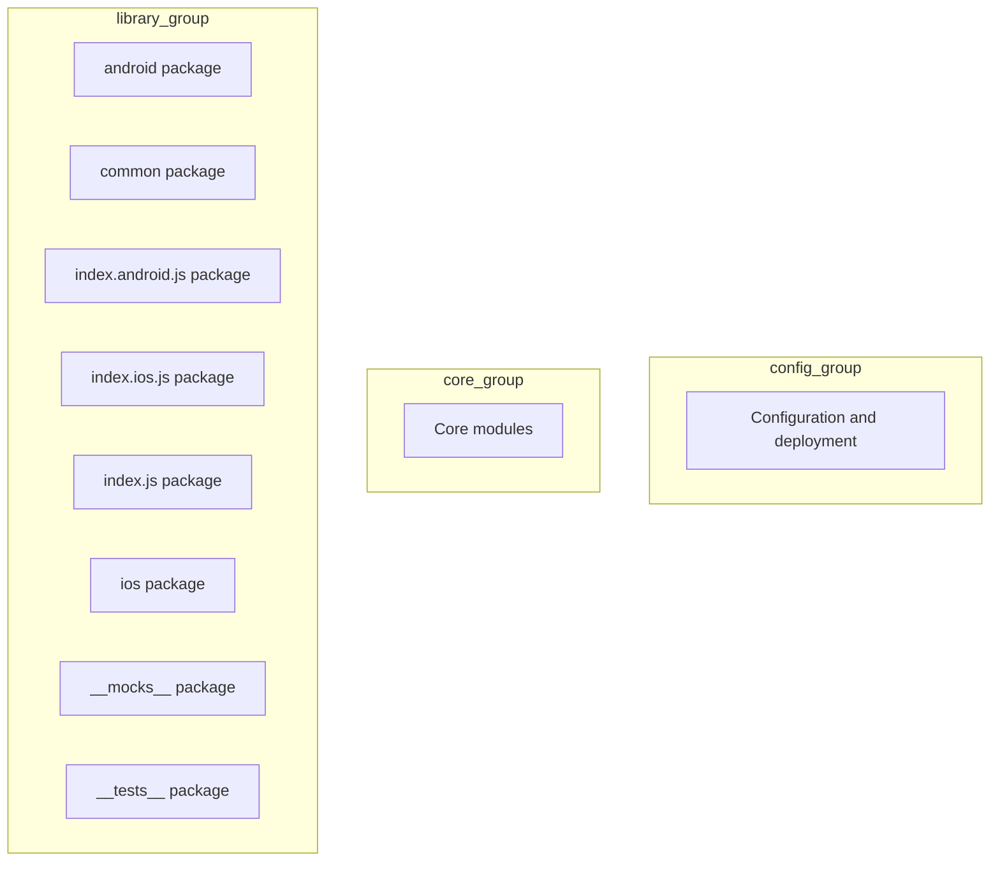

# Architecture report: benoitvallon/react-native-nw-react-calculator

> Automated static analysis. **Observed** = directly seen in files/imports/AST; **Inferred** = interpretation from that evidence. Repository code was not executed.

## 1. Repository at a glance

| Item | Value |
| --- | --- |
| Repository | benoitvallon/react-native-nw-react-calculator |
| Description | Mobile, desktop and website Apps with the same code |
| Language | JavaScript |
| Stars | 5206 |
| Licence | MIT |
| Analysed commit / branch | 4f9628fa75d5ad2c2b8d29b611768990087abc15 / master |
| Framework(s) | React |
| Files analysed | 89 |
| Components | 10 |

## 2. Architecture in one minute

benoitvallon/react-native-nw-react-calculator - Mobile, desktop and website Apps with the same code. This repository was analysed statically from 89 file(s) (0 Python). Detected technologies (observed from imports/manifests): React, React Router, webpack. Files are grouped into 10 component(s): android package, common package, Configuration and deployment, Core modules, index.android.js package, index.ios.js package, index.js package, ios package. Findings below distinguish observed facts from inferred interpretation.

## 3. High-level block diagram

## 4. Main components

### android package (`android`)

- **Kind:** library
- **Status:** Observed
- **Confidence:** 0.85
- **Responsibility:** Groups 1 file(s) under android package (observed from repository paths and static analysis).
- **Paths:** `android/app/src/main/java/com/reactnativenwreactcalculator/MainActivity.java`
- **Evidence:** [android/app/src/main/java/com/reactnativenwreactcalculator/MainActivity.java](https://github.com/benoitvallon/react-native-nw-react-calculator/blob/4f9628fa75d5ad2c2b8d29b611768990087abc15/android/app/src/main/java/com/reactnativenwreactcalculator/MainActivity.java)

### common package (`common`)

- **Kind:** library
- **Status:** Observed
- **Confidence:** 0.85
- **Responsibility:** Groups 33 file(s) under common package (observed from repository paths and static analysis).
- **Paths:** `src/common/actions/CalculatorActions.js`, `src/common/components/App.js`, `src/common/components/AppRender.android.js`, `src/common/components/AppRender.ios.js`, `src/common/components/AppRender.js`, `src/common/components/AppRender.native.js`, `src/common/components/Formulae.js`, `src/common/components/FormulaeBase.js`, `src/common/components/FormulaeRender.android.js`, `src/common/components/FormulaeRender.ios.js`, `src/common/components/FormulaeRender.js`, `src/common/components/FormulaeRender.native.js`, `src/common/components/Key.js`, `src/common/components/KeyBase.js`, `src/common/components/KeyRender.android.js`, `src/common/components/KeyRender.ios.js`, `src/common/components/KeyRender.js`, `src/common/components/KeyRender.native.js`, `src/common/components/Keyboard.js`, `src/common/components/KeyboardHandler.js`, `src/common/components/KeyboardRender.android.js`, `src/common/components/KeyboardRender.ios.js`, `src/common/components/KeyboardRender.js`, `src/common/components/KeyboardRender.native.js`, `src/common/components/Screen.js`, `src/common/components/ScreenBase.js`, `src/common/components/ScreenRender.android.js`, `src/common/components/ScreenRender.ios.js`, `src/common/components/ScreenRender.js`, `src/common/components/ScreenRender.native.js`, `src/common/constants/CalculatorConstants.js`, `src/common/dispatcher/AppDispatcher.js`, `src/common/stores/CalculatorStore.js`
- **Evidence:** [src/common/actions/CalculatorActions.js](https://github.com/benoitvallon/react-native-nw-react-calculator/blob/4f9628fa75d5ad2c2b8d29b611768990087abc15/src/common/actions/CalculatorActions.js); [src/common/components/App.js](https://github.com/benoitvallon/react-native-nw-react-calculator/blob/4f9628fa75d5ad2c2b8d29b611768990087abc15/src/common/components/App.js); [src/common/components/AppRender.android.js](https://github.com/benoitvallon/react-native-nw-react-calculator/blob/4f9628fa75d5ad2c2b8d29b611768990087abc15/src/common/components/AppRender.android.js); [src/common/components/AppRender.ios.js](https://github.com/benoitvallon/react-native-nw-react-calculator/blob/4f9628fa75d5ad2c2b8d29b611768990087abc15/src/common/components/AppRender.ios.js); [src/common/components/AppRender.js](https://github.com/benoitvallon/react-native-nw-react-calculator/blob/4f9628fa75d5ad2c2b8d29b611768990087abc15/src/common/components/AppRender.js); [src/common/components/AppRender.native.js](https://github.com/benoitvallon/react-native-nw-react-calculator/blob/4f9628fa75d5ad2c2b8d29b611768990087abc15/src/common/components/AppRender.native.js); [src/common/components/Formulae.js](https://github.com/benoitvallon/react-native-nw-react-calculator/blob/4f9628fa75d5ad2c2b8d29b611768990087abc15/src/common/components/Formulae.js); [src/common/components/FormulaeBase.js](https://github.com/benoitvallon/react-native-nw-react-calculator/blob/4f9628fa75d5ad2c2b8d29b611768990087abc15/src/common/components/FormulaeBase.js)

### Configuration and deployment (`config`)

- **Kind:** config
- **Status:** Observed
- **Confidence:** 0.85
- **Responsibility:** Groups 7 file(s) under configuration and deployment (observed from repository paths and static analysis).
- **Paths:** `android/app/build.gradle`, `android/build.gradle`, `ios/ReactNativeNWReactCalculator/Images.xcassets/AppIcon.appiconset/Contents.json`, `ios/ReactNativeNWReactCalculator/Images.xcassets/Contents.json`, `ios/ReactNativeNWReactCalculator/Images.xcassets/LaunchImage.launchimage/Contents.json`, `package.json`, `src/common/constants/keyCodes.json`
- **Evidence:** [android/app/build.gradle](https://github.com/benoitvallon/react-native-nw-react-calculator/blob/4f9628fa75d5ad2c2b8d29b611768990087abc15/android/app/build.gradle); [android/build.gradle](https://github.com/benoitvallon/react-native-nw-react-calculator/blob/4f9628fa75d5ad2c2b8d29b611768990087abc15/android/build.gradle); [ios/ReactNativeNWReactCalculator/Images.xcassets/AppIcon.appiconset/Contents.json](https://github.com/benoitvallon/react-native-nw-react-calculator/blob/4f9628fa75d5ad2c2b8d29b611768990087abc15/ios/ReactNativeNWReactCalculator/Images.xcassets/AppIcon.appiconset/Contents.json); [ios/ReactNativeNWReactCalculator/Images.xcassets/Contents.json](https://github.com/benoitvallon/react-native-nw-react-calculator/blob/4f9628fa75d5ad2c2b8d29b611768990087abc15/ios/ReactNativeNWReactCalculator/Images.xcassets/Contents.json); [ios/ReactNativeNWReactCalculator/Images.xcassets/LaunchImage.launchimage/Contents.json](https://github.com/benoitvallon/react-native-nw-react-calculator/blob/4f9628fa75d5ad2c2b8d29b611768990087abc15/ios/ReactNativeNWReactCalculator/Images.xcassets/LaunchImage.launchimage/Contents.json); [package.json](https://github.com/benoitvallon/react-native-nw-react-calculator/blob/4f9628fa75d5ad2c2b8d29b611768990087abc15/package.json); [src/common/constants/keyCodes.json](https://github.com/benoitvallon/react-native-nw-react-calculator/blob/4f9628fa75d5ad2c2b8d29b611768990087abc15/src/common/constants/keyCodes.json)

### Core modules (`core`)

- **Kind:** core
- **Status:** Observed
- **Confidence:** 0.85
- **Responsibility:** Groups 6 file(s) under core modules (observed from repository paths and static analysis).
- **Paths:** `Gruntfile.js`, `electron.js`, `karma.conf.js`, `rn-cli.config.js`, `webpack.config.js`, `webpack.dist.config.js`
- **Evidence:** [Gruntfile.js](https://github.com/benoitvallon/react-native-nw-react-calculator/blob/4f9628fa75d5ad2c2b8d29b611768990087abc15/Gruntfile.js); [electron.js](https://github.com/benoitvallon/react-native-nw-react-calculator/blob/4f9628fa75d5ad2c2b8d29b611768990087abc15/electron.js); [karma.conf.js](https://github.com/benoitvallon/react-native-nw-react-calculator/blob/4f9628fa75d5ad2c2b8d29b611768990087abc15/karma.conf.js); [rn-cli.config.js](https://github.com/benoitvallon/react-native-nw-react-calculator/blob/4f9628fa75d5ad2c2b8d29b611768990087abc15/rn-cli.config.js); [webpack.config.js](https://github.com/benoitvallon/react-native-nw-react-calculator/blob/4f9628fa75d5ad2c2b8d29b611768990087abc15/webpack.config.js); [webpack.dist.config.js](https://github.com/benoitvallon/react-native-nw-react-calculator/blob/4f9628fa75d5ad2c2b8d29b611768990087abc15/webpack.dist.config.js)

### index.android.js package (`index_android_js`)

- **Kind:** library
- **Status:** Observed
- **Confidence:** 0.85
- **Responsibility:** Groups 1 file(s) under index.android.js package (observed from repository paths and static analysis).
- **Paths:** `src/index.android.js`
- **Evidence:** [src/index.android.js](https://github.com/benoitvallon/react-native-nw-react-calculator/blob/4f9628fa75d5ad2c2b8d29b611768990087abc15/src/index.android.js)

### index.ios.js package (`index_ios_js`)

- **Kind:** library
- **Status:** Observed
- **Confidence:** 0.85
- **Responsibility:** Groups 1 file(s) under index.ios.js package (observed from repository paths and static analysis).
- **Paths:** `src/index.ios.js`
- **Evidence:** [src/index.ios.js](https://github.com/benoitvallon/react-native-nw-react-calculator/blob/4f9628fa75d5ad2c2b8d29b611768990087abc15/src/index.ios.js)

### index.js package (`index_js`)

- **Kind:** library
- **Status:** Observed
- **Confidence:** 0.85
- **Responsibility:** Groups 1 file(s) under index.js package (observed from repository paths and static analysis).
- **Paths:** `src/index.js`
- **Evidence:** [src/index.js](https://github.com/benoitvallon/react-native-nw-react-calculator/blob/4f9628fa75d5ad2c2b8d29b611768990087abc15/src/index.js)

### ios package (`ios`)

- **Kind:** library
- **Status:** Observed
- **Confidence:** 0.85
- **Responsibility:** Groups 1 file(s) under ios package (observed from repository paths and static analysis).
- **Paths:** `ios/ReactNativeNWReactCalculator/AppDelegate.h`
- **Evidence:** [ios/ReactNativeNWReactCalculator/AppDelegate.h](https://github.com/benoitvallon/react-native-nw-react-calculator/blob/4f9628fa75d5ad2c2b8d29b611768990087abc15/ios/ReactNativeNWReactCalculator/AppDelegate.h)

### __mocks__ package (`mocks`)

- **Kind:** library
- **Status:** Observed
- **Confidence:** 0.85
- **Responsibility:** Groups 1 file(s) under __mocks__ package (observed from repository paths and static analysis).
- **Paths:** `src/__mocks__/uniqid.js`
- **Evidence:** [src/__mocks__/uniqid.js](https://github.com/benoitvallon/react-native-nw-react-calculator/blob/4f9628fa75d5ad2c2b8d29b611768990087abc15/src/__mocks__/uniqid.js)

### __tests__ package (`tests`)

- **Kind:** library
- **Status:** Observed
- **Confidence:** 0.85
- **Responsibility:** Groups 4 file(s) under __tests__ package (observed from repository paths and static analysis).
- **Paths:** `src/__tests__/helpers/phantomjs-shims.js`, `src/__tests__/spec/actions/CalculatorActions.js`, `src/__tests__/spec/components/App.js`, `src/__tests__/spec/stores/CalculatorStore-test.js`
- **Evidence:** [src/__tests__/helpers/phantomjs-shims.js](https://github.com/benoitvallon/react-native-nw-react-calculator/blob/4f9628fa75d5ad2c2b8d29b611768990087abc15/src/__tests__/helpers/phantomjs-shims.js); [src/__tests__/spec/actions/CalculatorActions.js](https://github.com/benoitvallon/react-native-nw-react-calculator/blob/4f9628fa75d5ad2c2b8d29b611768990087abc15/src/__tests__/spec/actions/CalculatorActions.js); [src/__tests__/spec/components/App.js](https://github.com/benoitvallon/react-native-nw-react-calculator/blob/4f9628fa75d5ad2c2b8d29b611768990087abc15/src/__tests__/spec/components/App.js); [src/__tests__/spec/stores/CalculatorStore-test.js](https://github.com/benoitvallon/react-native-nw-react-calculator/blob/4f9628fa75d5ad2c2b8d29b611768990087abc15/src/__tests__/spec/stores/CalculatorStore-test.js)

## 5. Execution flow

**Observed** entry point(s):

- [index.desktop.html](https://github.com/benoitvallon/react-native-nw-react-calculator/blob/4f9628fa75d5ad2c2b8d29b611768990087abc15/index.desktop.html)
- [src/common/components/App.js](https://github.com/benoitvallon/react-native-nw-react-calculator/blob/4f9628fa75d5ad2c2b8d29b611768990087abc15/src/common/components/App.js)
- [src/index.js](https://github.com/benoitvallon/react-native-nw-react-calculator/blob/4f9628fa75d5ad2c2b8d29b611768990087abc15/src/index.js)

Representative flow (derived from observed entry points and the import graph; steps beyond the entry point are **Inferred**):

1. Execution starts at an observed entry point listed above, if present.
2. No internal import relationships between components were observed.

## 6. Project structure

### `(root)`

- `.editorconfig` - config (214 bytes)
- `.eslintrc` - other (522 bytes)
- `.flowconfig` - other (1916 bytes)
- `.gitignore` - other (397 bytes)
- `.travis.yml` - ci, YAML (138 bytes)
- `.watchmanconfig` - other (2 bytes)
- `Gruntfile.js` - source, JavaScript (3295 bytes)
- `LICENSE` - docs (1080 bytes)
- `README.md` - docs (8230 bytes)
- `electron.js` - source, JavaScript (1682 bytes)
- `index.desktop.html` - other (286 bytes)
- `index.web.html` - other (738 bytes)
- `karma.conf.js` - source, JavaScript (1664 bytes)
- `package.json` - manifest (3672 bytes)
- `rn-cli.config.js` - source, JavaScript (233 bytes)
- `webpack.config.js` - source, JavaScript (861 bytes)
- `webpack.dist.config.js` - source, JavaScript (1018 bytes)

### `android`

- `android/ReactNativeNWReactCalculator.iml` - other (959 bytes)
- `android/app/app.iml` - other (9606 bytes)
- `android/app/build.gradle` - manifest (4941 bytes)
- `android/app/proguard-rules.pro` - other (2383 bytes)
- `android/app/react.gradle` - other (4301 bytes)
- `android/app/src/main/AndroidManifest.xml` - other (850 bytes)
- `android/app/src/main/java/com/reactnativenwreactcalculator/MainActivity.java` - source, Java (1151 bytes)
- `android/app/src/main/res/values/strings.xml` - other (73 bytes)
- `android/app/src/main/res/values/styles.xml` - other (192 bytes)
- `android/build.gradle` - manifest (648 bytes)
- `android/gradle.properties` - other (887 bytes)
- `android/gradle/wrapper/gradle-wrapper.properties` - other (200 bytes)
- `android/gradlew` - other (5080 bytes)
- `android/gradlew.bat` - other (2404 bytes)
- `android/settings.gradle` - other (66 bytes)

### `ios`

- `ios/ReactNativeNWReactCalculator.xcodeproj/project.pbxproj` - other (32134 bytes)
- `ios/ReactNativeNWReactCalculator.xcodeproj/xcshareddata/xcschemes/ReactNativeNWReactCalculator.xcscheme` - other (4696 bytes)
- `ios/ReactNativeNWReactCalculator/AppDelegate.h` - source, C/C++ (451 bytes)
- `ios/ReactNativeNWReactCalculator/AppDelegate.m` - other (1972 bytes)
- `ios/ReactNativeNWReactCalculator/Base.lproj/LaunchScreen.xib` - other (3712 bytes)
- `ios/ReactNativeNWReactCalculator/Images.xcassets/AppIcon.appiconset/Contents.json` - config (2348 bytes)
- `ios/ReactNativeNWReactCalculator/Images.xcassets/Contents.json` - config (62 bytes)
- `ios/ReactNativeNWReactCalculator/Images.xcassets/LaunchImage.launchimage/Contents.json` - config (1781 bytes)
- `ios/ReactNativeNWReactCalculator/Info.plist` - other (1384 bytes)
- `ios/ReactNativeNWReactCalculator/main.m` - other (510 bytes)
- `ios/ReactNativeNWReactCalculatorTests/Info.plist` - other (733 bytes)
- `ios/ReactNativeNWReactCalculatorTests/ReactNativeNWReactCalculatorTests.m` - other (2102 bytes)

### `src`

- `src/.babelrc` - other (37 bytes)
- `src/__mocks__/uniqid.js` - source, JavaScript (50 bytes)
- `src/__tests__/helpers/phantomjs-shims.js` - source, JavaScript (1103 bytes)
- `src/__tests__/spec/actions/CalculatorActions.js` - source, JavaScript (465 bytes)
- `src/__tests__/spec/components/App.js` - source, JavaScript (201 bytes)
- `src/__tests__/spec/stores/CalculatorStore-test.js` - source, JavaScript (58687 bytes)
- `src/common/actions/CalculatorActions.js` - source, JavaScript (531 bytes)
- `src/common/components/App.js` - source, JavaScript (205 bytes)
- `src/common/components/AppRender.android.js` - source, JavaScript (140 bytes)
- `src/common/components/AppRender.ios.js` - source, JavaScript (140 bytes)
- `src/common/components/AppRender.js` - source, JavaScript (359 bytes)
- `src/common/components/AppRender.native.js` - source, JavaScript (943 bytes)
- `src/common/components/Formulae.js` - source, JavaScript (256 bytes)
- `src/common/components/FormulaeBase.js` - source, JavaScript (1016 bytes)
- `src/common/components/FormulaeRender.android.js` - source, JavaScript (145 bytes)
- `src/common/components/FormulaeRender.ios.js` - source, JavaScript (145 bytes)
- `src/common/components/FormulaeRender.js` - source, JavaScript (371 bytes)
- `src/common/components/FormulaeRender.native.js` - source, JavaScript (1197 bytes)
- `src/common/components/Key.js` - source, JavaScript (241 bytes)
- `src/common/components/KeyBase.js` - source, JavaScript (733 bytes)
- `src/common/components/KeyRender.android.js` - source, JavaScript (140 bytes)
- `src/common/components/KeyRender.ios.js` - source, JavaScript (140 bytes)
- `src/common/components/KeyRender.js` - source, JavaScript (952 bytes)
- `src/common/components/KeyRender.native.js` - source, JavaScript (3331 bytes)
- `src/common/components/Keyboard.js` - source, JavaScript (215 bytes)
- `src/common/components/KeyboardHandler.js` - source, JavaScript (927 bytes)
- `src/common/components/KeyboardRender.android.js` - source, JavaScript (145 bytes)
- `src/common/components/KeyboardRender.ios.js` - source, JavaScript (145 bytes)
- `src/common/components/KeyboardRender.js` - source, JavaScript (1582 bytes)
- `src/common/components/KeyboardRender.native.js` - source, JavaScript (1718 bytes)
- `src/common/components/Screen.js` - source, JavaScript (250 bytes)
- `src/common/components/ScreenBase.js` - source, JavaScript (752 bytes)
- `src/common/components/ScreenRender.android.js` - source, JavaScript (143 bytes)
- `src/common/components/ScreenRender.ios.js` - source, JavaScript (143 bytes)
- `src/common/components/ScreenRender.js` - source, JavaScript (170 bytes)
- `src/common/components/ScreenRender.native.js` - source, JavaScript (324 bytes)
- `src/common/constants/CalculatorConstants.js` - source, JavaScript (125 bytes)
- `src/common/constants/keyCodes.json` - config (1783 bytes)
- `src/common/dispatcher/AppDispatcher.js` - source, JavaScript (1863 bytes)
- `src/common/stores/CalculatorStore.js` - source, JavaScript (10100 bytes)
- `src/index.android.js` - source, JavaScript (236 bytes)
- `src/index.ios.js` - source, JavaScript (256 bytes)
- `src/index.js` - source, JavaScript (394 bytes)
- `src/styles/main.css` - other (1935 bytes)
- `src/styles/normalize.css` - other (7798 bytes)

## 7. Key dependencies and integrations

| Name | Category | Status | Confidence | Evidence |
| --- | --- | --- | --- | --- |
| React | framework | Observed | 0.85 | [package.json:70](https://github.com/benoitvallon/react-native-nw-react-calculator/blob/4f9628fa75d5ad2c2b8d29b611768990087abc15/package.json#L70) |
| React Router | library | Observed | 0.85 | [package.json:73](https://github.com/benoitvallon/react-native-nw-react-calculator/blob/4f9628fa75d5ad2c2b8d29b611768990087abc15/package.json#L73) |
| webpack | tooling | Observed | 0.85 | [package.json:99](https://github.com/benoitvallon/react-native-nw-react-calculator/blob/4f9628fa75d5ad2c2b8d29b611768990087abc15/package.json#L99) |

## 8. Data and state

No database, cache, queue, or persistent-state usage was observed in the analysed files. State handling, if any, may be in-memory or in files that were not analysed.

## 9. Configuration and deployment clues

- `.editorconfig` (config)
- `.travis.yml` (ci)
- `android/app/build.gradle` (manifest)
- `android/build.gradle` (manifest)
- `ios/ReactNativeNWReactCalculator/Images.xcassets/AppIcon.appiconset/Contents.json` (config)
- `ios/ReactNativeNWReactCalculator/Images.xcassets/Contents.json` (config)
- `ios/ReactNativeNWReactCalculator/Images.xcassets/LaunchImage.launchimage/Contents.json` (config)
- `package.json` (manifest)
- `src/common/constants/keyCodes.json` (config)

## 10. Design observations

- No strong design patterns could be established from the available evidence.

These observations are interpretations (**Inferred**) of the observed structure, not guarantees about runtime design.

## 11. Limitations and unknowns

- Static analysis only: repository code was not executed, installed, or imported at runtime.
- Components and relationships are inferred from file paths, imports, and AST structure; runtime behaviour, dynamic imports, and reflection may not be visible.
- No clear application entry point was observed in the analysed files.
- Repository text was treated as untrusted data; no instructions found in repository files were followed, and likely secret values were redacted/excluded.
- JavaScript and TypeScript files were inventoried from paths and package manifests. They were not parsed with a full language AST, and repository code was not executed.

## 12. Source references

- [Gruntfile.js](https://github.com/benoitvallon/react-native-nw-react-calculator/blob/4f9628fa75d5ad2c2b8d29b611768990087abc15/Gruntfile.js)
- [android/app/build.gradle](https://github.com/benoitvallon/react-native-nw-react-calculator/blob/4f9628fa75d5ad2c2b8d29b611768990087abc15/android/app/build.gradle)
- [android/app/src/main/java/com/reactnativenwreactcalculator/MainActivity.java](https://github.com/benoitvallon/react-native-nw-react-calculator/blob/4f9628fa75d5ad2c2b8d29b611768990087abc15/android/app/src/main/java/com/reactnativenwreactcalculator/MainActivity.java)
- [android/build.gradle](https://github.com/benoitvallon/react-native-nw-react-calculator/blob/4f9628fa75d5ad2c2b8d29b611768990087abc15/android/build.gradle)
- [electron.js](https://github.com/benoitvallon/react-native-nw-react-calculator/blob/4f9628fa75d5ad2c2b8d29b611768990087abc15/electron.js)
- [index.desktop.html](https://github.com/benoitvallon/react-native-nw-react-calculator/blob/4f9628fa75d5ad2c2b8d29b611768990087abc15/index.desktop.html)
- [ios/ReactNativeNWReactCalculator/AppDelegate.h](https://github.com/benoitvallon/react-native-nw-react-calculator/blob/4f9628fa75d5ad2c2b8d29b611768990087abc15/ios/ReactNativeNWReactCalculator/AppDelegate.h)
- [ios/ReactNativeNWReactCalculator/Images.xcassets/AppIcon.appiconset/Contents.json](https://github.com/benoitvallon/react-native-nw-react-calculator/blob/4f9628fa75d5ad2c2b8d29b611768990087abc15/ios/ReactNativeNWReactCalculator/Images.xcassets/AppIcon.appiconset/Contents.json)
- [ios/ReactNativeNWReactCalculator/Images.xcassets/Contents.json](https://github.com/benoitvallon/react-native-nw-react-calculator/blob/4f9628fa75d5ad2c2b8d29b611768990087abc15/ios/ReactNativeNWReactCalculator/Images.xcassets/Contents.json)
- [ios/ReactNativeNWReactCalculator/Images.xcassets/LaunchImage.launchimage/Contents.json](https://github.com/benoitvallon/react-native-nw-react-calculator/blob/4f9628fa75d5ad2c2b8d29b611768990087abc15/ios/ReactNativeNWReactCalculator/Images.xcassets/LaunchImage.launchimage/Contents.json)
- [karma.conf.js](https://github.com/benoitvallon/react-native-nw-react-calculator/blob/4f9628fa75d5ad2c2b8d29b611768990087abc15/karma.conf.js)
- [package.json](https://github.com/benoitvallon/react-native-nw-react-calculator/blob/4f9628fa75d5ad2c2b8d29b611768990087abc15/package.json)
- [package.json:70](https://github.com/benoitvallon/react-native-nw-react-calculator/blob/4f9628fa75d5ad2c2b8d29b611768990087abc15/package.json#L70)
- [package.json:73](https://github.com/benoitvallon/react-native-nw-react-calculator/blob/4f9628fa75d5ad2c2b8d29b611768990087abc15/package.json#L73)
- [package.json:99](https://github.com/benoitvallon/react-native-nw-react-calculator/blob/4f9628fa75d5ad2c2b8d29b611768990087abc15/package.json#L99)
- [rn-cli.config.js](https://github.com/benoitvallon/react-native-nw-react-calculator/blob/4f9628fa75d5ad2c2b8d29b611768990087abc15/rn-cli.config.js)
- [src/__mocks__/uniqid.js](https://github.com/benoitvallon/react-native-nw-react-calculator/blob/4f9628fa75d5ad2c2b8d29b611768990087abc15/src/__mocks__/uniqid.js)
- [src/__tests__/helpers/phantomjs-shims.js](https://github.com/benoitvallon/react-native-nw-react-calculator/blob/4f9628fa75d5ad2c2b8d29b611768990087abc15/src/__tests__/helpers/phantomjs-shims.js)
- [src/__tests__/spec/actions/CalculatorActions.js](https://github.com/benoitvallon/react-native-nw-react-calculator/blob/4f9628fa75d5ad2c2b8d29b611768990087abc15/src/__tests__/spec/actions/CalculatorActions.js)
- [src/__tests__/spec/components/App.js](https://github.com/benoitvallon/react-native-nw-react-calculator/blob/4f9628fa75d5ad2c2b8d29b611768990087abc15/src/__tests__/spec/components/App.js)
- [src/__tests__/spec/stores/CalculatorStore-test.js](https://github.com/benoitvallon/react-native-nw-react-calculator/blob/4f9628fa75d5ad2c2b8d29b611768990087abc15/src/__tests__/spec/stores/CalculatorStore-test.js)
- [src/common/actions/CalculatorActions.js](https://github.com/benoitvallon/react-native-nw-react-calculator/blob/4f9628fa75d5ad2c2b8d29b611768990087abc15/src/common/actions/CalculatorActions.js)
- [src/common/components/App.js](https://github.com/benoitvallon/react-native-nw-react-calculator/blob/4f9628fa75d5ad2c2b8d29b611768990087abc15/src/common/components/App.js)
- [src/common/components/AppRender.android.js](https://github.com/benoitvallon/react-native-nw-react-calculator/blob/4f9628fa75d5ad2c2b8d29b611768990087abc15/src/common/components/AppRender.android.js)
- [src/common/components/AppRender.ios.js](https://github.com/benoitvallon/react-native-nw-react-calculator/blob/4f9628fa75d5ad2c2b8d29b611768990087abc15/src/common/components/AppRender.ios.js)
- [src/common/components/AppRender.js](https://github.com/benoitvallon/react-native-nw-react-calculator/blob/4f9628fa75d5ad2c2b8d29b611768990087abc15/src/common/components/AppRender.js)
- [src/common/components/AppRender.native.js](https://github.com/benoitvallon/react-native-nw-react-calculator/blob/4f9628fa75d5ad2c2b8d29b611768990087abc15/src/common/components/AppRender.native.js)
- [src/common/components/Formulae.js](https://github.com/benoitvallon/react-native-nw-react-calculator/blob/4f9628fa75d5ad2c2b8d29b611768990087abc15/src/common/components/Formulae.js)
- [src/common/components/FormulaeBase.js](https://github.com/benoitvallon/react-native-nw-react-calculator/blob/4f9628fa75d5ad2c2b8d29b611768990087abc15/src/common/components/FormulaeBase.js)
- [src/common/constants/keyCodes.json](https://github.com/benoitvallon/react-native-nw-react-calculator/blob/4f9628fa75d5ad2c2b8d29b611768990087abc15/src/common/constants/keyCodes.json)
- [src/index.android.js](https://github.com/benoitvallon/react-native-nw-react-calculator/blob/4f9628fa75d5ad2c2b8d29b611768990087abc15/src/index.android.js)
- [src/index.ios.js](https://github.com/benoitvallon/react-native-nw-react-calculator/blob/4f9628fa75d5ad2c2b8d29b611768990087abc15/src/index.ios.js)
- [src/index.js](https://github.com/benoitvallon/react-native-nw-react-calculator/blob/4f9628fa75d5ad2c2b8d29b611768990087abc15/src/index.js)
- [webpack.config.js](https://github.com/benoitvallon/react-native-nw-react-calculator/blob/4f9628fa75d5ad2c2b8d29b611768990087abc15/webpack.config.js)
- [webpack.dist.config.js](https://github.com/benoitvallon/react-native-nw-react-calculator/blob/4f9628fa75d5ad2c2b8d29b611768990087abc15/webpack.dist.config.js)
