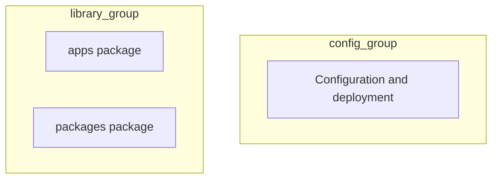

# Architecture report: bernaferrari/FigmaToCode

> Automated static analysis. **Observed** = directly seen in files/imports/AST; **Inferred** = interpretation from that evidence. Repository code was not executed.

## 1. Repository at a glance

| Item | Value |
| --- | --- |
| Repository | bernaferrari/FigmaToCode |
| Description | Generate responsive pages and apps on HTML, Tailwind, Flutter and SwiftUI. |
| Language | TypeScript |
| Stars | 5269 |
| Licence | GPL-3.0 |
| Analysed commit / branch | f5c4831d5de6cffc19a73fe2823c56b4bb551281 / main |
| Framework(s) | Next.js, React |
| Files analysed | 188 |
| Components | 3 |

## 2. Architecture in one minute

bernaferrari/FigmaToCode - Generate responsive pages and apps on HTML, Tailwind, Flutter and SwiftUI.. This repository was analysed statically from 188 file(s) (0 Python). Detected technologies (observed from imports/manifests): GitHub Actions, Next.js, React, Tailwind CSS, TypeScript, Vite. Files are grouped into 3 component(s): apps package, Configuration and deployment, packages package. Findings below distinguish observed facts from inferred interpretation.

## 3. High-level block diagram

## 4. Main components

### apps package (`apps`)

- **Kind:** library
- **Status:** Observed
- **Confidence:** 0.85
- **Responsibility:** Groups 28 file(s) under apps package (observed from repository paths and static analysis).
- **Paths:** `apps/plugin/plugin-src/code.ts`, `apps/plugin/postcss.config.mjs`, `apps/plugin/ui-src/App.tsx`, `apps/plugin/ui-src/main.tsx`, `apps/plugin/ui-src/messaging.ts`, `apps/plugin/vite-env.d.ts`, `apps/plugin/vite.config.ts`, `apps/web/app/FAQAccordion.tsx`, `apps/web/app/MarketingShell.tsx`, `apps/web/app/PreviewLab.tsx`, `apps/web/app/SectionLink.tsx`, `apps/web/app/ThemeProvider.tsx`, `apps/web/app/ThemeToggle.tsx`, `apps/web/app/compare/[slug]/page.tsx`, `apps/web/app/comparisons.ts`, `apps/web/app/layout.tsx`, `apps/web/app/manifest.ts`, `apps/web/app/marketingStyles.ts`, `apps/web/app/page.tsx`, `apps/web/app/privacy/page.tsx`, `apps/web/app/robots.ts`, `apps/web/app/site.ts`, `apps/web/app/sitemap.ts`, `apps/web/components/ui/accordion.tsx`, `apps/web/lib/utils.ts`, `apps/web/next-env.d.ts`, `apps/web/next.config.mjs`, `apps/web/postcss.config.js`
- **Evidence:** [apps/plugin/plugin-src/code.ts](https://github.com/bernaferrari/FigmaToCode/blob/f5c4831d5de6cffc19a73fe2823c56b4bb551281/apps/plugin/plugin-src/code.ts); [apps/plugin/postcss.config.mjs](https://github.com/bernaferrari/FigmaToCode/blob/f5c4831d5de6cffc19a73fe2823c56b4bb551281/apps/plugin/postcss.config.mjs); [apps/plugin/ui-src/App.tsx](https://github.com/bernaferrari/FigmaToCode/blob/f5c4831d5de6cffc19a73fe2823c56b4bb551281/apps/plugin/ui-src/App.tsx); [apps/plugin/ui-src/main.tsx](https://github.com/bernaferrari/FigmaToCode/blob/f5c4831d5de6cffc19a73fe2823c56b4bb551281/apps/plugin/ui-src/main.tsx); [apps/plugin/ui-src/messaging.ts](https://github.com/bernaferrari/FigmaToCode/blob/f5c4831d5de6cffc19a73fe2823c56b4bb551281/apps/plugin/ui-src/messaging.ts); [apps/plugin/vite-env.d.ts](https://github.com/bernaferrari/FigmaToCode/blob/f5c4831d5de6cffc19a73fe2823c56b4bb551281/apps/plugin/vite-env.d.ts); [apps/plugin/vite.config.ts](https://github.com/bernaferrari/FigmaToCode/blob/f5c4831d5de6cffc19a73fe2823c56b4bb551281/apps/plugin/vite.config.ts); [apps/web/app/FAQAccordion.tsx](https://github.com/bernaferrari/FigmaToCode/blob/f5c4831d5de6cffc19a73fe2823c56b4bb551281/apps/web/app/FAQAccordion.tsx)

### Configuration and deployment (`config`)

- **Kind:** config
- **Status:** Observed
- **Confidence:** 0.85
- **Responsibility:** Groups 23 file(s) under configuration and deployment (observed from repository paths and static analysis).
- **Paths:** `apps/plugin/package.json`, `apps/plugin/plugin-src/tsconfig.json`, `apps/plugin/tsconfig.json`, `apps/web/.env.example`, `apps/web/components.json`, `apps/web/package.json`, `apps/web/tsconfig.json`, `manifest.json`, `package.json`, `packages/backend/package.json`, `packages/backend/tsconfig.json`, `packages/plugin-ui/package.json`, `packages/plugin-ui/tsconfig.json`, `packages/tsconfig/backend.json`, `packages/tsconfig/base.json`, `packages/tsconfig/nextjs.json`, `packages/tsconfig/package.json`, `packages/tsconfig/react-library.json`, `packages/types/package.json`, `packages/types/tsconfig.json`, `pnpm-workspace.yaml`, `tsconfig.json`, `turbo.json`
- **Evidence:** [apps/plugin/package.json](https://github.com/bernaferrari/FigmaToCode/blob/f5c4831d5de6cffc19a73fe2823c56b4bb551281/apps/plugin/package.json); [apps/plugin/plugin-src/tsconfig.json](https://github.com/bernaferrari/FigmaToCode/blob/f5c4831d5de6cffc19a73fe2823c56b4bb551281/apps/plugin/plugin-src/tsconfig.json); [apps/plugin/tsconfig.json](https://github.com/bernaferrari/FigmaToCode/blob/f5c4831d5de6cffc19a73fe2823c56b4bb551281/apps/plugin/tsconfig.json); [apps/web/.env.example](https://github.com/bernaferrari/FigmaToCode/blob/f5c4831d5de6cffc19a73fe2823c56b4bb551281/apps/web/.env.example); [apps/web/components.json](https://github.com/bernaferrari/FigmaToCode/blob/f5c4831d5de6cffc19a73fe2823c56b4bb551281/apps/web/components.json); [apps/web/package.json](https://github.com/bernaferrari/FigmaToCode/blob/f5c4831d5de6cffc19a73fe2823c56b4bb551281/apps/web/package.json); [apps/web/tsconfig.json](https://github.com/bernaferrari/FigmaToCode/blob/f5c4831d5de6cffc19a73fe2823c56b4bb551281/apps/web/tsconfig.json); [manifest.json](https://github.com/bernaferrari/FigmaToCode/blob/f5c4831d5de6cffc19a73fe2823c56b4bb551281/manifest.json)

### packages package (`packages`)

- **Kind:** library
- **Status:** Observed
- **Confidence:** 0.85
- **Responsibility:** Groups 120 file(s) under packages package (observed from repository paths and static analysis).
- **Paths:** `packages/backend/src/altNodes/altNodeUtils.ts`, `packages/backend/src/altNodes/iconDetection.ts`, `packages/backend/src/altNodes/jsonNodeConversion.ts`, `packages/backend/src/altNodes/oldAltConversion.ts`, `packages/backend/src/alt_api_types.ts`, `packages/backend/src/api_types.ts`, `packages/backend/src/code.ts`, `packages/backend/src/common/color.ts`, `packages/backend/src/common/commonConversionWarnings.ts`, `packages/backend/src/common/commonFormatAttributes.ts`, `packages/backend/src/common/commonPadding.ts`, `packages/backend/src/common/commonPosition.ts`, `packages/backend/src/common/commonRadius.ts`, `packages/backend/src/common/commonStroke.ts`, `packages/backend/src/common/commonTextHeightSpacing.ts`, `packages/backend/src/common/convertFontWeight.ts`, `packages/backend/src/common/curry.ts`, `packages/backend/src/common/exportAsyncProxy.ts`, `packages/backend/src/common/images.ts`, `packages/backend/src/common/indentString.ts`, `packages/backend/src/common/lowercaseFirstLetter.ts`, `packages/backend/src/common/nodeVisibility.ts`, `packages/backend/src/common/nodeWidthHeight.ts`, `packages/backend/src/common/numToAutoFixed.ts`, `packages/backend/src/common/parentCoordinates.ts`, `packages/backend/src/common/parseJSX.ts`, `packages/backend/src/common/retrieveFill.ts`, `packages/backend/src/common/retrieveUI/commonUI.ts`, `packages/backend/src/common/retrieveUI/convertToCode.ts`, `packages/backend/src/common/retrieveUI/retrieveColors.ts`, `packages/backend/src/compose/builderImpl/composeAutoLayout.ts`, `packages/backend/src/compose/builderImpl/composeBlend.ts`, `packages/backend/src/compose/builderImpl/composeBorder.ts`, `packages/backend/src/compose/builderImpl/composeColor.ts`, `packages/backend/src/compose/builderImpl/composePadding.ts`, `packages/backend/src/compose/builderImpl/composeShadow.ts`, `packages/backend/src/compose/builderImpl/composeSize.ts`, `packages/backend/src/compose/composeContainer.ts`, `packages/backend/src/compose/composeDefaultBuilder.ts`, `packages/backend/src/compose/composeMain.ts`, `packages/backend/src/compose/composeTextBuilder.ts`, `packages/backend/src/flutter/builderImpl/flutterAutoLayout.ts`, `packages/backend/src/flutter/builderImpl/flutterBlend.ts`, `packages/backend/src/flutter/builderImpl/flutterBorder.ts`, `packages/backend/src/flutter/builderImpl/flutterColor.ts`, `packages/backend/src/flutter/builderImpl/flutterPadding.ts`, `packages/backend/src/flutter/builderImpl/flutterShadow.ts`, `packages/backend/src/flutter/builderImpl/flutterSize.ts`, `packages/backend/src/flutter/flutterContainer.ts`, `packages/backend/src/flutter/flutterDefaultBuilder.ts`, `packages/backend/src/flutter/flutterMain.ts`, `packages/backend/src/flutter/flutterTextBuilder.ts`, `packages/backend/src/html/builderImpl/htmlAutoLayout.ts`, `packages/backend/src/html/builderImpl/htmlBlend.ts`, `packages/backend/src/html/builderImpl/htmlBorderRadius.ts`, `packages/backend/src/html/builderImpl/htmlColor.ts`, `packages/backend/src/html/builderImpl/htmlPadding.ts`, `packages/backend/src/html/builderImpl/htmlShadow.ts`, `packages/backend/src/html/builderImpl/htmlSize.ts`, `packages/backend/src/html/htmlDefaultBuilder.ts`, `packages/backend/src/html/htmlMain.ts`, `packages/backend/src/html/htmlTextBuilder.ts`, `packages/backend/src/index.ts`, `packages/backend/src/messaging.ts`, `packages/backend/src/nearest-color/nearestColor.ts`, `packages/backend/src/swiftui/builderImpl/swiftuiBlend.ts`, `packages/backend/src/swiftui/builderImpl/swiftuiBorder.ts`, `packages/backend/src/swiftui/builderImpl/swiftuiColor.ts`, `packages/backend/src/swiftui/builderImpl/swiftuiEffects.ts`, `packages/backend/src/swiftui/builderImpl/swiftuiPadding.ts`, `packages/backend/src/swiftui/builderImpl/swiftuiParser.ts`, `packages/backend/src/swiftui/builderImpl/swiftuiSize.ts`, `packages/backend/src/swiftui/builderImpl/swiftuiTextWeight.ts`, `packages/backend/src/swiftui/swiftuiDefaultBuilder.ts`, `packages/backend/src/swiftui/swiftuiMain.ts`, `packages/backend/src/swiftui/swiftuiTextBuilder.ts`, `packages/backend/src/tailwind/builderImpl/tailwindAutoLayout.ts`, `packages/backend/src/tailwind/builderImpl/tailwindBlend.ts`, `packages/backend/src/tailwind/builderImpl/tailwindBorder.ts`, `packages/backend/src/tailwind/builderImpl/tailwindColor.ts`, `packages/backend/src/tailwind/builderImpl/tailwindPadding.ts`, `packages/backend/src/tailwind/builderImpl/tailwindShadow.ts`, `packages/backend/src/tailwind/builderImpl/tailwindSize.ts`, `packages/backend/src/tailwind/conversionTables.ts`, `packages/backend/src/tailwind/tailwindConfig.ts`, `packages/backend/src/tailwind/tailwindDefaultBuilder.ts`, `packages/backend/src/tailwind/tailwindMain.ts`, `packages/backend/src/tailwind/tailwindTextBuilder.ts`, `packages/backend/src/zipGenerator.test.ts`, `packages/backend/src/zipGenerator.ts`, `packages/plugin-ui/src/PluginUI.tsx`, `packages/plugin-ui/src/codegenPreferenceOptions.ts`, `packages/plugin-ui/src/components/About.tsx`, `packages/plugin-ui/src/components/CodePanel.tsx`, `packages/plugin-ui/src/components/ColorsPanel.tsx`, `packages/plugin-ui/src/components/CopyButton.tsx`, `packages/plugin-ui/src/components/CustomPrefixInput.tsx`, `packages/plugin-ui/src/components/DownloadMenu.tsx`, `packages/plugin-ui/src/components/EmptyState.tsx`, `packages/plugin-ui/src/components/ExpandIcon.tsx`, `packages/plugin-ui/src/components/FrameworkTabs.tsx`, `packages/plugin-ui/src/components/GradientsPanel.tsx`, `packages/plugin-ui/src/components/Loading.tsx`, `packages/plugin-ui/src/components/Preview.tsx`, `packages/plugin-ui/src/components/SelectableToggle.tsx`, `packages/plugin-ui/src/components/SettingsGroup.tsx`, `packages/plugin-ui/src/components/TailwindSettings.tsx`, `packages/plugin-ui/src/components/WarningsPanel.tsx`, `packages/plugin-ui/src/components/ui/badge.tsx`, `packages/plugin-ui/src/components/ui/button.tsx`, `packages/plugin-ui/src/components/ui/card.tsx`, `packages/plugin-ui/src/components/ui/checkbox.tsx`, `packages/plugin-ui/src/components/ui/collapsible.tsx`, `packages/plugin-ui/src/components/ui/popover.tsx`, `packages/plugin-ui/src/components/ui/scroll-area.tsx`, `packages/plugin-ui/src/components/ui/tooltip.tsx`, `packages/plugin-ui/src/index.tsx`, `packages/plugin-ui/src/lib/utils.ts`, `packages/types/src/index.ts`, `packages/types/src/types.ts`
- **Evidence:** [packages/backend/src/altNodes/altNodeUtils.ts](https://github.com/bernaferrari/FigmaToCode/blob/f5c4831d5de6cffc19a73fe2823c56b4bb551281/packages/backend/src/altNodes/altNodeUtils.ts); [packages/backend/src/altNodes/iconDetection.ts](https://github.com/bernaferrari/FigmaToCode/blob/f5c4831d5de6cffc19a73fe2823c56b4bb551281/packages/backend/src/altNodes/iconDetection.ts); [packages/backend/src/altNodes/jsonNodeConversion.ts](https://github.com/bernaferrari/FigmaToCode/blob/f5c4831d5de6cffc19a73fe2823c56b4bb551281/packages/backend/src/altNodes/jsonNodeConversion.ts); [packages/backend/src/altNodes/oldAltConversion.ts](https://github.com/bernaferrari/FigmaToCode/blob/f5c4831d5de6cffc19a73fe2823c56b4bb551281/packages/backend/src/altNodes/oldAltConversion.ts); [packages/backend/src/alt_api_types.ts](https://github.com/bernaferrari/FigmaToCode/blob/f5c4831d5de6cffc19a73fe2823c56b4bb551281/packages/backend/src/alt_api_types.ts); [packages/backend/src/api_types.ts](https://github.com/bernaferrari/FigmaToCode/blob/f5c4831d5de6cffc19a73fe2823c56b4bb551281/packages/backend/src/api_types.ts); [packages/backend/src/code.ts](https://github.com/bernaferrari/FigmaToCode/blob/f5c4831d5de6cffc19a73fe2823c56b4bb551281/packages/backend/src/code.ts); [packages/backend/src/common/color.ts](https://github.com/bernaferrari/FigmaToCode/blob/f5c4831d5de6cffc19a73fe2823c56b4bb551281/packages/backend/src/common/color.ts)

## 5. Execution flow

**Observed** entry point(s):

- [apps/plugin/ui-src/App.tsx](https://github.com/bernaferrari/FigmaToCode/blob/f5c4831d5de6cffc19a73fe2823c56b4bb551281/apps/plugin/ui-src/App.tsx)
- [apps/plugin/ui-src/main.tsx](https://github.com/bernaferrari/FigmaToCode/blob/f5c4831d5de6cffc19a73fe2823c56b4bb551281/apps/plugin/ui-src/main.tsx)
- [apps/web/app/page.tsx](https://github.com/bernaferrari/FigmaToCode/blob/f5c4831d5de6cffc19a73fe2823c56b4bb551281/apps/web/app/page.tsx)
- [packages/backend/src/index.ts](https://github.com/bernaferrari/FigmaToCode/blob/f5c4831d5de6cffc19a73fe2823c56b4bb551281/packages/backend/src/index.ts)
- [packages/plugin-ui/src/index.tsx](https://github.com/bernaferrari/FigmaToCode/blob/f5c4831d5de6cffc19a73fe2823c56b4bb551281/packages/plugin-ui/src/index.tsx)
- [packages/types/src/index.ts](https://github.com/bernaferrari/FigmaToCode/blob/f5c4831d5de6cffc19a73fe2823c56b4bb551281/packages/types/src/index.ts)

Representative flow (derived from observed entry points and the import graph; steps beyond the entry point are **Inferred**):

1. Execution starts at an observed entry point listed above, if present.
2. No internal import relationships between components were observed.

## 6. Project structure

### `(root)`

- `.eslintrc.js` - source, JavaScript (573 bytes)
- `.gitignore` - other (304 bytes)
- `.node-version` - other (3 bytes)
- `.oxfmtrc.json` - config (145 bytes)
- `.oxlintrc.json` - config (917 bytes)
- `.vercelignore` - other (113 bytes)
- `LICENSE` - docs (35148 bytes)
- `README.md` - docs (9205 bytes)
- `manifest.json` - config (843 bytes)
- `package.json` - manifest (627 bytes)
- `pnpm-workspace.yaml` - config (125 bytes)
- `tsconfig.json` - config (253 bytes)
- `turbo.json` - config (360 bytes)

### `.github`

- `.github/ISSUE_TEMPLATE/bug_report.yaml` - config (1885 bytes)
- `.github/workflows/test.yml` - ci, YAML (448 bytes)

### `apps`

- `apps/plugin/.gitignore` - other (386 bytes)
- `apps/plugin/README.md` - docs (725 bytes)
- `apps/plugin/package.json` - manifest (1393 bytes)
- `apps/plugin/plugin-src/code.ts` - source, TypeScript (21820 bytes)
- `apps/plugin/plugin-src/tsconfig.json` - config (136 bytes)
- `apps/plugin/postcss.config.mjs` - source, JavaScript (70 bytes)
- `apps/plugin/tsconfig.json` - config (178 bytes)
- `apps/plugin/ui-src/App.tsx` - source, TypeScript (6750 bytes)
- `apps/plugin/ui-src/index.css` - other (4208 bytes)
- `apps/plugin/ui-src/index.html` - other (297 bytes)
- `apps/plugin/ui-src/main.tsx` - source, TypeScript (160 bytes)
- `apps/plugin/ui-src/messaging.ts` - source, TypeScript (706 bytes)
- `apps/plugin/vite-env.d.ts` - source, TypeScript (38 bytes)
- `apps/plugin/vite.config.ts` - source, TypeScript (469 bytes)
- `apps/web/.env.example` - config (179 bytes)
- `apps/web/.gitignore` - other (386 bytes)
- `apps/web/README.md` - docs (967 bytes)
- `apps/web/app/FAQAccordion.tsx` - source, TypeScript (932 bytes)
- `apps/web/app/MarketingShell.tsx` - source, TypeScript (7915 bytes)
- `apps/web/app/PreviewLab.tsx` - source, TypeScript (16522 bytes)
- `apps/web/app/SectionLink.tsx` - source, TypeScript (1029 bytes)
- `apps/web/app/ThemeProvider.tsx` - source, TypeScript (264 bytes)
- `apps/web/app/ThemeToggle.tsx` - source, TypeScript (1177 bytes)
- `apps/web/app/compare/[slug]/page.tsx` - source, TypeScript (11171 bytes)
- `apps/web/app/comparisons.ts` - source, TypeScript (8833 bytes)
- `apps/web/app/layout.tsx` - source, TypeScript (2457 bytes)
- `apps/web/app/manifest.ts` - source, TypeScript (454 bytes)
- `apps/web/app/marketingStyles.ts` - source, TypeScript (18112 bytes)
- `apps/web/app/page.tsx` - source, TypeScript (33913 bytes)
- `apps/web/app/privacy/page.tsx` - source, TypeScript (14112 bytes)
- `apps/web/app/robots.ts` - source, TypeScript (289 bytes)
- `apps/web/app/site.ts` - source, TypeScript (801 bytes)
- `apps/web/app/sitemap.ts` - source, TypeScript (571 bytes)
- `apps/web/components.json` - config (503 bytes)
- `apps/web/components/ui/accordion.tsx` - source, TypeScript (2787 bytes)
- `apps/web/lib/utils.ts` - source, TypeScript (169 bytes)
- `apps/web/next-env.d.ts` - source, TypeScript (247 bytes)
- `apps/web/next.config.mjs` - source, JavaScript (750 bytes)
- `apps/web/package.json` - manifest (851 bytes)
- `apps/web/postcss.config.js` - source, JavaScript (72 bytes)
- `apps/web/styles/globals.css` - other (4986 bytes)
- `apps/web/tsconfig.json` - config (219 bytes)

### `packages`

- `packages/backend/package.json` - manifest (745 bytes)
- `packages/backend/src/altNodes/altNodeUtils.ts` - source, TypeScript (4212 bytes)
- `packages/backend/src/altNodes/iconDetection.ts` - source, TypeScript (9197 bytes)
- `packages/backend/src/altNodes/jsonNodeConversion.ts` - source, TypeScript (22410 bytes)
- `packages/backend/src/altNodes/oldAltConversion.ts` - source, TypeScript (5176 bytes)
- `packages/backend/src/alt_api_types.ts` - source, TypeScript (339 bytes)
- `packages/backend/src/api_types.ts` - source, TypeScript (168714 bytes)
- `packages/backend/src/code.ts` - source, TypeScript (5545 bytes)
- `packages/backend/src/common/color.ts` - source, TypeScript (4886 bytes)
- `packages/backend/src/common/commonConversionWarnings.ts` - source, TypeScript (281 bytes)
- `packages/backend/src/common/commonFormatAttributes.ts` - source, TypeScript (1106 bytes)
- `packages/backend/src/common/commonPadding.ts` - source, TypeScript (991 bytes)
- `packages/backend/src/common/commonPosition.ts` - source, TypeScript (2978 bytes)
- `packages/backend/src/common/commonRadius.ts` - source, TypeScript (1096 bytes)
- `packages/backend/src/common/commonStroke.ts` - source, TypeScript (874 bytes)
- `packages/backend/src/common/commonTextHeightSpacing.ts` - source, TypeScript (554 bytes)
- `packages/backend/src/common/convertFontWeight.ts` - source, TypeScript (770 bytes)
- `packages/backend/src/common/curry.ts` - source, TypeScript (311 bytes)
- `packages/backend/src/common/exportAsyncProxy.ts` - source, TypeScript (1636 bytes)
- `packages/backend/src/common/images.ts` - source, TypeScript (3162 bytes)
- `packages/backend/src/common/indentString.ts` - source, TypeScript (675 bytes)
- `packages/backend/src/common/lowercaseFirstLetter.ts` - source, TypeScript (170 bytes)
- `packages/backend/src/common/nodeVisibility.ts` - source, TypeScript (106 bytes)
- `packages/backend/src/common/nodeWidthHeight.ts` - source, TypeScript (589 bytes)
- `packages/backend/src/common/numToAutoFixed.ts` - source, TypeScript (2984 bytes)
- `packages/backend/src/common/parentCoordinates.ts` - source, TypeScript (506 bytes)
- `packages/backend/src/common/parseJSX.ts` - source, TypeScript (1420 bytes)
- `packages/backend/src/common/retrieveFill.ts` - source, TypeScript (540 bytes)
- `packages/backend/src/common/retrieveUI/commonUI.ts` - source, TypeScript (1029 bytes)
- `packages/backend/src/common/retrieveUI/convertToCode.ts` - source, TypeScript (808 bytes)
- `packages/backend/src/common/retrieveUI/retrieveColors.ts` - source, TypeScript (4563 bytes)
- `packages/backend/src/compose/builderImpl/composeAutoLayout.ts` - source, TypeScript (2941 bytes)
- `packages/backend/src/compose/builderImpl/composeBlend.ts` - source, TypeScript (2947 bytes)
- `packages/backend/src/compose/builderImpl/composeBorder.ts` - source, TypeScript (5769 bytes)
- `packages/backend/src/compose/builderImpl/composeColor.ts` - source, TypeScript (1230 bytes)
- `packages/backend/src/compose/builderImpl/composePadding.ts` - source, TypeScript (1846 bytes)
- `packages/backend/src/compose/builderImpl/composeShadow.ts` - source, TypeScript (4278 bytes)
- `packages/backend/src/compose/builderImpl/composeSize.ts` - source, TypeScript (1404 bytes)
- `packages/backend/src/compose/composeContainer.ts` - source, TypeScript (2984 bytes)
- `packages/backend/src/compose/composeDefaultBuilder.ts` - source, TypeScript (1320 bytes)
- `packages/backend/src/compose/composeMain.ts` - source, TypeScript (9162 bytes)
- `packages/backend/src/compose/composeTextBuilder.ts` - source, TypeScript (4019 bytes)
- `packages/backend/src/flutter/builderImpl/flutterAutoLayout.ts` - source, TypeScript (1594 bytes)
- `packages/backend/src/flutter/builderImpl/flutterBlend.ts` - source, TypeScript (1842 bytes)
- `packages/backend/src/flutter/builderImpl/flutterBorder.ts` - source, TypeScript (1478 bytes)
- `packages/backend/src/flutter/builderImpl/flutterColor.ts` - source, TypeScript (8075 bytes)
- `packages/backend/src/flutter/builderImpl/flutterPadding.ts` - source, TypeScript (1277 bytes)
- `packages/backend/src/flutter/builderImpl/flutterShadow.ts` - source, TypeScript (1352 bytes)
- `packages/backend/src/flutter/builderImpl/flutterSize.ts` - source, TypeScript (2165 bytes)
- `packages/backend/src/flutter/flutterContainer.ts` - source, TypeScript (8502 bytes)
- `packages/backend/src/flutter/flutterDefaultBuilder.ts` - source, TypeScript (1548 bytes)
- `packages/backend/src/flutter/flutterMain.ts` - source, TypeScript (7973 bytes)
- `packages/backend/src/flutter/flutterTextBuilder.ts` - source, TypeScript (8162 bytes)
- `packages/backend/src/html/builderImpl/htmlAutoLayout.ts` - source, TypeScript (2253 bytes)
- `packages/backend/src/html/builderImpl/htmlBlend.ts` - source, TypeScript (3434 bytes)
- `packages/backend/src/html/builderImpl/htmlBorderRadius.ts` - source, TypeScript (1338 bytes)
- `packages/backend/src/html/builderImpl/htmlColor.ts` - source, TypeScript (8466 bytes)
- `packages/backend/src/html/builderImpl/htmlPadding.ts` - source, TypeScript (1414 bytes)
- `packages/backend/src/html/builderImpl/htmlShadow.ts` - source, TypeScript (1461 bytes)
- `packages/backend/src/html/builderImpl/htmlSize.ts` - source, TypeScript (2360 bytes)
- `packages/backend/src/html/htmlDefaultBuilder.ts` - source, TypeScript (14698 bytes)
- `packages/backend/src/html/htmlMain.ts` - source, TypeScript (20703 bytes)
- `packages/backend/src/html/htmlTextBuilder.ts` - source, TypeScript (9092 bytes)
- `packages/backend/src/index.ts` - source, TypeScript (439 bytes)
- `packages/backend/src/messaging.ts` - source, TypeScript (1106 bytes)
- `packages/backend/src/nearest-color/nearestColor.ts` - source, TypeScript (6350 bytes)
- `packages/backend/src/swiftui/builderImpl/swiftuiBlend.ts` - source, TypeScript (2299 bytes)
- `packages/backend/src/swiftui/builderImpl/swiftuiBorder.ts` - source, TypeScript (4131 bytes)
- `packages/backend/src/swiftui/builderImpl/swiftuiColor.ts` - source, TypeScript (4372 bytes)
- `packages/backend/src/swiftui/builderImpl/swiftuiEffects.ts` - source, TypeScript (1928 bytes)
- `packages/backend/src/swiftui/builderImpl/swiftuiPadding.ts` - source, TypeScript (1176 bytes)
- `packages/backend/src/swiftui/builderImpl/swiftuiParser.ts` - source, TypeScript (1915 bytes)
- `packages/backend/src/swiftui/builderImpl/swiftuiSize.ts` - source, TypeScript (1277 bytes)
- `packages/backend/src/swiftui/builderImpl/swiftuiTextWeight.ts` - source, TypeScript (1477 bytes)
- `packages/backend/src/swiftui/swiftuiDefaultBuilder.ts` - source, TypeScript (4274 bytes)
- `packages/backend/src/swiftui/swiftuiMain.ts` - source, TypeScript (9213 bytes)
- `packages/backend/src/swiftui/swiftuiTextBuilder.ts` - source, TypeScript (8050 bytes)
- `packages/backend/src/tailwind/builderImpl/tailwindAutoLayout.ts` - source, TypeScript (2197 bytes)
- `packages/backend/src/tailwind/builderImpl/tailwindBlend.ts` - source, TypeScript (4171 bytes)
- `packages/backend/src/tailwind/builderImpl/tailwindBorder.ts` - source, TypeScript (5000 bytes)
- `packages/backend/src/tailwind/builderImpl/tailwindColor.ts` - source, TypeScript (14462 bytes)
- `packages/backend/src/tailwind/builderImpl/tailwindPadding.ts` - source, TypeScript (1622 bytes)
- `packages/backend/src/tailwind/builderImpl/tailwindShadow.ts` - source, TypeScript (4631 bytes)
- `packages/backend/src/tailwind/builderImpl/tailwindSize.ts` - source, TypeScript (2881 bytes)
- `packages/backend/src/tailwind/conversionTables.ts` - source, TypeScript (7056 bytes)
- `packages/backend/src/tailwind/tailwindConfig.ts` - source, TypeScript (9655 bytes)
- `packages/backend/src/tailwind/tailwindDefaultBuilder.ts` - source, TypeScript (8730 bytes)
- `packages/backend/src/tailwind/tailwindMain.ts` - source, TypeScript (10296 bytes)
- `packages/backend/src/tailwind/tailwindTextBuilder.ts` - source, TypeScript (10265 bytes)
- `packages/backend/src/zipGenerator.test.ts` - source, TypeScript (6776 bytes)
- `packages/backend/src/zipGenerator.ts` - source, TypeScript (16458 bytes)
- `packages/backend/tsconfig.json` - config (134 bytes)
- `packages/plugin-ui/package.json` - manifest (766 bytes)
- `packages/plugin-ui/src/PluginUI.tsx` - source, TypeScript (7429 bytes)
- `packages/plugin-ui/src/codegenPreferenceOptions.ts` - source, TypeScript (3696 bytes)
- `packages/plugin-ui/src/components/About.tsx` - source, TypeScript (12081 bytes)
- `packages/plugin-ui/src/components/CodePanel.tsx` - source, TypeScript (10831 bytes)
- `packages/plugin-ui/src/components/ColorsPanel.tsx` - source, TypeScript (2851 bytes)
- `packages/plugin-ui/src/components/CopyButton.tsx` - source, TypeScript (2587 bytes)
- `packages/plugin-ui/src/components/CustomPrefixInput.tsx` - source, TypeScript (12298 bytes)
- `packages/plugin-ui/src/components/DownloadMenu.tsx` - source, TypeScript (4450 bytes)
- `packages/plugin-ui/src/components/EmptyState.tsx` - source, TypeScript (4591 bytes)
- `packages/plugin-ui/src/components/ExpandIcon.tsx` - source, TypeScript (623 bytes)
- `packages/plugin-ui/src/components/FrameworkTabs.tsx` - source, TypeScript (1331 bytes)
- `packages/plugin-ui/src/components/GradientsPanel.tsx` - source, TypeScript (1851 bytes)
- `packages/plugin-ui/src/components/Loading.tsx` - source, TypeScript (3377 bytes)
- `packages/plugin-ui/src/components/Preview.tsx` - source, TypeScript (9145 bytes)
- `packages/plugin-ui/src/components/SelectableToggle.tsx` - source, TypeScript (2279 bytes)
- `packages/plugin-ui/src/components/SettingsGroup.tsx` - source, TypeScript (3277 bytes)
- `packages/plugin-ui/src/components/TailwindSettings.tsx` - source, TypeScript (5084 bytes)
- `packages/plugin-ui/src/components/WarningsPanel.tsx` - source, TypeScript (9470 bytes)
- `packages/plugin-ui/src/components/ui/badge.tsx` - source, TypeScript (1938 bytes)
- `packages/plugin-ui/src/components/ui/button.tsx` - source, TypeScript (3208 bytes)
- `packages/plugin-ui/src/components/ui/card.tsx` - source, TypeScript (2647 bytes)
- `packages/plugin-ui/src/components/ui/checkbox.tsx` - source, TypeScript (1345 bytes)
- `packages/plugin-ui/src/components/ui/collapsible.tsx` - source, TypeScript (649 bytes)
- `packages/plugin-ui/src/components/ui/popover.tsx` - source, TypeScript (2590 bytes)
- `packages/plugin-ui/src/components/ui/scroll-area.tsx` - source, TypeScript (1714 bytes)
- `packages/plugin-ui/src/components/ui/tooltip.tsx` - source, TypeScript (2921 bytes)
- `packages/plugin-ui/src/index.tsx` - source, TypeScript (28 bytes)
- `packages/plugin-ui/src/lib/utils.ts` - source, TypeScript (1167 bytes)
- `packages/plugin-ui/tsconfig.json` - config (117 bytes)
- `packages/tsconfig/backend.json` - config (236 bytes)
- `packages/tsconfig/base.json` - config (641 bytes)
- `packages/tsconfig/nextjs.json` - config (496 bytes)
- `packages/tsconfig/package.json` - manifest (135 bytes)
- `packages/tsconfig/react-library.json` - config (190 bytes)
- `packages/types/package.json` - manifest (467 bytes)
- `packages/types/src/index.ts` - source, TypeScript (25 bytes)
- `packages/types/src/types.ts` - source, TypeScript (5659 bytes)
- `packages/types/tsconfig.json` - config (134 bytes)

## 7. Key dependencies and integrations

| Name | Category | Status | Confidence | Evidence |
| --- | --- | --- | --- | --- |
| GitHub Actions | ci | Observed | 0.85 | [.github/workflows/test.yml](https://github.com/bernaferrari/FigmaToCode/blob/f5c4831d5de6cffc19a73fe2823c56b4bb551281/.github/workflows/test.yml) |
| Next.js | framework | Observed | 0.85 | [apps/web/package.json:6](https://github.com/bernaferrari/FigmaToCode/blob/f5c4831d5de6cffc19a73fe2823c56b4bb551281/apps/web/package.json#L6) |
| React | framework | Observed | 0.90 | [apps/plugin/package.json:18](https://github.com/bernaferrari/FigmaToCode/blob/f5c4831d5de6cffc19a73fe2823c56b4bb551281/apps/plugin/package.json#L18); [apps/plugin/package.json:23](https://github.com/bernaferrari/FigmaToCode/blob/f5c4831d5de6cffc19a73fe2823c56b4bb551281/apps/plugin/package.json#L23); [apps/web/package.json:12](https://github.com/bernaferrari/FigmaToCode/blob/f5c4831d5de6cffc19a73fe2823c56b4bb551281/apps/web/package.json#L12); [apps/web/package.json:20](https://github.com/bernaferrari/FigmaToCode/blob/f5c4831d5de6cffc19a73fe2823c56b4bb551281/apps/web/package.json#L20) |
| Tailwind CSS | library | Observed | 0.90 | [apps/plugin/package.json:27](https://github.com/bernaferrari/FigmaToCode/blob/f5c4831d5de6cffc19a73fe2823c56b4bb551281/apps/plugin/package.json#L27); [apps/web/package.json:24](https://github.com/bernaferrari/FigmaToCode/blob/f5c4831d5de6cffc19a73fe2823c56b4bb551281/apps/web/package.json#L24); [packages/plugin-ui/package.json:21](https://github.com/bernaferrari/FigmaToCode/blob/f5c4831d5de6cffc19a73fe2823c56b4bb551281/packages/plugin-ui/package.json#L21) |
| TypeScript | tooling | Observed | 0.90 | [apps/plugin/package.json:31](https://github.com/bernaferrari/FigmaToCode/blob/f5c4831d5de6cffc19a73fe2823c56b4bb551281/apps/plugin/package.json#L31); [apps/web/package.json:28](https://github.com/bernaferrari/FigmaToCode/blob/f5c4831d5de6cffc19a73fe2823c56b4bb551281/apps/web/package.json#L28); [package.json:14](https://github.com/bernaferrari/FigmaToCode/blob/f5c4831d5de6cffc19a73fe2823c56b4bb551281/package.json#L14); [packages/backend/package.json:28](https://github.com/bernaferrari/FigmaToCode/blob/f5c4831d5de6cffc19a73fe2823c56b4bb551281/packages/backend/package.json#L28) |
| Vite | tooling | Observed | 0.85 | [apps/plugin/package.json:9](https://github.com/bernaferrari/FigmaToCode/blob/f5c4831d5de6cffc19a73fe2823c56b4bb551281/apps/plugin/package.json#L9) |
| Vitest | tooling | Observed | 0.85 | [packages/backend/package.json:13](https://github.com/bernaferrari/FigmaToCode/blob/f5c4831d5de6cffc19a73fe2823c56b4bb551281/packages/backend/package.json#L13) |

## 8. Data and state

No database, cache, queue, or persistent-state usage was observed in the analysed files. State handling, if any, may be in-memory or in files that were not analysed.

## 9. Configuration and deployment clues

- `.github/ISSUE_TEMPLATE/bug_report.yaml` (config)
- `.github/workflows/test.yml` (ci)
- `.oxfmtrc.json` (config)
- `.oxlintrc.json` (config)
- `apps/plugin/package.json` (manifest)
- `apps/plugin/plugin-src/tsconfig.json` (config)
- `apps/plugin/tsconfig.json` (config)
- `apps/web/.env.example` (config)
- `apps/web/components.json` (config)
- `apps/web/package.json` (manifest)
- `apps/web/tsconfig.json` (config)
- `manifest.json` (config)
- `package.json` (manifest)
- `packages/backend/package.json` (manifest)
- `packages/backend/tsconfig.json` (config)
- `packages/plugin-ui/package.json` (manifest)
- `packages/plugin-ui/tsconfig.json` (config)
- `packages/tsconfig/backend.json` (config)
- `packages/tsconfig/base.json` (config)
- `packages/tsconfig/nextjs.json` (config)
- `packages/tsconfig/package.json` (manifest)
- `packages/tsconfig/react-library.json` (config)
- `packages/types/package.json` (manifest)
- `packages/types/tsconfig.json` (config)
- `pnpm-workspace.yaml` (config)
- `tsconfig.json` (config)
- `turbo.json` (config)

Environment variable *names* seen in example env files (values never recorded):

- `apps/web/.env.example`: `NEXT_PUBLIC_SITE_URL`

## 10. Design observations

- No strong design patterns could be established from the available evidence.

These observations are interpretations (**Inferred**) of the observed structure, not guarantees about runtime design.

## 11. Limitations and unknowns

- Static analysis only: repository code was not executed, installed, or imported at runtime.
- Components and relationships are inferred from file paths, imports, and AST structure; runtime behaviour, dynamic imports, and reflection may not be visible.
- 1 file(s) were skipped during inventory (1 x lockfile excluded).
- No clear application entry point was observed in the analysed files.
- Repository text was treated as untrusted data; no instructions found in repository files were followed, and likely secret values were redacted/excluded.
- JavaScript and TypeScript files were inventoried from paths and package manifests. They were not parsed with a full language AST, and repository code was not executed.

## 12. Source references

- [.github/workflows/test.yml](https://github.com/bernaferrari/FigmaToCode/blob/f5c4831d5de6cffc19a73fe2823c56b4bb551281/.github/workflows/test.yml)
- [apps/plugin/package.json](https://github.com/bernaferrari/FigmaToCode/blob/f5c4831d5de6cffc19a73fe2823c56b4bb551281/apps/plugin/package.json)
- [apps/plugin/package.json:9](https://github.com/bernaferrari/FigmaToCode/blob/f5c4831d5de6cffc19a73fe2823c56b4bb551281/apps/plugin/package.json#L9)
- [apps/plugin/package.json:18](https://github.com/bernaferrari/FigmaToCode/blob/f5c4831d5de6cffc19a73fe2823c56b4bb551281/apps/plugin/package.json#L18)
- [apps/plugin/package.json:23](https://github.com/bernaferrari/FigmaToCode/blob/f5c4831d5de6cffc19a73fe2823c56b4bb551281/apps/plugin/package.json#L23)
- [apps/plugin/package.json:27](https://github.com/bernaferrari/FigmaToCode/blob/f5c4831d5de6cffc19a73fe2823c56b4bb551281/apps/plugin/package.json#L27)
- [apps/plugin/package.json:31](https://github.com/bernaferrari/FigmaToCode/blob/f5c4831d5de6cffc19a73fe2823c56b4bb551281/apps/plugin/package.json#L31)
- [apps/plugin/plugin-src/code.ts](https://github.com/bernaferrari/FigmaToCode/blob/f5c4831d5de6cffc19a73fe2823c56b4bb551281/apps/plugin/plugin-src/code.ts)
- [apps/plugin/plugin-src/tsconfig.json](https://github.com/bernaferrari/FigmaToCode/blob/f5c4831d5de6cffc19a73fe2823c56b4bb551281/apps/plugin/plugin-src/tsconfig.json)
- [apps/plugin/postcss.config.mjs](https://github.com/bernaferrari/FigmaToCode/blob/f5c4831d5de6cffc19a73fe2823c56b4bb551281/apps/plugin/postcss.config.mjs)
- [apps/plugin/tsconfig.json](https://github.com/bernaferrari/FigmaToCode/blob/f5c4831d5de6cffc19a73fe2823c56b4bb551281/apps/plugin/tsconfig.json)
- [apps/plugin/ui-src/App.tsx](https://github.com/bernaferrari/FigmaToCode/blob/f5c4831d5de6cffc19a73fe2823c56b4bb551281/apps/plugin/ui-src/App.tsx)
- [apps/plugin/ui-src/main.tsx](https://github.com/bernaferrari/FigmaToCode/blob/f5c4831d5de6cffc19a73fe2823c56b4bb551281/apps/plugin/ui-src/main.tsx)
- [apps/plugin/ui-src/messaging.ts](https://github.com/bernaferrari/FigmaToCode/blob/f5c4831d5de6cffc19a73fe2823c56b4bb551281/apps/plugin/ui-src/messaging.ts)
- [apps/plugin/vite-env.d.ts](https://github.com/bernaferrari/FigmaToCode/blob/f5c4831d5de6cffc19a73fe2823c56b4bb551281/apps/plugin/vite-env.d.ts)
- [apps/plugin/vite.config.ts](https://github.com/bernaferrari/FigmaToCode/blob/f5c4831d5de6cffc19a73fe2823c56b4bb551281/apps/plugin/vite.config.ts)
- [apps/web/.env.example](https://github.com/bernaferrari/FigmaToCode/blob/f5c4831d5de6cffc19a73fe2823c56b4bb551281/apps/web/.env.example)
- [apps/web/app/FAQAccordion.tsx](https://github.com/bernaferrari/FigmaToCode/blob/f5c4831d5de6cffc19a73fe2823c56b4bb551281/apps/web/app/FAQAccordion.tsx)
- [apps/web/app/page.tsx](https://github.com/bernaferrari/FigmaToCode/blob/f5c4831d5de6cffc19a73fe2823c56b4bb551281/apps/web/app/page.tsx)
- [apps/web/components.json](https://github.com/bernaferrari/FigmaToCode/blob/f5c4831d5de6cffc19a73fe2823c56b4bb551281/apps/web/components.json)
- [apps/web/package.json](https://github.com/bernaferrari/FigmaToCode/blob/f5c4831d5de6cffc19a73fe2823c56b4bb551281/apps/web/package.json)
- [apps/web/package.json:6](https://github.com/bernaferrari/FigmaToCode/blob/f5c4831d5de6cffc19a73fe2823c56b4bb551281/apps/web/package.json#L6)
- [apps/web/package.json:12](https://github.com/bernaferrari/FigmaToCode/blob/f5c4831d5de6cffc19a73fe2823c56b4bb551281/apps/web/package.json#L12)
- [apps/web/package.json:20](https://github.com/bernaferrari/FigmaToCode/blob/f5c4831d5de6cffc19a73fe2823c56b4bb551281/apps/web/package.json#L20)
- [apps/web/package.json:24](https://github.com/bernaferrari/FigmaToCode/blob/f5c4831d5de6cffc19a73fe2823c56b4bb551281/apps/web/package.json#L24)
- [apps/web/package.json:28](https://github.com/bernaferrari/FigmaToCode/blob/f5c4831d5de6cffc19a73fe2823c56b4bb551281/apps/web/package.json#L28)
- [apps/web/tsconfig.json](https://github.com/bernaferrari/FigmaToCode/blob/f5c4831d5de6cffc19a73fe2823c56b4bb551281/apps/web/tsconfig.json)
- [manifest.json](https://github.com/bernaferrari/FigmaToCode/blob/f5c4831d5de6cffc19a73fe2823c56b4bb551281/manifest.json)
- [package.json:14](https://github.com/bernaferrari/FigmaToCode/blob/f5c4831d5de6cffc19a73fe2823c56b4bb551281/package.json#L14)
- [packages/backend/package.json:13](https://github.com/bernaferrari/FigmaToCode/blob/f5c4831d5de6cffc19a73fe2823c56b4bb551281/packages/backend/package.json#L13)
- [packages/backend/package.json:21](https://github.com/bernaferrari/FigmaToCode/blob/f5c4831d5de6cffc19a73fe2823c56b4bb551281/packages/backend/package.json#L21)
- [packages/backend/package.json:22](https://github.com/bernaferrari/FigmaToCode/blob/f5c4831d5de6cffc19a73fe2823c56b4bb551281/packages/backend/package.json#L22)
- [packages/backend/package.json:28](https://github.com/bernaferrari/FigmaToCode/blob/f5c4831d5de6cffc19a73fe2823c56b4bb551281/packages/backend/package.json#L28)
- [packages/backend/src/altNodes/altNodeUtils.ts](https://github.com/bernaferrari/FigmaToCode/blob/f5c4831d5de6cffc19a73fe2823c56b4bb551281/packages/backend/src/altNodes/altNodeUtils.ts)
- [packages/backend/src/altNodes/iconDetection.ts](https://github.com/bernaferrari/FigmaToCode/blob/f5c4831d5de6cffc19a73fe2823c56b4bb551281/packages/backend/src/altNodes/iconDetection.ts)
- [packages/backend/src/altNodes/jsonNodeConversion.ts](https://github.com/bernaferrari/FigmaToCode/blob/f5c4831d5de6cffc19a73fe2823c56b4bb551281/packages/backend/src/altNodes/jsonNodeConversion.ts)
- [packages/backend/src/altNodes/oldAltConversion.ts](https://github.com/bernaferrari/FigmaToCode/blob/f5c4831d5de6cffc19a73fe2823c56b4bb551281/packages/backend/src/altNodes/oldAltConversion.ts)
- [packages/backend/src/alt_api_types.ts](https://github.com/bernaferrari/FigmaToCode/blob/f5c4831d5de6cffc19a73fe2823c56b4bb551281/packages/backend/src/alt_api_types.ts)
- [packages/backend/src/api_types.ts](https://github.com/bernaferrari/FigmaToCode/blob/f5c4831d5de6cffc19a73fe2823c56b4bb551281/packages/backend/src/api_types.ts)
- [packages/backend/src/code.ts](https://github.com/bernaferrari/FigmaToCode/blob/f5c4831d5de6cffc19a73fe2823c56b4bb551281/packages/backend/src/code.ts)
- [packages/backend/src/common/color.ts](https://github.com/bernaferrari/FigmaToCode/blob/f5c4831d5de6cffc19a73fe2823c56b4bb551281/packages/backend/src/common/color.ts)
- [packages/backend/src/index.ts](https://github.com/bernaferrari/FigmaToCode/blob/f5c4831d5de6cffc19a73fe2823c56b4bb551281/packages/backend/src/index.ts)
- [packages/plugin-ui/package.json:10](https://github.com/bernaferrari/FigmaToCode/blob/f5c4831d5de6cffc19a73fe2823c56b4bb551281/packages/plugin-ui/package.json#L10)
- [packages/plugin-ui/package.json:21](https://github.com/bernaferrari/FigmaToCode/blob/f5c4831d5de6cffc19a73fe2823c56b4bb551281/packages/plugin-ui/package.json#L21)
- [packages/plugin-ui/package.json:24](https://github.com/bernaferrari/FigmaToCode/blob/f5c4831d5de6cffc19a73fe2823c56b4bb551281/packages/plugin-ui/package.json#L24)
- [packages/plugin-ui/src/index.tsx](https://github.com/bernaferrari/FigmaToCode/blob/f5c4831d5de6cffc19a73fe2823c56b4bb551281/packages/plugin-ui/src/index.tsx)
- [packages/types/package.json:19](https://github.com/bernaferrari/FigmaToCode/blob/f5c4831d5de6cffc19a73fe2823c56b4bb551281/packages/types/package.json#L19)
- [packages/types/src/index.ts](https://github.com/bernaferrari/FigmaToCode/blob/f5c4831d5de6cffc19a73fe2823c56b4bb551281/packages/types/src/index.ts)
