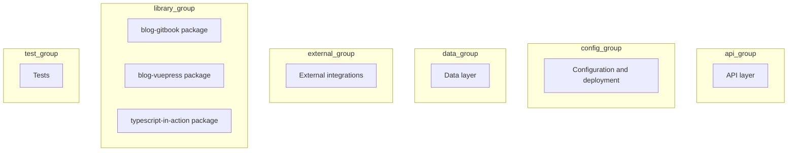

# Architecture report: biaochenxuying/blog

> Automated static analysis. **Observed** = directly seen in files/imports/AST; **Inferred** = interpretation from that evidence. Repository code was not executed.

## 1. Repository at a glance

| Item | Value |
| --- | --- |
| Repository | biaochenxuying/blog |
| Description | 大前端技术为主，读书笔记、随笔、理财为辅，做个终身学习者。 |
| Language | HTML |
| Stars | 4778 |
| Licence | Not detected |
| Analysed commit / branch | 87e37f1b557c6613c4e7cf3d444f47e364ba7f2a / master |
| Framework(s) | Express, React, Vue |
| Files analysed | 373 |
| Components | 8 |

## 2. Architecture in one minute

biaochenxuying/blog - 大前端技术为主，读书笔记、随笔、理财为辅，做个终身学习者。. This repository was analysed statically from 373 file(s) (0 Python). Detected technologies (observed from imports/manifests): MySQL, Express, React, Vue, axios, React Router. Files are grouped into 8 component(s): API layer, blog-gitbook package, blog-vuepress package, Configuration and deployment, Data layer, External integrations, Tests, typescript-in-action package. Findings below distinguish observed facts from inferred interpretation.

## 3. High-level block diagram

## 4. Main components

### API layer (`api_layer`)

- **Kind:** api
- **Status:** Observed
- **Confidence:** 0.85
- **Responsibility:** Groups 6 file(s) under api layer (observed from repository paths and static analysis).
- **Paths:** `typescript-in-action/sourcecode/ts-express/routes/employee.ts`, `typescript-in-action/sourcecode/ts-express/routes/excel-export.d.ts`, `typescript-in-action/sourcecode/ts-express/routes/index.ts`, `typescript-in-action/sourcecode/ts-express/routes/users.ts`, `typescript-in-action/sourcecode/ts-react-app/src/routers/index.tsx`, `typescript-in-action/sourcecode/ts-redux/src/routers/index.tsx`
- **Evidence:** [typescript-in-action/sourcecode/ts-express/routes/employee.ts](https://github.com/biaochenxuying/blog/blob/87e37f1b557c6613c4e7cf3d444f47e364ba7f2a/typescript-in-action/sourcecode/ts-express/routes/employee.ts); [typescript-in-action/sourcecode/ts-express/routes/excel-export.d.ts](https://github.com/biaochenxuying/blog/blob/87e37f1b557c6613c4e7cf3d444f47e364ba7f2a/typescript-in-action/sourcecode/ts-express/routes/excel-export.d.ts); [typescript-in-action/sourcecode/ts-express/routes/index.ts](https://github.com/biaochenxuying/blog/blob/87e37f1b557c6613c4e7cf3d444f47e364ba7f2a/typescript-in-action/sourcecode/ts-express/routes/index.ts); [typescript-in-action/sourcecode/ts-express/routes/users.ts](https://github.com/biaochenxuying/blog/blob/87e37f1b557c6613c4e7cf3d444f47e364ba7f2a/typescript-in-action/sourcecode/ts-express/routes/users.ts); [typescript-in-action/sourcecode/ts-react-app/src/routers/index.tsx](https://github.com/biaochenxuying/blog/blob/87e37f1b557c6613c4e7cf3d444f47e364ba7f2a/typescript-in-action/sourcecode/ts-react-app/src/routers/index.tsx); [typescript-in-action/sourcecode/ts-redux/src/routers/index.tsx](https://github.com/biaochenxuying/blog/blob/87e37f1b557c6613c4e7cf3d444f47e364ba7f2a/typescript-in-action/sourcecode/ts-redux/src/routers/index.tsx)

### blog-gitbook package (`blog_gitbook`)

- **Kind:** library
- **Status:** Observed
- **Confidence:** 0.85
- **Responsibility:** Groups 13 file(s) under blog-gitbook package (observed from repository paths and static analysis).
- **Paths:** `blog-gitbook/_book/gitbook/gitbook-plugin-anchor-navigation-ex/lib/config.js`, `blog-gitbook/_book/gitbook/gitbook-plugin-anchor-navigation-ex/lib/log.js`, `blog-gitbook/_book/gitbook/gitbook-plugin-anchor-navigation-ex/lib/plugin.js`, `blog-gitbook/_book/gitbook/gitbook-plugin-baidu-tongji/plugin.js`, `blog-gitbook/_book/gitbook/gitbook-plugin-copy-code-button/toggle.js`, `blog-gitbook/_book/gitbook/gitbook-plugin-donate/plugin.js`, `blog-gitbook/_book/gitbook/gitbook-plugin-expandable-chapters/expandable-chapters.js`, `blog-gitbook/_book/gitbook/gitbook-plugin-fontsettings/fontsettings.js`, `blog-gitbook/_book/gitbook/gitbook-plugin-github-buttons/plugin.js`, `blog-gitbook/_book/gitbook/gitbook-plugin-search-pro/search.js`, `blog-gitbook/_book/gitbook/gitbook-plugin-splitter/splitter.js`, `blog-gitbook/_book/gitbook/gitbook.js`, `blog-gitbook/_book/gitbook/theme.js`
- **Evidence:** [blog-gitbook/_book/gitbook/gitbook-plugin-anchor-navigation-ex/lib/config.js](https://github.com/biaochenxuying/blog/blob/87e37f1b557c6613c4e7cf3d444f47e364ba7f2a/blog-gitbook/_book/gitbook/gitbook-plugin-anchor-navigation-ex/lib/config.js); [blog-gitbook/_book/gitbook/gitbook-plugin-anchor-navigation-ex/lib/log.js](https://github.com/biaochenxuying/blog/blob/87e37f1b557c6613c4e7cf3d444f47e364ba7f2a/blog-gitbook/_book/gitbook/gitbook-plugin-anchor-navigation-ex/lib/log.js); [blog-gitbook/_book/gitbook/gitbook-plugin-anchor-navigation-ex/lib/plugin.js](https://github.com/biaochenxuying/blog/blob/87e37f1b557c6613c4e7cf3d444f47e364ba7f2a/blog-gitbook/_book/gitbook/gitbook-plugin-anchor-navigation-ex/lib/plugin.js); [blog-gitbook/_book/gitbook/gitbook-plugin-baidu-tongji/plugin.js](https://github.com/biaochenxuying/blog/blob/87e37f1b557c6613c4e7cf3d444f47e364ba7f2a/blog-gitbook/_book/gitbook/gitbook-plugin-baidu-tongji/plugin.js); [blog-gitbook/_book/gitbook/gitbook-plugin-copy-code-button/toggle.js](https://github.com/biaochenxuying/blog/blob/87e37f1b557c6613c4e7cf3d444f47e364ba7f2a/blog-gitbook/_book/gitbook/gitbook-plugin-copy-code-button/toggle.js); [blog-gitbook/_book/gitbook/gitbook-plugin-donate/plugin.js](https://github.com/biaochenxuying/blog/blob/87e37f1b557c6613c4e7cf3d444f47e364ba7f2a/blog-gitbook/_book/gitbook/gitbook-plugin-donate/plugin.js); [blog-gitbook/_book/gitbook/gitbook-plugin-expandable-chapters/expandable-chapters.js](https://github.com/biaochenxuying/blog/blob/87e37f1b557c6613c4e7cf3d444f47e364ba7f2a/blog-gitbook/_book/gitbook/gitbook-plugin-expandable-chapters/expandable-chapters.js); [blog-gitbook/_book/gitbook/gitbook-plugin-fontsettings/fontsettings.js](https://github.com/biaochenxuying/blog/blob/87e37f1b557c6613c4e7cf3d444f47e364ba7f2a/blog-gitbook/_book/gitbook/gitbook-plugin-fontsettings/fontsettings.js)

### blog-vuepress package (`blog_vuepress`)

- **Kind:** library
- **Status:** Observed
- **Confidence:** 0.85
- **Responsibility:** Groups 4 file(s) under blog-vuepress package (observed from repository paths and static analysis).
- **Paths:** `blog-vuepress/builds/addComponents.js`, `blog-vuepress/builds/delComponents.js`, `blog-vuepress/builds/findMarkdown.js`, `blog-vuepress/delay.sh`
- **Evidence:** [blog-vuepress/builds/addComponents.js](https://github.com/biaochenxuying/blog/blob/87e37f1b557c6613c4e7cf3d444f47e364ba7f2a/blog-vuepress/builds/addComponents.js); [blog-vuepress/builds/delComponents.js](https://github.com/biaochenxuying/blog/blob/87e37f1b557c6613c4e7cf3d444f47e364ba7f2a/blog-vuepress/builds/delComponents.js); [blog-vuepress/builds/findMarkdown.js](https://github.com/biaochenxuying/blog/blob/87e37f1b557c6613c4e7cf3d444f47e364ba7f2a/blog-vuepress/builds/findMarkdown.js); [blog-vuepress/delay.sh](https://github.com/biaochenxuying/blog/blob/87e37f1b557c6613c4e7cf3d444f47e364ba7f2a/blog-vuepress/delay.sh)

### Configuration and deployment (`config`)

- **Kind:** config
- **Status:** Observed
- **Confidence:** 0.85
- **Responsibility:** Groups 41 file(s) under configuration and deployment (observed from repository paths and static analysis).
- **Paths:** `blog-gitbook/_book/_config.yml`, `blog-gitbook/_book/search_plus_index.json`, `blog-gitbook/_config.yml`, `blog-gitbook/book.json`, `blog-vuepress/package.json`, `typescript-in-action/sourcecode/project-migration/stage-0/package.json`, `typescript-in-action/sourcecode/project-migration/stage-1/package.json`, `typescript-in-action/sourcecode/project-migration/stage-1/tsconfig.json`, `typescript-in-action/sourcecode/project-migration/stage-2/package.json`, `typescript-in-action/sourcecode/project-migration/stage-2/tsconfig.json`, `typescript-in-action/sourcecode/project-migration/stage-3/package.json`, `typescript-in-action/sourcecode/project-migration/stage-3/tsconfig.json`, `typescript-in-action/sourcecode/ts-babel/package.json`, `typescript-in-action/sourcecode/ts-babel/tsconfig.json`, `typescript-in-action/sourcecode/ts-base/.eslintrc.json`, `typescript-in-action/sourcecode/ts-base/package.json`, `typescript-in-action/sourcecode/ts-base/src/part2.project/06.tsconfig/tsconfig.json`, `typescript-in-action/sourcecode/ts-base/src/part2.project/07.project-references/new/src/client/tsconfig.json`, `typescript-in-action/sourcecode/ts-base/src/part2.project/07.project-references/new/src/common/tsconfig.json`, `typescript-in-action/sourcecode/ts-base/src/part2.project/07.project-references/new/src/server/tsconfig.json`, `typescript-in-action/sourcecode/ts-base/src/part2.project/07.project-references/new/tsconfig.json`, `typescript-in-action/sourcecode/ts-base/src/part2.project/07.project-references/old/tsconfig.json`, `typescript-in-action/sourcecode/ts-base/tsconfig.json`, `typescript-in-action/sourcecode/ts-express/config/db.ts`, `typescript-in-action/sourcecode/ts-express/package.json`, `typescript-in-action/sourcecode/ts-express/tsconfig.json`, `typescript-in-action/sourcecode/ts-react-app/mock/employee/getEmployee.json`, `typescript-in-action/sourcecode/ts-react-app/package.json`, `typescript-in-action/sourcecode/ts-react-app/tsconfig.json`, `typescript-in-action/sourcecode/ts-react/package.json`, `typescript-in-action/sourcecode/ts-react/tsconfig.json`, `typescript-in-action/sourcecode/ts-redux/mock/employee/createEmployee.json`, `typescript-in-action/sourcecode/ts-redux/mock/employee/deleteEmployee.json`, `typescript-in-action/sourcecode/ts-redux/mock/employee/getEmployee.json`, `typescript-in-action/sourcecode/ts-redux/mock/employee/updateEmployee.json`, `typescript-in-action/sourcecode/ts-redux/package.json`, `typescript-in-action/sourcecode/ts-redux/tsconfig.json`, `typescript-in-action/sourcecode/ts-vue/package.json`, `typescript-in-action/sourcecode/ts-vue/tsconfig.json`, `typescript-in-action/sourcecode/vue-employee-query/package.json`, `typescript-in-action/sourcecode/vue-employee-query/tsconfig.json`
- **Evidence:** [blog-gitbook/_book/_config.yml](https://github.com/biaochenxuying/blog/blob/87e37f1b557c6613c4e7cf3d444f47e364ba7f2a/blog-gitbook/_book/_config.yml); [blog-gitbook/_book/search_plus_index.json](https://github.com/biaochenxuying/blog/blob/87e37f1b557c6613c4e7cf3d444f47e364ba7f2a/blog-gitbook/_book/search_plus_index.json); [blog-gitbook/_config.yml](https://github.com/biaochenxuying/blog/blob/87e37f1b557c6613c4e7cf3d444f47e364ba7f2a/blog-gitbook/_config.yml); [blog-gitbook/book.json](https://github.com/biaochenxuying/blog/blob/87e37f1b557c6613c4e7cf3d444f47e364ba7f2a/blog-gitbook/book.json); [blog-vuepress/package.json](https://github.com/biaochenxuying/blog/blob/87e37f1b557c6613c4e7cf3d444f47e364ba7f2a/blog-vuepress/package.json); [typescript-in-action/sourcecode/project-migration/stage-0/package.json](https://github.com/biaochenxuying/blog/blob/87e37f1b557c6613c4e7cf3d444f47e364ba7f2a/typescript-in-action/sourcecode/project-migration/stage-0/package.json); [typescript-in-action/sourcecode/project-migration/stage-1/package.json](https://github.com/biaochenxuying/blog/blob/87e37f1b557c6613c4e7cf3d444f47e364ba7f2a/typescript-in-action/sourcecode/project-migration/stage-1/package.json); [typescript-in-action/sourcecode/project-migration/stage-1/tsconfig.json](https://github.com/biaochenxuying/blog/blob/87e37f1b557c6613c4e7cf3d444f47e364ba7f2a/typescript-in-action/sourcecode/project-migration/stage-1/tsconfig.json)

### Data layer (`data_layer`)

- **Kind:** data
- **Status:** Observed
- **Confidence:** 0.85
- **Responsibility:** Groups 2 file(s) under data layer (observed from repository paths and static analysis).
- **Paths:** `typescript-in-action/sourcecode/prototype/data/document.js`, `typescript-in-action/sourcecode/ts-express/models/query.ts`
- **Evidence:** [typescript-in-action/sourcecode/prototype/data/document.js](https://github.com/biaochenxuying/blog/blob/87e37f1b557c6613c4e7cf3d444f47e364ba7f2a/typescript-in-action/sourcecode/prototype/data/document.js); [typescript-in-action/sourcecode/ts-express/models/query.ts](https://github.com/biaochenxuying/blog/blob/87e37f1b557c6613c4e7cf3d444f47e364ba7f2a/typescript-in-action/sourcecode/ts-express/models/query.ts)

### External integrations (`external_integrations`)

- **Kind:** external
- **Status:** Observed
- **Confidence:** 0.85
- **Responsibility:** Groups 2 file(s) under external integrations (observed from repository paths and static analysis).
- **Paths:** `typescript-in-action/sourcecode/ts-base/src/part2.project/07.project-references/new/src/client/index.ts`, `typescript-in-action/sourcecode/ts-base/src/part2.project/07.project-references/old/src/client/index.ts`
- **Evidence:** [typescript-in-action/sourcecode/ts-base/src/part2.project/07.project-references/new/src/client/index.ts](https://github.com/biaochenxuying/blog/blob/87e37f1b557c6613c4e7cf3d444f47e364ba7f2a/typescript-in-action/sourcecode/ts-base/src/part2.project/07.project-references/new/src/client/index.ts); [typescript-in-action/sourcecode/ts-base/src/part2.project/07.project-references/old/src/client/index.ts](https://github.com/biaochenxuying/blog/blob/87e37f1b557c6613c4e7cf3d444f47e364ba7f2a/typescript-in-action/sourcecode/ts-base/src/part2.project/07.project-references/old/src/client/index.ts)

### Tests (`tests`)

- **Kind:** test
- **Status:** Observed
- **Confidence:** 0.85
- **Responsibility:** Groups 7 file(s) under tests (observed from repository paths and static analysis).
- **Paths:** `typescript-in-action/sourcecode/ts-babel/test/math.test.ts`, `typescript-in-action/sourcecode/ts-base/src/part2.project/07.project-references/new/test/client.test.ts`, `typescript-in-action/sourcecode/ts-base/src/part2.project/07.project-references/new/test/server.test.ts`, `typescript-in-action/sourcecode/ts-base/src/part2.project/07.project-references/new/test/tsconfig.json`, `typescript-in-action/sourcecode/ts-base/src/part2.project/07.project-references/old/test/client.test.ts`, `typescript-in-action/sourcecode/ts-base/src/part2.project/07.project-references/old/test/server.test.ts`, `typescript-in-action/sourcecode/ts-base/test/math.test.ts`
- **Evidence:** [typescript-in-action/sourcecode/ts-babel/test/math.test.ts](https://github.com/biaochenxuying/blog/blob/87e37f1b557c6613c4e7cf3d444f47e364ba7f2a/typescript-in-action/sourcecode/ts-babel/test/math.test.ts); [typescript-in-action/sourcecode/ts-base/src/part2.project/07.project-references/new/test/client.test.ts](https://github.com/biaochenxuying/blog/blob/87e37f1b557c6613c4e7cf3d444f47e364ba7f2a/typescript-in-action/sourcecode/ts-base/src/part2.project/07.project-references/new/test/client.test.ts); [typescript-in-action/sourcecode/ts-base/src/part2.project/07.project-references/new/test/server.test.ts](https://github.com/biaochenxuying/blog/blob/87e37f1b557c6613c4e7cf3d444f47e364ba7f2a/typescript-in-action/sourcecode/ts-base/src/part2.project/07.project-references/new/test/server.test.ts); [typescript-in-action/sourcecode/ts-base/src/part2.project/07.project-references/new/test/tsconfig.json](https://github.com/biaochenxuying/blog/blob/87e37f1b557c6613c4e7cf3d444f47e364ba7f2a/typescript-in-action/sourcecode/ts-base/src/part2.project/07.project-references/new/test/tsconfig.json); [typescript-in-action/sourcecode/ts-base/src/part2.project/07.project-references/old/test/client.test.ts](https://github.com/biaochenxuying/blog/blob/87e37f1b557c6613c4e7cf3d444f47e364ba7f2a/typescript-in-action/sourcecode/ts-base/src/part2.project/07.project-references/old/test/client.test.ts); [typescript-in-action/sourcecode/ts-base/src/part2.project/07.project-references/old/test/server.test.ts](https://github.com/biaochenxuying/blog/blob/87e37f1b557c6613c4e7cf3d444f47e364ba7f2a/typescript-in-action/sourcecode/ts-base/src/part2.project/07.project-references/old/test/server.test.ts); [typescript-in-action/sourcecode/ts-base/test/math.test.ts](https://github.com/biaochenxuying/blog/blob/87e37f1b557c6613c4e7cf3d444f47e364ba7f2a/typescript-in-action/sourcecode/ts-base/test/math.test.ts)

### typescript-in-action package (`typescript_in_action`)

- **Kind:** library
- **Status:** Observed
- **Confidence:** 0.85
- **Responsibility:** Groups 116 file(s) under typescript-in-action package (observed from repository paths and static analysis).
- **Paths:** `typescript-in-action/sourcecode/project-migration/stage-0/src/components/Hello.jsx`, `typescript-in-action/sourcecode/project-migration/stage-0/src/index.jsx`, `typescript-in-action/sourcecode/project-migration/stage-0/src/utils/a.js`, `typescript-in-action/sourcecode/project-migration/stage-1/src/components/Hello.jsx`, `typescript-in-action/sourcecode/project-migration/stage-1/src/components/Hi.tsx`, `typescript-in-action/sourcecode/project-migration/stage-1/src/index.jsx`, `typescript-in-action/sourcecode/project-migration/stage-1/src/utils/a.js`, `typescript-in-action/sourcecode/project-migration/stage-1/src/utils/b.ts`, `typescript-in-action/sourcecode/project-migration/stage-2/renameJS.ts`, `typescript-in-action/sourcecode/project-migration/stage-2/src/components/Hello.tsx`, `typescript-in-action/sourcecode/project-migration/stage-2/src/components/Hi.tsx`, `typescript-in-action/sourcecode/project-migration/stage-2/src/index.tsx`, `typescript-in-action/sourcecode/project-migration/stage-2/src/utils/a.ts`, `typescript-in-action/sourcecode/project-migration/stage-2/src/utils/b.ts`, `typescript-in-action/sourcecode/project-migration/stage-3/renameJS.ts`, `typescript-in-action/sourcecode/project-migration/stage-3/src/components/Hello.tsx`, `typescript-in-action/sourcecode/project-migration/stage-3/src/components/Hi.tsx`, `typescript-in-action/sourcecode/project-migration/stage-3/src/index.tsx`, `typescript-in-action/sourcecode/project-migration/stage-3/src/utils/a.ts`, `typescript-in-action/sourcecode/project-migration/stage-3/src/utils/b.ts`, `typescript-in-action/sourcecode/prototype/files/employee/data.js`, `typescript-in-action/sourcecode/prototype/files/systerm/data.js`, `typescript-in-action/sourcecode/prototype/plugins/recordplay/recordplay.js`, `typescript-in-action/sourcecode/prototype/resources/scripts/messagecenter.js`, `typescript-in-action/sourcecode/prototype/resources/scripts/player/axplayer.js`, `typescript-in-action/sourcecode/prototype/resources/scripts/player/splitter.js`, `typescript-in-action/sourcecode/prototype/resources/scripts/prototypePre.js`, `typescript-in-action/sourcecode/prototype/resources/scripts/startPost.js`, `typescript-in-action/sourcecode/prototype/resources/scripts/startPre.js`, `typescript-in-action/sourcecode/ts-babel/src/index.ts`, `typescript-in-action/sourcecode/ts-babel/src/math.ts`, `typescript-in-action/sourcecode/ts-base/jest.config.js`, `typescript-in-action/sourcecode/ts-base/src/index.ts`, `typescript-in-action/sourcecode/ts-base/src/math.ts`, `typescript-in-action/sourcecode/ts-base/src/part1.base/05.datatype.ts`, `typescript-in-action/sourcecode/ts-base/src/part1.base/06.enum.ts`, `typescript-in-action/sourcecode/ts-base/src/part1.base/07-08.interface.ts`, `typescript-in-action/sourcecode/ts-base/src/part1.base/09.function.ts`, `typescript-in-action/sourcecode/ts-base/src/part1.base/10-11.class.ts`, `typescript-in-action/sourcecode/ts-base/src/part1.base/12.class-interface.ts`, `typescript-in-action/sourcecode/ts-base/src/part1.base/13-14.generics.ts`, `typescript-in-action/sourcecode/ts-base/src/part1.base/15.inference.ts`, `typescript-in-action/sourcecode/ts-base/src/part1.base/16.compatible.ts`, `typescript-in-action/sourcecode/ts-base/src/part1.base/17.guards.ts`, `typescript-in-action/sourcecode/ts-base/src/part1.base/18.advanced-1.ts`, `typescript-in-action/sourcecode/ts-base/src/part1.base/19.advanced-2.ts`, `typescript-in-action/sourcecode/ts-base/src/part1.base/20.advanced-3.ts`, `typescript-in-action/sourcecode/ts-base/src/part1.base/21.advanced-4.ts`, `typescript-in-action/sourcecode/ts-base/src/part2.project/01.module/es6/a.ts`, `typescript-in-action/sourcecode/ts-base/src/part2.project/01.module/es6/b.ts`, `typescript-in-action/sourcecode/ts-base/src/part2.project/01.module/es6/c.ts`, `typescript-in-action/sourcecode/ts-base/src/part2.project/01.module/es6/d.ts`, `typescript-in-action/sourcecode/ts-base/src/part2.project/01.module/node/a.node.ts`, `typescript-in-action/sourcecode/ts-base/src/part2.project/01.module/node/b.node.ts`, `typescript-in-action/sourcecode/ts-base/src/part2.project/01.module/node/c.node.ts`, `typescript-in-action/sourcecode/ts-base/src/part2.project/02.namespace/a.ts`, `typescript-in-action/sourcecode/ts-base/src/part2.project/02.namespace/b.ts`, `typescript-in-action/sourcecode/ts-base/src/part2.project/03.merge/merge.ts`, `typescript-in-action/sourcecode/ts-base/src/part2.project/04.libs/global-lib.d.ts`, `typescript-in-action/sourcecode/ts-base/src/part2.project/04.libs/global-lib.js`, `typescript-in-action/sourcecode/ts-base/src/part2.project/04.libs/index.ts`, `typescript-in-action/sourcecode/ts-base/src/part2.project/04.libs/module-lib.d.ts`, `typescript-in-action/sourcecode/ts-base/src/part2.project/04.libs/module-lib.js`, `typescript-in-action/sourcecode/ts-base/src/part2.project/04.libs/umd-lib.d.ts`, `typescript-in-action/sourcecode/ts-base/src/part2.project/04.libs/umd-lib.js`, `typescript-in-action/sourcecode/ts-base/src/part2.project/07.project-references/new/src/common/index.ts`, `typescript-in-action/sourcecode/ts-base/src/part2.project/07.project-references/new/src/server/index.ts`, `typescript-in-action/sourcecode/ts-base/src/part2.project/07.project-references/old/src/common/index.ts`, `typescript-in-action/sourcecode/ts-base/src/part2.project/07.project-references/old/src/server/index.ts`, `typescript-in-action/sourcecode/ts-express/app.ts`, `typescript-in-action/sourcecode/ts-express/bin/server.ts`, `typescript-in-action/sourcecode/ts-express/copyStatic.ts`, `typescript-in-action/sourcecode/ts-react-app/config-overrides.js`, `typescript-in-action/sourcecode/ts-react-app/src/components/App.tsx`, `typescript-in-action/sourcecode/ts-react-app/src/components/demo/Hello.tsx`, `typescript-in-action/sourcecode/ts-react-app/src/components/demo/HelloClass.tsx`, `typescript-in-action/sourcecode/ts-react-app/src/components/demo/HelloHOC.tsx`, `typescript-in-action/sourcecode/ts-react-app/src/components/demo/HelloHooks.tsx`, `typescript-in-action/sourcecode/ts-react-app/src/components/employee/QueryForm.tsx`, `typescript-in-action/sourcecode/ts-react-app/src/components/employee/colums.tsx`, `typescript-in-action/sourcecode/ts-react-app/src/components/employee/index.tsx`, `typescript-in-action/sourcecode/ts-react-app/src/components/setting/index.tsx`, `typescript-in-action/sourcecode/ts-react-app/src/constants/urls.ts`, `typescript-in-action/sourcecode/ts-react-app/src/index.tsx`, `typescript-in-action/sourcecode/ts-react-app/src/interface/employee.ts`, `typescript-in-action/sourcecode/ts-react-app/src/react-app-env.d.ts`, `typescript-in-action/sourcecode/ts-react-app/src/setupProxy.js`, `typescript-in-action/sourcecode/ts-react-app/src/utils/request.ts`, `typescript-in-action/sourcecode/ts-react/src/components/Hello.tsx`, `typescript-in-action/sourcecode/ts-react/src/index.tsx`, `typescript-in-action/sourcecode/ts-redux/config-overrides.js`, `typescript-in-action/sourcecode/ts-redux/src/components/App.tsx`, `typescript-in-action/sourcecode/ts-redux/src/components/employee/InfoModal.tsx`, `typescript-in-action/sourcecode/ts-redux/src/components/employee/QueryForm.tsx`, `typescript-in-action/sourcecode/ts-redux/src/components/employee/colums.tsx`, `typescript-in-action/sourcecode/ts-redux/src/components/employee/index.tsx`, `typescript-in-action/sourcecode/ts-redux/src/components/setting/index.tsx`, `typescript-in-action/sourcecode/ts-redux/src/constants/actions.ts`, `typescript-in-action/sourcecode/ts-redux/src/constants/options.ts`, `typescript-in-action/sourcecode/ts-redux/src/constants/urls.ts`, `typescript-in-action/sourcecode/ts-redux/src/index.tsx`, `typescript-in-action/sourcecode/ts-redux/src/interface/employee.ts`, `typescript-in-action/sourcecode/ts-redux/src/react-app-env.d.ts`, `typescript-in-action/sourcecode/ts-redux/src/redux/employee/index.ts`, `typescript-in-action/sourcecode/ts-redux/src/redux/rootReducer.ts`, `typescript-in-action/sourcecode/ts-redux/src/redux/store.ts`, `typescript-in-action/sourcecode/ts-redux/src/setupProxy.js`, `typescript-in-action/sourcecode/ts-redux/src/utils/request.ts`, `typescript-in-action/sourcecode/ts-vue/src/components/Hello.vue`, `typescript-in-action/sourcecode/ts-vue/src/index.ts`, `typescript-in-action/sourcecode/ts-vue/src/vue-shims.d.ts`, `typescript-in-action/sourcecode/vue-employee-query/src/components/EmployeeQuery.vue`, `typescript-in-action/sourcecode/vue-employee-query/src/index.ts`, `typescript-in-action/sourcecode/vue-employee-query/src/main.ts`, `typescript-in-action/sourcecode/vue-employee-query/src/vue-shims.d.ts`, `typescript-in-action/sourcecode/vue-employee-query/types/employee-query.d.ts`
- **Evidence:** [typescript-in-action/sourcecode/project-migration/stage-0/src/components/Hello.jsx](https://github.com/biaochenxuying/blog/blob/87e37f1b557c6613c4e7cf3d444f47e364ba7f2a/typescript-in-action/sourcecode/project-migration/stage-0/src/components/Hello.jsx); [typescript-in-action/sourcecode/project-migration/stage-0/src/index.jsx](https://github.com/biaochenxuying/blog/blob/87e37f1b557c6613c4e7cf3d444f47e364ba7f2a/typescript-in-action/sourcecode/project-migration/stage-0/src/index.jsx); [typescript-in-action/sourcecode/project-migration/stage-0/src/utils/a.js](https://github.com/biaochenxuying/blog/blob/87e37f1b557c6613c4e7cf3d444f47e364ba7f2a/typescript-in-action/sourcecode/project-migration/stage-0/src/utils/a.js); [typescript-in-action/sourcecode/project-migration/stage-1/src/components/Hello.jsx](https://github.com/biaochenxuying/blog/blob/87e37f1b557c6613c4e7cf3d444f47e364ba7f2a/typescript-in-action/sourcecode/project-migration/stage-1/src/components/Hello.jsx); [typescript-in-action/sourcecode/project-migration/stage-1/src/components/Hi.tsx](https://github.com/biaochenxuying/blog/blob/87e37f1b557c6613c4e7cf3d444f47e364ba7f2a/typescript-in-action/sourcecode/project-migration/stage-1/src/components/Hi.tsx); [typescript-in-action/sourcecode/project-migration/stage-1/src/index.jsx](https://github.com/biaochenxuying/blog/blob/87e37f1b557c6613c4e7cf3d444f47e364ba7f2a/typescript-in-action/sourcecode/project-migration/stage-1/src/index.jsx); [typescript-in-action/sourcecode/project-migration/stage-1/src/utils/a.js](https://github.com/biaochenxuying/blog/blob/87e37f1b557c6613c4e7cf3d444f47e364ba7f2a/typescript-in-action/sourcecode/project-migration/stage-1/src/utils/a.js); [typescript-in-action/sourcecode/project-migration/stage-1/src/utils/b.ts](https://github.com/biaochenxuying/blog/blob/87e37f1b557c6613c4e7cf3d444f47e364ba7f2a/typescript-in-action/sourcecode/project-migration/stage-1/src/utils/b.ts)

## 5. Execution flow

**Observed** entry point(s):

- [typescript-in-action/sourcecode/project-migration/stage-0/src/index.jsx](https://github.com/biaochenxuying/blog/blob/87e37f1b557c6613c4e7cf3d444f47e364ba7f2a/typescript-in-action/sourcecode/project-migration/stage-0/src/index.jsx)
- [typescript-in-action/sourcecode/project-migration/stage-1/src/index.jsx](https://github.com/biaochenxuying/blog/blob/87e37f1b557c6613c4e7cf3d444f47e364ba7f2a/typescript-in-action/sourcecode/project-migration/stage-1/src/index.jsx)
- [typescript-in-action/sourcecode/project-migration/stage-2/src/index.tsx](https://github.com/biaochenxuying/blog/blob/87e37f1b557c6613c4e7cf3d444f47e364ba7f2a/typescript-in-action/sourcecode/project-migration/stage-2/src/index.tsx)
- [typescript-in-action/sourcecode/project-migration/stage-3/src/index.tsx](https://github.com/biaochenxuying/blog/blob/87e37f1b557c6613c4e7cf3d444f47e364ba7f2a/typescript-in-action/sourcecode/project-migration/stage-3/src/index.tsx)
- [typescript-in-action/sourcecode/ts-babel/src/index.ts](https://github.com/biaochenxuying/blog/blob/87e37f1b557c6613c4e7cf3d444f47e364ba7f2a/typescript-in-action/sourcecode/ts-babel/src/index.ts)
- [typescript-in-action/sourcecode/ts-base/src/index.ts](https://github.com/biaochenxuying/blog/blob/87e37f1b557c6613c4e7cf3d444f47e364ba7f2a/typescript-in-action/sourcecode/ts-base/src/index.ts)
- [typescript-in-action/sourcecode/ts-express/app.ts](https://github.com/biaochenxuying/blog/blob/87e37f1b557c6613c4e7cf3d444f47e364ba7f2a/typescript-in-action/sourcecode/ts-express/app.ts)
- [typescript-in-action/sourcecode/ts-react/src/index.tsx](https://github.com/biaochenxuying/blog/blob/87e37f1b557c6613c4e7cf3d444f47e364ba7f2a/typescript-in-action/sourcecode/ts-react/src/index.tsx)
- [typescript-in-action/sourcecode/ts-vue/src/index.ts](https://github.com/biaochenxuying/blog/blob/87e37f1b557c6613c4e7cf3d444f47e364ba7f2a/typescript-in-action/sourcecode/ts-vue/src/index.ts)

Representative flow (derived from observed entry points and the import graph; steps beyond the entry point are **Inferred**):

1. Execution starts at an observed entry point listed above, if present.
2. No internal import relationships between components were observed.

## 6. Project structure

### `(root)`

- `.gitignore` - other (117 bytes)
- `README.md` - docs (15238 bytes)

### `blog-gitbook`

- `blog-gitbook/.gitignore` - other (141 bytes)
- `blog-gitbook/README.md` - docs (9543 bytes)
- `blog-gitbook/SUMMARY.md` - docs (494 bytes)
- `blog-gitbook/_book/.gitignore` - other (141 bytes)
- `blog-gitbook/_book/_config.yml` - config (26 bytes)
- `blog-gitbook/_book/gitbook/gitbook-plugin-anchor-navigation-ex/lib/config.js` - source, JavaScript (3133 bytes)
- `blog-gitbook/_book/gitbook/gitbook-plugin-anchor-navigation-ex/lib/log.js` - source, JavaScript (274 bytes)
- `blog-gitbook/_book/gitbook/gitbook-plugin-anchor-navigation-ex/lib/plugin.js` - source, JavaScript (11045 bytes)
- `blog-gitbook/_book/gitbook/gitbook-plugin-anchor-navigation-ex/style/plugin.css` - other (4585 bytes)
- `blog-gitbook/_book/gitbook/gitbook-plugin-baidu-tongji/plugin.js` - source, JavaScript (403 bytes)
- `blog-gitbook/_book/gitbook/gitbook-plugin-copy-code-button/toggle.js` - source, JavaScript (3013 bytes)
- `blog-gitbook/_book/gitbook/gitbook-plugin-donate/plugin.css` - other (2720 bytes)
- `blog-gitbook/_book/gitbook/gitbook-plugin-donate/plugin.js` - source, JavaScript (1960 bytes)
- `blog-gitbook/_book/gitbook/gitbook-plugin-expandable-chapters/expandable-chapters.css` - other (568 bytes)
- `blog-gitbook/_book/gitbook/gitbook-plugin-expandable-chapters/expandable-chapters.js` - source, JavaScript (2009 bytes)
- `blog-gitbook/_book/gitbook/gitbook-plugin-fontsettings/fontsettings.js` - source, JavaScript (6447 bytes)
- `blog-gitbook/_book/gitbook/gitbook-plugin-fontsettings/website.css` - other (8596 bytes)
- `blog-gitbook/_book/gitbook/gitbook-plugin-github-buttons/plugin.js` - source, JavaScript (3318 bytes)
- `blog-gitbook/_book/gitbook/gitbook-plugin-search-pro/search.css` - other (1095 bytes)
- `blog-gitbook/_book/gitbook/gitbook-plugin-search-pro/search.js` - source, JavaScript (8191 bytes)
- `blog-gitbook/_book/gitbook/gitbook-plugin-splitter/splitter.css` - other (503 bytes)
- `blog-gitbook/_book/gitbook/gitbook-plugin-splitter/splitter.js` - source, JavaScript (3864 bytes)
- `blog-gitbook/_book/gitbook/gitbook-plugin-tbfed-pagefooter/footer.css` - other (271 bytes)
- `blog-gitbook/_book/gitbook/gitbook.js` - source, JavaScript (105401 bytes)
- `blog-gitbook/_book/gitbook/style.css` - other (52701 bytes)
- `blog-gitbook/_book/gitbook/theme.js` - source, JavaScript (113264 bytes)
- `blog-gitbook/_book/index.html` - other (37037 bytes)
- `blog-gitbook/_book/search_plus_index.json` - config (108906 bytes)
- `blog-gitbook/_book/views/README.md` - docs (55 bytes)
- `blog-gitbook/_book/views/algorithms/js-10algo.html` - other (131958 bytes)
- `blog-gitbook/_book/views/algorithms/js-time-space.html` - other (54632 bytes)
- `blog-gitbook/_book/views/component/gitalk.md` - docs (1050 bytes)
- `blog-gitbook/_book/views/github/follow.html` - other (32570 bytes)
- `blog-gitbook/_book/views/github/star.html` - other (48790 bytes)
- `blog-gitbook/_book/views/vue/vue-ts.html` - other (93620 bytes)
- `blog-gitbook/_config.yml` - config (26 bytes)
- `blog-gitbook/book.json` - config (1622 bytes)
- `blog-gitbook/views/README.md` - docs (55 bytes)
- `blog-gitbook/views/algorithms/js-10algo.md` - docs (51869 bytes)
- `blog-gitbook/views/algorithms/js-time-space.md` - docs (16513 bytes)
- `blog-gitbook/views/component/gitalk.md` - docs (1050 bytes)
- `blog-gitbook/views/github/follow.md` - docs (7754 bytes)
- `blog-gitbook/views/github/star.md` - docs (13248 bytes)
- `blog-gitbook/views/vue/vue-ts.md` - docs (42494 bytes)

### `blog-vuepress`

- `blog-vuepress/.gitignore` - other (141 bytes)
- `blog-vuepress/README.md` - docs (9570 bytes)
- `blog-vuepress/builds/addComponents.js` - source, JavaScript (390 bytes)
- `blog-vuepress/builds/delComponents.js` - source, JavaScript (518 bytes)
- `blog-vuepress/builds/findMarkdown.js` - source, JavaScript (794 bytes)
- `blog-vuepress/delay.sh` - source, Shell (652 bytes)
- `blog-vuepress/docs/.vuepress/components/comment.vue` - docs (1507 bytes)
- `blog-vuepress/docs/.vuepress/config.js` - docs (3831 bytes)
- `blog-vuepress/docs/.vuepress/css/gittalk.css` - docs (24007 bytes)
- `blog-vuepress/docs/.vuepress/enhanceApp.js` - docs (814 bytes)
- `blog-vuepress/docs/.vuepress/styles/index.styl` - docs (671 bytes)
- `blog-vuepress/docs/.vuepress/templates/dev.html` - docs (366 bytes)
- `blog-vuepress/docs/.vuepress/templates/ssr.html` - docs (563 bytes)
- `blog-vuepress/docs/.vuepress/utils.js` - docs (3302 bytes)
- `blog-vuepress/docs/README.md` - docs (550 bytes)
- `blog-vuepress/docs/en/README.md` - docs (540 bytes)
- `blog-vuepress/docs/guide/README.md` - docs (9968 bytes)
- `blog-vuepress/docs/views/README.md` - docs (55 bytes)
- `blog-vuepress/docs/views/algorithms/10algo.md` - docs (51869 bytes)
- `blog-vuepress/docs/views/github/follow.md` - docs (7754 bytes)
- `blog-vuepress/docs/views/github/star.md` - docs (13248 bytes)
- `blog-vuepress/docs/views/vue/vue-ts.md` - docs (42494 bytes)
- `blog-vuepress/package.json` - manifest (936 bytes)

### `data-structure-and-algorithms`

- `data-structure-and-algorithms/0. arr.html` - other (886 bytes)
- `data-structure-and-algorithms/1. singly-linked-list.html` - other (5038 bytes)
- `data-structure-and-algorithms/10. binary-search-tree.html` - other (7326 bytes)
- `data-structure-and-algorithms/11. bubble-sort.html` - other (2314 bytes)
- `data-structure-and-algorithms/12. insertion-sort.html` - other (2857 bytes)
- `data-structure-and-algorithms/13. selection-sort.html` - other (1059 bytes)
- `data-structure-and-algorithms/14. merge-sort.html` - other (1456 bytes)
- `data-structure-and-algorithms/15. quick-sort.html` - other (2349 bytes)
- `data-structure-and-algorithms/16. shell-sort.html` - other (1777 bytes)
- `data-structure-and-algorithms/17. heap-sort.html` - other (2621 bytes)
- `data-structure-and-algorithms/18. bocket-sort.html` - other (3504 bytes)
- `data-structure-and-algorithms/19. counting-sort.html` - other (2876 bytes)
- `data-structure-and-algorithms/2. doubly-linked-list.html` - other (5164 bytes)
- `data-structure-and-algorithms/20. radix-sort.html` - other (1737 bytes)
- `data-structure-and-algorithms/3. circular-linked-list.html` - other (4431 bytes)
- `data-structure-and-algorithms/4. stack.html` - other (1546 bytes)
- `data-structure-and-algorithms/5. queue.html` - other (1575 bytes)
- `data-structure-and-algorithms/6. min-priority-queue.html` - other (2607 bytes)
- `data-structure-and-algorithms/7. max-priority-queue.html` - other (2677 bytes)
- `data-structure-and-algorithms/9. hot-potato.html` - other (1866 bytes)

### `interview`

- `interview/fe-interview.md` - docs (175760 bytes)

### `resume`

- `resume/resume.md` - docs (5341 bytes)

### `typescript-in-action`

- `typescript-in-action/README.md` - docs (148 bytes)
- `typescript-in-action/sourcecode/project-migration/stage-0/.babelrc` - other (191 bytes)
- `typescript-in-action/sourcecode/project-migration/stage-0/.gitignore` - other (17 bytes)
- `typescript-in-action/sourcecode/project-migration/stage-0/README.md` - docs (72 bytes)
- `typescript-in-action/sourcecode/project-migration/stage-0/package.json` - manifest (921 bytes)
- `typescript-in-action/sourcecode/project-migration/stage-0/src/components/Hello.jsx` - source, JavaScript (671 bytes)
- `typescript-in-action/sourcecode/project-migration/stage-0/src/index.jsx` - source, JavaScript (262 bytes)
- `typescript-in-action/sourcecode/project-migration/stage-0/src/tpl/index.html` - other (296 bytes)
- `typescript-in-action/sourcecode/project-migration/stage-0/src/utils/a.js` - source, JavaScript (46 bytes)
- `typescript-in-action/sourcecode/project-migration/stage-1/.babelrc` - other (227 bytes)
- `typescript-in-action/sourcecode/project-migration/stage-1/.gitignore` - other (17 bytes)
- `typescript-in-action/sourcecode/project-migration/stage-1/README.md` - docs (85 bytes)
- `typescript-in-action/sourcecode/project-migration/stage-1/package.json` - manifest (1117 bytes)
- `typescript-in-action/sourcecode/project-migration/stage-1/src/components/Hello.jsx` - source, JavaScript (672 bytes)
- `typescript-in-action/sourcecode/project-migration/stage-1/src/components/Hi.tsx` - source, TypeScript (640 bytes)
- `typescript-in-action/sourcecode/project-migration/stage-1/src/index.jsx` - source, JavaScript (367 bytes)
- `typescript-in-action/sourcecode/project-migration/stage-1/src/tpl/index.html` - other (296 bytes)
- `typescript-in-action/sourcecode/project-migration/stage-1/src/utils/a.js` - source, JavaScript (120 bytes)
- `typescript-in-action/sourcecode/project-migration/stage-1/src/utils/b.ts` - source, TypeScript (62 bytes)
- `typescript-in-action/sourcecode/project-migration/stage-1/tsconfig.json` - config (5765 bytes)
- `typescript-in-action/sourcecode/project-migration/stage-2/.babelrc` - other (227 bytes)
- `typescript-in-action/sourcecode/project-migration/stage-2/.gitignore` - other (17 bytes)
- `typescript-in-action/sourcecode/project-migration/stage-2/README.md` - docs (86 bytes)
- `typescript-in-action/sourcecode/project-migration/stage-2/package.json` - manifest (1239 bytes)
- `typescript-in-action/sourcecode/project-migration/stage-2/renameJS.ts` - source, TypeScript (202 bytes)
- `typescript-in-action/sourcecode/project-migration/stage-2/src/components/Hello.tsx` - source, TypeScript (672 bytes)
- `typescript-in-action/sourcecode/project-migration/stage-2/src/components/Hi.tsx` - source, TypeScript (640 bytes)
- `typescript-in-action/sourcecode/project-migration/stage-2/src/index.tsx` - source, TypeScript (367 bytes)
- `typescript-in-action/sourcecode/project-migration/stage-2/src/tpl/index.html` - other (296 bytes)
- `typescript-in-action/sourcecode/project-migration/stage-2/src/utils/a.ts` - source, TypeScript (120 bytes)
- `typescript-in-action/sourcecode/project-migration/stage-2/src/utils/b.ts` - source, TypeScript (62 bytes)
- `typescript-in-action/sourcecode/project-migration/stage-2/tsconfig.json` - config (5764 bytes)
- `typescript-in-action/sourcecode/project-migration/stage-3/.babelrc` - other (227 bytes)
- `typescript-in-action/sourcecode/project-migration/stage-3/.gitignore` - other (17 bytes)
- `typescript-in-action/sourcecode/project-migration/stage-3/README.md` - docs (72 bytes)
- `typescript-in-action/sourcecode/project-migration/stage-3/package.json` - manifest (1239 bytes)
- `typescript-in-action/sourcecode/project-migration/stage-3/renameJS.ts` - source, TypeScript (202 bytes)
- `typescript-in-action/sourcecode/project-migration/stage-3/src/components/Hello.tsx` - source, TypeScript (649 bytes)
- `typescript-in-action/sourcecode/project-migration/stage-3/src/components/Hi.tsx` - source, TypeScript (640 bytes)
- `typescript-in-action/sourcecode/project-migration/stage-3/src/index.tsx` - source, TypeScript (367 bytes)
- `typescript-in-action/sourcecode/project-migration/stage-3/src/tpl/index.html` - other (296 bytes)
- `typescript-in-action/sourcecode/project-migration/stage-3/src/utils/a.ts` - source, TypeScript (78 bytes)
- `typescript-in-action/sourcecode/project-migration/stage-3/src/utils/b.ts` - source, TypeScript (62 bytes)
- `typescript-in-action/sourcecode/project-migration/stage-3/tsconfig.json` - config (5759 bytes)
- `typescript-in-action/sourcecode/prototype/data/document.js` - source, JavaScript (4245 bytes)
- `typescript-in-action/sourcecode/prototype/data/styles.css` - other (1205 bytes)
- `typescript-in-action/sourcecode/prototype/employee.html` - other (13459 bytes)
- `typescript-in-action/sourcecode/prototype/files/employee/data.js` - source, JavaScript (15118 bytes)
- `typescript-in-action/sourcecode/prototype/files/employee/styles.css` - other (19338 bytes)
- `typescript-in-action/sourcecode/prototype/files/systerm/data.js` - source, JavaScript (2845 bytes)
- `typescript-in-action/sourcecode/prototype/files/systerm/styles.css` - other (2086 bytes)
- `typescript-in-action/sourcecode/prototype/index.html` - other (21720 bytes)
- `typescript-in-action/sourcecode/prototype/plugins/debug/styles/debug.css` - other (2212 bytes)
- `typescript-in-action/sourcecode/prototype/plugins/debug/styles/images/reset.svg` - other (1281 bytes)
- `typescript-in-action/sourcecode/prototype/plugins/debug/styles/images/reset_hover.svg` - other (1311 bytes)
- `typescript-in-action/sourcecode/prototype/plugins/debug/styles/images/variables_hover.svg` - other (5233 bytes)
- `typescript-in-action/sourcecode/prototype/plugins/debug/styles/images/variables_off.svg` - other (5227 bytes)
- `typescript-in-action/sourcecode/prototype/plugins/debug/styles/images/variables_on.svg` - other (5229 bytes)
- `typescript-in-action/sourcecode/prototype/plugins/page_notes/styles/images/back.svg` - other (1217 bytes)
- `typescript-in-action/sourcecode/prototype/plugins/page_notes/styles/images/back_hover.svg` - other (1229 bytes)
- `typescript-in-action/sourcecode/prototype/plugins/page_notes/styles/images/footnotes.svg` - other (1315 bytes)
- `typescript-in-action/sourcecode/prototype/plugins/page_notes/styles/images/footnotes_hover.svg` - other (1327 bytes)
- `typescript-in-action/sourcecode/prototype/plugins/page_notes/styles/images/footnotes_on.svg` - other (1321 bytes)
- `typescript-in-action/sourcecode/prototype/plugins/page_notes/styles/images/forward.svg` - other (1230 bytes)
- `typescript-in-action/sourcecode/prototype/plugins/page_notes/styles/images/forward_hover.svg` - other (1242 bytes)
- `typescript-in-action/sourcecode/prototype/plugins/page_notes/styles/images/notes_hover.svg` - other (1013 bytes)
- `typescript-in-action/sourcecode/prototype/plugins/page_notes/styles/images/notes_off.svg` - other (1011 bytes)
- `typescript-in-action/sourcecode/prototype/plugins/page_notes/styles/images/notes_on.svg` - other (1010 bytes)
- `typescript-in-action/sourcecode/prototype/plugins/page_notes/styles/page_notes.css` - other (4004 bytes)
- `typescript-in-action/sourcecode/prototype/plugins/recordplay/recordplay.js` - source, JavaScript (19058 bytes)
- `typescript-in-action/sourcecode/prototype/plugins/recordplay/styles/recordplay.css` - other (1566 bytes)
- `typescript-in-action/sourcecode/prototype/plugins/sitemap/styles/images/flow.svg` - other (1757 bytes)
- `typescript-in-action/sourcecode/prototype/plugins/sitemap/styles/images/folder_closed.svg` - other (676 bytes)
- `typescript-in-action/sourcecode/prototype/plugins/sitemap/styles/images/folder_open.svg` - other (758 bytes)
- `typescript-in-action/sourcecode/prototype/plugins/sitemap/styles/images/hotspots.svg` - other (1712 bytes)
- `typescript-in-action/sourcecode/prototype/plugins/sitemap/styles/images/hotspots_hover.svg` - other (1724 bytes)
- `typescript-in-action/sourcecode/prototype/plugins/sitemap/styles/images/hotspots_on.svg` - other (1718 bytes)
- `typescript-in-action/sourcecode/prototype/plugins/sitemap/styles/images/images.html` - other (996 bytes)
- `typescript-in-action/sourcecode/prototype/plugins/sitemap/styles/images/note.svg` - other (1912 bytes)
- `typescript-in-action/sourcecode/prototype/plugins/sitemap/styles/images/page.svg` - other (733 bytes)
- `typescript-in-action/sourcecode/prototype/plugins/sitemap/styles/images/share.svg` - other (2411 bytes)
- `typescript-in-action/sourcecode/prototype/plugins/sitemap/styles/images/share_hover.svg` - other (2423 bytes)
- `typescript-in-action/sourcecode/prototype/plugins/sitemap/styles/images/share_on.svg` - other (2417 bytes)
- `typescript-in-action/sourcecode/prototype/plugins/sitemap/styles/images/sitemap_hover.svg` - other (2609 bytes)
- `typescript-in-action/sourcecode/prototype/plugins/sitemap/styles/images/sitemap_off.svg` - other (2607 bytes)
- `typescript-in-action/sourcecode/prototype/plugins/sitemap/styles/images/sitemap_on.svg` - other (2606 bytes)
- `typescript-in-action/sourcecode/prototype/plugins/sitemap/styles/images/views.svg` - other (886 bytes)
- `typescript-in-action/sourcecode/prototype/plugins/sitemap/styles/images/views_hover.svg` - other (898 bytes)
- `typescript-in-action/sourcecode/prototype/plugins/sitemap/styles/images/views_on.svg` - other (892 bytes)
- `typescript-in-action/sourcecode/prototype/plugins/sitemap/styles/sitemap.css` - other (7929 bytes)
- `typescript-in-action/sourcecode/prototype/resources/Other.html` - other (835 bytes)
- `typescript-in-action/sourcecode/prototype/resources/chrome/chrome.html` - other (5474 bytes)
- `typescript-in-action/sourcecode/prototype/resources/chrome/safari.html` - other (4308 bytes)
- `typescript-in-action/sourcecode/prototype/resources/css/axure_rp_page.css` - other (4889 bytes)
- `typescript-in-action/sourcecode/prototype/resources/css/default.css` - other (4594 bytes)
- `typescript-in-action/sourcecode/prototype/resources/css/images/images.html` - other (1356 bytes)
- `typescript-in-action/sourcecode/prototype/resources/css/jquery-ui-themes.css` - other (28384 bytes)
- `typescript-in-action/sourcecode/prototype/resources/css/reset.css` - other (479 bytes)
- `typescript-in-action/sourcecode/prototype/resources/expand.html` - other (2407 bytes)
- `typescript-in-action/sourcecode/prototype/resources/images/close.svg` - other (748 bytes)
- `typescript-in-action/sourcecode/prototype/resources/images/close_hover.svg` - other (796 bytes)
- `typescript-in-action/sourcecode/prototype/resources/images/divider.svg` - other (691 bytes)
- `typescript-in-action/sourcecode/prototype/resources/images/expand.svg` - other (879 bytes)
- `typescript-in-action/sourcecode/prototype/resources/images/expand_hover.svg` - other (885 bytes)
- `typescript-in-action/sourcecode/prototype/resources/images/images.html` - other (691 bytes)
- `typescript-in-action/sourcecode/prototype/resources/reload.html` - other (511 bytes)
- `typescript-in-action/sourcecode/prototype/resources/scripts/messagecenter.js` - source, JavaScript (10497 bytes)
- `typescript-in-action/sourcecode/prototype/resources/scripts/player/axplayer.js` - source, JavaScript (7716 bytes)
- `typescript-in-action/sourcecode/prototype/resources/scripts/player/splitter.js` - source, JavaScript (10180 bytes)
- `typescript-in-action/sourcecode/prototype/resources/scripts/prototypePre.js` - source, JavaScript (133217 bytes)
- `typescript-in-action/sourcecode/prototype/resources/scripts/startPost.js` - source, JavaScript (36087 bytes)
- `typescript-in-action/sourcecode/prototype/resources/scripts/startPre.js` - source, JavaScript (36895 bytes)
- `typescript-in-action/sourcecode/prototype/start.html` - other (21720 bytes)
- `typescript-in-action/sourcecode/prototype/start_c_1.html` - other (158 bytes)
- `typescript-in-action/sourcecode/prototype/start_g_0.html` - other (166 bytes)
- `typescript-in-action/sourcecode/prototype/systerm.html` - other (2411 bytes)
- `typescript-in-action/sourcecode/ts-babel/.babelrc` - other (196 bytes)
- `typescript-in-action/sourcecode/ts-babel/.gitignore` - other (18 bytes)
- `typescript-in-action/sourcecode/ts-babel/README.md` - docs (81 bytes)
- `typescript-in-action/sourcecode/ts-babel/package.json` - manifest (749 bytes)
- `typescript-in-action/sourcecode/ts-babel/src/index.ts` - source, TypeScript (264 bytes)
- `typescript-in-action/sourcecode/ts-babel/src/math.ts` - source, TypeScript (154 bytes)
- `typescript-in-action/sourcecode/ts-babel/test/math.test.ts` - test, TypeScript (207 bytes)
- `typescript-in-action/sourcecode/ts-babel/tsconfig.json` - config (5740 bytes)
- `typescript-in-action/sourcecode/ts-base/.eslintrc.json` - config (275 bytes)
- `typescript-in-action/sourcecode/ts-base/.gitignore` - other (18 bytes)
- `typescript-in-action/sourcecode/ts-base/README.md` - docs (211 bytes)
- `typescript-in-action/sourcecode/ts-base/jest.config.js` - source, JavaScript (69 bytes)
- `typescript-in-action/sourcecode/ts-base/package.json` - manifest (1133 bytes)
- `typescript-in-action/sourcecode/ts-base/src/index.ts` - source, TypeScript (94 bytes)
- `typescript-in-action/sourcecode/ts-base/src/math.ts` - source, TypeScript (153 bytes)
- `typescript-in-action/sourcecode/ts-base/src/part1.base/05.datatype.ts` - source, TypeScript (864 bytes)
- `typescript-in-action/sourcecode/ts-base/src/part1.base/06.enum.ts` - source, TypeScript (939 bytes)
- `typescript-in-action/sourcecode/ts-base/src/part1.base/07-08.interface.ts` - source, TypeScript (1133 bytes)
- `typescript-in-action/sourcecode/ts-base/src/part1.base/09.function.ts` - source, TypeScript (902 bytes)
- `typescript-in-action/sourcecode/ts-base/src/part1.base/10-11.class.ts` - source, TypeScript (1248 bytes)
- `typescript-in-action/sourcecode/ts-base/src/part1.base/12.class-interface.ts` - source, TypeScript (619 bytes)
- `typescript-in-action/sourcecode/ts-base/src/part1.base/13-14.generics.ts` - source, TypeScript (665 bytes)
- `typescript-in-action/sourcecode/ts-base/src/part1.base/15.inference.ts` - source, TypeScript (275 bytes)
- `typescript-in-action/sourcecode/ts-base/src/part1.base/16.compatible.ts` - source, TypeScript (2200 bytes)
- `typescript-in-action/sourcecode/ts-base/src/part1.base/17.guards.ts` - source, TypeScript (1213 bytes)
- `typescript-in-action/sourcecode/ts-base/src/part1.base/18.advanced-1.ts` - source, TypeScript (1161 bytes)
- `typescript-in-action/sourcecode/ts-base/src/part1.base/19.advanced-2.ts` - source, TypeScript (455 bytes)
- `typescript-in-action/sourcecode/ts-base/src/part1.base/20.advanced-3.ts` - source, TypeScript (191 bytes)
- `typescript-in-action/sourcecode/ts-base/src/part1.base/21.advanced-4.ts` - source, TypeScript (854 bytes)
- `typescript-in-action/sourcecode/ts-base/src/part2.project/01.module/es6/a.ts` - source, TypeScript (423 bytes)
- `typescript-in-action/sourcecode/ts-base/src/part2.project/01.module/es6/b.ts` - source, TypeScript (42 bytes)
- `typescript-in-action/sourcecode/ts-base/src/part2.project/01.module/es6/c.ts` - source, TypeScript (378 bytes)
- `typescript-in-action/sourcecode/ts-base/src/part2.project/01.module/es6/d.ts` - source, TypeScript (75 bytes)
- `typescript-in-action/sourcecode/ts-base/src/part2.project/01.module/node/a.node.ts` - source, TypeScript (67 bytes)
- `typescript-in-action/sourcecode/ts-base/src/part2.project/01.module/node/b.node.ts` - source, TypeScript (102 bytes)
- `typescript-in-action/sourcecode/ts-base/src/part2.project/01.module/node/c.node.ts` - source, TypeScript (200 bytes)
- `typescript-in-action/sourcecode/ts-base/src/part2.project/02.namespace/a.ts` - source, TypeScript (116 bytes)
- `typescript-in-action/sourcecode/ts-base/src/part2.project/02.namespace/b.ts` - source, TypeScript (229 bytes)
- `typescript-in-action/sourcecode/ts-base/src/part2.project/03.merge/merge.ts` - source, TypeScript (616 bytes)
- `typescript-in-action/sourcecode/ts-base/src/part2.project/04.libs/global-lib.d.ts` - source, TypeScript (213 bytes)
- `typescript-in-action/sourcecode/ts-base/src/part2.project/04.libs/global-lib.js` - source, JavaScript (172 bytes)
- `typescript-in-action/sourcecode/ts-base/src/part2.project/04.libs/index.ts` - source, TypeScript (497 bytes)
- `typescript-in-action/sourcecode/ts-base/src/part2.project/04.libs/module-lib.d.ts` - source, TypeScript (209 bytes)
- `typescript-in-action/sourcecode/ts-base/src/part2.project/04.libs/module-lib.js` - source, JavaScript (251 bytes)
- `typescript-in-action/sourcecode/ts-base/src/part2.project/04.libs/umd-lib.d.ts` - source, TypeScript (133 bytes)
- `typescript-in-action/sourcecode/ts-base/src/part2.project/04.libs/umd-lib.js` - source, JavaScript (411 bytes)
- `typescript-in-action/sourcecode/ts-base/src/part2.project/06.tsconfig/tsconfig.json` - config (3766 bytes)
- `typescript-in-action/sourcecode/ts-base/src/part2.project/07.project-references/new/src/client/index.ts` - source, TypeScript (111 bytes)
- `typescript-in-action/sourcecode/ts-base/src/part2.project/07.project-references/new/src/client/tsconfig.json` - config (170 bytes)
- `typescript-in-action/sourcecode/ts-base/src/part2.project/07.project-references/new/src/common/index.ts` - source, TypeScript (133 bytes)
- `typescript-in-action/sourcecode/ts-base/src/part2.project/07.project-references/new/src/common/tsconfig.json` - config (111 bytes)
- `typescript-in-action/sourcecode/ts-base/src/part2.project/07.project-references/new/src/server/index.ts` - source, TypeScript (111 bytes)
- `typescript-in-action/sourcecode/ts-base/src/part2.project/07.project-references/new/src/server/tsconfig.json` - config (170 bytes)
- `typescript-in-action/sourcecode/ts-base/src/part2.project/07.project-references/new/test/client.test.ts` - test, TypeScript (74 bytes)
- `typescript-in-action/sourcecode/ts-base/src/part2.project/07.project-references/new/test/server.test.ts` - test, TypeScript (74 bytes)
- `typescript-in-action/sourcecode/ts-base/src/part2.project/07.project-references/new/test/tsconfig.json` - test (137 bytes)
- `typescript-in-action/sourcecode/ts-base/src/part2.project/07.project-references/new/tsconfig.json` - config (145 bytes)
- `typescript-in-action/sourcecode/ts-base/src/part2.project/07.project-references/old/src/client/index.ts` - source, TypeScript (111 bytes)
- `typescript-in-action/sourcecode/ts-base/src/part2.project/07.project-references/old/src/common/index.ts` - source, TypeScript (133 bytes)
- `typescript-in-action/sourcecode/ts-base/src/part2.project/07.project-references/old/src/server/index.ts` - source, TypeScript (111 bytes)
- `typescript-in-action/sourcecode/ts-base/src/part2.project/07.project-references/old/test/client.test.ts` - test, TypeScript (74 bytes)
- `typescript-in-action/sourcecode/ts-base/src/part2.project/07.project-references/old/test/server.test.ts` - test, TypeScript (74 bytes)
- `typescript-in-action/sourcecode/ts-base/src/part2.project/07.project-references/old/tsconfig.json` - config (120 bytes)
- `typescript-in-action/sourcecode/ts-base/src/tpl/index.html` - other (299 bytes)
- `typescript-in-action/sourcecode/ts-base/test/math.test.ts` - test, TypeScript (206 bytes)
- `typescript-in-action/sourcecode/ts-base/tsconfig.json` - config (5743 bytes)
- `typescript-in-action/sourcecode/ts-express/.gitignore` - other (18 bytes)
- `typescript-in-action/sourcecode/ts-express/README.md` - docs (104 bytes)
- `typescript-in-action/sourcecode/ts-express/app.ts` - source, TypeScript (1173 bytes)
- `typescript-in-action/sourcecode/ts-express/bin/server.ts` - source, TypeScript (1605 bytes)
- `typescript-in-action/sourcecode/ts-express/config/db.ts` - source, TypeScript (162 bytes)
- `typescript-in-action/sourcecode/ts-express/copyStatic.ts` - source, TypeScript (101 bytes)
- `typescript-in-action/sourcecode/ts-express/employee.sql` - data, SQL (1631 bytes)
- `typescript-in-action/sourcecode/ts-express/models/query.ts` - source, TypeScript (666 bytes)
- `typescript-in-action/sourcecode/ts-express/package.json` - manifest (924 bytes)
- `typescript-in-action/sourcecode/ts-express/public/stylesheets/style.css` - other (111 bytes)
- `typescript-in-action/sourcecode/ts-express/routes/employee.ts` - source, TypeScript (3451 bytes)
- `typescript-in-action/sourcecode/ts-express/routes/excel-export.d.ts` - source, TypeScript (192 bytes)
- `typescript-in-action/sourcecode/ts-express/routes/index.ts` - source, TypeScript (207 bytes)
- `typescript-in-action/sourcecode/ts-express/routes/users.ts` - source, TypeScript (202 bytes)
- `typescript-in-action/sourcecode/ts-express/tsconfig.json` - config (5783 bytes)
- `typescript-in-action/sourcecode/ts-express/views/error.jade` - other (84 bytes)
- `typescript-in-action/sourcecode/ts-express/views/index.jade` - other (66 bytes)
- `typescript-in-action/sourcecode/ts-express/views/layout.jade` - other (125 bytes)
- `typescript-in-action/sourcecode/ts-react-app/.gitignore` - other (310 bytes)
- `typescript-in-action/sourcecode/ts-react-app/README.md` - docs (77 bytes)
- `typescript-in-action/sourcecode/ts-react-app/config-overrides.js` - source, JavaScript (216 bytes)
- `typescript-in-action/sourcecode/ts-react-app/mock/employee/getEmployee.json` - config (447 bytes)
- `typescript-in-action/sourcecode/ts-react-app/package.json` - manifest (1160 bytes)
- `typescript-in-action/sourcecode/ts-react-app/public/index.html` - other (362 bytes)
- `typescript-in-action/sourcecode/ts-react-app/src/components/App.css` - other (183 bytes)
- `typescript-in-action/sourcecode/ts-react-app/src/components/App.tsx` - source, TypeScript (1230 bytes)
- `typescript-in-action/sourcecode/ts-react-app/src/components/demo/Hello.tsx` - source, TypeScript (446 bytes)
- `typescript-in-action/sourcecode/ts-react-app/src/components/demo/HelloClass.tsx` - source, TypeScript (719 bytes)
- `typescript-in-action/sourcecode/ts-react-app/src/components/demo/HelloHOC.tsx` - source, TypeScript (464 bytes)
- `typescript-in-action/sourcecode/ts-react-app/src/components/demo/HelloHooks.tsx` - source, TypeScript (734 bytes)
- `typescript-in-action/sourcecode/ts-react-app/src/components/employee/QueryForm.tsx` - source, TypeScript (4487 bytes)
- `typescript-in-action/sourcecode/ts-react-app/src/components/employee/colums.tsx` - source, TypeScript (391 bytes)
- `typescript-in-action/sourcecode/ts-react-app/src/components/employee/index.css` - other (65 bytes)
- `typescript-in-action/sourcecode/ts-react-app/src/components/employee/index.tsx` - source, TypeScript (1713 bytes)
- `typescript-in-action/sourcecode/ts-react-app/src/components/setting/index.css` - other (35 bytes)
- `typescript-in-action/sourcecode/ts-react-app/src/components/setting/index.tsx` - source, TypeScript (365 bytes)
- `typescript-in-action/sourcecode/ts-react-app/src/constants/urls.ts` - source, TypeScript (68 bytes)
- `typescript-in-action/sourcecode/ts-react-app/src/index.tsx` - source, TypeScript (614 bytes)
- `typescript-in-action/sourcecode/ts-react-app/src/interface/employee.ts` - source, TypeScript (296 bytes)
- `typescript-in-action/sourcecode/ts-react-app/src/react-app-env.d.ts` - source, TypeScript (40 bytes)
- `typescript-in-action/sourcecode/ts-react-app/src/routers/index.tsx` - source, TypeScript (251 bytes)
- `typescript-in-action/sourcecode/ts-react-app/src/setupProxy.js` - source, JavaScript (287 bytes)
- `typescript-in-action/sourcecode/ts-react-app/src/utils/request.ts` - source, TypeScript (1000 bytes)
- `typescript-in-action/sourcecode/ts-react-app/tsconfig.json` - config (494 bytes)
- `typescript-in-action/sourcecode/ts-react/.gitignore` - other (18 bytes)
- `typescript-in-action/sourcecode/ts-react/README.md` - docs (63 bytes)
- `typescript-in-action/sourcecode/ts-react/package.json` - manifest (834 bytes)
- `typescript-in-action/sourcecode/ts-react/src/components/Hello.tsx` - source, TypeScript (156 bytes)
- `typescript-in-action/sourcecode/ts-react/src/index.tsx` - source, TypeScript (197 bytes)
- `typescript-in-action/sourcecode/ts-react/src/tpl/index.html` - other (299 bytes)
- `typescript-in-action/sourcecode/ts-react/tsconfig.json` - config (5737 bytes)
- `typescript-in-action/sourcecode/ts-redux/.gitignore` - other (310 bytes)
- `typescript-in-action/sourcecode/ts-redux/README.md` - docs (74 bytes)
- `typescript-in-action/sourcecode/ts-redux/config-overrides.js` - source, JavaScript (216 bytes)
- `typescript-in-action/sourcecode/ts-redux/mock/employee/createEmployee.json` - config (92 bytes)
- `typescript-in-action/sourcecode/ts-redux/mock/employee/deleteEmployee.json` - config (37 bytes)
- `typescript-in-action/sourcecode/ts-redux/mock/employee/getEmployee.json` - config (425 bytes)
- `typescript-in-action/sourcecode/ts-redux/mock/employee/updateEmployee.json` - config (37 bytes)
- `typescript-in-action/sourcecode/ts-redux/package.json` - manifest (1337 bytes)
- `typescript-in-action/sourcecode/ts-redux/public/index.html` - other (362 bytes)
- `typescript-in-action/sourcecode/ts-redux/src/components/App.css` - other (183 bytes)
- `typescript-in-action/sourcecode/ts-redux/src/components/App.tsx` - source, TypeScript (1230 bytes)
- `typescript-in-action/sourcecode/ts-redux/src/components/employee/InfoModal.tsx` - source, TypeScript (4831 bytes)
- `typescript-in-action/sourcecode/ts-redux/src/components/employee/QueryForm.tsx` - source, TypeScript (2800 bytes)
- `typescript-in-action/sourcecode/ts-redux/src/components/employee/colums.tsx` - source, TypeScript (1429 bytes)
- `typescript-in-action/sourcecode/ts-redux/src/components/employee/index.css` - other (94 bytes)
- `typescript-in-action/sourcecode/ts-redux/src/components/employee/index.tsx` - source, TypeScript (3616 bytes)
- `typescript-in-action/sourcecode/ts-redux/src/components/setting/index.css` - other (35 bytes)
- `typescript-in-action/sourcecode/ts-redux/src/components/setting/index.tsx` - source, TypeScript (365 bytes)
- `typescript-in-action/sourcecode/ts-redux/src/constants/actions.ts` - source, TypeScript (193 bytes)
- `typescript-in-action/sourcecode/ts-redux/src/constants/options.ts` - source, TypeScript (161 bytes)
- `typescript-in-action/sourcecode/ts-redux/src/constants/urls.ts` - source, TypeScript (332 bytes)
- `typescript-in-action/sourcecode/ts-redux/src/index.tsx` - source, TypeScript (292 bytes)
- `typescript-in-action/sourcecode/ts-redux/src/interface/employee.ts` - source, TypeScript (789 bytes)
- `typescript-in-action/sourcecode/ts-redux/src/react-app-env.d.ts` - source, TypeScript (40 bytes)
- `typescript-in-action/sourcecode/ts-redux/src/redux/employee/index.ts` - source, TypeScript (3908 bytes)
- `typescript-in-action/sourcecode/ts-redux/src/redux/rootReducer.ts` - source, TypeScript (156 bytes)
- `typescript-in-action/sourcecode/ts-redux/src/redux/store.ts` - source, TypeScript (254 bytes)
- `typescript-in-action/sourcecode/ts-redux/src/routers/index.tsx` - source, TypeScript (251 bytes)
- `typescript-in-action/sourcecode/ts-redux/src/setupProxy.js` - source, JavaScript (357 bytes)
- `typescript-in-action/sourcecode/ts-redux/src/utils/request.ts` - source, TypeScript (1000 bytes)
- `typescript-in-action/sourcecode/ts-redux/tsconfig.json` - config (524 bytes)
- `typescript-in-action/sourcecode/ts-vue/.gitignore` - other (17 bytes)
- `typescript-in-action/sourcecode/ts-vue/README.md` - docs (47 bytes)
- `typescript-in-action/sourcecode/ts-vue/package.json` - manifest (832 bytes)
- `typescript-in-action/sourcecode/ts-vue/src/components/Hello.vue` - source, Vue (260 bytes)
- `typescript-in-action/sourcecode/ts-vue/src/index.ts` - source, TypeScript (946 bytes)
- `typescript-in-action/sourcecode/ts-vue/src/tpl/index.html` - other (299 bytes)
- `typescript-in-action/sourcecode/ts-vue/src/vue-shims.d.ts` - source, TypeScript (80 bytes)
- `typescript-in-action/sourcecode/ts-vue/tsconfig.json` - config (5743 bytes)
- `typescript-in-action/sourcecode/vue-employee-query/.gitignore` - other (12 bytes)
- `typescript-in-action/sourcecode/vue-employee-query/README.md` - docs (50 bytes)
- `typescript-in-action/sourcecode/vue-employee-query/package.json` - manifest (976 bytes)
- `typescript-in-action/sourcecode/vue-employee-query/src/components/EmployeeQuery.vue` - source, Vue (1241 bytes)
- `typescript-in-action/sourcecode/vue-employee-query/src/index.ts` - source, TypeScript (635 bytes)
- `typescript-in-action/sourcecode/vue-employee-query/src/main.ts` - source, TypeScript (89 bytes)
- `typescript-in-action/sourcecode/vue-employee-query/src/tpl/index.html` - other (299 bytes)
- `typescript-in-action/sourcecode/vue-employee-query/src/vue-shims.d.ts` - source, TypeScript (76 bytes)
- `typescript-in-action/sourcecode/vue-employee-query/tsconfig.json` - config (5743 bytes)
- `typescript-in-action/sourcecode/vue-employee-query/types/employee-query.d.ts` - source, TypeScript (245 bytes)

## 7. Key dependencies and integrations

| Name | Category | Status | Confidence | Evidence |
| --- | --- | --- | --- | --- |
| MySQL | database | Observed | 0.85 | [typescript-in-action/sourcecode/ts-express/package.json:20](https://github.com/biaochenxuying/blog/blob/87e37f1b557c6613c4e7cf3d444f47e364ba7f2a/typescript-in-action/sourcecode/ts-express/package.json#L20) |
| Express | framework | Observed | 0.85 | [typescript-in-action/sourcecode/ts-express/package.json:2](https://github.com/biaochenxuying/blog/blob/87e37f1b557c6613c4e7cf3d444f47e364ba7f2a/typescript-in-action/sourcecode/ts-express/package.json#L2) |
| React | framework | Observed | 0.90 | [typescript-in-action/sourcecode/project-migration/stage-0/package.json:20](https://github.com/biaochenxuying/blog/blob/87e37f1b557c6613c4e7cf3d444f47e364ba7f2a/typescript-in-action/sourcecode/project-migration/stage-0/package.json#L20); [typescript-in-action/sourcecode/project-migration/stage-0/package.json:31](https://github.com/biaochenxuying/blog/blob/87e37f1b557c6613c4e7cf3d444f47e364ba7f2a/typescript-in-action/sourcecode/project-migration/stage-0/package.json#L31); [typescript-in-action/sourcecode/project-migration/stage-1/package.json:21](https://github.com/biaochenxuying/blog/blob/87e37f1b557c6613c4e7cf3d444f47e364ba7f2a/typescript-in-action/sourcecode/project-migration/stage-1/package.json#L21); [typescript-in-action/sourcecode/project-migration/stage-1/package.json:24](https://github.com/biaochenxuying/blog/blob/87e37f1b557c6613c4e7cf3d444f47e364ba7f2a/typescript-in-action/sourcecode/project-migration/stage-1/package.json#L24) |
| Vue | framework | Observed | 0.90 | [typescript-in-action/sourcecode/ts-vue/package.json:12](https://github.com/biaochenxuying/blog/blob/87e37f1b557c6613c4e7cf3d444f47e364ba7f2a/typescript-in-action/sourcecode/ts-vue/package.json#L12); [typescript-in-action/sourcecode/vue-employee-query/package.json:2](https://github.com/biaochenxuying/blog/blob/87e37f1b557c6613c4e7cf3d444f47e364ba7f2a/typescript-in-action/sourcecode/vue-employee-query/package.json#L2) |
| axios | library | Observed | 0.90 | [typescript-in-action/sourcecode/ts-react-app/package.json:11](https://github.com/biaochenxuying/blog/blob/87e37f1b557c6613c4e7cf3d444f47e364ba7f2a/typescript-in-action/sourcecode/ts-react-app/package.json#L11); [typescript-in-action/sourcecode/ts-redux/package.json:11](https://github.com/biaochenxuying/blog/blob/87e37f1b557c6613c4e7cf3d444f47e364ba7f2a/typescript-in-action/sourcecode/ts-redux/package.json#L11) |
| React Router | library | Observed | 0.90 | [typescript-in-action/sourcecode/ts-react-app/package.json:14](https://github.com/biaochenxuying/blog/blob/87e37f1b557c6613c4e7cf3d444f47e364ba7f2a/typescript-in-action/sourcecode/ts-react-app/package.json#L14); [typescript-in-action/sourcecode/ts-redux/package.json:16](https://github.com/biaochenxuying/blog/blob/87e37f1b557c6613c4e7cf3d444f47e364ba7f2a/typescript-in-action/sourcecode/ts-redux/package.json#L16) |
| Redux | library | Observed | 0.85 | [typescript-in-action/sourcecode/ts-redux/package.json:15](https://github.com/biaochenxuying/blog/blob/87e37f1b557c6613c4e7cf3d444f47e364ba7f2a/typescript-in-action/sourcecode/ts-redux/package.json#L15) |
| Jest | tooling | Observed | 0.90 | [typescript-in-action/sourcecode/ts-babel/package.json:9](https://github.com/biaochenxuying/blog/blob/87e37f1b557c6613c4e7cf3d444f47e364ba7f2a/typescript-in-action/sourcecode/ts-babel/package.json#L9); [typescript-in-action/sourcecode/ts-base/package.json:10](https://github.com/biaochenxuying/blog/blob/87e37f1b557c6613c4e7cf3d444f47e364ba7f2a/typescript-in-action/sourcecode/ts-base/package.json#L10) |
| TypeScript | tooling | Observed | 0.90 | [typescript-in-action/sourcecode/project-migration/stage-1/package.json:12](https://github.com/biaochenxuying/blog/blob/87e37f1b557c6613c4e7cf3d444f47e364ba7f2a/typescript-in-action/sourcecode/project-migration/stage-1/package.json#L12); [typescript-in-action/sourcecode/project-migration/stage-2/package.json:13](https://github.com/biaochenxuying/blog/blob/87e37f1b557c6613c4e7cf3d444f47e364ba7f2a/typescript-in-action/sourcecode/project-migration/stage-2/package.json#L13); [typescript-in-action/sourcecode/project-migration/stage-3/package.json:13](https://github.com/biaochenxuying/blog/blob/87e37f1b557c6613c4e7cf3d444f47e364ba7f2a/typescript-in-action/sourcecode/project-migration/stage-3/package.json#L13); [typescript-in-action/sourcecode/ts-babel/package.json:12](https://github.com/biaochenxuying/blog/blob/87e37f1b557c6613c4e7cf3d444f47e364ba7f2a/typescript-in-action/sourcecode/ts-babel/package.json#L12) |
| webpack | tooling | Observed | 0.90 | [typescript-in-action/sourcecode/project-migration/stage-0/package.json:7](https://github.com/biaochenxuying/blog/blob/87e37f1b557c6613c4e7cf3d444f47e364ba7f2a/typescript-in-action/sourcecode/project-migration/stage-0/package.json#L7); [typescript-in-action/sourcecode/project-migration/stage-1/package.json:7](https://github.com/biaochenxuying/blog/blob/87e37f1b557c6613c4e7cf3d444f47e364ba7f2a/typescript-in-action/sourcecode/project-migration/stage-1/package.json#L7); [typescript-in-action/sourcecode/project-migration/stage-2/package.json:7](https://github.com/biaochenxuying/blog/blob/87e37f1b557c6613c4e7cf3d444f47e364ba7f2a/typescript-in-action/sourcecode/project-migration/stage-2/package.json#L7); [typescript-in-action/sourcecode/project-migration/stage-3/package.json:7](https://github.com/biaochenxuying/blog/blob/87e37f1b557c6613c4e7cf3d444f47e364ba7f2a/typescript-in-action/sourcecode/project-migration/stage-3/package.json#L7) |

## 8. Data and state

- **MySQL** (Observed, confidence 0.85) - evidence: [typescript-in-action/sourcecode/ts-express/package.json:20](https://github.com/biaochenxuying/blog/blob/87e37f1b557c6613c4e7cf3d444f47e364ba7f2a/typescript-in-action/sourcecode/ts-express/package.json#L20)
- Data component `data_layer` (Observed): Groups 2 file(s) under data layer (observed from repository paths and static analysis).

## 9. Configuration and deployment clues

- `blog-gitbook/_book/_config.yml` (config)
- `blog-gitbook/_book/search_plus_index.json` (config)
- `blog-gitbook/_config.yml` (config)
- `blog-gitbook/book.json` (config)
- `blog-vuepress/package.json` (manifest)
- `typescript-in-action/sourcecode/project-migration/stage-0/package.json` (manifest)
- `typescript-in-action/sourcecode/project-migration/stage-1/package.json` (manifest)
- `typescript-in-action/sourcecode/project-migration/stage-1/tsconfig.json` (config)
- `typescript-in-action/sourcecode/project-migration/stage-2/package.json` (manifest)
- `typescript-in-action/sourcecode/project-migration/stage-2/tsconfig.json` (config)
- `typescript-in-action/sourcecode/project-migration/stage-3/package.json` (manifest)
- `typescript-in-action/sourcecode/project-migration/stage-3/tsconfig.json` (config)
- `typescript-in-action/sourcecode/ts-babel/package.json` (manifest)
- `typescript-in-action/sourcecode/ts-babel/tsconfig.json` (config)
- `typescript-in-action/sourcecode/ts-base/.eslintrc.json` (config)
- `typescript-in-action/sourcecode/ts-base/package.json` (manifest)
- `typescript-in-action/sourcecode/ts-base/src/part2.project/06.tsconfig/tsconfig.json` (config)
- `typescript-in-action/sourcecode/ts-base/src/part2.project/07.project-references/new/src/client/tsconfig.json` (config)
- `typescript-in-action/sourcecode/ts-base/src/part2.project/07.project-references/new/src/common/tsconfig.json` (config)
- `typescript-in-action/sourcecode/ts-base/src/part2.project/07.project-references/new/src/server/tsconfig.json` (config)
- `typescript-in-action/sourcecode/ts-base/src/part2.project/07.project-references/new/tsconfig.json` (config)
- `typescript-in-action/sourcecode/ts-base/src/part2.project/07.project-references/old/tsconfig.json` (config)
- `typescript-in-action/sourcecode/ts-base/tsconfig.json` (config)
- `typescript-in-action/sourcecode/ts-express/package.json` (manifest)
- `typescript-in-action/sourcecode/ts-express/tsconfig.json` (config)
- `typescript-in-action/sourcecode/ts-react-app/mock/employee/getEmployee.json` (config)
- `typescript-in-action/sourcecode/ts-react-app/package.json` (manifest)
- `typescript-in-action/sourcecode/ts-react-app/tsconfig.json` (config)
- `typescript-in-action/sourcecode/ts-react/package.json` (manifest)
- `typescript-in-action/sourcecode/ts-react/tsconfig.json` (config)
- `typescript-in-action/sourcecode/ts-redux/mock/employee/createEmployee.json` (config)
- `typescript-in-action/sourcecode/ts-redux/mock/employee/deleteEmployee.json` (config)
- `typescript-in-action/sourcecode/ts-redux/mock/employee/getEmployee.json` (config)
- `typescript-in-action/sourcecode/ts-redux/mock/employee/updateEmployee.json` (config)
- `typescript-in-action/sourcecode/ts-redux/package.json` (manifest)
- `typescript-in-action/sourcecode/ts-redux/tsconfig.json` (config)
- `typescript-in-action/sourcecode/ts-vue/package.json` (manifest)
- `typescript-in-action/sourcecode/ts-vue/tsconfig.json` (config)
- `typescript-in-action/sourcecode/vue-employee-query/package.json` (manifest)
- `typescript-in-action/sourcecode/vue-employee-query/tsconfig.json` (config)

## 10. Design observations

- An entry/API layer is separated from other code (Inferred from paths and decorators).
- Data-related code is grouped separately, suggesting a data-layer boundary (Inferred).
- Tests are present alongside source code (Observed from test file paths).
- External integrations appear isolated behind a boundary component (Inferred from imports/paths).

These observations are interpretations (**Inferred**) of the observed structure, not guarantees about runtime design.

## 11. Limitations and unknowns

- Static analysis only: repository code was not executed, installed, or imported at runtime.
- Components and relationships are inferred from file paths, imports, and AST structure; runtime behaviour, dynamic imports, and reflection may not be visible.
- 33 file(s) were skipped during inventory (33 x vendored/generated directory excluded).
- No clear application entry point was observed in the analysed files.
- Repository text was treated as untrusted data; no instructions found in repository files were followed, and likely secret values were redacted/excluded.
- JavaScript and TypeScript files were inventoried from paths and package manifests. They were not parsed with a full language AST, and repository code was not executed.

## 12. Source references

- [blog-gitbook/_book/_config.yml](https://github.com/biaochenxuying/blog/blob/87e37f1b557c6613c4e7cf3d444f47e364ba7f2a/blog-gitbook/_book/_config.yml)
- [blog-gitbook/_book/gitbook/gitbook-plugin-anchor-navigation-ex/lib/config.js](https://github.com/biaochenxuying/blog/blob/87e37f1b557c6613c4e7cf3d444f47e364ba7f2a/blog-gitbook/_book/gitbook/gitbook-plugin-anchor-navigation-ex/lib/config.js)
- [blog-gitbook/_book/gitbook/gitbook-plugin-anchor-navigation-ex/lib/log.js](https://github.com/biaochenxuying/blog/blob/87e37f1b557c6613c4e7cf3d444f47e364ba7f2a/blog-gitbook/_book/gitbook/gitbook-plugin-anchor-navigation-ex/lib/log.js)
- [blog-gitbook/_book/gitbook/gitbook-plugin-anchor-navigation-ex/lib/plugin.js](https://github.com/biaochenxuying/blog/blob/87e37f1b557c6613c4e7cf3d444f47e364ba7f2a/blog-gitbook/_book/gitbook/gitbook-plugin-anchor-navigation-ex/lib/plugin.js)
- [blog-gitbook/_book/gitbook/gitbook-plugin-baidu-tongji/plugin.js](https://github.com/biaochenxuying/blog/blob/87e37f1b557c6613c4e7cf3d444f47e364ba7f2a/blog-gitbook/_book/gitbook/gitbook-plugin-baidu-tongji/plugin.js)
- [blog-gitbook/_book/gitbook/gitbook-plugin-copy-code-button/toggle.js](https://github.com/biaochenxuying/blog/blob/87e37f1b557c6613c4e7cf3d444f47e364ba7f2a/blog-gitbook/_book/gitbook/gitbook-plugin-copy-code-button/toggle.js)
- [blog-gitbook/_book/gitbook/gitbook-plugin-donate/plugin.js](https://github.com/biaochenxuying/blog/blob/87e37f1b557c6613c4e7cf3d444f47e364ba7f2a/blog-gitbook/_book/gitbook/gitbook-plugin-donate/plugin.js)
- [blog-gitbook/_book/gitbook/gitbook-plugin-expandable-chapters/expandable-chapters.js](https://github.com/biaochenxuying/blog/blob/87e37f1b557c6613c4e7cf3d444f47e364ba7f2a/blog-gitbook/_book/gitbook/gitbook-plugin-expandable-chapters/expandable-chapters.js)
- [blog-gitbook/_book/gitbook/gitbook-plugin-fontsettings/fontsettings.js](https://github.com/biaochenxuying/blog/blob/87e37f1b557c6613c4e7cf3d444f47e364ba7f2a/blog-gitbook/_book/gitbook/gitbook-plugin-fontsettings/fontsettings.js)
- [blog-gitbook/_book/search_plus_index.json](https://github.com/biaochenxuying/blog/blob/87e37f1b557c6613c4e7cf3d444f47e364ba7f2a/blog-gitbook/_book/search_plus_index.json)
- [blog-gitbook/_config.yml](https://github.com/biaochenxuying/blog/blob/87e37f1b557c6613c4e7cf3d444f47e364ba7f2a/blog-gitbook/_config.yml)
- [blog-gitbook/book.json](https://github.com/biaochenxuying/blog/blob/87e37f1b557c6613c4e7cf3d444f47e364ba7f2a/blog-gitbook/book.json)
- [blog-vuepress/builds/addComponents.js](https://github.com/biaochenxuying/blog/blob/87e37f1b557c6613c4e7cf3d444f47e364ba7f2a/blog-vuepress/builds/addComponents.js)
- [blog-vuepress/builds/delComponents.js](https://github.com/biaochenxuying/blog/blob/87e37f1b557c6613c4e7cf3d444f47e364ba7f2a/blog-vuepress/builds/delComponents.js)
- [blog-vuepress/builds/findMarkdown.js](https://github.com/biaochenxuying/blog/blob/87e37f1b557c6613c4e7cf3d444f47e364ba7f2a/blog-vuepress/builds/findMarkdown.js)
- [blog-vuepress/delay.sh](https://github.com/biaochenxuying/blog/blob/87e37f1b557c6613c4e7cf3d444f47e364ba7f2a/blog-vuepress/delay.sh)
- [blog-vuepress/package.json](https://github.com/biaochenxuying/blog/blob/87e37f1b557c6613c4e7cf3d444f47e364ba7f2a/blog-vuepress/package.json)
- [typescript-in-action/sourcecode/project-migration/stage-0/package.json](https://github.com/biaochenxuying/blog/blob/87e37f1b557c6613c4e7cf3d444f47e364ba7f2a/typescript-in-action/sourcecode/project-migration/stage-0/package.json)
- [typescript-in-action/sourcecode/project-migration/stage-0/package.json:7](https://github.com/biaochenxuying/blog/blob/87e37f1b557c6613c4e7cf3d444f47e364ba7f2a/typescript-in-action/sourcecode/project-migration/stage-0/package.json#L7)
- [typescript-in-action/sourcecode/project-migration/stage-0/package.json:20](https://github.com/biaochenxuying/blog/blob/87e37f1b557c6613c4e7cf3d444f47e364ba7f2a/typescript-in-action/sourcecode/project-migration/stage-0/package.json#L20)
- [typescript-in-action/sourcecode/project-migration/stage-0/package.json:31](https://github.com/biaochenxuying/blog/blob/87e37f1b557c6613c4e7cf3d444f47e364ba7f2a/typescript-in-action/sourcecode/project-migration/stage-0/package.json#L31)
- [typescript-in-action/sourcecode/project-migration/stage-0/src/components/Hello.jsx](https://github.com/biaochenxuying/blog/blob/87e37f1b557c6613c4e7cf3d444f47e364ba7f2a/typescript-in-action/sourcecode/project-migration/stage-0/src/components/Hello.jsx)
- [typescript-in-action/sourcecode/project-migration/stage-0/src/index.jsx](https://github.com/biaochenxuying/blog/blob/87e37f1b557c6613c4e7cf3d444f47e364ba7f2a/typescript-in-action/sourcecode/project-migration/stage-0/src/index.jsx)
- [typescript-in-action/sourcecode/project-migration/stage-0/src/utils/a.js](https://github.com/biaochenxuying/blog/blob/87e37f1b557c6613c4e7cf3d444f47e364ba7f2a/typescript-in-action/sourcecode/project-migration/stage-0/src/utils/a.js)
- [typescript-in-action/sourcecode/project-migration/stage-1/package.json](https://github.com/biaochenxuying/blog/blob/87e37f1b557c6613c4e7cf3d444f47e364ba7f2a/typescript-in-action/sourcecode/project-migration/stage-1/package.json)
- [typescript-in-action/sourcecode/project-migration/stage-1/package.json:7](https://github.com/biaochenxuying/blog/blob/87e37f1b557c6613c4e7cf3d444f47e364ba7f2a/typescript-in-action/sourcecode/project-migration/stage-1/package.json#L7)
- [typescript-in-action/sourcecode/project-migration/stage-1/package.json:12](https://github.com/biaochenxuying/blog/blob/87e37f1b557c6613c4e7cf3d444f47e364ba7f2a/typescript-in-action/sourcecode/project-migration/stage-1/package.json#L12)
- [typescript-in-action/sourcecode/project-migration/stage-1/package.json:21](https://github.com/biaochenxuying/blog/blob/87e37f1b557c6613c4e7cf3d444f47e364ba7f2a/typescript-in-action/sourcecode/project-migration/stage-1/package.json#L21)
- [typescript-in-action/sourcecode/project-migration/stage-1/package.json:24](https://github.com/biaochenxuying/blog/blob/87e37f1b557c6613c4e7cf3d444f47e364ba7f2a/typescript-in-action/sourcecode/project-migration/stage-1/package.json#L24)
- [typescript-in-action/sourcecode/project-migration/stage-1/src/components/Hello.jsx](https://github.com/biaochenxuying/blog/blob/87e37f1b557c6613c4e7cf3d444f47e364ba7f2a/typescript-in-action/sourcecode/project-migration/stage-1/src/components/Hello.jsx)
- [typescript-in-action/sourcecode/project-migration/stage-1/src/components/Hi.tsx](https://github.com/biaochenxuying/blog/blob/87e37f1b557c6613c4e7cf3d444f47e364ba7f2a/typescript-in-action/sourcecode/project-migration/stage-1/src/components/Hi.tsx)
- [typescript-in-action/sourcecode/project-migration/stage-1/src/index.jsx](https://github.com/biaochenxuying/blog/blob/87e37f1b557c6613c4e7cf3d444f47e364ba7f2a/typescript-in-action/sourcecode/project-migration/stage-1/src/index.jsx)
- [typescript-in-action/sourcecode/project-migration/stage-1/src/utils/a.js](https://github.com/biaochenxuying/blog/blob/87e37f1b557c6613c4e7cf3d444f47e364ba7f2a/typescript-in-action/sourcecode/project-migration/stage-1/src/utils/a.js)
- [typescript-in-action/sourcecode/project-migration/stage-1/src/utils/b.ts](https://github.com/biaochenxuying/blog/blob/87e37f1b557c6613c4e7cf3d444f47e364ba7f2a/typescript-in-action/sourcecode/project-migration/stage-1/src/utils/b.ts)
- [typescript-in-action/sourcecode/project-migration/stage-1/tsconfig.json](https://github.com/biaochenxuying/blog/blob/87e37f1b557c6613c4e7cf3d444f47e364ba7f2a/typescript-in-action/sourcecode/project-migration/stage-1/tsconfig.json)
- [typescript-in-action/sourcecode/project-migration/stage-2/package.json:7](https://github.com/biaochenxuying/blog/blob/87e37f1b557c6613c4e7cf3d444f47e364ba7f2a/typescript-in-action/sourcecode/project-migration/stage-2/package.json#L7)
- [typescript-in-action/sourcecode/project-migration/stage-2/package.json:13](https://github.com/biaochenxuying/blog/blob/87e37f1b557c6613c4e7cf3d444f47e364ba7f2a/typescript-in-action/sourcecode/project-migration/stage-2/package.json#L13)
- [typescript-in-action/sourcecode/project-migration/stage-2/package.json:22](https://github.com/biaochenxuying/blog/blob/87e37f1b557c6613c4e7cf3d444f47e364ba7f2a/typescript-in-action/sourcecode/project-migration/stage-2/package.json#L22)
- [typescript-in-action/sourcecode/project-migration/stage-2/package.json:25](https://github.com/biaochenxuying/blog/blob/87e37f1b557c6613c4e7cf3d444f47e364ba7f2a/typescript-in-action/sourcecode/project-migration/stage-2/package.json#L25)
- [typescript-in-action/sourcecode/project-migration/stage-2/src/index.tsx](https://github.com/biaochenxuying/blog/blob/87e37f1b557c6613c4e7cf3d444f47e364ba7f2a/typescript-in-action/sourcecode/project-migration/stage-2/src/index.tsx)
- [typescript-in-action/sourcecode/project-migration/stage-3/package.json:7](https://github.com/biaochenxuying/blog/blob/87e37f1b557c6613c4e7cf3d444f47e364ba7f2a/typescript-in-action/sourcecode/project-migration/stage-3/package.json#L7)
- [typescript-in-action/sourcecode/project-migration/stage-3/package.json:13](https://github.com/biaochenxuying/blog/blob/87e37f1b557c6613c4e7cf3d444f47e364ba7f2a/typescript-in-action/sourcecode/project-migration/stage-3/package.json#L13)
- [typescript-in-action/sourcecode/project-migration/stage-3/package.json:22](https://github.com/biaochenxuying/blog/blob/87e37f1b557c6613c4e7cf3d444f47e364ba7f2a/typescript-in-action/sourcecode/project-migration/stage-3/package.json#L22)
- [typescript-in-action/sourcecode/project-migration/stage-3/package.json:25](https://github.com/biaochenxuying/blog/blob/87e37f1b557c6613c4e7cf3d444f47e364ba7f2a/typescript-in-action/sourcecode/project-migration/stage-3/package.json#L25)
- [typescript-in-action/sourcecode/project-migration/stage-3/src/index.tsx](https://github.com/biaochenxuying/blog/blob/87e37f1b557c6613c4e7cf3d444f47e364ba7f2a/typescript-in-action/sourcecode/project-migration/stage-3/src/index.tsx)
- [typescript-in-action/sourcecode/prototype/data/document.js](https://github.com/biaochenxuying/blog/blob/87e37f1b557c6613c4e7cf3d444f47e364ba7f2a/typescript-in-action/sourcecode/prototype/data/document.js)
- [typescript-in-action/sourcecode/ts-babel/package.json:9](https://github.com/biaochenxuying/blog/blob/87e37f1b557c6613c4e7cf3d444f47e364ba7f2a/typescript-in-action/sourcecode/ts-babel/package.json#L9)
- [typescript-in-action/sourcecode/ts-babel/package.json:12](https://github.com/biaochenxuying/blog/blob/87e37f1b557c6613c4e7cf3d444f47e364ba7f2a/typescript-in-action/sourcecode/ts-babel/package.json#L12)
- [typescript-in-action/sourcecode/ts-babel/src/index.ts](https://github.com/biaochenxuying/blog/blob/87e37f1b557c6613c4e7cf3d444f47e364ba7f2a/typescript-in-action/sourcecode/ts-babel/src/index.ts)
- [typescript-in-action/sourcecode/ts-babel/test/math.test.ts](https://github.com/biaochenxuying/blog/blob/87e37f1b557c6613c4e7cf3d444f47e364ba7f2a/typescript-in-action/sourcecode/ts-babel/test/math.test.ts)
- [typescript-in-action/sourcecode/ts-base/package.json:7](https://github.com/biaochenxuying/blog/blob/87e37f1b557c6613c4e7cf3d444f47e364ba7f2a/typescript-in-action/sourcecode/ts-base/package.json#L7)
- [typescript-in-action/sourcecode/ts-base/package.json:10](https://github.com/biaochenxuying/blog/blob/87e37f1b557c6613c4e7cf3d444f47e364ba7f2a/typescript-in-action/sourcecode/ts-base/package.json#L10)
- [typescript-in-action/sourcecode/ts-base/package.json:13](https://github.com/biaochenxuying/blog/blob/87e37f1b557c6613c4e7cf3d444f47e364ba7f2a/typescript-in-action/sourcecode/ts-base/package.json#L13)
- [typescript-in-action/sourcecode/ts-base/src/index.ts](https://github.com/biaochenxuying/blog/blob/87e37f1b557c6613c4e7cf3d444f47e364ba7f2a/typescript-in-action/sourcecode/ts-base/src/index.ts)
- [typescript-in-action/sourcecode/ts-base/src/part2.project/07.project-references/new/src/client/index.ts](https://github.com/biaochenxuying/blog/blob/87e37f1b557c6613c4e7cf3d444f47e364ba7f2a/typescript-in-action/sourcecode/ts-base/src/part2.project/07.project-references/new/src/client/index.ts)
- [typescript-in-action/sourcecode/ts-base/src/part2.project/07.project-references/new/test/client.test.ts](https://github.com/biaochenxuying/blog/blob/87e37f1b557c6613c4e7cf3d444f47e364ba7f2a/typescript-in-action/sourcecode/ts-base/src/part2.project/07.project-references/new/test/client.test.ts)
- [typescript-in-action/sourcecode/ts-base/src/part2.project/07.project-references/new/test/server.test.ts](https://github.com/biaochenxuying/blog/blob/87e37f1b557c6613c4e7cf3d444f47e364ba7f2a/typescript-in-action/sourcecode/ts-base/src/part2.project/07.project-references/new/test/server.test.ts)
- [typescript-in-action/sourcecode/ts-base/src/part2.project/07.project-references/new/test/tsconfig.json](https://github.com/biaochenxuying/blog/blob/87e37f1b557c6613c4e7cf3d444f47e364ba7f2a/typescript-in-action/sourcecode/ts-base/src/part2.project/07.project-references/new/test/tsconfig.json)
- [typescript-in-action/sourcecode/ts-base/src/part2.project/07.project-references/old/src/client/index.ts](https://github.com/biaochenxuying/blog/blob/87e37f1b557c6613c4e7cf3d444f47e364ba7f2a/typescript-in-action/sourcecode/ts-base/src/part2.project/07.project-references/old/src/client/index.ts)
- [typescript-in-action/sourcecode/ts-base/src/part2.project/07.project-references/old/test/client.test.ts](https://github.com/biaochenxuying/blog/blob/87e37f1b557c6613c4e7cf3d444f47e364ba7f2a/typescript-in-action/sourcecode/ts-base/src/part2.project/07.project-references/old/test/client.test.ts)
- [typescript-in-action/sourcecode/ts-base/src/part2.project/07.project-references/old/test/server.test.ts](https://github.com/biaochenxuying/blog/blob/87e37f1b557c6613c4e7cf3d444f47e364ba7f2a/typescript-in-action/sourcecode/ts-base/src/part2.project/07.project-references/old/test/server.test.ts)
- [typescript-in-action/sourcecode/ts-base/test/math.test.ts](https://github.com/biaochenxuying/blog/blob/87e37f1b557c6613c4e7cf3d444f47e364ba7f2a/typescript-in-action/sourcecode/ts-base/test/math.test.ts)
- [typescript-in-action/sourcecode/ts-express/app.ts](https://github.com/biaochenxuying/blog/blob/87e37f1b557c6613c4e7cf3d444f47e364ba7f2a/typescript-in-action/sourcecode/ts-express/app.ts)
- [typescript-in-action/sourcecode/ts-express/models/query.ts](https://github.com/biaochenxuying/blog/blob/87e37f1b557c6613c4e7cf3d444f47e364ba7f2a/typescript-in-action/sourcecode/ts-express/models/query.ts)
- [typescript-in-action/sourcecode/ts-express/package.json:2](https://github.com/biaochenxuying/blog/blob/87e37f1b557c6613c4e7cf3d444f47e364ba7f2a/typescript-in-action/sourcecode/ts-express/package.json#L2)
- [typescript-in-action/sourcecode/ts-express/package.json:20](https://github.com/biaochenxuying/blog/blob/87e37f1b557c6613c4e7cf3d444f47e364ba7f2a/typescript-in-action/sourcecode/ts-express/package.json#L20)
- [typescript-in-action/sourcecode/ts-express/package.json:34](https://github.com/biaochenxuying/blog/blob/87e37f1b557c6613c4e7cf3d444f47e364ba7f2a/typescript-in-action/sourcecode/ts-express/package.json#L34)
- [typescript-in-action/sourcecode/ts-express/routes/employee.ts](https://github.com/biaochenxuying/blog/blob/87e37f1b557c6613c4e7cf3d444f47e364ba7f2a/typescript-in-action/sourcecode/ts-express/routes/employee.ts)
- [typescript-in-action/sourcecode/ts-express/routes/excel-export.d.ts](https://github.com/biaochenxuying/blog/blob/87e37f1b557c6613c4e7cf3d444f47e364ba7f2a/typescript-in-action/sourcecode/ts-express/routes/excel-export.d.ts)
- [typescript-in-action/sourcecode/ts-express/routes/index.ts](https://github.com/biaochenxuying/blog/blob/87e37f1b557c6613c4e7cf3d444f47e364ba7f2a/typescript-in-action/sourcecode/ts-express/routes/index.ts)
- [typescript-in-action/sourcecode/ts-express/routes/users.ts](https://github.com/biaochenxuying/blog/blob/87e37f1b557c6613c4e7cf3d444f47e364ba7f2a/typescript-in-action/sourcecode/ts-express/routes/users.ts)
- [typescript-in-action/sourcecode/ts-react-app/package.json:11](https://github.com/biaochenxuying/blog/blob/87e37f1b557c6613c4e7cf3d444f47e364ba7f2a/typescript-in-action/sourcecode/ts-react-app/package.json#L11)
- [typescript-in-action/sourcecode/ts-react-app/package.json:14](https://github.com/biaochenxuying/blog/blob/87e37f1b557c6613c4e7cf3d444f47e364ba7f2a/typescript-in-action/sourcecode/ts-react-app/package.json#L14)
- [typescript-in-action/sourcecode/ts-react-app/package.json:16](https://github.com/biaochenxuying/blog/blob/87e37f1b557c6613c4e7cf3d444f47e364ba7f2a/typescript-in-action/sourcecode/ts-react-app/package.json#L16)
- [typescript-in-action/sourcecode/ts-react-app/src/routers/index.tsx](https://github.com/biaochenxuying/blog/blob/87e37f1b557c6613c4e7cf3d444f47e364ba7f2a/typescript-in-action/sourcecode/ts-react-app/src/routers/index.tsx)
- [typescript-in-action/sourcecode/ts-react/package.json:7](https://github.com/biaochenxuying/blog/blob/87e37f1b557c6613c4e7cf3d444f47e364ba7f2a/typescript-in-action/sourcecode/ts-react/package.json#L7)
- [typescript-in-action/sourcecode/ts-react/package.json:11](https://github.com/biaochenxuying/blog/blob/87e37f1b557c6613c4e7cf3d444f47e364ba7f2a/typescript-in-action/sourcecode/ts-react/package.json#L11)
- [typescript-in-action/sourcecode/ts-react/src/index.tsx](https://github.com/biaochenxuying/blog/blob/87e37f1b557c6613c4e7cf3d444f47e364ba7f2a/typescript-in-action/sourcecode/ts-react/src/index.tsx)
- [typescript-in-action/sourcecode/ts-redux/package.json:11](https://github.com/biaochenxuying/blog/blob/87e37f1b557c6613c4e7cf3d444f47e364ba7f2a/typescript-in-action/sourcecode/ts-redux/package.json#L11)
- [typescript-in-action/sourcecode/ts-redux/package.json:15](https://github.com/biaochenxuying/blog/blob/87e37f1b557c6613c4e7cf3d444f47e364ba7f2a/typescript-in-action/sourcecode/ts-redux/package.json#L15)
- [typescript-in-action/sourcecode/ts-redux/package.json:16](https://github.com/biaochenxuying/blog/blob/87e37f1b557c6613c4e7cf3d444f47e364ba7f2a/typescript-in-action/sourcecode/ts-redux/package.json#L16)
- [typescript-in-action/sourcecode/ts-redux/src/routers/index.tsx](https://github.com/biaochenxuying/blog/blob/87e37f1b557c6613c4e7cf3d444f47e364ba7f2a/typescript-in-action/sourcecode/ts-redux/src/routers/index.tsx)
- [typescript-in-action/sourcecode/ts-vue/package.json:7](https://github.com/biaochenxuying/blog/blob/87e37f1b557c6613c4e7cf3d444f47e364ba7f2a/typescript-in-action/sourcecode/ts-vue/package.json#L7)
- [typescript-in-action/sourcecode/ts-vue/package.json:12](https://github.com/biaochenxuying/blog/blob/87e37f1b557c6613c4e7cf3d444f47e364ba7f2a/typescript-in-action/sourcecode/ts-vue/package.json#L12)
- [typescript-in-action/sourcecode/ts-vue/src/index.ts](https://github.com/biaochenxuying/blog/blob/87e37f1b557c6613c4e7cf3d444f47e364ba7f2a/typescript-in-action/sourcecode/ts-vue/src/index.ts)
- [typescript-in-action/sourcecode/vue-employee-query/package.json:2](https://github.com/biaochenxuying/blog/blob/87e37f1b557c6613c4e7cf3d444f47e364ba7f2a/typescript-in-action/sourcecode/vue-employee-query/package.json#L2)
- [typescript-in-action/sourcecode/vue-employee-query/package.json:7](https://github.com/biaochenxuying/blog/blob/87e37f1b557c6613c4e7cf3d444f47e364ba7f2a/typescript-in-action/sourcecode/vue-employee-query/package.json#L7)
