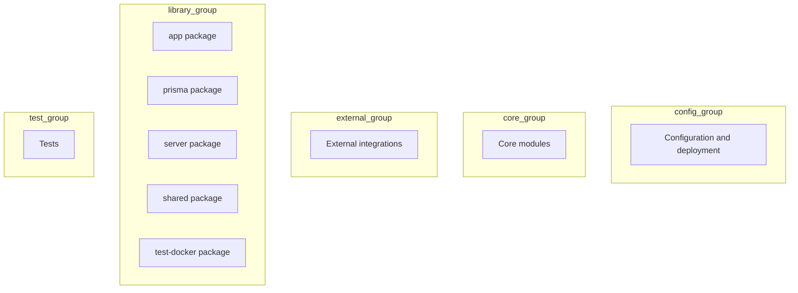

# Architecture report: blinkospace/blinko

> Automated static analysis. **Observed** = directly seen in files/imports/AST; **Inferred** = interpretation from that evidence. Repository code was not executed.

## 1. Repository at a glance

| Item | Value |
| --- | --- |
| Repository | blinkospace/blinko |
| Description | An open-source, self-hosted personal AI note tool prioritizing privacy, built using TypeScript . |
| Language | TypeScript |
| Stars | 11204 |
| Licence | GPL-3.0 |
| Analysed commit / branch | a1c71e67f653f88aabee93c6e5dc433ef5780d18 / main |
| Framework(s) | Express, React |
| Files analysed | 559 |
| Components | 9 |

## 2. Architecture in one minute

blinkospace/blinko - An open-source, self-hosted personal AI note tool prioritizing privacy, built using TypeScript .. This repository was analysed statically from 559 file(s) (0 Python). Detected technologies (observed from imports/manifests): GitHub Actions, PostgreSQL, SQLite, Express, React, axios. Files are grouped into 9 component(s): app package, Configuration and deployment, Core modules, External integrations, prisma package, server package, shared package, test-docker package. Findings below distinguish observed facts from inferred interpretation.

## 3. High-level block diagram

## 4. Main components

### app package (`app`)

- **Kind:** library
- **Status:** Observed
- **Confidence:** 0.85
- **Responsibility:** Groups 243 file(s) under app package (observed from repository paths and static analysis).
- **Paths:** `app/src-tauri/build.rs`, `app/src-tauri/src/desktop/hotkey.rs`, `app/src-tauri/src/desktop/mod.rs`, `app/src-tauri/src/desktop/setup.rs`, `app/src-tauri/src/desktop/text_selection.rs`, `app/src-tauri/src/desktop/tray.rs`, `app/src-tauri/src/desktop/window.rs`, `app/src-tauri/src/desktop/window_state.rs`, `app/src-tauri/src/lib.rs`, `app/src-tauri/src/main.rs`, `app/src/App.tsx`, `app/src/components/Auth/auth-client.ts`, `app/src/components/BlinkoAddButton/index.tsx`, `app/src/components/BlinkoAi/ToolComponents.tsx`, `app/src/components/BlinkoAi/aiChatBox.tsx`, `app/src/components/BlinkoAi/aiConversactionList.tsx`, `app/src/components/BlinkoAi/aiEmoji.tsx`, `app/src/components/BlinkoAi/aiInput.tsx`, `app/src/components/BlinkoAi/aiTag.tsx`, `app/src/components/BlinkoAnalytics/HeatMap.tsx`, `app/src/components/BlinkoAnalytics/StatsCards.tsx`, `app/src/components/BlinkoAnalytics/TagDistributionChart.tsx`, `app/src/components/BlinkoCard/FullscreenEditor.tsx`, `app/src/components/BlinkoCard/SwipeableCard.tsx`, `app/src/components/BlinkoCard/cardBlogBox.tsx`, `app/src/components/BlinkoCard/cardFooter.tsx`, `app/src/components/BlinkoCard/cardHeader.tsx`, `app/src/components/BlinkoCard/commentButton.tsx`, `app/src/components/BlinkoCard/expandContainer.tsx`, `app/src/components/BlinkoCard/index.tsx`, `app/src/components/BlinkoCard/noteContent.tsx`, `app/src/components/BlinkoCard/referencesContent.tsx`, `app/src/components/BlinkoEditor/index.tsx`, `app/src/components/BlinkoFollowDialog/index.tsx`, `app/src/components/BlinkoMultiSelectPop/index.tsx`, `app/src/components/BlinkoMusicPlayer/index.tsx`, `app/src/components/BlinkoNoteHistory/HistoryButton.tsx`, `app/src/components/BlinkoNoteHistory/NoteHistoryModal.tsx`, `app/src/components/BlinkoNotification/index.tsx`, `app/src/components/BlinkoReference/index.tsx`, `app/src/components/BlinkoResource/ResourceContextMenu.tsx`, `app/src/components/BlinkoResource/ResourceItem.tsx`, `app/src/components/BlinkoResource/ResourceMultiSelectpop.tsx`, `app/src/components/BlinkoRightClickMenu/index.tsx`, `app/src/components/BlinkoSettings/AboutSetting.tsx`, `app/src/components/BlinkoSettings/AiSetting/AIIcon.tsx`, `app/src/components/BlinkoSettings/AiSetting/AiPostProcessingSection.tsx`, `app/src/components/BlinkoSettings/AiSetting/AiSetting.tsx`, `app/src/components/BlinkoSettings/AiSetting/AiToolsSection.tsx`, `app/src/components/BlinkoSettings/AiSetting/DefaultModelsSection.tsx`, `app/src/components/BlinkoSettings/AiSetting/EmbeddingSettingsSection.tsx`, `app/src/components/BlinkoSettings/AiSetting/GlobalPromptSection.tsx`, `app/src/components/BlinkoSettings/AiSetting/McpServersSection.tsx`, `app/src/components/BlinkoSettings/AiSetting/ModelDialogContent.tsx`, `app/src/components/BlinkoSettings/AiSetting/ProviderCard.tsx`, `app/src/components/BlinkoSettings/AiSetting/ProviderDialogContent.tsx`, `app/src/components/BlinkoSettings/AiSetting/constants.tsx`, `app/src/components/BlinkoSettings/BasicSetting.tsx`, `app/src/components/BlinkoSettings/ExportSetting.tsx`, `app/src/components/BlinkoSettings/HotkeySetting.tsx`, `app/src/components/BlinkoSettings/HttpProxySetting.tsx`, `app/src/components/BlinkoSettings/ImportAIDialog.tsx`, `app/src/components/BlinkoSettings/ImportSetting.tsx`, `app/src/components/BlinkoSettings/Item.tsx`, `app/src/components/BlinkoSettings/MusicSetting.tsx`, `app/src/components/BlinkoSettings/PerferSetting.tsx`, `app/src/components/BlinkoSettings/PluginSetting.tsx`, `app/src/components/BlinkoSettings/SSOSetting.tsx`, `app/src/components/BlinkoSettings/StorageSetting.tsx`, `app/src/components/BlinkoSettings/TaskSetting.tsx`, `app/src/components/BlinkoSettings/UserSetting.tsx`, `app/src/components/BlinkoShareDialog/index.tsx`, `app/src/components/Common/AttachmentRender/DraggableFileGrid.tsx`, `app/src/components/Common/AttachmentRender/FileIcon.tsx`, `app/src/components/Common/AttachmentRender/audioRender.tsx`, `app/src/components/Common/AttachmentRender/icons.tsx`, `app/src/components/Common/AttachmentRender/imageRender.tsx`, `app/src/components/Common/AttachmentRender/index.tsx`, `app/src/components/Common/AudioDialog/index.tsx`, `app/src/components/Common/AudioRecorder/hook.ts`, `app/src/components/Common/AudioRecorder/interfaces.ts`, `app/src/components/Common/BlinkoSelectNote/index.tsx`, `app/src/components/Common/CameraDialog/index.tsx`, `app/src/components/Common/CollapsibleCard.tsx`, `app/src/components/Common/ContextMenu.tsx`, `app/src/components/Common/Copy/index.tsx`, `app/src/components/Common/CustomCheckbox/index.tsx`, `app/src/components/Common/Div/index.tsx`, `app/src/components/Common/DragContainer/index.tsx`, `app/src/components/Common/Editor/EditorToolbar/extends.ts`, `app/src/components/Common/Editor/EditorToolbar/i18n.ts`, `app/src/components/Common/Editor/EditorToolbar/index.ts`, `app/src/components/Common/Editor/Toolbar/AIWriteButton/index.tsx`, `app/src/components/Common/Editor/Toolbar/FullScreenButton/index.tsx`, `app/src/components/Common/Editor/Toolbar/HashtagButton/index.tsx`, `app/src/components/Common/Editor/Toolbar/IconButton/index.tsx`, `app/src/components/Common/Editor/Toolbar/NoteTypeButton/index.tsx`, `app/src/components/Common/Editor/Toolbar/ReferenceButton/index.tsx`, `app/src/components/Common/Editor/Toolbar/ResourceReferenceButton/index.tsx`, `app/src/components/Common/Editor/Toolbar/SendButton/index.tsx`, `app/src/components/Common/Editor/Toolbar/UploadButtons/index.tsx`, `app/src/components/Common/Editor/Toolbar/ViewModeButton/index.tsx`, `app/src/components/Common/Editor/editorStore.tsx`, `app/src/components/Common/Editor/editorUtils.tsx`, `app/src/components/Common/Editor/hooks/useEditor.ts`, `app/src/components/Common/Editor/index.tsx`, `app/src/components/Common/Editor/type.ts`, `app/src/components/Common/FallbackImage/index.tsx`, `app/src/components/Common/FontSwitcher/index.tsx`, `app/src/components/Common/GradientBackground.tsx`, `app/src/components/Common/Iconify/buildIcons.js`, `app/src/components/Common/Iconify/icons.tsx`, `app/src/components/Common/Icons/index.tsx`, `app/src/components/Common/ImportBlinkoProgress/index.tsx`, `app/src/components/Common/ImportMarkdownProgress/index.tsx`, `app/src/components/Common/ImportMemosProgress/index.tsx`, `app/src/components/Common/LanguageSwitcher/index.tsx`, `app/src/components/Common/LoadingAndEmpty.tsx`, `app/src/components/Common/LoadingPage.tsx`, `app/src/components/Common/MarkdownRender/Code.tsx`, `app/src/components/Common/MarkdownRender/EchartsWrapper.tsx`, `app/src/components/Common/MarkdownRender/ImageWrapper.tsx`, `app/src/components/Common/MarkdownRender/LinkPreview.tsx`, `app/src/components/Common/MarkdownRender/ListItem.tsx`, `app/src/components/Common/MarkdownRender/MarkmapWrapper.tsx`, `app/src/components/Common/MarkdownRender/MermaidWrapper.tsx`, `app/src/components/Common/MarkdownRender/TableWrapper.tsx`, `app/src/components/Common/MarkdownRender/index.tsx`, `app/src/components/Common/Modals/LinkAccountModal.tsx`, `app/src/components/Common/MultiSelectToolbar.tsx`, `app/src/components/Common/PasswordInput/index.tsx`, `app/src/components/Common/PopoverFloat/aiWritePop.tsx`, `app/src/components/Common/PopoverFloat/filterPop.tsx`, `app/src/components/Common/PopoverFloat/index.tsx`, `app/src/components/Common/PopoverFloat/tagSelectPop.tsx`, `app/src/components/Common/RebuildEmbeddingProgress/index.tsx`, `app/src/components/Common/ResizableWrapper/index.tsx`, `app/src/components/Common/ResponsiveTabs/index.tsx`, `app/src/components/Common/ScrollArea/index.tsx`, `app/src/components/Common/ScrollableTabs/index.tsx`, `app/src/components/Common/TagListPanel.tsx`, `app/src/components/Common/TagSelector/index.tsx`, `app/src/components/Common/Theme/ThemeColor.tsx`, `app/src/components/Common/Theme/ThemeSwitcher.tsx`, `app/src/components/Common/TipsDialog/index.tsx`, `app/src/components/Common/TwoFactorModal/gen2FATokenModal.tsx`, `app/src/components/Common/TwoFactorModal/index.tsx`, `app/src/components/Common/UpdateProgressDialog/index.tsx`, `app/src/components/Common/UpdateTagPop/index.tsx`, `app/src/components/Common/UpdateUserInfo.tsx`, `app/src/components/Common/UploadFile/index.tsx`, `app/src/components/Common/UserAvatarDropdown.tsx`, `app/src/components/Common/preparePasswordUpdate.ts`, `app/src/components/Layout/BarSearchInput.tsx`, `app/src/components/Layout/GlobalSearch.tsx`, `app/src/components/Layout/MobileNavBar.tsx`, `app/src/components/Layout/Sidebar.tsx`, `app/src/components/Layout/cn.ts`, `app/src/components/Layout/index.tsx`, `app/src/hooks/useDragCard.tsx`, `app/src/hooks/useInitialHotkeySetup.ts`, `app/src/hooks/useMediaQuery.ts`, `app/src/hooks/useQuickaiHotkey.ts`, `app/src/hooks/useQuicknoteHotkey.ts`, `app/src/lib/axios.ts`, `app/src/lib/blinkoEndpoint.ts`, `app/src/lib/cache.ts`, `app/src/lib/dayjs.ts`, `app/src/lib/event.ts`, `app/src/lib/fileUrl.ts`, `app/src/lib/fontManager.ts`, `app/src/lib/helper.ts`, `app/src/lib/hooks.ts`, `app/src/lib/i18n.ts`, `app/src/lib/lodash.ts`, `app/src/lib/pendingTwoFactor.ts`, `app/src/lib/searchFilters.ts`, `app/src/lib/tauriHelper.ts`, `app/src/lib/trpc.ts`, `app/src/lib/utils.ts`, `app/src/lib/utils/versionUtils.ts`, `app/src/main.tsx`, `app/src/pages/ai-share.tsx`, `app/src/pages/ai.tsx`, `app/src/pages/all.tsx`, `app/src/pages/analytics.tsx`, `app/src/pages/detail/index.tsx`, `app/src/pages/hub.tsx`, `app/src/pages/index.tsx`, `app/src/pages/oauth-callback.tsx`, `app/src/pages/plugin.tsx`, `app/src/pages/quickai.tsx`, `app/src/pages/quicknote.tsx`, `app/src/pages/quicktool.tsx`, `app/src/pages/resources.tsx`, `app/src/pages/review.tsx`, `app/src/pages/settings.tsx`, `app/src/pages/share/[id].tsx`, `app/src/pages/share/index.tsx`, `app/src/pages/signin.tsx`, `app/src/pages/signup.tsx`, `app/src/store/aiSettingStore.tsx`, `app/src/store/aiStore.tsx`, `app/src/store/analyticsStore.ts`, `app/src/store/baseStore.ts`, `app/src/store/blinkoStore.tsx`, `app/src/store/hubStore.tsx`, `app/src/store/index.ts`, `app/src/store/init.ts`, `app/src/store/module/AppProvider.tsx`, `app/src/store/module/Dialog/Provider.tsx`, `app/src/store/module/Dialog/index.tsx`, `app/src/store/module/DialogStandalone/Provider.tsx`, `app/src/store/module/DialogStandalone/index.tsx`, `app/src/store/module/Toast/Toast.tsx`, `app/src/store/musicManagerStore.tsx`, `app/src/store/plugin/index.ts`, `app/src/store/plugin/pluginApiStore.tsx`, `app/src/store/plugin/pluginManagerStore.ts`, `app/src/store/plugin/pluginRender.tsx`, `app/src/store/resourceStore.tsx`, `app/src/store/root.ts`, `app/src/store/standard/ObjectPool.ts`, `app/src/store/standard/PromiseState.ts`, `app/src/store/standard/StorageListState.ts`, `app/src/store/standard/StorageState.ts`, `app/src/store/standard/base.ts`, `app/src/store/user.ts`, `app/src/vite-env.d.ts`, `app/tailwind.config.js`, `app/tauri-plugin-blinko/build.rs`, `app/tauri-plugin-blinko/dist-js/index.cjs`, `app/tauri-plugin-blinko/dist-js/index.d.ts`, `app/tauri-plugin-blinko/dist-js/index.js`, `app/tauri-plugin-blinko/guest-js/index.ts`, `app/tauri-plugin-blinko/rollup.config.js`, `app/tauri-plugin-blinko/src/commands.rs`, `app/tauri-plugin-blinko/src/desktop.rs`, `app/tauri-plugin-blinko/src/error.rs`, `app/tauri-plugin-blinko/src/lib.rs`, `app/tauri-plugin-blinko/src/mobile.rs`, `app/tauri-plugin-blinko/src/models.rs`, `app/vite.config.ts`
- **Evidence:** [app/src-tauri/build.rs](https://github.com/blinkospace/blinko/blob/a1c71e67f653f88aabee93c6e5dc433ef5780d18/app/src-tauri/build.rs); [app/src-tauri/src/desktop/hotkey.rs](https://github.com/blinkospace/blinko/blob/a1c71e67f653f88aabee93c6e5dc433ef5780d18/app/src-tauri/src/desktop/hotkey.rs); [app/src-tauri/src/desktop/mod.rs](https://github.com/blinkospace/blinko/blob/a1c71e67f653f88aabee93c6e5dc433ef5780d18/app/src-tauri/src/desktop/mod.rs); [app/src-tauri/src/desktop/setup.rs](https://github.com/blinkospace/blinko/blob/a1c71e67f653f88aabee93c6e5dc433ef5780d18/app/src-tauri/src/desktop/setup.rs); [app/src-tauri/src/desktop/text_selection.rs](https://github.com/blinkospace/blinko/blob/a1c71e67f653f88aabee93c6e5dc433ef5780d18/app/src-tauri/src/desktop/text_selection.rs); [app/src-tauri/src/desktop/tray.rs](https://github.com/blinkospace/blinko/blob/a1c71e67f653f88aabee93c6e5dc433ef5780d18/app/src-tauri/src/desktop/tray.rs); [app/src-tauri/src/desktop/window.rs](https://github.com/blinkospace/blinko/blob/a1c71e67f653f88aabee93c6e5dc433ef5780d18/app/src-tauri/src/desktop/window.rs); [app/src-tauri/src/desktop/window_state.rs](https://github.com/blinkospace/blinko/blob/a1c71e67f653f88aabee93c6e5dc433ef5780d18/app/src-tauri/src/desktop/window_state.rs)

### Configuration and deployment (`config`)

- **Kind:** config
- **Status:** Observed
- **Confidence:** 0.85
- **Responsibility:** Groups 61 file(s) under configuration and deployment (observed from repository paths and static analysis).
- **Paths:** `app/package.json`, `app/public/locales/ar/translation.json`, `app/public/locales/de/translation.json`, `app/public/locales/en/translation.json`, `app/public/locales/es/translation.json`, `app/public/locales/fr/translation.json`, `app/public/locales/ja/translation.json`, `app/public/locales/ka/translation.json`, `app/public/locales/kab/translation.json`, `app/public/locales/ko/translation.json`, `app/public/locales/nl/translation.json`, `app/public/locales/pl/translation.json`, `app/public/locales/pt/translation.json`, `app/public/locales/ru/translation.json`, `app/public/locales/tr/translation.json`, `app/public/locales/uk/translation.json`, `app/public/locales/zh-TW/translation.json`, `app/public/locales/zh/translation.json`, `app/public/manifest.json`, `app/src-tauri/Cargo.toml`, `app/src-tauri/capabilities/default.json`, `app/src-tauri/capabilities/desktop.json`, `app/src-tauri/capabilities/mobile.json`, `app/src-tauri/gen/android/.editorconfig`, `app/src-tauri/tauri.android.conf.json`, `app/src-tauri/tauri.conf.json`, `app/src-tauri/tauri.cuda.conf.json`, `app/src-tauri/tauri.ios.conf.json`, `app/tauri-plugin-blinko/Cargo.toml`, `app/tauri-plugin-blinko/package.json`, `app/tauri-plugin-blinko/permissions/autogenerated/commands/setColor.toml`, `app/tauri-plugin-blinko/permissions/default.toml`, `app/tauri-plugin-blinko/permissions/schemas/schema.json`, `app/tauri-plugin-blinko/tsconfig.json`, `app/tsconfig.json`, `app/tsconfig.node.json`, `blinko-types/package.json`, `docker-compose.prod.yml`, `docker-compose.yml`, `dockerfile`, `helm/Chart.yaml`, `helm/templates/configmap.yaml`, `helm/templates/deployment.yaml`, `helm/templates/hpa.yaml`, `helm/templates/ingress.yaml`, `helm/templates/service.yaml`, `helm/templates/serviceaccount.yaml`, `helm/values.yaml`, `package.json`, `prisma/migrations/migration_lock.toml`, `prisma/tsconfig.json`, `server/package.json`, `server/tsconfig.json`, `server/tsconfig.trpc.json`, `shared/package.json`, `shared/tsconfig.json`, `test-docker/docker-compose.test.yml`, `tsconfig.blinko.json`, `tsconfig.json`, `tsconfig.node.json`, `turbo.json`
- **Evidence:** [app/package.json](https://github.com/blinkospace/blinko/blob/a1c71e67f653f88aabee93c6e5dc433ef5780d18/app/package.json); [app/public/locales/ar/translation.json](https://github.com/blinkospace/blinko/blob/a1c71e67f653f88aabee93c6e5dc433ef5780d18/app/public/locales/ar/translation.json); [app/public/locales/de/translation.json](https://github.com/blinkospace/blinko/blob/a1c71e67f653f88aabee93c6e5dc433ef5780d18/app/public/locales/de/translation.json); [app/public/locales/en/translation.json](https://github.com/blinkospace/blinko/blob/a1c71e67f653f88aabee93c6e5dc433ef5780d18/app/public/locales/en/translation.json); [app/public/locales/es/translation.json](https://github.com/blinkospace/blinko/blob/a1c71e67f653f88aabee93c6e5dc433ef5780d18/app/public/locales/es/translation.json); [app/public/locales/fr/translation.json](https://github.com/blinkospace/blinko/blob/a1c71e67f653f88aabee93c6e5dc433ef5780d18/app/public/locales/fr/translation.json); [app/public/locales/ja/translation.json](https://github.com/blinkospace/blinko/blob/a1c71e67f653f88aabee93c6e5dc433ef5780d18/app/public/locales/ja/translation.json); [app/public/locales/ka/translation.json](https://github.com/blinkospace/blinko/blob/a1c71e67f653f88aabee93c6e5dc433ef5780d18/app/public/locales/ka/translation.json)

### Core modules (`core`)

- **Kind:** core
- **Status:** Observed
- **Confidence:** 0.85
- **Responsibility:** Groups 2 file(s) under core modules (observed from repository paths and static analysis).
- **Paths:** `install.sh`, `update.sh`
- **Evidence:** [install.sh](https://github.com/blinkospace/blinko/blob/a1c71e67f653f88aabee93c6e5dc433ef5780d18/install.sh); [update.sh](https://github.com/blinkospace/blinko/blob/a1c71e67f653f88aabee93c6e5dc433ef5780d18/update.sh)

### External integrations (`external_integrations`)

- **Kind:** external
- **Status:** Observed
- **Confidence:** 0.85
- **Responsibility:** Groups 1 file(s) under external integrations (observed from repository paths and static analysis).
- **Paths:** `server/__tests__/integration/file/upload.test.ts`
- **Evidence:** [server/__tests__/integration/file/upload.test.ts](https://github.com/blinkospace/blinko/blob/a1c71e67f653f88aabee93c6e5dc433ef5780d18/server/__tests__/integration/file/upload.test.ts)

### prisma package (`prisma`)

- **Kind:** library
- **Status:** Observed
- **Confidence:** 0.85
- **Responsibility:** Groups 6 file(s) under prisma package (observed from repository paths and static analysis).
- **Paths:** `prisma/defaultFonts.ts`, `prisma/resetpassword.ts`, `prisma/seed.d.ts`, `prisma/seed.ts`, `prisma/seedData.d.ts`, `prisma/seedData.ts`
- **Evidence:** [prisma/defaultFonts.ts](https://github.com/blinkospace/blinko/blob/a1c71e67f653f88aabee93c6e5dc433ef5780d18/prisma/defaultFonts.ts); [prisma/resetpassword.ts](https://github.com/blinkospace/blinko/blob/a1c71e67f653f88aabee93c6e5dc433ef5780d18/prisma/resetpassword.ts); [prisma/seed.d.ts](https://github.com/blinkospace/blinko/blob/a1c71e67f653f88aabee93c6e5dc433ef5780d18/prisma/seed.d.ts); [prisma/seed.ts](https://github.com/blinkospace/blinko/blob/a1c71e67f653f88aabee93c6e5dc433ef5780d18/prisma/seed.ts); [prisma/seedData.d.ts](https://github.com/blinkospace/blinko/blob/a1c71e67f653f88aabee93c6e5dc433ef5780d18/prisma/seedData.d.ts); [prisma/seedData.ts](https://github.com/blinkospace/blinko/blob/a1c71e67f653f88aabee93c6e5dc433ef5780d18/prisma/seedData.ts)

### server package (`server`)

- **Kind:** library
- **Status:** Observed
- **Confidence:** 0.85
- **Responsibility:** Groups 112 file(s) under server package (observed from repository paths and static analysis).
- **Paths:** `server/__tests__/e2e/file-upload.test.ts`, `server/__tests__/security/attachment-binding.test.ts`, `server/__tests__/security/authorization.test.ts`, `server/__tests__/security/exports.test.ts`, `server/__tests__/security/file-storage.test.ts`, `server/__tests__/security/file-urls.test.ts`, `server/__tests__/security/http-auth.test.ts`, `server/__tests__/security/http-files.test.ts`, `server/__tests__/security/mcp-process.test.ts`, `server/__tests__/security/mcp.test.ts`, `server/__tests__/security/oauth-callback.test.ts`, `server/__tests__/security/pending-two-factor.test.ts`, `server/__tests__/security/plugin.test.ts`, `server/__tests__/security/policies.test.ts`, `server/__tests__/security/public-http.test.ts`, `server/__tests__/security/public-routes.test.ts`, `server/__tests__/security/public-runtime.test.ts`, `server/__tests__/unit/lib/sanitizeUploadFileName.test.ts`, `server/__tests__/unit/routerTrpc/attachment.deleteMany.test.ts`, `server/aiServer/aiModelFactory.ts`, `server/aiServer/index.ts`, `server/aiServer/mcp/McpClientManager.ts`, `server/aiServer/mcp/McpToolBridge.ts`, `server/aiServer/mcp/index.ts`, `server/aiServer/providers/AudioProvider.ts`, `server/aiServer/providers/BaseProvider.ts`, `server/aiServer/providers/EmbeddingProvider.ts`, `server/aiServer/providers/LLMProvider.ts`, `server/aiServer/providers/__tests__/litellm-provider.test.ts`, `server/aiServer/providers/__tests__/minimax-integration.test.ts`, `server/aiServer/providers/__tests__/minimax-provider.test.ts`, `server/aiServer/providers/index.ts`, `server/aiServer/tools/createBlinko.ts`, `server/aiServer/tools/createComment.ts`, `server/aiServer/tools/deleteBlinko.ts`, `server/aiServer/tools/scheduledTask.ts`, `server/aiServer/tools/searchBlinko.ts`, `server/aiServer/tools/updateBlinko.ts`, `server/aiServer/tools/webExtra.ts`, `server/aiServer/tools/webSearch.ts`, `server/aiServer/types.ts`, `server/context.ts`, `server/esbuild.config.ts`, `server/index.ts`, `server/jobs/aiScheduledTaskJob.ts`, `server/jobs/archivejob.d.ts`, `server/jobs/archivejob.ts`, `server/jobs/baseScheduleJob.d.ts`, `server/jobs/baseScheduleJob.ts`, `server/jobs/dbjob.d.ts`, `server/jobs/dbjob.ts`, `server/jobs/markdownJob.ts`, `server/jobs/memosJob.d.ts`, `server/jobs/memosJob.ts`, `server/jobs/rebuildEmbeddingJob.d.ts`, `server/jobs/rebuildEmbeddingJob.ts`, `server/jobs/recommandJob.d.ts`, `server/jobs/recommandJob.ts`, `server/lib/attachmentBinding.ts`, `server/lib/attachmentShare.ts`, `server/lib/commentWebhook.ts`, `server/lib/conversationAccess.ts`, `server/lib/exportDownload.ts`, `server/lib/fileAccessPolicy.ts`, `server/lib/files.ts`, `server/lib/helper.ts`, `server/lib/mcpStdioPolicy.ts`, `server/lib/pgBoss.ts`, `server/lib/pluginPaths.ts`, `server/lib/providerVisibility.ts`, `server/lib/proxy.ts`, `server/lib/publicHttp.ts`, `server/lib/spotify.ts`, `server/lib/twoFactorLogin.ts`, `server/middleware/index.ts`, `server/prisma.ts`, `server/routerExpress/auth/config.ts`, `server/routerExpress/auth/index.ts`, `server/routerExpress/file/delete.ts`, `server/routerExpress/file/file.ts`, `server/routerExpress/file/plugin.ts`, `server/routerExpress/file/s3file.ts`, `server/routerExpress/file/upload-by-url.ts`, `server/routerExpress/file/upload.ts`, `server/routerExpress/mcp.ts`, `server/routerExpress/openai.ts`, `server/routerExpress/rss.ts`, `server/routerTrpc/_app.ts`, `server/routerTrpc/ai.ts`, `server/routerTrpc/aiScheduledTask.ts`, `server/routerTrpc/analytics.ts`, `server/routerTrpc/attachment.ts`, `server/routerTrpc/comment.ts`, `server/routerTrpc/config.ts`, `server/routerTrpc/conversation.ts`, `server/routerTrpc/follows.ts`, `server/routerTrpc/font.ts`, `server/routerTrpc/mcpServers.ts`, `server/routerTrpc/message.ts`, `server/routerTrpc/note.ts`, `server/routerTrpc/notification.ts`, `server/routerTrpc/plugin.ts`, `server/routerTrpc/public.ts`, `server/routerTrpc/tag.ts`, `server/routerTrpc/task.ts`, `server/routerTrpc/user.ts`, `server/scripts/test-security.ts`, `server/swagger.ts`, `server/types/express.d.ts`, `server/types/trpc.d.ts`, `server/vditor/js/graphviz/viz.js`, `server/vditor/js/highlight.js/third-languages.js`
- **Evidence:** [server/__tests__/e2e/file-upload.test.ts](https://github.com/blinkospace/blinko/blob/a1c71e67f653f88aabee93c6e5dc433ef5780d18/server/__tests__/e2e/file-upload.test.ts); [server/__tests__/security/attachment-binding.test.ts](https://github.com/blinkospace/blinko/blob/a1c71e67f653f88aabee93c6e5dc433ef5780d18/server/__tests__/security/attachment-binding.test.ts); [server/__tests__/security/authorization.test.ts](https://github.com/blinkospace/blinko/blob/a1c71e67f653f88aabee93c6e5dc433ef5780d18/server/__tests__/security/authorization.test.ts); [server/__tests__/security/exports.test.ts](https://github.com/blinkospace/blinko/blob/a1c71e67f653f88aabee93c6e5dc433ef5780d18/server/__tests__/security/exports.test.ts); [server/__tests__/security/file-storage.test.ts](https://github.com/blinkospace/blinko/blob/a1c71e67f653f88aabee93c6e5dc433ef5780d18/server/__tests__/security/file-storage.test.ts); [server/__tests__/security/file-urls.test.ts](https://github.com/blinkospace/blinko/blob/a1c71e67f653f88aabee93c6e5dc433ef5780d18/server/__tests__/security/file-urls.test.ts); [server/__tests__/security/http-auth.test.ts](https://github.com/blinkospace/blinko/blob/a1c71e67f653f88aabee93c6e5dc433ef5780d18/server/__tests__/security/http-auth.test.ts); [server/__tests__/security/http-files.test.ts](https://github.com/blinkospace/blinko/blob/a1c71e67f653f88aabee93c6e5dc433ef5780d18/server/__tests__/security/http-files.test.ts)

### shared package (`shared`)

- **Kind:** library
- **Status:** Observed
- **Confidence:** 0.85
- **Responsibility:** Groups 11 file(s) under shared package (observed from repository paths and static analysis).
- **Paths:** `shared/index.ts`, `shared/lib/__tests__/minimax-model-templates.test.ts`, `shared/lib/cache.ts`, `shared/lib/dayjs.ts`, `shared/lib/helper.ts`, `shared/lib/lodash.ts`, `shared/lib/modelTemplates.ts`, `shared/lib/pathConstant.ts`, `shared/lib/prismaZodType.ts`, `shared/lib/sharedConstant.ts`, `shared/lib/types.ts`
- **Evidence:** [shared/index.ts](https://github.com/blinkospace/blinko/blob/a1c71e67f653f88aabee93c6e5dc433ef5780d18/shared/index.ts); [shared/lib/__tests__/minimax-model-templates.test.ts](https://github.com/blinkospace/blinko/blob/a1c71e67f653f88aabee93c6e5dc433ef5780d18/shared/lib/__tests__/minimax-model-templates.test.ts); [shared/lib/cache.ts](https://github.com/blinkospace/blinko/blob/a1c71e67f653f88aabee93c6e5dc433ef5780d18/shared/lib/cache.ts); [shared/lib/dayjs.ts](https://github.com/blinkospace/blinko/blob/a1c71e67f653f88aabee93c6e5dc433ef5780d18/shared/lib/dayjs.ts); [shared/lib/helper.ts](https://github.com/blinkospace/blinko/blob/a1c71e67f653f88aabee93c6e5dc433ef5780d18/shared/lib/helper.ts); [shared/lib/lodash.ts](https://github.com/blinkospace/blinko/blob/a1c71e67f653f88aabee93c6e5dc433ef5780d18/shared/lib/lodash.ts); [shared/lib/modelTemplates.ts](https://github.com/blinkospace/blinko/blob/a1c71e67f653f88aabee93c6e5dc433ef5780d18/shared/lib/modelTemplates.ts); [shared/lib/pathConstant.ts](https://github.com/blinkospace/blinko/blob/a1c71e67f653f88aabee93c6e5dc433ef5780d18/shared/lib/pathConstant.ts)

### test-docker package (`test_docker`)

- **Kind:** library
- **Status:** Observed
- **Confidence:** 0.85
- **Responsibility:** Groups 1 file(s) under test-docker package (observed from repository paths and static analysis).
- **Paths:** `test-docker/mock-openai/server.js`
- **Evidence:** [test-docker/mock-openai/server.js](https://github.com/blinkospace/blinko/blob/a1c71e67f653f88aabee93c6e5dc433ef5780d18/test-docker/mock-openai/server.js)

### Tests (`tests`)

- **Kind:** test
- **Status:** Observed
- **Confidence:** 0.85
- **Responsibility:** Groups 1 file(s) under tests (observed from repository paths and static analysis).
- **Paths:** `app/tauri-plugin-blinko/android/src/test/java/ExampleUnitTest.kt`
- **Evidence:** [app/tauri-plugin-blinko/android/src/test/java/ExampleUnitTest.kt](https://github.com/blinkospace/blinko/blob/a1c71e67f653f88aabee93c6e5dc433ef5780d18/app/tauri-plugin-blinko/android/src/test/java/ExampleUnitTest.kt)

## 5. Execution flow

**Observed** entry point(s):

- [app/src/App.tsx](https://github.com/blinkospace/blinko/blob/a1c71e67f653f88aabee93c6e5dc433ef5780d18/app/src/App.tsx)
- [app/src/main.tsx](https://github.com/blinkospace/blinko/blob/a1c71e67f653f88aabee93c6e5dc433ef5780d18/app/src/main.tsx)
- [app/src/pages/index.tsx](https://github.com/blinkospace/blinko/blob/a1c71e67f653f88aabee93c6e5dc433ef5780d18/app/src/pages/index.tsx)
- [app/src/store/index.ts](https://github.com/blinkospace/blinko/blob/a1c71e67f653f88aabee93c6e5dc433ef5780d18/app/src/store/index.ts)
- [app/tauri-plugin-blinko/dist-js/index.cjs](https://github.com/blinkospace/blinko/blob/a1c71e67f653f88aabee93c6e5dc433ef5780d18/app/tauri-plugin-blinko/dist-js/index.cjs)
- [app/tauri-plugin-blinko/dist-js/index.js](https://github.com/blinkospace/blinko/blob/a1c71e67f653f88aabee93c6e5dc433ef5780d18/app/tauri-plugin-blinko/dist-js/index.js)
- [app/tauri-plugin-blinko/guest-js/index.ts](https://github.com/blinkospace/blinko/blob/a1c71e67f653f88aabee93c6e5dc433ef5780d18/app/tauri-plugin-blinko/guest-js/index.ts)
- [server/aiServer/index.ts](https://github.com/blinkospace/blinko/blob/a1c71e67f653f88aabee93c6e5dc433ef5780d18/server/aiServer/index.ts)
- [server/aiServer/mcp/index.ts](https://github.com/blinkospace/blinko/blob/a1c71e67f653f88aabee93c6e5dc433ef5780d18/server/aiServer/mcp/index.ts)
- [server/aiServer/providers/index.ts](https://github.com/blinkospace/blinko/blob/a1c71e67f653f88aabee93c6e5dc433ef5780d18/server/aiServer/providers/index.ts)
- [server/index.ts](https://github.com/blinkospace/blinko/blob/a1c71e67f653f88aabee93c6e5dc433ef5780d18/server/index.ts)
- [shared/index.ts](https://github.com/blinkospace/blinko/blob/a1c71e67f653f88aabee93c6e5dc433ef5780d18/shared/index.ts)

Representative flow (derived from observed entry points and the import graph; steps beyond the entry point are **Inferred**):

1. Execution starts at an observed entry point listed above, if present.
2. No internal import relationships between components were observed.

## 6. Project structure

### `(root)`

- `.dockerignore` - container (425 bytes)
- `.gitignore` - other (410 bytes)
- `CLAUDE.md` - docs (4894 bytes)
- `DEV.md` - docs (2400 bytes)
- `LICENSE` - docs (35115 bytes)
- `README.md` - docs (5465 bytes)
- `README.zh-CN.md` - docs (4967 bytes)
- `SECURITY.md` - docs (214 bytes)
- `docker-compose.prod.yml` - config (1581 bytes)
- `docker-compose.yml` - container (1275 bytes)
- `dockerfile` - container (4584 bytes)
- `install.sh` - source, Shell (3220 bytes)
- `package.json` - manifest (1569 bytes)
- `tsconfig.blinko.json` - config (674 bytes)
- `tsconfig.json` - config (799 bytes)
- `tsconfig.node.json` - config (213 bytes)
- `turbo.json` - config (1170 bytes)
- `update.sh` - source, Shell (2650 bytes)

### `.github`

- `.github/FUNDING.yml` - config (864 bytes)
- `.github/ISSUE_TEMPLATE/bug_report.md` - docs (834 bytes)
- `.github/ISSUE_TEMPLATE/feature_request.md` - docs (595 bytes)
- `.github/changelog/changelog.js` - source, JavaScript (1047 bytes)
- `.github/workflows/app-release.yml` - ci, YAML (24741 bytes)
- `.github/workflows/build-publish-release.yml` - ci, YAML (11199 bytes)
- `.github/workflows/docker-build.yml` - ci, YAML (1098 bytes)
- `.github/workflows/mark-stable.yml` - ci, YAML (1126 bytes)
- `.github/workflows/security-checks.yml` - ci, YAML (1413 bytes)
- `.github/workflows/test-telegram-notification.yml` - ci, YAML (8228 bytes)
- `.github/workflows/translator.yml` - ci, YAML (781 bytes)
- `.github/workflows/windows-test-release.yml` - ci, YAML (8550 bytes)

### `app`

- `app/.gitignore` - other (253 bytes)
- `app/README.md` - docs (378 bytes)
- `app/index.html` - other (2458 bytes)
- `app/package.json` - manifest (4335 bytes)
- `app/public/image-fallback.svg` - other (1281 bytes)
- `app/public/locales/ar/translation.json` - config (53270 bytes)
- `app/public/locales/de/translation.json` - config (45352 bytes)
- `app/public/locales/en/translation.json` - config (40018 bytes)
- `app/public/locales/es/translation.json` - config (45206 bytes)
- `app/public/locales/fr/translation.json` - config (46777 bytes)
- `app/public/locales/ja/translation.json` - config (47169 bytes)
- `app/public/locales/ka/translation.json` - config (68258 bytes)
- `app/public/locales/kab/translation.json` - config (31129 bytes)
- `app/public/locales/ko/translation.json` - config (43599 bytes)
- `app/public/locales/nl/translation.json` - config (42647 bytes)
- `app/public/locales/pl/translation.json` - config (43779 bytes)
- `app/public/locales/pt/translation.json` - config (44608 bytes)
- `app/public/locales/ru/translation.json` - config (59423 bytes)
- `app/public/locales/tr/translation.json` - config (44254 bytes)
- `app/public/locales/uk/translation.json` - config (58417 bytes)
- `app/public/locales/zh-TW/translation.json` - config (39024 bytes)
- `app/public/locales/zh/translation.json` - config (38945 bytes)
- `app/public/manifest.json` - config (1209 bytes)
- `app/public/run-on-pikapods.svg` - other (14969 bytes)
- `app/public/run-on-zimaos-v2.svg` - other (20136 bytes)
- `app/src-tauri/.gitignore` - other (166 bytes)
- `app/src-tauri/Cargo.toml` - manifest (1560 bytes)
- `app/src-tauri/build.rs` - source, Rust (39 bytes)
- `app/src-tauri/capabilities/default.json` - config (1276 bytes)
- `app/src-tauri/capabilities/desktop.json` - config (1458 bytes)
- `app/src-tauri/capabilities/mobile.json` - config (1273 bytes)
- `app/src-tauri/gen/android/.editorconfig` - config (230 bytes)
- `app/src-tauri/gen/android/.gitignore` - other (270 bytes)
- `app/src-tauri/gen/android/app/.gitignore` - other (160 bytes)
- `app/src-tauri/gen/android/app/build.gradle.kts` - other (2813 bytes)
- `app/src-tauri/gen/android/app/proguard-rules.pro` - other (750 bytes)
- `app/src-tauri/gen/android/app/src/main/AndroidManifest.xml` - other (3880 bytes)
- `app/src-tauri/gen/android/app/src/main/java/com/blinko/app/MainActivity.kt` - other (6893 bytes)
- `app/src-tauri/gen/android/app/src/main/java/com/blinko/app/VoiceNoteWidgetProvider.kt` - other (2080 bytes)
- `app/src-tauri/gen/android/app/src/main/res/drawable-night/ic_note_shortcut.xml` - other (1230 bytes)
- `app/src-tauri/gen/android/app/src/main/res/drawable-night/ic_voice_shortcut.xml` - other (1205 bytes)
- `app/src-tauri/gen/android/app/src/main/res/drawable-v24/ic_launcher_foreground.xml` - other (1702 bytes)
- `app/src-tauri/gen/android/app/src/main/res/drawable/ic_blinko_logo.xml` - other (4266 bytes)
- `app/src-tauri/gen/android/app/src/main/res/drawable/ic_launcher_background.xml` - other (5606 bytes)
- `app/src-tauri/gen/android/app/src/main/res/drawable/ic_note.xml` - other (1217 bytes)
- `app/src-tauri/gen/android/app/src/main/res/drawable/ic_note_shortcut.xml` - other (1230 bytes)
- `app/src-tauri/gen/android/app/src/main/res/drawable/ic_voice.xml` - other (1179 bytes)
- `app/src-tauri/gen/android/app/src/main/res/drawable/ic_voice_shortcut.xml` - other (1205 bytes)
- `app/src-tauri/gen/android/app/src/main/res/drawable/widget_background.xml` - other (299 bytes)
- `app/src-tauri/gen/android/app/src/main/res/layout/activity_main.xml` - other (780 bytes)
- `app/src-tauri/gen/android/app/src/main/res/layout/widget_voice_note.xml` - other (889 bytes)
- `app/src-tauri/gen/android/app/src/main/res/values-night/themes.xml` - other (250 bytes)
- `app/src-tauri/gen/android/app/src/main/res/values/colors.xml` - other (378 bytes)
- `app/src-tauri/gen/android/app/src/main/res/values/strings.xml` - other (647 bytes)
- `app/src-tauri/gen/android/app/src/main/res/values/themes.xml` - other (250 bytes)
- `app/src-tauri/gen/android/app/src/main/res/xml/file_paths.xml` - other (210 bytes)
- `app/src-tauri/gen/android/app/src/main/res/xml/shortcuts.xml` - other (1546 bytes)
- `app/src-tauri/gen/android/app/src/main/res/xml/voice_note_widget_info.xml` - other (599 bytes)
- `app/src-tauri/gen/android/build.gradle.kts` - other (376 bytes)
- `app/src-tauri/gen/android/buildSrc/build.gradle.kts` - other (344 bytes)
- `app/src-tauri/gen/android/buildSrc/src/main/java/com/blinko/app/kotlin/BuildTask.kt` - other (1964 bytes)
- `app/src-tauri/gen/android/buildSrc/src/main/java/com/blinko/app/kotlin/RustPlugin.kt` - other (3336 bytes)
- `app/src-tauri/gen/android/gradle.properties` - other (1387 bytes)
- `app/src-tauri/gen/android/gradle/wrapper/gradle-wrapper.properties` - other (230 bytes)
- `app/src-tauri/gen/android/gradlew` - other (5766 bytes)
- `app/src-tauri/gen/android/gradlew.bat` - other (2674 bytes)
- `app/src-tauri/gen/android/settings.gradle` - other (52 bytes)
- `app/src-tauri/src/desktop/hotkey.rs` - source, Rust (6123 bytes)
- `app/src-tauri/src/desktop/mod.rs` - source, Rust (232 bytes)
- `app/src-tauri/src/desktop/setup.rs` - source, Rust (11000 bytes)
- `app/src-tauri/src/desktop/text_selection.rs` - source, Rust (19539 bytes)
- `app/src-tauri/src/desktop/tray.rs` - source, Rust (2830 bytes)
- `app/src-tauri/src/desktop/window.rs` - source, Rust (10567 bytes)
- `app/src-tauri/src/desktop/window_state.rs` - source, Rust (7514 bytes)
- `app/src-tauri/src/lib.rs` - source, Rust (3811 bytes)
- `app/src-tauri/src/main.rs` - source, Rust (178 bytes)
- `app/src-tauri/tauri.android.conf.json` - config (162 bytes)
- `app/src-tauri/tauri.conf.json` - config (2820 bytes)
- `app/src-tauri/tauri.cuda.conf.json` - config (2825 bytes)
- `app/src-tauri/tauri.ios.conf.json` - config (184 bytes)
- `app/src/App.tsx` - source, TypeScript (10944 bytes)
- `app/src/assets/react.svg` - other (4126 bytes)
- `app/src/components/Auth/auth-client.ts` - source, TypeScript (5368 bytes)
- `app/src/components/BlinkoAddButton/index.tsx` - source, TypeScript (3571 bytes)
- `app/src/components/BlinkoAi/ToolComponents.tsx` - source, TypeScript (7914 bytes)
- `app/src/components/BlinkoAi/aiChatBox.tsx` - source, TypeScript (18704 bytes)
- `app/src/components/BlinkoAi/aiConversactionList.tsx` - source, TypeScript (3867 bytes)
- `app/src/components/BlinkoAi/aiEmoji.tsx` - source, TypeScript (1241 bytes)
- `app/src/components/BlinkoAi/aiInput.tsx` - source, TypeScript (9364 bytes)
- `app/src/components/BlinkoAi/aiTag.tsx` - source, TypeScript (1936 bytes)
- `app/src/components/BlinkoAnalytics/HeatMap.tsx` - source, TypeScript (4402 bytes)
- `app/src/components/BlinkoAnalytics/StatsCards.tsx` - source, TypeScript (3035 bytes)
- `app/src/components/BlinkoAnalytics/TagDistributionChart.tsx` - source, TypeScript (4214 bytes)
- `app/src/components/BlinkoCard/FullscreenEditor.tsx` - source, TypeScript (12505 bytes)
- `app/src/components/BlinkoCard/SwipeableCard.tsx` - source, TypeScript (5737 bytes)
- `app/src/components/BlinkoCard/cardBlogBox.tsx` - source, TypeScript (3316 bytes)
- `app/src/components/BlinkoCard/cardFooter.tsx` - source, TypeScript (6539 bytes)
- `app/src/components/BlinkoCard/cardHeader.tsx` - source, TypeScript (8365 bytes)
- `app/src/components/BlinkoCard/commentButton.tsx` - source, TypeScript (13519 bytes)
- `app/src/components/BlinkoCard/expandContainer.tsx` - source, TypeScript (3152 bytes)
- `app/src/components/BlinkoCard/index.tsx` - source, TypeScript (7059 bytes)
- `app/src/components/BlinkoCard/noteContent.tsx` - source, TypeScript (1231 bytes)
- `app/src/components/BlinkoCard/referencesContent.tsx` - source, TypeScript (2902 bytes)
- `app/src/components/BlinkoEditor/index.tsx` - source, TypeScript (7170 bytes)
- `app/src/components/BlinkoFollowDialog/index.tsx` - source, TypeScript (5642 bytes)
- `app/src/components/BlinkoMultiSelectPop/index.tsx` - source, TypeScript (2967 bytes)
- `app/src/components/BlinkoMusicPlayer/index.tsx` - source, TypeScript (11928 bytes)
- `app/src/components/BlinkoNoteHistory/HistoryButton.tsx` - source, TypeScript (1065 bytes)
- `app/src/components/BlinkoNoteHistory/NoteHistoryModal.tsx` - source, TypeScript (6196 bytes)
- `app/src/components/BlinkoNotification/index.tsx` - source, TypeScript (6035 bytes)
- `app/src/components/BlinkoReference/index.tsx` - source, TypeScript (1498 bytes)
- `app/src/components/BlinkoResource/ResourceContextMenu.tsx` - source, TypeScript (8588 bytes)
- `app/src/components/BlinkoResource/ResourceItem.tsx` - source, TypeScript (9409 bytes)
- `app/src/components/BlinkoResource/ResourceMultiSelectpop.tsx` - source, TypeScript (1836 bytes)
- `app/src/components/BlinkoRightClickMenu/index.tsx` - source, TypeScript (21793 bytes)
- `app/src/components/BlinkoSettings/AboutSetting.tsx` - source, TypeScript (7950 bytes)
- `app/src/components/BlinkoSettings/AiSetting/AIIcon.tsx` - source, TypeScript (4384 bytes)
- `app/src/components/BlinkoSettings/AiSetting/AiPostProcessingSection.tsx` - source, TypeScript (12699 bytes)
- `app/src/components/BlinkoSettings/AiSetting/AiSetting.tsx` - source, TypeScript (6406 bytes)
- `app/src/components/BlinkoSettings/AiSetting/AiToolsSection.tsx` - source, TypeScript (2890 bytes)
- `app/src/components/BlinkoSettings/AiSetting/DefaultModelsSection.tsx` - source, TypeScript (12836 bytes)
- `app/src/components/BlinkoSettings/AiSetting/EmbeddingSettingsSection.tsx` - source, TypeScript (8926 bytes)
- `app/src/components/BlinkoSettings/AiSetting/GlobalPromptSection.tsx` - source, TypeScript (1918 bytes)
- `app/src/components/BlinkoSettings/AiSetting/McpServersSection.tsx` - source, TypeScript (20815 bytes)
- `app/src/components/BlinkoSettings/AiSetting/ModelDialogContent.tsx` - source, TypeScript (14914 bytes)
- `app/src/components/BlinkoSettings/AiSetting/ProviderCard.tsx` - source, TypeScript (19340 bytes)
- `app/src/components/BlinkoSettings/AiSetting/ProviderDialogContent.tsx` - source, TypeScript (8989 bytes)
- `app/src/components/BlinkoSettings/AiSetting/constants.tsx` - source, TypeScript (5008 bytes)
- `app/src/components/BlinkoSettings/BasicSetting.tsx` - source, TypeScript (13948 bytes)
- `app/src/components/BlinkoSettings/ExportSetting.tsx` - source, TypeScript (4327 bytes)
- `app/src/components/BlinkoSettings/HotkeySetting.tsx` - source, TypeScript (24270 bytes)
- `app/src/components/BlinkoSettings/HttpProxySetting.tsx` - source, TypeScript (11172 bytes)
- `app/src/components/BlinkoSettings/ImportAIDialog.tsx` - source, TypeScript (11223 bytes)
- `app/src/components/BlinkoSettings/ImportSetting.tsx` - source, TypeScript (2721 bytes)
- `app/src/components/BlinkoSettings/Item.tsx` - source, TypeScript (2365 bytes)
- `app/src/components/BlinkoSettings/MusicSetting.tsx` - source, TypeScript (2180 bytes)
- `app/src/components/BlinkoSettings/PerferSetting.tsx` - source, TypeScript (17663 bytes)
- `app/src/components/BlinkoSettings/PluginSetting.tsx` - source, TypeScript (26458 bytes)
- `app/src/components/BlinkoSettings/SSOSetting.tsx` - source, TypeScript (12913 bytes)
- `app/src/components/BlinkoSettings/StorageSetting.tsx` - source, TypeScript (5774 bytes)
- `app/src/components/BlinkoSettings/TaskSetting.tsx` - source, TypeScript (11269 bytes)
- `app/src/components/BlinkoSettings/UserSetting.tsx` - source, TypeScript (6721 bytes)
- `app/src/components/BlinkoShareDialog/index.tsx` - source, TypeScript (16586 bytes)
- `app/src/components/Common/AttachmentRender/DraggableFileGrid.tsx` - source, TypeScript (2791 bytes)
- `app/src/components/Common/AttachmentRender/FileIcon.tsx` - source, TypeScript (1096 bytes)
- `app/src/components/Common/AttachmentRender/audioRender.tsx` - source, TypeScript (24612 bytes)
- `app/src/components/Common/AttachmentRender/icons.tsx` - source, TypeScript (5926 bytes)
- `app/src/components/Common/AttachmentRender/imageRender.tsx` - source, TypeScript (4861 bytes)
- `app/src/components/Common/AttachmentRender/index.tsx` - source, TypeScript (6032 bytes)
- `app/src/components/Common/AudioDialog/index.tsx` - source, TypeScript (14950 bytes)
- `app/src/components/Common/AudioRecorder/hook.ts` - source, TypeScript (9620 bytes)
- `app/src/components/Common/AudioRecorder/index.css` - other (1696 bytes)
- `app/src/components/Common/AudioRecorder/interfaces.ts` - source, TypeScript (2641 bytes)
- `app/src/components/Common/BlinkoSelectNote/index.tsx` - source, TypeScript (3112 bytes)
- `app/src/components/Common/CameraDialog/index.tsx` - source, TypeScript (8171 bytes)
- `app/src/components/Common/CollapsibleCard.tsx` - source, TypeScript (3682 bytes)
- `app/src/components/Common/ContextMenu.tsx` - source, TypeScript (144 bytes)
- `app/src/components/Common/Copy/index.tsx` - source, TypeScript (731 bytes)
- `app/src/components/Common/CustomCheckbox/index.tsx` - source, TypeScript (1202 bytes)
- `app/src/components/Common/Div/index.tsx` - source, TypeScript (635 bytes)
- `app/src/components/Common/DragContainer/index.tsx` - source, TypeScript (2829 bytes)
- `app/src/components/Common/Editor/EditorToolbar/extends.ts` - source, TypeScript (674 bytes)
- `app/src/components/Common/Editor/EditorToolbar/i18n.ts` - source, TypeScript (2520 bytes)
- `app/src/components/Common/Editor/EditorToolbar/index.ts` - source, TypeScript (8049 bytes)
- `app/src/components/Common/Editor/Toolbar/AIWriteButton/index.tsx` - source, TypeScript (6701 bytes)
- `app/src/components/Common/Editor/Toolbar/FullScreenButton/index.tsx` - source, TypeScript (622 bytes)
- `app/src/components/Common/Editor/Toolbar/HashtagButton/index.tsx` - source, TypeScript (3098 bytes)
- `app/src/components/Common/Editor/Toolbar/IconButton/index.tsx` - source, TypeScript (1469 bytes)
- `app/src/components/Common/Editor/Toolbar/NoteTypeButton/index.tsx` - source, TypeScript (2169 bytes)
- `app/src/components/Common/Editor/Toolbar/ReferenceButton/index.tsx` - source, TypeScript (741 bytes)
- `app/src/components/Common/Editor/Toolbar/ResourceReferenceButton/index.tsx` - source, TypeScript (3690 bytes)
- `app/src/components/Common/Editor/Toolbar/SendButton/index.tsx` - source, TypeScript (1161 bytes)
- `app/src/components/Common/Editor/Toolbar/UploadButtons/index.tsx` - source, TypeScript (2132 bytes)
- `app/src/components/Common/Editor/Toolbar/ViewModeButton/index.tsx` - source, TypeScript (2071 bytes)
- `app/src/components/Common/Editor/editorStore.tsx` - source, TypeScript (14013 bytes)
- `app/src/components/Common/Editor/editorUtils.tsx` - source, TypeScript (2361 bytes)
- `app/src/components/Common/Editor/hooks/useEditor.ts` - source, TypeScript (60868 bytes)
- `app/src/components/Common/Editor/index.tsx` - source, TypeScript (10144 bytes)
- `app/src/components/Common/Editor/type.ts` - source, TypeScript (484 bytes)
- `app/src/components/Common/FallbackImage/index.tsx` - source, TypeScript (535 bytes)
- `app/src/components/Common/FontSwitcher/index.tsx` - source, TypeScript (3674 bytes)
- `app/src/components/Common/GradientBackground.tsx` - source, TypeScript (2661 bytes)
- `app/src/components/Common/Iconify/buildIcons.js` - source, JavaScript (8357 bytes)
- `app/src/components/Common/Iconify/icons.tsx` - source, TypeScript (152344 bytes)
- `app/src/components/Common/Icons/index.tsx` - source, TypeScript (5460 bytes)
- `app/src/components/Common/ImportBlinkoProgress/index.tsx` - source, TypeScript (2448 bytes)
- `app/src/components/Common/ImportMarkdownProgress/index.tsx` - source, TypeScript (2464 bytes)
- `app/src/components/Common/ImportMemosProgress/index.tsx` - source, TypeScript (2448 bytes)
- `app/src/components/Common/LanguageSwitcher/index.tsx` - source, TypeScript (1676 bytes)
- `app/src/components/Common/LoadingAndEmpty.tsx` - source, TypeScript (1197 bytes)
- `app/src/components/Common/LoadingPage.tsx` - source, TypeScript (1145 bytes)
- `app/src/components/Common/MarkdownRender/Code.tsx` - source, TypeScript (1433 bytes)
- `app/src/components/Common/MarkdownRender/EchartsWrapper.tsx` - source, TypeScript (1153 bytes)
- `app/src/components/Common/MarkdownRender/ImageWrapper.tsx` - source, TypeScript (975 bytes)
- `app/src/components/Common/MarkdownRender/LinkPreview.tsx` - source, TypeScript (4027 bytes)
- `app/src/components/Common/MarkdownRender/ListItem.tsx` - source, TypeScript (5367 bytes)
- `app/src/components/Common/MarkdownRender/MarkmapWrapper.tsx` - source, TypeScript (734 bytes)
- `app/src/components/Common/MarkdownRender/MermaidWrapper.tsx` - source, TypeScript (1398 bytes)
- `app/src/components/Common/MarkdownRender/TableWrapper.tsx` - source, TypeScript (2729 bytes)
- `app/src/components/Common/MarkdownRender/index.tsx` - source, TypeScript (9764 bytes)
- `app/src/components/Common/Modals/LinkAccountModal.tsx` - source, TypeScript (2301 bytes)
- `app/src/components/Common/MultiSelectToolbar.tsx` - source, TypeScript (1259 bytes)
- `app/src/components/Common/PasswordInput/index.tsx` - source, TypeScript (1473 bytes)
- `app/src/components/Common/PopoverFloat/aiWritePop.tsx` - source, TypeScript (6384 bytes)
- `app/src/components/Common/PopoverFloat/filterPop.tsx` - source, TypeScript (8873 bytes)
- `app/src/components/Common/PopoverFloat/index.tsx` - source, TypeScript (2857 bytes)
- `app/src/components/Common/PopoverFloat/tagSelectPop.tsx` - source, TypeScript (4234 bytes)
- `app/src/components/Common/RebuildEmbeddingProgress/index.tsx` - source, TypeScript (9401 bytes)
- `app/src/components/Common/ResizableWrapper/index.tsx` - source, TypeScript (2165 bytes)
- `app/src/components/Common/ResponsiveTabs/index.tsx` - source, TypeScript (3403 bytes)
- `app/src/components/Common/ScrollArea/index.tsx` - source, TypeScript (8641 bytes)
- `app/src/components/Common/ScrollableTabs/index.tsx` - source, TypeScript (4285 bytes)
- `app/src/components/Common/TagListPanel.tsx` - source, TypeScript (13395 bytes)
- `app/src/components/Common/TagSelector/index.tsx` - source, TypeScript (1908 bytes)
- `app/src/components/Common/Theme/ThemeColor.tsx` - source, TypeScript (1595 bytes)
- `app/src/components/Common/Theme/ThemeSwitcher.tsx` - source, TypeScript (2123 bytes)
- `app/src/components/Common/TipsDialog/index.tsx` - source, TypeScript (2558 bytes)
- `app/src/components/Common/TwoFactorModal/gen2FATokenModal.tsx` - source, TypeScript (2983 bytes)
- `app/src/components/Common/TwoFactorModal/index.tsx` - source, TypeScript (1423 bytes)
- `app/src/components/Common/UpdateProgressDialog/index.tsx` - source, TypeScript (9404 bytes)
- `app/src/components/Common/UpdateTagPop/index.tsx` - source, TypeScript (1743 bytes)
- `app/src/components/Common/UpdateUserInfo.tsx` - source, TypeScript (4126 bytes)
- `app/src/components/Common/UploadFile/index.tsx` - source, TypeScript (2171 bytes)
- `app/src/components/Common/UserAvatarDropdown.tsx` - source, TypeScript (3043 bytes)
- `app/src/components/Common/preparePasswordUpdate.ts` - source, TypeScript (470 bytes)
- `app/src/components/Layout/BarSearchInput.tsx` - source, TypeScript (4560 bytes)
- `app/src/components/Layout/GlobalSearch.tsx` - source, TypeScript (17655 bytes)
- `app/src/components/Layout/MobileNavBar.tsx` - source, TypeScript (2943 bytes)
- `app/src/components/Layout/Sidebar.tsx` - source, TypeScript (5018 bytes)
- `app/src/components/Layout/cn.ts` - source, TypeScript (834 bytes)
- `app/src/components/Layout/index.tsx` - source, TypeScript (9260 bytes)
- `app/src/hooks/useDragCard.tsx` - source, TypeScript (8109 bytes)
- `app/src/hooks/useInitialHotkeySetup.ts` - source, TypeScript (3082 bytes)
- `app/src/hooks/useMediaQuery.ts` - source, TypeScript (529 bytes)
- `app/src/hooks/useQuickaiHotkey.ts` - source, TypeScript (2919 bytes)
- `app/src/hooks/useQuicknoteHotkey.ts` - source, TypeScript (3420 bytes)
- `app/src/lib/axios.ts` - source, TypeScript (1628 bytes)
- `app/src/lib/blinkoEndpoint.ts` - source, TypeScript (1430 bytes)
- `app/src/lib/cache.ts` - source, TypeScript (1443 bytes)
- `app/src/lib/dayjs.ts` - source, TypeScript (312 bytes)
- `app/src/lib/event.ts` - source, TypeScript (79 bytes)
- `app/src/lib/fileUrl.ts` - source, TypeScript (1351 bytes)
- `app/src/lib/fontManager.ts` - source, TypeScript (18700 bytes)
- `app/src/lib/helper.ts` - source, TypeScript (9700 bytes)
- `app/src/lib/hooks.ts` - source, TypeScript (8283 bytes)
- `app/src/lib/i18n.ts` - source, TypeScript (1379 bytes)
- `app/src/lib/lodash.ts` - source, TypeScript (974 bytes)
- `app/src/lib/pendingTwoFactor.ts` - source, TypeScript (1429 bytes)
- `app/src/lib/searchFilters.ts` - source, TypeScript (888 bytes)
- `app/src/lib/tauriHelper.ts` - source, TypeScript (10689 bytes)
- `app/src/lib/trpc.ts` - source, TypeScript (3405 bytes)
- `app/src/lib/utils.ts` - source, TypeScript (169 bytes)
- `app/src/lib/utils/versionUtils.ts` - source, TypeScript (994 bytes)
- `app/src/main.tsx` - source, TypeScript (187 bytes)
- `app/src/pages/ai-share.tsx` - source, TypeScript (5469 bytes)
- `app/src/pages/ai.tsx` - source, TypeScript (6272 bytes)
- `app/src/pages/all.tsx` - source, TypeScript (191 bytes)
- `app/src/pages/analytics.tsx` - source, TypeScript (3007 bytes)
- `app/src/pages/detail/index.tsx` - source, TypeScript (1325 bytes)
- `app/src/pages/hub.tsx` - source, TypeScript (9156 bytes)
- `app/src/pages/index.tsx` - source, TypeScript (9446 bytes)
- `app/src/pages/oauth-callback.tsx` - source, TypeScript (7082 bytes)
- `app/src/pages/plugin.tsx` - source, TypeScript (599 bytes)
- `app/src/pages/quickai.tsx` - source, TypeScript (6011 bytes)
- `app/src/pages/quicknote.tsx` - source, TypeScript (5070 bytes)
- `app/src/pages/quicktool.tsx` - source, TypeScript (9645 bytes)
- `app/src/pages/resources.tsx` - source, TypeScript (8539 bytes)
- `app/src/pages/review.tsx` - source, TypeScript (9723 bytes)
- `app/src/pages/settings.tsx` - source, TypeScript (8811 bytes)
- `app/src/pages/share/[id].tsx` - source, TypeScript (4430 bytes)
- `app/src/pages/share/index.tsx` - source, TypeScript (293 bytes)
- `app/src/pages/signin.tsx` - source, TypeScript (9316 bytes)
- `app/src/pages/signup.tsx` - source, TypeScript (4965 bytes)
- `app/src/store/aiSettingStore.tsx` - source, TypeScript (10030 bytes)
- `app/src/store/aiStore.tsx` - source, TypeScript (14269 bytes)
- `app/src/store/analyticsStore.ts` - source, TypeScript (1215 bytes)
- `app/src/store/baseStore.ts` - source, TypeScript (7250 bytes)
- `app/src/store/blinkoStore.tsx` - source, TypeScript (19646 bytes)
- `app/src/store/hubStore.tsx` - source, TypeScript (2282 bytes)
- `app/src/store/index.ts` - source, TypeScript (226 bytes)
- `app/src/store/init.ts` - source, TypeScript (342 bytes)
- `app/src/store/module/AppProvider.tsx` - source, TypeScript (465 bytes)
- `app/src/store/module/Dialog/Provider.tsx` - source, TypeScript (6982 bytes)
- `app/src/store/module/Dialog/index.tsx` - source, TypeScript (1658 bytes)
- `app/src/store/module/DialogStandalone/Provider.tsx` - source, TypeScript (6843 bytes)
- `app/src/store/module/DialogStandalone/index.tsx` - source, TypeScript (1728 bytes)
- `app/src/store/module/Toast/Toast.tsx` - source, TypeScript (3981 bytes)
- `app/src/store/musicManagerStore.tsx` - source, TypeScript (9362 bytes)
- `app/src/store/plugin/index.ts` - source, TypeScript (3244 bytes)
- `app/src/store/plugin/pluginApiStore.tsx` - source, TypeScript (5605 bytes)
- `app/src/store/plugin/pluginManagerStore.ts` - source, TypeScript (18222 bytes)
- `app/src/store/plugin/pluginRender.tsx` - source, TypeScript (830 bytes)
- `app/src/store/resourceStore.tsx` - source, TypeScript (7258 bytes)
- `app/src/store/root.ts` - source, TypeScript (2619 bytes)
- `app/src/store/standard/ObjectPool.ts` - source, TypeScript (281 bytes)
- `app/src/store/standard/PromiseState.ts` - source, TypeScript (8226 bytes)
- `app/src/store/standard/StorageListState.ts` - source, TypeScript (1360 bytes)
- `app/src/store/standard/StorageState.ts` - source, TypeScript (1366 bytes)
- `app/src/store/standard/base.ts` - source, TypeScript (2541 bytes)
- `app/src/store/user.ts` - source, TypeScript (14429 bytes)
- `app/src/styles/github-markdown.css` - other (33686 bytes)
- `app/src/styles/globals.css` - other (6623 bytes)
- `app/src/styles/nprogress.css` - other (1451 bytes)
- `app/src/styles/swiper-cards.css` - other (201 bytes)
- `app/src/styles/vditor.css` - other (7905 bytes)
- `app/src/vite-env.d.ts` - source, TypeScript (38 bytes)
- `app/tailwind.config.js` - source, JavaScript (4560 bytes)
- `app/tauri-plugin-blinko/.gitignore` - other (152 bytes)
- `app/tauri-plugin-blinko/Cargo.toml` - manifest (387 bytes)
- `app/tauri-plugin-blinko/README.md` - docs (22 bytes)
- `app/tauri-plugin-blinko/android/.gitignore` - other (15 bytes)
- `app/tauri-plugin-blinko/android/build.gradle.kts` - other (1176 bytes)
- `app/tauri-plugin-blinko/android/proguard-rules.pro` - other (750 bytes)
- `app/tauri-plugin-blinko/android/settings.gradle` - other (723 bytes)
- `app/tauri-plugin-blinko/android/src/androidTest/java/ExampleInstrumentedTest.kt` - other (662 bytes)
- `app/tauri-plugin-blinko/android/src/main/AndroidManifest.xml` - other (121 bytes)
- `app/tauri-plugin-blinko/android/src/main/java/Blinko.kt` - other (5293 bytes)
- `app/tauri-plugin-blinko/android/src/main/java/BlinkoPlugin.kt` - other (786 bytes)
- `app/tauri-plugin-blinko/android/src/test/java/ExampleUnitTest.kt` - test (342 bytes)
- `app/tauri-plugin-blinko/build.rs` - source, Rust (159 bytes)
- `app/tauri-plugin-blinko/dist-js/index.cjs` - source, JavaScript (425 bytes)
- `app/tauri-plugin-blinko/dist-js/index.d.ts` - source, TypeScript (134 bytes)
- `app/tauri-plugin-blinko/dist-js/index.js` - source, JavaScript (360 bytes)
- `app/tauri-plugin-blinko/guest-js/index.ts` - source, TypeScript (356 bytes)
- `app/tauri-plugin-blinko/package.json` - manifest (724 bytes)
- `app/tauri-plugin-blinko/permissions/autogenerated/commands/setColor.toml` - config (389 bytes)
- `app/tauri-plugin-blinko/permissions/autogenerated/reference.md` - docs (476 bytes)
- `app/tauri-plugin-blinko/permissions/default.toml` - config (94 bytes)
- `app/tauri-plugin-blinko/permissions/schemas/schema.json` - config (9284 bytes)
- `app/tauri-plugin-blinko/rollup.config.js` - source, JavaScript (678 bytes)
- `app/tauri-plugin-blinko/src/commands.rs` - source, Rust (410 bytes)
- `app/tauri-plugin-blinko/src/desktop.rs` - source, Rust (662 bytes)
- `app/tauri-plugin-blinko/src/error.rs` - source, Rust (511 bytes)
- `app/tauri-plugin-blinko/src/lib.rs` - source, Rust (1036 bytes)
- `app/tauri-plugin-blinko/src/mobile.rs` - source, Rust (1044 bytes)
- `app/tauri-plugin-blinko/src/models.rs` - source, Rust (163 bytes)
- `app/tauri-plugin-blinko/tsconfig.json` - config (308 bytes)
- `app/tsconfig.json` - config (848 bytes)
- `app/tsconfig.node.json` - config (213 bytes)
- `app/vite.config.ts` - source, TypeScript (5346 bytes)

### `blinko-types`

- `blinko-types/package.json` - manifest (489 bytes)

### `docs`

- `docs/security-remediation.md` - docs (1610 bytes)
- `docs/security-upgrade.md` - docs (2610 bytes)

### `helm`

- `helm/.helmignore` - other (481 bytes)
- `helm/Chart.lock` - other (225 bytes)
- `helm/Chart.yaml` - config (471 bytes)
- `helm/README.md` - docs (7028 bytes)
- `helm/charts/.gitignore` - other (5 bytes)
- `helm/templates/NOTES.txt` - docs (3355 bytes)
- `helm/templates/_helpers.tpl` - other (3425 bytes)
- `helm/templates/configmap.yaml` - config (323 bytes)
- `helm/templates/deployment.yaml` - config (3000 bytes)
- `helm/templates/hpa.yaml` - config (988 bytes)
- `helm/templates/ingress.yaml` - config (1984 bytes)
- `helm/templates/service.yaml` - config (386 bytes)
- `helm/templates/serviceaccount.yaml` - config (387 bytes)
- `helm/values.yaml` - config (3761 bytes)

### `prisma`

- `prisma/defaultFonts.ts` - source, TypeScript (9854 bytes)
- `prisma/migrations/20241026033301_0_0_1/migration.sql` - data, SQL (3197 bytes)
- `prisma/migrations/20241027072348_0_0_3/migration.sql` - data, SQL (94 bytes)
- `prisma/migrations/20241112084821_0_2_9/migration.sql` - data, SQL (387 bytes)
- `prisma/migrations/20241121082228_0_6_0/migration.sql` - data, SQL (91 bytes)
- `prisma/migrations/20241202103221_0_12_11/migration.sql` - data, SQL (232 bytes)
- `prisma/migrations/20241205035247_18_0_1/migration.sql` - data, SQL (750 bytes)
- `prisma/migrations/20241212033352_0_23_3/migration.sql` - data, SQL (232 bytes)
- `prisma/migrations/20241218023101_0_27_0/migration.sql` - data, SQL (183 bytes)
- `prisma/migrations/20241219062514_0_27_7/migration.sql` - data, SQL (120 bytes)
- `prisma/migrations/20241226141834_0_30_7/migration.sql` - data, SQL (227 bytes)
- `prisma/migrations/20241231014246_0_32_0/migration.sql` - data, SQL (93 bytes)
- `prisma/migrations/20250101032000_0_32_4/migration.sql` - data, SQL (77 bytes)
- `prisma/migrations/20250108081202_0_34_0/migration.sql` - data, SQL (920 bytes)
- `prisma/migrations/20250110011520_0_34_13/migration.sql` - data, SQL (336 bytes)
- `prisma/migrations/20250110022717_0_34_15/migration.sql` - data, SQL (292 bytes)
- `prisma/migrations/20250110105226_0_36_0/migration.sql` - data, SQL (687 bytes)
- `prisma/migrations/20250115050059_0_37_0/migration.sql` - data, SQL (611 bytes)
- `prisma/migrations/20250116052731_0_37_4/migration.sql` - data, SQL (349 bytes)
- `prisma/migrations/20250219083523_0_39_0/migration.sql` - data, SQL (371 bytes)
- `prisma/migrations/20250222125610_0_41_0/migration.sql` - data, SQL (1215 bytes)
- `prisma/migrations/20250306102203_0_42_4/migration.sql` - data, SQL (672 bytes)
- `prisma/migrations/20250331072252_0_48_0/migration.sql` - data, SQL (1049 bytes)
- `prisma/migrations/20250418115430_1_0_0/migration.sql` - data, SQL (470 bytes)
- `prisma/migrations/20250529145705_1_0_4/migration.sql` - data, SQL (98 bytes)
- `prisma/migrations/20250921064614_1_5_0/migration.sql` - data, SQL (1122 bytes)
- `prisma/migrations/20250922040757_1_5_1/migration.sql` - data, SQL (72 bytes)
- `prisma/migrations/20250930000000_add_sort_order_to_notes/migration.sql` - data, SQL (84 bytes)
- `prisma/migrations/20251221120939_add_mcp_servers/migration.sql` - data, SQL (468 bytes)
- `prisma/migrations/20251221193000_pg_boss_migration/migration.sql` - data, SQL (855 bytes)
- `prisma/migrations/20251231140909_add_fonts_table/migration.sql` - data, SQL (633 bytes)
- `prisma/migrations/migration_lock.toml` - config (126 bytes)
- `prisma/resetpassword.ts` - source, TypeScript (1016 bytes)
- `prisma/schema.prisma` - other (12095 bytes)
- `prisma/seed.d.ts` - source, TypeScript (178 bytes)
- `prisma/seed.ts` - source, TypeScript (7128 bytes)
- `prisma/seedData.d.ts` - source, TypeScript (517 bytes)
- `prisma/seedData.ts` - source, TypeScript (5198 bytes)
- `prisma/seedfiles/story.txt` - docs (12 bytes)
- `prisma/tsconfig.json` - config (449 bytes)

### `server`

- `server/__tests__/e2e/file-upload.test.ts` - source, TypeScript (5369 bytes)
- `server/__tests__/integration/file/upload.test.ts` - source, TypeScript (10356 bytes)
- `server/__tests__/security/attachment-binding.test.ts` - source, TypeScript (8473 bytes)
- `server/__tests__/security/authorization.test.ts` - source, TypeScript (10231 bytes)
- `server/__tests__/security/exports.test.ts` - source, TypeScript (2873 bytes)
- `server/__tests__/security/file-storage.test.ts` - source, TypeScript (1598 bytes)
- `server/__tests__/security/file-urls.test.ts` - source, TypeScript (6489 bytes)
- `server/__tests__/security/http-auth.test.ts` - source, TypeScript (7204 bytes)
- `server/__tests__/security/http-files.test.ts` - source, TypeScript (12706 bytes)
- `server/__tests__/security/mcp-process.test.ts` - source, TypeScript (3274 bytes)
- `server/__tests__/security/mcp.test.ts` - source, TypeScript (3390 bytes)
- `server/__tests__/security/oauth-callback.test.ts` - source, TypeScript (4602 bytes)
- `server/__tests__/security/pending-two-factor.test.ts` - source, TypeScript (1666 bytes)
- `server/__tests__/security/plugin.test.ts` - source, TypeScript (4902 bytes)
- `server/__tests__/security/policies.test.ts` - source, TypeScript (11514 bytes)
- `server/__tests__/security/public-http.test.ts` - source, TypeScript (4400 bytes)
- `server/__tests__/security/public-routes.test.ts` - source, TypeScript (4706 bytes)
- `server/__tests__/security/public-runtime.test.ts` - source, TypeScript (1272 bytes)
- `server/__tests__/unit/lib/sanitizeUploadFileName.test.ts` - source, TypeScript (3924 bytes)
- `server/__tests__/unit/routerTrpc/attachment.deleteMany.test.ts` - source, TypeScript (4482 bytes)
- `server/aiServer/aiModelFactory.ts` - source, TypeScript (23489 bytes)
- `server/aiServer/index.ts` - source, TypeScript (23564 bytes)
- `server/aiServer/mcp/McpClientManager.ts` - source, TypeScript (10903 bytes)
- `server/aiServer/mcp/McpToolBridge.ts` - source, TypeScript (6609 bytes)
- `server/aiServer/mcp/index.ts` - source, TypeScript (216 bytes)
- `server/aiServer/providers/AudioProvider.ts` - source, TypeScript (1792 bytes)
- `server/aiServer/providers/BaseProvider.ts` - source, TypeScript (719 bytes)
- `server/aiServer/providers/EmbeddingProvider.ts` - source, TypeScript (2168 bytes)
- `server/aiServer/providers/LLMProvider.ts` - source, TypeScript (3181 bytes)
- `server/aiServer/providers/__tests__/litellm-provider.test.ts` - source, TypeScript (6062 bytes)
- `server/aiServer/providers/__tests__/minimax-integration.test.ts` - source, TypeScript (2656 bytes)
- `server/aiServer/providers/__tests__/minimax-provider.test.ts` - source, TypeScript (4270 bytes)
- `server/aiServer/providers/index.ts` - source, TypeScript (1773 bytes)
- `server/aiServer/tools/createBlinko.ts` - source, TypeScript (2101 bytes)
- `server/aiServer/tools/createComment.ts` - source, TypeScript (1464 bytes)
- `server/aiServer/tools/deleteBlinko.ts` - source, TypeScript (1038 bytes)
- `server/aiServer/tools/scheduledTask.ts` - source, TypeScript (6282 bytes)
- `server/aiServer/tools/searchBlinko.ts` - source, TypeScript (3552 bytes)
- `server/aiServer/tools/updateBlinko.ts` - source, TypeScript (2107 bytes)
- `server/aiServer/tools/webExtra.ts` - source, TypeScript (1065 bytes)
- `server/aiServer/tools/webSearch.ts` - source, TypeScript (957 bytes)
- `server/aiServer/types.ts` - source, TypeScript (890 bytes)
- `server/context.ts` - source, TypeScript (1184 bytes)
- `server/esbuild.config.ts` - source, TypeScript (2211 bytes)
- `server/index.ts` - source, TypeScript (11713 bytes)
- `server/jobs/aiScheduledTaskJob.ts` - source, TypeScript (11004 bytes)
- `server/jobs/archivejob.d.ts` - source, TypeScript (301 bytes)
- `server/jobs/archivejob.ts` - source, TypeScript (1027 bytes)
- `server/jobs/baseScheduleJob.d.ts` - source, TypeScript (948 bytes)
- `server/jobs/baseScheduleJob.ts` - source, TypeScript (4563 bytes)
- `server/jobs/dbjob.d.ts` - source, TypeScript (939 bytes)
- `server/jobs/dbjob.ts` - source, TypeScript (16221 bytes)
- `server/jobs/markdownJob.ts` - source, TypeScript (4786 bytes)
- `server/jobs/memosJob.d.ts` - source, TypeScript (559 bytes)
- `server/jobs/memosJob.ts` - source, TypeScript (9392 bytes)
- `server/jobs/rebuildEmbeddingJob.d.ts` - source, TypeScript (1060 bytes)
- `server/jobs/rebuildEmbeddingJob.ts` - source, TypeScript (15763 bytes)
- `server/jobs/recommandJob.d.ts` - source, TypeScript (8177 bytes)
- `server/jobs/recommandJob.ts` - source, TypeScript (5847 bytes)
- `server/lib/attachmentBinding.ts` - source, TypeScript (2846 bytes)
- `server/lib/attachmentShare.ts` - source, TypeScript (2447 bytes)
- `server/lib/commentWebhook.ts` - source, TypeScript (2144 bytes)
- `server/lib/conversationAccess.ts` - source, TypeScript (765 bytes)
- `server/lib/exportDownload.ts` - source, TypeScript (1713 bytes)
- `server/lib/fileAccessPolicy.ts` - source, TypeScript (2176 bytes)
- `server/lib/files.ts` - source, TypeScript (22730 bytes)
- `server/lib/helper.ts` - source, TypeScript (9377 bytes)
- `server/lib/mcpStdioPolicy.ts` - source, TypeScript (1771 bytes)
- `server/lib/pgBoss.ts` - source, TypeScript (1614 bytes)
- `server/lib/pluginPaths.ts` - source, TypeScript (1287 bytes)
- `server/lib/providerVisibility.ts` - source, TypeScript (867 bytes)
- `server/lib/proxy.ts` - source, TypeScript (10572 bytes)
- `server/lib/publicHttp.ts` - source, TypeScript (6787 bytes)
- `server/lib/spotify.ts` - source, TypeScript (4719 bytes)
- `server/lib/twoFactorLogin.ts` - source, TypeScript (3289 bytes)
- `server/middleware/index.ts` - source, TypeScript (2028 bytes)
- `server/package.json` - manifest (4057 bytes)
- `server/prisma.ts` - source, TypeScript (658 bytes)
- `server/routerExpress/auth/config.ts` - source, TypeScript (17467 bytes)
- `server/routerExpress/auth/index.ts` - source, TypeScript (9134 bytes)
- `server/routerExpress/file/delete.ts` - source, TypeScript (2495 bytes)
- `server/routerExpress/file/file.ts` - source, TypeScript (11706 bytes)
- `server/routerExpress/file/plugin.ts` - source, TypeScript (2856 bytes)
- `server/routerExpress/file/s3file.ts` - source, TypeScript (7411 bytes)
- `server/routerExpress/file/upload-by-url.ts` - source, TypeScript (3868 bytes)
- `server/routerExpress/file/upload.ts` - source, TypeScript (5955 bytes)
- `server/routerExpress/mcp.ts` - source, TypeScript (10946 bytes)
- `server/routerExpress/openai.ts` - source, TypeScript (5154 bytes)
- `server/routerExpress/rss.ts` - source, TypeScript (1772 bytes)
- `server/routerTrpc/_app.ts` - source, TypeScript (1985 bytes)
- `server/routerTrpc/ai.ts` - source, TypeScript (25765 bytes)
- `server/routerTrpc/aiScheduledTask.ts` - source, TypeScript (3081 bytes)
- `server/routerTrpc/analytics.ts` - source, TypeScript (3870 bytes)
- `server/routerTrpc/attachment.ts` - source, TypeScript (15295 bytes)
- `server/routerTrpc/comment.ts` - source, TypeScript (10250 bytes)
- `server/routerTrpc/config.ts` - source, TypeScript (8378 bytes)
- `server/routerTrpc/conversation.ts` - source, TypeScript (4447 bytes)
- `server/routerTrpc/follows.ts` - source, TypeScript (9722 bytes)
- `server/routerTrpc/font.ts` - source, TypeScript (8904 bytes)
- `server/routerTrpc/mcpServers.ts` - source, TypeScript (10618 bytes)
- `server/routerTrpc/message.ts` - source, TypeScript (3307 bytes)
- `server/routerTrpc/note.ts` - source, TypeScript (60740 bytes)
- `server/routerTrpc/notification.ts` - source, TypeScript (3438 bytes)
- `server/routerTrpc/plugin.ts` - source, TypeScript (13316 bytes)
- `server/routerTrpc/public.ts` - source, TypeScript (19408 bytes)
- `server/routerTrpc/tag.ts` - source, TypeScript (7601 bytes)
- `server/routerTrpc/task.ts` - source, TypeScript (7718 bytes)
- `server/routerTrpc/user.ts` - source, TypeScript (22636 bytes)
- `server/scripts/test-security.ts` - source, TypeScript (854 bytes)
- `server/swagger.ts` - source, TypeScript (1624 bytes)
- `server/tsconfig.json` - config (665 bytes)
- `server/tsconfig.trpc.json` - config (445 bytes)
- `server/types/express.d.ts` - source, TypeScript (1245 bytes)
- `server/types/trpc.d.ts` - source, TypeScript (89 bytes)
- `server/vditor/js/graphviz/viz.js` - source, JavaScript (11468 bytes)
- `server/vditor/js/highlight.js/third-languages.js` - source, JavaScript (21007 bytes)

### `shared`

- `shared/index.ts` - source, TypeScript (164 bytes)
- `shared/lib/__tests__/minimax-model-templates.test.ts` - source, TypeScript (2968 bytes)
- `shared/lib/cache.ts` - source, TypeScript (2043 bytes)
- `shared/lib/dayjs.ts` - source, TypeScript (312 bytes)
- `shared/lib/helper.ts` - source, TypeScript (6742 bytes)
- `shared/lib/lodash.ts` - source, TypeScript (974 bytes)
- `shared/lib/modelTemplates.ts` - source, TypeScript (15329 bytes)
- `shared/lib/pathConstant.ts` - source, TypeScript (445 bytes)
- `shared/lib/prismaZodType.ts` - source, TypeScript (11499 bytes)
- `shared/lib/sharedConstant.ts` - source, TypeScript (241 bytes)
- `shared/lib/types.ts` - source, TypeScript (11961 bytes)
- `shared/package.json` - manifest (189 bytes)
- `shared/tsconfig.json` - config (311 bytes)

### `test-docker`

- `test-docker/README.md` - docs (1527 bytes)
- `test-docker/docker-compose.test.yml` - config (1443 bytes)
- `test-docker/mock-openai/server.js` - source, JavaScript (1138 bytes)

## 7. Key dependencies and integrations

| Name | Category | Status | Confidence | Evidence |
| --- | --- | --- | --- | --- |
| GitHub Actions | ci | Observed | 0.90 | [.github/workflows/app-release.yml](https://github.com/blinkospace/blinko/blob/a1c71e67f653f88aabee93c6e5dc433ef5780d18/.github/workflows/app-release.yml); [.github/workflows/build-publish-release.yml](https://github.com/blinkospace/blinko/blob/a1c71e67f653f88aabee93c6e5dc433ef5780d18/.github/workflows/build-publish-release.yml); [.github/workflows/docker-build.yml](https://github.com/blinkospace/blinko/blob/a1c71e67f653f88aabee93c6e5dc433ef5780d18/.github/workflows/docker-build.yml); [.github/workflows/mark-stable.yml](https://github.com/blinkospace/blinko/blob/a1c71e67f653f88aabee93c6e5dc433ef5780d18/.github/workflows/mark-stable.yml) |
| PostgreSQL | database | Observed | 0.80 | [docker-compose.yml:21](https://github.com/blinkospace/blinko/blob/a1c71e67f653f88aabee93c6e5dc433ef5780d18/docker-compose.yml#L21) |
| SQLite | database | Observed | 0.85 | [server/package.json:87](https://github.com/blinkospace/blinko/blob/a1c71e67f653f88aabee93c6e5dc433ef5780d18/server/package.json#L87) |
| Express | framework | Observed | 0.85 | [server/package.json:19](https://github.com/blinkospace/blinko/blob/a1c71e67f653f88aabee93c6e5dc433ef5780d18/server/package.json#L19) |
| React | framework | Observed | 0.90 | [app/package.json:27](https://github.com/blinkospace/blinko/blob/a1c71e67f653f88aabee93c6e5dc433ef5780d18/app/package.json#L27); [app/package.json:82](https://github.com/blinkospace/blinko/blob/a1c71e67f653f88aabee93c6e5dc433ef5780d18/app/package.json#L82) |
| axios | library | Observed | 0.90 | [app/package.json:52](https://github.com/blinkospace/blinko/blob/a1c71e67f653f88aabee93c6e5dc433ef5780d18/app/package.json#L52); [server/package.json:45](https://github.com/blinkospace/blinko/blob/a1c71e67f653f88aabee93c6e5dc433ef5780d18/server/package.json#L45) |
| Prisma | library | Observed | 0.85 | [server/package.json:37](https://github.com/blinkospace/blinko/blob/a1c71e67f653f88aabee93c6e5dc433ef5780d18/server/package.json#L37) |
| React Router | library | Observed | 0.85 | [app/package.json:90](https://github.com/blinkospace/blinko/blob/a1c71e67f653f88aabee93c6e5dc433ef5780d18/app/package.json#L90) |
| Tailwind CSS | library | Observed | 0.85 | [app/package.json:38](https://github.com/blinkospace/blinko/blob/a1c71e67f653f88aabee93c6e5dc433ef5780d18/app/package.json#L38) |
| Docker | tooling | Observed | 0.90 | [.github/workflows/build-publish-release.yml:1](https://github.com/blinkospace/blinko/blob/a1c71e67f653f88aabee93c6e5dc433ef5780d18/.github/workflows/build-publish-release.yml#L1); [.github/workflows/docker-build.yml:1](https://github.com/blinkospace/blinko/blob/a1c71e67f653f88aabee93c6e5dc433ef5780d18/.github/workflows/docker-build.yml#L1); [.github/workflows/mark-stable.yml:15](https://github.com/blinkospace/blinko/blob/a1c71e67f653f88aabee93c6e5dc433ef5780d18/.github/workflows/mark-stable.yml#L15); [dockerfile](https://github.com/blinkospace/blinko/blob/a1c71e67f653f88aabee93c6e5dc433ef5780d18/dockerfile) |
| Docker Compose | tooling | Observed | 0.85 | [docker-compose.yml](https://github.com/blinkospace/blinko/blob/a1c71e67f653f88aabee93c6e5dc433ef5780d18/docker-compose.yml) |
| TypeScript | tooling | Observed | 0.90 | [app/package.json:126](https://github.com/blinkospace/blinko/blob/a1c71e67f653f88aabee93c6e5dc433ef5780d18/app/package.json#L126); [app/tauri-plugin-blinko/package.json:28](https://github.com/blinkospace/blinko/blob/a1c71e67f653f88aabee93c6e5dc433ef5780d18/app/tauri-plugin-blinko/package.json#L28); [package.json:35](https://github.com/blinkospace/blinko/blob/a1c71e67f653f88aabee93c6e5dc433ef5780d18/package.json#L35); [server/package.json:130](https://github.com/blinkospace/blinko/blob/a1c71e67f653f88aabee93c6e5dc433ef5780d18/server/package.json#L130) |
| Vite | tooling | Observed | 0.85 | [app/package.json:12](https://github.com/blinkospace/blinko/blob/a1c71e67f653f88aabee93c6e5dc433ef5780d18/app/package.json#L12) |

## 8. Data and state

- **PostgreSQL** (Observed, confidence 0.80) - evidence: [docker-compose.yml:21](https://github.com/blinkospace/blinko/blob/a1c71e67f653f88aabee93c6e5dc433ef5780d18/docker-compose.yml#L21)
- **SQLite** (Observed, confidence 0.85) - evidence: [server/package.json:87](https://github.com/blinkospace/blinko/blob/a1c71e67f653f88aabee93c6e5dc433ef5780d18/server/package.json#L87)

## 9. Configuration and deployment clues

- `.dockerignore` (container)
- `.github/FUNDING.yml` (config)
- `.github/workflows/app-release.yml` (ci)
- `.github/workflows/build-publish-release.yml` (ci)
- `.github/workflows/docker-build.yml` (ci)
- `.github/workflows/mark-stable.yml` (ci)
- `.github/workflows/security-checks.yml` (ci)
- `.github/workflows/test-telegram-notification.yml` (ci)
- `.github/workflows/translator.yml` (ci)
- `.github/workflows/windows-test-release.yml` (ci)
- `app/package.json` (manifest)
- `app/public/locales/ar/translation.json` (config)
- `app/public/locales/de/translation.json` (config)
- `app/public/locales/en/translation.json` (config)
- `app/public/locales/es/translation.json` (config)
- `app/public/locales/fr/translation.json` (config)
- `app/public/locales/ja/translation.json` (config)
- `app/public/locales/ka/translation.json` (config)
- `app/public/locales/kab/translation.json` (config)
- `app/public/locales/ko/translation.json` (config)
- `app/public/locales/nl/translation.json` (config)
- `app/public/locales/pl/translation.json` (config)
- `app/public/locales/pt/translation.json` (config)
- `app/public/locales/ru/translation.json` (config)
- `app/public/locales/tr/translation.json` (config)
- `app/public/locales/uk/translation.json` (config)
- `app/public/locales/zh-TW/translation.json` (config)
- `app/public/locales/zh/translation.json` (config)
- `app/public/manifest.json` (config)
- `app/src-tauri/Cargo.toml` (manifest)
- `app/src-tauri/capabilities/default.json` (config)
- `app/src-tauri/capabilities/desktop.json` (config)
- `app/src-tauri/capabilities/mobile.json` (config)
- `app/src-tauri/gen/android/.editorconfig` (config)
- `app/src-tauri/tauri.android.conf.json` (config)
- `app/src-tauri/tauri.conf.json` (config)
- `app/src-tauri/tauri.cuda.conf.json` (config)
- `app/src-tauri/tauri.ios.conf.json` (config)
- `app/tauri-plugin-blinko/Cargo.toml` (manifest)
- `app/tauri-plugin-blinko/package.json` (manifest)
- `app/tauri-plugin-blinko/permissions/autogenerated/commands/setColor.toml` (config)
- `app/tauri-plugin-blinko/permissions/default.toml` (config)
- `app/tauri-plugin-blinko/permissions/schemas/schema.json` (config)
- `app/tauri-plugin-blinko/tsconfig.json` (config)
- `app/tsconfig.json` (config)
- `app/tsconfig.node.json` (config)
- `blinko-types/package.json` (manifest)
- `docker-compose.prod.yml` (config)
- `docker-compose.yml` (container)
- `dockerfile` (container)
- `helm/Chart.yaml` (config)
- `helm/templates/configmap.yaml` (config)
- `helm/templates/deployment.yaml` (config)
- `helm/templates/hpa.yaml` (config)
- `helm/templates/ingress.yaml` (config)
- `helm/templates/service.yaml` (config)
- `helm/templates/serviceaccount.yaml` (config)
- `helm/values.yaml` (config)
- `package.json` (manifest)
- `prisma/migrations/migration_lock.toml` (config)
- `prisma/tsconfig.json` (config)
- `server/package.json` (manifest)
- `server/tsconfig.json` (config)
- `server/tsconfig.trpc.json` (config)
- `shared/package.json` (manifest)
- `shared/tsconfig.json` (config)
- `test-docker/docker-compose.test.yml` (config)
- `tsconfig.blinko.json` (config)
- `tsconfig.json` (config)
- `tsconfig.node.json` (config)
- `turbo.json` (config)

## 10. Design observations

- Tests are present alongside source code (Observed from test file paths).
- External integrations appear isolated behind a boundary component (Inferred from imports/paths).

These observations are interpretations (**Inferred**) of the observed structure, not guarantees about runtime design.

## 11. Limitations and unknowns

- Static analysis only: repository code was not executed, installed, or imported at runtime.
- Components and relationships are inferred from file paths, imports, and AST structure; runtime behaviour, dynamic imports, and reflection may not be visible.
- 6 file(s) were skipped during inventory (2 x generated/minified file excluded; 3 x likely secret file excluded; 1 x lockfile excluded).
- No clear application entry point was observed in the analysed files.
- Repository text was treated as untrusted data; no instructions found in repository files were followed, and likely secret values were redacted/excluded.
- JavaScript and TypeScript files were inventoried from paths and package manifests. They were not parsed with a full language AST, and repository code was not executed.

## 12. Source references

- [.github/workflows/app-release.yml](https://github.com/blinkospace/blinko/blob/a1c71e67f653f88aabee93c6e5dc433ef5780d18/.github/workflows/app-release.yml)
- [.github/workflows/build-publish-release.yml](https://github.com/blinkospace/blinko/blob/a1c71e67f653f88aabee93c6e5dc433ef5780d18/.github/workflows/build-publish-release.yml)
- [.github/workflows/build-publish-release.yml:1](https://github.com/blinkospace/blinko/blob/a1c71e67f653f88aabee93c6e5dc433ef5780d18/.github/workflows/build-publish-release.yml#L1)
- [.github/workflows/docker-build.yml](https://github.com/blinkospace/blinko/blob/a1c71e67f653f88aabee93c6e5dc433ef5780d18/.github/workflows/docker-build.yml)
- [.github/workflows/docker-build.yml:1](https://github.com/blinkospace/blinko/blob/a1c71e67f653f88aabee93c6e5dc433ef5780d18/.github/workflows/docker-build.yml#L1)
- [.github/workflows/mark-stable.yml](https://github.com/blinkospace/blinko/blob/a1c71e67f653f88aabee93c6e5dc433ef5780d18/.github/workflows/mark-stable.yml)
- [.github/workflows/mark-stable.yml:15](https://github.com/blinkospace/blinko/blob/a1c71e67f653f88aabee93c6e5dc433ef5780d18/.github/workflows/mark-stable.yml#L15)
- [.github/workflows/security-checks.yml](https://github.com/blinkospace/blinko/blob/a1c71e67f653f88aabee93c6e5dc433ef5780d18/.github/workflows/security-checks.yml)
- [.github/workflows/test-telegram-notification.yml](https://github.com/blinkospace/blinko/blob/a1c71e67f653f88aabee93c6e5dc433ef5780d18/.github/workflows/test-telegram-notification.yml)
- [.github/workflows/translator.yml](https://github.com/blinkospace/blinko/blob/a1c71e67f653f88aabee93c6e5dc433ef5780d18/.github/workflows/translator.yml)
- [.github/workflows/windows-test-release.yml](https://github.com/blinkospace/blinko/blob/a1c71e67f653f88aabee93c6e5dc433ef5780d18/.github/workflows/windows-test-release.yml)
- [app/package.json](https://github.com/blinkospace/blinko/blob/a1c71e67f653f88aabee93c6e5dc433ef5780d18/app/package.json)
- [app/package.json:12](https://github.com/blinkospace/blinko/blob/a1c71e67f653f88aabee93c6e5dc433ef5780d18/app/package.json#L12)
- [app/package.json:27](https://github.com/blinkospace/blinko/blob/a1c71e67f653f88aabee93c6e5dc433ef5780d18/app/package.json#L27)
- [app/package.json:38](https://github.com/blinkospace/blinko/blob/a1c71e67f653f88aabee93c6e5dc433ef5780d18/app/package.json#L38)
- [app/package.json:52](https://github.com/blinkospace/blinko/blob/a1c71e67f653f88aabee93c6e5dc433ef5780d18/app/package.json#L52)
- [app/package.json:82](https://github.com/blinkospace/blinko/blob/a1c71e67f653f88aabee93c6e5dc433ef5780d18/app/package.json#L82)
- [app/package.json:90](https://github.com/blinkospace/blinko/blob/a1c71e67f653f88aabee93c6e5dc433ef5780d18/app/package.json#L90)
- [app/package.json:126](https://github.com/blinkospace/blinko/blob/a1c71e67f653f88aabee93c6e5dc433ef5780d18/app/package.json#L126)
- [app/public/locales/ar/translation.json](https://github.com/blinkospace/blinko/blob/a1c71e67f653f88aabee93c6e5dc433ef5780d18/app/public/locales/ar/translation.json)
- [app/public/locales/de/translation.json](https://github.com/blinkospace/blinko/blob/a1c71e67f653f88aabee93c6e5dc433ef5780d18/app/public/locales/de/translation.json)
- [app/public/locales/en/translation.json](https://github.com/blinkospace/blinko/blob/a1c71e67f653f88aabee93c6e5dc433ef5780d18/app/public/locales/en/translation.json)
- [app/public/locales/es/translation.json](https://github.com/blinkospace/blinko/blob/a1c71e67f653f88aabee93c6e5dc433ef5780d18/app/public/locales/es/translation.json)
- [app/public/locales/fr/translation.json](https://github.com/blinkospace/blinko/blob/a1c71e67f653f88aabee93c6e5dc433ef5780d18/app/public/locales/fr/translation.json)
- [app/public/locales/ja/translation.json](https://github.com/blinkospace/blinko/blob/a1c71e67f653f88aabee93c6e5dc433ef5780d18/app/public/locales/ja/translation.json)
- [app/public/locales/ka/translation.json](https://github.com/blinkospace/blinko/blob/a1c71e67f653f88aabee93c6e5dc433ef5780d18/app/public/locales/ka/translation.json)
- [app/src-tauri/build.rs](https://github.com/blinkospace/blinko/blob/a1c71e67f653f88aabee93c6e5dc433ef5780d18/app/src-tauri/build.rs)
- [app/src-tauri/src/desktop/hotkey.rs](https://github.com/blinkospace/blinko/blob/a1c71e67f653f88aabee93c6e5dc433ef5780d18/app/src-tauri/src/desktop/hotkey.rs)
- [app/src-tauri/src/desktop/mod.rs](https://github.com/blinkospace/blinko/blob/a1c71e67f653f88aabee93c6e5dc433ef5780d18/app/src-tauri/src/desktop/mod.rs)
- [app/src-tauri/src/desktop/setup.rs](https://github.com/blinkospace/blinko/blob/a1c71e67f653f88aabee93c6e5dc433ef5780d18/app/src-tauri/src/desktop/setup.rs)
- [app/src-tauri/src/desktop/text_selection.rs](https://github.com/blinkospace/blinko/blob/a1c71e67f653f88aabee93c6e5dc433ef5780d18/app/src-tauri/src/desktop/text_selection.rs)
- [app/src-tauri/src/desktop/tray.rs](https://github.com/blinkospace/blinko/blob/a1c71e67f653f88aabee93c6e5dc433ef5780d18/app/src-tauri/src/desktop/tray.rs)
- [app/src-tauri/src/desktop/window.rs](https://github.com/blinkospace/blinko/blob/a1c71e67f653f88aabee93c6e5dc433ef5780d18/app/src-tauri/src/desktop/window.rs)
- [app/src-tauri/src/desktop/window_state.rs](https://github.com/blinkospace/blinko/blob/a1c71e67f653f88aabee93c6e5dc433ef5780d18/app/src-tauri/src/desktop/window_state.rs)
- [app/src/App.tsx](https://github.com/blinkospace/blinko/blob/a1c71e67f653f88aabee93c6e5dc433ef5780d18/app/src/App.tsx)
- [app/src/main.tsx](https://github.com/blinkospace/blinko/blob/a1c71e67f653f88aabee93c6e5dc433ef5780d18/app/src/main.tsx)
- [app/src/pages/index.tsx](https://github.com/blinkospace/blinko/blob/a1c71e67f653f88aabee93c6e5dc433ef5780d18/app/src/pages/index.tsx)
- [app/src/store/index.ts](https://github.com/blinkospace/blinko/blob/a1c71e67f653f88aabee93c6e5dc433ef5780d18/app/src/store/index.ts)
- [app/tauri-plugin-blinko/android/src/test/java/ExampleUnitTest.kt](https://github.com/blinkospace/blinko/blob/a1c71e67f653f88aabee93c6e5dc433ef5780d18/app/tauri-plugin-blinko/android/src/test/java/ExampleUnitTest.kt)
- [app/tauri-plugin-blinko/dist-js/index.cjs](https://github.com/blinkospace/blinko/blob/a1c71e67f653f88aabee93c6e5dc433ef5780d18/app/tauri-plugin-blinko/dist-js/index.cjs)
- [app/tauri-plugin-blinko/dist-js/index.js](https://github.com/blinkospace/blinko/blob/a1c71e67f653f88aabee93c6e5dc433ef5780d18/app/tauri-plugin-blinko/dist-js/index.js)
- [app/tauri-plugin-blinko/guest-js/index.ts](https://github.com/blinkospace/blinko/blob/a1c71e67f653f88aabee93c6e5dc433ef5780d18/app/tauri-plugin-blinko/guest-js/index.ts)
- [app/tauri-plugin-blinko/package.json:28](https://github.com/blinkospace/blinko/blob/a1c71e67f653f88aabee93c6e5dc433ef5780d18/app/tauri-plugin-blinko/package.json#L28)
- [docker-compose.yml](https://github.com/blinkospace/blinko/blob/a1c71e67f653f88aabee93c6e5dc433ef5780d18/docker-compose.yml)
- [docker-compose.yml:21](https://github.com/blinkospace/blinko/blob/a1c71e67f653f88aabee93c6e5dc433ef5780d18/docker-compose.yml#L21)
- [dockerfile](https://github.com/blinkospace/blinko/blob/a1c71e67f653f88aabee93c6e5dc433ef5780d18/dockerfile)
- [install.sh](https://github.com/blinkospace/blinko/blob/a1c71e67f653f88aabee93c6e5dc433ef5780d18/install.sh)
- [package.json:35](https://github.com/blinkospace/blinko/blob/a1c71e67f653f88aabee93c6e5dc433ef5780d18/package.json#L35)
- [prisma/defaultFonts.ts](https://github.com/blinkospace/blinko/blob/a1c71e67f653f88aabee93c6e5dc433ef5780d18/prisma/defaultFonts.ts)
- [prisma/resetpassword.ts](https://github.com/blinkospace/blinko/blob/a1c71e67f653f88aabee93c6e5dc433ef5780d18/prisma/resetpassword.ts)
- [prisma/seed.d.ts](https://github.com/blinkospace/blinko/blob/a1c71e67f653f88aabee93c6e5dc433ef5780d18/prisma/seed.d.ts)
- [prisma/seed.ts](https://github.com/blinkospace/blinko/blob/a1c71e67f653f88aabee93c6e5dc433ef5780d18/prisma/seed.ts)
- [prisma/seedData.d.ts](https://github.com/blinkospace/blinko/blob/a1c71e67f653f88aabee93c6e5dc433ef5780d18/prisma/seedData.d.ts)
- [prisma/seedData.ts](https://github.com/blinkospace/blinko/blob/a1c71e67f653f88aabee93c6e5dc433ef5780d18/prisma/seedData.ts)
- [server/__tests__/e2e/file-upload.test.ts](https://github.com/blinkospace/blinko/blob/a1c71e67f653f88aabee93c6e5dc433ef5780d18/server/__tests__/e2e/file-upload.test.ts)
- [server/__tests__/integration/file/upload.test.ts](https://github.com/blinkospace/blinko/blob/a1c71e67f653f88aabee93c6e5dc433ef5780d18/server/__tests__/integration/file/upload.test.ts)
- [server/__tests__/security/attachment-binding.test.ts](https://github.com/blinkospace/blinko/blob/a1c71e67f653f88aabee93c6e5dc433ef5780d18/server/__tests__/security/attachment-binding.test.ts)
- [server/__tests__/security/authorization.test.ts](https://github.com/blinkospace/blinko/blob/a1c71e67f653f88aabee93c6e5dc433ef5780d18/server/__tests__/security/authorization.test.ts)
- [server/__tests__/security/exports.test.ts](https://github.com/blinkospace/blinko/blob/a1c71e67f653f88aabee93c6e5dc433ef5780d18/server/__tests__/security/exports.test.ts)
- [server/__tests__/security/file-storage.test.ts](https://github.com/blinkospace/blinko/blob/a1c71e67f653f88aabee93c6e5dc433ef5780d18/server/__tests__/security/file-storage.test.ts)
- [server/__tests__/security/file-urls.test.ts](https://github.com/blinkospace/blinko/blob/a1c71e67f653f88aabee93c6e5dc433ef5780d18/server/__tests__/security/file-urls.test.ts)
- [server/__tests__/security/http-auth.test.ts](https://github.com/blinkospace/blinko/blob/a1c71e67f653f88aabee93c6e5dc433ef5780d18/server/__tests__/security/http-auth.test.ts)
- [server/__tests__/security/http-files.test.ts](https://github.com/blinkospace/blinko/blob/a1c71e67f653f88aabee93c6e5dc433ef5780d18/server/__tests__/security/http-files.test.ts)
- [server/aiServer/index.ts](https://github.com/blinkospace/blinko/blob/a1c71e67f653f88aabee93c6e5dc433ef5780d18/server/aiServer/index.ts)
- [server/aiServer/mcp/index.ts](https://github.com/blinkospace/blinko/blob/a1c71e67f653f88aabee93c6e5dc433ef5780d18/server/aiServer/mcp/index.ts)
- [server/aiServer/providers/index.ts](https://github.com/blinkospace/blinko/blob/a1c71e67f653f88aabee93c6e5dc433ef5780d18/server/aiServer/providers/index.ts)
- [server/index.ts](https://github.com/blinkospace/blinko/blob/a1c71e67f653f88aabee93c6e5dc433ef5780d18/server/index.ts)
- [server/package.json:19](https://github.com/blinkospace/blinko/blob/a1c71e67f653f88aabee93c6e5dc433ef5780d18/server/package.json#L19)
- [server/package.json:37](https://github.com/blinkospace/blinko/blob/a1c71e67f653f88aabee93c6e5dc433ef5780d18/server/package.json#L37)
- [server/package.json:45](https://github.com/blinkospace/blinko/blob/a1c71e67f653f88aabee93c6e5dc433ef5780d18/server/package.json#L45)
- [server/package.json:87](https://github.com/blinkospace/blinko/blob/a1c71e67f653f88aabee93c6e5dc433ef5780d18/server/package.json#L87)
- [server/package.json:130](https://github.com/blinkospace/blinko/blob/a1c71e67f653f88aabee93c6e5dc433ef5780d18/server/package.json#L130)
- [shared/index.ts](https://github.com/blinkospace/blinko/blob/a1c71e67f653f88aabee93c6e5dc433ef5780d18/shared/index.ts)
- [shared/lib/__tests__/minimax-model-templates.test.ts](https://github.com/blinkospace/blinko/blob/a1c71e67f653f88aabee93c6e5dc433ef5780d18/shared/lib/__tests__/minimax-model-templates.test.ts)
- [shared/lib/cache.ts](https://github.com/blinkospace/blinko/blob/a1c71e67f653f88aabee93c6e5dc433ef5780d18/shared/lib/cache.ts)
- [shared/lib/dayjs.ts](https://github.com/blinkospace/blinko/blob/a1c71e67f653f88aabee93c6e5dc433ef5780d18/shared/lib/dayjs.ts)
- [shared/lib/helper.ts](https://github.com/blinkospace/blinko/blob/a1c71e67f653f88aabee93c6e5dc433ef5780d18/shared/lib/helper.ts)
- [shared/lib/lodash.ts](https://github.com/blinkospace/blinko/blob/a1c71e67f653f88aabee93c6e5dc433ef5780d18/shared/lib/lodash.ts)
- [shared/lib/modelTemplates.ts](https://github.com/blinkospace/blinko/blob/a1c71e67f653f88aabee93c6e5dc433ef5780d18/shared/lib/modelTemplates.ts)
- [shared/lib/pathConstant.ts](https://github.com/blinkospace/blinko/blob/a1c71e67f653f88aabee93c6e5dc433ef5780d18/shared/lib/pathConstant.ts)
- [test-docker/mock-openai/server.js](https://github.com/blinkospace/blinko/blob/a1c71e67f653f88aabee93c6e5dc433ef5780d18/test-docker/mock-openai/server.js)
- [update.sh](https://github.com/blinkospace/blinko/blob/a1c71e67f653f88aabee93c6e5dc433ef5780d18/update.sh)
