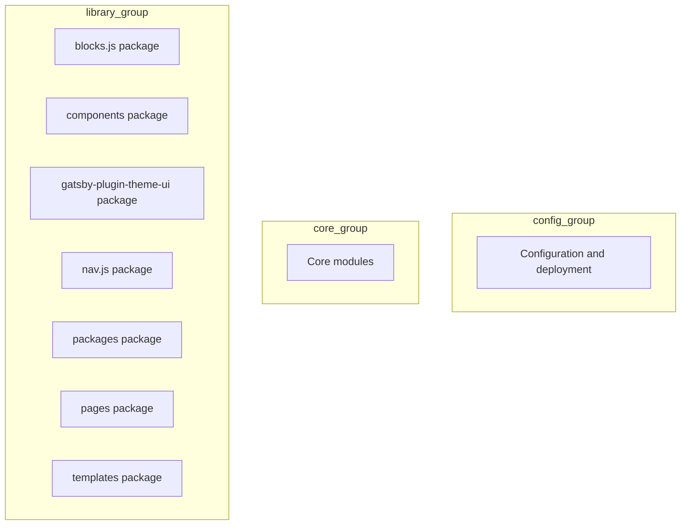

# Architecture report: blocks/blocks

> Automated static analysis. **Observed** = directly seen in files/imports/AST; **Inferred** = interpretation from that evidence. Repository code was not executed.

## 1. Repository at a glance

| Item | Value |
| --- | --- |
| Repository | blocks/blocks |
| Description | A JSX-based page builder for creating beautiful websites without writing code |
| Language | JavaScript |
| Stars | 5096 |
| Licence | MIT |
| Analysed commit / branch | 70bee97e65353fd3e2ad0ba7040a07f2637b9b97 / master |
| Framework(s) | React |
| Files analysed | 188 |
| Components | 9 |

## 2. Architecture in one minute

blocks/blocks - A JSX-based page builder for creating beautiful websites without writing code. This repository was analysed statically from 188 file(s) (0 Python). Detected technologies (observed from imports/manifests): GitHub Actions, React, Jest. Files are grouped into 9 component(s): blocks.js package, components package, Configuration and deployment, Core modules, gatsby-plugin-theme-ui package, nav.js package, packages package, pages package. Findings below distinguish observed facts from inferred interpretation.

## 3. High-level block diagram

## 4. Main components

### blocks.js package (`blocks_js`)

- **Kind:** library
- **Status:** Observed
- **Confidence:** 0.85
- **Responsibility:** Groups 1 file(s) under blocks.js package (observed from repository paths and static analysis).
- **Paths:** `src/blocks.js`
- **Evidence:** [src/blocks.js](https://github.com/blocks/blocks/blob/70bee97e65353fd3e2ad0ba7040a07f2637b9b97/src/blocks.js)

### components package (`components`)

- **Kind:** library
- **Status:** Observed
- **Confidence:** 0.85
- **Responsibility:** Groups 5 file(s) under components package (observed from repository paths and static analysis).
- **Paths:** `src/components/block.js`, `src/components/layout.js`, `src/components/minimal-layout.js`, `src/components/seo.js`, `src/components/subscribe.js`
- **Evidence:** [src/components/block.js](https://github.com/blocks/blocks/blob/70bee97e65353fd3e2ad0ba7040a07f2637b9b97/src/components/block.js); [src/components/layout.js](https://github.com/blocks/blocks/blob/70bee97e65353fd3e2ad0ba7040a07f2637b9b97/src/components/layout.js); [src/components/minimal-layout.js](https://github.com/blocks/blocks/blob/70bee97e65353fd3e2ad0ba7040a07f2637b9b97/src/components/minimal-layout.js); [src/components/seo.js](https://github.com/blocks/blocks/blob/70bee97e65353fd3e2ad0ba7040a07f2637b9b97/src/components/seo.js); [src/components/subscribe.js](https://github.com/blocks/blocks/blob/70bee97e65353fd3e2ad0ba7040a07f2637b9b97/src/components/subscribe.js)

### Configuration and deployment (`config`)

- **Kind:** config
- **Status:** Observed
- **Confidence:** 0.85
- **Responsibility:** Groups 7 file(s) under configuration and deployment (observed from repository paths and static analysis).
- **Paths:** `now.json`, `package.json`, `packages/blocks-ui/package.json`, `packages/gatsby-plugin-blocks/package.json`, `packages/property-controls/package.json`, `packages/react/package.json`, `renovate.json`
- **Evidence:** [now.json](https://github.com/blocks/blocks/blob/70bee97e65353fd3e2ad0ba7040a07f2637b9b97/now.json); [package.json](https://github.com/blocks/blocks/blob/70bee97e65353fd3e2ad0ba7040a07f2637b9b97/package.json); [packages/blocks-ui/package.json](https://github.com/blocks/blocks/blob/70bee97e65353fd3e2ad0ba7040a07f2637b9b97/packages/blocks-ui/package.json); [packages/gatsby-plugin-blocks/package.json](https://github.com/blocks/blocks/blob/70bee97e65353fd3e2ad0ba7040a07f2637b9b97/packages/gatsby-plugin-blocks/package.json); [packages/property-controls/package.json](https://github.com/blocks/blocks/blob/70bee97e65353fd3e2ad0ba7040a07f2637b9b97/packages/property-controls/package.json); [packages/react/package.json](https://github.com/blocks/blocks/blob/70bee97e65353fd3e2ad0ba7040a07f2637b9b97/packages/react/package.json); [renovate.json](https://github.com/blocks/blocks/blob/70bee97e65353fd3e2ad0ba7040a07f2637b9b97/renovate.json)

### Core modules (`core`)

- **Kind:** core
- **Status:** Observed
- **Confidence:** 0.85
- **Responsibility:** Groups 3 file(s) under core modules (observed from repository paths and static analysis).
- **Paths:** `babel.config.js`, `gatsby-config.js`, `gatsby-node.js`
- **Evidence:** [babel.config.js](https://github.com/blocks/blocks/blob/70bee97e65353fd3e2ad0ba7040a07f2637b9b97/babel.config.js); [gatsby-config.js](https://github.com/blocks/blocks/blob/70bee97e65353fd3e2ad0ba7040a07f2637b9b97/gatsby-config.js); [gatsby-node.js](https://github.com/blocks/blocks/blob/70bee97e65353fd3e2ad0ba7040a07f2637b9b97/gatsby-node.js)

### gatsby-plugin-theme-ui package (`gatsby_plugin_theme_ui`)

- **Kind:** library
- **Status:** Observed
- **Confidence:** 0.85
- **Responsibility:** Groups 2 file(s) under gatsby-plugin-theme-ui package (observed from repository paths and static analysis).
- **Paths:** `src/gatsby-plugin-theme-ui/components.js`, `src/gatsby-plugin-theme-ui/index.js`
- **Evidence:** [src/gatsby-plugin-theme-ui/components.js](https://github.com/blocks/blocks/blob/70bee97e65353fd3e2ad0ba7040a07f2637b9b97/src/gatsby-plugin-theme-ui/components.js); [src/gatsby-plugin-theme-ui/index.js](https://github.com/blocks/blocks/blob/70bee97e65353fd3e2ad0ba7040a07f2637b9b97/src/gatsby-plugin-theme-ui/index.js)

### nav.js package (`nav_js`)

- **Kind:** library
- **Status:** Observed
- **Confidence:** 0.85
- **Responsibility:** Groups 1 file(s) under nav.js package (observed from repository paths and static analysis).
- **Paths:** `src/nav.js`
- **Evidence:** [src/nav.js](https://github.com/blocks/blocks/blob/70bee97e65353fd3e2ad0ba7040a07f2637b9b97/src/nav.js)

### packages package (`packages`)

- **Kind:** library
- **Status:** Observed
- **Confidence:** 0.85
- **Responsibility:** Groups 125 file(s) under packages package (observed from repository paths and static analysis).
- **Paths:** `packages/blocks-ui/src/babel-plugins/add-block-imports.js`, `packages/blocks-ui/src/babel-plugins/add-block-imports.test.js`, `packages/blocks-ui/src/babel-plugins/add-tuid-prop.js`, `packages/blocks-ui/src/babel-plugins/add-tuid-prop.test.js`, `packages/blocks-ui/src/babel-plugins/apply-prop.js`, `packages/blocks-ui/src/babel-plugins/apply-prop.test.js`, `packages/blocks-ui/src/babel-plugins/apply-sx-prop.js`, `packages/blocks-ui/src/babel-plugins/apply-sx-prop.test.js`, `packages/blocks-ui/src/babel-plugins/clone.js`, `packages/blocks-ui/src/babel-plugins/clone.test.js`, `packages/blocks-ui/src/babel-plugins/drag-and-drop.js`, `packages/blocks-ui/src/babel-plugins/drag-and-drop.test.js`, `packages/blocks-ui/src/babel-plugins/get-blocks-usage.js`, `packages/blocks-ui/src/babel-plugins/get-blocks-usage.test.js`, `packages/blocks-ui/src/babel-plugins/get-blocks.js`, `packages/blocks-ui/src/babel-plugins/get-blocks.test.js`, `packages/blocks-ui/src/babel-plugins/get-current-element.js`, `packages/blocks-ui/src/babel-plugins/get-current-element.test.js`, `packages/blocks-ui/src/babel-plugins/get-element-tree.js`, `packages/blocks-ui/src/babel-plugins/get-element-tree.test.js`, `packages/blocks-ui/src/babel-plugins/get-exported-elements.js`, `packages/blocks-ui/src/babel-plugins/get-exported-elements.test.js`, `packages/blocks-ui/src/babel-plugins/inject-blocks-root.js`, `packages/blocks-ui/src/babel-plugins/inject-blocks-root.test.js`, `packages/blocks-ui/src/babel-plugins/insert-after.js`, `packages/blocks-ui/src/babel-plugins/insert-after.test.js`, `packages/blocks-ui/src/babel-plugins/insert-before.js`, `packages/blocks-ui/src/babel-plugins/insert-before.test.js`, `packages/blocks-ui/src/babel-plugins/insert-block.js`, `packages/blocks-ui/src/babel-plugins/insert-block.test.js`, `packages/blocks-ui/src/babel-plugins/remove-imports.js`, `packages/blocks-ui/src/babel-plugins/remove-imports.test.js`, `packages/blocks-ui/src/babel-plugins/remove-named-exports.js`, `packages/blocks-ui/src/babel-plugins/remove-named-exports.test.js`, `packages/blocks-ui/src/babel-plugins/remove-sx-prop.js`, `packages/blocks-ui/src/babel-plugins/remove-sx-prop.test.js`, `packages/blocks-ui/src/babel-plugins/remove-tuid.js`, `packages/blocks-ui/src/babel-plugins/remove-tuid.test.js`, `packages/blocks-ui/src/babel-plugins/remove.js`, `packages/blocks-ui/src/babel-plugins/remove.test.js`, `packages/blocks-ui/src/babel-plugins/reorder-blocks.js`, `packages/blocks-ui/src/babel-plugins/reorder-blocks.test.js`, `packages/blocks-ui/src/babel-plugins/replace-text.js`, `packages/blocks-ui/src/babel-plugins/replace-text.test.js`, `packages/blocks-ui/src/babel-plugins/set-default-export-to-container.js`, `packages/blocks-ui/src/babel-plugins/set-default-export-to-container.test.js`, `packages/blocks-ui/src/babel-plugins/test-util.js`, `packages/blocks-ui/src/block-error.js`, `packages/blocks-ui/src/canvas.js`, `packages/blocks-ui/src/code-editor.js`, `packages/blocks-ui/src/constants.js`, `packages/blocks-ui/src/controls.js`, `packages/blocks-ui/src/device-preview.js`, `packages/blocks-ui/src/editor.js`, `packages/blocks-ui/src/field-group.js`, `packages/blocks-ui/src/fixture.js`, `packages/blocks-ui/src/header.js`, `packages/blocks-ui/src/hooks.js`, `packages/blocks-ui/src/index.js`, `packages/blocks-ui/src/inline-block-render.js`, `packages/blocks-ui/src/inline-render.js`, `packages/blocks-ui/src/layout.js`, `packages/blocks-ui/src/loader.js`, `packages/blocks-ui/src/modes/canvas.js`, `packages/blocks-ui/src/modes/code.js`, `packages/blocks-ui/src/modes/viewports.js`, `packages/blocks-ui/src/panels/blocks-listing.js`, `packages/blocks-ui/src/panels/editor.js`, `packages/blocks-ui/src/panels/property-controls.js`, `packages/blocks-ui/src/panels/side.js`, `packages/blocks-ui/src/panels/theme.js`, `packages/blocks-ui/src/panels/tree.js`, `packages/blocks-ui/src/pragma.js`, `packages/blocks-ui/src/providers/blocks.js`, `packages/blocks-ui/src/providers/canvas.js`, `packages/blocks-ui/src/providers/code.js`, `packages/blocks-ui/src/providers/editor.js`, `packages/blocks-ui/src/providers/index.js`, `packages/blocks-ui/src/providers/scope.js`, `packages/blocks-ui/src/providers/theme-editor.js`, `packages/blocks-ui/src/queries.js`, `packages/blocks-ui/src/recipes.js`, `packages/blocks-ui/src/segmented-control.js`, `packages/blocks-ui/src/theme-editor/ColorPicker.js`, `packages/blocks-ui/src/theme-editor/Combobox.js`, `packages/blocks-ui/src/theme-editor/EditorProvider.js`, `packages/blocks-ui/src/theme-editor/Styles.js`, `packages/blocks-ui/src/theme-editor/Sx/Colors.js`, `packages/blocks-ui/src/theme-editor/Sx/Margin.js`, `packages/blocks-ui/src/theme-editor/Sx/Padding.js`, `packages/blocks-ui/src/theme-editor/Sx/Space.js`, `packages/blocks-ui/src/theme-editor/Sx/ThemeColorPicker.js`, `packages/blocks-ui/src/theme-editor/Sx/Typography.js`, `packages/blocks-ui/src/theme-editor/Sx/index.js`, `packages/blocks-ui/src/theme-editor/Theme/Colors.js`, `packages/blocks-ui/src/theme-editor/Theme/FontSizes.js`, `packages/blocks-ui/src/theme-editor/Theme/FontWeights.js`, `packages/blocks-ui/src/theme-editor/Theme/Fonts.js`, `packages/blocks-ui/src/theme-editor/Theme/LineHeights.js`, `packages/blocks-ui/src/theme-editor/Theme/Space.js`, `packages/blocks-ui/src/theme-editor/Theme/index.js`, `packages/blocks-ui/src/theme-editor/index.js`, `packages/blocks-ui/src/theme.js`, `packages/blocks-ui/src/transforms.js`, `packages/blocks-ui/src/ui.js`, `packages/blocks-ui/src/use-canvas-styles.js`, `packages/blocks-ui/src/use-copy-to-clipboard.js`, `packages/blocks-ui/src/use-debounce.js`, `packages/blocks-ui/src/use-element-size.js`, `packages/blocks-ui/src/util.js`, `packages/gatsby-plugin-blocks/gatsby-node.js`, `packages/gatsby-plugin-blocks/index.js`, `packages/gatsby-plugin-blocks/src/templates/editor.js`, `packages/gatsby-plugin-blocks/src/templates/pages.js`, `packages/gatsby-plugin-blocks/src/use-debounce.js`, `packages/property-controls/src/index.js`, `packages/react/src/footers/basic.js`, `packages/react/src/headers/basic.js`, `packages/react/src/headers/index.js`, `packages/react/src/headers/logo.js`, `packages/react/src/headers/logo2.js`, `packages/react/src/index.js`, `packages/react/src/quotes/basic.js`, `packages/react/src/taglines/bold.js`, `packages/react/src/taglines/content.js`
- **Evidence:** [packages/blocks-ui/src/babel-plugins/add-block-imports.js](https://github.com/blocks/blocks/blob/70bee97e65353fd3e2ad0ba7040a07f2637b9b97/packages/blocks-ui/src/babel-plugins/add-block-imports.js); [packages/blocks-ui/src/babel-plugins/add-block-imports.test.js](https://github.com/blocks/blocks/blob/70bee97e65353fd3e2ad0ba7040a07f2637b9b97/packages/blocks-ui/src/babel-plugins/add-block-imports.test.js); [packages/blocks-ui/src/babel-plugins/add-tuid-prop.js](https://github.com/blocks/blocks/blob/70bee97e65353fd3e2ad0ba7040a07f2637b9b97/packages/blocks-ui/src/babel-plugins/add-tuid-prop.js); [packages/blocks-ui/src/babel-plugins/add-tuid-prop.test.js](https://github.com/blocks/blocks/blob/70bee97e65353fd3e2ad0ba7040a07f2637b9b97/packages/blocks-ui/src/babel-plugins/add-tuid-prop.test.js); [packages/blocks-ui/src/babel-plugins/apply-prop.js](https://github.com/blocks/blocks/blob/70bee97e65353fd3e2ad0ba7040a07f2637b9b97/packages/blocks-ui/src/babel-plugins/apply-prop.js); [packages/blocks-ui/src/babel-plugins/apply-prop.test.js](https://github.com/blocks/blocks/blob/70bee97e65353fd3e2ad0ba7040a07f2637b9b97/packages/blocks-ui/src/babel-plugins/apply-prop.test.js); [packages/blocks-ui/src/babel-plugins/apply-sx-prop.js](https://github.com/blocks/blocks/blob/70bee97e65353fd3e2ad0ba7040a07f2637b9b97/packages/blocks-ui/src/babel-plugins/apply-sx-prop.js); [packages/blocks-ui/src/babel-plugins/apply-sx-prop.test.js](https://github.com/blocks/blocks/blob/70bee97e65353fd3e2ad0ba7040a07f2637b9b97/packages/blocks-ui/src/babel-plugins/apply-sx-prop.test.js)

### pages package (`pages`)

- **Kind:** library
- **Status:** Observed
- **Confidence:** 0.85
- **Responsibility:** Groups 2 file(s) under pages package (observed from repository paths and static analysis).
- **Paths:** `src/pages/blocks-old.js`, `src/pages/demo.js`
- **Evidence:** [src/pages/blocks-old.js](https://github.com/blocks/blocks/blob/70bee97e65353fd3e2ad0ba7040a07f2637b9b97/src/pages/blocks-old.js); [src/pages/demo.js](https://github.com/blocks/blocks/blob/70bee97e65353fd3e2ad0ba7040a07f2637b9b97/src/pages/demo.js)

### templates package (`templates`)

- **Kind:** library
- **Status:** Observed
- **Confidence:** 0.85
- **Responsibility:** Groups 1 file(s) under templates package (observed from repository paths and static analysis).
- **Paths:** `src/templates/block.js`
- **Evidence:** [src/templates/block.js](https://github.com/blocks/blocks/blob/70bee97e65353fd3e2ad0ba7040a07f2637b9b97/src/templates/block.js)

## 5. Execution flow

**Observed** entry point(s):

- [packages/blocks-ui/src/index.js](https://github.com/blocks/blocks/blob/70bee97e65353fd3e2ad0ba7040a07f2637b9b97/packages/blocks-ui/src/index.js)
- [packages/gatsby-plugin-blocks/index.js](https://github.com/blocks/blocks/blob/70bee97e65353fd3e2ad0ba7040a07f2637b9b97/packages/gatsby-plugin-blocks/index.js)
- [packages/property-controls/src/index.js](https://github.com/blocks/blocks/blob/70bee97e65353fd3e2ad0ba7040a07f2637b9b97/packages/property-controls/src/index.js)
- [packages/react/src/index.js](https://github.com/blocks/blocks/blob/70bee97e65353fd3e2ad0ba7040a07f2637b9b97/packages/react/src/index.js)
- [src/gatsby-plugin-theme-ui/index.js](https://github.com/blocks/blocks/blob/70bee97e65353fd3e2ad0ba7040a07f2637b9b97/src/gatsby-plugin-theme-ui/index.js)

Representative flow (derived from observed entry points and the import graph; steps beyond the entry point are **Inferred**):

1. Execution starts at an observed entry point listed above, if present.
2. No internal import relationships between components were observed.

## 6. Project structure

### `(root)`

- `.eslintignore` - other (67 bytes)
- `.eslintrc.js` - source, JavaScript (1001 bytes)
- `.gitignore` - other (60 bytes)
- `.nowignore` - other (22 bytes)
- `.prettierrc` - other (70 bytes)
- `babel.config.js` - source, JavaScript (193 bytes)
- `code-of-conduct.md` - docs (4170 bytes)
- `contributing.md` - docs (1616 bytes)
- `gatsby-config.js` - source, JavaScript (1027 bytes)
- `gatsby-node.js` - source, JavaScript (1985 bytes)
- `license` - docs (1079 bytes)
- `now.json` - config (56 bytes)
- `package.json` - manifest (2464 bytes)
- `readme.md` - docs (523 bytes)
- `renovate.json` - config (79 bytes)

### `.changeset`

- `.changeset/README.md` - docs (512 bytes)
- `.changeset/config.json` - config (201 bytes)

### `.github`

- `.github/workflows/lint.yml` - ci, YAML (379 bytes)
- `.github/workflows/release.yml` - ci, YAML (540 bytes)
- `.github/workflows/test.yml` - ci, YAML (592 bytes)

### `packages`

- `packages/blocks-ui/CHANGELOG.md` - docs (3427 bytes)
- `packages/blocks-ui/package.json` - manifest (1494 bytes)
- `packages/blocks-ui/src/babel-plugins/__snapshots__/get-exported-elements.test.js.snap` - other (2349 bytes)
- `packages/blocks-ui/src/babel-plugins/add-block-imports.js` - source, JavaScript (903 bytes)
- `packages/blocks-ui/src/babel-plugins/add-block-imports.test.js` - source, JavaScript (611 bytes)
- `packages/blocks-ui/src/babel-plugins/add-tuid-prop.js` - source, JavaScript (808 bytes)
- `packages/blocks-ui/src/babel-plugins/add-tuid-prop.test.js` - source, JavaScript (706 bytes)
- `packages/blocks-ui/src/babel-plugins/apply-prop.js` - source, JavaScript (663 bytes)
- `packages/blocks-ui/src/babel-plugins/apply-prop.test.js` - source, JavaScript (887 bytes)
- `packages/blocks-ui/src/babel-plugins/apply-sx-prop.js` - source, JavaScript (1481 bytes)
- `packages/blocks-ui/src/babel-plugins/apply-sx-prop.test.js` - source, JavaScript (1024 bytes)
- `packages/blocks-ui/src/babel-plugins/clone.js` - source, JavaScript (1265 bytes)
- `packages/blocks-ui/src/babel-plugins/clone.test.js` - source, JavaScript (836 bytes)
- `packages/blocks-ui/src/babel-plugins/drag-and-drop.js` - source, JavaScript (1975 bytes)
- `packages/blocks-ui/src/babel-plugins/drag-and-drop.test.js` - source, JavaScript (796 bytes)
- `packages/blocks-ui/src/babel-plugins/get-blocks-usage.js` - source, JavaScript (1008 bytes)
- `packages/blocks-ui/src/babel-plugins/get-blocks-usage.test.js` - source, JavaScript (692 bytes)
- `packages/blocks-ui/src/babel-plugins/get-blocks.js` - source, JavaScript (1236 bytes)
- `packages/blocks-ui/src/babel-plugins/get-blocks.test.js` - source, JavaScript (772 bytes)
- `packages/blocks-ui/src/babel-plugins/get-current-element.js` - source, JavaScript (2571 bytes)
- `packages/blocks-ui/src/babel-plugins/get-current-element.test.js` - source, JavaScript (2071 bytes)
- `packages/blocks-ui/src/babel-plugins/get-element-tree.js` - source, JavaScript (3207 bytes)
- `packages/blocks-ui/src/babel-plugins/get-element-tree.test.js` - source, JavaScript (1439 bytes)
- `packages/blocks-ui/src/babel-plugins/get-exported-elements.js` - source, JavaScript (733 bytes)
- `packages/blocks-ui/src/babel-plugins/get-exported-elements.test.js` - source, JavaScript (723 bytes)
- `packages/blocks-ui/src/babel-plugins/inject-blocks-root.js` - source, JavaScript (1116 bytes)
- `packages/blocks-ui/src/babel-plugins/inject-blocks-root.test.js` - source, JavaScript (898 bytes)
- `packages/blocks-ui/src/babel-plugins/insert-after.js` - source, JavaScript (533 bytes)
- `packages/blocks-ui/src/babel-plugins/insert-after.test.js` - source, JavaScript (596 bytes)
- `packages/blocks-ui/src/babel-plugins/insert-before.js` - source, JavaScript (534 bytes)
- `packages/blocks-ui/src/babel-plugins/insert-before.test.js` - source, JavaScript (599 bytes)
- `packages/blocks-ui/src/babel-plugins/insert-block.js` - source, JavaScript (1555 bytes)
- `packages/blocks-ui/src/babel-plugins/insert-block.test.js` - source, JavaScript (1445 bytes)
- `packages/blocks-ui/src/babel-plugins/remove-imports.js` - source, JavaScript (123 bytes)
- `packages/blocks-ui/src/babel-plugins/remove-imports.test.js` - source, JavaScript (582 bytes)
- `packages/blocks-ui/src/babel-plugins/remove-named-exports.js` - source, JavaScript (295 bytes)
- `packages/blocks-ui/src/babel-plugins/remove-named-exports.test.js` - source, JavaScript (442 bytes)
- `packages/blocks-ui/src/babel-plugins/remove-sx-prop.js` - source, JavaScript (675 bytes)
- `packages/blocks-ui/src/babel-plugins/remove-sx-prop.test.js` - source, JavaScript (1041 bytes)
- `packages/blocks-ui/src/babel-plugins/remove-tuid.js` - source, JavaScript (574 bytes)
- `packages/blocks-ui/src/babel-plugins/remove-tuid.test.js` - source, JavaScript (250 bytes)
- `packages/blocks-ui/src/babel-plugins/remove.js` - source, JavaScript (401 bytes)
- `packages/blocks-ui/src/babel-plugins/remove.test.js` - source, JavaScript (532 bytes)
- `packages/blocks-ui/src/babel-plugins/reorder-blocks.js` - source, JavaScript (898 bytes)
- `packages/blocks-ui/src/babel-plugins/reorder-blocks.test.js` - source, JavaScript (1365 bytes)
- `packages/blocks-ui/src/babel-plugins/replace-text.js` - source, JavaScript (454 bytes)
- `packages/blocks-ui/src/babel-plugins/replace-text.test.js` - source, JavaScript (591 bytes)
- `packages/blocks-ui/src/babel-plugins/set-default-export-to-container.js` - source, JavaScript (380 bytes)
- `packages/blocks-ui/src/babel-plugins/set-default-export-to-container.test.js` - source, JavaScript (602 bytes)
- `packages/blocks-ui/src/babel-plugins/test-util.js` - source, JavaScript (271 bytes)
- `packages/blocks-ui/src/block-error.js` - source, JavaScript (415 bytes)
- `packages/blocks-ui/src/canvas.js` - source, JavaScript (1263 bytes)
- `packages/blocks-ui/src/code-editor.js` - source, JavaScript (1454 bytes)
- `packages/blocks-ui/src/constants.js` - source, JavaScript (34 bytes)
- `packages/blocks-ui/src/controls.js` - source, JavaScript (95 bytes)
- `packages/blocks-ui/src/device-preview.js` - source, JavaScript (5375 bytes)
- `packages/blocks-ui/src/editor.js` - source, JavaScript (1370 bytes)
- `packages/blocks-ui/src/field-group.js` - source, JavaScript (654 bytes)
- `packages/blocks-ui/src/fixture.js` - source, JavaScript (1455 bytes)
- `packages/blocks-ui/src/header.js` - source, JavaScript (2484 bytes)
- `packages/blocks-ui/src/hooks.js` - source, JavaScript (1794 bytes)
- `packages/blocks-ui/src/index.js` - source, JavaScript (212 bytes)
- `packages/blocks-ui/src/inline-block-render.js` - source, JavaScript (707 bytes)
- `packages/blocks-ui/src/inline-render.js` - source, JavaScript (1062 bytes)
- `packages/blocks-ui/src/layout.js` - source, JavaScript (653 bytes)
- `packages/blocks-ui/src/loader.js` - source, JavaScript (8717 bytes)
- `packages/blocks-ui/src/modes/canvas.js` - source, JavaScript (534 bytes)
- `packages/blocks-ui/src/modes/code.js` - source, JavaScript (973 bytes)
- `packages/blocks-ui/src/modes/viewports.js` - source, JavaScript (653 bytes)
- `packages/blocks-ui/src/panels/blocks-listing.js` - source, JavaScript (2919 bytes)
- `packages/blocks-ui/src/panels/editor.js` - source, JavaScript (2173 bytes)
- `packages/blocks-ui/src/panels/property-controls.js` - source, JavaScript (5311 bytes)
- `packages/blocks-ui/src/panels/side.js` - source, JavaScript (2745 bytes)
- `packages/blocks-ui/src/panels/theme.js` - source, JavaScript (2542 bytes)
- `packages/blocks-ui/src/panels/tree.js` - source, JavaScript (2843 bytes)
- `packages/blocks-ui/src/pragma.js` - source, JavaScript (1329 bytes)
- `packages/blocks-ui/src/providers/blocks.js` - source, JavaScript (409 bytes)
- `packages/blocks-ui/src/providers/canvas.js` - source, JavaScript (469 bytes)
- `packages/blocks-ui/src/providers/code.js` - source, JavaScript (6281 bytes)
- `packages/blocks-ui/src/providers/editor.js` - source, JavaScript (1276 bytes)
- `packages/blocks-ui/src/providers/index.js` - source, JavaScript (869 bytes)
- `packages/blocks-ui/src/providers/scope.js` - source, JavaScript (2098 bytes)
- `packages/blocks-ui/src/providers/theme-editor.js` - source, JavaScript (720 bytes)
- `packages/blocks-ui/src/queries.js` - source, JavaScript (1565 bytes)
- `packages/blocks-ui/src/recipes.js` - source, JavaScript (61957 bytes)
- `packages/blocks-ui/src/segmented-control.js` - source, JavaScript (725 bytes)
- `packages/blocks-ui/src/theme-editor/ColorPicker.js` - source, JavaScript (4019 bytes)
- `packages/blocks-ui/src/theme-editor/Combobox.js` - source, JavaScript (4584 bytes)
- `packages/blocks-ui/src/theme-editor/EditorProvider.js` - source, JavaScript (656 bytes)
- `packages/blocks-ui/src/theme-editor/Styles.js` - source, JavaScript (683 bytes)
- `packages/blocks-ui/src/theme-editor/Sx/Colors.js` - source, JavaScript (1096 bytes)
- `packages/blocks-ui/src/theme-editor/Sx/Margin.js` - source, JavaScript (167 bytes)
- `packages/blocks-ui/src/theme-editor/Sx/Padding.js` - source, JavaScript (170 bytes)
- `packages/blocks-ui/src/theme-editor/Sx/Space.js` - source, JavaScript (4464 bytes)
- `packages/blocks-ui/src/theme-editor/Sx/ThemeColorPicker.js` - source, JavaScript (2027 bytes)
- `packages/blocks-ui/src/theme-editor/Sx/Typography.js` - source, JavaScript (2489 bytes)
- `packages/blocks-ui/src/theme-editor/Sx/index.js` - source, JavaScript (195 bytes)
- `packages/blocks-ui/src/theme-editor/Theme/Colors.js` - source, JavaScript (996 bytes)
- `packages/blocks-ui/src/theme-editor/Theme/FontSizes.js` - source, JavaScript (812 bytes)
- `packages/blocks-ui/src/theme-editor/Theme/FontWeights.js` - source, JavaScript (638 bytes)
- `packages/blocks-ui/src/theme-editor/Theme/Fonts.js` - source, JavaScript (1269 bytes)
- `packages/blocks-ui/src/theme-editor/Theme/LineHeights.js` - source, JavaScript (670 bytes)
- `packages/blocks-ui/src/theme-editor/Theme/Space.js` - source, JavaScript (845 bytes)
- `packages/blocks-ui/src/theme-editor/Theme/index.js` - source, JavaScript (293 bytes)
- `packages/blocks-ui/src/theme-editor/index.js` - source, JavaScript (319 bytes)
- `packages/blocks-ui/src/theme.js` - source, JavaScript (1210 bytes)
- `packages/blocks-ui/src/transforms.js` - source, JavaScript (4273 bytes)
- `packages/blocks-ui/src/ui.js` - source, JavaScript (935 bytes)
- `packages/blocks-ui/src/use-canvas-styles.js` - source, JavaScript (941 bytes)
- `packages/blocks-ui/src/use-copy-to-clipboard.js` - source, JavaScript (735 bytes)
- `packages/blocks-ui/src/use-debounce.js` - source, JavaScript (341 bytes)
- `packages/blocks-ui/src/use-element-size.js` - source, JavaScript (1079 bytes)
- `packages/blocks-ui/src/util.js` - source, JavaScript (3042 bytes)
- `packages/gatsby-plugin-blocks/CHANGELOG.md` - docs (2507 bytes)
- `packages/gatsby-plugin-blocks/gatsby-node.js` - source, JavaScript (3256 bytes)
- `packages/gatsby-plugin-blocks/index.js` - source, JavaScript (8 bytes)
- `packages/gatsby-plugin-blocks/package.json` - manifest (273 bytes)
- `packages/gatsby-plugin-blocks/src/templates/editor.js` - source, JavaScript (1297 bytes)
- `packages/gatsby-plugin-blocks/src/templates/pages.js` - source, JavaScript (1728 bytes)
- `packages/gatsby-plugin-blocks/src/use-debounce.js` - source, JavaScript (341 bytes)
- `packages/property-controls/CHANGELOG.md` - docs (445 bytes)
- `packages/property-controls/package.json` - manifest (450 bytes)
- `packages/property-controls/readme.md` - docs (562 bytes)
- `packages/property-controls/src/index.js` - source, JavaScript (1075 bytes)
- `packages/react/CHANGELOG.md` - docs (1058 bytes)
- `packages/react/package.json` - manifest (640 bytes)
- `packages/react/readme.md` - docs (130 bytes)
- `packages/react/src/footers/basic.js` - source, JavaScript (2153 bytes)
- `packages/react/src/headers/basic.js` - source, JavaScript (1821 bytes)
- `packages/react/src/headers/index.js` - source, JavaScript (96 bytes)
- `packages/react/src/headers/logo.js` - source, JavaScript (2158 bytes)
- `packages/react/src/headers/logo2.js` - source, JavaScript (2320 bytes)
- `packages/react/src/index.js` - source, JavaScript (600 bytes)
- `packages/react/src/quotes/basic.js` - source, JavaScript (1435 bytes)
- `packages/react/src/taglines/bold.js` - source, JavaScript (1775 bytes)
- `packages/react/src/taglines/content.js` - source, JavaScript (2482 bytes)

### `src`

- `src/blocks.js` - source, JavaScript (62738 bytes)
- `src/components/block.js` - source, JavaScript (4417 bytes)
- `src/components/layout.js` - source, JavaScript (6137 bytes)
- `src/components/minimal-layout.js` - source, JavaScript (835 bytes)
- `src/components/seo.js` - source, JavaScript (1922 bytes)
- `src/components/subscribe.js` - source, JavaScript (1721 bytes)
- `src/gatsby-plugin-theme-ui/components.js` - source, JavaScript (164 bytes)
- `src/gatsby-plugin-theme-ui/index.js` - source, JavaScript (1006 bytes)
- `src/nav.js` - source, JavaScript (1794 bytes)
- `src/pages/404.mdx` - other (151 bytes)
- `src/pages/about.mdx` - other (1725 bytes)
- `src/pages/blocks-old.js` - source, JavaScript (262 bytes)
- `src/pages/blocks.mdx` - other (486 bytes)
- `src/pages/confirm.mdx` - other (503 bytes)
- `src/pages/confirmed.mdx` - other (349 bytes)
- `src/pages/demo.js` - source, JavaScript (874 bytes)
- `src/pages/docs/advanced/blocks-docs-generation.mdx` - docs (197 bytes)
- `src/pages/docs/advanced/how-it-works.mdx` - docs (6139 bytes)
- `src/pages/docs/advanced/index.mdx` - docs (401 bytes)
- `src/pages/docs/advanced/queries.mdx` - docs (167 bytes)
- `src/pages/docs/advanced/transforms.mdx` - docs (173 bytes)
- `src/pages/docs/controls.mdx` - docs (4123 bytes)
- `src/pages/docs/guides/index.mdx` - docs (165 bytes)
- `src/pages/docs/guides/write-a-custom-block.mdx` - docs (4202 bytes)
- `src/pages/docs/index.mdx` - docs (146 bytes)
- `src/pages/getting-started.mdx` - other (1206 bytes)
- `src/pages/index.mdx` - other (1406 bytes)
- `src/pages/newsletter.mdx` - other (152 bytes)
- `src/pages/prior-art.mdx` - other (859 bytes)
- `src/pages/uses.mdx` - other (893 bytes)
- `src/pages/vision.mdx` - other (2607 bytes)
- `src/templates/block.js` - source, JavaScript (327 bytes)

## 7. Key dependencies and integrations

| Name | Category | Status | Confidence | Evidence |
| --- | --- | --- | --- | --- |
| GitHub Actions | ci | Observed | 0.90 | [.github/workflows/lint.yml](https://github.com/blocks/blocks/blob/70bee97e65353fd3e2ad0ba7040a07f2637b9b97/.github/workflows/lint.yml); [.github/workflows/release.yml](https://github.com/blocks/blocks/blob/70bee97e65353fd3e2ad0ba7040a07f2637b9b97/.github/workflows/release.yml); [.github/workflows/test.yml](https://github.com/blocks/blocks/blob/70bee97e65353fd3e2ad0ba7040a07f2637b9b97/.github/workflows/test.yml) |
| React | framework | Observed | 0.90 | [package.json:24](https://github.com/blocks/blocks/blob/70bee97e65353fd3e2ad0ba7040a07f2637b9b97/package.json#L24); [package.json:81](https://github.com/blocks/blocks/blob/70bee97e65353fd3e2ad0ba7040a07f2637b9b97/package.json#L81); [packages/blocks-ui/package.json:11](https://github.com/blocks/blocks/blob/70bee97e65353fd3e2ad0ba7040a07f2637b9b97/packages/blocks-ui/package.json#L11); [packages/blocks-ui/package.json:46](https://github.com/blocks/blocks/blob/70bee97e65353fd3e2ad0ba7040a07f2637b9b97/packages/blocks-ui/package.json#L46) |
| Jest | tooling | Observed | 0.90 | [package.json:15](https://github.com/blocks/blocks/blob/70bee97e65353fd3e2ad0ba7040a07f2637b9b97/package.json#L15); [packages/blocks-ui/package.json:44](https://github.com/blocks/blocks/blob/70bee97e65353fd3e2ad0ba7040a07f2637b9b97/packages/blocks-ui/package.json#L44) |

## 8. Data and state

No database, cache, queue, or persistent-state usage was observed in the analysed files. State handling, if any, may be in-memory or in files that were not analysed.

## 9. Configuration and deployment clues

- `.changeset/config.json` (config)
- `.github/workflows/lint.yml` (ci)
- `.github/workflows/release.yml` (ci)
- `.github/workflows/test.yml` (ci)
- `now.json` (config)
- `package.json` (manifest)
- `packages/blocks-ui/package.json` (manifest)
- `packages/gatsby-plugin-blocks/package.json` (manifest)
- `packages/property-controls/package.json` (manifest)
- `packages/react/package.json` (manifest)
- `renovate.json` (config)

## 10. Design observations

- No strong design patterns could be established from the available evidence.

These observations are interpretations (**Inferred**) of the observed structure, not guarantees about runtime design.

## 11. Limitations and unknowns

- Static analysis only: repository code was not executed, installed, or imported at runtime.
- Components and relationships are inferred from file paths, imports, and AST structure; runtime behaviour, dynamic imports, and reflection may not be visible.
- 1 file(s) were skipped during inventory (1 x likely secret file excluded).
- No clear application entry point was observed in the analysed files.
- Repository text was treated as untrusted data; no instructions found in repository files were followed, and likely secret values were redacted/excluded.
- JavaScript and TypeScript files were inventoried from paths and package manifests. They were not parsed with a full language AST, and repository code was not executed.

## 12. Source references

- [.github/workflows/lint.yml](https://github.com/blocks/blocks/blob/70bee97e65353fd3e2ad0ba7040a07f2637b9b97/.github/workflows/lint.yml)
- [.github/workflows/release.yml](https://github.com/blocks/blocks/blob/70bee97e65353fd3e2ad0ba7040a07f2637b9b97/.github/workflows/release.yml)
- [.github/workflows/test.yml](https://github.com/blocks/blocks/blob/70bee97e65353fd3e2ad0ba7040a07f2637b9b97/.github/workflows/test.yml)
- [babel.config.js](https://github.com/blocks/blocks/blob/70bee97e65353fd3e2ad0ba7040a07f2637b9b97/babel.config.js)
- [gatsby-config.js](https://github.com/blocks/blocks/blob/70bee97e65353fd3e2ad0ba7040a07f2637b9b97/gatsby-config.js)
- [gatsby-node.js](https://github.com/blocks/blocks/blob/70bee97e65353fd3e2ad0ba7040a07f2637b9b97/gatsby-node.js)
- [now.json](https://github.com/blocks/blocks/blob/70bee97e65353fd3e2ad0ba7040a07f2637b9b97/now.json)
- [package.json](https://github.com/blocks/blocks/blob/70bee97e65353fd3e2ad0ba7040a07f2637b9b97/package.json)
- [package.json:15](https://github.com/blocks/blocks/blob/70bee97e65353fd3e2ad0ba7040a07f2637b9b97/package.json#L15)
- [package.json:24](https://github.com/blocks/blocks/blob/70bee97e65353fd3e2ad0ba7040a07f2637b9b97/package.json#L24)
- [package.json:81](https://github.com/blocks/blocks/blob/70bee97e65353fd3e2ad0ba7040a07f2637b9b97/package.json#L81)
- [packages/blocks-ui/package.json](https://github.com/blocks/blocks/blob/70bee97e65353fd3e2ad0ba7040a07f2637b9b97/packages/blocks-ui/package.json)
- [packages/blocks-ui/package.json:11](https://github.com/blocks/blocks/blob/70bee97e65353fd3e2ad0ba7040a07f2637b9b97/packages/blocks-ui/package.json#L11)
- [packages/blocks-ui/package.json:44](https://github.com/blocks/blocks/blob/70bee97e65353fd3e2ad0ba7040a07f2637b9b97/packages/blocks-ui/package.json#L44)
- [packages/blocks-ui/package.json:46](https://github.com/blocks/blocks/blob/70bee97e65353fd3e2ad0ba7040a07f2637b9b97/packages/blocks-ui/package.json#L46)
- [packages/blocks-ui/src/babel-plugins/add-block-imports.js](https://github.com/blocks/blocks/blob/70bee97e65353fd3e2ad0ba7040a07f2637b9b97/packages/blocks-ui/src/babel-plugins/add-block-imports.js)
- [packages/blocks-ui/src/babel-plugins/add-block-imports.test.js](https://github.com/blocks/blocks/blob/70bee97e65353fd3e2ad0ba7040a07f2637b9b97/packages/blocks-ui/src/babel-plugins/add-block-imports.test.js)
- [packages/blocks-ui/src/babel-plugins/add-tuid-prop.js](https://github.com/blocks/blocks/blob/70bee97e65353fd3e2ad0ba7040a07f2637b9b97/packages/blocks-ui/src/babel-plugins/add-tuid-prop.js)
- [packages/blocks-ui/src/babel-plugins/add-tuid-prop.test.js](https://github.com/blocks/blocks/blob/70bee97e65353fd3e2ad0ba7040a07f2637b9b97/packages/blocks-ui/src/babel-plugins/add-tuid-prop.test.js)
- [packages/blocks-ui/src/babel-plugins/apply-prop.js](https://github.com/blocks/blocks/blob/70bee97e65353fd3e2ad0ba7040a07f2637b9b97/packages/blocks-ui/src/babel-plugins/apply-prop.js)
- [packages/blocks-ui/src/babel-plugins/apply-prop.test.js](https://github.com/blocks/blocks/blob/70bee97e65353fd3e2ad0ba7040a07f2637b9b97/packages/blocks-ui/src/babel-plugins/apply-prop.test.js)
- [packages/blocks-ui/src/babel-plugins/apply-sx-prop.js](https://github.com/blocks/blocks/blob/70bee97e65353fd3e2ad0ba7040a07f2637b9b97/packages/blocks-ui/src/babel-plugins/apply-sx-prop.js)
- [packages/blocks-ui/src/babel-plugins/apply-sx-prop.test.js](https://github.com/blocks/blocks/blob/70bee97e65353fd3e2ad0ba7040a07f2637b9b97/packages/blocks-ui/src/babel-plugins/apply-sx-prop.test.js)
- [packages/blocks-ui/src/index.js](https://github.com/blocks/blocks/blob/70bee97e65353fd3e2ad0ba7040a07f2637b9b97/packages/blocks-ui/src/index.js)
- [packages/gatsby-plugin-blocks/index.js](https://github.com/blocks/blocks/blob/70bee97e65353fd3e2ad0ba7040a07f2637b9b97/packages/gatsby-plugin-blocks/index.js)
- [packages/gatsby-plugin-blocks/package.json](https://github.com/blocks/blocks/blob/70bee97e65353fd3e2ad0ba7040a07f2637b9b97/packages/gatsby-plugin-blocks/package.json)
- [packages/property-controls/package.json](https://github.com/blocks/blocks/blob/70bee97e65353fd3e2ad0ba7040a07f2637b9b97/packages/property-controls/package.json)
- [packages/property-controls/src/index.js](https://github.com/blocks/blocks/blob/70bee97e65353fd3e2ad0ba7040a07f2637b9b97/packages/property-controls/src/index.js)
- [packages/react/package.json](https://github.com/blocks/blocks/blob/70bee97e65353fd3e2ad0ba7040a07f2637b9b97/packages/react/package.json)
- [packages/react/package.json:2](https://github.com/blocks/blocks/blob/70bee97e65353fd3e2ad0ba7040a07f2637b9b97/packages/react/package.json#L2)
- [packages/react/src/index.js](https://github.com/blocks/blocks/blob/70bee97e65353fd3e2ad0ba7040a07f2637b9b97/packages/react/src/index.js)
- [renovate.json](https://github.com/blocks/blocks/blob/70bee97e65353fd3e2ad0ba7040a07f2637b9b97/renovate.json)
- [src/blocks.js](https://github.com/blocks/blocks/blob/70bee97e65353fd3e2ad0ba7040a07f2637b9b97/src/blocks.js)
- [src/components/block.js](https://github.com/blocks/blocks/blob/70bee97e65353fd3e2ad0ba7040a07f2637b9b97/src/components/block.js)
- [src/components/layout.js](https://github.com/blocks/blocks/blob/70bee97e65353fd3e2ad0ba7040a07f2637b9b97/src/components/layout.js)
- [src/components/minimal-layout.js](https://github.com/blocks/blocks/blob/70bee97e65353fd3e2ad0ba7040a07f2637b9b97/src/components/minimal-layout.js)
- [src/components/seo.js](https://github.com/blocks/blocks/blob/70bee97e65353fd3e2ad0ba7040a07f2637b9b97/src/components/seo.js)
- [src/components/subscribe.js](https://github.com/blocks/blocks/blob/70bee97e65353fd3e2ad0ba7040a07f2637b9b97/src/components/subscribe.js)
- [src/gatsby-plugin-theme-ui/components.js](https://github.com/blocks/blocks/blob/70bee97e65353fd3e2ad0ba7040a07f2637b9b97/src/gatsby-plugin-theme-ui/components.js)
- [src/gatsby-plugin-theme-ui/index.js](https://github.com/blocks/blocks/blob/70bee97e65353fd3e2ad0ba7040a07f2637b9b97/src/gatsby-plugin-theme-ui/index.js)
- [src/nav.js](https://github.com/blocks/blocks/blob/70bee97e65353fd3e2ad0ba7040a07f2637b9b97/src/nav.js)
- [src/pages/blocks-old.js](https://github.com/blocks/blocks/blob/70bee97e65353fd3e2ad0ba7040a07f2637b9b97/src/pages/blocks-old.js)
- [src/pages/demo.js](https://github.com/blocks/blocks/blob/70bee97e65353fd3e2ad0ba7040a07f2637b9b97/src/pages/demo.js)
- [src/templates/block.js](https://github.com/blocks/blocks/blob/70bee97e65353fd3e2ad0ba7040a07f2637b9b97/src/templates/block.js)
