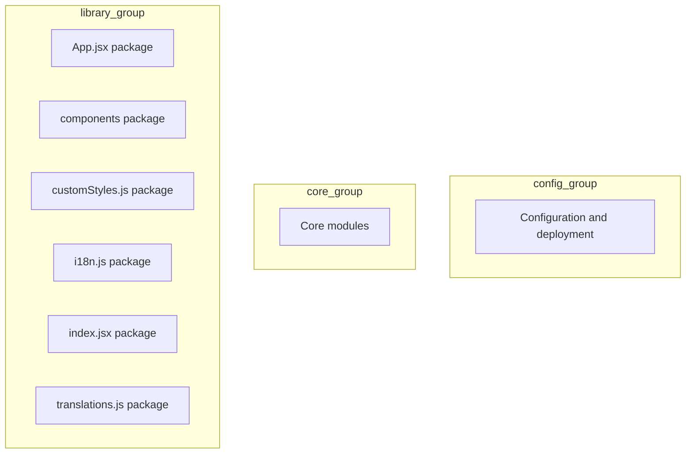

# Architecture report: bndw/wifi-card

> Automated static analysis. **Observed** = directly seen in files/imports/AST; **Inferred** = interpretation from that evidence. Repository code was not executed.

## 1. Repository at a glance

| Item | Value |
| --- | --- |
| Repository | bndw/wifi-card |
| Description | 📶 Print a QR code for connecting to your WiFi (wificard.io) |
| Language | JavaScript |
| Stars | 7210 |
| Licence | MIT |
| Analysed commit / branch | 7a990dd2411f6c8758ad696bf737b509f9672953 / master |
| Framework(s) | React |
| Files analysed | 25 |
| Components | 8 |

## 2. Architecture in one minute

bndw/wifi-card - 📶 Print a QR code for connecting to your WiFi (wificard.io). This repository was analysed statically from 25 file(s) (0 Python). Detected technologies (observed from imports/manifests): GitHub Actions, React, Docker, Vite. Files are grouped into 8 component(s): App.jsx package, components package, Configuration and deployment, Core modules, customStyles.js package, i18n.js package, index.jsx package, translations.js package. Findings below distinguish observed facts from inferred interpretation.

## 3. High-level block diagram

## 4. Main components

### App.jsx package (`app_jsx`)

- **Kind:** library
- **Status:** Observed
- **Confidence:** 0.85
- **Responsibility:** Groups 1 file(s) under app.jsx package (observed from repository paths and static analysis).
- **Paths:** `src/App.jsx`
- **Evidence:** [src/App.jsx](https://github.com/bndw/wifi-card/blob/7a990dd2411f6c8758ad696bf737b509f9672953/src/App.jsx)

### components package (`components`)

- **Kind:** library
- **Status:** Observed
- **Confidence:** 0.85
- **Responsibility:** Groups 2 file(s) under components package (observed from repository paths and static analysis).
- **Paths:** `src/components/Settings.jsx`, `src/components/WifiCard.jsx`
- **Evidence:** [src/components/Settings.jsx](https://github.com/bndw/wifi-card/blob/7a990dd2411f6c8758ad696bf737b509f9672953/src/components/Settings.jsx); [src/components/WifiCard.jsx](https://github.com/bndw/wifi-card/blob/7a990dd2411f6c8758ad696bf737b509f9672953/src/components/WifiCard.jsx)

### Configuration and deployment (`config`)

- **Kind:** config
- **Status:** Observed
- **Confidence:** 0.85
- **Responsibility:** Groups 3 file(s) under configuration and deployment (observed from repository paths and static analysis).
- **Paths:** `Dockerfile`, `package.json`, `public/manifest.json`
- **Evidence:** [Dockerfile](https://github.com/bndw/wifi-card/blob/7a990dd2411f6c8758ad696bf737b509f9672953/Dockerfile); [package.json](https://github.com/bndw/wifi-card/blob/7a990dd2411f6c8758ad696bf737b509f9672953/package.json); [public/manifest.json](https://github.com/bndw/wifi-card/blob/7a990dd2411f6c8758ad696bf737b509f9672953/public/manifest.json)

### Core modules (`core`)

- **Kind:** core
- **Status:** Observed
- **Confidence:** 0.85
- **Responsibility:** Groups 1 file(s) under core modules (observed from repository paths and static analysis).
- **Paths:** `vite.config.js`
- **Evidence:** [vite.config.js](https://github.com/bndw/wifi-card/blob/7a990dd2411f6c8758ad696bf737b509f9672953/vite.config.js)

### customStyles.js package (`customstyles_js`)

- **Kind:** library
- **Status:** Observed
- **Confidence:** 0.85
- **Responsibility:** Groups 1 file(s) under customstyles.js package (observed from repository paths and static analysis).
- **Paths:** `src/customStyles.js`
- **Evidence:** [src/customStyles.js](https://github.com/bndw/wifi-card/blob/7a990dd2411f6c8758ad696bf737b509f9672953/src/customStyles.js)

### i18n.js package (`i18n_js`)

- **Kind:** library
- **Status:** Observed
- **Confidence:** 0.85
- **Responsibility:** Groups 1 file(s) under i18n.js package (observed from repository paths and static analysis).
- **Paths:** `src/i18n.js`
- **Evidence:** [src/i18n.js](https://github.com/bndw/wifi-card/blob/7a990dd2411f6c8758ad696bf737b509f9672953/src/i18n.js)

### index.jsx package (`index_jsx`)

- **Kind:** library
- **Status:** Observed
- **Confidence:** 0.85
- **Responsibility:** Groups 1 file(s) under index.jsx package (observed from repository paths and static analysis).
- **Paths:** `src/index.jsx`
- **Evidence:** [src/index.jsx](https://github.com/bndw/wifi-card/blob/7a990dd2411f6c8758ad696bf737b509f9672953/src/index.jsx)

### translations.js package (`translations_js`)

- **Kind:** library
- **Status:** Observed
- **Confidence:** 0.85
- **Responsibility:** Groups 1 file(s) under translations.js package (observed from repository paths and static analysis).
- **Paths:** `src/translations.js`
- **Evidence:** [src/translations.js](https://github.com/bndw/wifi-card/blob/7a990dd2411f6c8758ad696bf737b509f9672953/src/translations.js)

## 5. Execution flow

**Observed** entry point(s):

- [src/App.jsx](https://github.com/bndw/wifi-card/blob/7a990dd2411f6c8758ad696bf737b509f9672953/src/App.jsx)
- [src/index.jsx](https://github.com/bndw/wifi-card/blob/7a990dd2411f6c8758ad696bf737b509f9672953/src/index.jsx)

Representative flow (derived from observed entry points and the import graph; steps beyond the entry point are **Inferred**):

1. Execution starts at an observed entry point listed above, if present.
2. No internal import relationships between components were observed.

## 6. Project structure

### `(root)`

- `.dockerignore` - container (29 bytes)
- `.gitignore` - other (399 bytes)
- `.prettierrc.json` - config (68 bytes)
- `.yarnrc.yml` - config (103 bytes)
- `Dockerfile` - container (252 bytes)
- `LICENSE.md` - docs (1069 bytes)
- `Makefile` - other (507 bytes)
- `README.md` - docs (5551 bytes)
- `index.html` - other (726 bytes)
- `package.json` - manifest (830 bytes)
- `vite.config.js` - source, JavaScript (792 bytes)

### `.github`

- `.github/workflows/master_push.yml` - ci, YAML (489 bytes)
- `.github/workflows/pull_request.yml` - ci, YAML (252 bytes)

### `.husky`

- `.husky/pre-commit` - other (33 bytes)

### `public`

- `public/manifest.json` - config (304 bytes)
- `public/robots.txt` - docs (67 bytes)

### `src`

- `src/App.jsx` - source, JavaScript (4997 bytes)
- `src/components/Settings.jsx` - source, JavaScript (7796 bytes)
- `src/components/WifiCard.jsx` - source, JavaScript (6623 bytes)
- `src/components/style.css` - other (6248 bytes)
- `src/customStyles.js` - source, JavaScript (6174 bytes)
- `src/i18n.js` - source, JavaScript (643 bytes)
- `src/index.jsx` - source, JavaScript (243 bytes)
- `src/style.css` - other (1297 bytes)
- `src/translations.js` - source, JavaScript (73484 bytes)

## 7. Key dependencies and integrations

| Name | Category | Status | Confidence | Evidence |
| --- | --- | --- | --- | --- |
| GitHub Actions | ci | Observed | 0.90 | [.github/workflows/master_push.yml](https://github.com/bndw/wifi-card/blob/7a990dd2411f6c8758ad696bf737b509f9672953/.github/workflows/master_push.yml); [.github/workflows/pull_request.yml](https://github.com/bndw/wifi-card/blob/7a990dd2411f6c8758ad696bf737b509f9672953/.github/workflows/pull_request.yml) |
| React | framework | Observed | 0.90 | [package.json:8](https://github.com/bndw/wifi-card/blob/7a990dd2411f6c8758ad696bf737b509f9672953/package.json#L8); [package.json:10](https://github.com/bndw/wifi-card/blob/7a990dd2411f6c8758ad696bf737b509f9672953/package.json#L10) |
| Docker | tooling | Observed | 0.90 | [.github/workflows/master_push.yml:11](https://github.com/bndw/wifi-card/blob/7a990dd2411f6c8758ad696bf737b509f9672953/.github/workflows/master_push.yml#L11); [.github/workflows/pull_request.yml:9](https://github.com/bndw/wifi-card/blob/7a990dd2411f6c8758ad696bf737b509f9672953/.github/workflows/pull_request.yml#L9); [Dockerfile](https://github.com/bndw/wifi-card/blob/7a990dd2411f6c8758ad696bf737b509f9672953/Dockerfile) |
| Vite | tooling | Observed | 0.85 | [package.json:14](https://github.com/bndw/wifi-card/blob/7a990dd2411f6c8758ad696bf737b509f9672953/package.json#L14) |

## 8. Data and state

No database, cache, queue, or persistent-state usage was observed in the analysed files. State handling, if any, may be in-memory or in files that were not analysed.

## 9. Configuration and deployment clues

- `.dockerignore` (container)
- `.github/workflows/master_push.yml` (ci)
- `.github/workflows/pull_request.yml` (ci)
- `.prettierrc.json` (config)
- `.yarnrc.yml` (config)
- `Dockerfile` (container)
- `package.json` (manifest)
- `public/manifest.json` (config)

## 10. Design observations

- No strong design patterns could be established from the available evidence.

These observations are interpretations (**Inferred**) of the observed structure, not guarantees about runtime design.

## 11. Limitations and unknowns

- Static analysis only: repository code was not executed, installed, or imported at runtime.
- Components and relationships are inferred from file paths, imports, and AST structure; runtime behaviour, dynamic imports, and reflection may not be visible.
- 1 file(s) were skipped during inventory (1 x lockfile excluded).
- No clear application entry point was observed in the analysed files.
- Repository text was treated as untrusted data; no instructions found in repository files were followed, and likely secret values were redacted/excluded.
- JavaScript and TypeScript files were inventoried from paths and package manifests. They were not parsed with a full language AST, and repository code was not executed.

## 12. Source references

- [.github/workflows/master_push.yml](https://github.com/bndw/wifi-card/blob/7a990dd2411f6c8758ad696bf737b509f9672953/.github/workflows/master_push.yml)
- [.github/workflows/master_push.yml:11](https://github.com/bndw/wifi-card/blob/7a990dd2411f6c8758ad696bf737b509f9672953/.github/workflows/master_push.yml#L11)
- [.github/workflows/pull_request.yml](https://github.com/bndw/wifi-card/blob/7a990dd2411f6c8758ad696bf737b509f9672953/.github/workflows/pull_request.yml)
- [.github/workflows/pull_request.yml:9](https://github.com/bndw/wifi-card/blob/7a990dd2411f6c8758ad696bf737b509f9672953/.github/workflows/pull_request.yml#L9)
- [Dockerfile](https://github.com/bndw/wifi-card/blob/7a990dd2411f6c8758ad696bf737b509f9672953/Dockerfile)
- [package.json](https://github.com/bndw/wifi-card/blob/7a990dd2411f6c8758ad696bf737b509f9672953/package.json)
- [package.json:8](https://github.com/bndw/wifi-card/blob/7a990dd2411f6c8758ad696bf737b509f9672953/package.json#L8)
- [package.json:10](https://github.com/bndw/wifi-card/blob/7a990dd2411f6c8758ad696bf737b509f9672953/package.json#L10)
- [package.json:14](https://github.com/bndw/wifi-card/blob/7a990dd2411f6c8758ad696bf737b509f9672953/package.json#L14)
- [public/manifest.json](https://github.com/bndw/wifi-card/blob/7a990dd2411f6c8758ad696bf737b509f9672953/public/manifest.json)
- [src/App.jsx](https://github.com/bndw/wifi-card/blob/7a990dd2411f6c8758ad696bf737b509f9672953/src/App.jsx)
- [src/components/Settings.jsx](https://github.com/bndw/wifi-card/blob/7a990dd2411f6c8758ad696bf737b509f9672953/src/components/Settings.jsx)
- [src/components/WifiCard.jsx](https://github.com/bndw/wifi-card/blob/7a990dd2411f6c8758ad696bf737b509f9672953/src/components/WifiCard.jsx)
- [src/customStyles.js](https://github.com/bndw/wifi-card/blob/7a990dd2411f6c8758ad696bf737b509f9672953/src/customStyles.js)
- [src/i18n.js](https://github.com/bndw/wifi-card/blob/7a990dd2411f6c8758ad696bf737b509f9672953/src/i18n.js)
- [src/index.jsx](https://github.com/bndw/wifi-card/blob/7a990dd2411f6c8758ad696bf737b509f9672953/src/index.jsx)
- [src/translations.js](https://github.com/bndw/wifi-card/blob/7a990dd2411f6c8758ad696bf737b509f9672953/src/translations.js)
- [vite.config.js](https://github.com/bndw/wifi-card/blob/7a990dd2411f6c8758ad696bf737b509f9672953/vite.config.js)
