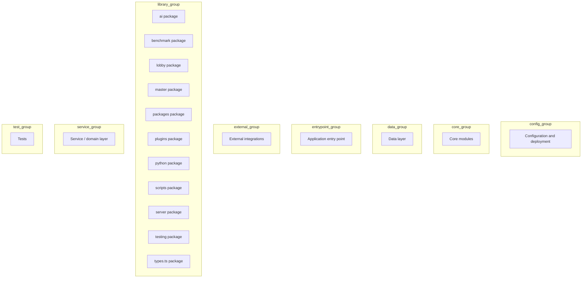

# Architecture report: boardgameio/boardgame.io

> Automated static analysis. **Observed** = directly seen in files/imports/AST; **Inferred** = interpretation from that evidence. Repository code was not executed.

## 1. Repository at a glance

| Item | Value |
| --- | --- |
| Repository | boardgameio/boardgame.io |
| Description | State Management and Multiplayer Networking for Turn-Based Games |
| Language | TypeScript |
| Stars | 12491 |
| Licence | MIT |
| Analysed commit / branch | 47adef2b46e375999931209ba7b41e9654c506e1 / main |
| Framework(s) | Koa, React, Svelte |
| Files analysed | 343 |
| Components | 18 |

## 2. Architecture in one minute

boardgameio/boardgame.io - State Management and Multiplayer Networking for Turn-Based Games. This repository was analysed statically from 343 file(s) (3 Python). Detected technologies (observed from imports/manifests): GitHub Actions, Koa, React, Svelte, React Router, Redux. Files are grouped into 18 component(s): ai package, benchmark package, Configuration and deployment, Core modules, Data layer, Application entry point, External integrations, lobby package. Findings below distinguish observed facts from inferred interpretation.

## 3. High-level block diagram

## 4. Main components

### ai package (`ai`)

- **Kind:** library
- **Status:** Observed
- **Confidence:** 0.85
- **Responsibility:** Groups 5 file(s) under ai package (observed from repository paths and static analysis).
- **Paths:** `src/ai/ai.test.ts`, `src/ai/ai.ts`, `src/ai/bot.ts`, `src/ai/mcts-bot.ts`, `src/ai/random-bot.ts`
- **Evidence:** [src/ai/ai.test.ts](https://github.com/boardgameio/boardgame.io/blob/47adef2b46e375999931209ba7b41e9654c506e1/src/ai/ai.test.ts); [src/ai/ai.ts](https://github.com/boardgameio/boardgame.io/blob/47adef2b46e375999931209ba7b41e9654c506e1/src/ai/ai.ts); [src/ai/bot.ts](https://github.com/boardgameio/boardgame.io/blob/47adef2b46e375999931209ba7b41e9654c506e1/src/ai/bot.ts); [src/ai/mcts-bot.ts](https://github.com/boardgameio/boardgame.io/blob/47adef2b46e375999931209ba7b41e9654c506e1/src/ai/mcts-bot.ts); [src/ai/random-bot.ts](https://github.com/boardgameio/boardgame.io/blob/47adef2b46e375999931209ba7b41e9654c506e1/src/ai/random-bot.ts)

### benchmark package (`benchmark`)

- **Kind:** library
- **Status:** Observed
- **Confidence:** 0.85
- **Responsibility:** Groups 1 file(s) under benchmark package (observed from repository paths and static analysis).
- **Paths:** `benchmark/index.js`
- **Evidence:** [benchmark/index.js](https://github.com/boardgameio/boardgame.io/blob/47adef2b46e375999931209ba7b41e9654c506e1/benchmark/index.js)

### Configuration and deployment (`config`)

- **Kind:** config
- **Status:** Observed
- **Confidence:** 0.85
- **Responsibility:** Groups 5 file(s) under configuration and deployment (observed from repository paths and static analysis).
- **Paths:** `integration/package.json`, `integration/type-tests/tsconfig.json`, `package.json`, `pnpm-workspace.yaml`, `tsconfig.json`
- **Evidence:** [integration/package.json](https://github.com/boardgameio/boardgame.io/blob/47adef2b46e375999931209ba7b41e9654c506e1/integration/package.json); [integration/type-tests/tsconfig.json](https://github.com/boardgameio/boardgame.io/blob/47adef2b46e375999931209ba7b41e9654c506e1/integration/type-tests/tsconfig.json); [package.json](https://github.com/boardgameio/boardgame.io/blob/47adef2b46e375999931209ba7b41e9654c506e1/package.json); [pnpm-workspace.yaml](https://github.com/boardgameio/boardgame.io/blob/47adef2b46e375999931209ba7b41e9654c506e1/pnpm-workspace.yaml); [tsconfig.json](https://github.com/boardgameio/boardgame.io/blob/47adef2b46e375999931209ba7b41e9654c506e1/tsconfig.json)

### Core modules (`core`)

- **Kind:** core
- **Status:** Observed
- **Confidence:** 0.85
- **Responsibility:** Groups 7 file(s) under core modules (observed from repository paths and static analysis).
- **Paths:** `babel.config.js`, `babel.config.test.js`, `eslint.config.js`, `jest-svelte-transformer.cjs`, `jest.setup.js`, `rollup.config.js`, `subpackages.js`
- **Evidence:** [babel.config.js](https://github.com/boardgameio/boardgame.io/blob/47adef2b46e375999931209ba7b41e9654c506e1/babel.config.js); [babel.config.test.js](https://github.com/boardgameio/boardgame.io/blob/47adef2b46e375999931209ba7b41e9654c506e1/babel.config.test.js); [eslint.config.js](https://github.com/boardgameio/boardgame.io/blob/47adef2b46e375999931209ba7b41e9654c506e1/eslint.config.js); [jest-svelte-transformer.cjs](https://github.com/boardgameio/boardgame.io/blob/47adef2b46e375999931209ba7b41e9654c506e1/jest-svelte-transformer.cjs); [jest.setup.js](https://github.com/boardgameio/boardgame.io/blob/47adef2b46e375999931209ba7b41e9654c506e1/jest.setup.js); [rollup.config.js](https://github.com/boardgameio/boardgame.io/blob/47adef2b46e375999931209ba7b41e9654c506e1/rollup.config.js); [subpackages.js](https://github.com/boardgameio/boardgame.io/blob/47adef2b46e375999931209ba7b41e9654c506e1/subpackages.js)

### Data layer (`data_layer`)

- **Kind:** data
- **Status:** Observed
- **Confidence:** 0.85
- **Responsibility:** Groups 9 file(s) under data layer (observed from repository paths and static analysis).
- **Paths:** `src/server/db/base.ts`, `src/server/db/flatfile.test.ts`, `src/server/db/flatfile.ts`, `src/server/db/index.test.ts`, `src/server/db/index.ts`, `src/server/db/inmemory.test.ts`, `src/server/db/inmemory.ts`, `src/server/db/localstorage.test.ts`, `src/server/db/localstorage.ts`
- **Evidence:** [src/server/db/base.ts](https://github.com/boardgameio/boardgame.io/blob/47adef2b46e375999931209ba7b41e9654c506e1/src/server/db/base.ts); [src/server/db/flatfile.test.ts](https://github.com/boardgameio/boardgame.io/blob/47adef2b46e375999931209ba7b41e9654c506e1/src/server/db/flatfile.test.ts); [src/server/db/flatfile.ts](https://github.com/boardgameio/boardgame.io/blob/47adef2b46e375999931209ba7b41e9654c506e1/src/server/db/flatfile.ts); [src/server/db/index.test.ts](https://github.com/boardgameio/boardgame.io/blob/47adef2b46e375999931209ba7b41e9654c506e1/src/server/db/index.test.ts); [src/server/db/index.ts](https://github.com/boardgameio/boardgame.io/blob/47adef2b46e375999931209ba7b41e9654c506e1/src/server/db/index.ts); [src/server/db/inmemory.test.ts](https://github.com/boardgameio/boardgame.io/blob/47adef2b46e375999931209ba7b41e9654c506e1/src/server/db/inmemory.test.ts); [src/server/db/inmemory.ts](https://github.com/boardgameio/boardgame.io/blob/47adef2b46e375999931209ba7b41e9654c506e1/src/server/db/inmemory.ts); [src/server/db/localstorage.test.ts](https://github.com/boardgameio/boardgame.io/blob/47adef2b46e375999931209ba7b41e9654c506e1/src/server/db/localstorage.test.ts)

### Application entry point (`entrypoint`)

- **Kind:** entrypoint
- **Status:** Observed
- **Confidence:** 0.85
- **Responsibility:** Groups 1 file(s) under application entry point (observed from repository paths and static analysis). Observed top-level classes: TicTacToeBot. Observed top-level functions: main, stop.
- **Paths:** `python/examples/tic-tac-toe/tictactoebot.py`
- **Evidence:** [python/examples/tic-tac-toe/tictactoebot.py:24](https://github.com/boardgameio/boardgame.io/blob/47adef2b46e375999931209ba7b41e9654c506e1/python/examples/tic-tac-toe/tictactoebot.py#L24)

### External integrations (`external_integrations`)

- **Kind:** external
- **Status:** Observed
- **Confidence:** 0.85
- **Responsibility:** Groups 49 file(s) under external integrations (observed from repository paths and static analysis).
- **Paths:** `integration/node-smoke/cjs-test.cjs`, `integration/node-smoke/esm-test.mjs`, `integration/src/App.jsx`, `integration/src/App.test.jsx`, `integration/src/board.jsx`, `integration/src/game.js`, `integration/src/index.jsx`, `integration/type-tests/server-custom-plugin.ts`, `integration/vite.config.js`, `src/client/client.test.ts`, `src/client/client.ts`, `src/client/debug/Debug.svelte`, `src/client/debug/Menu.svelte`, `src/client/debug/ai/AI.svelte`, `src/client/debug/ai/Options.svelte`, `src/client/debug/icons/ArrowDown.svelte`, `src/client/debug/icons/Chevron.svelte`, `src/client/debug/info/Info.svelte`, `src/client/debug/info/Item.svelte`, `src/client/debug/log/Log.svelte`, `src/client/debug/log/LogEvent.svelte`, `src/client/debug/log/LogMetadata.svelte`, `src/client/debug/log/PhaseMarker.svelte`, `src/client/debug/log/TurnMarker.svelte`, `src/client/debug/main/ClientSwitcher.svelte`, `src/client/debug/main/Controls.svelte`, `src/client/debug/main/Hotkey.svelte`, `src/client/debug/main/InteractiveFunction.svelte`, `src/client/debug/main/Main.svelte`, `src/client/debug/main/Move.svelte`, `src/client/debug/main/PlayerInfo.svelte`, `src/client/debug/mcts/Action.svelte`, `src/client/debug/mcts/MCTS.svelte`, `src/client/debug/mcts/Table.svelte`, `src/client/debug/utils/shortcuts.js`, `src/client/debug/utils/shortcuts.test.js`, `src/client/manager.ts`, `src/client/react-native.js`, `src/client/react-native.test.js`, `src/client/react.ssr.test.tsx`, `src/client/react.test.tsx`, `src/client/react.tsx`, `src/client/transport/dummy.ts`, `src/client/transport/local.test.ts`, `src/client/transport/local.ts`, `src/client/transport/socketio.test.ts`, `src/client/transport/socketio.ts`, `src/client/transport/transport.test.ts`, `src/client/transport/transport.ts`
- **Evidence:** [integration/node-smoke/cjs-test.cjs](https://github.com/boardgameio/boardgame.io/blob/47adef2b46e375999931209ba7b41e9654c506e1/integration/node-smoke/cjs-test.cjs); [integration/node-smoke/esm-test.mjs](https://github.com/boardgameio/boardgame.io/blob/47adef2b46e375999931209ba7b41e9654c506e1/integration/node-smoke/esm-test.mjs); [integration/src/App.jsx](https://github.com/boardgameio/boardgame.io/blob/47adef2b46e375999931209ba7b41e9654c506e1/integration/src/App.jsx); [integration/src/App.test.jsx](https://github.com/boardgameio/boardgame.io/blob/47adef2b46e375999931209ba7b41e9654c506e1/integration/src/App.test.jsx); [integration/src/board.jsx](https://github.com/boardgameio/boardgame.io/blob/47adef2b46e375999931209ba7b41e9654c506e1/integration/src/board.jsx); [integration/src/game.js](https://github.com/boardgameio/boardgame.io/blob/47adef2b46e375999931209ba7b41e9654c506e1/integration/src/game.js); [integration/src/index.jsx](https://github.com/boardgameio/boardgame.io/blob/47adef2b46e375999931209ba7b41e9654c506e1/integration/src/index.jsx); [integration/type-tests/server-custom-plugin.ts](https://github.com/boardgameio/boardgame.io/blob/47adef2b46e375999931209ba7b41e9654c506e1/integration/type-tests/server-custom-plugin.ts)

### lobby package (`lobby`)

- **Kind:** library
- **Status:** Observed
- **Confidence:** 0.85
- **Responsibility:** Groups 10 file(s) under lobby package (observed from repository paths and static analysis).
- **Paths:** `src/lobby/client.test.ts`, `src/lobby/client.ts`, `src/lobby/connection.test.ts`, `src/lobby/connection.ts`, `src/lobby/create-match-form.tsx`, `src/lobby/login-form.tsx`, `src/lobby/match-instance.tsx`, `src/lobby/react.ssr.test.tsx`, `src/lobby/react.test.tsx`, `src/lobby/react.tsx`
- **Evidence:** [src/lobby/client.test.ts](https://github.com/boardgameio/boardgame.io/blob/47adef2b46e375999931209ba7b41e9654c506e1/src/lobby/client.test.ts); [src/lobby/client.ts](https://github.com/boardgameio/boardgame.io/blob/47adef2b46e375999931209ba7b41e9654c506e1/src/lobby/client.ts); [src/lobby/connection.test.ts](https://github.com/boardgameio/boardgame.io/blob/47adef2b46e375999931209ba7b41e9654c506e1/src/lobby/connection.test.ts); [src/lobby/connection.ts](https://github.com/boardgameio/boardgame.io/blob/47adef2b46e375999931209ba7b41e9654c506e1/src/lobby/connection.ts); [src/lobby/create-match-form.tsx](https://github.com/boardgameio/boardgame.io/blob/47adef2b46e375999931209ba7b41e9654c506e1/src/lobby/create-match-form.tsx); [src/lobby/login-form.tsx](https://github.com/boardgameio/boardgame.io/blob/47adef2b46e375999931209ba7b41e9654c506e1/src/lobby/login-form.tsx); [src/lobby/match-instance.tsx](https://github.com/boardgameio/boardgame.io/blob/47adef2b46e375999931209ba7b41e9654c506e1/src/lobby/match-instance.tsx); [src/lobby/react.ssr.test.tsx](https://github.com/boardgameio/boardgame.io/blob/47adef2b46e375999931209ba7b41e9654c506e1/src/lobby/react.ssr.test.tsx)

### master package (`master`)

- **Kind:** library
- **Status:** Observed
- **Confidence:** 0.85
- **Responsibility:** Groups 4 file(s) under master package (observed from repository paths and static analysis).
- **Paths:** `src/master/filter-player-view.test.ts`, `src/master/filter-player-view.ts`, `src/master/master.test.ts`, `src/master/master.ts`
- **Evidence:** [src/master/filter-player-view.test.ts](https://github.com/boardgameio/boardgame.io/blob/47adef2b46e375999931209ba7b41e9654c506e1/src/master/filter-player-view.test.ts); [src/master/filter-player-view.ts](https://github.com/boardgameio/boardgame.io/blob/47adef2b46e375999931209ba7b41e9654c506e1/src/master/filter-player-view.ts); [src/master/master.test.ts](https://github.com/boardgameio/boardgame.io/blob/47adef2b46e375999931209ba7b41e9654c506e1/src/master/master.test.ts); [src/master/master.ts](https://github.com/boardgameio/boardgame.io/blob/47adef2b46e375999931209ba7b41e9654c506e1/src/master/master.ts)

### packages package (`packages`)

- **Kind:** library
- **Status:** Observed
- **Confidence:** 0.85
- **Responsibility:** Groups 13 file(s) under packages package (observed from repository paths and static analysis).
- **Paths:** `packages/ai.ts`, `packages/client.ts`, `packages/core.ts`, `packages/debug.ts`, `packages/internal.ts`, `packages/main.js`, `packages/master.ts`, `packages/multiplayer.ts`, `packages/plugins.ts`, `packages/react-native.ts`, `packages/react.ts`, `packages/server.ts`, `packages/testing.ts`
- **Evidence:** [packages/ai.ts](https://github.com/boardgameio/boardgame.io/blob/47adef2b46e375999931209ba7b41e9654c506e1/packages/ai.ts); [packages/client.ts](https://github.com/boardgameio/boardgame.io/blob/47adef2b46e375999931209ba7b41e9654c506e1/packages/client.ts); [packages/core.ts](https://github.com/boardgameio/boardgame.io/blob/47adef2b46e375999931209ba7b41e9654c506e1/packages/core.ts); [packages/debug.ts](https://github.com/boardgameio/boardgame.io/blob/47adef2b46e375999931209ba7b41e9654c506e1/packages/debug.ts); [packages/internal.ts](https://github.com/boardgameio/boardgame.io/blob/47adef2b46e375999931209ba7b41e9654c506e1/packages/internal.ts); [packages/main.js](https://github.com/boardgameio/boardgame.io/blob/47adef2b46e375999931209ba7b41e9654c506e1/packages/main.js); [packages/master.ts](https://github.com/boardgameio/boardgame.io/blob/47adef2b46e375999931209ba7b41e9654c506e1/packages/master.ts); [packages/multiplayer.ts](https://github.com/boardgameio/boardgame.io/blob/47adef2b46e375999931209ba7b41e9654c506e1/packages/multiplayer.ts)

### plugins package (`plugins`)

- **Kind:** library
- **Status:** Observed
- **Confidence:** 0.85
- **Responsibility:** Groups 17 file(s) under plugins package (observed from repository paths and static analysis).
- **Paths:** `src/plugins/events/events.test.ts`, `src/plugins/events/events.ts`, `src/plugins/main.test.ts`, `src/plugins/main.ts`, `src/plugins/plugin-events.ts`, `src/plugins/plugin-immer.test.ts`, `src/plugins/plugin-immer.ts`, `src/plugins/plugin-log.test.ts`, `src/plugins/plugin-log.ts`, `src/plugins/plugin-player.test.ts`, `src/plugins/plugin-player.ts`, `src/plugins/plugin-random.ts`, `src/plugins/plugin-serializable.test.ts`, `src/plugins/plugin-serializable.ts`, `src/plugins/random/random.alea.ts`, `src/plugins/random/random.test.ts`, `src/plugins/random/random.ts`
- **Evidence:** [src/plugins/events/events.test.ts](https://github.com/boardgameio/boardgame.io/blob/47adef2b46e375999931209ba7b41e9654c506e1/src/plugins/events/events.test.ts); [src/plugins/events/events.ts](https://github.com/boardgameio/boardgame.io/blob/47adef2b46e375999931209ba7b41e9654c506e1/src/plugins/events/events.ts); [src/plugins/main.test.ts](https://github.com/boardgameio/boardgame.io/blob/47adef2b46e375999931209ba7b41e9654c506e1/src/plugins/main.test.ts); [src/plugins/main.ts](https://github.com/boardgameio/boardgame.io/blob/47adef2b46e375999931209ba7b41e9654c506e1/src/plugins/main.ts); [src/plugins/plugin-events.ts](https://github.com/boardgameio/boardgame.io/blob/47adef2b46e375999931209ba7b41e9654c506e1/src/plugins/plugin-events.ts); [src/plugins/plugin-immer.test.ts](https://github.com/boardgameio/boardgame.io/blob/47adef2b46e375999931209ba7b41e9654c506e1/src/plugins/plugin-immer.test.ts); [src/plugins/plugin-immer.ts](https://github.com/boardgameio/boardgame.io/blob/47adef2b46e375999931209ba7b41e9654c506e1/src/plugins/plugin-immer.ts); [src/plugins/plugin-log.test.ts](https://github.com/boardgameio/boardgame.io/blob/47adef2b46e375999931209ba7b41e9654c506e1/src/plugins/plugin-log.test.ts)

### python package (`python`)

- **Kind:** library
- **Status:** Observed
- **Confidence:** 0.85
- **Responsibility:** Groups 1 file(s) under python package (observed from repository paths and static analysis). Observed top-level classes: Bot, Namespace.
- **Paths:** `python/boardgameio.py`
- **Evidence:** [python/boardgameio.py:17](https://github.com/boardgameio/boardgame.io/blob/47adef2b46e375999931209ba7b41e9654c506e1/python/boardgameio.py#L17)

### scripts package (`scripts`)

- **Kind:** library
- **Status:** Observed
- **Confidence:** 0.85
- **Responsibility:** Groups 7 file(s) under scripts package (observed from repository paths and static analysis).
- **Paths:** `scripts/changelog.js`, `scripts/clean.js`, `scripts/dev-client.js`, `scripts/install-examples.js`, `scripts/integration.js`, `scripts/proxy-dirs.js`, `scripts/rollup-filesize.js`
- **Evidence:** [scripts/changelog.js](https://github.com/boardgameio/boardgame.io/blob/47adef2b46e375999931209ba7b41e9654c506e1/scripts/changelog.js); [scripts/clean.js](https://github.com/boardgameio/boardgame.io/blob/47adef2b46e375999931209ba7b41e9654c506e1/scripts/clean.js); [scripts/dev-client.js](https://github.com/boardgameio/boardgame.io/blob/47adef2b46e375999931209ba7b41e9654c506e1/scripts/dev-client.js); [scripts/install-examples.js](https://github.com/boardgameio/boardgame.io/blob/47adef2b46e375999931209ba7b41e9654c506e1/scripts/install-examples.js); [scripts/integration.js](https://github.com/boardgameio/boardgame.io/blob/47adef2b46e375999931209ba7b41e9654c506e1/scripts/integration.js); [scripts/proxy-dirs.js](https://github.com/boardgameio/boardgame.io/blob/47adef2b46e375999931209ba7b41e9654c506e1/scripts/proxy-dirs.js); [scripts/rollup-filesize.js](https://github.com/boardgameio/boardgame.io/blob/47adef2b46e375999931209ba7b41e9654c506e1/scripts/rollup-filesize.js)

### server package (`server`)

- **Kind:** library
- **Status:** Observed
- **Confidence:** 0.85
- **Responsibility:** Groups 16 file(s) under server package (observed from repository paths and static analysis).
- **Paths:** `src/server/api.test.ts`, `src/server/api.ts`, `src/server/auth.test.ts`, `src/server/auth.ts`, `src/server/cors.test.ts`, `src/server/cors.ts`, `src/server/index.test.ts`, `src/server/index.ts`, `src/server/transport/pubsub/generic-pub-sub.ts`, `src/server/transport/pubsub/in-memory-pub-sub.test.ts`, `src/server/transport/pubsub/in-memory-pub-sub.ts`, `src/server/transport/socketio-simultaneous.test.ts`, `src/server/transport/socketio-smoke.test.ts`, `src/server/transport/socketio.test.ts`, `src/server/transport/socketio.ts`, `src/server/util.ts`
- **Evidence:** [src/server/api.test.ts](https://github.com/boardgameio/boardgame.io/blob/47adef2b46e375999931209ba7b41e9654c506e1/src/server/api.test.ts); [src/server/api.ts](https://github.com/boardgameio/boardgame.io/blob/47adef2b46e375999931209ba7b41e9654c506e1/src/server/api.ts); [src/server/auth.test.ts](https://github.com/boardgameio/boardgame.io/blob/47adef2b46e375999931209ba7b41e9654c506e1/src/server/auth.test.ts); [src/server/auth.ts](https://github.com/boardgameio/boardgame.io/blob/47adef2b46e375999931209ba7b41e9654c506e1/src/server/auth.ts); [src/server/cors.test.ts](https://github.com/boardgameio/boardgame.io/blob/47adef2b46e375999931209ba7b41e9654c506e1/src/server/cors.test.ts); [src/server/cors.ts](https://github.com/boardgameio/boardgame.io/blob/47adef2b46e375999931209ba7b41e9654c506e1/src/server/cors.ts); [src/server/index.test.ts](https://github.com/boardgameio/boardgame.io/blob/47adef2b46e375999931209ba7b41e9654c506e1/src/server/index.test.ts); [src/server/index.ts](https://github.com/boardgameio/boardgame.io/blob/47adef2b46e375999931209ba7b41e9654c506e1/src/server/index.ts)

### Service / domain layer (`service_layer`)

- **Kind:** service
- **Status:** Observed
- **Confidence:** 0.85
- **Responsibility:** Groups 19 file(s) under service / domain layer (observed from repository paths and static analysis).
- **Paths:** `src/core/action-creators.ts`, `src/core/action-types.ts`, `src/core/backwards-compatibility.ts`, `src/core/constants.ts`, `src/core/errors.ts`, `src/core/flow.test.ts`, `src/core/flow.ts`, `src/core/game-methods.ts`, `src/core/game.test.ts`, `src/core/game.ts`, `src/core/initialize.ts`, `src/core/logger.test.js`, `src/core/logger.ts`, `src/core/player-view.test.ts`, `src/core/player-view.ts`, `src/core/reducer.test.ts`, `src/core/reducer.ts`, `src/core/turn-order.test.ts`, `src/core/turn-order.ts`
- **Evidence:** [src/core/action-creators.ts](https://github.com/boardgameio/boardgame.io/blob/47adef2b46e375999931209ba7b41e9654c506e1/src/core/action-creators.ts); [src/core/action-types.ts](https://github.com/boardgameio/boardgame.io/blob/47adef2b46e375999931209ba7b41e9654c506e1/src/core/action-types.ts); [src/core/backwards-compatibility.ts](https://github.com/boardgameio/boardgame.io/blob/47adef2b46e375999931209ba7b41e9654c506e1/src/core/backwards-compatibility.ts); [src/core/constants.ts](https://github.com/boardgameio/boardgame.io/blob/47adef2b46e375999931209ba7b41e9654c506e1/src/core/constants.ts); [src/core/errors.ts](https://github.com/boardgameio/boardgame.io/blob/47adef2b46e375999931209ba7b41e9654c506e1/src/core/errors.ts); [src/core/flow.test.ts](https://github.com/boardgameio/boardgame.io/blob/47adef2b46e375999931209ba7b41e9654c506e1/src/core/flow.test.ts); [src/core/flow.ts](https://github.com/boardgameio/boardgame.io/blob/47adef2b46e375999931209ba7b41e9654c506e1/src/core/flow.ts); [src/core/game-methods.ts](https://github.com/boardgameio/boardgame.io/blob/47adef2b46e375999931209ba7b41e9654c506e1/src/core/game-methods.ts)

### testing package (`testing`)

- **Kind:** library
- **Status:** Observed
- **Confidence:** 0.85
- **Responsibility:** Groups 2 file(s) under testing package (observed from repository paths and static analysis).
- **Paths:** `src/testing/mock-random.test.ts`, `src/testing/mock-random.ts`
- **Evidence:** [src/testing/mock-random.test.ts](https://github.com/boardgameio/boardgame.io/blob/47adef2b46e375999931209ba7b41e9654c506e1/src/testing/mock-random.test.ts); [src/testing/mock-random.ts](https://github.com/boardgameio/boardgame.io/blob/47adef2b46e375999931209ba7b41e9654c506e1/src/testing/mock-random.ts)

### Tests (`tests`)

- **Kind:** test
- **Status:** Observed
- **Confidence:** 0.85
- **Responsibility:** Groups 3 file(s) under tests (observed from repository paths and static analysis). Observed top-level classes: TestBot, TestNamespace.
- **Paths:** `python/test_boardgameio.py`, `src/client/debug/tests/JSONTree.mock.svelte`, `src/client/debug/tests/debug.test.ts`
- **Evidence:** [python/test_boardgameio.py:26](https://github.com/boardgameio/boardgame.io/blob/47adef2b46e375999931209ba7b41e9654c506e1/python/test_boardgameio.py#L26); [src/client/debug/tests/JSONTree.mock.svelte](https://github.com/boardgameio/boardgame.io/blob/47adef2b46e375999931209ba7b41e9654c506e1/src/client/debug/tests/JSONTree.mock.svelte); [src/client/debug/tests/debug.test.ts](https://github.com/boardgameio/boardgame.io/blob/47adef2b46e375999931209ba7b41e9654c506e1/src/client/debug/tests/debug.test.ts)

### types.ts package (`types_ts`)

- **Kind:** library
- **Status:** Observed
- **Confidence:** 0.85
- **Responsibility:** Groups 1 file(s) under types.ts package (observed from repository paths and static analysis).
- **Paths:** `src/types.ts`
- **Evidence:** [src/types.ts](https://github.com/boardgameio/boardgame.io/blob/47adef2b46e375999931209ba7b41e9654c506e1/src/types.ts)

## 5. Execution flow

**Observed** entry point(s):

- [benchmark/index.js](https://github.com/boardgameio/boardgame.io/blob/47adef2b46e375999931209ba7b41e9654c506e1/benchmark/index.js)
- [integration/src/App.jsx](https://github.com/boardgameio/boardgame.io/blob/47adef2b46e375999931209ba7b41e9654c506e1/integration/src/App.jsx)
- [integration/src/index.jsx](https://github.com/boardgameio/boardgame.io/blob/47adef2b46e375999931209ba7b41e9654c506e1/integration/src/index.jsx)
- [packages/main.js](https://github.com/boardgameio/boardgame.io/blob/47adef2b46e375999931209ba7b41e9654c506e1/packages/main.js)
- [packages/server.ts](https://github.com/boardgameio/boardgame.io/blob/47adef2b46e375999931209ba7b41e9654c506e1/packages/server.ts)
- [src/plugins/main.ts](https://github.com/boardgameio/boardgame.io/blob/47adef2b46e375999931209ba7b41e9654c506e1/src/plugins/main.ts)
- [src/server/db/index.ts](https://github.com/boardgameio/boardgame.io/blob/47adef2b46e375999931209ba7b41e9654c506e1/src/server/db/index.ts)
- [src/server/index.ts](https://github.com/boardgameio/boardgame.io/blob/47adef2b46e375999931209ba7b41e9654c506e1/src/server/index.ts)

Representative flow (derived from observed entry points and the import graph; steps beyond the entry point are **Inferred**):

1. Execution starts at an observed entry point listed above, if present.
2. No internal import relationships between components were observed.

## 6. Project structure

### `(root)`

- `.empty_module.js` - source, JavaScript (279 bytes)
- `.gitignore` - other (204 bytes)
- `.lintstagedrc` - other (45 bytes)
- `.prettierignore` - other (65 bytes)
- `.prettierrc` - other (47 bytes)
- `AGENTS.md` - docs (6978 bytes)
- `AUTHORS` - other (430 bytes)
- `CODE_OF_CONDUCT.md` - docs (1111 bytes)
- `CONTRIBUTING.md` - docs (3348 bytes)
- `LICENSE` - docs (1082 bytes)
- `README.md` - docs (4019 bytes)
- `babel.config.js` - source, JavaScript (640 bytes)
- `babel.config.test.js` - source, JavaScript (277 bytes)
- `eslint.config.js` - source, JavaScript (3134 bytes)
- `jest-svelte-transformer.cjs` - source, JavaScript (658 bytes)
- `jest.setup.js` - source, JavaScript (2269 bytes)
- `package.json` - manifest (9863 bytes)
- `pnpm-workspace.yaml` - config (308 bytes)
- `roadmap.md` - docs (2356 bytes)
- `rollup.config.js` - source, JavaScript (3080 bytes)
- `subpackages.js` - source, JavaScript (364 bytes)
- `tsconfig.json` - config (387 bytes)

### `.devcontainer`

- `.devcontainer/Dockerfile` - container (842 bytes)
- `.devcontainer/devcontainer.json` - config (1152 bytes)

### `.github`

- `.github/FUNDING.yml` - config (98 bytes)
- `.github/dependabot.yml` - config (1158 bytes)
- `.github/pull_request_template.md` - docs (144 bytes)
- `.github/workflows/ci.yml` - ci, YAML (1966 bytes)
- `.github/workflows/npm-publish.yml` - ci, YAML (1022 bytes)

### `.husky`

- `.husky/pre-commit` - other (22 bytes)
- `.husky/pre-push` - other (23 bytes)

### `benchmark`

- `benchmark/index.js` - source, JavaScript (1201 bytes)

### `docs`

- `docs/CNAME` - docs (12 bytes)
- `docs/documentation/.nojekyll` - docs (0 bytes)
- `docs/documentation/CHANGELOG.md` - docs (77160 bytes)
- `docs/documentation/api/Client.md` - docs (10656 bytes)
- `docs/documentation/api/Game.md` - docs (4640 bytes)
- `docs/documentation/api/Lobby.md` - docs (7793 bytes)
- `docs/documentation/api/Server.md` - docs (7528 bytes)
- `docs/documentation/chat.md` - docs (1839 bytes)
- `docs/documentation/concepts.md` - docs (3155 bytes)
- `docs/documentation/debugging.md` - docs (2661 bytes)
- `docs/documentation/deployment.md` - docs (7066 bytes)
- `docs/documentation/events.md` - docs (5562 bytes)
- `docs/documentation/immutability.md` - docs (2505 bytes)
- `docs/documentation/index.html` - docs (3377 bytes)
- `docs/documentation/multiplayer.md` - docs (10402 bytes)
- `docs/documentation/notable_projects.md` - docs (12108 bytes)
- `docs/documentation/phases.md` - docs (7303 bytes)
- `docs/documentation/plugins.md` - docs (4653 bytes)
- `docs/documentation/random.md` - docs (3255 bytes)
- `docs/documentation/secret-state.md` - docs (1971 bytes)
- `docs/documentation/sidebar.md` - docs (739 bytes)
- `docs/documentation/snippets/example-1/index.html` - docs (339 bytes)
- `docs/documentation/snippets/example-2/index.html` - docs (339 bytes)
- `docs/documentation/snippets/example-3/index.html` - docs (339 bytes)
- `docs/documentation/snippets/multiplayer/index.html` - docs (359 bytes)
- `docs/documentation/snippets/phases-1.490dcd4c.css` - docs (679 bytes)
- `docs/documentation/snippets/phases-1/index.html` - docs (231 bytes)
- `docs/documentation/snippets/phases-2.fa21cb61.css` - docs (749 bytes)
- `docs/documentation/snippets/phases-2/index.html` - docs (231 bytes)
- `docs/documentation/snippets/stages-1.bcf7ab84.css` - docs (434 bytes)
- `docs/documentation/snippets/stages-1/index.html` - docs (231 bytes)
- `docs/documentation/stages.md` - docs (7999 bytes)
- `docs/documentation/storage.md` - docs (1575 bytes)
- `docs/documentation/testing.md` - docs (5024 bytes)
- `docs/documentation/theme.css` - docs (2010 bytes)
- `docs/documentation/turn-order.md` - docs (3490 bytes)
- `docs/documentation/tutorial.md` - docs (18835 bytes)
- `docs/documentation/typescript.md` - docs (1911 bytes)
- `docs/documentation/undo.md` - docs (1294 bytes)
- `docs/index.css` - docs (1462 bytes)
- `docs/index.html` - docs (5132 bytes)
- `docs/logo-optimized.svg` - docs (5056 bytes)
- `docs/logo.svg` - docs (14139 bytes)

### `examples`

- `examples/react-native/.gitignore` - other (248 bytes)
- `examples/react-native/.watchmanconfig` - other (3 bytes)
- `examples/react-native/App.js` - source, JavaScript (904 bytes)
- `examples/react-native/README.md` - docs (376 bytes)
- `examples/react-native/app.json` - config (645 bytes)
- `examples/react-native/board.js` - source, JavaScript (3615 bytes)
- `examples/react-native/game.js` - source, JavaScript (1110 bytes)
- `examples/react-native/package.json` - manifest (503 bytes)
- `examples/react-native/rn-cli.config.js` - source, JavaScript (150 bytes)
- `examples/react-web/.gitignore` - other (374 bytes)
- `examples/react-web/package.json` - manifest (843 bytes)
- `examples/react-web/server.js` - source, JavaScript (557 bytes)
- `examples/react-web/src/app.css` - other (559 bytes)
- `examples/react-web/src/app.js` - source, JavaScript (1587 bytes)
- `examples/react-web/src/app.test.js` - source, JavaScript (2168 bytes)
- `examples/react-web/src/chess/board.js` - source, JavaScript (6557 bytes)
- `examples/react-web/src/chess/chat.js` - source, JavaScript (931 bytes)
- `examples/react-web/src/chess/checkerboard.js` - source, JavaScript (3767 bytes)
- `examples/react-web/src/chess/checkerboard.test.js` - source, JavaScript (1423 bytes)
- `examples/react-web/src/chess/game.js` - source, JavaScript (1366 bytes)
- `examples/react-web/src/chess/grid.js` - source, JavaScript (6073 bytes)
- `examples/react-web/src/chess/index.js` - source, JavaScript (764 bytes)
- `examples/react-web/src/chess/multiplayer.js` - source, JavaScript (765 bytes)
- `examples/react-web/src/chess/pieces/CREDITS` - other (132 bytes)
- `examples/react-web/src/chess/pieces/bishop.js` - source, JavaScript (2063 bytes)
- `examples/react-web/src/chess/pieces/king.js` - source, JavaScript (2915 bytes)
- `examples/react-web/src/chess/pieces/knight.js` - source, JavaScript (2667 bytes)
- `examples/react-web/src/chess/pieces/pawn.js` - source, JavaScript (1318 bytes)
- `examples/react-web/src/chess/pieces/queen.js` - source, JavaScript (2648 bytes)
- `examples/react-web/src/chess/pieces/rook.js` - source, JavaScript (4785 bytes)
- `examples/react-web/src/chess/singleplayer.js` - source, JavaScript (541 bytes)
- `examples/react-web/src/chess/token.js` - source, JavaScript (8684 bytes)
- `examples/react-web/src/index.html` - other (403 bytes)
- `examples/react-web/src/index.js` - source, JavaScript (297 bytes)
- `examples/react-web/src/li-navlink.js` - source, JavaScript (1357 bytes)
- `examples/react-web/src/lobby/index.js` - source, JavaScript (312 bytes)
- `examples/react-web/src/lobby/lobby.css` - other (1018 bytes)
- `examples/react-web/src/lobby/lobby.js` - source, JavaScript (1074 bytes)
- `examples/react-web/src/lobby/routes.js` - source, JavaScript (363 bytes)
- `examples/react-web/src/random/board.js` - source, JavaScript (597 bytes)
- `examples/react-web/src/random/game.js` - source, JavaScript (586 bytes)
- `examples/react-web/src/random/index.js` - source, JavaScript (639 bytes)
- `examples/react-web/src/redacted-move/board.css` - other (309 bytes)
- `examples/react-web/src/redacted-move/board.js` - source, JavaScript (930 bytes)
- `examples/react-web/src/redacted-move/game.js` - source, JavaScript (733 bytes)
- `examples/react-web/src/redacted-move/index.js` - source, JavaScript (374 bytes)
- `examples/react-web/src/redacted-move/multiview.js` - source, JavaScript (1386 bytes)
- `examples/react-web/src/routes.js` - source, JavaScript (1119 bytes)
- `examples/react-web/src/secret-state/board.css` - other (309 bytes)
- `examples/react-web/src/secret-state/board.js` - source, JavaScript (632 bytes)
- `examples/react-web/src/secret-state/game.js` - source, JavaScript (514 bytes)
- `examples/react-web/src/secret-state/index.js` - source, JavaScript (372 bytes)
- `examples/react-web/src/secret-state/multiview.js` - source, JavaScript (1170 bytes)
- `examples/react-web/src/simulator/example-all-once.js` - source, JavaScript (635 bytes)
- `examples/react-web/src/simulator/example-all.js` - source, JavaScript (625 bytes)
- `examples/react-web/src/simulator/example-others-once.js` - source, JavaScript (1083 bytes)
- `examples/react-web/src/simulator/example-others.js` - source, JavaScript (631 bytes)
- `examples/react-web/src/simulator/index.js` - source, JavaScript (360 bytes)
- `examples/react-web/src/simulator/simulator.css` - other (2743 bytes)
- `examples/react-web/src/simulator/simulator.js` - source, JavaScript (3923 bytes)
- `examples/react-web/src/threejs/index.js` - source, JavaScript (3748 bytes)
- `examples/react-web/src/threejs/main.css` - other (98 bytes)
- `examples/react-web/src/tic-tac-toe/advanced-ai.js` - source, JavaScript (3012 bytes)
- `examples/react-web/src/tic-tac-toe/authenticated.js` - source, JavaScript (3693 bytes)
- `examples/react-web/src/tic-tac-toe/board.css` - other (598 bytes)
- `examples/react-web/src/tic-tac-toe/board.js` - source, JavaScript (2095 bytes)
- `examples/react-web/src/tic-tac-toe/bots.js` - source, JavaScript (717 bytes)
- `examples/react-web/src/tic-tac-toe/game.js` - source, JavaScript (1404 bytes)
- `examples/react-web/src/tic-tac-toe/index.js` - source, JavaScript (997 bytes)
- `examples/react-web/src/tic-tac-toe/multiplayer.js` - source, JavaScript (904 bytes)
- `examples/react-web/src/tic-tac-toe/singleplayer.js` - source, JavaScript (603 bytes)
- `examples/react-web/src/tic-tac-toe/spectator.js` - source, JavaScript (1067 bytes)
- `examples/react-web/src/undo/board.js` - source, JavaScript (1040 bytes)
- `examples/react-web/src/undo/game.js` - source, JavaScript (427 bytes)
- `examples/react-web/src/undo/index.js` - source, JavaScript (720 bytes)
- `examples/snippets/.gitignore` - other (17 bytes)
- `examples/snippets/README.md` - docs (636 bytes)
- `examples/snippets/install.sh` - source, Shell (298 bytes)
- `examples/snippets/package.json` - manifest (761 bytes)
- `examples/snippets/src/example-1/index.html` - other (358 bytes)
- `examples/snippets/src/example-1/index.js` - source, JavaScript (434 bytes)
- `examples/snippets/src/example-2/index.html` - other (358 bytes)
- `examples/snippets/src/example-2/index.js` - source, JavaScript (2363 bytes)
- `examples/snippets/src/example-3/index.html` - other (358 bytes)
- `examples/snippets/src/example-3/index.js` - source, JavaScript (2600 bytes)
- `examples/snippets/src/multiplayer/index.html` - other (394 bytes)
- `examples/snippets/src/multiplayer/index.js` - source, JavaScript (3097 bytes)
- `examples/snippets/src/phases-1/App.svelte` - source, Svelte (384 bytes)
- `examples/snippets/src/phases-1/Player.svelte` - source, Svelte (1515 bytes)
- `examples/snippets/src/phases-1/game.js` - source, JavaScript (333 bytes)
- `examples/snippets/src/phases-1/index.html` - other (129 bytes)
- `examples/snippets/src/phases-1/index.js` - source, JavaScript (157 bytes)
- `examples/snippets/src/phases-2/App.svelte` - source, Svelte (384 bytes)
- `examples/snippets/src/phases-2/Player.svelte` - source, Svelte (1564 bytes)
- `examples/snippets/src/phases-2/game.js` - source, JavaScript (523 bytes)
- `examples/snippets/src/phases-2/index.html` - other (129 bytes)
- `examples/snippets/src/phases-2/index.js` - source, JavaScript (157 bytes)
- `examples/snippets/src/stages-1/App.svelte` - source, Svelte (308 bytes)
- `examples/snippets/src/stages-1/Player.svelte` - source, Svelte (1265 bytes)
- `examples/snippets/src/stages-1/game.js` - source, JavaScript (298 bytes)
- `examples/snippets/src/stages-1/index.html` - other (129 bytes)
- `examples/snippets/src/stages-1/index.js` - source, JavaScript (157 bytes)

### `integration`

- `integration/.gitignore` - other (59 bytes)
- `integration/README.md` - docs (124335 bytes)
- `integration/index.html` - other (382 bytes)
- `integration/node-smoke/cjs-test.cjs` - source, JavaScript (704 bytes)
- `integration/node-smoke/esm-test.mjs` - source, JavaScript (684 bytes)
- `integration/package.json` - manifest (522 bytes)
- `integration/src/App.css` - other (671 bytes)
- `integration/src/App.jsx` - source, JavaScript (788 bytes)
- `integration/src/App.test.jsx` - source, JavaScript (396 bytes)
- `integration/src/board.css` - other (598 bytes)
- `integration/src/board.jsx` - source, JavaScript (1762 bytes)
- `integration/src/game.js` - source, JavaScript (1228 bytes)
- `integration/src/index.css` - other (583 bytes)
- `integration/src/index.jsx` - source, JavaScript (364 bytes)
- `integration/type-tests/server-custom-plugin.ts` - source, TypeScript (555 bytes)
- `integration/type-tests/tsconfig.json` - config (224 bytes)
- `integration/vite.config.js` - source, JavaScript (196 bytes)

### `packages`

- `packages/ai.ts` - source, TypeScript (384 bytes)
- `packages/client.ts` - source, TypeScript (319 bytes)
- `packages/core.ts` - source, TypeScript (441 bytes)
- `packages/debug.ts` - source, TypeScript (272 bytes)
- `packages/internal.ts` - source, TypeScript (610 bytes)
- `packages/main.js` - source, JavaScript (698 bytes)
- `packages/master.ts` - source, TypeScript (250 bytes)
- `packages/multiplayer.ts` - source, TypeScript (320 bytes)
- `packages/plugins.ts` - source, TypeScript (294 bytes)
- `packages/react-native.ts` - source, TypeScript (256 bytes)
- `packages/react.ts` - source, TypeScript (317 bytes)
- `packages/server.ts` - source, TypeScript (475 bytes)
- `packages/testing.ts` - source, TypeScript (57 bytes)

### `python`

- `python/.gitignore` - other (31 bytes)
- `python/boardgameio.py` - source, Python (5248 bytes)
- `python/examples/tic-tac-toe/tictactoebot.py` - source, Python (2345 bytes)
- `python/test_boardgameio.py` - test, Python (4804 bytes)

### `scripts`

- `scripts/changelog.js` - source, JavaScript (2434 bytes)
- `scripts/clean.js` - source, JavaScript (367 bytes)
- `scripts/dev-client.js` - source, JavaScript (93 bytes)
- `scripts/install-examples.js` - source, JavaScript (953 bytes)
- `scripts/integration.js` - source, JavaScript (2595 bytes)
- `scripts/proxy-dirs.js` - source, JavaScript (1339 bytes)
- `scripts/rollup-filesize.js` - source, JavaScript (1488 bytes)

### `src`

- `src/ai/ai.test.ts` - source, TypeScript (11052 bytes)
- `src/ai/ai.ts` - source, TypeScript (1954 bytes)
- `src/ai/bot.ts` - source, TypeScript (2638 bytes)
- `src/ai/mcts-bot.ts` - source, TypeScript (8547 bytes)
- `src/ai/random-bot.ts` - source, TypeScript (542 bytes)
- `src/client/client.test.ts` - source, TypeScript (29116 bytes)
- `src/client/client.ts` - source, TypeScript (16734 bytes)
- `src/client/debug/Debug.svelte` - source, Svelte (5290 bytes)
- `src/client/debug/Menu.svelte` - source, Svelte (1218 bytes)
- `src/client/debug/ai/AI.svelte` - source, Svelte (4621 bytes)
- `src/client/debug/ai/Options.svelte` - source, Svelte (1011 bytes)
- `src/client/debug/icons/ArrowDown.svelte` - source, Svelte (484 bytes)
- `src/client/debug/icons/Chevron.svelte` - source, Svelte (525 bytes)
- `src/client/debug/info/Info.svelte` - source, Svelte (471 bytes)
- `src/client/debug/info/Item.svelte` - source, Svelte (306 bytes)
- `src/client/debug/log/Log.svelte` - source, Svelte (3609 bytes)
- `src/client/debug/log/LogEvent.svelte` - source, Svelte (2853 bytes)
- `src/client/debug/log/LogMetadata.svelte` - source, Svelte (169 bytes)
- `src/client/debug/log/PhaseMarker.svelte` - source, Svelte (474 bytes)
- `src/client/debug/log/TurnMarker.svelte` - source, Svelte (390 bytes)
- `src/client/debug/main/ClientSwitcher.svelte` - source, Svelte (1567 bytes)
- `src/client/debug/main/Controls.svelte` - source, Svelte (1573 bytes)
- `src/client/debug/main/Hotkey.svelte` - source, Svelte (1490 bytes)
- `src/client/debug/main/InteractiveFunction.svelte` - source, Svelte (1460 bytes)
- `src/client/debug/main/Main.svelte` - source, Svelte (2370 bytes)
- `src/client/debug/main/Move.svelte` - source, Svelte (1223 bytes)
- `src/client/debug/main/PlayerInfo.svelte` - source, Svelte (1487 bytes)
- `src/client/debug/mcts/Action.svelte` - source, Svelte (356 bytes)
- `src/client/debug/mcts/MCTS.svelte` - source, Svelte (1390 bytes)
- `src/client/debug/mcts/Table.svelte` - source, Svelte (1924 bytes)
- `src/client/debug/tests/JSONTree.mock.svelte` - test, Svelte (39 bytes)
- `src/client/debug/tests/debug.test.ts` - test, TypeScript (7097 bytes)
- `src/client/debug/utils/shortcuts.js` - source, JavaScript (1060 bytes)
- `src/client/debug/utils/shortcuts.test.js` - source, JavaScript (953 bytes)
- `src/client/manager.ts` - source, TypeScript (4709 bytes)
- `src/client/react-native.js` - source, JavaScript (3770 bytes)
- `src/client/react-native.test.js` - source, JavaScript (5434 bytes)
- `src/client/react.ssr.test.tsx` - source, TypeScript (566 bytes)
- `src/client/react.test.tsx` - source, TypeScript (5367 bytes)
- `src/client/react.tsx` - source, TypeScript (5428 bytes)
- `src/client/transport/dummy.ts` - source, TypeScript (533 bytes)
- `src/client/transport/local.test.ts` - source, TypeScript (9934 bytes)
- `src/client/transport/local.ts` - source, TypeScript (5838 bytes)
- `src/client/transport/socketio.test.ts` - source, TypeScript (9442 bytes)
- `src/client/transport/socketio.ts` - source, TypeScript (5645 bytes)
- `src/client/transport/transport.test.ts` - source, TypeScript (710 bytes)
- `src/client/transport/transport.ts` - source, TypeScript (3239 bytes)
- `src/core/action-creators.ts` - source, TypeScript (4821 bytes)
- `src/core/action-types.ts` - source, TypeScript (585 bytes)
- `src/core/backwards-compatibility.ts` - source, TypeScript (628 bytes)
- `src/core/constants.ts` - source, TypeScript (191 bytes)
- `src/core/errors.ts` - source, TypeScript (1318 bytes)
- `src/core/flow.test.ts` - source, TypeScript (73891 bytes)
- `src/core/flow.ts` - source, TypeScript (24519 bytes)
- `src/core/game-methods.ts` - source, TypeScript (293 bytes)
- `src/core/game.test.ts` - source, TypeScript (7904 bytes)
- `src/core/game.ts` - source, TypeScript (3848 bytes)
- `src/core/initialize.ts` - source, TypeScript (1749 bytes)
- `src/core/logger.test.js` - source, JavaScript (2138 bytes)
- `src/core/logger.ts` - source, TypeScript (516 bytes)
- `src/core/player-view.test.ts` - source, TypeScript (1235 bytes)
- `src/core/player-view.ts` - source, TypeScript (870 bytes)
- `src/core/reducer.test.ts` - source, TypeScript (34814 bytes)
- `src/core/reducer.ts` - source, TypeScript (20367 bytes)
- `src/core/turn-order.test.ts` - source, TypeScript (35524 bytes)
- `src/core/turn-order.ts` - source, TypeScript (16221 bytes)
- `src/lobby/client.test.ts` - source, TypeScript (13724 bytes)
- `src/lobby/client.ts` - source, TypeScript (12622 bytes)
- `src/lobby/connection.test.ts` - source, TypeScript (6684 bytes)
- `src/lobby/connection.ts` - source, TypeScript (4760 bytes)
- `src/lobby/create-match-form.tsx` - source, TypeScript (3078 bytes)
- `src/lobby/login-form.tsx` - source, TypeScript (1714 bytes)
- `src/lobby/match-instance.tsx` - source, TypeScript (3452 bytes)
- `src/lobby/react.ssr.test.tsx` - source, TypeScript (583 bytes)
- `src/lobby/react.test.tsx` - source, TypeScript (22705 bytes)
- `src/lobby/react.tsx` - source, TypeScript (12045 bytes)
- `src/master/filter-player-view.test.ts` - source, TypeScript (10413 bytes)
- `src/master/filter-player-view.ts` - source, TypeScript (3335 bytes)
- `src/master/master.test.ts` - source, TypeScript (42407 bytes)
- `src/master/master.ts` - source, TypeScript (17752 bytes)
- `src/plugins/events/events.test.ts` - source, TypeScript (2566 bytes)
- `src/plugins/events/events.ts` - source, TypeScript (7450 bytes)
- `src/plugins/main.test.ts` - source, TypeScript (9399 bytes)
- `src/plugins/main.ts` - source, TypeScript (8507 bytes)
- `src/plugins/plugin-events.ts` - source, TypeScript (1299 bytes)
- `src/plugins/plugin-immer.test.ts` - source, TypeScript (2061 bytes)
- `src/plugins/plugin-immer.ts` - source, TypeScript (892 bytes)
- `src/plugins/plugin-log.test.ts` - source, TypeScript (7210 bytes)
- `src/plugins/plugin-log.ts` - source, TypeScript (821 bytes)
- `src/plugins/plugin-player.test.ts` - source, TypeScript (3997 bytes)
- `src/plugins/plugin-player.ts` - source, TypeScript (2542 bytes)
- `src/plugins/plugin-random.ts` - source, TypeScript (889 bytes)
- `src/plugins/plugin-serializable.test.ts` - source, TypeScript (850 bytes)
- `src/plugins/plugin-serializable.ts` - source, TypeScript (1456 bytes)
- `src/plugins/random/random.alea.ts` - source, TypeScript (2902 bytes)
- `src/plugins/random/random.test.ts` - source, TypeScript (4598 bytes)
- `src/plugins/random/random.ts` - source, TypeScript (5036 bytes)
- `src/server/api.test.ts` - source, TypeScript (70888 bytes)
- `src/server/api.ts` - source, TypeScript (20738 bytes)
- `src/server/auth.test.ts` - source, TypeScript (7444 bytes)
- `src/server/auth.ts` - source, TypeScript (2543 bytes)
- `src/server/cors.test.ts` - source, TypeScript (3500 bytes)
- `src/server/cors.ts` - source, TypeScript (168 bytes)
- `src/server/db/base.ts` - source, TypeScript (7032 bytes)
- `src/server/db/flatfile.test.ts` - source, TypeScript (6169 bytes)
- `src/server/db/flatfile.ts` - source, TypeScript (5696 bytes)
- `src/server/db/index.test.ts` - source, TypeScript (212 bytes)
- `src/server/db/index.ts` - source, TypeScript (336 bytes)
- `src/server/db/inmemory.test.ts` - source, TypeScript (4427 bytes)
- `src/server/db/inmemory.ts` - source, TypeScript (3384 bytes)
- `src/server/db/localstorage.test.ts` - source, TypeScript (2054 bytes)
- `src/server/db/localstorage.ts` - source, TypeScript (1053 bytes)
- `src/server/index.test.ts` - source, TypeScript (8588 bytes)
- `src/server/index.ts` - source, TypeScript (5976 bytes)
- `src/server/transport/pubsub/generic-pub-sub.ts` - source, TypeScript (366 bytes)
- `src/server/transport/pubsub/in-memory-pub-sub.test.ts` - source, TypeScript (1628 bytes)
- `src/server/transport/pubsub/in-memory-pub-sub.ts` - source, TypeScript (769 bytes)
- `src/server/transport/socketio-simultaneous.test.ts` - source, TypeScript (19202 bytes)
- `src/server/transport/socketio-smoke.test.ts` - source, TypeScript (2432 bytes)
- `src/server/transport/socketio.test.ts` - source, TypeScript (9161 bytes)
- `src/server/transport/socketio.ts` - source, TypeScript (9011 bytes)
- `src/server/util.ts` - source, TypeScript (2633 bytes)
- `src/testing/mock-random.test.ts` - source, TypeScript (1113 bytes)
- `src/testing/mock-random.ts` - source, TypeScript (810 bytes)
- `src/types.ts` - source, TypeScript (14673 bytes)

## 7. Key dependencies and integrations

| Name | Category | Status | Confidence | Evidence |
| --- | --- | --- | --- | --- |
| GitHub Actions | ci | Observed | 0.90 | [.github/workflows/ci.yml](https://github.com/boardgameio/boardgame.io/blob/47adef2b46e375999931209ba7b41e9654c506e1/.github/workflows/ci.yml); [.github/workflows/npm-publish.yml](https://github.com/boardgameio/boardgame.io/blob/47adef2b46e375999931209ba7b41e9654c506e1/.github/workflows/npm-publish.yml) |
| Koa | framework | Observed | 0.85 | [package.json:184](https://github.com/boardgameio/boardgame.io/blob/47adef2b46e375999931209ba7b41e9654c506e1/package.json#L184) |
| React | framework | Observed | 0.90 | [examples/react-native/package.json:12](https://github.com/boardgameio/boardgame.io/blob/47adef2b46e375999931209ba7b41e9654c506e1/examples/react-native/package.json#L12); [examples/react-web/package.json:2](https://github.com/boardgameio/boardgame.io/blob/47adef2b46e375999931209ba7b41e9654c506e1/examples/react-web/package.json#L2); [examples/react-web/package.json:14](https://github.com/boardgameio/boardgame.io/blob/47adef2b46e375999931209ba7b41e9654c506e1/examples/react-web/package.json#L14); [examples/snippets/package.json:21](https://github.com/boardgameio/boardgame.io/blob/47adef2b46e375999931209ba7b41e9654c506e1/examples/snippets/package.json#L21) |
| Svelte | framework | Observed | 0.90 | [examples/snippets/package.json:22](https://github.com/boardgameio/boardgame.io/blob/47adef2b46e375999931209ba7b41e9654c506e1/examples/snippets/package.json#L22); [package.json:180](https://github.com/boardgameio/boardgame.io/blob/47adef2b46e375999931209ba7b41e9654c506e1/package.json#L180) |
| React Router | library | Observed | 0.85 | [examples/react-web/package.json:28](https://github.com/boardgameio/boardgame.io/blob/47adef2b46e375999931209ba7b41e9654c506e1/examples/react-web/package.json#L28) |
| Redux | library | Observed | 0.85 | [package.json:241](https://github.com/boardgameio/boardgame.io/blob/47adef2b46e375999931209ba7b41e9654c506e1/package.json#L241) |
| Docker | tooling | Observed | 0.85 | [.devcontainer/Dockerfile](https://github.com/boardgameio/boardgame.io/blob/47adef2b46e375999931209ba7b41e9654c506e1/.devcontainer/Dockerfile) |
| Jest | tooling | Observed | 0.85 | [package.json:24](https://github.com/boardgameio/boardgame.io/blob/47adef2b46e375999931209ba7b41e9654c506e1/package.json#L24) |
| TypeScript | tooling | Observed | 0.90 | [integration/package.json:14](https://github.com/boardgameio/boardgame.io/blob/47adef2b46e375999931209ba7b41e9654c506e1/integration/package.json#L14); [package.json:19](https://github.com/boardgameio/boardgame.io/blob/47adef2b46e375999931209ba7b41e9654c506e1/package.json#L19) |
| unittest | tooling | Observed | 0.90 | [python/test_boardgameio.py:16](https://github.com/boardgameio/boardgame.io/blob/47adef2b46e375999931209ba7b41e9654c506e1/python/test_boardgameio.py#L16) |
| Vite | tooling | Observed | 0.85 | [integration/package.json:12](https://github.com/boardgameio/boardgame.io/blob/47adef2b46e375999931209ba7b41e9654c506e1/integration/package.json#L12) |
| Vitest | tooling | Observed | 0.85 | [integration/package.json:16](https://github.com/boardgameio/boardgame.io/blob/47adef2b46e375999931209ba7b41e9654c506e1/integration/package.json#L16) |

## 8. Data and state

- Data component `data_layer` (Observed): Groups 9 file(s) under data layer (observed from repository paths and static analysis).

## 9. Configuration and deployment clues

- `.devcontainer/Dockerfile` (container)
- `.devcontainer/devcontainer.json` (config)
- `.github/FUNDING.yml` (config)
- `.github/dependabot.yml` (config)
- `.github/workflows/ci.yml` (ci)
- `.github/workflows/npm-publish.yml` (ci)
- `examples/react-native/app.json` (config)
- `examples/react-native/package.json` (manifest)
- `examples/react-web/package.json` (manifest)
- `examples/snippets/package.json` (manifest)
- `integration/package.json` (manifest)
- `integration/type-tests/tsconfig.json` (config)
- `package.json` (manifest)
- `pnpm-workspace.yaml` (config)
- `tsconfig.json` (config)

## 10. Design observations

- An entry/API layer is separated from other code (Inferred from paths and decorators).
- Data-related code is grouped separately, suggesting a data-layer boundary (Inferred).
- Service/domain code is distinct from entry and data code, suggesting layered separation (Inferred).
- Tests are present alongside source code (Observed from test file paths).
- External integrations appear isolated behind a boundary component (Inferred from imports/paths).

These observations are interpretations (**Inferred**) of the observed structure, not guarantees about runtime design.

## 11. Limitations and unknowns

- Static analysis only: repository code was not executed, installed, or imported at runtime.
- Components and relationships are inferred from file paths, imports, and AST structure; runtime behaviour, dynamic imports, and reflection may not be visible.
- 3 file(s) were skipped during inventory (3 x likely secret file excluded).
- No clear application entry point was observed in the analysed files.
- Repository text was treated as untrusted data; no instructions found in repository files were followed, and likely secret values were redacted/excluded.

## 12. Source references

- [.devcontainer/Dockerfile](https://github.com/boardgameio/boardgame.io/blob/47adef2b46e375999931209ba7b41e9654c506e1/.devcontainer/Dockerfile)
- [.github/workflows/ci.yml](https://github.com/boardgameio/boardgame.io/blob/47adef2b46e375999931209ba7b41e9654c506e1/.github/workflows/ci.yml)
- [.github/workflows/npm-publish.yml](https://github.com/boardgameio/boardgame.io/blob/47adef2b46e375999931209ba7b41e9654c506e1/.github/workflows/npm-publish.yml)
- [babel.config.js](https://github.com/boardgameio/boardgame.io/blob/47adef2b46e375999931209ba7b41e9654c506e1/babel.config.js)
- [babel.config.test.js](https://github.com/boardgameio/boardgame.io/blob/47adef2b46e375999931209ba7b41e9654c506e1/babel.config.test.js)
- [benchmark/index.js](https://github.com/boardgameio/boardgame.io/blob/47adef2b46e375999931209ba7b41e9654c506e1/benchmark/index.js)
- [eslint.config.js](https://github.com/boardgameio/boardgame.io/blob/47adef2b46e375999931209ba7b41e9654c506e1/eslint.config.js)
- [examples/react-native/package.json:12](https://github.com/boardgameio/boardgame.io/blob/47adef2b46e375999931209ba7b41e9654c506e1/examples/react-native/package.json#L12)
- [examples/react-web/package.json:2](https://github.com/boardgameio/boardgame.io/blob/47adef2b46e375999931209ba7b41e9654c506e1/examples/react-web/package.json#L2)
- [examples/react-web/package.json:14](https://github.com/boardgameio/boardgame.io/blob/47adef2b46e375999931209ba7b41e9654c506e1/examples/react-web/package.json#L14)
- [examples/react-web/package.json:28](https://github.com/boardgameio/boardgame.io/blob/47adef2b46e375999931209ba7b41e9654c506e1/examples/react-web/package.json#L28)
- [examples/snippets/package.json:21](https://github.com/boardgameio/boardgame.io/blob/47adef2b46e375999931209ba7b41e9654c506e1/examples/snippets/package.json#L21)
- [examples/snippets/package.json:22](https://github.com/boardgameio/boardgame.io/blob/47adef2b46e375999931209ba7b41e9654c506e1/examples/snippets/package.json#L22)
- [examples/snippets/package.json:24](https://github.com/boardgameio/boardgame.io/blob/47adef2b46e375999931209ba7b41e9654c506e1/examples/snippets/package.json#L24)
- [integration/node-smoke/cjs-test.cjs](https://github.com/boardgameio/boardgame.io/blob/47adef2b46e375999931209ba7b41e9654c506e1/integration/node-smoke/cjs-test.cjs)
- [integration/node-smoke/esm-test.mjs](https://github.com/boardgameio/boardgame.io/blob/47adef2b46e375999931209ba7b41e9654c506e1/integration/node-smoke/esm-test.mjs)
- [integration/package.json](https://github.com/boardgameio/boardgame.io/blob/47adef2b46e375999931209ba7b41e9654c506e1/integration/package.json)
- [integration/package.json:7](https://github.com/boardgameio/boardgame.io/blob/47adef2b46e375999931209ba7b41e9654c506e1/integration/package.json#L7)
- [integration/package.json:8](https://github.com/boardgameio/boardgame.io/blob/47adef2b46e375999931209ba7b41e9654c506e1/integration/package.json#L8)
- [integration/package.json:12](https://github.com/boardgameio/boardgame.io/blob/47adef2b46e375999931209ba7b41e9654c506e1/integration/package.json#L12)
- [integration/package.json:14](https://github.com/boardgameio/boardgame.io/blob/47adef2b46e375999931209ba7b41e9654c506e1/integration/package.json#L14)
- [integration/package.json:16](https://github.com/boardgameio/boardgame.io/blob/47adef2b46e375999931209ba7b41e9654c506e1/integration/package.json#L16)
- [integration/src/App.jsx](https://github.com/boardgameio/boardgame.io/blob/47adef2b46e375999931209ba7b41e9654c506e1/integration/src/App.jsx)
- [integration/src/App.test.jsx](https://github.com/boardgameio/boardgame.io/blob/47adef2b46e375999931209ba7b41e9654c506e1/integration/src/App.test.jsx)
- [integration/src/board.jsx](https://github.com/boardgameio/boardgame.io/blob/47adef2b46e375999931209ba7b41e9654c506e1/integration/src/board.jsx)
- [integration/src/game.js](https://github.com/boardgameio/boardgame.io/blob/47adef2b46e375999931209ba7b41e9654c506e1/integration/src/game.js)
- [integration/src/index.jsx](https://github.com/boardgameio/boardgame.io/blob/47adef2b46e375999931209ba7b41e9654c506e1/integration/src/index.jsx)
- [integration/type-tests/server-custom-plugin.ts](https://github.com/boardgameio/boardgame.io/blob/47adef2b46e375999931209ba7b41e9654c506e1/integration/type-tests/server-custom-plugin.ts)
- [integration/type-tests/tsconfig.json](https://github.com/boardgameio/boardgame.io/blob/47adef2b46e375999931209ba7b41e9654c506e1/integration/type-tests/tsconfig.json)
- [jest-svelte-transformer.cjs](https://github.com/boardgameio/boardgame.io/blob/47adef2b46e375999931209ba7b41e9654c506e1/jest-svelte-transformer.cjs)
- [jest.setup.js](https://github.com/boardgameio/boardgame.io/blob/47adef2b46e375999931209ba7b41e9654c506e1/jest.setup.js)
- [package.json](https://github.com/boardgameio/boardgame.io/blob/47adef2b46e375999931209ba7b41e9654c506e1/package.json)
- [package.json:16](https://github.com/boardgameio/boardgame.io/blob/47adef2b46e375999931209ba7b41e9654c506e1/package.json#L16)
- [package.json:19](https://github.com/boardgameio/boardgame.io/blob/47adef2b46e375999931209ba7b41e9654c506e1/package.json#L19)
- [package.json:24](https://github.com/boardgameio/boardgame.io/blob/47adef2b46e375999931209ba7b41e9654c506e1/package.json#L24)
- [package.json:180](https://github.com/boardgameio/boardgame.io/blob/47adef2b46e375999931209ba7b41e9654c506e1/package.json#L180)
- [package.json:184](https://github.com/boardgameio/boardgame.io/blob/47adef2b46e375999931209ba7b41e9654c506e1/package.json#L184)
- [package.json:241](https://github.com/boardgameio/boardgame.io/blob/47adef2b46e375999931209ba7b41e9654c506e1/package.json#L241)
- [packages/ai.ts](https://github.com/boardgameio/boardgame.io/blob/47adef2b46e375999931209ba7b41e9654c506e1/packages/ai.ts)
- [packages/client.ts](https://github.com/boardgameio/boardgame.io/blob/47adef2b46e375999931209ba7b41e9654c506e1/packages/client.ts)
- [packages/core.ts](https://github.com/boardgameio/boardgame.io/blob/47adef2b46e375999931209ba7b41e9654c506e1/packages/core.ts)
- [packages/debug.ts](https://github.com/boardgameio/boardgame.io/blob/47adef2b46e375999931209ba7b41e9654c506e1/packages/debug.ts)
- [packages/internal.ts](https://github.com/boardgameio/boardgame.io/blob/47adef2b46e375999931209ba7b41e9654c506e1/packages/internal.ts)
- [packages/main.js](https://github.com/boardgameio/boardgame.io/blob/47adef2b46e375999931209ba7b41e9654c506e1/packages/main.js)
- [packages/master.ts](https://github.com/boardgameio/boardgame.io/blob/47adef2b46e375999931209ba7b41e9654c506e1/packages/master.ts)
- [packages/multiplayer.ts](https://github.com/boardgameio/boardgame.io/blob/47adef2b46e375999931209ba7b41e9654c506e1/packages/multiplayer.ts)
- [packages/server.ts](https://github.com/boardgameio/boardgame.io/blob/47adef2b46e375999931209ba7b41e9654c506e1/packages/server.ts)
- [pnpm-workspace.yaml](https://github.com/boardgameio/boardgame.io/blob/47adef2b46e375999931209ba7b41e9654c506e1/pnpm-workspace.yaml)
- [python/boardgameio.py:17](https://github.com/boardgameio/boardgame.io/blob/47adef2b46e375999931209ba7b41e9654c506e1/python/boardgameio.py#L17)
- [python/examples/tic-tac-toe/tictactoebot.py:24](https://github.com/boardgameio/boardgame.io/blob/47adef2b46e375999931209ba7b41e9654c506e1/python/examples/tic-tac-toe/tictactoebot.py#L24)
- [python/test_boardgameio.py:16](https://github.com/boardgameio/boardgame.io/blob/47adef2b46e375999931209ba7b41e9654c506e1/python/test_boardgameio.py#L16)
- [python/test_boardgameio.py:26](https://github.com/boardgameio/boardgame.io/blob/47adef2b46e375999931209ba7b41e9654c506e1/python/test_boardgameio.py#L26)
- [rollup.config.js](https://github.com/boardgameio/boardgame.io/blob/47adef2b46e375999931209ba7b41e9654c506e1/rollup.config.js)
- [scripts/changelog.js](https://github.com/boardgameio/boardgame.io/blob/47adef2b46e375999931209ba7b41e9654c506e1/scripts/changelog.js)
- [scripts/clean.js](https://github.com/boardgameio/boardgame.io/blob/47adef2b46e375999931209ba7b41e9654c506e1/scripts/clean.js)
- [scripts/dev-client.js](https://github.com/boardgameio/boardgame.io/blob/47adef2b46e375999931209ba7b41e9654c506e1/scripts/dev-client.js)
- [scripts/install-examples.js](https://github.com/boardgameio/boardgame.io/blob/47adef2b46e375999931209ba7b41e9654c506e1/scripts/install-examples.js)
- [scripts/integration.js](https://github.com/boardgameio/boardgame.io/blob/47adef2b46e375999931209ba7b41e9654c506e1/scripts/integration.js)
- [scripts/proxy-dirs.js](https://github.com/boardgameio/boardgame.io/blob/47adef2b46e375999931209ba7b41e9654c506e1/scripts/proxy-dirs.js)
- [scripts/rollup-filesize.js](https://github.com/boardgameio/boardgame.io/blob/47adef2b46e375999931209ba7b41e9654c506e1/scripts/rollup-filesize.js)
- [src/ai/ai.test.ts](https://github.com/boardgameio/boardgame.io/blob/47adef2b46e375999931209ba7b41e9654c506e1/src/ai/ai.test.ts)
- [src/ai/ai.ts](https://github.com/boardgameio/boardgame.io/blob/47adef2b46e375999931209ba7b41e9654c506e1/src/ai/ai.ts)
- [src/ai/bot.ts](https://github.com/boardgameio/boardgame.io/blob/47adef2b46e375999931209ba7b41e9654c506e1/src/ai/bot.ts)
- [src/ai/mcts-bot.ts](https://github.com/boardgameio/boardgame.io/blob/47adef2b46e375999931209ba7b41e9654c506e1/src/ai/mcts-bot.ts)
- [src/ai/random-bot.ts](https://github.com/boardgameio/boardgame.io/blob/47adef2b46e375999931209ba7b41e9654c506e1/src/ai/random-bot.ts)
- [src/client/debug/tests/JSONTree.mock.svelte](https://github.com/boardgameio/boardgame.io/blob/47adef2b46e375999931209ba7b41e9654c506e1/src/client/debug/tests/JSONTree.mock.svelte)
- [src/client/debug/tests/debug.test.ts](https://github.com/boardgameio/boardgame.io/blob/47adef2b46e375999931209ba7b41e9654c506e1/src/client/debug/tests/debug.test.ts)
- [src/core/action-creators.ts](https://github.com/boardgameio/boardgame.io/blob/47adef2b46e375999931209ba7b41e9654c506e1/src/core/action-creators.ts)
- [src/core/action-types.ts](https://github.com/boardgameio/boardgame.io/blob/47adef2b46e375999931209ba7b41e9654c506e1/src/core/action-types.ts)
- [src/core/backwards-compatibility.ts](https://github.com/boardgameio/boardgame.io/blob/47adef2b46e375999931209ba7b41e9654c506e1/src/core/backwards-compatibility.ts)
- [src/core/constants.ts](https://github.com/boardgameio/boardgame.io/blob/47adef2b46e375999931209ba7b41e9654c506e1/src/core/constants.ts)
- [src/core/errors.ts](https://github.com/boardgameio/boardgame.io/blob/47adef2b46e375999931209ba7b41e9654c506e1/src/core/errors.ts)
- [src/core/flow.test.ts](https://github.com/boardgameio/boardgame.io/blob/47adef2b46e375999931209ba7b41e9654c506e1/src/core/flow.test.ts)
- [src/core/flow.ts](https://github.com/boardgameio/boardgame.io/blob/47adef2b46e375999931209ba7b41e9654c506e1/src/core/flow.ts)
- [src/core/game-methods.ts](https://github.com/boardgameio/boardgame.io/blob/47adef2b46e375999931209ba7b41e9654c506e1/src/core/game-methods.ts)
- [src/lobby/client.test.ts](https://github.com/boardgameio/boardgame.io/blob/47adef2b46e375999931209ba7b41e9654c506e1/src/lobby/client.test.ts)
- [src/lobby/client.ts](https://github.com/boardgameio/boardgame.io/blob/47adef2b46e375999931209ba7b41e9654c506e1/src/lobby/client.ts)
- [src/lobby/connection.test.ts](https://github.com/boardgameio/boardgame.io/blob/47adef2b46e375999931209ba7b41e9654c506e1/src/lobby/connection.test.ts)
- [src/lobby/connection.ts](https://github.com/boardgameio/boardgame.io/blob/47adef2b46e375999931209ba7b41e9654c506e1/src/lobby/connection.ts)
- [src/lobby/create-match-form.tsx](https://github.com/boardgameio/boardgame.io/blob/47adef2b46e375999931209ba7b41e9654c506e1/src/lobby/create-match-form.tsx)
- [src/lobby/login-form.tsx](https://github.com/boardgameio/boardgame.io/blob/47adef2b46e375999931209ba7b41e9654c506e1/src/lobby/login-form.tsx)
- [src/lobby/match-instance.tsx](https://github.com/boardgameio/boardgame.io/blob/47adef2b46e375999931209ba7b41e9654c506e1/src/lobby/match-instance.tsx)
- [src/lobby/react.ssr.test.tsx](https://github.com/boardgameio/boardgame.io/blob/47adef2b46e375999931209ba7b41e9654c506e1/src/lobby/react.ssr.test.tsx)
- [src/master/filter-player-view.test.ts](https://github.com/boardgameio/boardgame.io/blob/47adef2b46e375999931209ba7b41e9654c506e1/src/master/filter-player-view.test.ts)
- [src/master/filter-player-view.ts](https://github.com/boardgameio/boardgame.io/blob/47adef2b46e375999931209ba7b41e9654c506e1/src/master/filter-player-view.ts)
- [src/master/master.test.ts](https://github.com/boardgameio/boardgame.io/blob/47adef2b46e375999931209ba7b41e9654c506e1/src/master/master.test.ts)
- [src/master/master.ts](https://github.com/boardgameio/boardgame.io/blob/47adef2b46e375999931209ba7b41e9654c506e1/src/master/master.ts)
- [src/plugins/events/events.test.ts](https://github.com/boardgameio/boardgame.io/blob/47adef2b46e375999931209ba7b41e9654c506e1/src/plugins/events/events.test.ts)
- [src/plugins/events/events.ts](https://github.com/boardgameio/boardgame.io/blob/47adef2b46e375999931209ba7b41e9654c506e1/src/plugins/events/events.ts)
- [src/plugins/main.test.ts](https://github.com/boardgameio/boardgame.io/blob/47adef2b46e375999931209ba7b41e9654c506e1/src/plugins/main.test.ts)
- [src/plugins/main.ts](https://github.com/boardgameio/boardgame.io/blob/47adef2b46e375999931209ba7b41e9654c506e1/src/plugins/main.ts)
- [src/plugins/plugin-events.ts](https://github.com/boardgameio/boardgame.io/blob/47adef2b46e375999931209ba7b41e9654c506e1/src/plugins/plugin-events.ts)
- [src/plugins/plugin-immer.test.ts](https://github.com/boardgameio/boardgame.io/blob/47adef2b46e375999931209ba7b41e9654c506e1/src/plugins/plugin-immer.test.ts)
- [src/plugins/plugin-immer.ts](https://github.com/boardgameio/boardgame.io/blob/47adef2b46e375999931209ba7b41e9654c506e1/src/plugins/plugin-immer.ts)
- [src/plugins/plugin-log.test.ts](https://github.com/boardgameio/boardgame.io/blob/47adef2b46e375999931209ba7b41e9654c506e1/src/plugins/plugin-log.test.ts)
- [src/server/api.test.ts](https://github.com/boardgameio/boardgame.io/blob/47adef2b46e375999931209ba7b41e9654c506e1/src/server/api.test.ts)
- [src/server/api.ts](https://github.com/boardgameio/boardgame.io/blob/47adef2b46e375999931209ba7b41e9654c506e1/src/server/api.ts)
- [src/server/auth.test.ts](https://github.com/boardgameio/boardgame.io/blob/47adef2b46e375999931209ba7b41e9654c506e1/src/server/auth.test.ts)
- [src/server/auth.ts](https://github.com/boardgameio/boardgame.io/blob/47adef2b46e375999931209ba7b41e9654c506e1/src/server/auth.ts)
- [src/server/cors.test.ts](https://github.com/boardgameio/boardgame.io/blob/47adef2b46e375999931209ba7b41e9654c506e1/src/server/cors.test.ts)
- [src/server/cors.ts](https://github.com/boardgameio/boardgame.io/blob/47adef2b46e375999931209ba7b41e9654c506e1/src/server/cors.ts)
- [src/server/db/base.ts](https://github.com/boardgameio/boardgame.io/blob/47adef2b46e375999931209ba7b41e9654c506e1/src/server/db/base.ts)
- [src/server/db/flatfile.test.ts](https://github.com/boardgameio/boardgame.io/blob/47adef2b46e375999931209ba7b41e9654c506e1/src/server/db/flatfile.test.ts)
- [src/server/db/flatfile.ts](https://github.com/boardgameio/boardgame.io/blob/47adef2b46e375999931209ba7b41e9654c506e1/src/server/db/flatfile.ts)
- [src/server/db/index.test.ts](https://github.com/boardgameio/boardgame.io/blob/47adef2b46e375999931209ba7b41e9654c506e1/src/server/db/index.test.ts)
- [src/server/db/index.ts](https://github.com/boardgameio/boardgame.io/blob/47adef2b46e375999931209ba7b41e9654c506e1/src/server/db/index.ts)
- [src/server/db/inmemory.test.ts](https://github.com/boardgameio/boardgame.io/blob/47adef2b46e375999931209ba7b41e9654c506e1/src/server/db/inmemory.test.ts)
- [src/server/db/inmemory.ts](https://github.com/boardgameio/boardgame.io/blob/47adef2b46e375999931209ba7b41e9654c506e1/src/server/db/inmemory.ts)
- [src/server/db/localstorage.test.ts](https://github.com/boardgameio/boardgame.io/blob/47adef2b46e375999931209ba7b41e9654c506e1/src/server/db/localstorage.test.ts)
- [src/server/index.test.ts](https://github.com/boardgameio/boardgame.io/blob/47adef2b46e375999931209ba7b41e9654c506e1/src/server/index.test.ts)
- [src/server/index.ts](https://github.com/boardgameio/boardgame.io/blob/47adef2b46e375999931209ba7b41e9654c506e1/src/server/index.ts)
- [src/testing/mock-random.test.ts](https://github.com/boardgameio/boardgame.io/blob/47adef2b46e375999931209ba7b41e9654c506e1/src/testing/mock-random.test.ts)
- [src/testing/mock-random.ts](https://github.com/boardgameio/boardgame.io/blob/47adef2b46e375999931209ba7b41e9654c506e1/src/testing/mock-random.ts)
- [src/types.ts](https://github.com/boardgameio/boardgame.io/blob/47adef2b46e375999931209ba7b41e9654c506e1/src/types.ts)
- [subpackages.js](https://github.com/boardgameio/boardgame.io/blob/47adef2b46e375999931209ba7b41e9654c506e1/subpackages.js)
- [tsconfig.json](https://github.com/boardgameio/boardgame.io/blob/47adef2b46e375999931209ba7b41e9654c506e1/tsconfig.json)
