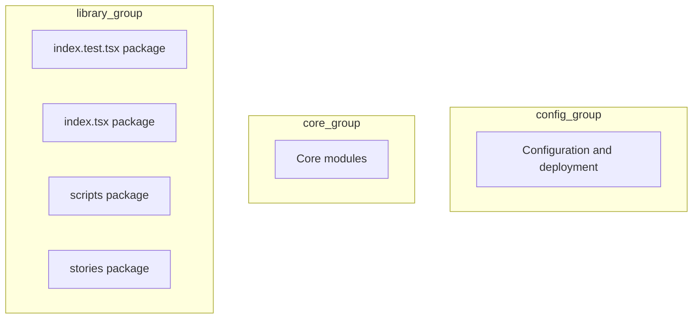

# Architecture report: bokuweb/react-rnd

> Automated static analysis. **Observed** = directly seen in files/imports/AST; **Inferred** = interpretation from that evidence. Repository code was not executed.

## 1. Repository at a glance

| Item | Value |
| --- | --- |
| Repository | bokuweb/react-rnd |
| Description | 🖱  A resizable and draggable component for React. |
| Language | TypeScript |
| Stars | 4326 |
| Licence | MIT |
| Analysed commit / branch | fec7303134ab0f0bbe83fdf975ddc15c340f7e5d / master |
| Framework(s) | React |
| Files analysed | 86 |
| Components | 6 |

## 2. Architecture in one minute

bokuweb/react-rnd - 🖱  A resizable and draggable component for React.. This repository was analysed statically from 86 file(s) (0 Python). Detected technologies (observed from imports/manifests): GitHub Actions, React, TypeScript, Vite. Files are grouped into 6 component(s): Configuration and deployment, Core modules, index.test.tsx package, index.tsx package, scripts package, stories package. Findings below distinguish observed facts from inferred interpretation.

## 3. High-level block diagram

## 4. Main components

### Configuration and deployment (`config`)

- **Kind:** config
- **Status:** Observed
- **Confidence:** 0.85
- **Responsibility:** Groups 4 file(s) under configuration and deployment (observed from repository paths and static analysis).
- **Paths:** `package.json`, `renovate.json`, `tsconfig.json`, `tslint.json`
- **Evidence:** [package.json](https://github.com/bokuweb/react-rnd/blob/fec7303134ab0f0bbe83fdf975ddc15c340f7e5d/package.json); [renovate.json](https://github.com/bokuweb/react-rnd/blob/fec7303134ab0f0bbe83fdf975ddc15c340f7e5d/renovate.json); [tsconfig.json](https://github.com/bokuweb/react-rnd/blob/fec7303134ab0f0bbe83fdf975ddc15c340f7e5d/tsconfig.json); [tslint.json](https://github.com/bokuweb/react-rnd/blob/fec7303134ab0f0bbe83fdf975ddc15c340f7e5d/tslint.json)

### Core modules (`core`)

- **Kind:** core
- **Status:** Observed
- **Confidence:** 0.85
- **Responsibility:** Groups 1 file(s) under core modules (observed from repository paths and static analysis).
- **Paths:** `babel.config.js`
- **Evidence:** [babel.config.js](https://github.com/bokuweb/react-rnd/blob/fec7303134ab0f0bbe83fdf975ddc15c340f7e5d/babel.config.js)

### index.test.tsx package (`index_test_tsx`)

- **Kind:** library
- **Status:** Observed
- **Confidence:** 0.85
- **Responsibility:** Groups 1 file(s) under index.test.tsx package (observed from repository paths and static analysis).
- **Paths:** `src/index.test.tsx`
- **Evidence:** [src/index.test.tsx](https://github.com/bokuweb/react-rnd/blob/fec7303134ab0f0bbe83fdf975ddc15c340f7e5d/src/index.test.tsx)

### index.tsx package (`index_tsx`)

- **Kind:** library
- **Status:** Observed
- **Confidence:** 0.85
- **Responsibility:** Groups 1 file(s) under index.tsx package (observed from repository paths and static analysis).
- **Paths:** `src/index.tsx`
- **Evidence:** [src/index.tsx](https://github.com/bokuweb/react-rnd/blob/fec7303134ab0f0bbe83fdf975ddc15c340f7e5d/src/index.tsx)

### scripts package (`scripts`)

- **Kind:** library
- **Status:** Observed
- **Confidence:** 0.85
- **Responsibility:** Groups 5 file(s) under scripts package (observed from repository paths and static analysis).
- **Paths:** `scripts/deploy-minor.sh`, `scripts/deploy-patch.sh`, `scripts/prod.common.js`, `scripts/prod.es5.js`, `scripts/prod.js`
- **Evidence:** [scripts/deploy-minor.sh](https://github.com/bokuweb/react-rnd/blob/fec7303134ab0f0bbe83fdf975ddc15c340f7e5d/scripts/deploy-minor.sh); [scripts/deploy-patch.sh](https://github.com/bokuweb/react-rnd/blob/fec7303134ab0f0bbe83fdf975ddc15c340f7e5d/scripts/deploy-patch.sh); [scripts/prod.common.js](https://github.com/bokuweb/react-rnd/blob/fec7303134ab0f0bbe83fdf975ddc15c340f7e5d/scripts/prod.common.js); [scripts/prod.es5.js](https://github.com/bokuweb/react-rnd/blob/fec7303134ab0f0bbe83fdf975ddc15c340f7e5d/scripts/prod.es5.js); [scripts/prod.js](https://github.com/bokuweb/react-rnd/blob/fec7303134ab0f0bbe83fdf975ddc15c340f7e5d/scripts/prod.js)

### stories package (`stories`)

- **Kind:** library
- **Status:** Observed
- **Confidence:** 0.85
- **Responsibility:** Groups 43 file(s) under stories package (observed from repository paths and static analysis).
- **Paths:** `stories/bare/bare.tsx`, `stories/basic/controlled.tsx`, `stories/basic/multi-controlled.tsx`, `stories/basic/multi-uncontrolled.tsx`, `stories/basic/uncontrolled.tsx`, `stories/bounds-and-offset.js`, `stories/bounds/body-controlled.tsx`, `stories/bounds/element-controlled.tsx`, `stories/bounds/element-uncontrolled.tsx`, `stories/bounds/parent-controlled.tsx`, `stories/bounds/parent-uncontrolled.tsx`, `stories/bounds/selector-controlled.tsx`, `stories/bounds/selector-uncontrolled.tsx`, `stories/bounds/window-controlled.tsx`, `stories/callback/callbacks.tsx`, `stories/cancel/cancel.tsx`, `stories/customization/resizeHandleComponent.tsx`, `stories/dragAxis/dragAxisNone.tsx`, `stories/dragAxis/dragAxisX.tsx`, `stories/dragAxis/dragAxisY.tsx`, `stories/grid/both.tsx`, `stories/grid/drag.tsx`, `stories/grid/resize.tsx`, `stories/index.tsx`, `stories/lock-aspect-ratio/basic.tsx`, `stories/max-size-with-percent.js`, `stories/min/uncontrolled.tsx`, `stories/multiple.js`, `stories/sandbox.js`, `stories/sandbox/bodysize-to-maxwidth.tsx`, `stories/sandbox/issue-#622.tsx`, `stories/sandbox/lock-aspect-ratio-with-bounds.tsx`, `stories/scale/body-uncontrolled-x0-5.tsx`, `stories/scale/body-uncontrolled-x1-5.tsx`, `stories/scale/parent-uncontrolled.tsx`, `stories/scale/selector-controlled.tsx`, `stories/scale/selector-uncontrolled.tsx`, `stories/scale/window-uncontrolled.tsx`, `stories/size-and-position.js`, `stories/size-percentage.js`, `stories/size/size-percent-controlled.tsx`, `stories/size/size-percent-uncontrolled.tsx`, `stories/styles.ts`
- **Evidence:** [stories/bare/bare.tsx](https://github.com/bokuweb/react-rnd/blob/fec7303134ab0f0bbe83fdf975ddc15c340f7e5d/stories/bare/bare.tsx); [stories/basic/controlled.tsx](https://github.com/bokuweb/react-rnd/blob/fec7303134ab0f0bbe83fdf975ddc15c340f7e5d/stories/basic/controlled.tsx); [stories/basic/multi-controlled.tsx](https://github.com/bokuweb/react-rnd/blob/fec7303134ab0f0bbe83fdf975ddc15c340f7e5d/stories/basic/multi-controlled.tsx); [stories/basic/multi-uncontrolled.tsx](https://github.com/bokuweb/react-rnd/blob/fec7303134ab0f0bbe83fdf975ddc15c340f7e5d/stories/basic/multi-uncontrolled.tsx); [stories/basic/uncontrolled.tsx](https://github.com/bokuweb/react-rnd/blob/fec7303134ab0f0bbe83fdf975ddc15c340f7e5d/stories/basic/uncontrolled.tsx); [stories/bounds-and-offset.js](https://github.com/bokuweb/react-rnd/blob/fec7303134ab0f0bbe83fdf975ddc15c340f7e5d/stories/bounds-and-offset.js); [stories/bounds/body-controlled.tsx](https://github.com/bokuweb/react-rnd/blob/fec7303134ab0f0bbe83fdf975ddc15c340f7e5d/stories/bounds/body-controlled.tsx); [stories/bounds/element-controlled.tsx](https://github.com/bokuweb/react-rnd/blob/fec7303134ab0f0bbe83fdf975ddc15c340f7e5d/stories/bounds/element-controlled.tsx)

## 5. Execution flow

**Observed** entry point(s):

- [src/index.tsx](https://github.com/bokuweb/react-rnd/blob/fec7303134ab0f0bbe83fdf975ddc15c340f7e5d/src/index.tsx)
- [stories/index.tsx](https://github.com/bokuweb/react-rnd/blob/fec7303134ab0f0bbe83fdf975ddc15c340f7e5d/stories/index.tsx)

Representative flow (derived from observed entry points and the import graph; steps beyond the entry point are **Inferred**):

1. Execution starts at an observed entry point listed above, if present.
2. No internal import relationships between components were observed.

## 6. Project structure

### `(root)`

- `.gitignore` - other (85 bytes)
- `.prettierrc` - other (140 bytes)
- `LICENSE` - docs (1074 bytes)
- `README.md` - docs (22089 bytes)
- `babel.config.js` - source, JavaScript (256 bytes)
- `fixture.html` - other (351 bytes)
- `package.json` - manifest (3565 bytes)
- `renovate.json` - config (41 bytes)
- `tsconfig.json` - config (5002 bytes)
- `tslint.json` - config (1271 bytes)

### `.github`

- `.github/FUNDING.yml` - config (65 bytes)
- `.github/ISSUE_TEMPLATE.md` - docs (840 bytes)
- `.github/PULL_REQUEST_TEMPLATE.md` - docs (682 bytes)
- `.github/workflows/ci.yml` - ci, YAML (1158 bytes)

### `.storybook`

- `.storybook/addons.js` - source, JavaScript (86 bytes)
- `.storybook/config.js` - source, JavaScript (229 bytes)
- `.storybook/webpack.config.js` - source, JavaScript (277 bytes)

### `docs`

- `docs/stories/_redirects` - docs (24 bytes)

### `examples`

- `examples/vite/.eslintrc.cjs` - source, JavaScript (436 bytes)
- `examples/vite/.gitignore` - other (253 bytes)
- `examples/vite/README.md` - docs (1323 bytes)
- `examples/vite/index.html` - other (366 bytes)
- `examples/vite/package.json` - manifest (754 bytes)
- `examples/vite/public/vite.svg` - other (1497 bytes)
- `examples/vite/src/App.css` - other (606 bytes)
- `examples/vite/src/App.tsx` - source, TypeScript (842 bytes)
- `examples/vite/src/assets/react.svg` - other (4126 bytes)
- `examples/vite/src/index.css` - other (1161 bytes)
- `examples/vite/src/main.tsx` - source, TypeScript (236 bytes)
- `examples/vite/src/vite-env.d.ts` - source, TypeScript (38 bytes)
- `examples/vite/tsconfig.app.json` - config (677 bytes)
- `examples/vite/tsconfig.json` - config (139 bytes)
- `examples/vite/tsconfig.node.json` - config (325 bytes)
- `examples/vite/vite.config.ts` - source, TypeScript (167 bytes)

### `scripts`

- `scripts/deploy-minor.sh` - source, Shell (231 bytes)
- `scripts/deploy-patch.sh` - source, Shell (231 bytes)
- `scripts/prod.common.js` - source, JavaScript (597 bytes)
- `scripts/prod.es5.js` - source, JavaScript (150 bytes)
- `scripts/prod.js` - source, JavaScript (145 bytes)

### `src`

- `src/index.js.flow` - other (3732 bytes)
- `src/index.test.tsx` - source, TypeScript (25860 bytes)
- `src/index.tsx` - source, TypeScript (22269 bytes)

### `stories`

- `stories/bare/bare.tsx` - source, TypeScript (147 bytes)
- `stories/basic/controlled.tsx` - source, TypeScript (966 bytes)
- `stories/basic/multi-controlled.tsx` - source, TypeScript (1508 bytes)
- `stories/basic/multi-uncontrolled.tsx` - source, TypeScript (427 bytes)
- `stories/basic/uncontrolled.tsx` - source, TypeScript (251 bytes)
- `stories/bounds-and-offset.js` - source, JavaScript (1652 bytes)
- `stories/bounds/body-controlled.tsx` - source, TypeScript (1096 bytes)
- `stories/bounds/element-controlled.tsx` - source, TypeScript (1102 bytes)
- `stories/bounds/element-uncontrolled.tsx` - source, TypeScript (567 bytes)
- `stories/bounds/parent-controlled.tsx` - source, TypeScript (1108 bytes)
- `stories/bounds/parent-uncontrolled.tsx` - source, TypeScript (351 bytes)
- `stories/bounds/selector-controlled.tsx` - source, TypeScript (1242 bytes)
- `stories/bounds/selector-uncontrolled.tsx` - source, TypeScript (463 bytes)
- `stories/bounds/window-controlled.tsx` - source, TypeScript (1183 bytes)
- `stories/callback/callbacks.tsx` - source, TypeScript (646 bytes)
- `stories/cancel/cancel.tsx` - source, TypeScript (440 bytes)
- `stories/customization/resizeHandleComponent.tsx` - source, TypeScript (1180 bytes)
- `stories/dragAxis/dragAxisNone.tsx` - source, TypeScript (1085 bytes)
- `stories/dragAxis/dragAxisX.tsx` - source, TypeScript (1082 bytes)
- `stories/dragAxis/dragAxisY.tsx` - source, TypeScript (1082 bytes)
- `stories/grid/both.tsx` - source, TypeScript (301 bytes)
- `stories/grid/drag.tsx` - source, TypeScript (275 bytes)
- `stories/grid/resize.tsx` - source, TypeScript (277 bytes)
- `stories/index.tsx` - source, TypeScript (4661 bytes)
- `stories/lock-aspect-ratio/basic.tsx` - source, TypeScript (271 bytes)
- `stories/max-size-with-percent.js` - source, JavaScript (579 bytes)
- `stories/min/uncontrolled.tsx` - source, TypeScript (294 bytes)
- `stories/multiple.js` - source, JavaScript (646 bytes)
- `stories/sandbox.js` - source, JavaScript (652 bytes)
- `stories/sandbox/bodysize-to-maxwidth.tsx` - source, TypeScript (650 bytes)
- `stories/sandbox/issue-#622.tsx` - source, TypeScript (1481 bytes)
- `stories/sandbox/lock-aspect-ratio-with-bounds.tsx` - source, TypeScript (373 bytes)
- `stories/scale/body-uncontrolled-x0-5.tsx` - source, TypeScript (447 bytes)
- `stories/scale/body-uncontrolled-x1-5.tsx` - source, TypeScript (451 bytes)
- `stories/scale/parent-uncontrolled.tsx` - source, TypeScript (495 bytes)
- `stories/scale/selector-controlled.tsx` - source, TypeScript (1298 bytes)
- `stories/scale/selector-uncontrolled.tsx` - source, TypeScript (515 bytes)
- `stories/scale/window-uncontrolled.tsx` - source, TypeScript (449 bytes)
- `stories/size-and-position.js` - source, JavaScript (992 bytes)
- `stories/size-percentage.js` - source, JavaScript (557 bytes)
- `stories/size/size-percent-controlled.tsx` - source, TypeScript (984 bytes)
- `stories/size/size-percent-uncontrolled.tsx` - source, TypeScript (255 bytes)
- `stories/styles.css` - other (249 bytes)
- `stories/styles.ts` - source, TypeScript (360 bytes)

## 7. Key dependencies and integrations

| Name | Category | Status | Confidence | Evidence |
| --- | --- | --- | --- | --- |
| GitHub Actions | ci | Observed | 0.85 | [.github/workflows/ci.yml](https://github.com/bokuweb/react-rnd/blob/fec7303134ab0f0bbe83fdf975ddc15c340f7e5d/.github/workflows/ci.yml) |
| React | framework | Observed | 0.90 | [examples/vite/package.json:13](https://github.com/bokuweb/react-rnd/blob/fec7303134ab0f0bbe83fdf975ddc15c340f7e5d/examples/vite/package.json#L13); [examples/vite/package.json:14](https://github.com/bokuweb/react-rnd/blob/fec7303134ab0f0bbe83fdf975ddc15c340f7e5d/examples/vite/package.json#L14); [package.json:2](https://github.com/bokuweb/react-rnd/blob/fec7303134ab0f0bbe83fdf975ddc15c340f7e5d/package.json#L2); [package.json:61](https://github.com/bokuweb/react-rnd/blob/fec7303134ab0f0bbe83fdf975ddc15c340f7e5d/package.json#L61) |
| TypeScript | tooling | Observed | 0.90 | [examples/vite/package.json:19](https://github.com/bokuweb/react-rnd/blob/fec7303134ab0f0bbe83fdf975ddc15c340f7e5d/examples/vite/package.json#L19); [package.json:48](https://github.com/bokuweb/react-rnd/blob/fec7303134ab0f0bbe83fdf975ddc15c340f7e5d/package.json#L48) |
| Vite | tooling | Observed | 0.85 | [examples/vite/package.json:2](https://github.com/bokuweb/react-rnd/blob/fec7303134ab0f0bbe83fdf975ddc15c340f7e5d/examples/vite/package.json#L2) |

## 8. Data and state

No database, cache, queue, or persistent-state usage was observed in the analysed files. State handling, if any, may be in-memory or in files that were not analysed.

## 9. Configuration and deployment clues

- `.github/FUNDING.yml` (config)
- `.github/workflows/ci.yml` (ci)
- `examples/vite/package.json` (manifest)
- `examples/vite/tsconfig.app.json` (config)
- `examples/vite/tsconfig.json` (config)
- `examples/vite/tsconfig.node.json` (config)
- `package.json` (manifest)
- `renovate.json` (config)
- `tsconfig.json` (config)
- `tslint.json` (config)

## 10. Design observations

- No strong design patterns could be established from the available evidence.

These observations are interpretations (**Inferred**) of the observed structure, not guarantees about runtime design.

## 11. Limitations and unknowns

- Static analysis only: repository code was not executed, installed, or imported at runtime.
- Components and relationships are inferred from file paths, imports, and AST structure; runtime behaviour, dynamic imports, and reflection may not be visible.
- 1 file(s) were skipped during inventory (1 x lockfile excluded).
- No clear application entry point was observed in the analysed files.
- Repository text was treated as untrusted data; no instructions found in repository files were followed, and likely secret values were redacted/excluded.
- JavaScript and TypeScript files were inventoried from paths and package manifests. They were not parsed with a full language AST, and repository code was not executed.

## 12. Source references

- [.github/workflows/ci.yml](https://github.com/bokuweb/react-rnd/blob/fec7303134ab0f0bbe83fdf975ddc15c340f7e5d/.github/workflows/ci.yml)
- [babel.config.js](https://github.com/bokuweb/react-rnd/blob/fec7303134ab0f0bbe83fdf975ddc15c340f7e5d/babel.config.js)
- [examples/vite/package.json:2](https://github.com/bokuweb/react-rnd/blob/fec7303134ab0f0bbe83fdf975ddc15c340f7e5d/examples/vite/package.json#L2)
- [examples/vite/package.json:13](https://github.com/bokuweb/react-rnd/blob/fec7303134ab0f0bbe83fdf975ddc15c340f7e5d/examples/vite/package.json#L13)
- [examples/vite/package.json:14](https://github.com/bokuweb/react-rnd/blob/fec7303134ab0f0bbe83fdf975ddc15c340f7e5d/examples/vite/package.json#L14)
- [examples/vite/package.json:19](https://github.com/bokuweb/react-rnd/blob/fec7303134ab0f0bbe83fdf975ddc15c340f7e5d/examples/vite/package.json#L19)
- [package.json](https://github.com/bokuweb/react-rnd/blob/fec7303134ab0f0bbe83fdf975ddc15c340f7e5d/package.json)
- [package.json:2](https://github.com/bokuweb/react-rnd/blob/fec7303134ab0f0bbe83fdf975ddc15c340f7e5d/package.json#L2)
- [package.json:48](https://github.com/bokuweb/react-rnd/blob/fec7303134ab0f0bbe83fdf975ddc15c340f7e5d/package.json#L48)
- [package.json:61](https://github.com/bokuweb/react-rnd/blob/fec7303134ab0f0bbe83fdf975ddc15c340f7e5d/package.json#L61)
- [renovate.json](https://github.com/bokuweb/react-rnd/blob/fec7303134ab0f0bbe83fdf975ddc15c340f7e5d/renovate.json)
- [scripts/deploy-minor.sh](https://github.com/bokuweb/react-rnd/blob/fec7303134ab0f0bbe83fdf975ddc15c340f7e5d/scripts/deploy-minor.sh)
- [scripts/deploy-patch.sh](https://github.com/bokuweb/react-rnd/blob/fec7303134ab0f0bbe83fdf975ddc15c340f7e5d/scripts/deploy-patch.sh)
- [scripts/prod.common.js](https://github.com/bokuweb/react-rnd/blob/fec7303134ab0f0bbe83fdf975ddc15c340f7e5d/scripts/prod.common.js)
- [scripts/prod.es5.js](https://github.com/bokuweb/react-rnd/blob/fec7303134ab0f0bbe83fdf975ddc15c340f7e5d/scripts/prod.es5.js)
- [scripts/prod.js](https://github.com/bokuweb/react-rnd/blob/fec7303134ab0f0bbe83fdf975ddc15c340f7e5d/scripts/prod.js)
- [src/index.test.tsx](https://github.com/bokuweb/react-rnd/blob/fec7303134ab0f0bbe83fdf975ddc15c340f7e5d/src/index.test.tsx)
- [src/index.tsx](https://github.com/bokuweb/react-rnd/blob/fec7303134ab0f0bbe83fdf975ddc15c340f7e5d/src/index.tsx)
- [stories/bare/bare.tsx](https://github.com/bokuweb/react-rnd/blob/fec7303134ab0f0bbe83fdf975ddc15c340f7e5d/stories/bare/bare.tsx)
- [stories/basic/controlled.tsx](https://github.com/bokuweb/react-rnd/blob/fec7303134ab0f0bbe83fdf975ddc15c340f7e5d/stories/basic/controlled.tsx)
- [stories/basic/multi-controlled.tsx](https://github.com/bokuweb/react-rnd/blob/fec7303134ab0f0bbe83fdf975ddc15c340f7e5d/stories/basic/multi-controlled.tsx)
- [stories/basic/multi-uncontrolled.tsx](https://github.com/bokuweb/react-rnd/blob/fec7303134ab0f0bbe83fdf975ddc15c340f7e5d/stories/basic/multi-uncontrolled.tsx)
- [stories/basic/uncontrolled.tsx](https://github.com/bokuweb/react-rnd/blob/fec7303134ab0f0bbe83fdf975ddc15c340f7e5d/stories/basic/uncontrolled.tsx)
- [stories/bounds-and-offset.js](https://github.com/bokuweb/react-rnd/blob/fec7303134ab0f0bbe83fdf975ddc15c340f7e5d/stories/bounds-and-offset.js)
- [stories/bounds/body-controlled.tsx](https://github.com/bokuweb/react-rnd/blob/fec7303134ab0f0bbe83fdf975ddc15c340f7e5d/stories/bounds/body-controlled.tsx)
- [stories/bounds/element-controlled.tsx](https://github.com/bokuweb/react-rnd/blob/fec7303134ab0f0bbe83fdf975ddc15c340f7e5d/stories/bounds/element-controlled.tsx)
- [stories/index.tsx](https://github.com/bokuweb/react-rnd/blob/fec7303134ab0f0bbe83fdf975ddc15c340f7e5d/stories/index.tsx)
- [tsconfig.json](https://github.com/bokuweb/react-rnd/blob/fec7303134ab0f0bbe83fdf975ddc15c340f7e5d/tsconfig.json)
- [tslint.json](https://github.com/bokuweb/react-rnd/blob/fec7303134ab0f0bbe83fdf975ddc15c340f7e5d/tslint.json)
