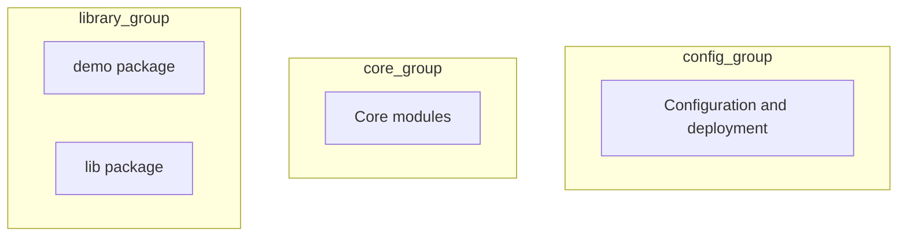

# Architecture report: boringdesigners/boring-avatars

> Automated static analysis. **Observed** = directly seen in files/imports/AST; **Inferred** = interpretation from that evidence. Repository code was not executed.

## 1. Repository at a glance

| Item | Value |
| --- | --- |
| Repository | boringdesigners/boring-avatars |
| Description | Boring avatars is an open source React library that generates custom, SVG-based avatars from any username and color palette. |
| Language | TypeScript |
| Stars | 6503 |
| Licence | MIT |
| Analysed commit / branch | d0ff2582a8921b643a89de4a4912be28938a828b / master |
| Framework(s) | React |
| Files analysed | 40 |
| Components | 4 |

## 2. Architecture in one minute

boringdesigners/boring-avatars - Boring avatars is an open source React library that generates custom, SVG-based avatars from any username and color palette.. This repository was analysed statically from 40 file(s) (0 Python). Detected technologies (observed from imports/manifests): GitHub Actions, React, TypeScript, Vite. Files are grouped into 4 component(s): Configuration and deployment, Core modules, demo package, lib package. Findings below distinguish observed facts from inferred interpretation.

## 3. High-level block diagram

## 4. Main components

### Configuration and deployment (`config`)

- **Kind:** config
- **Status:** Observed
- **Confidence:** 0.85
- **Responsibility:** Groups 6 file(s) under configuration and deployment (observed from repository paths and static analysis).
- **Paths:** `package.json`, `public/manifest.json`, `tsconfig.app.json`, `tsconfig.json`, `tsconfig.lib.json`, `tsconfig.node.json`
- **Evidence:** [package.json](https://github.com/boringdesigners/boring-avatars/blob/d0ff2582a8921b643a89de4a4912be28938a828b/package.json); [public/manifest.json](https://github.com/boringdesigners/boring-avatars/blob/d0ff2582a8921b643a89de4a4912be28938a828b/public/manifest.json); [tsconfig.app.json](https://github.com/boringdesigners/boring-avatars/blob/d0ff2582a8921b643a89de4a4912be28938a828b/tsconfig.app.json); [tsconfig.json](https://github.com/boringdesigners/boring-avatars/blob/d0ff2582a8921b643a89de4a4912be28938a828b/tsconfig.json); [tsconfig.lib.json](https://github.com/boringdesigners/boring-avatars/blob/d0ff2582a8921b643a89de4a4912be28938a828b/tsconfig.lib.json); [tsconfig.node.json](https://github.com/boringdesigners/boring-avatars/blob/d0ff2582a8921b643a89de4a4912be28938a828b/tsconfig.node.json)

### Core modules (`core`)

- **Kind:** core
- **Status:** Observed
- **Confidence:** 0.85
- **Responsibility:** Groups 2 file(s) under core modules (observed from repository paths and static analysis).
- **Paths:** `eslint.config.js`, `vite.config.ts`
- **Evidence:** [eslint.config.js](https://github.com/boringdesigners/boring-avatars/blob/d0ff2582a8921b643a89de4a4912be28938a828b/eslint.config.js); [vite.config.ts](https://github.com/boringdesigners/boring-avatars/blob/d0ff2582a8921b643a89de4a4912be28938a828b/vite.config.ts)

### demo package (`demo`)

- **Kind:** library
- **Status:** Observed
- **Confidence:** 0.85
- **Responsibility:** Groups 11 file(s) under demo package (observed from repository paths and static analysis).
- **Paths:** `src/demo/App.tsx`, `src/demo/example-names.ts`, `src/demo/hooks.tsx`, `src/demo/main.tsx`, `src/demo/playground.tsx`, `src/demo/ui-system/components/base-styles.tsx`, `src/demo/ui-system/components/button.tsx`, `src/demo/ui-system/components/color-dot.tsx`, `src/demo/ui-system/components/segment.tsx`, `src/demo/ui-system/index.ts`, `src/demo/vite-env.d.ts`
- **Evidence:** [src/demo/App.tsx](https://github.com/boringdesigners/boring-avatars/blob/d0ff2582a8921b643a89de4a4912be28938a828b/src/demo/App.tsx); [src/demo/example-names.ts](https://github.com/boringdesigners/boring-avatars/blob/d0ff2582a8921b643a89de4a4912be28938a828b/src/demo/example-names.ts); [src/demo/hooks.tsx](https://github.com/boringdesigners/boring-avatars/blob/d0ff2582a8921b643a89de4a4912be28938a828b/src/demo/hooks.tsx); [src/demo/main.tsx](https://github.com/boringdesigners/boring-avatars/blob/d0ff2582a8921b643a89de4a4912be28938a828b/src/demo/main.tsx); [src/demo/playground.tsx](https://github.com/boringdesigners/boring-avatars/blob/d0ff2582a8921b643a89de4a4912be28938a828b/src/demo/playground.tsx); [src/demo/ui-system/components/base-styles.tsx](https://github.com/boringdesigners/boring-avatars/blob/d0ff2582a8921b643a89de4a4912be28938a828b/src/demo/ui-system/components/base-styles.tsx); [src/demo/ui-system/components/button.tsx](https://github.com/boringdesigners/boring-avatars/blob/d0ff2582a8921b643a89de4a4912be28938a828b/src/demo/ui-system/components/button.tsx); [src/demo/ui-system/components/color-dot.tsx](https://github.com/boringdesigners/boring-avatars/blob/d0ff2582a8921b643a89de4a4912be28938a828b/src/demo/ui-system/components/color-dot.tsx)

### lib package (`lib`)

- **Kind:** library
- **Status:** Observed
- **Confidence:** 0.85
- **Responsibility:** Groups 9 file(s) under lib package (observed from repository paths and static analysis).
- **Paths:** `src/lib/components/avatar-bauhaus.tsx`, `src/lib/components/avatar-beam.tsx`, `src/lib/components/avatar-marble.tsx`, `src/lib/components/avatar-pixel.tsx`, `src/lib/components/avatar-ring.tsx`, `src/lib/components/avatar-sunset.tsx`, `src/lib/components/types.ts`, `src/lib/index.tsx`, `src/lib/utilities.ts`
- **Evidence:** [src/lib/components/avatar-bauhaus.tsx](https://github.com/boringdesigners/boring-avatars/blob/d0ff2582a8921b643a89de4a4912be28938a828b/src/lib/components/avatar-bauhaus.tsx); [src/lib/components/avatar-beam.tsx](https://github.com/boringdesigners/boring-avatars/blob/d0ff2582a8921b643a89de4a4912be28938a828b/src/lib/components/avatar-beam.tsx); [src/lib/components/avatar-marble.tsx](https://github.com/boringdesigners/boring-avatars/blob/d0ff2582a8921b643a89de4a4912be28938a828b/src/lib/components/avatar-marble.tsx); [src/lib/components/avatar-pixel.tsx](https://github.com/boringdesigners/boring-avatars/blob/d0ff2582a8921b643a89de4a4912be28938a828b/src/lib/components/avatar-pixel.tsx); [src/lib/components/avatar-ring.tsx](https://github.com/boringdesigners/boring-avatars/blob/d0ff2582a8921b643a89de4a4912be28938a828b/src/lib/components/avatar-ring.tsx); [src/lib/components/avatar-sunset.tsx](https://github.com/boringdesigners/boring-avatars/blob/d0ff2582a8921b643a89de4a4912be28938a828b/src/lib/components/avatar-sunset.tsx); [src/lib/components/types.ts](https://github.com/boringdesigners/boring-avatars/blob/d0ff2582a8921b643a89de4a4912be28938a828b/src/lib/components/types.ts); [src/lib/index.tsx](https://github.com/boringdesigners/boring-avatars/blob/d0ff2582a8921b643a89de4a4912be28938a828b/src/lib/index.tsx)

## 5. Execution flow

**Observed** entry point(s):

- [src/demo/App.tsx](https://github.com/boringdesigners/boring-avatars/blob/d0ff2582a8921b643a89de4a4912be28938a828b/src/demo/App.tsx)
- [src/demo/main.tsx](https://github.com/boringdesigners/boring-avatars/blob/d0ff2582a8921b643a89de4a4912be28938a828b/src/demo/main.tsx)
- [src/demo/ui-system/index.ts](https://github.com/boringdesigners/boring-avatars/blob/d0ff2582a8921b643a89de4a4912be28938a828b/src/demo/ui-system/index.ts)
- [src/lib/index.tsx](https://github.com/boringdesigners/boring-avatars/blob/d0ff2582a8921b643a89de4a4912be28938a828b/src/lib/index.tsx)

Representative flow (derived from observed entry points and the import graph; steps beyond the entry point are **Inferred**):

1. Execution starts at an observed entry point listed above, if present.
2. No internal import relationships between components were observed.

## 6. Project structure

### `(root)`

- `.gitignore` - other (315 bytes)
- `.prettierrc` - other (106 bytes)
- `LICENSE` - docs (1072 bytes)
- `README.md` - docs (3158 bytes)
- `eslint.config.js` - source, JavaScript (610 bytes)
- `index.html` - other (371 bytes)
- `package.json` - manifest (1586 bytes)
- `tsconfig.app.json` - config (702 bytes)
- `tsconfig.json` - config (119 bytes)
- `tsconfig.lib.json` - config (435 bytes)
- `tsconfig.node.json` - config (630 bytes)
- `vite.config.ts` - source, TypeScript (686 bytes)

### `.github`

- `.github/FUNDING.yml` - config (71 bytes)
- `.github/ISSUE_TEMPLATE/bug_report.md` - docs (834 bytes)
- `.github/ISSUE_TEMPLATE/feature_request.md` - docs (595 bytes)
- `.github/workflows/stale.yml` - ci, YAML (916 bytes)

### `public`

- `public/index.html` - other (1808 bytes)
- `public/manifest.json` - config (488 bytes)
- `public/robots.txt` - docs (57 bytes)

### `src`

- `src/demo/App.tsx` - source, TypeScript (105 bytes)
- `src/demo/example-names.ts` - source, TypeScript (1955 bytes)
- `src/demo/hooks.tsx` - source, TypeScript (1152 bytes)
- `src/demo/index.css` - other (366 bytes)
- `src/demo/main.tsx` - source, TypeScript (230 bytes)
- `src/demo/playground.tsx` - source, TypeScript (7483 bytes)
- `src/demo/ui-system/components/base-styles.tsx` - source, TypeScript (813 bytes)
- `src/demo/ui-system/components/button.tsx` - source, TypeScript (1117 bytes)
- `src/demo/ui-system/components/color-dot.tsx` - source, TypeScript (1203 bytes)
- `src/demo/ui-system/components/segment.tsx` - source, TypeScript (1092 bytes)
- `src/demo/ui-system/index.ts` - source, TypeScript (291 bytes)
- `src/demo/vite-env.d.ts` - source, TypeScript (38 bytes)
- `src/lib/components/avatar-bauhaus.tsx` - source, TypeScript (2778 bytes)
- `src/lib/components/avatar-beam.tsx` - source, TypeScript (3973 bytes)
- `src/lib/components/avatar-marble.tsx` - source, TypeScript (3179 bytes)
- `src/lib/components/avatar-pixel.tsx` - source, TypeScript (6064 bytes)
- `src/lib/components/avatar-ring.tsx` - source, TypeScript (2101 bytes)
- `src/lib/components/avatar-sunset.tsx` - source, TypeScript (2164 bytes)
- `src/lib/components/types.ts` - source, TypeScript (198 bytes)
- `src/lib/index.tsx` - source, TypeScript (1189 bytes)
- `src/lib/utilities.ts` - source, TypeScript (1545 bytes)

## 7. Key dependencies and integrations

| Name | Category | Status | Confidence | Evidence |
| --- | --- | --- | --- | --- |
| GitHub Actions | ci | Observed | 0.85 | [.github/workflows/stale.yml](https://github.com/boringdesigners/boring-avatars/blob/d0ff2582a8921b643a89de4a4912be28938a828b/.github/workflows/stale.yml) |
| React | framework | Observed | 0.90 | [package.json:3](https://github.com/boringdesigners/boring-avatars/blob/d0ff2582a8921b643a89de4a4912be28938a828b/package.json#L3); [package.json:36](https://github.com/boringdesigners/boring-avatars/blob/d0ff2582a8921b643a89de4a4912be28938a828b/package.json#L36) |
| TypeScript | tooling | Observed | 0.85 | [package.json:54](https://github.com/boringdesigners/boring-avatars/blob/d0ff2582a8921b643a89de4a4912be28938a828b/package.json#L54) |
| Vite | tooling | Observed | 0.85 | [package.json:29](https://github.com/boringdesigners/boring-avatars/blob/d0ff2582a8921b643a89de4a4912be28938a828b/package.json#L29) |

## 8. Data and state

No database, cache, queue, or persistent-state usage was observed in the analysed files. State handling, if any, may be in-memory or in files that were not analysed.

## 9. Configuration and deployment clues

- `.github/FUNDING.yml` (config)
- `.github/workflows/stale.yml` (ci)
- `package.json` (manifest)
- `public/manifest.json` (config)
- `tsconfig.app.json` (config)
- `tsconfig.json` (config)
- `tsconfig.lib.json` (config)
- `tsconfig.node.json` (config)

## 10. Design observations

- No strong design patterns could be established from the available evidence.

These observations are interpretations (**Inferred**) of the observed structure, not guarantees about runtime design.

## 11. Limitations and unknowns

- Static analysis only: repository code was not executed, installed, or imported at runtime.
- Components and relationships are inferred from file paths, imports, and AST structure; runtime behaviour, dynamic imports, and reflection may not be visible.
- 1 file(s) were skipped during inventory (1 x lockfile excluded).
- No clear application entry point was observed in the analysed files.
- Repository text was treated as untrusted data; no instructions found in repository files were followed, and likely secret values were redacted/excluded.
- JavaScript and TypeScript files were inventoried from paths and package manifests. They were not parsed with a full language AST, and repository code was not executed.

## 12. Source references

- [.github/workflows/stale.yml](https://github.com/boringdesigners/boring-avatars/blob/d0ff2582a8921b643a89de4a4912be28938a828b/.github/workflows/stale.yml)
- [eslint.config.js](https://github.com/boringdesigners/boring-avatars/blob/d0ff2582a8921b643a89de4a4912be28938a828b/eslint.config.js)
- [package.json](https://github.com/boringdesigners/boring-avatars/blob/d0ff2582a8921b643a89de4a4912be28938a828b/package.json)
- [package.json:3](https://github.com/boringdesigners/boring-avatars/blob/d0ff2582a8921b643a89de4a4912be28938a828b/package.json#L3)
- [package.json:29](https://github.com/boringdesigners/boring-avatars/blob/d0ff2582a8921b643a89de4a4912be28938a828b/package.json#L29)
- [package.json:36](https://github.com/boringdesigners/boring-avatars/blob/d0ff2582a8921b643a89de4a4912be28938a828b/package.json#L36)
- [package.json:54](https://github.com/boringdesigners/boring-avatars/blob/d0ff2582a8921b643a89de4a4912be28938a828b/package.json#L54)
- [public/manifest.json](https://github.com/boringdesigners/boring-avatars/blob/d0ff2582a8921b643a89de4a4912be28938a828b/public/manifest.json)
- [src/demo/App.tsx](https://github.com/boringdesigners/boring-avatars/blob/d0ff2582a8921b643a89de4a4912be28938a828b/src/demo/App.tsx)
- [src/demo/example-names.ts](https://github.com/boringdesigners/boring-avatars/blob/d0ff2582a8921b643a89de4a4912be28938a828b/src/demo/example-names.ts)
- [src/demo/hooks.tsx](https://github.com/boringdesigners/boring-avatars/blob/d0ff2582a8921b643a89de4a4912be28938a828b/src/demo/hooks.tsx)
- [src/demo/main.tsx](https://github.com/boringdesigners/boring-avatars/blob/d0ff2582a8921b643a89de4a4912be28938a828b/src/demo/main.tsx)
- [src/demo/playground.tsx](https://github.com/boringdesigners/boring-avatars/blob/d0ff2582a8921b643a89de4a4912be28938a828b/src/demo/playground.tsx)
- [src/demo/ui-system/components/base-styles.tsx](https://github.com/boringdesigners/boring-avatars/blob/d0ff2582a8921b643a89de4a4912be28938a828b/src/demo/ui-system/components/base-styles.tsx)
- [src/demo/ui-system/components/button.tsx](https://github.com/boringdesigners/boring-avatars/blob/d0ff2582a8921b643a89de4a4912be28938a828b/src/demo/ui-system/components/button.tsx)
- [src/demo/ui-system/components/color-dot.tsx](https://github.com/boringdesigners/boring-avatars/blob/d0ff2582a8921b643a89de4a4912be28938a828b/src/demo/ui-system/components/color-dot.tsx)
- [src/demo/ui-system/index.ts](https://github.com/boringdesigners/boring-avatars/blob/d0ff2582a8921b643a89de4a4912be28938a828b/src/demo/ui-system/index.ts)
- [src/lib/components/avatar-bauhaus.tsx](https://github.com/boringdesigners/boring-avatars/blob/d0ff2582a8921b643a89de4a4912be28938a828b/src/lib/components/avatar-bauhaus.tsx)
- [src/lib/components/avatar-beam.tsx](https://github.com/boringdesigners/boring-avatars/blob/d0ff2582a8921b643a89de4a4912be28938a828b/src/lib/components/avatar-beam.tsx)
- [src/lib/components/avatar-marble.tsx](https://github.com/boringdesigners/boring-avatars/blob/d0ff2582a8921b643a89de4a4912be28938a828b/src/lib/components/avatar-marble.tsx)
- [src/lib/components/avatar-pixel.tsx](https://github.com/boringdesigners/boring-avatars/blob/d0ff2582a8921b643a89de4a4912be28938a828b/src/lib/components/avatar-pixel.tsx)
- [src/lib/components/avatar-ring.tsx](https://github.com/boringdesigners/boring-avatars/blob/d0ff2582a8921b643a89de4a4912be28938a828b/src/lib/components/avatar-ring.tsx)
- [src/lib/components/avatar-sunset.tsx](https://github.com/boringdesigners/boring-avatars/blob/d0ff2582a8921b643a89de4a4912be28938a828b/src/lib/components/avatar-sunset.tsx)
- [src/lib/components/types.ts](https://github.com/boringdesigners/boring-avatars/blob/d0ff2582a8921b643a89de4a4912be28938a828b/src/lib/components/types.ts)
- [src/lib/index.tsx](https://github.com/boringdesigners/boring-avatars/blob/d0ff2582a8921b643a89de4a4912be28938a828b/src/lib/index.tsx)
- [tsconfig.app.json](https://github.com/boringdesigners/boring-avatars/blob/d0ff2582a8921b643a89de4a4912be28938a828b/tsconfig.app.json)
- [tsconfig.json](https://github.com/boringdesigners/boring-avatars/blob/d0ff2582a8921b643a89de4a4912be28938a828b/tsconfig.json)
- [tsconfig.lib.json](https://github.com/boringdesigners/boring-avatars/blob/d0ff2582a8921b643a89de4a4912be28938a828b/tsconfig.lib.json)
- [tsconfig.node.json](https://github.com/boringdesigners/boring-avatars/blob/d0ff2582a8921b643a89de4a4912be28938a828b/tsconfig.node.json)
- [vite.config.ts](https://github.com/boringdesigners/boring-avatars/blob/d0ff2582a8921b643a89de4a4912be28938a828b/vite.config.ts)
