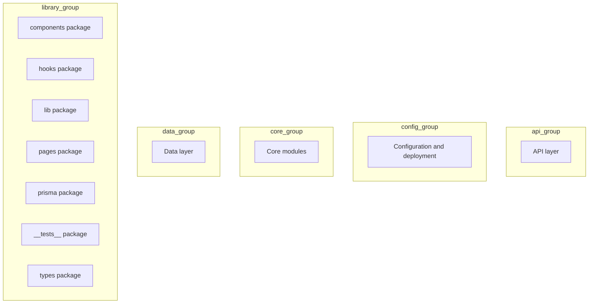

# Architecture report: boxyhq/saas-starter-kit

> Automated static analysis. **Observed** = directly seen in files/imports/AST; **Inferred** = interpretation from that evidence. Repository code was not executed.

## 1. Repository at a glance

| Item | Value |
| --- | --- |
| Repository | boxyhq/saas-starter-kit |
| Description | 🔥 Enterprise SaaS Starter Kit - Kickstart your enterprise app development with the Next.js SaaS boilerplate 🚀 |
| Language | TypeScript |
| Stars | 4976 |
| Licence | Apache-2.0 |
| Analysed commit / branch | abc9b686823cbfb4973c79bc36fea37a3244be6c / main |
| Framework(s) | Next.js, React |
| Files analysed | 322 |
| Components | 11 |

## 2. Architecture in one minute

boxyhq/saas-starter-kit - 🔥 Enterprise SaaS Starter Kit - Kickstart your enterprise app development with the Next.js SaaS boilerplate 🚀. This repository was analysed statically from 322 file(s) (0 Python). Detected technologies (observed from imports/manifests): GitHub Actions, Database (unspecified), PostgreSQL, Next.js, React, Prisma. Files are grouped into 11 component(s): API layer, components package, Configuration and deployment, Core modules, Data layer, hooks package, lib package, pages package. Findings below distinguish observed facts from inferred interpretation.

## 3. High-level block diagram

## 4. Main components

### API layer (`api_layer`)

- **Kind:** api
- **Status:** Observed
- **Confidence:** 0.85
- **Responsibility:** Groups 42 file(s) under api layer (observed from repository paths and static analysis).
- **Paths:** `pages/api/auth/[...nextauth].ts`, `pages/api/auth/custom-signout.ts`, `pages/api/auth/forgot-password.ts`, `pages/api/auth/join.ts`, `pages/api/auth/resend-email-token.ts`, `pages/api/auth/reset-password.ts`, `pages/api/auth/sso/acs.ts`, `pages/api/auth/sso/verify.ts`, `pages/api/auth/unlock-account.ts`, `pages/api/health.ts`, `pages/api/hello.ts`, `pages/api/idp.ts`, `pages/api/import-hack.ts`, `pages/api/invitations/[token].ts`, `pages/api/oauth/authorize.ts`, `pages/api/oauth/oidc.ts`, `pages/api/oauth/saml.ts`, `pages/api/oauth/token.ts`, `pages/api/oauth/userinfo.ts`, `pages/api/password.ts`, `pages/api/scim/v2.0/[...directory].ts`, `pages/api/sessions/[id].ts`, `pages/api/sessions/index.ts`, `pages/api/teams/[slug]/api-keys/[apiKeyId].ts`, `pages/api/teams/[slug]/api-keys/index.ts`, `pages/api/teams/[slug]/dsync/[directoryId].ts`, `pages/api/teams/[slug]/dsync/index.ts`, `pages/api/teams/[slug]/index.ts`, `pages/api/teams/[slug]/invitations.ts`, `pages/api/teams/[slug]/members.ts`, `pages/api/teams/[slug]/payments/create-checkout-session.ts`, `pages/api/teams/[slug]/payments/create-portal-link.ts`, `pages/api/teams/[slug]/payments/products.ts`, `pages/api/teams/[slug]/permissions.ts`, `pages/api/teams/[slug]/sso.ts`, `pages/api/teams/[slug]/webhooks/[endpointId].ts`, `pages/api/teams/[slug]/webhooks/index.ts`, `pages/api/teams/index.ts`, `pages/api/users.ts`, `pages/api/webhooks/dsync.ts`, `pages/api/webhooks/stripe.ts`, `pages/api/well-known/saml.cer.ts`
- **Evidence:** [pages/api/auth/[...nextauth].ts](https://github.com/boxyhq/saas-starter-kit/blob/abc9b686823cbfb4973c79bc36fea37a3244be6c/pages/api/auth/%5B...nextauth%5D.ts); [pages/api/auth/custom-signout.ts](https://github.com/boxyhq/saas-starter-kit/blob/abc9b686823cbfb4973c79bc36fea37a3244be6c/pages/api/auth/custom-signout.ts); [pages/api/auth/forgot-password.ts](https://github.com/boxyhq/saas-starter-kit/blob/abc9b686823cbfb4973c79bc36fea37a3244be6c/pages/api/auth/forgot-password.ts); [pages/api/auth/join.ts](https://github.com/boxyhq/saas-starter-kit/blob/abc9b686823cbfb4973c79bc36fea37a3244be6c/pages/api/auth/join.ts); [pages/api/auth/resend-email-token.ts](https://github.com/boxyhq/saas-starter-kit/blob/abc9b686823cbfb4973c79bc36fea37a3244be6c/pages/api/auth/resend-email-token.ts); [pages/api/auth/reset-password.ts](https://github.com/boxyhq/saas-starter-kit/blob/abc9b686823cbfb4973c79bc36fea37a3244be6c/pages/api/auth/reset-password.ts); [pages/api/auth/sso/acs.ts](https://github.com/boxyhq/saas-starter-kit/blob/abc9b686823cbfb4973c79bc36fea37a3244be6c/pages/api/auth/sso/acs.ts); [pages/api/auth/sso/verify.ts](https://github.com/boxyhq/saas-starter-kit/blob/abc9b686823cbfb4973c79bc36fea37a3244be6c/pages/api/auth/sso/verify.ts)

### components package (`components`)

- **Kind:** library
- **Status:** Observed
- **Confidence:** 0.85
- **Responsibility:** Groups 94 file(s) under components package (observed from repository paths and static analysis).
- **Paths:** `components/account/ManageSessions.tsx`, `components/account/UpdateAccount.tsx`, `components/account/UpdateEmail.tsx`, `components/account/UpdateName.tsx`, `components/account/UpdatePassword.tsx`, `components/account/UpdateTheme.tsx`, `components/account/UploadAvatar.tsx`, `components/account/index.ts`, `components/apiKey/APIKeys.tsx`, `components/apiKey/APIKeysContainer.tsx`, `components/apiKey/NewAPIKey.tsx`, `components/auth/AgreeMessage.tsx`, `components/auth/GithubButton.tsx`, `components/auth/GoogleButton.tsx`, `components/auth/Join.tsx`, `components/auth/JoinWithInvitation.tsx`, `components/auth/MagicLink.tsx`, `components/auth/ResetPassword.tsx`, `components/auth/index.ts`, `components/billing/Help.tsx`, `components/billing/LinkToPortal.tsx`, `components/billing/PaymentButton.tsx`, `components/billing/ProductPricing.tsx`, `components/billing/Subscriptions.tsx`, `components/defaultLanding/FAQSection.tsx`, `components/defaultLanding/FeatureSection.tsx`, `components/defaultLanding/HeroSection.tsx`, `components/defaultLanding/PricingSection.tsx`, `components/emailTemplates/AccountLocked.tsx`, `components/emailTemplates/EmailLayout.tsx`, `components/emailTemplates/MagicLink.tsx`, `components/emailTemplates/ResetPassword.tsx`, `components/emailTemplates/TeamInvite.tsx`, `components/emailTemplates/VerificationEmail.tsx`, `components/emailTemplates/WelcomeEmail.tsx`, `components/emailTemplates/index.ts`, `components/invitation/AcceptInvitation.tsx`, `components/invitation/EmailDomainMismatch.tsx`, `components/invitation/EmailMismatch.tsx`, `components/invitation/InviteMember.tsx`, `components/invitation/InviteViaEmail.tsx`, `components/invitation/InviteViaLink.tsx`, `components/invitation/NotAuthenticated.tsx`, `components/invitation/PendingInvitations.tsx`, `components/invitation/index.ts`, `components/layouts/AccountLayout.tsx`, `components/layouts/AuthLayout.tsx`, `components/layouts/index.ts`, `components/shared/AccessControl.tsx`, `components/shared/Alert.tsx`, `components/shared/Badge.tsx`, `components/shared/Card.tsx`, `components/shared/Checkbox.tsx`, `components/shared/ConfirmationDialog.tsx`, `components/shared/CopyToClipboardButton.tsx`, `components/shared/EmptyState.tsx`, `components/shared/Error.tsx`, `components/shared/GoogleReCAPTCHA.tsx`, `components/shared/InputWithCopyButton.tsx`, `components/shared/InputWithLabel.tsx`, `components/shared/LetterAvatar.tsx`, `components/shared/Loading.tsx`, `components/shared/Modal.tsx`, `components/shared/TeamDropdown.tsx`, `components/shared/TogglePasswordVisibility.tsx`, `components/shared/WithLoadingAndError.tsx`, `components/shared/index.ts`, `components/shared/shell/AppShell.tsx`, `components/shared/shell/Brand.tsx`, `components/shared/shell/Drawer.tsx`, `components/shared/shell/Header.tsx`, `components/shared/shell/Navigation.tsx`, `components/shared/shell/NavigationItems.tsx`, `components/shared/shell/ProductNavigation.tsx`, `components/shared/shell/TeamNavigation.tsx`, `components/shared/shell/UserNavigation.tsx`, `components/shared/table/Table.tsx`, `components/shared/table/TableBody.tsx`, `components/shared/table/TableHeader.tsx`, `components/styles.ts`, `components/team/CreateTeam.tsx`, `components/team/Members.tsx`, `components/team/RemoveTeam.tsx`, `components/team/TeamSettings.tsx`, `components/team/TeamTab.tsx`, `components/team/Teams.tsx`, `components/team/UpdateMemberRole.tsx`, `components/team/index.ts`, `components/webhook/CreateWebhook.tsx`, `components/webhook/EditWebhook.tsx`, `components/webhook/EventTypes.tsx`, `components/webhook/Form.tsx`, `components/webhook/Webhooks.tsx`, `components/webhook/index.ts`
- **Evidence:** [components/account/ManageSessions.tsx](https://github.com/boxyhq/saas-starter-kit/blob/abc9b686823cbfb4973c79bc36fea37a3244be6c/components/account/ManageSessions.tsx); [components/account/UpdateAccount.tsx](https://github.com/boxyhq/saas-starter-kit/blob/abc9b686823cbfb4973c79bc36fea37a3244be6c/components/account/UpdateAccount.tsx); [components/account/UpdateEmail.tsx](https://github.com/boxyhq/saas-starter-kit/blob/abc9b686823cbfb4973c79bc36fea37a3244be6c/components/account/UpdateEmail.tsx); [components/account/UpdateName.tsx](https://github.com/boxyhq/saas-starter-kit/blob/abc9b686823cbfb4973c79bc36fea37a3244be6c/components/account/UpdateName.tsx); [components/account/UpdatePassword.tsx](https://github.com/boxyhq/saas-starter-kit/blob/abc9b686823cbfb4973c79bc36fea37a3244be6c/components/account/UpdatePassword.tsx); [components/account/UpdateTheme.tsx](https://github.com/boxyhq/saas-starter-kit/blob/abc9b686823cbfb4973c79bc36fea37a3244be6c/components/account/UpdateTheme.tsx); [components/account/UploadAvatar.tsx](https://github.com/boxyhq/saas-starter-kit/blob/abc9b686823cbfb4973c79bc36fea37a3244be6c/components/account/UploadAvatar.tsx); [components/account/index.ts](https://github.com/boxyhq/saas-starter-kit/blob/abc9b686823cbfb4973c79bc36fea37a3244be6c/components/account/index.ts)

### Configuration and deployment (`config`)

- **Kind:** config
- **Status:** Observed
- **Confidence:** 0.85
- **Responsibility:** Groups 12 file(s) under configuration and deployment (observed from repository paths and static analysis).
- **Paths:** `app.json`, `components/defaultLanding/data/faq.json`, `components/defaultLanding/data/features.json`, `components/defaultLanding/data/pricing.json`, `docker-compose.yml`, `lib/email/freeEmailService.json`, `locales/en/common.json`, `package.json`, `pages/settings/account.tsx`, `pages/settings/security.tsx`, `prisma/migrations/migration_lock.toml`, `tsconfig.json`
- **Evidence:** [app.json](https://github.com/boxyhq/saas-starter-kit/blob/abc9b686823cbfb4973c79bc36fea37a3244be6c/app.json); [components/defaultLanding/data/faq.json](https://github.com/boxyhq/saas-starter-kit/blob/abc9b686823cbfb4973c79bc36fea37a3244be6c/components/defaultLanding/data/faq.json); [components/defaultLanding/data/features.json](https://github.com/boxyhq/saas-starter-kit/blob/abc9b686823cbfb4973c79bc36fea37a3244be6c/components/defaultLanding/data/features.json); [components/defaultLanding/data/pricing.json](https://github.com/boxyhq/saas-starter-kit/blob/abc9b686823cbfb4973c79bc36fea37a3244be6c/components/defaultLanding/data/pricing.json); [docker-compose.yml](https://github.com/boxyhq/saas-starter-kit/blob/abc9b686823cbfb4973c79bc36fea37a3244be6c/docker-compose.yml); [lib/email/freeEmailService.json](https://github.com/boxyhq/saas-starter-kit/blob/abc9b686823cbfb4973c79bc36fea37a3244be6c/lib/email/freeEmailService.json); [locales/en/common.json](https://github.com/boxyhq/saas-starter-kit/blob/abc9b686823cbfb4973c79bc36fea37a3244be6c/locales/en/common.json); [package.json](https://github.com/boxyhq/saas-starter-kit/blob/abc9b686823cbfb4973c79bc36fea37a3244be6c/package.json)

### Core modules (`core`)

- **Kind:** core
- **Status:** Observed
- **Confidence:** 0.85
- **Responsibility:** Groups 17 file(s) under core modules (observed from repository paths and static analysis).
- **Paths:** `check-locale.js`, `delete-team.js`, `eslint.config.cjs`, `find-dupe-locale.js`, `i18next.d.ts`, `instrumentation.ts`, `jest.config.js`, `jest.setup.js`, `middleware.ts`, `next-env.d.ts`, `next-i18next.config.js`, `next.config.js`, `playwright.config.ts`, `postcss.config.js`, `sentry.client.config.ts`, `sync-stripe.js`, `tailwind.config.js`
- **Evidence:** [check-locale.js](https://github.com/boxyhq/saas-starter-kit/blob/abc9b686823cbfb4973c79bc36fea37a3244be6c/check-locale.js); [delete-team.js](https://github.com/boxyhq/saas-starter-kit/blob/abc9b686823cbfb4973c79bc36fea37a3244be6c/delete-team.js); [eslint.config.cjs](https://github.com/boxyhq/saas-starter-kit/blob/abc9b686823cbfb4973c79bc36fea37a3244be6c/eslint.config.cjs); [find-dupe-locale.js](https://github.com/boxyhq/saas-starter-kit/blob/abc9b686823cbfb4973c79bc36fea37a3244be6c/find-dupe-locale.js); [i18next.d.ts](https://github.com/boxyhq/saas-starter-kit/blob/abc9b686823cbfb4973c79bc36fea37a3244be6c/i18next.d.ts); [instrumentation.ts](https://github.com/boxyhq/saas-starter-kit/blob/abc9b686823cbfb4973c79bc36fea37a3244be6c/instrumentation.ts); [jest.config.js](https://github.com/boxyhq/saas-starter-kit/blob/abc9b686823cbfb4973c79bc36fea37a3244be6c/jest.config.js); [jest.setup.js](https://github.com/boxyhq/saas-starter-kit/blob/abc9b686823cbfb4973c79bc36fea37a3244be6c/jest.setup.js)

### Data layer (`data_layer`)

- **Kind:** data
- **Status:** Observed
- **Confidence:** 0.85
- **Responsibility:** Groups 12 file(s) under data layer (observed from repository paths and static analysis).
- **Paths:** `models/account.ts`, `models/apiKey.ts`, `models/invitation.ts`, `models/passwordReset.ts`, `models/price.ts`, `models/service.ts`, `models/session.ts`, `models/subscription.ts`, `models/team.ts`, `models/teamMember.ts`, `models/user.ts`, `models/verificationToken.ts`
- **Evidence:** [models/account.ts](https://github.com/boxyhq/saas-starter-kit/blob/abc9b686823cbfb4973c79bc36fea37a3244be6c/models/account.ts); [models/apiKey.ts](https://github.com/boxyhq/saas-starter-kit/blob/abc9b686823cbfb4973c79bc36fea37a3244be6c/models/apiKey.ts); [models/invitation.ts](https://github.com/boxyhq/saas-starter-kit/blob/abc9b686823cbfb4973c79bc36fea37a3244be6c/models/invitation.ts); [models/passwordReset.ts](https://github.com/boxyhq/saas-starter-kit/blob/abc9b686823cbfb4973c79bc36fea37a3244be6c/models/passwordReset.ts); [models/price.ts](https://github.com/boxyhq/saas-starter-kit/blob/abc9b686823cbfb4973c79bc36fea37a3244be6c/models/price.ts); [models/service.ts](https://github.com/boxyhq/saas-starter-kit/blob/abc9b686823cbfb4973c79bc36fea37a3244be6c/models/service.ts); [models/session.ts](https://github.com/boxyhq/saas-starter-kit/blob/abc9b686823cbfb4973c79bc36fea37a3244be6c/models/session.ts); [models/subscription.ts](https://github.com/boxyhq/saas-starter-kit/blob/abc9b686823cbfb4973c79bc36fea37a3244be6c/models/subscription.ts)

### hooks package (`hooks`)

- **Kind:** library
- **Status:** Observed
- **Confidence:** 0.85
- **Responsibility:** Groups 12 file(s) under hooks package (observed from repository paths and static analysis).
- **Paths:** `hooks/useAPIKeys.ts`, `hooks/useCanAccess.ts`, `hooks/useCustomSignout.ts`, `hooks/useInvitation.ts`, `hooks/useInvitations.ts`, `hooks/usePermissions.ts`, `hooks/useTeam.ts`, `hooks/useTeamMembers.ts`, `hooks/useTeams.ts`, `hooks/useTheme.ts`, `hooks/useWebhook.ts`, `hooks/useWebhooks.ts`
- **Evidence:** [hooks/useAPIKeys.ts](https://github.com/boxyhq/saas-starter-kit/blob/abc9b686823cbfb4973c79bc36fea37a3244be6c/hooks/useAPIKeys.ts); [hooks/useCanAccess.ts](https://github.com/boxyhq/saas-starter-kit/blob/abc9b686823cbfb4973c79bc36fea37a3244be6c/hooks/useCanAccess.ts); [hooks/useCustomSignout.ts](https://github.com/boxyhq/saas-starter-kit/blob/abc9b686823cbfb4973c79bc36fea37a3244be6c/hooks/useCustomSignout.ts); [hooks/useInvitation.ts](https://github.com/boxyhq/saas-starter-kit/blob/abc9b686823cbfb4973c79bc36fea37a3244be6c/hooks/useInvitation.ts); [hooks/useInvitations.ts](https://github.com/boxyhq/saas-starter-kit/blob/abc9b686823cbfb4973c79bc36fea37a3244be6c/hooks/useInvitations.ts); [hooks/usePermissions.ts](https://github.com/boxyhq/saas-starter-kit/blob/abc9b686823cbfb4973c79bc36fea37a3244be6c/hooks/usePermissions.ts); [hooks/useTeam.ts](https://github.com/boxyhq/saas-starter-kit/blob/abc9b686823cbfb4973c79bc36fea37a3244be6c/hooks/useTeam.ts); [hooks/useTeamMembers.ts](https://github.com/boxyhq/saas-starter-kit/blob/abc9b686823cbfb4973c79bc36fea37a3244be6c/hooks/useTeamMembers.ts)

### lib package (`lib`)

- **Kind:** library
- **Status:** Observed
- **Confidence:** 0.85
- **Responsibility:** Groups 45 file(s) under lib package (observed from repository paths and static analysis).
- **Paths:** `lib/accountLock.ts`, `lib/app.ts`, `lib/auth.ts`, `lib/common.ts`, `lib/email/sendEmail.ts`, `lib/email/sendMagicLink.ts`, `lib/email/sendPasswordResetEmail.ts`, `lib/email/sendTeamInviteEmail.ts`, `lib/email/sendVerificationEmail.ts`, `lib/email/sendWelcomeEmail.ts`, `lib/email/utils.ts`, `lib/env.ts`, `lib/errors.ts`, `lib/fetcher.ts`, `lib/guards/team-api-key.ts`, `lib/guards/team-dsync.ts`, `lib/guards/team-sso.ts`, `lib/inferSSRProps.ts`, `lib/jackson.ts`, `lib/jackson/config.ts`, `lib/jackson/dsync/embed.ts`, `lib/jackson/dsync/hosted.ts`, `lib/jackson/dsync/index.ts`, `lib/jackson/dsync/utils.ts`, `lib/jackson/dsyncEvents.ts`, `lib/jackson/sso/embed.ts`, `lib/jackson/sso/hosted.ts`, `lib/jackson/sso/index.ts`, `lib/jackson/sso/utils.ts`, `lib/metrics.ts`, `lib/nextAuth.ts`, `lib/permissions.ts`, `lib/prisma.ts`, `lib/rbac.ts`, `lib/recaptcha.ts`, `lib/retraced.ts`, `lib/server-common.ts`, `lib/session.ts`, `lib/slack.ts`, `lib/stripe.ts`, `lib/svix.ts`, `lib/theme.ts`, `lib/zod/index.ts`, `lib/zod/primitives.ts`, `lib/zod/schema.ts`
- **Evidence:** [lib/accountLock.ts](https://github.com/boxyhq/saas-starter-kit/blob/abc9b686823cbfb4973c79bc36fea37a3244be6c/lib/accountLock.ts); [lib/app.ts](https://github.com/boxyhq/saas-starter-kit/blob/abc9b686823cbfb4973c79bc36fea37a3244be6c/lib/app.ts); [lib/auth.ts](https://github.com/boxyhq/saas-starter-kit/blob/abc9b686823cbfb4973c79bc36fea37a3244be6c/lib/auth.ts); [lib/common.ts](https://github.com/boxyhq/saas-starter-kit/blob/abc9b686823cbfb4973c79bc36fea37a3244be6c/lib/common.ts); [lib/email/sendEmail.ts](https://github.com/boxyhq/saas-starter-kit/blob/abc9b686823cbfb4973c79bc36fea37a3244be6c/lib/email/sendEmail.ts); [lib/email/sendMagicLink.ts](https://github.com/boxyhq/saas-starter-kit/blob/abc9b686823cbfb4973c79bc36fea37a3244be6c/lib/email/sendMagicLink.ts); [lib/email/sendPasswordResetEmail.ts](https://github.com/boxyhq/saas-starter-kit/blob/abc9b686823cbfb4973c79bc36fea37a3244be6c/lib/email/sendPasswordResetEmail.ts); [lib/email/sendTeamInviteEmail.ts](https://github.com/boxyhq/saas-starter-kit/blob/abc9b686823cbfb4973c79bc36fea37a3244be6c/lib/email/sendTeamInviteEmail.ts)

### pages package (`pages`)

- **Kind:** library
- **Status:** Observed
- **Confidence:** 0.85
- **Responsibility:** Groups 31 file(s) under pages package (observed from repository paths and static analysis).
- **Paths:** `pages/404.tsx`, `pages/500.tsx`, `pages/_app.tsx`, `pages/_document.tsx`, `pages/auth/forgot-password.tsx`, `pages/auth/idp-login.tsx`, `pages/auth/join.tsx`, `pages/auth/login.tsx`, `pages/auth/magic-link.tsx`, `pages/auth/resend-email-token.tsx`, `pages/auth/reset-password/[token].tsx`, `pages/auth/sso/idp-select.tsx`, `pages/auth/sso/index.tsx`, `pages/auth/unlock-account.tsx`, `pages/auth/verify-email-token.tsx`, `pages/auth/verify-email.tsx`, `pages/dashboard.tsx`, `pages/index.tsx`, `pages/invitations/[token].tsx`, `pages/teams/[slug]/api-keys.tsx`, `pages/teams/[slug]/audit-logs.tsx`, `pages/teams/[slug]/billing.tsx`, `pages/teams/[slug]/directory-sync.tsx`, `pages/teams/[slug]/members.tsx`, `pages/teams/[slug]/products.tsx`, `pages/teams/[slug]/settings.tsx`, `pages/teams/[slug]/sso.tsx`, `pages/teams/[slug]/webhooks.tsx`, `pages/teams/index.tsx`, `pages/teams/switch.tsx`, `pages/well-known/saml-configuration.tsx`
- **Evidence:** [pages/404.tsx](https://github.com/boxyhq/saas-starter-kit/blob/abc9b686823cbfb4973c79bc36fea37a3244be6c/pages/404.tsx); [pages/500.tsx](https://github.com/boxyhq/saas-starter-kit/blob/abc9b686823cbfb4973c79bc36fea37a3244be6c/pages/500.tsx); [pages/_app.tsx](https://github.com/boxyhq/saas-starter-kit/blob/abc9b686823cbfb4973c79bc36fea37a3244be6c/pages/_app.tsx); [pages/_document.tsx](https://github.com/boxyhq/saas-starter-kit/blob/abc9b686823cbfb4973c79bc36fea37a3244be6c/pages/_document.tsx); [pages/auth/forgot-password.tsx](https://github.com/boxyhq/saas-starter-kit/blob/abc9b686823cbfb4973c79bc36fea37a3244be6c/pages/auth/forgot-password.tsx); [pages/auth/idp-login.tsx](https://github.com/boxyhq/saas-starter-kit/blob/abc9b686823cbfb4973c79bc36fea37a3244be6c/pages/auth/idp-login.tsx); [pages/auth/join.tsx](https://github.com/boxyhq/saas-starter-kit/blob/abc9b686823cbfb4973c79bc36fea37a3244be6c/pages/auth/join.tsx); [pages/auth/login.tsx](https://github.com/boxyhq/saas-starter-kit/blob/abc9b686823cbfb4973c79bc36fea37a3244be6c/pages/auth/login.tsx)

### prisma package (`prisma`)

- **Kind:** library
- **Status:** Observed
- **Confidence:** 0.85
- **Responsibility:** Groups 1 file(s) under prisma package (observed from repository paths and static analysis).
- **Paths:** `prisma/seed.ts`
- **Evidence:** [prisma/seed.ts](https://github.com/boxyhq/saas-starter-kit/blob/abc9b686823cbfb4973c79bc36fea37a3244be6c/prisma/seed.ts)

### __tests__ package (`tests`)

- **Kind:** library
- **Status:** Observed
- **Confidence:** 0.85
- **Responsibility:** Groups 23 file(s) under __tests__ package (observed from repository paths and static analysis).
- **Paths:** `__tests__/lib/server-common.spec.ts`, `tests/e2e/auth/idp-initiated.spec.ts`, `tests/e2e/auth/sso.login.spec.ts`, `tests/e2e/session/session.spec.ts`, `tests/e2e/settings/api-key.spec.ts`, `tests/e2e/settings/directory-sync.spec.ts`, `tests/e2e/settings/members.spec.ts`, `tests/e2e/settings/team-settings.spec.ts`, `tests/e2e/support/account.setup.ts`, `tests/e2e/support/account.teardown.ts`, `tests/e2e/support/fixtures/api-keys-page.ts`, `tests/e2e/support/fixtures/consts.ts`, `tests/e2e/support/fixtures/directory-sync-page.ts`, `tests/e2e/support/fixtures/index.ts`, `tests/e2e/support/fixtures/join-page.ts`, `tests/e2e/support/fixtures/login-page.ts`, `tests/e2e/support/fixtures/member-page.ts`, `tests/e2e/support/fixtures/security-page.ts`, `tests/e2e/support/fixtures/settings-page.ts`, `tests/e2e/support/fixtures/sso-page.ts`, `tests/e2e/support/globalSetup.ts`, `tests/e2e/support/helper.ts`, `tests/e2e/support/utils/throttling-network-presets.ts`
- **Evidence:** [__tests__/lib/server-common.spec.ts](https://github.com/boxyhq/saas-starter-kit/blob/abc9b686823cbfb4973c79bc36fea37a3244be6c/__tests__/lib/server-common.spec.ts); [tests/e2e/auth/idp-initiated.spec.ts](https://github.com/boxyhq/saas-starter-kit/blob/abc9b686823cbfb4973c79bc36fea37a3244be6c/tests/e2e/auth/idp-initiated.spec.ts); [tests/e2e/auth/sso.login.spec.ts](https://github.com/boxyhq/saas-starter-kit/blob/abc9b686823cbfb4973c79bc36fea37a3244be6c/tests/e2e/auth/sso.login.spec.ts); [tests/e2e/session/session.spec.ts](https://github.com/boxyhq/saas-starter-kit/blob/abc9b686823cbfb4973c79bc36fea37a3244be6c/tests/e2e/session/session.spec.ts); [tests/e2e/settings/api-key.spec.ts](https://github.com/boxyhq/saas-starter-kit/blob/abc9b686823cbfb4973c79bc36fea37a3244be6c/tests/e2e/settings/api-key.spec.ts); [tests/e2e/settings/directory-sync.spec.ts](https://github.com/boxyhq/saas-starter-kit/blob/abc9b686823cbfb4973c79bc36fea37a3244be6c/tests/e2e/settings/directory-sync.spec.ts); [tests/e2e/settings/members.spec.ts](https://github.com/boxyhq/saas-starter-kit/blob/abc9b686823cbfb4973c79bc36fea37a3244be6c/tests/e2e/settings/members.spec.ts); [tests/e2e/settings/team-settings.spec.ts](https://github.com/boxyhq/saas-starter-kit/blob/abc9b686823cbfb4973c79bc36fea37a3244be6c/tests/e2e/settings/team-settings.spec.ts)

### types package (`types`)

- **Kind:** library
- **Status:** Observed
- **Confidence:** 0.85
- **Responsibility:** Groups 4 file(s) under types package (observed from repository paths and static analysis).
- **Paths:** `types/base.ts`, `types/index.ts`, `types/next-auth.d.ts`, `types/next.ts`
- **Evidence:** [types/base.ts](https://github.com/boxyhq/saas-starter-kit/blob/abc9b686823cbfb4973c79bc36fea37a3244be6c/types/base.ts); [types/index.ts](https://github.com/boxyhq/saas-starter-kit/blob/abc9b686823cbfb4973c79bc36fea37a3244be6c/types/index.ts); [types/next-auth.d.ts](https://github.com/boxyhq/saas-starter-kit/blob/abc9b686823cbfb4973c79bc36fea37a3244be6c/types/next-auth.d.ts); [types/next.ts](https://github.com/boxyhq/saas-starter-kit/blob/abc9b686823cbfb4973c79bc36fea37a3244be6c/types/next.ts)

## 5. Execution flow

**Observed** entry point(s):

- [components/account/index.ts](https://github.com/boxyhq/saas-starter-kit/blob/abc9b686823cbfb4973c79bc36fea37a3244be6c/components/account/index.ts)
- [components/auth/index.ts](https://github.com/boxyhq/saas-starter-kit/blob/abc9b686823cbfb4973c79bc36fea37a3244be6c/components/auth/index.ts)
- [components/emailTemplates/index.ts](https://github.com/boxyhq/saas-starter-kit/blob/abc9b686823cbfb4973c79bc36fea37a3244be6c/components/emailTemplates/index.ts)
- [components/invitation/index.ts](https://github.com/boxyhq/saas-starter-kit/blob/abc9b686823cbfb4973c79bc36fea37a3244be6c/components/invitation/index.ts)
- [components/layouts/index.ts](https://github.com/boxyhq/saas-starter-kit/blob/abc9b686823cbfb4973c79bc36fea37a3244be6c/components/layouts/index.ts)
- [components/shared/index.ts](https://github.com/boxyhq/saas-starter-kit/blob/abc9b686823cbfb4973c79bc36fea37a3244be6c/components/shared/index.ts)
- [components/team/index.ts](https://github.com/boxyhq/saas-starter-kit/blob/abc9b686823cbfb4973c79bc36fea37a3244be6c/components/team/index.ts)
- [components/webhook/index.ts](https://github.com/boxyhq/saas-starter-kit/blob/abc9b686823cbfb4973c79bc36fea37a3244be6c/components/webhook/index.ts)
- [lib/app.ts](https://github.com/boxyhq/saas-starter-kit/blob/abc9b686823cbfb4973c79bc36fea37a3244be6c/lib/app.ts)
- [lib/jackson/dsync/index.ts](https://github.com/boxyhq/saas-starter-kit/blob/abc9b686823cbfb4973c79bc36fea37a3244be6c/lib/jackson/dsync/index.ts)
- [lib/jackson/sso/index.ts](https://github.com/boxyhq/saas-starter-kit/blob/abc9b686823cbfb4973c79bc36fea37a3244be6c/lib/jackson/sso/index.ts)
- [lib/zod/index.ts](https://github.com/boxyhq/saas-starter-kit/blob/abc9b686823cbfb4973c79bc36fea37a3244be6c/lib/zod/index.ts)

Representative flow (derived from observed entry points and the import graph; steps beyond the entry point are **Inferred**):

1. Execution starts at an observed entry point listed above, if present.
2. No internal import relationships between components were observed.

## 6. Project structure

### `(root)`

- `.env.example` - config (2927 bytes)
- `.gitignore` - other (608 bytes)
- `.prettierignore` - other (76 bytes)
- `.prettierrc.js` - source, JavaScript (406 bytes)
- `.release-it.json` - config (1330 bytes)
- `CODE_OF_CONDUCT.md` - docs (5194 bytes)
- `CONTRIBUTING.md` - docs (1622 bytes)
- `LICENSE` - docs (10947 bytes)
- `Procfile` - other (35 bytes)
- `README.md` - docs (12902 bytes)
- `app.json` - config (1511 bytes)
- `check-locale.js` - source, JavaScript (2606 bytes)
- `delete-team.js` - source, JavaScript (13456 bytes)
- `docker-compose.yml` - container (201 bytes)
- `eslint.config.cjs` - source, JavaScript (1530 bytes)
- `find-dupe-locale.js` - source, JavaScript (588 bytes)
- `i18next.d.ts` - source, TypeScript (107 bytes)
- `instrumentation.ts` - source, TypeScript (403 bytes)
- `jest.config.js` - source, JavaScript (857 bytes)
- `jest.setup.js` - source, JavaScript (299 bytes)
- `middleware.ts` - source, TypeScript (3481 bytes)
- `next-env.d.ts` - source, TypeScript (264 bytes)
- `next-i18next.config.js` - source, JavaScript (155 bytes)
- `next.config.js` - source, JavaScript (1493 bytes)
- `package.json` - manifest (3455 bytes)
- `playwright.config.ts` - source, TypeScript (967 bytes)
- `postcss.config.js` - source, JavaScript (83 bytes)
- `sentry.client.config.ts` - source, TypeScript (219 bytes)
- `sync-stripe.js` - source, JavaScript (3177 bytes)
- `tailwind.config.js` - source, JavaScript (364 bytes)
- `tsconfig.json` - config (700 bytes)

### `.do`

- `.do/deploy.template.yaml` - config (521 bytes)

### `.github`

- `.github/dependabot.yml` - config (978 bytes)
- `.github/workflows/main.yml` - ci, YAML (6472 bytes)

### `__tests__`

- `__tests__/lib/server-common.spec.ts` - source, TypeScript (1201 bytes)

### `components`

- `components/account/ManageSessions.tsx` - source, TypeScript (3661 bytes)
- `components/account/UpdateAccount.tsx` - source, TypeScript (688 bytes)
- `components/account/UpdateEmail.tsx` - source, TypeScript (2305 bytes)
- `components/account/UpdateName.tsx` - source, TypeScript (2363 bytes)
- `components/account/UpdatePassword.tsx` - source, TypeScript (3130 bytes)
- `components/account/UpdateTheme.tsx` - source, TypeScript (1932 bytes)
- `components/account/UploadAvatar.tsx` - source, TypeScript (5216 bytes)
- `components/account/index.ts` - source, TypeScript (122 bytes)
- `components/apiKey/APIKeys.tsx` - source, TypeScript (4234 bytes)
- `components/apiKey/APIKeysContainer.tsx` - source, TypeScript (795 bytes)
- `components/apiKey/NewAPIKey.tsx` - source, TypeScript (4164 bytes)
- `components/auth/AgreeMessage.tsx` - source, TypeScript (898 bytes)
- `components/auth/GithubButton.tsx` - source, TypeScript (2357 bytes)
- `components/auth/GoogleButton.tsx` - source, TypeScript (1290 bytes)
- `components/auth/Join.tsx` - source, TypeScript (4480 bytes)
- `components/auth/JoinWithInvitation.tsx` - source, TypeScript (4910 bytes)
- `components/auth/MagicLink.tsx` - source, TypeScript (3506 bytes)
- `components/auth/ResetPassword.tsx` - source, TypeScript (3059 bytes)
- `components/auth/index.ts` - source, TypeScript (176 bytes)
- `components/billing/Help.tsx` - source, TypeScript (911 bytes)
- `components/billing/LinkToPortal.tsx` - source, TypeScript (1795 bytes)
- `components/billing/PaymentButton.tsx` - source, TypeScript (1350 bytes)
- `components/billing/ProductPricing.tsx` - source, TypeScript (3959 bytes)
- `components/billing/Subscriptions.tsx` - source, TypeScript (1248 bytes)
- `components/defaultLanding/FAQSection.tsx` - source, TypeScript (1193 bytes)
- `components/defaultLanding/FeatureSection.tsx` - source, TypeScript (1257 bytes)
- `components/defaultLanding/HeroSection.tsx` - source, TypeScript (989 bytes)
- `components/defaultLanding/PricingSection.tsx` - source, TypeScript (2512 bytes)
- `components/defaultLanding/data/faq.json` - config (694 bytes)
- `components/defaultLanding/data/features.json` - config (2396 bytes)
- `components/defaultLanding/data/pricing.json` - config (832 bytes)
- `components/emailTemplates/AccountLocked.tsx` - source, TypeScript (1101 bytes)
- `components/emailTemplates/EmailLayout.tsx` - source, TypeScript (1237 bytes)
- `components/emailTemplates/MagicLink.tsx` - source, TypeScript (1019 bytes)
- `components/emailTemplates/ResetPassword.tsx` - source, TypeScript (1221 bytes)
- `components/emailTemplates/TeamInvite.tsx` - source, TypeScript (1132 bytes)
- `components/emailTemplates/VerificationEmail.tsx` - source, TypeScript (1091 bytes)
- `components/emailTemplates/WelcomeEmail.tsx` - source, TypeScript (1006 bytes)
- `components/emailTemplates/index.ts` - source, TypeScript (250 bytes)
- `components/invitation/AcceptInvitation.tsx` - source, TypeScript (1245 bytes)
- `components/invitation/EmailDomainMismatch.tsx` - source, TypeScript (1159 bytes)
- `components/invitation/EmailMismatch.tsx` - source, TypeScript (777 bytes)
- `components/invitation/InviteMember.tsx` - source, TypeScript (878 bytes)
- `components/invitation/InviteViaEmail.tsx` - source, TypeScript (2804 bytes)
- `components/invitation/InviteViaLink.tsx` - source, TypeScript (5245 bytes)
- `components/invitation/NotAuthenticated.tsx` - source, TypeScript (973 bytes)
- `components/invitation/PendingInvitations.tsx` - source, TypeScript (3727 bytes)
- `components/invitation/index.ts` - source, TypeScript (128 bytes)
- `components/layouts/AccountLayout.tsx` - source, TypeScript (399 bytes)
- `components/layouts/AuthLayout.tsx` - source, TypeScript (1159 bytes)
- `components/layouts/index.ts` - source, TypeScript (114 bytes)
- `components/shared/AccessControl.tsx` - source, TypeScript (439 bytes)
- `components/shared/Alert.tsx` - source, TypeScript (329 bytes)
- `components/shared/Badge.tsx` - source, TypeScript (399 bytes)
- `components/shared/Card.tsx` - source, TypeScript (1229 bytes)
- `components/shared/Checkbox.tsx` - source, TypeScript (838 bytes)
- `components/shared/ConfirmationDialog.tsx` - source, TypeScript (1148 bytes)
- `components/shared/CopyToClipboardButton.tsx` - source, TypeScript (810 bytes)
- `components/shared/EmptyState.tsx` - source, TypeScript (775 bytes)
- `components/shared/Error.tsx` - source, TypeScript (379 bytes)
- `components/shared/GoogleReCAPTCHA.tsx` - source, TypeScript (485 bytes)
- `components/shared/InputWithCopyButton.tsx` - source, TypeScript (1028 bytes)
- `components/shared/InputWithLabel.tsx` - source, TypeScript (960 bytes)
- `components/shared/LetterAvatar.tsx` - source, TypeScript (252 bytes)
- `components/shared/Loading.tsx` - source, TypeScript (1571 bytes)
- `components/shared/Modal.tsx` - source, TypeScript (1400 bytes)
- `components/shared/TeamDropdown.tsx` - source, TypeScript (3333 bytes)
- `components/shared/TogglePasswordVisibility.tsx` - source, TypeScript (562 bytes)
- `components/shared/WithLoadingAndError.tsx` - source, TypeScript (468 bytes)
- `components/shared/index.ts` - source, TypeScript (622 bytes)
- `components/shared/shell/AppShell.tsx` - source, TypeScript (946 bytes)
- `components/shared/shell/Brand.tsx` - source, TypeScript (470 bytes)
- `components/shared/shell/Drawer.tsx` - source, TypeScript (1846 bytes)
- `components/shared/shell/Header.tsx` - source, TypeScript (4004 bytes)
- `components/shared/shell/Navigation.tsx` - source, TypeScript (909 bytes)
- `components/shared/shell/NavigationItems.tsx` - source, TypeScript (1768 bytes)
- `components/shared/shell/ProductNavigation.tsx` - source, TypeScript (344 bytes)
- `components/shared/shell/TeamNavigation.tsx` - source, TypeScript (943 bytes)
- `components/shared/shell/UserNavigation.tsx` - source, TypeScript (940 bytes)
- `components/shared/table/Table.tsx` - source, TypeScript (636 bytes)
- `components/shared/table/TableBody.tsx` - source, TypeScript (3880 bytes)
- `components/shared/table/TableHeader.tsx` - source, TypeScript (491 bytes)
- `components/styles.ts` - source, TypeScript (479 bytes)
- `components/team/CreateTeam.tsx` - source, TypeScript (2612 bytes)
- `components/team/Members.tsx` - source, TypeScript (4809 bytes)
- `components/team/RemoveTeam.tsx` - source, TypeScript (2260 bytes)
- `components/team/TeamSettings.tsx` - source, TypeScript (3404 bytes)
- `components/team/TeamTab.tsx` - source, TypeScript (3660 bytes)
- `components/team/Teams.tsx` - source, TypeScript (4395 bytes)
- `components/team/UpdateMemberRole.tsx` - source, TypeScript (1313 bytes)
- `components/team/index.ts` - source, TypeScript (306 bytes)
- `components/webhook/CreateWebhook.tsx` - source, TypeScript (1495 bytes)
- `components/webhook/EditWebhook.tsx` - source, TypeScript (2002 bytes)
- `components/webhook/EventTypes.tsx` - source, TypeScript (887 bytes)
- `components/webhook/Form.tsx` - source, TypeScript (3642 bytes)
- `components/webhook/Webhooks.tsx` - source, TypeScript (5240 bytes)
- `components/webhook/index.ts` - source, TypeScript (220 bytes)

### `hooks`

- `hooks/useAPIKeys.ts` - source, TypeScript (548 bytes)
- `hooks/useCanAccess.ts` - source, TypeScript (587 bytes)
- `hooks/useCustomSignout.ts` - source, TypeScript (548 bytes)
- `hooks/useInvitation.ts` - source, TypeScript (658 bytes)
- `hooks/useInvitations.ts` - source, TypeScript (675 bytes)
- `hooks/usePermissions.ts` - source, TypeScript (787 bytes)
- `hooks/useTeam.ts` - source, TypeScript (561 bytes)
- `hooks/useTeamMembers.ts` - source, TypeScript (631 bytes)
- `hooks/useTeams.ts` - source, TypeScript (480 bytes)
- `hooks/useTheme.ts` - source, TypeScript (1389 bytes)
- `hooks/useWebhook.ts` - source, TypeScript (584 bytes)
- `hooks/useWebhooks.ts` - source, TypeScript (550 bytes)

### `lib`

- `lib/accountLock.ts` - source, TypeScript (2120 bytes)
- `lib/app.ts` - source, TypeScript (222 bytes)
- `lib/auth.ts` - source, TypeScript (822 bytes)
- `lib/common.ts` - source, TypeScript (986 bytes)
- `lib/email/freeEmailService.json` - config (147806 bytes)
- `lib/email/sendEmail.ts` - source, TypeScript (558 bytes)
- `lib/email/sendMagicLink.ts` - source, TypeScript (417 bytes)
- `lib/email/sendPasswordResetEmail.ts` - source, TypeScript (603 bytes)
- `lib/email/sendTeamInviteEmail.ts` - source, TypeScript (703 bytes)
- `lib/email/sendVerificationEmail.ts` - source, TypeScript (758 bytes)
- `lib/email/sendWelcomeEmail.ts` - source, TypeScript (422 bytes)
- `lib/email/utils.ts` - source, TypeScript (532 bytes)
- `lib/env.ts` - source, TypeScript (3580 bytes)
- `lib/errors.ts` - source, TypeScript (158 bytes)
- `lib/fetcher.ts` - source, TypeScript (287 bytes)
- `lib/guards/team-api-key.ts` - source, TypeScript (439 bytes)
- `lib/guards/team-dsync.ts` - source, TypeScript (647 bytes)
- `lib/guards/team-sso.ts` - source, TypeScript (1099 bytes)
- `lib/inferSSRProps.ts` - source, TypeScript (294 bytes)
- `lib/jackson.ts` - source, TypeScript (1505 bytes)
- `lib/jackson/config.ts` - source, TypeScript (164 bytes)
- `lib/jackson/dsync/embed.ts` - source, TypeScript (1956 bytes)
- `lib/jackson/dsync/hosted.ts` - source, TypeScript (2557 bytes)
- `lib/jackson/dsync/index.ts` - source, TypeScript (267 bytes)
- `lib/jackson/dsync/utils.ts` - source, TypeScript (501 bytes)
- `lib/jackson/dsyncEvents.ts` - source, TypeScript (2106 bytes)
- `lib/jackson/sso/embed.ts` - source, TypeScript (1632 bytes)
- `lib/jackson/sso/hosted.ts` - source, TypeScript (1976 bytes)
- `lib/jackson/sso/index.ts` - source, TypeScript (265 bytes)
- `lib/jackson/sso/utils.ts` - source, TypeScript (1592 bytes)
- `lib/metrics.ts` - source, TypeScript (640 bytes)
- `lib/nextAuth.ts` - source, TypeScript (12346 bytes)
- `lib/permissions.ts` - source, TypeScript (1931 bytes)
- `lib/prisma.ts` - source, TypeScript (346 bytes)
- `lib/rbac.ts` - source, TypeScript (1473 bytes)
- `lib/recaptcha.ts` - source, TypeScript (668 bytes)
- `lib/retraced.ts` - source, TypeScript (1981 bytes)
- `lib/server-common.ts` - source, TypeScript (1288 bytes)
- `lib/session.ts` - source, TypeScript (458 bytes)
- `lib/slack.ts` - source, TypeScript (195 bytes)
- `lib/stripe.ts` - source, TypeScript (899 bytes)
- `lib/svix.ts` - source, TypeScript (1592 bytes)
- `lib/theme.ts` - source, TypeScript (1277 bytes)
- `lib/zod/index.ts` - source, TypeScript (432 bytes)
- `lib/zod/primitives.ts` - source, TypeScript (6837 bytes)
- `lib/zod/schema.ts` - source, TypeScript (2863 bytes)

### `locales`

- `locales/en/common.json` - config (14115 bytes)

### `models`

- `models/account.ts` - source, TypeScript (170 bytes)
- `models/apiKey.ts` - source, TypeScript (1446 bytes)
- `models/invitation.ts` - source, TypeScript (3408 bytes)
- `models/passwordReset.ts` - source, TypeScript (462 bytes)
- `models/price.ts` - source, TypeScript (428 bytes)
- `models/service.ts` - source, TypeScript (129 bytes)
- `models/session.ts` - source, TypeScript (522 bytes)
- `models/subscription.ts` - source, TypeScript (1172 bytes)
- `models/team.ts` - source, TypeScript (15031 bytes)
- `models/teamMember.ts` - source, TypeScript (290 bytes)
- `models/user.ts` - source, TypeScript (2793 bytes)
- `models/verificationToken.ts` - source, TypeScript (904 bytes)

### `pages`

- `pages/404.tsx` - source, TypeScript (1779 bytes)
- `pages/500.tsx` - source, TypeScript (1723 bytes)
- `pages/_app.tsx` - source, TypeScript (2264 bytes)
- `pages/_document.tsx` - source, TypeScript (291 bytes)
- `pages/api/auth/[...nextauth].ts` - source, TypeScript (325 bytes)
- `pages/api/auth/custom-signout.ts` - source, TypeScript (1565 bytes)
- `pages/api/auth/forgot-password.ts` - source, TypeScript (1887 bytes)
- `pages/api/auth/join.ts` - source, TypeScript (4133 bytes)
- `pages/api/auth/resend-email-token.ts` - source, TypeScript (1471 bytes)
- `pages/api/auth/reset-password.ts` - source, TypeScript (2359 bytes)
- `pages/api/auth/sso/acs.ts` - source, TypeScript (357 bytes)
- `pages/api/auth/sso/verify.ts` - source, TypeScript (3991 bytes)
- `pages/api/auth/unlock-account.ts` - source, TypeScript (1477 bytes)
- `pages/api/health.ts` - source, TypeScript (538 bytes)
- `pages/api/hello.ts` - source, TypeScript (206 bytes)
- `pages/api/idp.ts` - source, TypeScript (335 bytes)
- `pages/api/import-hack.ts` - source, TypeScript (510 bytes)
- `pages/api/invitations/[token].ts` - source, TypeScript (1267 bytes)
- `pages/api/oauth/authorize.ts` - source, TypeScript (1275 bytes)
- `pages/api/oauth/oidc.ts` - source, TypeScript (756 bytes)
- `pages/api/oauth/saml.ts` - source, TypeScript (1047 bytes)
- `pages/api/oauth/token.ts` - source, TypeScript (857 bytes)
- `pages/api/oauth/userinfo.ts` - source, TypeScript (1186 bytes)
- `pages/api/password.ts` - source, TypeScript (2153 bytes)
- `pages/api/scim/v2.0/[...directory].ts` - source, TypeScript (1363 bytes)
- `pages/api/sessions/[id].ts` - source, TypeScript (1232 bytes)
- `pages/api/sessions/index.ts` - source, TypeScript (1422 bytes)
- `pages/api/teams/[slug]/api-keys/[apiKeyId].ts` - source, TypeScript (1606 bytes)
- `pages/api/teams/[slug]/api-keys/index.ts` - source, TypeScript (1942 bytes)
- `pages/api/teams/[slug]/dsync/[directoryId].ts` - source, TypeScript (2711 bytes)
- `pages/api/teams/[slug]/dsync/index.ts` - source, TypeScript (1920 bytes)
- `pages/api/teams/[slug]/index.ts` - source, TypeScript (3174 bytes)
- `pages/api/teams/[slug]/invitations.ts` - source, TypeScript (9091 bytes)
- `pages/api/teams/[slug]/members.ts` - source, TypeScript (5371 bytes)
- `pages/api/teams/[slug]/payments/create-checkout-session.ts` - source, TypeScript (1773 bytes)
- `pages/api/teams/[slug]/payments/create-portal-link.ts` - source, TypeScript (1241 bytes)
- `pages/api/teams/[slug]/payments/products.ts` - source, TypeScript (2168 bytes)
- `pages/api/teams/[slug]/permissions.ts` - source, TypeScript (943 bytes)
- `pages/api/teams/[slug]/sso.ts` - source, TypeScript (3748 bytes)
- `pages/api/teams/[slug]/webhooks/[endpointId].ts` - source, TypeScript (2944 bytes)
- `pages/api/teams/[slug]/webhooks/index.ts` - source, TypeScript (3734 bytes)
- `pages/api/teams/index.ts` - source, TypeScript (1772 bytes)
- `pages/api/users.ts` - source, TypeScript (1725 bytes)
- `pages/api/webhooks/dsync.ts` - source, TypeScript (1213 bytes)
- `pages/api/webhooks/stripe.ts` - source, TypeScript (3795 bytes)
- `pages/api/well-known/saml.cer.ts` - source, TypeScript (627 bytes)
- `pages/auth/forgot-password.tsx` - source, TypeScript (3795 bytes)
- `pages/auth/idp-login.tsx` - source, TypeScript (531 bytes)
- `pages/auth/join.tsx` - source, TypeScript (3135 bytes)
- `pages/auth/login.tsx` - source, TypeScript (7935 bytes)
- `pages/auth/magic-link.tsx` - source, TypeScript (1086 bytes)
- `pages/auth/resend-email-token.tsx` - source, TypeScript (3435 bytes)
- `pages/auth/reset-password/[token].tsx` - source, TypeScript (907 bytes)
- `pages/auth/sso/idp-select.tsx` - source, TypeScript (3332 bytes)
- `pages/auth/sso/index.tsx` - source, TypeScript (4521 bytes)
- `pages/auth/unlock-account.tsx` - source, TypeScript (3970 bytes)
- `pages/auth/verify-email-token.tsx` - source, TypeScript (1416 bytes)
- `pages/auth/verify-email.tsx` - source, TypeScript (755 bytes)
- `pages/dashboard.tsx` - source, TypeScript (954 bytes)
- `pages/index.tsx` - source, TypeScript (3057 bytes)
- `pages/invitations/[token].tsx` - source, TypeScript (3343 bytes)
- `pages/settings/account.tsx` - source, TypeScript (1242 bytes)
- `pages/settings/security.tsx` - source, TypeScript (912 bytes)
- `pages/teams/[slug]/api-keys.tsx` - source, TypeScript (672 bytes)
- `pages/teams/[slug]/audit-logs.tsx` - source, TypeScript (3139 bytes)
- `pages/teams/[slug]/billing.tsx` - source, TypeScript (2185 bytes)
- `pages/teams/[slug]/directory-sync.tsx` - source, TypeScript (2799 bytes)
- `pages/teams/[slug]/members.tsx` - source, TypeScript (1239 bytes)
- `pages/teams/[slug]/products.tsx` - source, TypeScript (654 bytes)
- `pages/teams/[slug]/settings.tsx` - source, TypeScript (1457 bytes)
- `pages/teams/[slug]/sso.tsx` - source, TypeScript (2821 bytes)
- `pages/teams/[slug]/webhooks.tsx` - source, TypeScript (1209 bytes)
- `pages/teams/index.tsx` - source, TypeScript (507 bytes)
- `pages/teams/switch.tsx` - source, TypeScript (1974 bytes)
- `pages/well-known/saml-configuration.tsx` - source, TypeScript (5038 bytes)

### `prisma`

- `prisma/migrations/20230625203909_init/migration.sql` - data, SQL (4755 bytes)
- `prisma/migrations/20230703084002_add_api_keys/migration.sql` - data, SQL (635 bytes)
- `prisma/migrations/20230703084117_add_index_user/migration.sql` - data, SQL (152 bytes)
- `prisma/migrations/20230720113226_make_password_optional/migration.sql` - data, SQL (72 bytes)
- `prisma/migrations/20231109082527_add_account_lockout/migration.sql` - data, SQL (141 bytes)
- `prisma/migrations/20240109041326_columns_for_invitation_link/migration.sql` - data, SQL (200 bytes)
- `prisma/migrations/20240212105842_stripe/migration.sql` - data, SQL (1552 bytes)
- `prisma/migrations/20240213160517_indices/migration.sql` - data, SQL (297 bytes)
- `prisma/migrations/20240226091046_add_jackson_schema/migration.sql` - data, SQL (1612 bytes)
- `prisma/migrations/20240316224800_add_index_billing_id/migration.sql` - data, SQL (73 bytes)
- `prisma/migrations/20240531124127_expand_jackson_namespace_column/migration.sql` - data, SQL (95 bytes)
- `prisma/migrations/migration_lock.toml` - config (126 bytes)
- `prisma/schema.prisma` - other (5596 bytes)
- `prisma/seed.ts` - source, TypeScript (4246 bytes)

### `public`

- `public/home-hero.svg` - other (6977 bytes)
- `public/vercel.svg` - other (1101 bytes)

### `styles`

- `styles/globals.css` - other (1160 bytes)
- `styles/sdk-override.module.css` - other (211 bytes)

### `tests`

- `tests/e2e/auth/idp-initiated.spec.ts` - test, TypeScript (1286 bytes)
- `tests/e2e/auth/sso.login.spec.ts` - test, TypeScript (3587 bytes)
- `tests/e2e/session/session.spec.ts` - test, TypeScript (2904 bytes)
- `tests/e2e/settings/api-key.spec.ts` - test, TypeScript (1831 bytes)
- `tests/e2e/settings/directory-sync.spec.ts` - test, TypeScript (2131 bytes)
- `tests/e2e/settings/members.spec.ts` - test, TypeScript (6830 bytes)
- `tests/e2e/settings/team-settings.spec.ts` - test, TypeScript (5131 bytes)
- `tests/e2e/support/account.setup.ts` - test, TypeScript (806 bytes)
- `tests/e2e/support/account.teardown.ts` - test, TypeScript (314 bytes)
- `tests/e2e/support/fixtures/api-keys-page.ts` - test, TypeScript (2985 bytes)
- `tests/e2e/support/fixtures/consts.ts` - test, TypeScript (118 bytes)
- `tests/e2e/support/fixtures/directory-sync-page.ts` - test, TypeScript (6377 bytes)
- `tests/e2e/support/fixtures/index.ts` - test, TypeScript (256 bytes)
- `tests/e2e/support/fixtures/join-page.ts` - test, TypeScript (1619 bytes)
- `tests/e2e/support/fixtures/login-page.ts` - test, TypeScript (6899 bytes)
- `tests/e2e/support/fixtures/member-page.ts` - test, TypeScript (4240 bytes)
- `tests/e2e/support/fixtures/security-page.ts` - test, TypeScript (1285 bytes)
- `tests/e2e/support/fixtures/settings-page.ts` - test, TypeScript (5606 bytes)
- `tests/e2e/support/fixtures/sso-page.ts` - test, TypeScript (10586 bytes)
- `tests/e2e/support/globalSetup.ts` - test, TypeScript (188 bytes)
- `tests/e2e/support/helper.ts` - test, TypeScript (511 bytes)
- `tests/e2e/support/utils/throttling-network-presets.ts` - test, TypeScript (1845 bytes)

### `types`

- `types/base.ts` - source, TypeScript (1373 bytes)
- `types/index.ts` - source, TypeScript (48 bytes)
- `types/next-auth.d.ts` - source, TypeScript (494 bytes)
- `types/next.ts` - source, TypeScript (413 bytes)

## 7. Key dependencies and integrations

| Name | Category | Status | Confidence | Evidence |
| --- | --- | --- | --- | --- |
| GitHub Actions | ci | Observed | 0.85 | [.github/workflows/main.yml](https://github.com/boxyhq/saas-starter-kit/blob/abc9b686823cbfb4973c79bc36fea37a3244be6c/.github/workflows/main.yml) |
| Database (unspecified) | database | Inferred | 0.45 | [.env.example:14](https://github.com/boxyhq/saas-starter-kit/blob/abc9b686823cbfb4973c79bc36fea37a3244be6c/.env.example#L14) |
| PostgreSQL | database | Observed | 0.80 | [docker-compose.yml:3](https://github.com/boxyhq/saas-starter-kit/blob/abc9b686823cbfb4973c79bc36fea37a3244be6c/docker-compose.yml#L3) |
| Next.js | framework | Observed | 0.85 | [package.json:10](https://github.com/boxyhq/saas-starter-kit/blob/abc9b686823cbfb4973c79bc36fea37a3244be6c/package.json#L10) |
| React | framework | Observed | 0.90 | [package.json:31](https://github.com/boxyhq/saas-starter-kit/blob/abc9b686823cbfb4973c79bc36fea37a3244be6c/package.json#L31); [package.json:56](https://github.com/boxyhq/saas-starter-kit/blob/abc9b686823cbfb4973c79bc36fea37a3244be6c/package.json#L56) |
| Prisma | library | Observed | 0.85 | [package.json:5](https://github.com/boxyhq/saas-starter-kit/blob/abc9b686823cbfb4973c79bc36fea37a3244be6c/package.json#L5) |
| Tailwind CSS | library | Observed | 0.85 | [package.json:41](https://github.com/boxyhq/saas-starter-kit/blob/abc9b686823cbfb4973c79bc36fea37a3244be6c/package.json#L41) |
| Docker Compose | tooling | Observed | 0.85 | [docker-compose.yml](https://github.com/boxyhq/saas-starter-kit/blob/abc9b686823cbfb4973c79bc36fea37a3244be6c/docker-compose.yml) |
| Jest | tooling | Observed | 0.85 | [package.json:21](https://github.com/boxyhq/saas-starter-kit/blob/abc9b686823cbfb4973c79bc36fea37a3244be6c/package.json#L21) |
| TypeScript | tooling | Observed | 0.85 | [package.json:79](https://github.com/boxyhq/saas-starter-kit/blob/abc9b686823cbfb4973c79bc36fea37a3244be6c/package.json#L79) |

## 8. Data and state

- **Database (unspecified)** (Inferred, confidence 0.45) - evidence: [.env.example:14](https://github.com/boxyhq/saas-starter-kit/blob/abc9b686823cbfb4973c79bc36fea37a3244be6c/.env.example#L14)
- **PostgreSQL** (Observed, confidence 0.80) - evidence: [docker-compose.yml:3](https://github.com/boxyhq/saas-starter-kit/blob/abc9b686823cbfb4973c79bc36fea37a3244be6c/docker-compose.yml#L3)
- Data component `data_layer` (Observed): Groups 12 file(s) under data layer (observed from repository paths and static analysis).

## 9. Configuration and deployment clues

- `.do/deploy.template.yaml` (config)
- `.env.example` (config)
- `.github/dependabot.yml` (config)
- `.github/workflows/main.yml` (ci)
- `.release-it.json` (config)
- `app.json` (config)
- `components/defaultLanding/data/faq.json` (config)
- `components/defaultLanding/data/features.json` (config)
- `components/defaultLanding/data/pricing.json` (config)
- `docker-compose.yml` (container)
- `lib/email/freeEmailService.json` (config)
- `locales/en/common.json` (config)
- `package.json` (manifest)
- `prisma/migrations/migration_lock.toml` (config)
- `tsconfig.json` (config)

Environment variable *names* seen in example env files (values never recorded):

- `.env.example`: `APP_URL`, `AUTH_PROVIDERS`, `CONFIRM_EMAIL`, `DATABASE_URL`, `DISABLE_NON_BUSINESS_EMAIL_SIGNUP`, `FEATURE_TEAM_API_KEY`, `FEATURE_TEAM_AUDIT_LOG`, `FEATURE_TEAM_DELETION`, `FEATURE_TEAM_DSYNC`, `FEATURE_TEAM_PAYMENTS`, `FEATURE_TEAM_SSO`, `FEATURE_TEAM_WEBHOOK`, `GITHUB_CLIENT_ID`, `GITHUB_CLIENT_SECRET`, `GOOGLE_CLIENT_ID`, `GOOGLE_CLIENT_SECRET`, `GROUP_PREFIX`, `HIDE_LANDING_PAGE`, `MAX_LOGIN_ATTEMPTS`, `NEXTAUTH_SECRET`, `NEXTAUTH_SESSION_STRATEGY`, `NEXTAUTH_URL`, `NEXT_PUBLIC_DARK_MODE`, `NEXT_PUBLIC_MIXPANEL_TOKEN`, `NEXT_PUBLIC_PRIVACY_URL`, `NEXT_PUBLIC_SENTRY_DSN`, `NEXT_PUBLIC_SENTRY_TRACE_SAMPLE_RATE`, `NEXT_PUBLIC_SUPPORT_URL`, `NEXT_PUBLIC_TERMS_URL`, `OTEL_EXPORTER_OTLP_METRICS_ENDPOINT`, `OTEL_EXPORTER_OTLP_METRICS_HEADERS`, `OTEL_PREFIX`, `RECAPTCHA_SECRET_KEY`, `RECAPTCHA_SITE_KEY`, `RETRACED_API_KEY`, `RETRACED_PROJECT_ID`, `RETRACED_URL`, `SENTRY_AUTH_TOKEN`, `SENTRY_ENVIRONMENT`, `SENTRY_ORG`, `SENTRY_PROJECT`, `SENTRY_RELEASE`, `SENTRY_URL`, `SLACK_WEBHOOK_URL`, `SMTP_FROM`, `SMTP_HOST`, `SMTP_PASSWORD`, `SMTP_PORT`, `SMTP_USER`, `STRIPE_SECRET_KEY`, `STRIPE_WEBHOOK_SECRET`, `SVIX_API_KEY`, `SVIX_URL`

## 10. Design observations

- An entry/API layer is separated from other code (Inferred from paths and decorators).
- Data-related code is grouped separately, suggesting a data-layer boundary (Inferred).

These observations are interpretations (**Inferred**) of the observed structure, not guarantees about runtime design.

## 11. Limitations and unknowns

- Static analysis only: repository code was not executed, installed, or imported at runtime.
- Components and relationships are inferred from file paths, imports, and AST structure; runtime behaviour, dynamic imports, and reflection may not be visible.
- No clear application entry point was observed in the analysed files.
- Repository text was treated as untrusted data; no instructions found in repository files were followed, and likely secret values were redacted/excluded.
- JavaScript and TypeScript files were inventoried from paths and package manifests. They were not parsed with a full language AST, and repository code was not executed.

## 12. Source references

- [.env.example:14](https://github.com/boxyhq/saas-starter-kit/blob/abc9b686823cbfb4973c79bc36fea37a3244be6c/.env.example#L14)
- [.github/workflows/main.yml](https://github.com/boxyhq/saas-starter-kit/blob/abc9b686823cbfb4973c79bc36fea37a3244be6c/.github/workflows/main.yml)
- [__tests__/lib/server-common.spec.ts](https://github.com/boxyhq/saas-starter-kit/blob/abc9b686823cbfb4973c79bc36fea37a3244be6c/__tests__/lib/server-common.spec.ts)
- [app.json](https://github.com/boxyhq/saas-starter-kit/blob/abc9b686823cbfb4973c79bc36fea37a3244be6c/app.json)
- [check-locale.js](https://github.com/boxyhq/saas-starter-kit/blob/abc9b686823cbfb4973c79bc36fea37a3244be6c/check-locale.js)
- [components/account/ManageSessions.tsx](https://github.com/boxyhq/saas-starter-kit/blob/abc9b686823cbfb4973c79bc36fea37a3244be6c/components/account/ManageSessions.tsx)
- [components/account/UpdateAccount.tsx](https://github.com/boxyhq/saas-starter-kit/blob/abc9b686823cbfb4973c79bc36fea37a3244be6c/components/account/UpdateAccount.tsx)
- [components/account/UpdateEmail.tsx](https://github.com/boxyhq/saas-starter-kit/blob/abc9b686823cbfb4973c79bc36fea37a3244be6c/components/account/UpdateEmail.tsx)
- [components/account/UpdateName.tsx](https://github.com/boxyhq/saas-starter-kit/blob/abc9b686823cbfb4973c79bc36fea37a3244be6c/components/account/UpdateName.tsx)
- [components/account/UpdatePassword.tsx](https://github.com/boxyhq/saas-starter-kit/blob/abc9b686823cbfb4973c79bc36fea37a3244be6c/components/account/UpdatePassword.tsx)
- [components/account/UpdateTheme.tsx](https://github.com/boxyhq/saas-starter-kit/blob/abc9b686823cbfb4973c79bc36fea37a3244be6c/components/account/UpdateTheme.tsx)
- [components/account/UploadAvatar.tsx](https://github.com/boxyhq/saas-starter-kit/blob/abc9b686823cbfb4973c79bc36fea37a3244be6c/components/account/UploadAvatar.tsx)
- [components/account/index.ts](https://github.com/boxyhq/saas-starter-kit/blob/abc9b686823cbfb4973c79bc36fea37a3244be6c/components/account/index.ts)
- [components/auth/index.ts](https://github.com/boxyhq/saas-starter-kit/blob/abc9b686823cbfb4973c79bc36fea37a3244be6c/components/auth/index.ts)
- [components/defaultLanding/data/faq.json](https://github.com/boxyhq/saas-starter-kit/blob/abc9b686823cbfb4973c79bc36fea37a3244be6c/components/defaultLanding/data/faq.json)
- [components/defaultLanding/data/features.json](https://github.com/boxyhq/saas-starter-kit/blob/abc9b686823cbfb4973c79bc36fea37a3244be6c/components/defaultLanding/data/features.json)
- [components/defaultLanding/data/pricing.json](https://github.com/boxyhq/saas-starter-kit/blob/abc9b686823cbfb4973c79bc36fea37a3244be6c/components/defaultLanding/data/pricing.json)
- [components/emailTemplates/index.ts](https://github.com/boxyhq/saas-starter-kit/blob/abc9b686823cbfb4973c79bc36fea37a3244be6c/components/emailTemplates/index.ts)
- [components/invitation/index.ts](https://github.com/boxyhq/saas-starter-kit/blob/abc9b686823cbfb4973c79bc36fea37a3244be6c/components/invitation/index.ts)
- [components/layouts/index.ts](https://github.com/boxyhq/saas-starter-kit/blob/abc9b686823cbfb4973c79bc36fea37a3244be6c/components/layouts/index.ts)
- [components/shared/index.ts](https://github.com/boxyhq/saas-starter-kit/blob/abc9b686823cbfb4973c79bc36fea37a3244be6c/components/shared/index.ts)
- [components/team/index.ts](https://github.com/boxyhq/saas-starter-kit/blob/abc9b686823cbfb4973c79bc36fea37a3244be6c/components/team/index.ts)
- [components/webhook/index.ts](https://github.com/boxyhq/saas-starter-kit/blob/abc9b686823cbfb4973c79bc36fea37a3244be6c/components/webhook/index.ts)
- [delete-team.js](https://github.com/boxyhq/saas-starter-kit/blob/abc9b686823cbfb4973c79bc36fea37a3244be6c/delete-team.js)
- [docker-compose.yml](https://github.com/boxyhq/saas-starter-kit/blob/abc9b686823cbfb4973c79bc36fea37a3244be6c/docker-compose.yml)
- [docker-compose.yml:3](https://github.com/boxyhq/saas-starter-kit/blob/abc9b686823cbfb4973c79bc36fea37a3244be6c/docker-compose.yml#L3)
- [eslint.config.cjs](https://github.com/boxyhq/saas-starter-kit/blob/abc9b686823cbfb4973c79bc36fea37a3244be6c/eslint.config.cjs)
- [find-dupe-locale.js](https://github.com/boxyhq/saas-starter-kit/blob/abc9b686823cbfb4973c79bc36fea37a3244be6c/find-dupe-locale.js)
- [hooks/useAPIKeys.ts](https://github.com/boxyhq/saas-starter-kit/blob/abc9b686823cbfb4973c79bc36fea37a3244be6c/hooks/useAPIKeys.ts)
- [hooks/useCanAccess.ts](https://github.com/boxyhq/saas-starter-kit/blob/abc9b686823cbfb4973c79bc36fea37a3244be6c/hooks/useCanAccess.ts)
- [hooks/useCustomSignout.ts](https://github.com/boxyhq/saas-starter-kit/blob/abc9b686823cbfb4973c79bc36fea37a3244be6c/hooks/useCustomSignout.ts)
- [hooks/useInvitation.ts](https://github.com/boxyhq/saas-starter-kit/blob/abc9b686823cbfb4973c79bc36fea37a3244be6c/hooks/useInvitation.ts)
- [hooks/useInvitations.ts](https://github.com/boxyhq/saas-starter-kit/blob/abc9b686823cbfb4973c79bc36fea37a3244be6c/hooks/useInvitations.ts)
- [hooks/usePermissions.ts](https://github.com/boxyhq/saas-starter-kit/blob/abc9b686823cbfb4973c79bc36fea37a3244be6c/hooks/usePermissions.ts)
- [hooks/useTeam.ts](https://github.com/boxyhq/saas-starter-kit/blob/abc9b686823cbfb4973c79bc36fea37a3244be6c/hooks/useTeam.ts)
- [hooks/useTeamMembers.ts](https://github.com/boxyhq/saas-starter-kit/blob/abc9b686823cbfb4973c79bc36fea37a3244be6c/hooks/useTeamMembers.ts)
- [i18next.d.ts](https://github.com/boxyhq/saas-starter-kit/blob/abc9b686823cbfb4973c79bc36fea37a3244be6c/i18next.d.ts)
- [instrumentation.ts](https://github.com/boxyhq/saas-starter-kit/blob/abc9b686823cbfb4973c79bc36fea37a3244be6c/instrumentation.ts)
- [jest.config.js](https://github.com/boxyhq/saas-starter-kit/blob/abc9b686823cbfb4973c79bc36fea37a3244be6c/jest.config.js)
- [jest.setup.js](https://github.com/boxyhq/saas-starter-kit/blob/abc9b686823cbfb4973c79bc36fea37a3244be6c/jest.setup.js)
- [lib/accountLock.ts](https://github.com/boxyhq/saas-starter-kit/blob/abc9b686823cbfb4973c79bc36fea37a3244be6c/lib/accountLock.ts)
- [lib/app.ts](https://github.com/boxyhq/saas-starter-kit/blob/abc9b686823cbfb4973c79bc36fea37a3244be6c/lib/app.ts)
- [lib/auth.ts](https://github.com/boxyhq/saas-starter-kit/blob/abc9b686823cbfb4973c79bc36fea37a3244be6c/lib/auth.ts)
- [lib/common.ts](https://github.com/boxyhq/saas-starter-kit/blob/abc9b686823cbfb4973c79bc36fea37a3244be6c/lib/common.ts)
- [lib/email/freeEmailService.json](https://github.com/boxyhq/saas-starter-kit/blob/abc9b686823cbfb4973c79bc36fea37a3244be6c/lib/email/freeEmailService.json)
- [lib/email/sendEmail.ts](https://github.com/boxyhq/saas-starter-kit/blob/abc9b686823cbfb4973c79bc36fea37a3244be6c/lib/email/sendEmail.ts)
- [lib/email/sendMagicLink.ts](https://github.com/boxyhq/saas-starter-kit/blob/abc9b686823cbfb4973c79bc36fea37a3244be6c/lib/email/sendMagicLink.ts)
- [lib/email/sendPasswordResetEmail.ts](https://github.com/boxyhq/saas-starter-kit/blob/abc9b686823cbfb4973c79bc36fea37a3244be6c/lib/email/sendPasswordResetEmail.ts)
- [lib/email/sendTeamInviteEmail.ts](https://github.com/boxyhq/saas-starter-kit/blob/abc9b686823cbfb4973c79bc36fea37a3244be6c/lib/email/sendTeamInviteEmail.ts)
- [lib/jackson/dsync/index.ts](https://github.com/boxyhq/saas-starter-kit/blob/abc9b686823cbfb4973c79bc36fea37a3244be6c/lib/jackson/dsync/index.ts)
- [lib/jackson/sso/index.ts](https://github.com/boxyhq/saas-starter-kit/blob/abc9b686823cbfb4973c79bc36fea37a3244be6c/lib/jackson/sso/index.ts)
- [lib/zod/index.ts](https://github.com/boxyhq/saas-starter-kit/blob/abc9b686823cbfb4973c79bc36fea37a3244be6c/lib/zod/index.ts)
- [locales/en/common.json](https://github.com/boxyhq/saas-starter-kit/blob/abc9b686823cbfb4973c79bc36fea37a3244be6c/locales/en/common.json)
- [models/account.ts](https://github.com/boxyhq/saas-starter-kit/blob/abc9b686823cbfb4973c79bc36fea37a3244be6c/models/account.ts)
- [models/apiKey.ts](https://github.com/boxyhq/saas-starter-kit/blob/abc9b686823cbfb4973c79bc36fea37a3244be6c/models/apiKey.ts)
- [models/invitation.ts](https://github.com/boxyhq/saas-starter-kit/blob/abc9b686823cbfb4973c79bc36fea37a3244be6c/models/invitation.ts)
- [models/passwordReset.ts](https://github.com/boxyhq/saas-starter-kit/blob/abc9b686823cbfb4973c79bc36fea37a3244be6c/models/passwordReset.ts)
- [models/price.ts](https://github.com/boxyhq/saas-starter-kit/blob/abc9b686823cbfb4973c79bc36fea37a3244be6c/models/price.ts)
- [models/service.ts](https://github.com/boxyhq/saas-starter-kit/blob/abc9b686823cbfb4973c79bc36fea37a3244be6c/models/service.ts)
- [models/session.ts](https://github.com/boxyhq/saas-starter-kit/blob/abc9b686823cbfb4973c79bc36fea37a3244be6c/models/session.ts)
- [models/subscription.ts](https://github.com/boxyhq/saas-starter-kit/blob/abc9b686823cbfb4973c79bc36fea37a3244be6c/models/subscription.ts)
- [package.json](https://github.com/boxyhq/saas-starter-kit/blob/abc9b686823cbfb4973c79bc36fea37a3244be6c/package.json)
- [package.json:5](https://github.com/boxyhq/saas-starter-kit/blob/abc9b686823cbfb4973c79bc36fea37a3244be6c/package.json#L5)
- [package.json:10](https://github.com/boxyhq/saas-starter-kit/blob/abc9b686823cbfb4973c79bc36fea37a3244be6c/package.json#L10)
- [package.json:21](https://github.com/boxyhq/saas-starter-kit/blob/abc9b686823cbfb4973c79bc36fea37a3244be6c/package.json#L21)
- [package.json:31](https://github.com/boxyhq/saas-starter-kit/blob/abc9b686823cbfb4973c79bc36fea37a3244be6c/package.json#L31)
- [package.json:41](https://github.com/boxyhq/saas-starter-kit/blob/abc9b686823cbfb4973c79bc36fea37a3244be6c/package.json#L41)
- [package.json:56](https://github.com/boxyhq/saas-starter-kit/blob/abc9b686823cbfb4973c79bc36fea37a3244be6c/package.json#L56)
- [package.json:79](https://github.com/boxyhq/saas-starter-kit/blob/abc9b686823cbfb4973c79bc36fea37a3244be6c/package.json#L79)
- [pages/404.tsx](https://github.com/boxyhq/saas-starter-kit/blob/abc9b686823cbfb4973c79bc36fea37a3244be6c/pages/404.tsx)
- [pages/500.tsx](https://github.com/boxyhq/saas-starter-kit/blob/abc9b686823cbfb4973c79bc36fea37a3244be6c/pages/500.tsx)
- [pages/_app.tsx](https://github.com/boxyhq/saas-starter-kit/blob/abc9b686823cbfb4973c79bc36fea37a3244be6c/pages/_app.tsx)
- [pages/_document.tsx](https://github.com/boxyhq/saas-starter-kit/blob/abc9b686823cbfb4973c79bc36fea37a3244be6c/pages/_document.tsx)
- [pages/api/auth/[...nextauth].ts](https://github.com/boxyhq/saas-starter-kit/blob/abc9b686823cbfb4973c79bc36fea37a3244be6c/pages/api/auth/%5B...nextauth%5D.ts)
- [pages/api/auth/custom-signout.ts](https://github.com/boxyhq/saas-starter-kit/blob/abc9b686823cbfb4973c79bc36fea37a3244be6c/pages/api/auth/custom-signout.ts)
- [pages/api/auth/forgot-password.ts](https://github.com/boxyhq/saas-starter-kit/blob/abc9b686823cbfb4973c79bc36fea37a3244be6c/pages/api/auth/forgot-password.ts)
- [pages/api/auth/join.ts](https://github.com/boxyhq/saas-starter-kit/blob/abc9b686823cbfb4973c79bc36fea37a3244be6c/pages/api/auth/join.ts)
- [pages/api/auth/resend-email-token.ts](https://github.com/boxyhq/saas-starter-kit/blob/abc9b686823cbfb4973c79bc36fea37a3244be6c/pages/api/auth/resend-email-token.ts)
- [pages/api/auth/reset-password.ts](https://github.com/boxyhq/saas-starter-kit/blob/abc9b686823cbfb4973c79bc36fea37a3244be6c/pages/api/auth/reset-password.ts)
- [pages/api/auth/sso/acs.ts](https://github.com/boxyhq/saas-starter-kit/blob/abc9b686823cbfb4973c79bc36fea37a3244be6c/pages/api/auth/sso/acs.ts)
- [pages/api/auth/sso/verify.ts](https://github.com/boxyhq/saas-starter-kit/blob/abc9b686823cbfb4973c79bc36fea37a3244be6c/pages/api/auth/sso/verify.ts)
- [pages/auth/forgot-password.tsx](https://github.com/boxyhq/saas-starter-kit/blob/abc9b686823cbfb4973c79bc36fea37a3244be6c/pages/auth/forgot-password.tsx)
- [pages/auth/idp-login.tsx](https://github.com/boxyhq/saas-starter-kit/blob/abc9b686823cbfb4973c79bc36fea37a3244be6c/pages/auth/idp-login.tsx)
- [pages/auth/join.tsx](https://github.com/boxyhq/saas-starter-kit/blob/abc9b686823cbfb4973c79bc36fea37a3244be6c/pages/auth/join.tsx)
- [pages/auth/login.tsx](https://github.com/boxyhq/saas-starter-kit/blob/abc9b686823cbfb4973c79bc36fea37a3244be6c/pages/auth/login.tsx)
- [prisma/seed.ts](https://github.com/boxyhq/saas-starter-kit/blob/abc9b686823cbfb4973c79bc36fea37a3244be6c/prisma/seed.ts)
- [tests/e2e/auth/idp-initiated.spec.ts](https://github.com/boxyhq/saas-starter-kit/blob/abc9b686823cbfb4973c79bc36fea37a3244be6c/tests/e2e/auth/idp-initiated.spec.ts)
- [tests/e2e/auth/sso.login.spec.ts](https://github.com/boxyhq/saas-starter-kit/blob/abc9b686823cbfb4973c79bc36fea37a3244be6c/tests/e2e/auth/sso.login.spec.ts)
- [tests/e2e/session/session.spec.ts](https://github.com/boxyhq/saas-starter-kit/blob/abc9b686823cbfb4973c79bc36fea37a3244be6c/tests/e2e/session/session.spec.ts)
- [tests/e2e/settings/api-key.spec.ts](https://github.com/boxyhq/saas-starter-kit/blob/abc9b686823cbfb4973c79bc36fea37a3244be6c/tests/e2e/settings/api-key.spec.ts)
- [tests/e2e/settings/directory-sync.spec.ts](https://github.com/boxyhq/saas-starter-kit/blob/abc9b686823cbfb4973c79bc36fea37a3244be6c/tests/e2e/settings/directory-sync.spec.ts)
- [tests/e2e/settings/members.spec.ts](https://github.com/boxyhq/saas-starter-kit/blob/abc9b686823cbfb4973c79bc36fea37a3244be6c/tests/e2e/settings/members.spec.ts)
- [tests/e2e/settings/team-settings.spec.ts](https://github.com/boxyhq/saas-starter-kit/blob/abc9b686823cbfb4973c79bc36fea37a3244be6c/tests/e2e/settings/team-settings.spec.ts)
- [types/base.ts](https://github.com/boxyhq/saas-starter-kit/blob/abc9b686823cbfb4973c79bc36fea37a3244be6c/types/base.ts)
- [types/index.ts](https://github.com/boxyhq/saas-starter-kit/blob/abc9b686823cbfb4973c79bc36fea37a3244be6c/types/index.ts)
- [types/next-auth.d.ts](https://github.com/boxyhq/saas-starter-kit/blob/abc9b686823cbfb4973c79bc36fea37a3244be6c/types/next-auth.d.ts)
- [types/next.ts](https://github.com/boxyhq/saas-starter-kit/blob/abc9b686823cbfb4973c79bc36fea37a3244be6c/types/next.ts)
