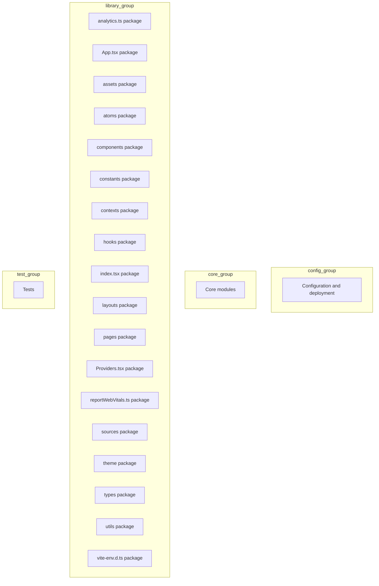

# Architecture report: buildship-ai/rowy

> Automated static analysis. **Observed** = directly seen in files/imports/AST; **Inferred** = interpretation from that evidence. Repository code was not executed.

## 1. Repository at a glance

| Item | Value |
| --- | --- |
| Repository | buildship-ai/rowy |
| Description | Low-code backend platform. Manage database on spreadsheet-like UI and build cloud functions workflows in JS/TS, all in your browser. |
| Language | TypeScript |
| Stars | 6846 |
| Licence | Other |
| Analysed commit / branch | a5b4316cf04c7b653f007e8420ca189b587637cf / main |
| Framework(s) | React |
| Files analysed | 718 |
| Components | 21 |

## 2. Architecture in one minute

buildship-ai/rowy - Low-code backend platform. Manage database on spreadsheet-like UI and build cloud functions workflows in JS/TS, all in your browser.. This repository was analysed statically from 718 file(s) (0 Python). Detected technologies (observed from imports/manifests): GitHub Actions, React, React Router, TypeScript, Vite, Vitest. Files are grouped into 21 component(s): analytics.ts package, App.tsx package, assets package, atoms package, components package, Configuration and deployment, constants package, contexts package. Findings below distinguish observed facts from inferred interpretation.

## 3. High-level block diagram

## 4. Main components

### analytics.ts package (`analytics_ts`)

- **Kind:** library
- **Status:** Observed
- **Confidence:** 0.85
- **Responsibility:** Groups 1 file(s) under analytics.ts package (observed from repository paths and static analysis).
- **Paths:** `src/analytics.ts`
- **Evidence:** [src/analytics.ts](https://github.com/buildship-ai/rowy/blob/a5b4316cf04c7b653f007e8420ca189b587637cf/src/analytics.ts)

### App.tsx package (`app_tsx`)

- **Kind:** library
- **Status:** Observed
- **Confidence:** 0.85
- **Responsibility:** Groups 1 file(s) under app.tsx package (observed from repository paths and static analysis).
- **Paths:** `src/App.tsx`
- **Evidence:** [src/App.tsx](https://github.com/buildship-ai/rowy/blob/a5b4316cf04c7b653f007e8420ca189b587637cf/src/App.tsx)

### assets package (`assets`)

- **Kind:** library
- **Status:** Observed
- **Confidence:** 0.85
- **Responsibility:** Groups 24 file(s) under assets package (observed from repository paths and static analysis).
- **Paths:** `src/assets/BrandedBackground.tsx`, `src/assets/Favicon.tsx`, `src/assets/Logo.tsx`, `src/assets/LogoRowyRun.tsx`, `src/assets/icons/AddRow.tsx`, `src/assets/icons/AddRowTop.tsx`, `src/assets/icons/ArraySubTable.tsx`, `src/assets/icons/ChevronDown.tsx`, `src/assets/icons/ChevronRight.tsx`, `src/assets/icons/Clear.tsx`, `src/assets/icons/ConnectTable.tsx`, `src/assets/icons/Copy.tsx`, `src/assets/icons/CopyCells.tsx`, `src/assets/icons/CreatedBy.tsx`, `src/assets/icons/Discord.tsx`, `src/assets/icons/Export.tsx`, `src/assets/icons/Freeze.tsx`, `src/assets/icons/Go.tsx`, `src/assets/icons/Import.tsx`, `src/assets/icons/SingleSelect.tsx`, `src/assets/icons/Slider.tsx`, `src/assets/icons/SubTable.tsx`, `src/assets/icons/Unfreeze.tsx`, `src/assets/icons/index.ts`
- **Evidence:** [src/assets/BrandedBackground.tsx](https://github.com/buildship-ai/rowy/blob/a5b4316cf04c7b653f007e8420ca189b587637cf/src/assets/BrandedBackground.tsx); [src/assets/Favicon.tsx](https://github.com/buildship-ai/rowy/blob/a5b4316cf04c7b653f007e8420ca189b587637cf/src/assets/Favicon.tsx); [src/assets/Logo.tsx](https://github.com/buildship-ai/rowy/blob/a5b4316cf04c7b653f007e8420ca189b587637cf/src/assets/Logo.tsx); [src/assets/LogoRowyRun.tsx](https://github.com/buildship-ai/rowy/blob/a5b4316cf04c7b653f007e8420ca189b587637cf/src/assets/LogoRowyRun.tsx); [src/assets/icons/AddRow.tsx](https://github.com/buildship-ai/rowy/blob/a5b4316cf04c7b653f007e8420ca189b587637cf/src/assets/icons/AddRow.tsx); [src/assets/icons/AddRowTop.tsx](https://github.com/buildship-ai/rowy/blob/a5b4316cf04c7b653f007e8420ca189b587637cf/src/assets/icons/AddRowTop.tsx); [src/assets/icons/ArraySubTable.tsx](https://github.com/buildship-ai/rowy/blob/a5b4316cf04c7b653f007e8420ca189b587637cf/src/assets/icons/ArraySubTable.tsx); [src/assets/icons/ChevronDown.tsx](https://github.com/buildship-ai/rowy/blob/a5b4316cf04c7b653f007e8420ca189b587637cf/src/assets/icons/ChevronDown.tsx)

### atoms package (`atoms`)

- **Kind:** library
- **Status:** Observed
- **Confidence:** 0.85
- **Responsibility:** Groups 14 file(s) under atoms package (observed from repository paths and static analysis).
- **Paths:** `src/atoms/projectScope/auth.ts`, `src/atoms/projectScope/index.ts`, `src/atoms/projectScope/project.ts`, `src/atoms/projectScope/rowyRun.ts`, `src/atoms/projectScope/ui.ts`, `src/atoms/projectScope/user.ts`, `src/atoms/tableScope/columnActions.test.ts`, `src/atoms/tableScope/columnActions.ts`, `src/atoms/tableScope/index.ts`, `src/atoms/tableScope/rowActions.test.ts`, `src/atoms/tableScope/rowActions.ts`, `src/atoms/tableScope/table.ts`, `src/atoms/tableScope/ui.ts`, `src/atoms/utils.ts`
- **Evidence:** [src/atoms/projectScope/auth.ts](https://github.com/buildship-ai/rowy/blob/a5b4316cf04c7b653f007e8420ca189b587637cf/src/atoms/projectScope/auth.ts); [src/atoms/projectScope/index.ts](https://github.com/buildship-ai/rowy/blob/a5b4316cf04c7b653f007e8420ca189b587637cf/src/atoms/projectScope/index.ts); [src/atoms/projectScope/project.ts](https://github.com/buildship-ai/rowy/blob/a5b4316cf04c7b653f007e8420ca189b587637cf/src/atoms/projectScope/project.ts); [src/atoms/projectScope/rowyRun.ts](https://github.com/buildship-ai/rowy/blob/a5b4316cf04c7b653f007e8420ca189b587637cf/src/atoms/projectScope/rowyRun.ts); [src/atoms/projectScope/ui.ts](https://github.com/buildship-ai/rowy/blob/a5b4316cf04c7b653f007e8420ca189b587637cf/src/atoms/projectScope/ui.ts); [src/atoms/projectScope/user.ts](https://github.com/buildship-ai/rowy/blob/a5b4316cf04c7b653f007e8420ca189b587637cf/src/atoms/projectScope/user.ts); [src/atoms/tableScope/columnActions.test.ts](https://github.com/buildship-ai/rowy/blob/a5b4316cf04c7b653f007e8420ca189b587637cf/src/atoms/tableScope/columnActions.test.ts); [src/atoms/tableScope/columnActions.ts](https://github.com/buildship-ai/rowy/blob/a5b4316cf04c7b653f007e8420ca189b587637cf/src/atoms/tableScope/columnActions.ts)

### components package (`components`)

- **Kind:** library
- **Status:** Observed
- **Confidence:** 0.85
- **Responsibility:** Groups 492 file(s) under components package (observed from repository paths and static analysis).
- **Paths:** `src/components/AccessDenied.tsx`, `src/components/ButtonWithStatus.tsx`, `src/components/CircularProgressOptical.tsx`, `src/components/CircularProgressTimed.tsx`, `src/components/CodeEditor/CodeEditor.tsx`, `src/components/CodeEditor/CodeEditorHelper.tsx`, `src/components/CodeEditor/DiffEditor.tsx`, `src/components/CodeEditor/extensions.d.ts`, `src/components/CodeEditor/firebaseAuth.d.ts`, `src/components/CodeEditor/firebaseStorage.d.ts`, `src/components/CodeEditor/firestore.d.ts`, `src/components/CodeEditor/index.ts`, `src/components/CodeEditor/rowy.d.ts`, `src/components/CodeEditor/useMonacoCustomizations.ts`, `src/components/CodeEditor/utils.d.ts`, `src/components/ColorPickerInput.tsx`, `src/components/ColumnMenu/ColumnMenu.tsx`, `src/components/ColumnMenu/MenuContents.tsx`, `src/components/ColumnMenu/index.ts`, `src/components/ColumnModals/ColumnConfigModal/ColumnConfig.tsx`, `src/components/ColumnModals/ColumnConfigModal/DefaultValueInput.tsx`, `src/components/ColumnModals/ColumnConfigModal/defaultValue.d.ts`, `src/components/ColumnModals/ColumnConfigModal/index.ts`, `src/components/ColumnModals/ColumnModals.tsx`, `src/components/ColumnModals/FieldsDropdown.tsx`, `src/components/ColumnModals/NameChangeModal.tsx`, `src/components/ColumnModals/NewColumnModal.tsx`, `src/components/ColumnModals/SetColumnWidthModal.tsx`, `src/components/ColumnModals/TypeChangeModal.tsx`, `src/components/ColumnModals/index.ts`, `src/components/ConfirmDialog.tsx`, `src/components/EmojiAvatar.tsx`, `src/components/EmptyState.tsx`, `src/components/ErrorFallback.tsx`, `src/components/FirebaseUi.tsx`, `src/components/FloatingSearch.tsx`, `src/components/FormattedChip.tsx`, `src/components/FullScreenButton.tsx`, `src/components/GetStartedChecklist/GetStartedChecklist.tsx`, `src/components/GetStartedChecklist/GetStartedProgress.tsx`, `src/components/GetStartedChecklist/index.ts`, `src/components/GetStartedChecklist/useGetStartedCompletion.ts`, `src/components/IconSlash.tsx`, `src/components/InfoTooltip.tsx`, `src/components/InlineOpenInNewIcon.tsx`, `src/components/KeyValueInput.tsx`, `src/components/Loading.tsx`, `src/components/Modal/MemoizedText.tsx`, `src/components/Modal/Modal.tsx`, `src/components/Modal/ModalTransition.tsx`, `src/components/Modal/ScrollableDialogContent.tsx`, `src/components/Modal/SlideTransition.tsx`, `src/components/Modal/index.ts`, `src/components/ProjectSettingsDialog/ProjectSettingsDialog.tsx`, `src/components/ProjectSettingsDialog/SecretDetailsModal.tsx`, `src/components/ProjectSettingsDialog/index.ts`, `src/components/RenderedHtml.tsx`, `src/components/RenderedMarkdown.tsx`, `src/components/RichTextEditor.tsx`, `src/components/RichTooltip.tsx`, `src/components/RowyRunModal.tsx`, `src/components/SectionHeading.tsx`, `src/components/SectionHeadingSkeleton.tsx`, `src/components/SelectColors/CustomizeColorModal.tsx`, `src/components/SelectColors/index.tsx`, `src/components/Setup/SetupItem.tsx`, `src/components/Setup/SetupLayout.tsx`, `src/components/Setup/SetupStep.d.ts`, `src/components/Setup/SignInWithGoogle.tsx`, `src/components/Setup/Steps/StepFinish.tsx`, `src/components/Setup/Steps/StepRules.tsx`, `src/components/Setup/Steps/StepStorageRules.tsx`, `src/components/Setup/Steps/StepWelcome.tsx`, `src/components/SideDrawer/FieldSkeleton.tsx`, `src/components/SideDrawer/FieldWrapper.tsx`, `src/components/SideDrawer/MemoizedField.tsx`, `src/components/SideDrawer/SaveState.tsx`, `src/components/SideDrawer/SideDrawer.tsx`, `src/components/SideDrawer/SideDrawerFields.tsx`, `src/components/SideDrawer/StyledDrawer.ts`, `src/components/SideDrawer/index.ts`, `src/components/SideDrawer/utils.ts`, `src/components/SnackbarProgress.tsx`, `src/components/SocialLogo.tsx`, `src/components/SteppedAccordion.tsx`, `src/components/StepsProgress.tsx`, `src/components/Table/Breadcrumbs/BreadcrumbsSubTable.tsx`, `src/components/Table/Breadcrumbs/BreadcrumbsTableRoot.tsx`, `src/components/Table/ColumnHeader/ColumnHeader.tsx`, `src/components/Table/ColumnHeader/ColumnHeaderDragHandle.tsx`, `src/components/Table/ColumnHeader/ColumnHeaderResizer.tsx`, `src/components/Table/ColumnHeader/ColumnHeaderSort.tsx`, `src/components/Table/ColumnHeader/index.ts`, `src/components/Table/ColumnHeader/useSaveTableSorts.tsx`, `src/components/Table/ColumnSelect.tsx`, `src/components/Table/ContextMenu/BasicCellContextMenuActions.tsx`, `src/components/Table/ContextMenu/ContextMenu.tsx`, `src/components/Table/ContextMenu/ContextMenuItem.tsx`, `src/components/Table/ContextMenu/MenuContents.tsx`, `src/components/Table/ContextMenu/index.ts`, `src/components/Table/EmptyTable.tsx`, `src/components/Table/FinalColumn/FinalColumn.tsx`, `src/components/Table/FinalColumn/FinalColumnHeader.tsx`, `src/components/Table/Mock/Cell.tsx`, `src/components/Table/Mock/Column.tsx`, `src/components/Table/OutOfOrderIndicator.tsx`, `src/components/Table/Styled/StyledCell.tsx`, `src/components/Table/Styled/StyledColumnHeader.tsx`, `src/components/Table/Styled/StyledDot.tsx`, `src/components/Table/Styled/StyledRow.tsx`, `src/components/Table/Styled/StyledTable.tsx`, `src/components/Table/Table.tsx`, `src/components/Table/TableBody.tsx`, `src/components/Table/TableCell/ChipList.tsx`, `src/components/Table/TableCell/EditorCellController.tsx`, `src/components/Table/TableCell/EditorCellTextField.tsx`, `src/components/Table/TableCell/TableCell.tsx`, `src/components/Table/TableCell/index.ts`, `src/components/Table/TableCell/withRenderTableCell.tsx`, `src/components/Table/TableHeader.tsx`, `src/components/Table/TableSkeleton.tsx`, `src/components/Table/index.ts`, `src/components/Table/useHotKey.tsx`, `src/components/Table/useKeyboardNavigation.tsx`, `src/components/Table/useMenuAction.tsx`, `src/components/Table/useSaveColumnSizing.tsx`, `src/components/Table/useStateWithRef.ts`, `src/components/Table/useTraceUpdates.ts`, `src/components/Table/useVirtualization.tsx`, `src/components/TableInformationDrawer/Details.tsx`, `src/components/TableInformationDrawer/TableInformationDrawer.tsx`, `src/components/TableInformationDrawer/index.ts`, `src/components/TableModals/CloudLogsModal/BuildLogs/BuildLogList.tsx`, `src/components/TableModals/CloudLogsModal/BuildLogs/BuildLogRow.tsx`, `src/components/TableModals/CloudLogsModal/BuildLogs/BuildLogs.tsx`, `src/components/TableModals/CloudLogsModal/BuildLogs/BuildLogsSnack.tsx`, `src/components/TableModals/CloudLogsModal/BuildLogs/index.ts`, `src/components/TableModals/CloudLogsModal/BuildLogs/useBuildLogs.ts`, `src/components/TableModals/CloudLogsModal/CloudLogItem.tsx`, `src/components/TableModals/CloudLogsModal/CloudLogList.tsx`, `src/components/TableModals/CloudLogsModal/CloudLogSeverityIcon.tsx`, `src/components/TableModals/CloudLogsModal/CloudLogSubheader.tsx`, `src/components/TableModals/CloudLogsModal/CloudLogsModal.tsx`, `src/components/TableModals/CloudLogsModal/TimeRangeSelect.tsx`, `src/components/TableModals/CloudLogsModal/index.ts`, `src/components/TableModals/CloudLogsModal/utils.ts`, `src/components/TableModals/ExportModal/ExportModal.tsx`, `src/components/TableModals/ExportModal/ModalContentsDownload.tsx`, `src/components/TableModals/ExportModal/ModalContentsExport.tsx`, `src/components/TableModals/ExportModal/index.ts`, `src/components/TableModals/ExtensionsModal/AddExtensionButton.tsx`, `src/components/TableModals/ExtensionsModal/ExtensionList.tsx`, `src/components/TableModals/ExtensionsModal/ExtensionMigration.tsx`, `src/components/TableModals/ExtensionsModal/ExtensionModal.tsx`, `src/components/TableModals/ExtensionsModal/ExtensionsModal.tsx`, `src/components/TableModals/ExtensionsModal/RuntimeOptions.tsx`, `src/components/TableModals/ExtensionsModal/Step1Triggers.tsx`, `src/components/TableModals/ExtensionsModal/Step2RequiredFields.tsx`, `src/components/TableModals/ExtensionsModal/Step3Conditions.tsx`, `src/components/TableModals/ExtensionsModal/Step4Body.tsx`, `src/components/TableModals/ExtensionsModal/index.ts`, `src/components/TableModals/ExtensionsModal/utils.ts`, `src/components/TableModals/ImportAirtableWizard/ImportAirtableWizard.tsx`, `src/components/TableModals/ImportAirtableWizard/Step1Columns.tsx`, `src/components/TableModals/ImportAirtableWizard/Step2NewColumns.tsx`, `src/components/TableModals/ImportAirtableWizard/Step3Preview.tsx`, `src/components/TableModals/ImportAirtableWizard/index.ts`, `src/components/TableModals/ImportAirtableWizard/utils.ts`, `src/components/TableModals/ImportCsvWizard/ImportCsvWizard.tsx`, `src/components/TableModals/ImportCsvWizard/Step1Columns.tsx`, `src/components/TableModals/ImportCsvWizard/Step2NewColumns.tsx`, `src/components/TableModals/ImportCsvWizard/Step3Preview.tsx`, `src/components/TableModals/ImportCsvWizard/index.ts`, `src/components/TableModals/ImportCsvWizard/useConverter.ts`, `src/components/TableModals/ImportCsvWizard/useUploadFileFromURL.tsx`, `src/components/TableModals/ImportCsvWizard/utils.ts`, `src/components/TableModals/ImportExistingWizard/ImportExistingWizard.tsx`, `src/components/TableModals/ImportExistingWizard/Step1Columns.tsx`, `src/components/TableModals/ImportExistingWizard/Step2Rename.tsx`, `src/components/TableModals/ImportExistingWizard/Step3Types.tsx`, `src/components/TableModals/ImportExistingWizard/Step4Preview.tsx`, `src/components/TableModals/ImportExistingWizard/index.ts`, `src/components/TableModals/ImportExistingWizard/utils.ts`, `src/components/TableModals/ScrollableList.tsx`, `src/components/TableModals/TableModals.tsx`, `src/components/TableModals/WebhooksModal/AddWebhookButton.tsx`, `src/components/TableModals/WebhooksModal/Schemas/basic.tsx`, `src/components/TableModals/WebhooksModal/Schemas/firebaseAuth.tsx`, `src/components/TableModals/WebhooksModal/Schemas/index.ts`, `src/components/TableModals/WebhooksModal/Schemas/sendgrid.tsx`, `src/components/TableModals/WebhooksModal/Schemas/stripe.tsx`, `src/components/TableModals/WebhooksModal/Schemas/typeform.tsx`, `src/components/TableModals/WebhooksModal/Schemas/webform.tsx`, `src/components/TableModals/WebhooksModal/Step1Auth.tsx`, `src/components/TableModals/WebhooksModal/Step2Conditions.tsx`, `src/components/TableModals/WebhooksModal/Step3Parser.tsx`, `src/components/TableModals/WebhooksModal/WebhookList.tsx`, `src/components/TableModals/WebhooksModal/WebhookModal.tsx`, `src/components/TableModals/WebhooksModal/WebhooksModal.tsx`, `src/components/TableModals/WebhooksModal/index.ts`, `src/components/TableModals/WebhooksModal/utils.tsx`, `src/components/TableModals/WebhooksModal/webhooks.d.ts`, `src/components/TableModals/WizardDialog.tsx`, `src/components/TableModals/index.ts`, `src/components/TableSettingsDialog/ActionsMenu/ActionsMenu.tsx`, `src/components/TableSettingsDialog/ActionsMenu/ExportSettings.tsx`, `src/components/TableSettingsDialog/ActionsMenu/ImportSettings.tsx`, `src/components/TableSettingsDialog/ActionsMenu/index.ts`, `src/components/TableSettingsDialog/DeleteMenu.tsx`, `src/components/TableSettingsDialog/SuggestedRules.tsx`, `src/components/TableSettingsDialog/TableDetails.tsx`, `src/components/TableSettingsDialog/TableId.tsx`, `src/components/TableSettingsDialog/TableName.tsx`, `src/components/TableSettingsDialog/TableSettingsDialog.tsx`, `src/components/TableSettingsDialog/TableThumbnail.tsx`, `src/components/TableSettingsDialog/form.tsx`, `src/components/TableSettingsDialog/index.ts`, `src/components/TableSettingsDialog/utils.ts`, `src/components/TableToolbar/AddRow.tsx`, `src/components/TableToolbar/Filters/FilterInputs.tsx`, `src/components/TableToolbar/Filters/FilterInputsCollection.tsx`, `src/components/TableToolbar/Filters/Filters.tsx`, `src/components/TableToolbar/Filters/FiltersPopover.tsx`, `src/components/TableToolbar/Filters/IdFilterInput.tsx`, `src/components/TableToolbar/Filters/index.ts`, `src/components/TableToolbar/Filters/useFilterInputs.ts`, `src/components/TableToolbar/Filters/useFilterUrl.tsx`, `src/components/TableToolbar/HiddenFields.tsx`, `src/components/TableToolbar/ImportData/ImportData.tsx`, `src/components/TableToolbar/ImportData/ImportFromAirtable.tsx`, `src/components/TableToolbar/ImportData/ImportFromCsv.tsx`, `src/components/TableToolbar/LoadedRowsStatus.tsx`, `src/components/TableToolbar/ReExecute.tsx`, `src/components/TableToolbar/RowHeight.tsx`, `src/components/TableToolbar/Sort/Sort.tsx`, `src/components/TableToolbar/Sort/SortPopover.tsx`, `src/components/TableToolbar/Sort/index.tsx`, `src/components/TableToolbar/TableInformation.tsx`, `src/components/TableToolbar/TableSettings.tsx`, `src/components/TableToolbar/TableToolbar.tsx`, `src/components/TableToolbar/TableToolbarButton.tsx`, `src/components/TableToolbar/TableToolbarSkeleton.tsx`, `src/components/TableToolbar/index.ts`, `src/components/TableTutorial/Steps/Step1Import.tsx`, `src/components/TableTutorial/Steps/Step2Add.tsx`, `src/components/TableTutorial/Steps/Step3Invite.tsx`, `src/components/TableTutorial/Steps/Step4Code.tsx`, `src/components/TableTutorial/Steps/Step5Finish.tsx`, `src/components/TableTutorial/Steps/index.ts`, `src/components/TableTutorial/TableSourceTutorial.tsx`, `src/components/TableTutorial/TableTutorial.tsx`, `src/components/TableTutorial/TutorialCheckbox.tsx`, `src/components/TableTutorial/data.ts`, `src/components/TableTutorial/index.ts`, `src/components/Tables/HomeWelcomePrompt.tsx`, `src/components/Tables/TableGrid/TableCard.tsx`, `src/components/Tables/TableGrid/TableCardSkeleton.tsx`, `src/components/Tables/TableGrid/TableGrid.tsx`, `src/components/Tables/TableGrid/index.ts`, `src/components/Tables/TableList/TableList.tsx`, `src/components/Tables/TableList/TableListItem.tsx`, `src/components/Tables/TableList/TableListItemSkeleton.tsx`, `src/components/Tables/TableList/index.ts`, `src/components/Thumbnail.tsx`, `src/components/fields/Action/ActionFab.tsx`, `src/components/fields/Action/DisplayCell.tsx`, `src/components/fields/Action/EditorCell.tsx`, `src/components/fields/Action/FormDialog/Context.ts`, `src/components/fields/Action/FormDialog/Dialog.tsx`, `src/components/fields/Action/FormDialog/Provider.tsx`, `src/components/fields/Action/FormDialog/index.ts`, `src/components/fields/Action/FormDialog/props.ts`, `src/components/fields/Action/FormFieldSnippets.tsx`, `src/components/fields/Action/Settings.tsx`, `src/components/fields/Action/SideDrawerField.tsx`, `src/components/fields/Action/action.d.ts`, `src/components/fields/Action/index.tsx`, `src/components/fields/Action/templates.ts`, `src/components/fields/Action/utils.ts`, `src/components/fields/Array/DisplayCell.tsx`, `src/components/fields/Array/Filter.tsx`, `src/components/fields/Array/SideDrawerField/AddButton.tsx`, `src/components/fields/Array/SideDrawerField/SupportedTypes.ts`, `src/components/fields/Array/SideDrawerField/index.tsx`, `src/components/fields/Array/SideDrawerField/utils.ts`, `src/components/fields/Array/index.tsx`, `src/components/fields/ArraySubTable/DisplayCell.tsx`, `src/components/fields/ArraySubTable/Settings.tsx`, `src/components/fields/ArraySubTable/SideDrawerField.tsx`, `src/components/fields/ArraySubTable/index.tsx`, `src/components/fields/ArraySubTable/utils.ts`, `src/components/fields/Checkbox/DisplayCell.tsx`, `src/components/fields/Checkbox/EditorCell.tsx`, `src/components/fields/Checkbox/SideDrawerField.tsx`, `src/components/fields/Checkbox/index.tsx`, `src/components/fields/Code/DisplayCell.tsx`, `src/components/fields/Code/Settings.tsx`, `src/components/fields/Code/SideDrawerField.tsx`, `src/components/fields/Code/index.tsx`, `src/components/fields/Color/DisplayCell.tsx`, `src/components/fields/Color/EditorCell.tsx`, `src/components/fields/Color/SideDrawerField.tsx`, `src/components/fields/Color/filters.ts`, `src/components/fields/Color/index.tsx`, `src/components/fields/ConnectService/ConnectServiceSelect/PopupContents.tsx`, `src/components/fields/ConnectService/ConnectServiceSelect/index.tsx`, `src/components/fields/ConnectService/ConnectServiceSelect/styles.ts`, `src/components/fields/ConnectService/DisplayCell.tsx`, `src/components/fields/ConnectService/EditorCell.tsx`, `src/components/fields/ConnectService/Settings.tsx`, `src/components/fields/ConnectService/SideDrawerField.tsx`, `src/components/fields/ConnectService/index.tsx`, `src/components/fields/ConnectService/utils.ts`, `src/components/fields/ConnectTable/ConnectTableSelect.tsx`, `src/components/fields/ConnectTable/DisplayCell.tsx`, `src/components/fields/ConnectTable/EditorCell.tsx`, `src/components/fields/ConnectTable/Settings.tsx`, `src/components/fields/ConnectTable/SideDrawerField.tsx`, `src/components/fields/ConnectTable/index.tsx`, `src/components/fields/ConnectTable/utils.ts`, `src/components/fields/Connector/DisplayCell.tsx`, `src/components/fields/Connector/EditorCell.tsx`, `src/components/fields/Connector/Select/PopupContents.tsx`, `src/components/fields/Connector/Select/index.tsx`, `src/components/fields/Connector/Select/styles.ts`, `src/components/fields/Connector/Settings.tsx`, `src/components/fields/Connector/SideDrawerField.tsx`, `src/components/fields/Connector/connector.d.ts`, `src/components/fields/Connector/index.tsx`, `src/components/fields/Connector/types.d.ts`, `src/components/fields/Connector/utils.ts`, `src/components/fields/CreatedAt/DisplayCell.tsx`, `src/components/fields/CreatedAt/SideDrawerField.tsx`, `src/components/fields/CreatedAt/index.tsx`, `src/components/fields/CreatedBy/DisplayCell.tsx`, `src/components/fields/CreatedBy/Settings.tsx`, `src/components/fields/CreatedBy/SideDrawerField.tsx`, `src/components/fields/CreatedBy/index.tsx`, `src/components/fields/Date/DisplayCell.tsx`, `src/components/fields/Date/EditorCell.tsx`, `src/components/fields/Date/Settings.tsx`, `src/components/fields/Date/SideDrawerField.tsx`, `src/components/fields/Date/filters.ts`, `src/components/fields/Date/index.tsx`, `src/components/fields/Date/utils.ts`, `src/components/fields/DateTime/DisplayCell.tsx`, `src/components/fields/DateTime/EditorCell.tsx`, `src/components/fields/DateTime/FilterCustomInput.tsx`, `src/components/fields/DateTime/Settings.tsx`, `src/components/fields/DateTime/SideDrawerField.tsx`, `src/components/fields/DateTime/filters.ts`, `src/components/fields/DateTime/index.tsx`, `src/components/fields/Derivative/ContextMenuActions.tsx`, `src/components/fields/Derivative/Settings.tsx`, `src/components/fields/Derivative/derivative.d.ts`, `src/components/fields/Derivative/index.tsx`, `src/components/fields/Duration/DisplayCell.tsx`, `src/components/fields/Duration/SideDrawerField.tsx`, `src/components/fields/Duration/index.tsx`, `src/components/fields/Duration/utils.ts`, `src/components/fields/Email/EditorCell.tsx`, `src/components/fields/Email/Settings.tsx`, `src/components/fields/Email/SideDrawerField.tsx`, `src/components/fields/Email/index.tsx`, `src/components/fields/File/ContextMenuActions.tsx`, `src/components/fields/File/DisplayCell.tsx`, `src/components/fields/File/EditorCell.tsx`, `src/components/fields/File/SideDrawerField.tsx`, `src/components/fields/File/index.tsx`, `src/components/fields/File/useFileUpload.ts`, `src/components/fields/Formula/DisplayCell.tsx`, `src/components/fields/Formula/PreviewTable.tsx`, `src/components/fields/Formula/Settings.tsx`, `src/components/fields/Formula/SideDrawerField.tsx`, `src/components/fields/Formula/TableSourcePreview.ts`, `src/components/fields/Formula/formula.d.ts`, `src/components/fields/Formula/index.tsx`, `src/components/fields/Formula/useFormula.tsx`, `src/components/fields/Formula/util.tsx`, `src/components/fields/Formula/worker.ts`, `src/components/fields/GeoPoint/DisplayCell.tsx`, `src/components/fields/GeoPoint/SideDrawerField.tsx`, `src/components/fields/GeoPoint/index.tsx`, `src/components/fields/GeoPoint/utils.ts`, `src/components/fields/Id/DisplayCell.tsx`, `src/components/fields/Id/SideDrawerField.tsx`, `src/components/fields/Id/index.tsx`, `src/components/fields/Image/ContextMenuActions.tsx`, `src/components/fields/Image/DisplayCell.tsx`, `src/components/fields/Image/EditorCell.tsx`, `src/components/fields/Image/SideDrawerField.tsx`, `src/components/fields/Image/index.tsx`, `src/components/fields/Json/ContextMenuActions.tsx`, `src/components/fields/Json/DisplayCell.tsx`, `src/components/fields/Json/Settings.tsx`, `src/components/fields/Json/SideDrawerField.tsx`, `src/components/fields/Json/index.tsx`, `src/components/fields/LongText/DisplayCell.tsx`, `src/components/fields/LongText/EditorCell.tsx`, `src/components/fields/LongText/Filter.tsx`, `src/components/fields/LongText/Settings.tsx`, `src/components/fields/LongText/SideDrawerField.tsx`, `src/components/fields/LongText/index.tsx`, `src/components/fields/Markdown/DisplayCell.tsx`, `src/components/fields/Markdown/SideDrawerField.tsx`, `src/components/fields/Markdown/index.tsx`, `src/components/fields/MultiSelect/DisplayCell.tsx`, `src/components/fields/MultiSelect/EditorCell.tsx`, `src/components/fields/MultiSelect/Filter.ts`, `src/components/fields/MultiSelect/SideDrawerField.tsx`, `src/components/fields/MultiSelect/index.tsx`, `src/components/fields/MultiSelect/utils.ts`, `src/components/fields/Number/DisplayCell.tsx`, `src/components/fields/Number/EditorCell.tsx`, `src/components/fields/Number/Filter.tsx`, `src/components/fields/Number/SideDrawerField.tsx`, `src/components/fields/Number/index.tsx`, `src/components/fields/Percentage/DisplayCell.tsx`, `src/components/fields/Percentage/EditorCell.tsx`, `src/components/fields/Percentage/Settings.tsx`, `src/components/fields/Percentage/SideDrawerField.tsx`, `src/components/fields/Percentage/index.tsx`, `src/components/fields/Percentage/utils.ts`, `src/components/fields/Phone/EditorCell.tsx`, `src/components/fields/Phone/SideDrawerField.tsx`, `src/components/fields/Phone/index.tsx`, `src/components/fields/Rating/DisplayCell.tsx`, `src/components/fields/Rating/EditorCell.tsx`, `src/components/fields/Rating/Icon.tsx`, `src/components/fields/Rating/Settings.tsx`, `src/components/fields/Rating/SideDrawerField.tsx`, `src/components/fields/Rating/index.tsx`, `src/components/fields/Reference/DisplayCell.tsx`, `src/components/fields/Reference/EditorCell.tsx`, `src/components/fields/Reference/SideDrawerField.tsx`, `src/components/fields/Reference/filters.ts`, `src/components/fields/Reference/index.tsx`, `src/components/fields/Reference/utils.ts`, `src/components/fields/RichText/DisplayCell.tsx`, `src/components/fields/RichText/SideDrawerField.tsx`, `src/components/fields/RichText/index.tsx`, `src/components/fields/ShortText/DisplayCell.tsx`, `src/components/fields/ShortText/EditorCell.tsx`, `src/components/fields/ShortText/Filter.tsx`, `src/components/fields/ShortText/Settings.tsx`, `src/components/fields/ShortText/SideDrawerField.tsx`, `src/components/fields/ShortText/index.tsx`, `src/components/fields/SingleSelect/DisplayCell.tsx`, `src/components/fields/SingleSelect/EditorCell.tsx`, `src/components/fields/SingleSelect/Settings.tsx`, `src/components/fields/SingleSelect/SideDrawerField.tsx`, `src/components/fields/SingleSelect/index.tsx`, `src/components/fields/SingleSelect/utils.ts`, `src/components/fields/Slider/DisplayCell.tsx`, `src/components/fields/Slider/Settings.tsx`, `src/components/fields/Slider/SideDrawerField.tsx`, `src/components/fields/Slider/index.tsx`, `src/components/fields/Status/ConditionList.tsx`, `src/components/fields/Status/ConditionModal.tsx`, `src/components/fields/Status/ConditionModalContent.tsx`, `src/components/fields/Status/DisplayCell.tsx`, `src/components/fields/Status/EditorCell.tsx`, `src/components/fields/Status/Filter.tsx`, `src/components/fields/Status/Settings.tsx`, `src/components/fields/Status/SideDrawerField.tsx`, `src/components/fields/Status/index.tsx`, `src/components/fields/Status/styles.ts`, `src/components/fields/Status/utils/conditionListHelper.ts`, `src/components/fields/Status/utils/getLabelHelper.ts`, `src/components/fields/SubTable/DisplayCell.tsx`, `src/components/fields/SubTable/Settings.tsx`, `src/components/fields/SubTable/SideDrawerField.tsx`, `src/components/fields/SubTable/index.tsx`, `src/components/fields/SubTable/utils.ts`, `src/components/fields/UpdatedAt/DisplayCell.tsx`, `src/components/fields/UpdatedAt/SideDrawerField.tsx`, `src/components/fields/UpdatedAt/index.tsx`, `src/components/fields/UpdatedBy/DisplayCell.tsx`, `src/components/fields/UpdatedBy/SideDrawerField.tsx`, `src/components/fields/UpdatedBy/index.tsx`, `src/components/fields/Url/DisplayCell.tsx`, `src/components/fields/Url/EditorCell.tsx`, `src/components/fields/Url/SideDrawerField.tsx`, `src/components/fields/Url/index.tsx`, `src/components/fields/User/DisplayCell.tsx`, `src/components/fields/User/EditorCell.tsx`, `src/components/fields/User/Settings.tsx`, `src/components/fields/User/SideDrawerField.tsx`, `src/components/fields/User/UserSelect.tsx`, `src/components/fields/User/index.tsx`, `src/components/fields/index.ts`, `src/components/fields/types.ts`
- **Evidence:** [src/components/AccessDenied.tsx](https://github.com/buildship-ai/rowy/blob/a5b4316cf04c7b653f007e8420ca189b587637cf/src/components/AccessDenied.tsx); [src/components/ButtonWithStatus.tsx](https://github.com/buildship-ai/rowy/blob/a5b4316cf04c7b653f007e8420ca189b587637cf/src/components/ButtonWithStatus.tsx); [src/components/CircularProgressOptical.tsx](https://github.com/buildship-ai/rowy/blob/a5b4316cf04c7b653f007e8420ca189b587637cf/src/components/CircularProgressOptical.tsx); [src/components/CircularProgressTimed.tsx](https://github.com/buildship-ai/rowy/blob/a5b4316cf04c7b653f007e8420ca189b587637cf/src/components/CircularProgressTimed.tsx); [src/components/CodeEditor/CodeEditor.tsx](https://github.com/buildship-ai/rowy/blob/a5b4316cf04c7b653f007e8420ca189b587637cf/src/components/CodeEditor/CodeEditor.tsx); [src/components/CodeEditor/CodeEditorHelper.tsx](https://github.com/buildship-ai/rowy/blob/a5b4316cf04c7b653f007e8420ca189b587637cf/src/components/CodeEditor/CodeEditorHelper.tsx); [src/components/CodeEditor/DiffEditor.tsx](https://github.com/buildship-ai/rowy/blob/a5b4316cf04c7b653f007e8420ca189b587637cf/src/components/CodeEditor/DiffEditor.tsx); [src/components/CodeEditor/extensions.d.ts](https://github.com/buildship-ai/rowy/blob/a5b4316cf04c7b653f007e8420ca189b587637cf/src/components/CodeEditor/extensions.d.ts)

### Configuration and deployment (`config`)

- **Kind:** config
- **Status:** Observed
- **Confidence:** 0.85
- **Responsibility:** Groups 37 file(s) under configuration and deployment (observed from repository paths and static analysis).
- **Paths:** `cloudbuild.yaml`, `emulators/auth_export/accounts.json`, `emulators/auth_export/config.json`, `emulators/firebase-export-metadata.json`, `firebase.json`, `firestore.indexes.json`, `package.json`, `public/manifest.json`, `src/components/CodeEditor/github-dark-default.json`, `src/components/CodeEditor/github-light-default.json`, `src/components/Settings/ProjectSettings/About.tsx`, `src/components/Settings/ProjectSettings/Authentication.tsx`, `src/components/Settings/ProjectSettings/Customization.tsx`, `src/components/Settings/ProjectSettings/RowyRun.tsx`, `src/components/Settings/RegionSelect.tsx`, `src/components/Settings/SettingsSection.tsx`, `src/components/Settings/SettingsSkeleton.tsx`, `src/components/Settings/ThemeColorPicker.tsx`, `src/components/Settings/UserManagement/InviteUser.tsx`, `src/components/Settings/UserManagement/UserItem.tsx`, `src/components/Settings/UserManagement/UserSkeleton.tsx`, `src/components/Settings/UserSettings/Account.tsx`, `src/components/Settings/UserSettings/Personalization.tsx`, `src/components/Settings/UserSettings/TableSettings.tsx`, `src/components/Settings/UserSettings/Theme.tsx`, `src/config/db.ts`, `src/config/dbPaths.ts`, `src/config/firebaseui.ts`, `src/config/firestoreRules.ts`, `src/config/storageRules.ts`, `src/pages/Settings/DebugPage.tsx`, `src/pages/Settings/MembersPage.tsx`, `src/pages/Settings/ProjectSettingsPage.tsx`, `src/pages/Settings/UserSettingsPage.tsx`, `tsconfig.extend.json`, `tsconfig.json`, `typedoc.json`
- **Evidence:** [cloudbuild.yaml](https://github.com/buildship-ai/rowy/blob/a5b4316cf04c7b653f007e8420ca189b587637cf/cloudbuild.yaml); [emulators/auth_export/accounts.json](https://github.com/buildship-ai/rowy/blob/a5b4316cf04c7b653f007e8420ca189b587637cf/emulators/auth_export/accounts.json); [emulators/auth_export/config.json](https://github.com/buildship-ai/rowy/blob/a5b4316cf04c7b653f007e8420ca189b587637cf/emulators/auth_export/config.json); [emulators/firebase-export-metadata.json](https://github.com/buildship-ai/rowy/blob/a5b4316cf04c7b653f007e8420ca189b587637cf/emulators/firebase-export-metadata.json); [firebase.json](https://github.com/buildship-ai/rowy/blob/a5b4316cf04c7b653f007e8420ca189b587637cf/firebase.json); [firestore.indexes.json](https://github.com/buildship-ai/rowy/blob/a5b4316cf04c7b653f007e8420ca189b587637cf/firestore.indexes.json); [package.json](https://github.com/buildship-ai/rowy/blob/a5b4316cf04c7b653f007e8420ca189b587637cf/package.json); [public/manifest.json](https://github.com/buildship-ai/rowy/blob/a5b4316cf04c7b653f007e8420ca189b587637cf/public/manifest.json)

### constants package (`constants`)

- **Kind:** library
- **Status:** Observed
- **Confidence:** 0.85
- **Responsibility:** Groups 6 file(s) under constants package (observed from repository paths and static analysis).
- **Paths:** `src/constants/dates.ts`, `src/constants/externalLinks.ts`, `src/constants/fields.ts`, `src/constants/regions.ts`, `src/constants/routes.tsx`, `src/constants/runRoutes.ts`
- **Evidence:** [src/constants/dates.ts](https://github.com/buildship-ai/rowy/blob/a5b4316cf04c7b653f007e8420ca189b587637cf/src/constants/dates.ts); [src/constants/externalLinks.ts](https://github.com/buildship-ai/rowy/blob/a5b4316cf04c7b653f007e8420ca189b587637cf/src/constants/externalLinks.ts); [src/constants/fields.ts](https://github.com/buildship-ai/rowy/blob/a5b4316cf04c7b653f007e8420ca189b587637cf/src/constants/fields.ts); [src/constants/regions.ts](https://github.com/buildship-ai/rowy/blob/a5b4316cf04c7b653f007e8420ca189b587637cf/src/constants/regions.ts); [src/constants/routes.tsx](https://github.com/buildship-ai/rowy/blob/a5b4316cf04c7b653f007e8420ca189b587637cf/src/constants/routes.tsx); [src/constants/runRoutes.ts](https://github.com/buildship-ai/rowy/blob/a5b4316cf04c7b653f007e8420ca189b587637cf/src/constants/runRoutes.ts)

### contexts package (`contexts`)

- **Kind:** library
- **Status:** Observed
- **Confidence:** 0.85
- **Responsibility:** Groups 3 file(s) under contexts package (observed from repository paths and static analysis).
- **Paths:** `src/contexts/SnackLogContext.tsx`, `src/contexts/SnackbarContext.tsx`, `src/contexts/SwrContext.tsx`
- **Evidence:** [src/contexts/SnackLogContext.tsx](https://github.com/buildship-ai/rowy/blob/a5b4316cf04c7b653f007e8420ca189b587637cf/src/contexts/SnackLogContext.tsx); [src/contexts/SnackbarContext.tsx](https://github.com/buildship-ai/rowy/blob/a5b4316cf04c7b653f007e8420ca189b587637cf/src/contexts/SnackbarContext.tsx); [src/contexts/SwrContext.tsx](https://github.com/buildship-ai/rowy/blob/a5b4316cf04c7b653f007e8420ca189b587637cf/src/contexts/SwrContext.tsx)

### Core modules (`core`)

- **Kind:** core
- **Status:** Observed
- **Confidence:** 0.85
- **Responsibility:** Groups 4 file(s) under core modules (observed from repository paths and static analysis).
- **Paths:** `craco.config.js`, `createDotEnv.js`, `eslint-local-rules.js`, `vite.config.ts`
- **Evidence:** [craco.config.js](https://github.com/buildship-ai/rowy/blob/a5b4316cf04c7b653f007e8420ca189b587637cf/craco.config.js); [createDotEnv.js](https://github.com/buildship-ai/rowy/blob/a5b4316cf04c7b653f007e8420ca189b587637cf/createDotEnv.js); [eslint-local-rules.js](https://github.com/buildship-ai/rowy/blob/a5b4316cf04c7b653f007e8420ca189b587637cf/eslint-local-rules.js); [vite.config.ts](https://github.com/buildship-ai/rowy/blob/a5b4316cf04c7b653f007e8420ca189b587637cf/vite.config.ts)

### hooks package (`hooks`)

- **Kind:** library
- **Status:** Observed
- **Confidence:** 0.85
- **Responsibility:** Groups 13 file(s) under hooks package (observed from repository paths and static analysis).
- **Paths:** `src/hooks/useBasicSearch.ts`, `src/hooks/useBeforeUnload.ts`, `src/hooks/useDocumentTitle.ts`, `src/hooks/useFirebaseStorageUploader.tsx`, `src/hooks/useFirestoreCollectionWithAtom.ts`, `src/hooks/useFirestoreDocAsCollectionWithAtom.ts`, `src/hooks/useFirestoreDocWithAtom.ts`, `src/hooks/useKeyPress.ts`, `src/hooks/useKeyPressWithAtom.ts`, `src/hooks/useOffline.ts`, `src/hooks/useSaveOnUnmount.ts`, `src/hooks/useScrollToHash.ts`, `src/hooks/useUpdateCheck.ts`
- **Evidence:** [src/hooks/useBasicSearch.ts](https://github.com/buildship-ai/rowy/blob/a5b4316cf04c7b653f007e8420ca189b587637cf/src/hooks/useBasicSearch.ts); [src/hooks/useBeforeUnload.ts](https://github.com/buildship-ai/rowy/blob/a5b4316cf04c7b653f007e8420ca189b587637cf/src/hooks/useBeforeUnload.ts); [src/hooks/useDocumentTitle.ts](https://github.com/buildship-ai/rowy/blob/a5b4316cf04c7b653f007e8420ca189b587637cf/src/hooks/useDocumentTitle.ts); [src/hooks/useFirebaseStorageUploader.tsx](https://github.com/buildship-ai/rowy/blob/a5b4316cf04c7b653f007e8420ca189b587637cf/src/hooks/useFirebaseStorageUploader.tsx); [src/hooks/useFirestoreCollectionWithAtom.ts](https://github.com/buildship-ai/rowy/blob/a5b4316cf04c7b653f007e8420ca189b587637cf/src/hooks/useFirestoreCollectionWithAtom.ts); [src/hooks/useFirestoreDocAsCollectionWithAtom.ts](https://github.com/buildship-ai/rowy/blob/a5b4316cf04c7b653f007e8420ca189b587637cf/src/hooks/useFirestoreDocAsCollectionWithAtom.ts); [src/hooks/useFirestoreDocWithAtom.ts](https://github.com/buildship-ai/rowy/blob/a5b4316cf04c7b653f007e8420ca189b587637cf/src/hooks/useFirestoreDocWithAtom.ts); [src/hooks/useKeyPress.ts](https://github.com/buildship-ai/rowy/blob/a5b4316cf04c7b653f007e8420ca189b587637cf/src/hooks/useKeyPress.ts)

### index.tsx package (`index_tsx`)

- **Kind:** library
- **Status:** Observed
- **Confidence:** 0.85
- **Responsibility:** Groups 1 file(s) under index.tsx package (observed from repository paths and static analysis).
- **Paths:** `src/index.tsx`
- **Evidence:** [src/index.tsx](https://github.com/buildship-ai/rowy/blob/a5b4316cf04c7b653f007e8420ca189b587637cf/src/index.tsx)

### layouts package (`layouts`)

- **Kind:** library
- **Status:** Observed
- **Confidence:** 0.85
- **Responsibility:** Groups 19 file(s) under layouts package (observed from repository paths and static analysis).
- **Paths:** `src/layouts/AdminRoute.tsx`, `src/layouts/AuthLayout.tsx`, `src/layouts/MarketingPanel.tsx`, `src/layouts/Nav.tsx`, `src/layouts/Navigation/NavDrawer/CommunityMenu.tsx`, `src/layouts/Navigation/NavDrawer/HelpMenu.tsx`, `src/layouts/Navigation/NavDrawer/LearningMenu.tsx`, `src/layouts/Navigation/NavDrawer/NavDrawer.tsx`, `src/layouts/Navigation/NavDrawer/NavDrawerContents.tsx`, `src/layouts/Navigation/NavDrawer/NavItem.tsx`, `src/layouts/Navigation/NavDrawer/NavTableSection.tsx`, `src/layouts/Navigation/NavDrawer/SettingsNav.tsx`, `src/layouts/Navigation/NavDrawer/index.ts`, `src/layouts/Navigation/Navigation.tsx`, `src/layouts/Navigation/TopBar.tsx`, `src/layouts/Navigation/UpdateCheckBadge.tsx`, `src/layouts/Navigation/UserMenu.tsx`, `src/layouts/Navigation/index.ts`, `src/layouts/RequireAuth.tsx`
- **Evidence:** [src/layouts/AdminRoute.tsx](https://github.com/buildship-ai/rowy/blob/a5b4316cf04c7b653f007e8420ca189b587637cf/src/layouts/AdminRoute.tsx); [src/layouts/AuthLayout.tsx](https://github.com/buildship-ai/rowy/blob/a5b4316cf04c7b653f007e8420ca189b587637cf/src/layouts/AuthLayout.tsx); [src/layouts/MarketingPanel.tsx](https://github.com/buildship-ai/rowy/blob/a5b4316cf04c7b653f007e8420ca189b587637cf/src/layouts/MarketingPanel.tsx); [src/layouts/Nav.tsx](https://github.com/buildship-ai/rowy/blob/a5b4316cf04c7b653f007e8420ca189b587637cf/src/layouts/Nav.tsx); [src/layouts/Navigation/NavDrawer/CommunityMenu.tsx](https://github.com/buildship-ai/rowy/blob/a5b4316cf04c7b653f007e8420ca189b587637cf/src/layouts/Navigation/NavDrawer/CommunityMenu.tsx); [src/layouts/Navigation/NavDrawer/HelpMenu.tsx](https://github.com/buildship-ai/rowy/blob/a5b4316cf04c7b653f007e8420ca189b587637cf/src/layouts/Navigation/NavDrawer/HelpMenu.tsx); [src/layouts/Navigation/NavDrawer/LearningMenu.tsx](https://github.com/buildship-ai/rowy/blob/a5b4316cf04c7b653f007e8420ca189b587637cf/src/layouts/Navigation/NavDrawer/LearningMenu.tsx); [src/layouts/Navigation/NavDrawer/NavDrawer.tsx](https://github.com/buildship-ai/rowy/blob/a5b4316cf04c7b653f007e8420ca189b587637cf/src/layouts/Navigation/NavDrawer/NavDrawer.tsx)

### pages package (`pages`)

- **Kind:** library
- **Status:** Observed
- **Confidence:** 0.85
- **Responsibility:** Groups 14 file(s) under pages package (observed from repository paths and static analysis).
- **Paths:** `src/pages/Auth/AuthPage.tsx`, `src/pages/Auth/ImpersonatorAuthPage.tsx`, `src/pages/Auth/JwtAuthPage.tsx`, `src/pages/Auth/SignOutPage.tsx`, `src/pages/Auth/SignUpPage.tsx`, `src/pages/NotFoundPage.tsx`, `src/pages/SetupPage.tsx`, `src/pages/Table/ProvidedArraySubTablePage.tsx`, `src/pages/Table/ProvidedSubTablePage.tsx`, `src/pages/Table/ProvidedTablePage.tsx`, `src/pages/Table/TablePage.tsx`, `src/pages/Table/TableTutorialPage.tsx`, `src/pages/TableGroupRedirectPage.tsx`, `src/pages/TablesPage.tsx`
- **Evidence:** [src/pages/Auth/AuthPage.tsx](https://github.com/buildship-ai/rowy/blob/a5b4316cf04c7b653f007e8420ca189b587637cf/src/pages/Auth/AuthPage.tsx); [src/pages/Auth/ImpersonatorAuthPage.tsx](https://github.com/buildship-ai/rowy/blob/a5b4316cf04c7b653f007e8420ca189b587637cf/src/pages/Auth/ImpersonatorAuthPage.tsx); [src/pages/Auth/JwtAuthPage.tsx](https://github.com/buildship-ai/rowy/blob/a5b4316cf04c7b653f007e8420ca189b587637cf/src/pages/Auth/JwtAuthPage.tsx); [src/pages/Auth/SignOutPage.tsx](https://github.com/buildship-ai/rowy/blob/a5b4316cf04c7b653f007e8420ca189b587637cf/src/pages/Auth/SignOutPage.tsx); [src/pages/Auth/SignUpPage.tsx](https://github.com/buildship-ai/rowy/blob/a5b4316cf04c7b653f007e8420ca189b587637cf/src/pages/Auth/SignUpPage.tsx); [src/pages/NotFoundPage.tsx](https://github.com/buildship-ai/rowy/blob/a5b4316cf04c7b653f007e8420ca189b587637cf/src/pages/NotFoundPage.tsx); [src/pages/SetupPage.tsx](https://github.com/buildship-ai/rowy/blob/a5b4316cf04c7b653f007e8420ca189b587637cf/src/pages/SetupPage.tsx); [src/pages/Table/ProvidedArraySubTablePage.tsx](https://github.com/buildship-ai/rowy/blob/a5b4316cf04c7b653f007e8420ca189b587637cf/src/pages/Table/ProvidedArraySubTablePage.tsx)

### Providers.tsx package (`providers_tsx`)

- **Kind:** library
- **Status:** Observed
- **Confidence:** 0.85
- **Responsibility:** Groups 1 file(s) under providers.tsx package (observed from repository paths and static analysis).
- **Paths:** `src/Providers.tsx`
- **Evidence:** [src/Providers.tsx](https://github.com/buildship-ai/rowy/blob/a5b4316cf04c7b653f007e8420ca189b587637cf/src/Providers.tsx)

### reportWebVitals.ts package (`reportwebvitals_ts`)

- **Kind:** library
- **Status:** Observed
- **Confidence:** 0.85
- **Responsibility:** Groups 1 file(s) under reportwebvitals.ts package (observed from repository paths and static analysis).
- **Paths:** `src/reportWebVitals.ts`
- **Evidence:** [src/reportWebVitals.ts](https://github.com/buildship-ai/rowy/blob/a5b4316cf04c7b653f007e8420ca189b587637cf/src/reportWebVitals.ts)

### sources package (`sources`)

- **Kind:** library
- **Status:** Observed
- **Confidence:** 0.85
- **Responsibility:** Groups 14 file(s) under sources package (observed from repository paths and static analysis).
- **Paths:** `src/sources/FunctionsSourceFirestore.tsx`, `src/sources/MembersSourceFirebase.tsx`, `src/sources/ProjectSourceFirebase/ProjectSourceFirebase.tsx`, `src/sources/ProjectSourceFirebase/index.ts`, `src/sources/ProjectSourceFirebase/init.ts`, `src/sources/ProjectSourceFirebase/useAuthUser.ts`, `src/sources/ProjectSourceFirebase/useSettingsDocs.ts`, `src/sources/ProjectSourceFirebase/useTableFunctions.ts`, `src/sources/TableSourceFirestore/ArraySubTableSourceFirestore.tsx`, `src/sources/TableSourceFirestore/TableSourceFirestore.tsx`, `src/sources/TableSourceFirestore/handleFirestoreError.tsx`, `src/sources/TableSourceFirestore/index.ts`, `src/sources/TableSourceFirestore/useAuditChange.ts`, `src/sources/TableSourceFirestore/useBulkWriteDb.ts`
- **Evidence:** [src/sources/FunctionsSourceFirestore.tsx](https://github.com/buildship-ai/rowy/blob/a5b4316cf04c7b653f007e8420ca189b587637cf/src/sources/FunctionsSourceFirestore.tsx); [src/sources/MembersSourceFirebase.tsx](https://github.com/buildship-ai/rowy/blob/a5b4316cf04c7b653f007e8420ca189b587637cf/src/sources/MembersSourceFirebase.tsx); [src/sources/ProjectSourceFirebase/ProjectSourceFirebase.tsx](https://github.com/buildship-ai/rowy/blob/a5b4316cf04c7b653f007e8420ca189b587637cf/src/sources/ProjectSourceFirebase/ProjectSourceFirebase.tsx); [src/sources/ProjectSourceFirebase/index.ts](https://github.com/buildship-ai/rowy/blob/a5b4316cf04c7b653f007e8420ca189b587637cf/src/sources/ProjectSourceFirebase/index.ts); [src/sources/ProjectSourceFirebase/init.ts](https://github.com/buildship-ai/rowy/blob/a5b4316cf04c7b653f007e8420ca189b587637cf/src/sources/ProjectSourceFirebase/init.ts); [src/sources/ProjectSourceFirebase/useAuthUser.ts](https://github.com/buildship-ai/rowy/blob/a5b4316cf04c7b653f007e8420ca189b587637cf/src/sources/ProjectSourceFirebase/useAuthUser.ts); [src/sources/ProjectSourceFirebase/useSettingsDocs.ts](https://github.com/buildship-ai/rowy/blob/a5b4316cf04c7b653f007e8420ca189b587637cf/src/sources/ProjectSourceFirebase/useSettingsDocs.ts); [src/sources/ProjectSourceFirebase/useTableFunctions.ts](https://github.com/buildship-ai/rowy/blob/a5b4316cf04c7b653f007e8420ca189b587637cf/src/sources/ProjectSourceFirebase/useTableFunctions.ts)

### Tests (`tests`)

- **Kind:** test
- **Status:** Observed
- **Confidence:** 0.85
- **Responsibility:** Groups 8 file(s) under tests (observed from repository paths and static analysis).
- **Paths:** `src/pages/Test/JotaiTestPage.tsx`, `src/pages/Test/TableTestPage.tsx`, `src/pages/Test/ThemeTestPage.tsx`, `src/test/App.test.tsx`, `src/test/custom-jest-env.js`, `src/test/importStub.js`, `src/test/setupTests.ts`, `src/test/testUtils.tsx`
- **Evidence:** [src/pages/Test/JotaiTestPage.tsx](https://github.com/buildship-ai/rowy/blob/a5b4316cf04c7b653f007e8420ca189b587637cf/src/pages/Test/JotaiTestPage.tsx); [src/pages/Test/TableTestPage.tsx](https://github.com/buildship-ai/rowy/blob/a5b4316cf04c7b653f007e8420ca189b587637cf/src/pages/Test/TableTestPage.tsx); [src/pages/Test/ThemeTestPage.tsx](https://github.com/buildship-ai/rowy/blob/a5b4316cf04c7b653f007e8420ca189b587637cf/src/pages/Test/ThemeTestPage.tsx); [src/test/App.test.tsx](https://github.com/buildship-ai/rowy/blob/a5b4316cf04c7b653f007e8420ca189b587637cf/src/test/App.test.tsx); [src/test/custom-jest-env.js](https://github.com/buildship-ai/rowy/blob/a5b4316cf04c7b653f007e8420ca189b587637cf/src/test/custom-jest-env.js); [src/test/importStub.js](https://github.com/buildship-ai/rowy/blob/a5b4316cf04c7b653f007e8420ca189b587637cf/src/test/importStub.js); [src/test/setupTests.ts](https://github.com/buildship-ai/rowy/blob/a5b4316cf04c7b653f007e8420ca189b587637cf/src/test/setupTests.ts); [src/test/testUtils.tsx](https://github.com/buildship-ai/rowy/blob/a5b4316cf04c7b653f007e8420ca189b587637cf/src/test/testUtils.tsx)

### theme package (`theme`)

- **Kind:** library
- **Status:** Observed
- **Confidence:** 0.85
- **Responsibility:** Groups 11 file(s) under theme package (observed from repository paths and static analysis).
- **Paths:** `src/theme/CheckboxIcon.tsx`, `src/theme/CheckboxIndeterminateIcon.tsx`, `src/theme/RadioIcon.tsx`, `src/theme/RowyThemeProvider.tsx`, `src/theme/breakpoints.ts`, `src/theme/colors.ts`, `src/theme/components.tsx`, `src/theme/index.ts`, `src/theme/palette.ts`, `src/theme/themes.ts`, `src/theme/typography.ts`
- **Evidence:** [src/theme/CheckboxIcon.tsx](https://github.com/buildship-ai/rowy/blob/a5b4316cf04c7b653f007e8420ca189b587637cf/src/theme/CheckboxIcon.tsx); [src/theme/CheckboxIndeterminateIcon.tsx](https://github.com/buildship-ai/rowy/blob/a5b4316cf04c7b653f007e8420ca189b587637cf/src/theme/CheckboxIndeterminateIcon.tsx); [src/theme/RadioIcon.tsx](https://github.com/buildship-ai/rowy/blob/a5b4316cf04c7b653f007e8420ca189b587637cf/src/theme/RadioIcon.tsx); [src/theme/RowyThemeProvider.tsx](https://github.com/buildship-ai/rowy/blob/a5b4316cf04c7b653f007e8420ca189b587637cf/src/theme/RowyThemeProvider.tsx); [src/theme/breakpoints.ts](https://github.com/buildship-ai/rowy/blob/a5b4316cf04c7b653f007e8420ca189b587637cf/src/theme/breakpoints.ts); [src/theme/colors.ts](https://github.com/buildship-ai/rowy/blob/a5b4316cf04c7b653f007e8420ca189b587637cf/src/theme/colors.ts); [src/theme/components.tsx](https://github.com/buildship-ai/rowy/blob/a5b4316cf04c7b653f007e8420ca189b587637cf/src/theme/components.tsx); [src/theme/index.ts](https://github.com/buildship-ai/rowy/blob/a5b4316cf04c7b653f007e8420ca189b587637cf/src/theme/index.ts)

### types package (`types`)

- **Kind:** library
- **Status:** Observed
- **Confidence:** 0.85
- **Responsibility:** Groups 6 file(s) under types package (observed from repository paths and static analysis).
- **Paths:** `src/types/files.d.ts`, `src/types/function.d.ts`, `src/types/json-stable-stringify-without-jsonify.d.ts`, `src/types/react-element-scroll-hook.d.ts`, `src/types/settings.d.ts`, `src/types/table.d.ts`
- **Evidence:** [src/types/files.d.ts](https://github.com/buildship-ai/rowy/blob/a5b4316cf04c7b653f007e8420ca189b587637cf/src/types/files.d.ts); [src/types/function.d.ts](https://github.com/buildship-ai/rowy/blob/a5b4316cf04c7b653f007e8420ca189b587637cf/src/types/function.d.ts); [src/types/json-stable-stringify-without-jsonify.d.ts](https://github.com/buildship-ai/rowy/blob/a5b4316cf04c7b653f007e8420ca189b587637cf/src/types/json-stable-stringify-without-jsonify.d.ts); [src/types/react-element-scroll-hook.d.ts](https://github.com/buildship-ai/rowy/blob/a5b4316cf04c7b653f007e8420ca189b587637cf/src/types/react-element-scroll-hook.d.ts); [src/types/settings.d.ts](https://github.com/buildship-ai/rowy/blob/a5b4316cf04c7b653f007e8420ca189b587637cf/src/types/settings.d.ts); [src/types/table.d.ts](https://github.com/buildship-ai/rowy/blob/a5b4316cf04c7b653f007e8420ca189b587637cf/src/types/table.d.ts)

### utils package (`utils`)

- **Kind:** library
- **Status:** Observed
- **Confidence:** 0.85
- **Responsibility:** Groups 4 file(s) under utils package (observed from repository paths and static analysis).
- **Paths:** `src/utils/color.ts`, `src/utils/date.ts`, `src/utils/table.ts`, `src/utils/ui.ts`
- **Evidence:** [src/utils/color.ts](https://github.com/buildship-ai/rowy/blob/a5b4316cf04c7b653f007e8420ca189b587637cf/src/utils/color.ts); [src/utils/date.ts](https://github.com/buildship-ai/rowy/blob/a5b4316cf04c7b653f007e8420ca189b587637cf/src/utils/date.ts); [src/utils/table.ts](https://github.com/buildship-ai/rowy/blob/a5b4316cf04c7b653f007e8420ca189b587637cf/src/utils/table.ts); [src/utils/ui.ts](https://github.com/buildship-ai/rowy/blob/a5b4316cf04c7b653f007e8420ca189b587637cf/src/utils/ui.ts)

### vite-env.d.ts package (`vite_env_d_ts`)

- **Kind:** library
- **Status:** Observed
- **Confidence:** 0.85
- **Responsibility:** Groups 1 file(s) under vite-env.d.ts package (observed from repository paths and static analysis).
- **Paths:** `src/vite-env.d.ts`
- **Evidence:** [src/vite-env.d.ts](https://github.com/buildship-ai/rowy/blob/a5b4316cf04c7b653f007e8420ca189b587637cf/src/vite-env.d.ts)

## 5. Execution flow

**Observed** entry point(s):

- [src/App.tsx](https://github.com/buildship-ai/rowy/blob/a5b4316cf04c7b653f007e8420ca189b587637cf/src/App.tsx)
- [src/assets/icons/index.ts](https://github.com/buildship-ai/rowy/blob/a5b4316cf04c7b653f007e8420ca189b587637cf/src/assets/icons/index.ts)
- [src/atoms/projectScope/index.ts](https://github.com/buildship-ai/rowy/blob/a5b4316cf04c7b653f007e8420ca189b587637cf/src/atoms/projectScope/index.ts)
- [src/atoms/tableScope/index.ts](https://github.com/buildship-ai/rowy/blob/a5b4316cf04c7b653f007e8420ca189b587637cf/src/atoms/tableScope/index.ts)
- [src/components/CodeEditor/index.ts](https://github.com/buildship-ai/rowy/blob/a5b4316cf04c7b653f007e8420ca189b587637cf/src/components/CodeEditor/index.ts)
- [src/components/ColumnMenu/index.ts](https://github.com/buildship-ai/rowy/blob/a5b4316cf04c7b653f007e8420ca189b587637cf/src/components/ColumnMenu/index.ts)
- [src/components/ColumnModals/index.ts](https://github.com/buildship-ai/rowy/blob/a5b4316cf04c7b653f007e8420ca189b587637cf/src/components/ColumnModals/index.ts)
- [src/components/GetStartedChecklist/index.ts](https://github.com/buildship-ai/rowy/blob/a5b4316cf04c7b653f007e8420ca189b587637cf/src/components/GetStartedChecklist/index.ts)
- [src/components/Modal/index.ts](https://github.com/buildship-ai/rowy/blob/a5b4316cf04c7b653f007e8420ca189b587637cf/src/components/Modal/index.ts)
- [src/components/ProjectSettingsDialog/index.ts](https://github.com/buildship-ai/rowy/blob/a5b4316cf04c7b653f007e8420ca189b587637cf/src/components/ProjectSettingsDialog/index.ts)
- [src/components/SelectColors/index.tsx](https://github.com/buildship-ai/rowy/blob/a5b4316cf04c7b653f007e8420ca189b587637cf/src/components/SelectColors/index.tsx)
- [src/components/SideDrawer/index.ts](https://github.com/buildship-ai/rowy/blob/a5b4316cf04c7b653f007e8420ca189b587637cf/src/components/SideDrawer/index.ts)

Representative flow (derived from observed entry points and the import graph; steps beyond the entry point are **Inferred**):

1. Execution starts at an observed entry point listed above, if present.
2. No internal import relationships between components were observed.

## 6. Project structure

### `(root)`

- `.env.example` - config (68 bytes)
- `.eslintignore` - other (10 bytes)
- `.gitignore` - other (420 bytes)
- `.prettierignore` - other (40 bytes)
- `.prettierrc` - other (28 bytes)
- `.yarnrc` - other (129 bytes)
- `.yarnrc.yml` - config (42 bytes)
- `CODE_OF_CONDUCT.md` - docs (5480 bytes)
- `CONTRIBUTING.md` - docs (3273 bytes)
- `LICENSE` - docs (12021 bytes)
- `README.md` - docs (5484 bytes)
- `cloudbuild.yaml` - config (767 bytes)
- `craco.config.js` - source, JavaScript (2137 bytes)
- `createDotEnv.js` - source, JavaScript (471 bytes)
- `eslint-local-rules.js` - source, JavaScript (1578 bytes)
- `firebase.json` - config (543 bytes)
- `firestore.indexes.json` - config (44 bytes)
- `firestore.rules` - other (1244 bytes)
- `index.html` - other (4207 bytes)
- `package.json` - manifest (6084 bytes)
- `storage.rules` - other (176 bytes)
- `tsconfig.extend.json` - config (103 bytes)
- `tsconfig.json` - config (794 bytes)
- `typedoc.json` - config (245 bytes)
- `vite.config.ts` - source, TypeScript (1174 bytes)

### `.github`

- `.github/ISSUE_TEMPLATE/bug_report.md` - docs (926 bytes)
- `.github/ISSUE_TEMPLATE/config.yml` - config (333 bytes)
- `.github/ISSUE_TEMPLATE/feature_request.md` - docs (587 bytes)
- `.github/workflows/codeql-analysis.yml` - ci, YAML (2364 bytes)
- `.github/workflows/deploy-preview.yml` - ci, YAML (922 bytes)
- `.github/workflows/tweet_release.yml` - ci, YAML (1864 bytes)

### `.husky`

- `.husky/pre-commit` - other (17 bytes)

### `.opensource`

- `.opensource/project.json` - config (145 bytes)

### `emulators`

- `emulators/auth_export/accounts.json` - config (1598 bytes)
- `emulators/auth_export/config.json` - config (63 bytes)
- `emulators/firebase-export-metadata.json` - config (253 bytes)

### `public`

- `public/favicon/icon.svg` - other (451 bytes)
- `public/favicon/safari-pinned-tab.svg` - other (1991 bytes)
- `public/manifest.json` - config (514 bytes)
- `public/robots.txt` - docs (67 bytes)
- `public/site.webmanifest` - other (307 bytes)

### `src`

- `src/App.tsx` - source, TypeScript (7653 bytes)
- `src/Providers.tsx` - source, TypeScript (2599 bytes)
- `src/analytics.ts` - source, TypeScript (225 bytes)
- `src/assets/BrandedBackground.tsx` - source, TypeScript (2554 bytes)
- `src/assets/Favicon.tsx` - source, TypeScript (967 bytes)
- `src/assets/Logo.tsx` - source, TypeScript (2405 bytes)
- `src/assets/LogoRowyRun.tsx` - source, TypeScript (1967 bytes)
- `src/assets/bg-pattern-dark.svg` - other (1478 bytes)
- `src/assets/bg-pattern.svg` - other (1473 bytes)
- `src/assets/favicon.svg` - other (485 bytes)
- `src/assets/icons/AddRow.tsx` - source, TypeScript (348 bytes)
- `src/assets/icons/AddRowTop.tsx` - source, TypeScript (359 bytes)
- `src/assets/icons/ArraySubTable.tsx` - source, TypeScript (459 bytes)
- `src/assets/icons/ChevronDown.tsx` - source, TypeScript (226 bytes)
- `src/assets/icons/ChevronRight.tsx` - source, TypeScript (233 bytes)
- `src/assets/icons/Clear.tsx` - source, TypeScript (413 bytes)
- `src/assets/icons/ConnectTable.tsx` - source, TypeScript (305 bytes)
- `src/assets/icons/Copy.tsx` - source, TypeScript (319 bytes)
- `src/assets/icons/CopyCells.tsx` - source, TypeScript (242 bytes)
- `src/assets/icons/CreatedBy.tsx` - source, TypeScript (619 bytes)
- `src/assets/icons/Discord.tsx` - source, TypeScript (2049 bytes)
- `src/assets/icons/Export.tsx` - source, TypeScript (291 bytes)
- `src/assets/icons/Freeze.tsx` - source, TypeScript (552 bytes)
- `src/assets/icons/Go.tsx` - source, TypeScript (289 bytes)
- `src/assets/icons/Import.tsx` - source, TypeScript (297 bytes)
- `src/assets/icons/SingleSelect.tsx` - source, TypeScript (265 bytes)
- `src/assets/icons/Slider.tsx` - source, TypeScript (307 bytes)
- `src/assets/icons/SubTable.tsx` - source, TypeScript (326 bytes)
- `src/assets/icons/Unfreeze.tsx` - source, TypeScript (404 bytes)
- `src/assets/icons/index.ts` - source, TypeScript (3582 bytes)
- `src/assets/logo-sticker.svg` - other (2698 bytes)
- `src/assets/logos/apple.svg` - other (776 bytes)
- `src/assets/logos/facebook.svg` - other (686 bytes)
- `src/assets/logos/github.svg` - other (614 bytes)
- `src/assets/logos/microsoft.svg` - other (240 bytes)
- `src/assets/logos/twitter.svg` - other (834 bytes)
- `src/assets/logos/yahoo.svg` - other (376 bytes)
- `src/assets/tutorial/community-dark.svg` - other (15040 bytes)
- `src/assets/tutorial/community-light.svg` - other (14924 bytes)
- `src/assets/tutorial/playground-dark.svg` - other (4996 bytes)
- `src/assets/tutorial/playground-light.svg` - other (4959 bytes)
- `src/assets/tutorial/templates-dark.svg` - other (6923 bytes)
- `src/assets/tutorial/templates-light.svg` - other (7504 bytes)
- `src/atoms/projectScope/auth.ts` - source, TypeScript (313 bytes)
- `src/atoms/projectScope/index.ts` - source, TypeScript (231 bytes)
- `src/atoms/projectScope/project.ts` - source, TypeScript (4392 bytes)
- `src/atoms/projectScope/rowyRun.ts` - source, TypeScript (4624 bytes)
- `src/atoms/projectScope/ui.ts` - source, TypeScript (5075 bytes)
- `src/atoms/projectScope/user.ts` - source, TypeScript (1794 bytes)
- `src/atoms/tableScope/columnActions.test.ts` - source, TypeScript (10039 bytes)
- `src/atoms/tableScope/columnActions.ts` - source, TypeScript (5073 bytes)
- `src/atoms/tableScope/index.ts` - source, TypeScript (208 bytes)
- `src/atoms/tableScope/rowActions.test.ts` - source, TypeScript (19053 bytes)
- `src/atoms/tableScope/rowActions.ts` - source, TypeScript (16197 bytes)
- `src/atoms/tableScope/table.ts` - source, TypeScript (7654 bytes)
- `src/atoms/tableScope/ui.ts` - source, TypeScript (4883 bytes)
- `src/atoms/utils.ts` - source, TypeScript (846 bytes)
- `src/components/AccessDenied.tsx` - source, TypeScript (2670 bytes)
- `src/components/ButtonWithStatus.tsx` - source, TypeScript (1829 bytes)
- `src/components/CircularProgressOptical.tsx` - source, TypeScript (602 bytes)
- `src/components/CircularProgressTimed.tsx` - source, TypeScript (3233 bytes)
- `src/components/CodeEditor/CodeEditor.tsx` - source, TypeScript (6006 bytes)
- `src/components/CodeEditor/CodeEditorHelper.tsx` - source, TypeScript (3924 bytes)
- `src/components/CodeEditor/DiffEditor.tsx` - source, TypeScript (3396 bytes)
- `src/components/CodeEditor/extensions.d.ts` - source, TypeScript (2910 bytes)
- `src/components/CodeEditor/firebaseAuth.d.ts` - source, TypeScript (62195 bytes)
- `src/components/CodeEditor/firebaseStorage.d.ts` - source, TypeScript (15333 bytes)
- `src/components/CodeEditor/firestore.d.ts` - source, TypeScript (55109 bytes)
- `src/components/CodeEditor/github-dark-default.json` - config (15194 bytes)
- `src/components/CodeEditor/github-light-default.json` - config (14977 bytes)
- `src/components/CodeEditor/index.ts` - source, TypeScript (70 bytes)
- `src/components/CodeEditor/rowy.d.ts` - source, TypeScript (2809 bytes)
- `src/components/CodeEditor/useMonacoCustomizations.ts` - source, TypeScript (12814 bytes)
- `src/components/CodeEditor/utils.d.ts` - source, TypeScript (970 bytes)
- `src/components/ColorPickerInput.tsx` - source, TypeScript (1928 bytes)
- `src/components/ColumnMenu/ColumnMenu.tsx` - source, TypeScript (16958 bytes)
- `src/components/ColumnMenu/MenuContents.tsx` - source, TypeScript (1399 bytes)
- `src/components/ColumnMenu/index.ts` - source, TypeScript (70 bytes)
- `src/components/ColumnModals/ColumnConfigModal/ColumnConfig.tsx` - source, TypeScript (7414 bytes)
- `src/components/ColumnModals/ColumnConfigModal/DefaultValueInput.tsx` - source, TypeScript (8026 bytes)
- `src/components/ColumnModals/ColumnConfigModal/defaultValue.d.ts` - source, TypeScript (295 bytes)
- `src/components/ColumnModals/ColumnConfigModal/index.ts` - source, TypeScript (74 bytes)
- `src/components/ColumnModals/ColumnModals.tsx` - source, TypeScript (1442 bytes)
- `src/components/ColumnModals/FieldsDropdown.tsx` - source, TypeScript (5362 bytes)
- `src/components/ColumnModals/NameChangeModal.tsx` - source, TypeScript (1166 bytes)
- `src/components/ColumnModals/NewColumnModal.tsx` - source, TypeScript (5463 bytes)
- `src/components/ColumnModals/SetColumnWidthModal.tsx` - source, TypeScript (1799 bytes)
- `src/components/ColumnModals/TypeChangeModal.tsx` - source, TypeScript (2449 bytes)
- `src/components/ColumnModals/index.ts` - source, TypeScript (74 bytes)
- `src/components/ConfirmDialog.tsx` - source, TypeScript (3472 bytes)
- `src/components/EmojiAvatar.tsx` - source, TypeScript (2426 bytes)
- `src/components/EmptyState.tsx` - source, TypeScript (2786 bytes)
- `src/components/ErrorFallback.tsx` - source, TypeScript (4177 bytes)
- `src/components/FirebaseUi.tsx` - source, TypeScript (8987 bytes)
- `src/components/FloatingSearch.tsx` - source, TypeScript (3797 bytes)
- `src/components/FormattedChip.tsx` - source, TypeScript (1235 bytes)
- `src/components/FullScreenButton.tsx` - source, TypeScript (825 bytes)
- `src/components/GetStartedChecklist/GetStartedChecklist.tsx` - source, TypeScript (6081 bytes)
- `src/components/GetStartedChecklist/GetStartedProgress.tsx` - source, TypeScript (447 bytes)
- `src/components/GetStartedChecklist/index.ts` - source, TypeScript (88 bytes)
- `src/components/GetStartedChecklist/useGetStartedCompletion.ts` - source, TypeScript (668 bytes)
- `src/components/IconSlash.tsx` - source, TypeScript (1256 bytes)
- `src/components/InfoTooltip.tsx` - source, TypeScript (2522 bytes)
- `src/components/InlineOpenInNewIcon.tsx` - source, TypeScript (377 bytes)
- `src/components/KeyValueInput.tsx` - source, TypeScript (3564 bytes)
- `src/components/Loading.tsx` - source, TypeScript (1184 bytes)
- `src/components/Modal/MemoizedText.tsx` - source, TypeScript (360 bytes)
- `src/components/Modal/Modal.tsx` - source, TypeScript (3837 bytes)
- `src/components/Modal/ModalTransition.tsx` - source, TypeScript (2252 bytes)
- `src/components/Modal/ScrollableDialogContent.tsx` - source, TypeScript (1601 bytes)
- `src/components/Modal/SlideTransition.tsx` - source, TypeScript (1984 bytes)
- `src/components/Modal/index.ts` - source, TypeScript (60 bytes)
- `src/components/ProjectSettingsDialog/ProjectSettingsDialog.tsx` - source, TypeScript (9177 bytes)
- `src/components/ProjectSettingsDialog/SecretDetailsModal.tsx` - source, TypeScript (4461 bytes)
- `src/components/ProjectSettingsDialog/index.ts` - source, TypeScript (92 bytes)
- `src/components/RenderedHtml.tsx` - source, TypeScript (2048 bytes)
- `src/components/RenderedMarkdown.tsx` - source, TypeScript (1163 bytes)
- `src/components/RichTextEditor.tsx` - source, TypeScript (11224 bytes)
- `src/components/RichTooltip.tsx` - source, TypeScript (4027 bytes)
- `src/components/RowyRunModal.tsx` - source, TypeScript (3941 bytes)
- `src/components/SectionHeading.tsx` - source, TypeScript (1700 bytes)
- `src/components/SectionHeadingSkeleton.tsx` - source, TypeScript (317 bytes)
- `src/components/SelectColors/CustomizeColorModal.tsx` - source, TypeScript (3387 bytes)
- `src/components/SelectColors/index.tsx` - source, TypeScript (5281 bytes)
- `src/components/Settings/ProjectSettings/About.tsx` - source, TypeScript (4610 bytes)
- `src/components/Settings/ProjectSettings/Authentication.tsx` - source, TypeScript (1622 bytes)
- `src/components/Settings/ProjectSettings/Customization.tsx` - source, TypeScript (2163 bytes)
- `src/components/Settings/ProjectSettings/RowyRun.tsx` - source, TypeScript (6357 bytes)
- `src/components/Settings/RegionSelect.tsx` - source, TypeScript (1628 bytes)
- `src/components/Settings/SettingsSection.tsx` - source, TypeScript (1038 bytes)
- `src/components/Settings/SettingsSkeleton.tsx` - source, TypeScript (1348 bytes)
- `src/components/Settings/ThemeColorPicker.tsx` - source, TypeScript (6705 bytes)
- `src/components/Settings/UserManagement/InviteUser.tsx` - source, TypeScript (4643 bytes)
- `src/components/Settings/UserManagement/UserItem.tsx` - source, TypeScript (6471 bytes)
- `src/components/Settings/UserManagement/UserSkeleton.tsx` - source, TypeScript (873 bytes)
- `src/components/Settings/UserSettings/Account.tsx` - source, TypeScript (946 bytes)
- `src/components/Settings/UserSettings/Personalization.tsx` - source, TypeScript (2153 bytes)
- `src/components/Settings/UserSettings/TableSettings.tsx` - source, TypeScript (3246 bytes)
- `src/components/Settings/UserSettings/Theme.tsx` - source, TypeScript (2079 bytes)
- `src/components/Setup/SetupItem.tsx` - source, TypeScript (1323 bytes)
- `src/components/Setup/SetupLayout.tsx` - source, TypeScript (10107 bytes)
- `src/components/Setup/SetupStep.d.ts` - source, TypeScript (432 bytes)
- `src/components/Setup/SignInWithGoogle.tsx` - source, TypeScript (2382 bytes)
- `src/components/Setup/Steps/StepFinish.tsx` - source, TypeScript (2977 bytes)
- `src/components/Setup/Steps/StepRules.tsx` - source, TypeScript (3763 bytes)
- `src/components/Setup/Steps/StepStorageRules.tsx` - source, TypeScript (3079 bytes)
- `src/components/Setup/Steps/StepWelcome.tsx` - source, TypeScript (2116 bytes)
- `src/components/SideDrawer/FieldSkeleton.tsx` - source, TypeScript (295 bytes)
- `src/components/SideDrawer/FieldWrapper.tsx` - source, TypeScript (4333 bytes)
- `src/components/SideDrawer/MemoizedField.tsx` - source, TypeScript (2958 bytes)
- `src/components/SideDrawer/SaveState.tsx` - source, TypeScript (2076 bytes)
- `src/components/SideDrawer/SideDrawer.tsx` - source, TypeScript (5513 bytes)
- `src/components/SideDrawer/SideDrawerFields.tsx` - source, TypeScript (5279 bytes)
- `src/components/SideDrawer/StyledDrawer.ts` - source, TypeScript (3913 bytes)
- `src/components/SideDrawer/index.ts` - source, TypeScript (70 bytes)
- `src/components/SideDrawer/utils.ts` - source, TypeScript (967 bytes)
- `src/components/SnackbarProgress.tsx` - source, TypeScript (1553 bytes)
- `src/components/SocialLogo.tsx` - source, TypeScript (1663 bytes)
- `src/components/SteppedAccordion.tsx` - source, TypeScript (3107 bytes)
- `src/components/StepsProgress.tsx` - source, TypeScript (1039 bytes)
- `src/components/Table/Breadcrumbs/BreadcrumbsSubTable.tsx` - source, TypeScript (2761 bytes)
- `src/components/Table/Breadcrumbs/BreadcrumbsTableRoot.tsx` - source, TypeScript (2146 bytes)
- `src/components/Table/ColumnHeader/ColumnHeader.tsx` - source, TypeScript (7373 bytes)
- `src/components/Table/ColumnHeader/ColumnHeaderDragHandle.tsx` - source, TypeScript (1551 bytes)
- `src/components/Table/ColumnHeader/ColumnHeaderResizer.tsx` - source, TypeScript (1396 bytes)
- `src/components/Table/ColumnHeader/ColumnHeaderSort.tsx` - source, TypeScript (3489 bytes)
- `src/components/Table/ColumnHeader/index.ts` - source, TypeScript (74 bytes)
- `src/components/Table/ColumnHeader/useSaveTableSorts.tsx` - source, TypeScript (3340 bytes)
- `src/components/Table/ColumnSelect.tsx` - source, TypeScript (3671 bytes)
- `src/components/Table/ContextMenu/BasicCellContextMenuActions.tsx` - source, TypeScript (1479 bytes)
- `src/components/Table/ContextMenu/ContextMenu.tsx` - source, TypeScript (1463 bytes)
- `src/components/Table/ContextMenu/ContextMenuItem.tsx` - source, TypeScript (2841 bytes)
- `src/components/Table/ContextMenu/MenuContents.tsx` - source, TypeScript (9363 bytes)
- `src/components/Table/ContextMenu/index.ts` - source, TypeScript (72 bytes)
- `src/components/Table/EmptyTable.tsx` - source, TypeScript (5200 bytes)
- `src/components/Table/FinalColumn/FinalColumn.tsx` - source, TypeScript (4889 bytes)
- `src/components/Table/FinalColumn/FinalColumnHeader.tsx` - source, TypeScript (2298 bytes)
- `src/components/Table/Mock/Cell.tsx` - source, TypeScript (2269 bytes)
- `src/components/Table/Mock/Column.tsx` - source, TypeScript (2886 bytes)
- `src/components/Table/OutOfOrderIndicator.tsx` - source, TypeScript (1303 bytes)
- `src/components/Table/Styled/StyledCell.tsx` - source, TypeScript (1259 bytes)
- `src/components/Table/Styled/StyledColumnHeader.tsx` - source, TypeScript (1672 bytes)
- `src/components/Table/Styled/StyledDot.tsx` - source, TypeScript (475 bytes)
- `src/components/Table/Styled/StyledRow.tsx` - source, TypeScript (1271 bytes)
- `src/components/Table/Styled/StyledTable.tsx` - source, TypeScript (1260 bytes)
- `src/components/Table/Table.tsx` - source, TypeScript (13643 bytes)
- `src/components/Table/TableBody.tsx` - source, TypeScript (5224 bytes)
- `src/components/Table/TableCell/ChipList.tsx` - source, TypeScript (815 bytes)
- `src/components/Table/TableCell/EditorCellController.tsx` - source, TypeScript (3492 bytes)
- `src/components/Table/TableCell/EditorCellTextField.tsx` - source, TypeScript (2626 bytes)
- `src/components/Table/TableCell/TableCell.tsx` - source, TypeScript (7187 bytes)
- `src/components/Table/TableCell/index.ts` - source, TypeScript (68 bytes)
- `src/components/Table/TableCell/withRenderTableCell.tsx` - source, TypeScript (9318 bytes)
- `src/components/Table/TableHeader.tsx` - source, TypeScript (5496 bytes)
- `src/components/Table/TableSkeleton.tsx` - source, TypeScript (5252 bytes)
- `src/components/Table/index.ts` - source, TypeScript (60 bytes)
- `src/components/Table/useHotKey.tsx` - source, TypeScript (2187 bytes)
- `src/components/Table/useKeyboardNavigation.tsx` - source, TypeScript (4753 bytes)
- `src/components/Table/useMenuAction.tsx` - source, TypeScript (15243 bytes)
- `src/components/Table/useSaveColumnSizing.tsx` - source, TypeScript (3822 bytes)
- `src/components/Table/useStateWithRef.ts` - source, TypeScript (841 bytes)
- `src/components/Table/useTraceUpdates.ts` - source, TypeScript (614 bytes)
- `src/components/Table/useVirtualization.tsx` - source, TypeScript (4031 bytes)
- `src/components/TableInformationDrawer/Details.tsx` - source, TypeScript (7607 bytes)
- `src/components/TableInformationDrawer/TableInformationDrawer.tsx` - source, TypeScript (3923 bytes)
- `src/components/TableInformationDrawer/index.ts` - source, TypeScript (94 bytes)
- `src/components/TableModals/CloudLogsModal/BuildLogs/BuildLogList.tsx` - source, TypeScript (2933 bytes)
- `src/components/TableModals/CloudLogsModal/BuildLogs/BuildLogRow.tsx` - source, TypeScript (1542 bytes)
- `src/components/TableModals/CloudLogsModal/BuildLogs/BuildLogs.tsx` - source, TypeScript (5810 bytes)
- `src/components/TableModals/CloudLogsModal/BuildLogs/BuildLogsSnack.tsx` - source, TypeScript (6148 bytes)
- `src/components/TableModals/CloudLogsModal/BuildLogs/index.ts` - source, TypeScript (68 bytes)
- `src/components/TableModals/CloudLogsModal/BuildLogs/useBuildLogs.ts` - source, TypeScript (1364 bytes)
- `src/components/TableModals/CloudLogsModal/CloudLogItem.tsx` - source, TypeScript (7817 bytes)
- `src/components/TableModals/CloudLogsModal/CloudLogList.tsx` - source, TypeScript (2844 bytes)
- `src/components/TableModals/CloudLogsModal/CloudLogSeverityIcon.tsx` - source, TypeScript (2981 bytes)
- `src/components/TableModals/CloudLogsModal/CloudLogSubheader.tsx` - source, TypeScript (635 bytes)
- `src/components/TableModals/CloudLogsModal/CloudLogsModal.tsx` - source, TypeScript (19431 bytes)
- `src/components/TableModals/CloudLogsModal/TimeRangeSelect.tsx` - source, TypeScript (2732 bytes)
- `src/components/TableModals/CloudLogsModal/index.ts` - source, TypeScript (78 bytes)
- `src/components/TableModals/CloudLogsModal/utils.ts` - source, TypeScript (3847 bytes)
- `src/components/TableModals/ExportModal/ExportModal.tsx` - source, TypeScript (5226 bytes)
- `src/components/TableModals/ExportModal/ModalContentsDownload.tsx` - source, TypeScript (6452 bytes)
- `src/components/TableModals/ExportModal/ModalContentsExport.tsx` - source, TypeScript (7161 bytes)
- `src/components/TableModals/ExportModal/index.ts` - source, TypeScript (72 bytes)
- `src/components/TableModals/ExtensionsModal/AddExtensionButton.tsx` - source, TypeScript (2190 bytes)
- `src/components/TableModals/ExtensionsModal/ExtensionList.tsx` - source, TypeScript (5824 bytes)
- `src/components/TableModals/ExtensionsModal/ExtensionMigration.tsx` - source, TypeScript (5043 bytes)
- `src/components/TableModals/ExtensionsModal/ExtensionModal.tsx` - source, TypeScript (5840 bytes)
- `src/components/TableModals/ExtensionsModal/ExtensionsModal.tsx` - source, TypeScript (8773 bytes)
- `src/components/TableModals/ExtensionsModal/RuntimeOptions.tsx` - source, TypeScript (3257 bytes)
- `src/components/TableModals/ExtensionsModal/Step1Triggers.tsx` - source, TypeScript (3724 bytes)
- `src/components/TableModals/ExtensionsModal/Step2RequiredFields.tsx` - source, TypeScript (1124 bytes)
- `src/components/TableModals/ExtensionsModal/Step3Conditions.tsx` - source, TypeScript (2862 bytes)
- `src/components/TableModals/ExtensionsModal/Step4Body.tsx` - source, TypeScript (2717 bytes)
- `src/components/TableModals/ExtensionsModal/index.ts` - source, TypeScript (80 bytes)
- `src/components/TableModals/ExtensionsModal/utils.ts` - source, TypeScript (10708 bytes)
- `src/components/TableModals/ImportAirtableWizard/ImportAirtableWizard.tsx` - source, TypeScript (9646 bytes)
- `src/components/TableModals/ImportAirtableWizard/Step1Columns.tsx` - source, TypeScript (14159 bytes)
- `src/components/TableModals/ImportAirtableWizard/Step2NewColumns.tsx` - source, TypeScript (4984 bytes)
- `src/components/TableModals/ImportAirtableWizard/Step3Preview.tsx` - source, TypeScript (2271 bytes)
- `src/components/TableModals/ImportAirtableWizard/index.ts` - source, TypeScript (90 bytes)
- `src/components/TableModals/ImportAirtableWizard/utils.ts` - source, TypeScript (2406 bytes)
- `src/components/TableModals/ImportCsvWizard/ImportCsvWizard.tsx` - source, TypeScript (11573 bytes)
- `src/components/TableModals/ImportCsvWizard/Step1Columns.tsx` - source, TypeScript (18619 bytes)
- `src/components/TableModals/ImportCsvWizard/Step2NewColumns.tsx` - source, TypeScript (5060 bytes)
- `src/components/TableModals/ImportCsvWizard/Step3Preview.tsx` - source, TypeScript (2400 bytes)
- `src/components/TableModals/ImportCsvWizard/index.ts` - source, TypeScript (80 bytes)
- `src/components/TableModals/ImportCsvWizard/useConverter.ts` - source, TypeScript (4185 bytes)
- `src/components/TableModals/ImportCsvWizard/useUploadFileFromURL.tsx` - source, TypeScript (4575 bytes)
- `src/components/TableModals/ImportCsvWizard/utils.ts` - source, TypeScript (219 bytes)
- `src/components/TableModals/ImportExistingWizard/ImportExistingWizard.tsx` - source, TypeScript (4441 bytes)
- `src/components/TableModals/ImportExistingWizard/Step1Columns.tsx` - source, TypeScript (6336 bytes)
- `src/components/TableModals/ImportExistingWizard/Step2Rename.tsx` - source, TypeScript (4031 bytes)
- `src/components/TableModals/ImportExistingWizard/Step3Types.tsx` - source, TypeScript (4406 bytes)
- `src/components/TableModals/ImportExistingWizard/Step4Preview.tsx` - source, TypeScript (1939 bytes)
- `src/components/TableModals/ImportExistingWizard/index.ts` - source, TypeScript (90 bytes)
- `src/components/TableModals/ImportExistingWizard/utils.ts` - source, TypeScript (3386 bytes)
- `src/components/TableModals/ScrollableList.tsx` - source, TypeScript (1514 bytes)
- `src/components/TableModals/TableModals.tsx` - source, TypeScript (1999 bytes)
- `src/components/TableModals/WebhooksModal/AddWebhookButton.tsx` - source, TypeScript (2160 bytes)
- `src/components/TableModals/WebhooksModal/Schemas/basic.tsx` - source, TypeScript (3191 bytes)
- `src/components/TableModals/WebhooksModal/Schemas/firebaseAuth.tsx` - source, TypeScript (1993 bytes)
- `src/components/TableModals/WebhooksModal/Schemas/index.ts` - source, TypeScript (276 bytes)
- `src/components/TableModals/WebhooksModal/Schemas/sendgrid.tsx` - source, TypeScript (3077 bytes)
- `src/components/TableModals/WebhooksModal/Schemas/stripe.tsx` - source, TypeScript (5322 bytes)
- `src/components/TableModals/WebhooksModal/Schemas/typeform.tsx` - source, TypeScript (3769 bytes)
- `src/components/TableModals/WebhooksModal/Schemas/webform.tsx` - source, TypeScript (2947 bytes)
- `src/components/TableModals/WebhooksModal/Step1Auth.tsx` - source, TypeScript (1126 bytes)
- `src/components/TableModals/WebhooksModal/Step2Conditions.tsx` - source, TypeScript (2112 bytes)
- `src/components/TableModals/WebhooksModal/Step3Parser.tsx` - source, TypeScript (2535 bytes)
- `src/components/TableModals/WebhooksModal/WebhookList.tsx` - source, TypeScript (6494 bytes)
- `src/components/TableModals/WebhooksModal/WebhookModal.tsx` - source, TypeScript (6972 bytes)
- `src/components/TableModals/WebhooksModal/WebhooksModal.tsx` - source, TypeScript (7272 bytes)
- `src/components/TableModals/WebhooksModal/index.ts` - source, TypeScript (76 bytes)
- `src/components/TableModals/WebhooksModal/utils.tsx` - source, TypeScript (2959 bytes)
- `src/components/TableModals/WebhooksModal/webhooks.d.ts` - source, TypeScript (363 bytes)
- `src/components/TableModals/WizardDialog.tsx` - source, TypeScript (5257 bytes)
- `src/components/TableModals/index.ts` - source, TypeScript (72 bytes)
- `src/components/TableSettingsDialog/ActionsMenu/ActionsMenu.tsx` - source, TypeScript (2816 bytes)
- `src/components/TableSettingsDialog/ActionsMenu/ExportSettings.tsx` - source, TypeScript (2601 bytes)
- `src/components/TableSettingsDialog/ActionsMenu/ImportSettings.tsx` - source, TypeScript (5815 bytes)
- `src/components/TableSettingsDialog/ActionsMenu/index.ts` - source, TypeScript (72 bytes)
- `src/components/TableSettingsDialog/DeleteMenu.tsx` - source, TypeScript (4390 bytes)
- `src/components/TableSettingsDialog/SuggestedRules.tsx` - source, TypeScript (4621 bytes)
- `src/components/TableSettingsDialog/TableDetails.tsx` - source, TypeScript (1875 bytes)
- `src/components/TableSettingsDialog/TableId.tsx` - source, TypeScript (843 bytes)
- `src/components/TableSettingsDialog/TableName.tsx` - source, TypeScript (981 bytes)
- `src/components/TableSettingsDialog/TableSettingsDialog.tsx` - source, TypeScript (16018 bytes)
- `src/components/TableSettingsDialog/TableThumbnail.tsx` - source, TypeScript (3258 bytes)
- `src/components/TableSettingsDialog/form.tsx` - source, TypeScript (17250 bytes)
- `src/components/TableSettingsDialog/index.ts` - source, TypeScript (88 bytes)
- `src/components/TableSettingsDialog/utils.ts` - source, TypeScript (372 bytes)
- `src/components/TableToolbar/AddRow.tsx` - source, TypeScript (9848 bytes)
- `src/components/TableToolbar/Filters/FilterInputs.tsx` - source, TypeScript (7173 bytes)
- `src/components/TableToolbar/Filters/FilterInputsCollection.tsx` - source, TypeScript (4172 bytes)
- `src/components/TableToolbar/Filters/Filters.tsx` - source, TypeScript (18828 bytes)
- `src/components/TableToolbar/Filters/FiltersPopover.tsx` - source, TypeScript (4377 bytes)
- `src/components/TableToolbar/Filters/IdFilterInput.tsx` - source, TypeScript (521 bytes)
- `src/components/TableToolbar/Filters/index.ts` - source, TypeScript (64 bytes)
- `src/components/TableToolbar/Filters/useFilterInputs.ts` - source, TypeScript (3976 bytes)
- `src/components/TableToolbar/Filters/useFilterUrl.tsx` - source, TypeScript (2390 bytes)
- `src/components/TableToolbar/HiddenFields.tsx` - source, TypeScript (8007 bytes)
- `src/components/TableToolbar/ImportData/ImportData.tsx` - source, TypeScript (3407 bytes)
- `src/components/TableToolbar/ImportData/ImportFromAirtable.tsx` - source, TypeScript (6328 bytes)
- `src/components/TableToolbar/ImportData/ImportFromCsv.tsx` - source, TypeScript (11697 bytes)
- `src/components/TableToolbar/LoadedRowsStatus.tsx` - source, TypeScript (2529 bytes)
- `src/components/TableToolbar/ReExecute.tsx` - source, TypeScript (2963 bytes)
- `src/components/TableToolbar/RowHeight.tsx` - source, TypeScript (2114 bytes)
- `src/components/TableToolbar/Sort/Sort.tsx` - source, TypeScript (4142 bytes)
- `src/components/TableToolbar/Sort/SortPopover.tsx` - source, TypeScript (1966 bytes)
- `src/components/TableToolbar/Sort/index.tsx` - source, TypeScript (58 bytes)
- `src/components/TableToolbar/TableInformation.tsx` - source, TypeScript (744 bytes)
- `src/components/TableToolbar/TableSettings.tsx` - source, TypeScript (812 bytes)
- `src/components/TableToolbar/TableToolbar.tsx` - source, TypeScript (8478 bytes)
- `src/components/TableToolbar/TableToolbarButton.tsx` - source, TypeScript (1187 bytes)
- `src/components/TableToolbar/TableToolbarSkeleton.tsx` - source, TypeScript (1928 bytes)
- `src/components/TableToolbar/index.ts` - source, TypeScript (74 bytes)
- `src/components/TableTutorial/Steps/Step1Import.tsx` - source, TypeScript (1725 bytes)
- `src/components/TableTutorial/Steps/Step2Add.tsx` - source, TypeScript (2741 bytes)
- `src/components/TableTutorial/Steps/Step3Invite.tsx` - source, TypeScript (1237 bytes)
- `src/components/TableTutorial/Steps/Step4Code.tsx` - source, TypeScript (1333 bytes)
- `src/components/TableTutorial/Steps/Step5Finish.tsx` - source, TypeScript (2963 bytes)
- `src/components/TableTutorial/Steps/index.ts` - source, TypeScript (722 bytes)
- `src/components/TableTutorial/TableSourceTutorial.tsx` - source, TypeScript (3340 bytes)
- `src/components/TableTutorial/TableTutorial.tsx` - source, TypeScript (5578 bytes)
- `src/components/TableTutorial/TutorialCheckbox.tsx` - source, TypeScript (1508 bytes)
- `src/components/TableTutorial/data.ts` - source, TypeScript (331 bytes)
- `src/components/TableTutorial/index.ts` - source, TypeScript (76 bytes)
- `src/components/Tables/HomeWelcomePrompt.tsx` - source, TypeScript (827 bytes)
- `src/components/Tables/TableGrid/TableCard.tsx` - source, TypeScript (2499 bytes)
- `src/components/Tables/TableGrid/TableCardSkeleton.tsx` - source, TypeScript (1052 bytes)
- `src/components/Tables/TableGrid/TableGrid.tsx` - source, TypeScript (2216 bytes)
- `src/components/Tables/TableGrid/index.ts` - source, TypeScript (68 bytes)
- `src/components/Tables/TableList/TableList.tsx` - source, TypeScript (2153 bytes)
- `src/components/Tables/TableList/TableListItem.tsx` - source, TypeScript (1797 bytes)
- `src/components/Tables/TableList/TableListItemSkeleton.tsx` - source, TypeScript (604 bytes)
- `src/components/Tables/TableList/index.ts` - source, TypeScript (68 bytes)
- `src/components/Thumbnail.tsx` - source, TypeScript (2889 bytes)
- `src/components/fields/Action/ActionFab.tsx` - source, TypeScript (6327 bytes)
- `src/components/fields/Action/DisplayCell.tsx` - source, TypeScript (914 bytes)
- `src/components/fields/Action/EditorCell.tsx` - source, TypeScript (1090 bytes)
- `src/components/fields/Action/FormDialog/Context.ts` - source, TypeScript (311 bytes)
- `src/components/fields/Action/FormDialog/Dialog.tsx` - source, TypeScript (407 bytes)
- `src/components/fields/Action/FormDialog/Provider.tsx` - source, TypeScript (945 bytes)
- `src/components/fields/Action/FormDialog/index.ts` - source, TypeScript (45 bytes)
- `src/components/fields/Action/FormDialog/props.ts` - source, TypeScript (445 bytes)
- `src/components/fields/Action/FormFieldSnippets.tsx` - source, TypeScript (3239 bytes)
- `src/components/fields/Action/Settings.tsx` - source, TypeScript (25526 bytes)
- `src/components/fields/Action/SideDrawerField.tsx` - source, TypeScript (1834 bytes)
- `src/components/fields/Action/action.d.ts` - source, TypeScript (661 bytes)
- `src/components/fields/Action/index.tsx` - source, TypeScript (1196 bytes)
- `src/components/fields/Action/templates.ts` - source, TypeScript (1680 bytes)
- `src/components/fields/Action/utils.ts` - source, TypeScript (452 bytes)
- `src/components/fields/Array/DisplayCell.tsx` - source, TypeScript (887 bytes)
- `src/components/fields/Array/Filter.tsx` - source, TypeScript (381 bytes)
- `src/components/fields/Array/SideDrawerField/AddButton.tsx` - source, TypeScript (2661 bytes)
- `src/components/fields/Array/SideDrawerField/SupportedTypes.ts` - source, TypeScript (3252 bytes)
- `src/components/fields/Array/SideDrawerField/index.tsx` - source, TypeScript (5735 bytes)
- `src/components/fields/Array/SideDrawerField/utils.ts` - source, TypeScript (1504 bytes)
- `src/components/fields/Array/index.tsx` - source, TypeScript (1226 bytes)
- `src/components/fields/ArraySubTable/DisplayCell.tsx` - source, TypeScript (1087 bytes)
- `src/components/fields/ArraySubTable/Settings.tsx` - source, TypeScript (893 bytes)
- `src/components/fields/ArraySubTable/SideDrawerField.tsx` - source, TypeScript (1423 bytes)
- `src/components/fields/ArraySubTable/index.tsx` - source, TypeScript (1114 bytes)
- `src/components/fields/ArraySubTable/utils.ts` - source, TypeScript (993 bytes)
- `src/components/fields/Checkbox/DisplayCell.tsx` - source, TypeScript (949 bytes)
- `src/components/fields/Checkbox/EditorCell.tsx` - source, TypeScript (1725 bytes)
- `src/components/fields/Checkbox/SideDrawerField.tsx` - source, TypeScript (1164 bytes)
- `src/components/fields/Checkbox/index.tsx` - source, TypeScript (1491 bytes)
- `src/components/fields/Code/DisplayCell.tsx` - source, TypeScript (618 bytes)
- `src/components/fields/Code/Settings.tsx` - source, TypeScript (674 bytes)
- `src/components/fields/Code/SideDrawerField.tsx` - source, TypeScript (1163 bytes)
- `src/components/fields/Code/index.tsx` - source, TypeScript (1206 bytes)
- `src/components/fields/Color/DisplayCell.tsx` - source, TypeScript (1276 bytes)
- `src/components/fields/Color/EditorCell.tsx` - source, TypeScript (547 bytes)
- `src/components/fields/Color/SideDrawerField.tsx` - source, TypeScript (2737 bytes)
- `src/components/fields/Color/filters.ts` - source, TypeScript (414 bytes)
- `src/components/fields/Color/index.tsx` - source, TypeScript (1508 bytes)
- `src/components/fields/ConnectService/ConnectServiceSelect/PopupContents.tsx` - source, TypeScript (6015 bytes)
- `src/components/fields/ConnectService/ConnectServiceSelect/index.tsx` - source, TypeScript (2354 bytes)
- `src/components/fields/ConnectService/ConnectServiceSelect/styles.ts` - source, TypeScript (2208 bytes)
- `src/components/fields/ConnectService/DisplayCell.tsx` - source, TypeScript (1287 bytes)
- `src/components/fields/ConnectService/EditorCell.tsx` - source, TypeScript (920 bytes)
- `src/components/fields/ConnectService/Settings.tsx` - source, TypeScript (2086 bytes)
- `src/components/fields/ConnectService/SideDrawerField.tsx` - source, TypeScript (1766 bytes)
- `src/components/fields/ConnectService/index.tsx` - source, TypeScript (1221 bytes)
- `src/components/fields/ConnectService/utils.ts` - source, TypeScript (155 bytes)
- `src/components/fields/ConnectTable/ConnectTableSelect.tsx` - source, TypeScript (10641 bytes)
- `src/components/fields/ConnectTable/DisplayCell.tsx` - source, TypeScript (1503 bytes)
- `src/components/fields/ConnectTable/EditorCell.tsx` - source, TypeScript (1003 bytes)
- `src/components/fields/ConnectTable/Settings.tsx` - source, TypeScript (5938 bytes)
- `src/components/fields/ConnectTable/SideDrawerField.tsx` - source, TypeScript (2457 bytes)
- `src/components/fields/ConnectTable/index.tsx` - source, TypeScript (1326 bytes)
- `src/components/fields/ConnectTable/utils.ts` - source, TypeScript (155 bytes)
- `src/components/fields/Connector/DisplayCell.tsx` - source, TypeScript (1213 bytes)
- `src/components/fields/Connector/EditorCell.tsx` - source, TypeScript (577 bytes)
- `src/components/fields/Connector/Select/PopupContents.tsx` - source, TypeScript (5949 bytes)
- `src/components/fields/Connector/Select/index.tsx` - source, TypeScript (2372 bytes)
- `src/components/fields/Connector/Select/styles.ts` - source, TypeScript (2218 bytes)
- `src/components/fields/Connector/Settings.tsx` - source, TypeScript (5146 bytes)
- `src/components/fields/Connector/SideDrawerField.tsx` - source, TypeScript (1693 bytes)
- `src/components/fields/Connector/connector.d.ts` - source, TypeScript (539 bytes)
- `src/components/fields/Connector/index.tsx` - source, TypeScript (1183 bytes)
- `src/components/fields/Connector/types.d.ts` - source, TypeScript (98 bytes)
- `src/components/fields/Connector/utils.ts` - source, TypeScript (1079 bytes)
- `src/components/fields/CreatedAt/DisplayCell.tsx` - source, TypeScript (478 bytes)
- `src/components/fields/CreatedAt/SideDrawerField.tsx` - source, TypeScript (619 bytes)
- `src/components/fields/CreatedAt/index.tsx` - source, TypeScript (1162 bytes)
- `src/components/fields/CreatedBy/DisplayCell.tsx` - source, TypeScript (973 bytes)
- `src/components/fields/CreatedBy/Settings.tsx` - source, TypeScript (1326 bytes)
- `src/components/fields/CreatedBy/SideDrawerField.tsx` - source, TypeScript (1302 bytes)
- `src/components/fields/CreatedBy/index.tsx` - source, TypeScript (1286 bytes)
- `src/components/fields/Date/DisplayCell.tsx` - source, TypeScript (755 bytes)
- `src/components/fields/Date/EditorCell.tsx` - source, TypeScript (2582 bytes)
- `src/components/fields/Date/Settings.tsx` - source, TypeScript (1206 bytes)
- `src/components/fields/Date/SideDrawerField.tsx` - source, TypeScript (1791 bytes)
- `src/components/fields/Date/filters.ts` - source, TypeScript (768 bytes)
- `src/components/fields/Date/index.tsx` - source, TypeScript (1776 bytes)
- `src/components/fields/Date/utils.ts` - source, TypeScript (363 bytes)
- `src/components/fields/DateTime/DisplayCell.tsx` - source, TypeScript (768 bytes)
- `src/components/fields/DateTime/EditorCell.tsx` - source, TypeScript (2718 bytes)
- `src/components/fields/DateTime/FilterCustomInput.tsx` - source, TypeScript (483 bytes)
- `src/components/fields/DateTime/Settings.tsx` - source, TypeScript (1326 bytes)
- `src/components/fields/DateTime/SideDrawerField.tsx` - source, TypeScript (1955 bytes)
- `src/components/fields/DateTime/filters.ts` - source, TypeScript (1683 bytes)
- `src/components/fields/DateTime/index.tsx` - source, TypeScript (1999 bytes)
- `src/components/fields/Derivative/ContextMenuActions.tsx` - source, TypeScript (4057 bytes)
- `src/components/fields/Derivative/Settings.tsx` - source, TypeScript (6056 bytes)
- `src/components/fields/Derivative/derivative.d.ts` - source, TypeScript (305 bytes)
- `src/components/fields/Derivative/index.tsx` - source, TypeScript (977 bytes)
- `src/components/fields/Duration/DisplayCell.tsx` - source, TypeScript (401 bytes)
- `src/components/fields/Duration/SideDrawerField.tsx` - source, TypeScript (3408 bytes)
- `src/components/fields/Duration/index.tsx` - source, TypeScript (1042 bytes)
- `src/components/fields/Duration/utils.ts` - source, TypeScript (440 bytes)
- `src/components/fields/Email/EditorCell.tsx` - source, TypeScript (301 bytes)
- `src/components/fields/Email/Settings.tsx` - source, TypeScript (857 bytes)
- `src/components/fields/Email/SideDrawerField.tsx` - source, TypeScript (683 bytes)
- `src/components/fields/Email/index.tsx` - source, TypeScript (1214 bytes)
- `src/components/fields/File/ContextMenuActions.tsx` - source, TypeScript (2414 bytes)
- `src/components/fields/File/DisplayCell.tsx` - source, TypeScript (1169 bytes)
- `src/components/fields/File/EditorCell.tsx` - source, TypeScript (7528 bytes)
- `src/components/fields/File/SideDrawerField.tsx` - source, TypeScript (5815 bytes)
- `src/components/fields/File/index.tsx` - source, TypeScript (1100 bytes)
- `src/components/fields/File/useFileUpload.ts` - source, TypeScript (2664 bytes)
- `src/components/fields/Formula/DisplayCell.tsx` - source, TypeScript (885 bytes)
- `src/components/fields/Formula/PreviewTable.tsx` - source, TypeScript (1227 bytes)
- `src/components/fields/Formula/Settings.tsx` - source, TypeScript (6326 bytes)
- `src/components/fields/Formula/SideDrawerField.tsx` - source, TypeScript (1067 bytes)
- `src/components/fields/Formula/TableSourcePreview.ts` - source, TypeScript (2937 bytes)
- `src/components/fields/Formula/formula.d.ts` - source, TypeScript (219 bytes)
- `src/components/fields/Formula/index.tsx` - source, TypeScript (963 bytes)
- `src/components/fields/Formula/useFormula.tsx` - source, TypeScript (2352 bytes)
- `src/components/fields/Formula/util.tsx` - source, TypeScript (5138 bytes)
- `src/components/fields/Formula/worker.ts` - source, TypeScript (1189 bytes)
- `src/components/fields/GeoPoint/DisplayCell.tsx` - source, TypeScript (1403 bytes)
- `src/components/fields/GeoPoint/SideDrawerField.tsx` - source, TypeScript (1653 bytes)
- `src/components/fields/GeoPoint/index.tsx` - source, TypeScript (1100 bytes)
- `src/components/fields/GeoPoint/utils.ts` - source, TypeScript (440 bytes)
- `src/components/fields/Id/DisplayCell.tsx` - source, TypeScript (413 bytes)
- `src/components/fields/Id/SideDrawerField.tsx` - source, TypeScript (365 bytes)
- `src/components/fields/Id/index.tsx` - source, TypeScript (747 bytes)
- `src/components/fields/Image/ContextMenuActions.tsx` - source, TypeScript (3160 bytes)
- `src/components/fields/Image/DisplayCell.tsx` - source, TypeScript (3215 bytes)
- `src/components/fields/Image/EditorCell.tsx` - source, TypeScript (7775 bytes)
- `src/components/fields/Image/SideDrawerField.tsx` - source, TypeScript (11100 bytes)
- `src/components/fields/Image/index.tsx` - source, TypeScript (1210 bytes)
- `src/components/fields/Json/ContextMenuActions.tsx` - source, TypeScript (2083 bytes)
- `src/components/fields/Json/DisplayCell.tsx` - source, TypeScript (707 bytes)
- `src/components/fields/Json/Settings.tsx` - source, TypeScript (752 bytes)
- `src/components/fields/Json/SideDrawerField.tsx` - source, TypeScript (4777 bytes)
- `src/components/fields/Json/index.tsx` - source, TypeScript (1171 bytes)
- `src/components/fields/LongText/DisplayCell.tsx` - source, TypeScript (427 bytes)
- `src/components/fields/LongText/EditorCell.tsx` - source, TypeScript (306 bytes)
- `src/components/fields/LongText/Filter.tsx` - source, TypeScript (336 bytes)
- `src/components/fields/LongText/Settings.tsx` - source, TypeScript (868 bytes)
- `src/components/fields/LongText/SideDrawerField.tsx` - source, TypeScript (674 bytes)
- `src/components/fields/LongText/index.tsx` - source, TypeScript (1199 bytes)
- `src/components/fields/Markdown/DisplayCell.tsx` - source, TypeScript (659 bytes)
- `src/components/fields/Markdown/SideDrawerField.tsx` - source, TypeScript (1184 bytes)
- `src/components/fields/Markdown/index.tsx` - source, TypeScript (959 bytes)
- `src/components/fields/MultiSelect/DisplayCell.tsx` - source, TypeScript (2035 bytes)
- `src/components/fields/MultiSelect/EditorCell.tsx` - source, TypeScript (1908 bytes)
- `src/components/fields/MultiSelect/Filter.ts` - source, TypeScript (350 bytes)
- `src/components/fields/MultiSelect/SideDrawerField.tsx` - source, TypeScript (2767 bytes)
- `src/components/fields/MultiSelect/index.tsx` - source, TypeScript (1681 bytes)
- `src/components/fields/MultiSelect/utils.ts` - source, TypeScript (155 bytes)
- `src/components/fields/Number/DisplayCell.tsx` - source, TypeScript (167 bytes)
- `src/components/fields/Number/EditorCell.tsx` - source, TypeScript (916 bytes)
- `src/components/fields/Number/Filter.tsx` - source, TypeScript (373 bytes)
- `src/components/fields/Number/SideDrawerField.tsx` - source, TypeScript (1160 bytes)
- `src/components/fields/Number/index.tsx` - source, TypeScript (1229 bytes)
- `src/components/fields/Percentage/DisplayCell.tsx` - source, TypeScript (1051 bytes)
- `src/components/fields/Percentage/EditorCell.tsx` - source, TypeScript (1174 bytes)
- `src/components/fields/Percentage/Settings.tsx` - source, TypeScript (4926 bytes)
- `src/components/fields/Percentage/SideDrawerField.tsx` - source, TypeScript (2215 bytes)
- `src/components/fields/Percentage/index.tsx` - source, TypeScript (1458 bytes)
- `src/components/fields/Percentage/utils.ts` - source, TypeScript (3049 bytes)
- `src/components/fields/Phone/EditorCell.tsx` - source, TypeScript (299 bytes)
- `src/components/fields/Phone/SideDrawerField.tsx` - source, TypeScript (698 bytes)
- `src/components/fields/Phone/index.tsx` - source, TypeScript (1140 bytes)
- `src/components/fields/Rating/DisplayCell.tsx` - source, TypeScript (1255 bytes)
- `src/components/fields/Rating/EditorCell.tsx` - source, TypeScript (715 bytes)
- `src/components/fields/Rating/Icon.tsx` - source, TypeScript (841 bytes)
- `src/components/fields/Rating/Settings.tsx` - source, TypeScript (3126 bytes)
- `src/components/fields/Rating/SideDrawerField.tsx` - source, TypeScript (1107 bytes)
- `src/components/fields/Rating/index.tsx` - source, TypeScript (1562 bytes)
- `src/components/fields/Reference/DisplayCell.tsx` - source, TypeScript (1179 bytes)
- `src/components/fields/Reference/EditorCell.tsx` - source, TypeScript (1683 bytes)
- `src/components/fields/Reference/SideDrawerField.tsx` - source, TypeScript (2119 bytes)
- `src/components/fields/Reference/filters.ts` - source, TypeScript (204 bytes)
- `src/components/fields/Reference/index.tsx` - source, TypeScript (1245 bytes)
- `src/components/fields/Reference/utils.ts` - source, TypeScript (215 bytes)
- `src/components/fields/RichText/DisplayCell.tsx` - source, TypeScript (2806 bytes)
- `src/components/fields/RichText/SideDrawerField.tsx` - source, TypeScript (551 bytes)
- `src/components/fields/RichText/index.tsx` - source, TypeScript (969 bytes)
- `src/components/fields/ShortText/DisplayCell.tsx` - source, TypeScript (211 bytes)
- `src/components/fields/ShortText/EditorCell.tsx` - source, TypeScript (274 bytes)
- `src/components/fields/ShortText/Filter.tsx` - source, TypeScript (336 bytes)
- `src/components/fields/ShortText/Settings.tsx` - source, TypeScript (868 bytes)
- `src/components/fields/ShortText/SideDrawerField.tsx` - source, TypeScript (641 bytes)
- `src/components/fields/ShortText/index.tsx` - source, TypeScript (1240 bytes)
- `src/components/fields/SingleSelect/DisplayCell.tsx` - source, TypeScript (1523 bytes)
- `src/components/fields/SingleSelect/EditorCell.tsx` - source, TypeScript (1195 bytes)
- `src/components/fields/SingleSelect/Settings.tsx` - source, TypeScript (11559 bytes)
- `src/components/fields/SingleSelect/SideDrawerField.tsx` - source, TypeScript (770 bytes)
- `src/components/fields/SingleSelect/index.tsx` - source, TypeScript (1444 bytes)
- `src/components/fields/SingleSelect/utils.ts` - source, TypeScript (215 bytes)
- `src/components/fields/Slider/DisplayCell.tsx` - source, TypeScript (1464 bytes)
- `src/components/fields/Slider/Settings.tsx` - source, TypeScript (5976 bytes)
- `src/components/fields/Slider/SideDrawerField.tsx` - source, TypeScript (1843 bytes)
- `src/components/fields/Slider/index.tsx` - source, TypeScript (1558 bytes)
- `src/components/fields/Status/ConditionList.tsx` - source, TypeScript (1567 bytes)
- `src/components/fields/Status/ConditionModal.tsx` - source, TypeScript (2854 bytes)
- `src/components/fields/Status/ConditionModalContent.tsx` - source, TypeScript (2542 bytes)
- `src/components/fields/Status/DisplayCell.tsx` - source, TypeScript (1927 bytes)
- `src/components/fields/Status/EditorCell.tsx` - source, TypeScript (1693 bytes)
- `src/components/fields/Status/Filter.tsx` - source, TypeScript (218 bytes)
- `src/components/fields/Status/Settings.tsx` - source, TypeScript (1184 bytes)
- `src/components/fields/Status/SideDrawerField.tsx` - source, TypeScript (791 bytes)
- `src/components/fields/Status/index.tsx` - source, TypeScript (1136 bytes)
- `src/components/fields/Status/styles.ts` - source, TypeScript (211 bytes)
- `src/components/fields/Status/utils/conditionListHelper.ts` - source, TypeScript (455 bytes)
- `src/components/fields/Status/utils/getLabelHelper.ts` - source, TypeScript (2318 bytes)
- `src/components/fields/SubTable/DisplayCell.tsx` - source, TypeScript (1082 bytes)
- `src/components/fields/SubTable/Settings.tsx` - source, TypeScript (893 bytes)
- `src/components/fields/SubTable/SideDrawerField.tsx` - source, TypeScript (1413 bytes)
- `src/components/fields/SubTable/index.tsx` - source, TypeScript (1126 bytes)
- `src/components/fields/SubTable/utils.ts` - source, TypeScript (1021 bytes)
- `src/components/fields/UpdatedAt/DisplayCell.tsx` - source, TypeScript (478 bytes)
- `src/components/fields/UpdatedAt/SideDrawerField.tsx` - source, TypeScript (619 bytes)
- `src/components/fields/UpdatedAt/index.tsx` - source, TypeScript (1168 bytes)
- `src/components/fields/UpdatedBy/DisplayCell.tsx` - source, TypeScript (1137 bytes)
- `src/components/fields/UpdatedBy/SideDrawerField.tsx` - source, TypeScript (1470 bytes)
- `src/components/fields/UpdatedBy/index.tsx` - source, TypeScript (1350 bytes)
- `src/components/fields/Url/DisplayCell.tsx` - source, TypeScript (943 bytes)
- `src/components/fields/Url/EditorCell.tsx` - source, TypeScript (297 bytes)
- `src/components/fields/Url/SideDrawerField.tsx` - source, TypeScript (1156 bytes)
- `src/components/fields/Url/index.tsx` - source, TypeScript (1111 bytes)
- `src/components/fields/User/DisplayCell.tsx` - source, TypeScript (2839 bytes)
- `src/components/fields/User/EditorCell.tsx` - source, TypeScript (212 bytes)
- `src/components/fields/User/Settings.tsx` - source, TypeScript (700 bytes)
- `src/components/fields/User/SideDrawerField.tsx` - source, TypeScript (2833 bytes)
- `src/components/fields/User/UserSelect.tsx` - source, TypeScript (3907 bytes)
- `src/components/fields/User/index.tsx` - source, TypeScript (1163 bytes)
- `src/components/fields/index.ts` - source, TypeScript (3748 bytes)
- `src/components/fields/types.ts` - source, TypeScript (3877 bytes)
- `src/config/db.ts` - source, TypeScript (40 bytes)
- `src/config/dbPaths.ts` - source, TypeScript (567 bytes)
- `src/config/firebaseui.ts` - source, TypeScript (1940 bytes)
- `src/config/firestoreRules.ts` - source, TypeScript (1553 bytes)
- `src/config/storageRules.ts` - source, TypeScript (349 bytes)
- `src/constants/dates.ts` - source, TypeScript (145 bytes)
- `src/constants/externalLinks.ts` - source, TypeScript (3367 bytes)
- `src/constants/fields.ts` - source, TypeScript (1253 bytes)
- `src/constants/regions.ts` - source, TypeScript (7196 bytes)
- `src/constants/routes.tsx` - source, TypeScript (2282 bytes)
- `src/constants/runRoutes.ts` - source, TypeScript (2488 bytes)
- `src/contexts/SnackLogContext.tsx` - source, TypeScript (1124 bytes)
- `src/contexts/SnackbarContext.tsx` - source, TypeScript (2803 bytes)
- `src/contexts/SwrContext.tsx` - source, TypeScript (904 bytes)
- `src/hooks/useBasicSearch.ts` - source, TypeScript (534 bytes)
- `src/hooks/useBeforeUnload.ts` - source, TypeScript (891 bytes)
- `src/hooks/useDocumentTitle.ts` - source, TypeScript (805 bytes)
- `src/hooks/useFirebaseStorageUploader.tsx` - source, TypeScript (6499 bytes)
- `src/hooks/useFirestoreCollectionWithAtom.ts` - source, TypeScript (16299 bytes)
- `src/hooks/useFirestoreDocAsCollectionWithAtom.ts` - source, TypeScript (12897 bytes)
- `src/hooks/useFirestoreDocWithAtom.ts` - source, TypeScript (6119 bytes)
- `src/hooks/useKeyPress.ts` - source, TypeScript (1075 bytes)
- `src/hooks/useKeyPressWithAtom.ts` - source, TypeScript (1205 bytes)
- `src/hooks/useOffline.ts` - source, TypeScript (1046 bytes)
- `src/hooks/useSaveOnUnmount.ts` - source, TypeScript (497 bytes)
- `src/hooks/useScrollToHash.ts` - source, TypeScript (1681 bytes)
- `src/hooks/useUpdateCheck.ts` - source, TypeScript (2912 bytes)
- `src/index.tsx` - source, TypeScript (610 bytes)
- `src/layouts/AdminRoute.tsx` - source, TypeScript (1397 bytes)
- `src/layouts/AuthLayout.tsx` - source, TypeScript (5271 bytes)
- `src/layouts/MarketingPanel.tsx` - source, TypeScript (2588 bytes)
- `src/layouts/Nav.tsx` - source, TypeScript (294 bytes)
- `src/layouts/Navigation/NavDrawer/CommunityMenu.tsx` - source, TypeScript (2959 bytes)
- `src/layouts/Navigation/NavDrawer/HelpMenu.tsx` - source, TypeScript (2217 bytes)
- `src/layouts/Navigation/NavDrawer/LearningMenu.tsx` - source, TypeScript (2157 bytes)
- `src/layouts/Navigation/NavDrawer/NavDrawer.tsx` - source, TypeScript (13061 bytes)
- `src/layouts/Navigation/NavDrawer/NavDrawerContents.tsx` - source, TypeScript (2937 bytes)
- `src/layouts/Navigation/NavDrawer/NavItem.tsx` - source, TypeScript (1629 bytes)
- `src/layouts/Navigation/NavDrawer/NavTableSection.tsx` - source, TypeScript (2638 bytes)
- `src/layouts/Navigation/NavDrawer/SettingsNav.tsx` - source, TypeScript (3277 bytes)
- `src/layouts/Navigation/NavDrawer/index.ts` - source, TypeScript (68 bytes)
- `src/layouts/Navigation/Navigation.tsx` - source, TypeScript (2901 bytes)
- `src/layouts/Navigation/TopBar.tsx` - source, TypeScript (5150 bytes)
- `src/layouts/Navigation/UpdateCheckBadge.tsx` - source, TypeScript (765 bytes)
- `src/layouts/Navigation/UserMenu.tsx` - source, TypeScript (4797 bytes)
- `src/layouts/Navigation/index.ts` - source, TypeScript (70 bytes)
- `src/layouts/RequireAuth.tsx` - source, TypeScript (1014 bytes)
- `src/pages/Auth/AuthPage.tsx` - source, TypeScript (1061 bytes)
- `src/pages/Auth/ImpersonatorAuthPage.tsx` - source, TypeScript (3304 bytes)
- `src/pages/Auth/JwtAuthPage.tsx` - source, TypeScript (1331 bytes)
- `src/pages/Auth/SignOutPage.tsx` - source, TypeScript (720 bytes)
- `src/pages/Auth/SignUpPage.tsx` - source, TypeScript (1404 bytes)
- `src/pages/NotFoundPage.tsx` - source, TypeScript (1508 bytes)
- `src/pages/Settings/DebugPage.tsx` - source, TypeScript (6495 bytes)
- `src/pages/Settings/MembersPage.tsx` - source, TypeScript (3234 bytes)
- `src/pages/Settings/ProjectSettingsPage.tsx` - source, TypeScript (3526 bytes)
- `src/pages/Settings/UserSettingsPage.tsx` - source, TypeScript (2982 bytes)
- `src/pages/SetupPage.tsx` - source, TypeScript (750 bytes)
- `src/pages/Table/ProvidedArraySubTablePage.tsx` - source, TypeScript (5182 bytes)
- `src/pages/Table/ProvidedSubTablePage.tsx` - source, TypeScript (4846 bytes)
- `src/pages/Table/ProvidedTablePage.tsx` - source, TypeScript (4494 bytes)
- `src/pages/Table/TablePage.tsx` - source, TypeScript (8532 bytes)
- `src/pages/Table/TableTutorialPage.tsx` - source, TypeScript (4158 bytes)
- `src/pages/TableGroupRedirectPage.tsx` - source, TypeScript (432 bytes)
- `src/pages/TablesPage.tsx` - source, TypeScript (7474 bytes)
- `src/pages/Test/JotaiTestPage.tsx` - test, TypeScript (3292 bytes)
- `src/pages/Test/TableTestPage.tsx` - test, TypeScript (3851 bytes)
- `src/pages/Test/ThemeTestPage.tsx` - test, TypeScript (31414 bytes)
- `src/reportWebVitals.ts` - source, TypeScript (425 bytes)
- `src/sources/FunctionsSourceFirestore.tsx` - source, TypeScript (545 bytes)
- `src/sources/MembersSourceFirebase.tsx` - source, TypeScript (566 bytes)
- `src/sources/ProjectSourceFirebase/ProjectSourceFirebase.tsx` - source, TypeScript (1165 bytes)
- `src/sources/ProjectSourceFirebase/index.ts` - source, TypeScript (117 bytes)
- `src/sources/ProjectSourceFirebase/init.ts` - source, TypeScript (3063 bytes)
- `src/sources/ProjectSourceFirebase/useAuthUser.ts` - source, TypeScript (1985 bytes)
- `src/sources/ProjectSourceFirebase/useSettingsDocs.ts` - source, TypeScript (1795 bytes)
- `src/sources/ProjectSourceFirebase/useTableFunctions.ts` - source, TypeScript (12030 bytes)
- `src/sources/TableSourceFirestore/ArraySubTableSourceFirestore.tsx` - source, TypeScript (4622 bytes)
- `src/sources/TableSourceFirestore/TableSourceFirestore.tsx` - source, TypeScript (4936 bytes)
- `src/sources/TableSourceFirestore/handleFirestoreError.tsx` - source, TypeScript (2135 bytes)
- `src/sources/TableSourceFirestore/index.ts` - source, TypeScript (90 bytes)
- `src/sources/TableSourceFirestore/useAuditChange.ts` - source, TypeScript (1826 bytes)
- `src/sources/TableSourceFirestore/useBulkWriteDb.ts` - source, TypeScript (2676 bytes)
- `src/test/App.test.tsx` - test, TypeScript (2542 bytes)
- `src/test/custom-jest-env.js` - test, JavaScript (880 bytes)
- `src/test/importStub.js` - test, JavaScript (41 bytes)
- `src/test/setupTests.ts` - test, TypeScript (241 bytes)
- `src/test/testUtils.tsx` - test, TypeScript (2650 bytes)
- `src/theme/CheckboxIcon.tsx` - source, TypeScript (2454 bytes)
- `src/theme/CheckboxIndeterminateIcon.tsx` - source, TypeScript (2454 bytes)
- `src/theme/RadioIcon.tsx` - source, TypeScript (1980 bytes)
- `src/theme/RowyThemeProvider.tsx` - source, TypeScript (1767 bytes)
- `src/theme/breakpoints.ts` - source, TypeScript (115 bytes)
- `src/theme/colors.ts` - source, TypeScript (8268 bytes)
- `src/theme/components.tsx` - source, TypeScript (46977 bytes)
- `src/theme/index.ts` - source, TypeScript (274 bytes)
- `src/theme/palette.ts` - source, TypeScript (2388 bytes)
- `src/theme/space-grotesk.css` - other (360 bytes)
- `src/theme/themes.ts` - source, TypeScript (1359 bytes)
- `src/theme/typography.ts` - source, TypeScript (4662 bytes)
- `src/types/files.d.ts` - source, TypeScript (315 bytes)
- `src/types/function.d.ts` - source, TypeScript (422 bytes)
- `src/types/json-stable-stringify-without-jsonify.d.ts` - source, TypeScript (132 bytes)
- `src/types/react-element-scroll-hook.d.ts` - source, TypeScript (89 bytes)
- `src/types/settings.d.ts` - source, TypeScript (1750 bytes)
- `src/types/table.d.ts` - source, TypeScript (6554 bytes)
- `src/utils/color.ts` - source, TypeScript (455 bytes)
- `src/utils/date.ts` - source, TypeScript (1237 bytes)
- `src/utils/table.ts` - source, TypeScript (4980 bytes)
- `src/utils/ui.ts` - source, TypeScript (461 bytes)
- `src/vite-env.d.ts` - source, TypeScript (38 bytes)

## 7. Key dependencies and integrations

| Name | Category | Status | Confidence | Evidence |
| --- | --- | --- | --- | --- |
| GitHub Actions | ci | Observed | 0.90 | [.github/workflows/codeql-analysis.yml](https://github.com/buildship-ai/rowy/blob/a5b4316cf04c7b653f007e8420ca189b587637cf/.github/workflows/codeql-analysis.yml); [.github/workflows/deploy-preview.yml](https://github.com/buildship-ai/rowy/blob/a5b4316cf04c7b653f007e8420ca189b587637cf/.github/workflows/deploy-preview.yml); [.github/workflows/tweet_release.yml](https://github.com/buildship-ai/rowy/blob/a5b4316cf04c7b653f007e8420ca189b587637cf/.github/workflows/tweet_release.yml) |
| React | framework | Observed | 0.90 | [package.json:11](https://github.com/buildship-ai/rowy/blob/a5b4316cf04c7b653f007e8420ca189b587637cf/package.json#L11); [package.json:56](https://github.com/buildship-ai/rowy/blob/a5b4316cf04c7b653f007e8420ca189b587637cf/package.json#L56) |
| React Router | library | Observed | 0.85 | [package.json:65](https://github.com/buildship-ai/rowy/blob/a5b4316cf04c7b653f007e8420ca189b587637cf/package.json#L65) |
| TypeScript | tooling | Observed | 0.85 | [package.json:76](https://github.com/buildship-ai/rowy/blob/a5b4316cf04c7b653f007e8420ca189b587637cf/package.json#L76) |
| Vite | tooling | Observed | 0.85 | [package.json:85](https://github.com/buildship-ai/rowy/blob/a5b4316cf04c7b653f007e8420ca189b587637cf/package.json#L85) |
| Vitest | tooling | Observed | 0.85 | [package.json:88](https://github.com/buildship-ai/rowy/blob/a5b4316cf04c7b653f007e8420ca189b587637cf/package.json#L88) |

## 8. Data and state

No database, cache, queue, or persistent-state usage was observed in the analysed files. State handling, if any, may be in-memory or in files that were not analysed.

## 9. Configuration and deployment clues

- `.env.example` (config)
- `.github/ISSUE_TEMPLATE/config.yml` (config)
- `.github/workflows/codeql-analysis.yml` (ci)
- `.github/workflows/deploy-preview.yml` (ci)
- `.github/workflows/tweet_release.yml` (ci)
- `.opensource/project.json` (config)
- `.yarnrc.yml` (config)
- `cloudbuild.yaml` (config)
- `emulators/auth_export/accounts.json` (config)
- `emulators/auth_export/config.json` (config)
- `emulators/firebase-export-metadata.json` (config)
- `firebase.json` (config)
- `firestore.indexes.json` (config)
- `package.json` (manifest)
- `public/manifest.json` (config)
- `src/components/CodeEditor/github-dark-default.json` (config)
- `src/components/CodeEditor/github-light-default.json` (config)
- `tsconfig.extend.json` (config)
- `tsconfig.json` (config)
- `typedoc.json` (config)

Environment variable *names* seen in example env files (values never recorded):

- `.env.example`: `VITE_APP_FIREBASE_PROJECT_ID`, `VITE_APP_FIREBASE_PROJECT_WEB_API_KEY`

## 10. Design observations

- Tests are present alongside source code (Observed from test file paths).

These observations are interpretations (**Inferred**) of the observed structure, not guarantees about runtime design.

## 11. Limitations and unknowns

- Static analysis only: repository code was not executed, installed, or imported at runtime.
- Components and relationships are inferred from file paths, imports, and AST structure; runtime behaviour, dynamic imports, and reflection may not be visible.
- No clear application entry point was observed in the analysed files.
- Repository text was treated as untrusted data; no instructions found in repository files were followed, and likely secret values were redacted/excluded.
- JavaScript and TypeScript files were inventoried from paths and package manifests. They were not parsed with a full language AST, and repository code was not executed.

## 12. Source references

- [.github/workflows/codeql-analysis.yml](https://github.com/buildship-ai/rowy/blob/a5b4316cf04c7b653f007e8420ca189b587637cf/.github/workflows/codeql-analysis.yml)
- [.github/workflows/deploy-preview.yml](https://github.com/buildship-ai/rowy/blob/a5b4316cf04c7b653f007e8420ca189b587637cf/.github/workflows/deploy-preview.yml)
- [.github/workflows/tweet_release.yml](https://github.com/buildship-ai/rowy/blob/a5b4316cf04c7b653f007e8420ca189b587637cf/.github/workflows/tweet_release.yml)
- [cloudbuild.yaml](https://github.com/buildship-ai/rowy/blob/a5b4316cf04c7b653f007e8420ca189b587637cf/cloudbuild.yaml)
- [craco.config.js](https://github.com/buildship-ai/rowy/blob/a5b4316cf04c7b653f007e8420ca189b587637cf/craco.config.js)
- [createDotEnv.js](https://github.com/buildship-ai/rowy/blob/a5b4316cf04c7b653f007e8420ca189b587637cf/createDotEnv.js)
- [emulators/auth_export/accounts.json](https://github.com/buildship-ai/rowy/blob/a5b4316cf04c7b653f007e8420ca189b587637cf/emulators/auth_export/accounts.json)
- [emulators/auth_export/config.json](https://github.com/buildship-ai/rowy/blob/a5b4316cf04c7b653f007e8420ca189b587637cf/emulators/auth_export/config.json)
- [emulators/firebase-export-metadata.json](https://github.com/buildship-ai/rowy/blob/a5b4316cf04c7b653f007e8420ca189b587637cf/emulators/firebase-export-metadata.json)
- [eslint-local-rules.js](https://github.com/buildship-ai/rowy/blob/a5b4316cf04c7b653f007e8420ca189b587637cf/eslint-local-rules.js)
- [firebase.json](https://github.com/buildship-ai/rowy/blob/a5b4316cf04c7b653f007e8420ca189b587637cf/firebase.json)
- [firestore.indexes.json](https://github.com/buildship-ai/rowy/blob/a5b4316cf04c7b653f007e8420ca189b587637cf/firestore.indexes.json)
- [package.json](https://github.com/buildship-ai/rowy/blob/a5b4316cf04c7b653f007e8420ca189b587637cf/package.json)
- [package.json:11](https://github.com/buildship-ai/rowy/blob/a5b4316cf04c7b653f007e8420ca189b587637cf/package.json#L11)
- [package.json:56](https://github.com/buildship-ai/rowy/blob/a5b4316cf04c7b653f007e8420ca189b587637cf/package.json#L56)
- [package.json:65](https://github.com/buildship-ai/rowy/blob/a5b4316cf04c7b653f007e8420ca189b587637cf/package.json#L65)
- [package.json:76](https://github.com/buildship-ai/rowy/blob/a5b4316cf04c7b653f007e8420ca189b587637cf/package.json#L76)
- [package.json:85](https://github.com/buildship-ai/rowy/blob/a5b4316cf04c7b653f007e8420ca189b587637cf/package.json#L85)
- [package.json:88](https://github.com/buildship-ai/rowy/blob/a5b4316cf04c7b653f007e8420ca189b587637cf/package.json#L88)
- [public/manifest.json](https://github.com/buildship-ai/rowy/blob/a5b4316cf04c7b653f007e8420ca189b587637cf/public/manifest.json)
- [src/App.tsx](https://github.com/buildship-ai/rowy/blob/a5b4316cf04c7b653f007e8420ca189b587637cf/src/App.tsx)
- [src/Providers.tsx](https://github.com/buildship-ai/rowy/blob/a5b4316cf04c7b653f007e8420ca189b587637cf/src/Providers.tsx)
- [src/analytics.ts](https://github.com/buildship-ai/rowy/blob/a5b4316cf04c7b653f007e8420ca189b587637cf/src/analytics.ts)
- [src/assets/BrandedBackground.tsx](https://github.com/buildship-ai/rowy/blob/a5b4316cf04c7b653f007e8420ca189b587637cf/src/assets/BrandedBackground.tsx)
- [src/assets/Favicon.tsx](https://github.com/buildship-ai/rowy/blob/a5b4316cf04c7b653f007e8420ca189b587637cf/src/assets/Favicon.tsx)
- [src/assets/Logo.tsx](https://github.com/buildship-ai/rowy/blob/a5b4316cf04c7b653f007e8420ca189b587637cf/src/assets/Logo.tsx)
- [src/assets/LogoRowyRun.tsx](https://github.com/buildship-ai/rowy/blob/a5b4316cf04c7b653f007e8420ca189b587637cf/src/assets/LogoRowyRun.tsx)
- [src/assets/icons/AddRow.tsx](https://github.com/buildship-ai/rowy/blob/a5b4316cf04c7b653f007e8420ca189b587637cf/src/assets/icons/AddRow.tsx)
- [src/assets/icons/AddRowTop.tsx](https://github.com/buildship-ai/rowy/blob/a5b4316cf04c7b653f007e8420ca189b587637cf/src/assets/icons/AddRowTop.tsx)
- [src/assets/icons/ArraySubTable.tsx](https://github.com/buildship-ai/rowy/blob/a5b4316cf04c7b653f007e8420ca189b587637cf/src/assets/icons/ArraySubTable.tsx)
- [src/assets/icons/ChevronDown.tsx](https://github.com/buildship-ai/rowy/blob/a5b4316cf04c7b653f007e8420ca189b587637cf/src/assets/icons/ChevronDown.tsx)
- [src/assets/icons/index.ts](https://github.com/buildship-ai/rowy/blob/a5b4316cf04c7b653f007e8420ca189b587637cf/src/assets/icons/index.ts)
- [src/atoms/projectScope/auth.ts](https://github.com/buildship-ai/rowy/blob/a5b4316cf04c7b653f007e8420ca189b587637cf/src/atoms/projectScope/auth.ts)
- [src/atoms/projectScope/index.ts](https://github.com/buildship-ai/rowy/blob/a5b4316cf04c7b653f007e8420ca189b587637cf/src/atoms/projectScope/index.ts)
- [src/atoms/projectScope/project.ts](https://github.com/buildship-ai/rowy/blob/a5b4316cf04c7b653f007e8420ca189b587637cf/src/atoms/projectScope/project.ts)
- [src/atoms/projectScope/rowyRun.ts](https://github.com/buildship-ai/rowy/blob/a5b4316cf04c7b653f007e8420ca189b587637cf/src/atoms/projectScope/rowyRun.ts)
- [src/atoms/projectScope/ui.ts](https://github.com/buildship-ai/rowy/blob/a5b4316cf04c7b653f007e8420ca189b587637cf/src/atoms/projectScope/ui.ts)
- [src/atoms/projectScope/user.ts](https://github.com/buildship-ai/rowy/blob/a5b4316cf04c7b653f007e8420ca189b587637cf/src/atoms/projectScope/user.ts)
- [src/atoms/tableScope/columnActions.test.ts](https://github.com/buildship-ai/rowy/blob/a5b4316cf04c7b653f007e8420ca189b587637cf/src/atoms/tableScope/columnActions.test.ts)
- [src/atoms/tableScope/columnActions.ts](https://github.com/buildship-ai/rowy/blob/a5b4316cf04c7b653f007e8420ca189b587637cf/src/atoms/tableScope/columnActions.ts)
- [src/atoms/tableScope/index.ts](https://github.com/buildship-ai/rowy/blob/a5b4316cf04c7b653f007e8420ca189b587637cf/src/atoms/tableScope/index.ts)
- [src/components/AccessDenied.tsx](https://github.com/buildship-ai/rowy/blob/a5b4316cf04c7b653f007e8420ca189b587637cf/src/components/AccessDenied.tsx)
- [src/components/ButtonWithStatus.tsx](https://github.com/buildship-ai/rowy/blob/a5b4316cf04c7b653f007e8420ca189b587637cf/src/components/ButtonWithStatus.tsx)
- [src/components/CircularProgressOptical.tsx](https://github.com/buildship-ai/rowy/blob/a5b4316cf04c7b653f007e8420ca189b587637cf/src/components/CircularProgressOptical.tsx)
- [src/components/CircularProgressTimed.tsx](https://github.com/buildship-ai/rowy/blob/a5b4316cf04c7b653f007e8420ca189b587637cf/src/components/CircularProgressTimed.tsx)
- [src/components/CodeEditor/CodeEditor.tsx](https://github.com/buildship-ai/rowy/blob/a5b4316cf04c7b653f007e8420ca189b587637cf/src/components/CodeEditor/CodeEditor.tsx)
- [src/components/CodeEditor/CodeEditorHelper.tsx](https://github.com/buildship-ai/rowy/blob/a5b4316cf04c7b653f007e8420ca189b587637cf/src/components/CodeEditor/CodeEditorHelper.tsx)
- [src/components/CodeEditor/DiffEditor.tsx](https://github.com/buildship-ai/rowy/blob/a5b4316cf04c7b653f007e8420ca189b587637cf/src/components/CodeEditor/DiffEditor.tsx)
- [src/components/CodeEditor/extensions.d.ts](https://github.com/buildship-ai/rowy/blob/a5b4316cf04c7b653f007e8420ca189b587637cf/src/components/CodeEditor/extensions.d.ts)
- [src/components/CodeEditor/index.ts](https://github.com/buildship-ai/rowy/blob/a5b4316cf04c7b653f007e8420ca189b587637cf/src/components/CodeEditor/index.ts)
- [src/components/ColumnMenu/index.ts](https://github.com/buildship-ai/rowy/blob/a5b4316cf04c7b653f007e8420ca189b587637cf/src/components/ColumnMenu/index.ts)
- [src/components/ColumnModals/index.ts](https://github.com/buildship-ai/rowy/blob/a5b4316cf04c7b653f007e8420ca189b587637cf/src/components/ColumnModals/index.ts)
- [src/components/GetStartedChecklist/index.ts](https://github.com/buildship-ai/rowy/blob/a5b4316cf04c7b653f007e8420ca189b587637cf/src/components/GetStartedChecklist/index.ts)
- [src/components/Modal/index.ts](https://github.com/buildship-ai/rowy/blob/a5b4316cf04c7b653f007e8420ca189b587637cf/src/components/Modal/index.ts)
- [src/components/ProjectSettingsDialog/index.ts](https://github.com/buildship-ai/rowy/blob/a5b4316cf04c7b653f007e8420ca189b587637cf/src/components/ProjectSettingsDialog/index.ts)
- [src/components/SelectColors/index.tsx](https://github.com/buildship-ai/rowy/blob/a5b4316cf04c7b653f007e8420ca189b587637cf/src/components/SelectColors/index.tsx)
- [src/components/SideDrawer/index.ts](https://github.com/buildship-ai/rowy/blob/a5b4316cf04c7b653f007e8420ca189b587637cf/src/components/SideDrawer/index.ts)
- [src/constants/dates.ts](https://github.com/buildship-ai/rowy/blob/a5b4316cf04c7b653f007e8420ca189b587637cf/src/constants/dates.ts)
- [src/constants/externalLinks.ts](https://github.com/buildship-ai/rowy/blob/a5b4316cf04c7b653f007e8420ca189b587637cf/src/constants/externalLinks.ts)
- [src/constants/fields.ts](https://github.com/buildship-ai/rowy/blob/a5b4316cf04c7b653f007e8420ca189b587637cf/src/constants/fields.ts)
- [src/constants/regions.ts](https://github.com/buildship-ai/rowy/blob/a5b4316cf04c7b653f007e8420ca189b587637cf/src/constants/regions.ts)
- [src/constants/routes.tsx](https://github.com/buildship-ai/rowy/blob/a5b4316cf04c7b653f007e8420ca189b587637cf/src/constants/routes.tsx)
- [src/constants/runRoutes.ts](https://github.com/buildship-ai/rowy/blob/a5b4316cf04c7b653f007e8420ca189b587637cf/src/constants/runRoutes.ts)
- [src/contexts/SnackLogContext.tsx](https://github.com/buildship-ai/rowy/blob/a5b4316cf04c7b653f007e8420ca189b587637cf/src/contexts/SnackLogContext.tsx)
- [src/contexts/SnackbarContext.tsx](https://github.com/buildship-ai/rowy/blob/a5b4316cf04c7b653f007e8420ca189b587637cf/src/contexts/SnackbarContext.tsx)
- [src/contexts/SwrContext.tsx](https://github.com/buildship-ai/rowy/blob/a5b4316cf04c7b653f007e8420ca189b587637cf/src/contexts/SwrContext.tsx)
- [src/hooks/useBasicSearch.ts](https://github.com/buildship-ai/rowy/blob/a5b4316cf04c7b653f007e8420ca189b587637cf/src/hooks/useBasicSearch.ts)
- [src/hooks/useBeforeUnload.ts](https://github.com/buildship-ai/rowy/blob/a5b4316cf04c7b653f007e8420ca189b587637cf/src/hooks/useBeforeUnload.ts)
- [src/hooks/useDocumentTitle.ts](https://github.com/buildship-ai/rowy/blob/a5b4316cf04c7b653f007e8420ca189b587637cf/src/hooks/useDocumentTitle.ts)
- [src/hooks/useFirebaseStorageUploader.tsx](https://github.com/buildship-ai/rowy/blob/a5b4316cf04c7b653f007e8420ca189b587637cf/src/hooks/useFirebaseStorageUploader.tsx)
- [src/hooks/useFirestoreCollectionWithAtom.ts](https://github.com/buildship-ai/rowy/blob/a5b4316cf04c7b653f007e8420ca189b587637cf/src/hooks/useFirestoreCollectionWithAtom.ts)
- [src/hooks/useFirestoreDocAsCollectionWithAtom.ts](https://github.com/buildship-ai/rowy/blob/a5b4316cf04c7b653f007e8420ca189b587637cf/src/hooks/useFirestoreDocAsCollectionWithAtom.ts)
- [src/hooks/useFirestoreDocWithAtom.ts](https://github.com/buildship-ai/rowy/blob/a5b4316cf04c7b653f007e8420ca189b587637cf/src/hooks/useFirestoreDocWithAtom.ts)
- [src/hooks/useKeyPress.ts](https://github.com/buildship-ai/rowy/blob/a5b4316cf04c7b653f007e8420ca189b587637cf/src/hooks/useKeyPress.ts)
- [src/index.tsx](https://github.com/buildship-ai/rowy/blob/a5b4316cf04c7b653f007e8420ca189b587637cf/src/index.tsx)
- [src/layouts/AdminRoute.tsx](https://github.com/buildship-ai/rowy/blob/a5b4316cf04c7b653f007e8420ca189b587637cf/src/layouts/AdminRoute.tsx)
- [src/layouts/AuthLayout.tsx](https://github.com/buildship-ai/rowy/blob/a5b4316cf04c7b653f007e8420ca189b587637cf/src/layouts/AuthLayout.tsx)
- [src/layouts/MarketingPanel.tsx](https://github.com/buildship-ai/rowy/blob/a5b4316cf04c7b653f007e8420ca189b587637cf/src/layouts/MarketingPanel.tsx)
- [src/layouts/Nav.tsx](https://github.com/buildship-ai/rowy/blob/a5b4316cf04c7b653f007e8420ca189b587637cf/src/layouts/Nav.tsx)
- [src/layouts/Navigation/NavDrawer/CommunityMenu.tsx](https://github.com/buildship-ai/rowy/blob/a5b4316cf04c7b653f007e8420ca189b587637cf/src/layouts/Navigation/NavDrawer/CommunityMenu.tsx)
- [src/layouts/Navigation/NavDrawer/HelpMenu.tsx](https://github.com/buildship-ai/rowy/blob/a5b4316cf04c7b653f007e8420ca189b587637cf/src/layouts/Navigation/NavDrawer/HelpMenu.tsx)
- [src/layouts/Navigation/NavDrawer/LearningMenu.tsx](https://github.com/buildship-ai/rowy/blob/a5b4316cf04c7b653f007e8420ca189b587637cf/src/layouts/Navigation/NavDrawer/LearningMenu.tsx)
- [src/layouts/Navigation/NavDrawer/NavDrawer.tsx](https://github.com/buildship-ai/rowy/blob/a5b4316cf04c7b653f007e8420ca189b587637cf/src/layouts/Navigation/NavDrawer/NavDrawer.tsx)
- [src/pages/Auth/AuthPage.tsx](https://github.com/buildship-ai/rowy/blob/a5b4316cf04c7b653f007e8420ca189b587637cf/src/pages/Auth/AuthPage.tsx)
- [src/pages/Auth/ImpersonatorAuthPage.tsx](https://github.com/buildship-ai/rowy/blob/a5b4316cf04c7b653f007e8420ca189b587637cf/src/pages/Auth/ImpersonatorAuthPage.tsx)
- [src/pages/Auth/JwtAuthPage.tsx](https://github.com/buildship-ai/rowy/blob/a5b4316cf04c7b653f007e8420ca189b587637cf/src/pages/Auth/JwtAuthPage.tsx)
- [src/pages/Auth/SignOutPage.tsx](https://github.com/buildship-ai/rowy/blob/a5b4316cf04c7b653f007e8420ca189b587637cf/src/pages/Auth/SignOutPage.tsx)
- [src/pages/Auth/SignUpPage.tsx](https://github.com/buildship-ai/rowy/blob/a5b4316cf04c7b653f007e8420ca189b587637cf/src/pages/Auth/SignUpPage.tsx)
- [src/pages/NotFoundPage.tsx](https://github.com/buildship-ai/rowy/blob/a5b4316cf04c7b653f007e8420ca189b587637cf/src/pages/NotFoundPage.tsx)
- [src/pages/SetupPage.tsx](https://github.com/buildship-ai/rowy/blob/a5b4316cf04c7b653f007e8420ca189b587637cf/src/pages/SetupPage.tsx)
- [src/pages/Table/ProvidedArraySubTablePage.tsx](https://github.com/buildship-ai/rowy/blob/a5b4316cf04c7b653f007e8420ca189b587637cf/src/pages/Table/ProvidedArraySubTablePage.tsx)
- [src/pages/Test/JotaiTestPage.tsx](https://github.com/buildship-ai/rowy/blob/a5b4316cf04c7b653f007e8420ca189b587637cf/src/pages/Test/JotaiTestPage.tsx)
- [src/pages/Test/TableTestPage.tsx](https://github.com/buildship-ai/rowy/blob/a5b4316cf04c7b653f007e8420ca189b587637cf/src/pages/Test/TableTestPage.tsx)
- [src/pages/Test/ThemeTestPage.tsx](https://github.com/buildship-ai/rowy/blob/a5b4316cf04c7b653f007e8420ca189b587637cf/src/pages/Test/ThemeTestPage.tsx)
- [src/reportWebVitals.ts](https://github.com/buildship-ai/rowy/blob/a5b4316cf04c7b653f007e8420ca189b587637cf/src/reportWebVitals.ts)
- [src/sources/FunctionsSourceFirestore.tsx](https://github.com/buildship-ai/rowy/blob/a5b4316cf04c7b653f007e8420ca189b587637cf/src/sources/FunctionsSourceFirestore.tsx)
- [src/sources/MembersSourceFirebase.tsx](https://github.com/buildship-ai/rowy/blob/a5b4316cf04c7b653f007e8420ca189b587637cf/src/sources/MembersSourceFirebase.tsx)
- [src/sources/ProjectSourceFirebase/ProjectSourceFirebase.tsx](https://github.com/buildship-ai/rowy/blob/a5b4316cf04c7b653f007e8420ca189b587637cf/src/sources/ProjectSourceFirebase/ProjectSourceFirebase.tsx)
- [src/sources/ProjectSourceFirebase/index.ts](https://github.com/buildship-ai/rowy/blob/a5b4316cf04c7b653f007e8420ca189b587637cf/src/sources/ProjectSourceFirebase/index.ts)
- [src/sources/ProjectSourceFirebase/init.ts](https://github.com/buildship-ai/rowy/blob/a5b4316cf04c7b653f007e8420ca189b587637cf/src/sources/ProjectSourceFirebase/init.ts)
- [src/sources/ProjectSourceFirebase/useAuthUser.ts](https://github.com/buildship-ai/rowy/blob/a5b4316cf04c7b653f007e8420ca189b587637cf/src/sources/ProjectSourceFirebase/useAuthUser.ts)
- [src/sources/ProjectSourceFirebase/useSettingsDocs.ts](https://github.com/buildship-ai/rowy/blob/a5b4316cf04c7b653f007e8420ca189b587637cf/src/sources/ProjectSourceFirebase/useSettingsDocs.ts)
- [src/sources/ProjectSourceFirebase/useTableFunctions.ts](https://github.com/buildship-ai/rowy/blob/a5b4316cf04c7b653f007e8420ca189b587637cf/src/sources/ProjectSourceFirebase/useTableFunctions.ts)
- [src/test/App.test.tsx](https://github.com/buildship-ai/rowy/blob/a5b4316cf04c7b653f007e8420ca189b587637cf/src/test/App.test.tsx)
- [src/test/custom-jest-env.js](https://github.com/buildship-ai/rowy/blob/a5b4316cf04c7b653f007e8420ca189b587637cf/src/test/custom-jest-env.js)
- [src/test/importStub.js](https://github.com/buildship-ai/rowy/blob/a5b4316cf04c7b653f007e8420ca189b587637cf/src/test/importStub.js)
- [src/test/setupTests.ts](https://github.com/buildship-ai/rowy/blob/a5b4316cf04c7b653f007e8420ca189b587637cf/src/test/setupTests.ts)
- [src/test/testUtils.tsx](https://github.com/buildship-ai/rowy/blob/a5b4316cf04c7b653f007e8420ca189b587637cf/src/test/testUtils.tsx)
- [src/theme/CheckboxIcon.tsx](https://github.com/buildship-ai/rowy/blob/a5b4316cf04c7b653f007e8420ca189b587637cf/src/theme/CheckboxIcon.tsx)
- [src/theme/CheckboxIndeterminateIcon.tsx](https://github.com/buildship-ai/rowy/blob/a5b4316cf04c7b653f007e8420ca189b587637cf/src/theme/CheckboxIndeterminateIcon.tsx)
- [src/theme/RadioIcon.tsx](https://github.com/buildship-ai/rowy/blob/a5b4316cf04c7b653f007e8420ca189b587637cf/src/theme/RadioIcon.tsx)
- [src/theme/RowyThemeProvider.tsx](https://github.com/buildship-ai/rowy/blob/a5b4316cf04c7b653f007e8420ca189b587637cf/src/theme/RowyThemeProvider.tsx)
- [src/theme/breakpoints.ts](https://github.com/buildship-ai/rowy/blob/a5b4316cf04c7b653f007e8420ca189b587637cf/src/theme/breakpoints.ts)
- [src/theme/colors.ts](https://github.com/buildship-ai/rowy/blob/a5b4316cf04c7b653f007e8420ca189b587637cf/src/theme/colors.ts)
- [src/theme/components.tsx](https://github.com/buildship-ai/rowy/blob/a5b4316cf04c7b653f007e8420ca189b587637cf/src/theme/components.tsx)
- [src/theme/index.ts](https://github.com/buildship-ai/rowy/blob/a5b4316cf04c7b653f007e8420ca189b587637cf/src/theme/index.ts)
- [src/types/files.d.ts](https://github.com/buildship-ai/rowy/blob/a5b4316cf04c7b653f007e8420ca189b587637cf/src/types/files.d.ts)
- [src/types/function.d.ts](https://github.com/buildship-ai/rowy/blob/a5b4316cf04c7b653f007e8420ca189b587637cf/src/types/function.d.ts)
- [src/types/json-stable-stringify-without-jsonify.d.ts](https://github.com/buildship-ai/rowy/blob/a5b4316cf04c7b653f007e8420ca189b587637cf/src/types/json-stable-stringify-without-jsonify.d.ts)
- [src/types/react-element-scroll-hook.d.ts](https://github.com/buildship-ai/rowy/blob/a5b4316cf04c7b653f007e8420ca189b587637cf/src/types/react-element-scroll-hook.d.ts)
- [src/types/settings.d.ts](https://github.com/buildship-ai/rowy/blob/a5b4316cf04c7b653f007e8420ca189b587637cf/src/types/settings.d.ts)
- [src/types/table.d.ts](https://github.com/buildship-ai/rowy/blob/a5b4316cf04c7b653f007e8420ca189b587637cf/src/types/table.d.ts)
- [src/utils/color.ts](https://github.com/buildship-ai/rowy/blob/a5b4316cf04c7b653f007e8420ca189b587637cf/src/utils/color.ts)
- [src/utils/date.ts](https://github.com/buildship-ai/rowy/blob/a5b4316cf04c7b653f007e8420ca189b587637cf/src/utils/date.ts)
- [src/utils/table.ts](https://github.com/buildship-ai/rowy/blob/a5b4316cf04c7b653f007e8420ca189b587637cf/src/utils/table.ts)
- [src/utils/ui.ts](https://github.com/buildship-ai/rowy/blob/a5b4316cf04c7b653f007e8420ca189b587637cf/src/utils/ui.ts)
- [src/vite-env.d.ts](https://github.com/buildship-ai/rowy/blob/a5b4316cf04c7b653f007e8420ca189b587637cf/src/vite-env.d.ts)
- [vite.config.ts](https://github.com/buildship-ai/rowy/blob/a5b4316cf04c7b653f007e8420ca189b587637cf/vite.config.ts)
