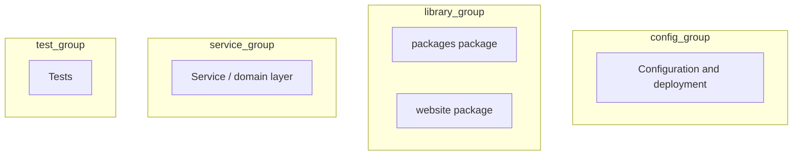

# Architecture report: buuing/lucky-canvas

> Automated static analysis. **Observed** = directly seen in files/imports/AST; **Inferred** = interpretation from that evidence. Repository code was not executed.

## 1. Repository at a glance

| Item | Value |
| --- | --- |
| Repository | buuing/lucky-canvas |
| Description | 🎖🎖🎖 基于 TS + Canvas 开发的【大转盘 / 九宫格 / 老虎机】抽奖插件，🌈 一套源码适配多端框架 JS / Vue / React / Taro / UniApp / 微信小程序等，🎨 奖品 / 文字 / 图片 / 颜色 / 按钮均可配置，支持同步 / 异步抽奖，🎯 概率前 / 后端可控，🚀 自动根据 dpr 调整清晰度适配移动端 |
| Language | TypeScript |
| Stars | 8785 |
| Licence | Apache-2.0 |
| Analysed commit / branch | 7a8c0bbcb992a297b390e3a2ebaa1a3385c1f2f9 / master |
| Framework(s) | Vue |
| Files analysed | 206 |
| Components | 5 |

## 2. Architecture in one minute

buuing/lucky-canvas - 🎖🎖🎖 基于 TS + Canvas 开发的【大转盘 / 九宫格 / 老虎机】抽奖插件，🌈 一套源码适配多端框架 JS / Vue / React / Taro / UniApp / 微信小程序等，🎨 奖品 / 文字 / 图片 / 颜色 / 按钮均可配置，支持同步 / 异步抽奖，🎯 概率前 / 后端可控，🚀 自动根据 dpr 调整清晰度适配移动端. This repository was analysed statically from 206 file(s) (0 Python). Detected technologies (observed from imports/manifests): Vue, Jest, TypeScript, Vite, webpack. Files are grouped into 5 component(s): Configuration and deployment, packages package, Service / domain layer, Tests, website package. Findings below distinguish observed facts from inferred interpretation.

## 3. High-level block diagram

## 4. Main components

### Configuration and deployment (`config`)

- **Kind:** config
- **Status:** Observed
- **Confidence:** 0.85
- **Responsibility:** Groups 28 file(s) under configuration and deployment (observed from repository paths and static analysis).
- **Paths:** `lerna.json`, `package.json`, `packages/core/package.json`, `packages/core/tsconfig.json`, `packages/mini/package.json`, `packages/mini/src/lucky-grid/index.json`, `packages/mini/src/lucky-wheel/index.json`, `packages/mini/src/slot-machine/index.json`, `packages/mini/tools/demo/app.json`, `packages/mini/tools/demo/package.json`, `packages/mini/tools/demo/pages/cjl/index.json`, `packages/mini/tools/demo/pages/index/index.json`, `packages/mini/tools/demo/pages/jd/index.json`, `packages/mini/tools/demo/pages/slot/index.json`, `packages/mini/tools/demo/pages/xc/index.json`, `packages/mini/tools/demo/pages/xdf/index.json`, `packages/mini/tools/demo/pages/ymc/index.json`, `packages/mini/tools/demo/pages/yx/index.json`, `packages/mini/tools/demo/pages/yyjk/index.json`, `packages/mini/tools/demo/pages/yyx/index.json`, `packages/mini/tools/demo/project.config.json`, `packages/mini/tsconfig.json`, `packages/react/package.json`, `packages/taro/package.json`, `packages/uni/package.json`, `packages/vue/package.json`, `packages/vue/tsconfig.json`, `website/package.json`
- **Evidence:** [lerna.json](https://github.com/buuing/lucky-canvas/blob/7a8c0bbcb992a297b390e3a2ebaa1a3385c1f2f9/lerna.json); [package.json](https://github.com/buuing/lucky-canvas/blob/7a8c0bbcb992a297b390e3a2ebaa1a3385c1f2f9/package.json); [packages/core/package.json](https://github.com/buuing/lucky-canvas/blob/7a8c0bbcb992a297b390e3a2ebaa1a3385c1f2f9/packages/core/package.json); [packages/core/tsconfig.json](https://github.com/buuing/lucky-canvas/blob/7a8c0bbcb992a297b390e3a2ebaa1a3385c1f2f9/packages/core/tsconfig.json); [packages/mini/package.json](https://github.com/buuing/lucky-canvas/blob/7a8c0bbcb992a297b390e3a2ebaa1a3385c1f2f9/packages/mini/package.json); [packages/mini/src/lucky-grid/index.json](https://github.com/buuing/lucky-canvas/blob/7a8c0bbcb992a297b390e3a2ebaa1a3385c1f2f9/packages/mini/src/lucky-grid/index.json); [packages/mini/src/lucky-wheel/index.json](https://github.com/buuing/lucky-canvas/blob/7a8c0bbcb992a297b390e3a2ebaa1a3385c1f2f9/packages/mini/src/lucky-wheel/index.json); [packages/mini/src/slot-machine/index.json](https://github.com/buuing/lucky-canvas/blob/7a8c0bbcb992a297b390e3a2ebaa1a3385c1f2f9/packages/mini/src/slot-machine/index.json)

### packages package (`packages`)

- **Kind:** library
- **Status:** Observed
- **Confidence:** 0.85
- **Responsibility:** Groups 60 file(s) under packages package (observed from repository paths and static analysis).
- **Paths:** `packages/mini/.eslintrc.js`, `packages/mini/gulpfile.js`, `packages/mini/src/lucky-grid/index.js`, `packages/mini/src/lucky-wheel/index.js`, `packages/mini/src/slot-machine/index.js`, `packages/mini/src/utils.js`, `packages/mini/tools/build.js`, `packages/mini/tools/checkcomponents.js`, `packages/mini/tools/checkwxss.js`, `packages/mini/tools/config.js`, `packages/mini/tools/demo/app.js`, `packages/mini/tools/demo/pages/cjl/index.js`, `packages/mini/tools/demo/pages/index/index.js`, `packages/mini/tools/demo/pages/jd/img.js`, `packages/mini/tools/demo/pages/jd/index.js`, `packages/mini/tools/demo/pages/slot/index.js`, `packages/mini/tools/demo/pages/xc/index.js`, `packages/mini/tools/demo/pages/xdf/img.js`, `packages/mini/tools/demo/pages/xdf/index.js`, `packages/mini/tools/demo/pages/ymc/index.js`, `packages/mini/tools/demo/pages/yx/index.js`, `packages/mini/tools/demo/pages/yyjk/index.js`, `packages/mini/tools/demo/pages/yyx/img.js`, `packages/mini/tools/demo/pages/yyx/index.js`, `packages/mini/tools/utils.js`, `packages/react/rollup.config.build.js`, `packages/react/rollup.config.dev.js`, `packages/react/src/app.js`, `packages/react/src/components/LuckyGrid.js`, `packages/react/src/components/LuckyWheel.js`, `packages/react/src/components/SlotMachine.js`, `packages/react/src/demo/LuckyGrid.js`, `packages/react/src/demo/LuckyWheel.js`, `packages/react/src/demo/SlotMachine.js`, `packages/react/src/index.js`, `packages/taro/react/LuckyGrid.js`, `packages/taro/react/LuckyWheel.js`, `packages/taro/react/SlotMachine.js`, `packages/taro/react/index.js`, `packages/taro/utils/index.js`, `packages/taro/vue/LuckyGrid.vue`, `packages/taro/vue/LuckyWheel.vue`, `packages/taro/vue/SlotMachine.vue`, `packages/taro/vue/index.js`, `packages/uni/lucky-grid.vue`, `packages/uni/lucky-wheel.vue`, `packages/uni/slot-machine.vue`, `packages/uni/utils.js`, `packages/vue/composition-api.js`, `packages/vue/index.js`, `packages/vue/rollup.config.build.js`, `packages/vue/rollup.config.dev.js`, `packages/vue/shims-vue.d.ts`, `packages/vue/src/components/LuckyGrid.ts`, `packages/vue/src/components/LuckyWheel.ts`, `packages/vue/src/components/SlotMachine.ts`, `packages/vue/src/index.ts`, `packages/vue/src/utils/h-demi.ts`, `packages/vue/types/index.d.ts`, `packages/vue/vue-demi.js`
- **Evidence:** [packages/mini/.eslintrc.js](https://github.com/buuing/lucky-canvas/blob/7a8c0bbcb992a297b390e3a2ebaa1a3385c1f2f9/packages/mini/.eslintrc.js); [packages/mini/gulpfile.js](https://github.com/buuing/lucky-canvas/blob/7a8c0bbcb992a297b390e3a2ebaa1a3385c1f2f9/packages/mini/gulpfile.js); [packages/mini/src/lucky-grid/index.js](https://github.com/buuing/lucky-canvas/blob/7a8c0bbcb992a297b390e3a2ebaa1a3385c1f2f9/packages/mini/src/lucky-grid/index.js); [packages/mini/src/lucky-wheel/index.js](https://github.com/buuing/lucky-canvas/blob/7a8c0bbcb992a297b390e3a2ebaa1a3385c1f2f9/packages/mini/src/lucky-wheel/index.js); [packages/mini/src/slot-machine/index.js](https://github.com/buuing/lucky-canvas/blob/7a8c0bbcb992a297b390e3a2ebaa1a3385c1f2f9/packages/mini/src/slot-machine/index.js); [packages/mini/src/utils.js](https://github.com/buuing/lucky-canvas/blob/7a8c0bbcb992a297b390e3a2ebaa1a3385c1f2f9/packages/mini/src/utils.js); [packages/mini/tools/build.js](https://github.com/buuing/lucky-canvas/blob/7a8c0bbcb992a297b390e3a2ebaa1a3385c1f2f9/packages/mini/tools/build.js); [packages/mini/tools/checkcomponents.js](https://github.com/buuing/lucky-canvas/blob/7a8c0bbcb992a297b390e3a2ebaa1a3385c1f2f9/packages/mini/tools/checkcomponents.js)

### Service / domain layer (`service_layer`)

- **Kind:** service
- **Status:** Observed
- **Confidence:** 0.85
- **Responsibility:** Groups 25 file(s) under service / domain layer (observed from repository paths and static analysis).
- **Paths:** `packages/core/.eslintrc.js`, `packages/core/index.js`, `packages/core/postinstall.js`, `packages/core/rollup.config.build.js`, `packages/core/rollup.config.dev.js`, `packages/core/src/index.ts`, `packages/core/src/lib/grid.ts`, `packages/core/src/lib/lucky.ts`, `packages/core/src/lib/slot.ts`, `packages/core/src/lib/wheel.ts`, `packages/core/src/observer/array.ts`, `packages/core/src/observer/dep.ts`, `packages/core/src/observer/index.ts`, `packages/core/src/observer/utils.ts`, `packages/core/src/observer/watcher.ts`, `packages/core/src/types/grid.ts`, `packages/core/src/types/index.ts`, `packages/core/src/types/slot.ts`, `packages/core/src/types/wheel.ts`, `packages/core/src/utils/image.ts`, `packages/core/src/utils/index.ts`, `packages/core/src/utils/math.ts`, `packages/core/src/utils/polyfill.js`, `packages/core/src/utils/tween.ts`, `packages/core/types/index.d.ts`
- **Evidence:** [packages/core/.eslintrc.js](https://github.com/buuing/lucky-canvas/blob/7a8c0bbcb992a297b390e3a2ebaa1a3385c1f2f9/packages/core/.eslintrc.js); [packages/core/index.js](https://github.com/buuing/lucky-canvas/blob/7a8c0bbcb992a297b390e3a2ebaa1a3385c1f2f9/packages/core/index.js); [packages/core/postinstall.js](https://github.com/buuing/lucky-canvas/blob/7a8c0bbcb992a297b390e3a2ebaa1a3385c1f2f9/packages/core/postinstall.js); [packages/core/rollup.config.build.js](https://github.com/buuing/lucky-canvas/blob/7a8c0bbcb992a297b390e3a2ebaa1a3385c1f2f9/packages/core/rollup.config.build.js); [packages/core/rollup.config.dev.js](https://github.com/buuing/lucky-canvas/blob/7a8c0bbcb992a297b390e3a2ebaa1a3385c1f2f9/packages/core/rollup.config.dev.js); [packages/core/src/index.ts](https://github.com/buuing/lucky-canvas/blob/7a8c0bbcb992a297b390e3a2ebaa1a3385c1f2f9/packages/core/src/index.ts); [packages/core/src/lib/grid.ts](https://github.com/buuing/lucky-canvas/blob/7a8c0bbcb992a297b390e3a2ebaa1a3385c1f2f9/packages/core/src/lib/grid.ts); [packages/core/src/lib/lucky.ts](https://github.com/buuing/lucky-canvas/blob/7a8c0bbcb992a297b390e3a2ebaa1a3385c1f2f9/packages/core/src/lib/lucky.ts)

### Tests (`tests`)

- **Kind:** test
- **Status:** Observed
- **Confidence:** 0.85
- **Responsibility:** Groups 3 file(s) under tests (observed from repository paths and static analysis).
- **Paths:** `packages/mini/test/index.test.js`, `packages/mini/test/utils.js`, `packages/mini/test/wx.test.js`
- **Evidence:** [packages/mini/test/index.test.js](https://github.com/buuing/lucky-canvas/blob/7a8c0bbcb992a297b390e3a2ebaa1a3385c1f2f9/packages/mini/test/index.test.js); [packages/mini/test/utils.js](https://github.com/buuing/lucky-canvas/blob/7a8c0bbcb992a297b390e3a2ebaa1a3385c1f2f9/packages/mini/test/utils.js); [packages/mini/test/wx.test.js](https://github.com/buuing/lucky-canvas/blob/7a8c0bbcb992a297b390e3a2ebaa1a3385c1f2f9/packages/mini/test/wx.test.js)

### website package (`website`)

- **Kind:** library
- **Status:** Observed
- **Confidence:** 0.85
- **Responsibility:** Groups 3 file(s) under website package (observed from repository paths and static analysis).
- **Paths:** `website/src/components/footer.js`, `website/src/components/header.js`, `website/src/main.js`
- **Evidence:** [website/src/components/footer.js](https://github.com/buuing/lucky-canvas/blob/7a8c0bbcb992a297b390e3a2ebaa1a3385c1f2f9/website/src/components/footer.js); [website/src/components/header.js](https://github.com/buuing/lucky-canvas/blob/7a8c0bbcb992a297b390e3a2ebaa1a3385c1f2f9/website/src/components/header.js); [website/src/main.js](https://github.com/buuing/lucky-canvas/blob/7a8c0bbcb992a297b390e3a2ebaa1a3385c1f2f9/website/src/main.js)

## 5. Execution flow

**Observed** entry point(s):

- [packages/core/index.js](https://github.com/buuing/lucky-canvas/blob/7a8c0bbcb992a297b390e3a2ebaa1a3385c1f2f9/packages/core/index.js)
- [packages/core/src/index.ts](https://github.com/buuing/lucky-canvas/blob/7a8c0bbcb992a297b390e3a2ebaa1a3385c1f2f9/packages/core/src/index.ts)
- [packages/react/src/app.js](https://github.com/buuing/lucky-canvas/blob/7a8c0bbcb992a297b390e3a2ebaa1a3385c1f2f9/packages/react/src/app.js)
- [packages/react/src/index.js](https://github.com/buuing/lucky-canvas/blob/7a8c0bbcb992a297b390e3a2ebaa1a3385c1f2f9/packages/react/src/index.js)
- [packages/taro/react/index.js](https://github.com/buuing/lucky-canvas/blob/7a8c0bbcb992a297b390e3a2ebaa1a3385c1f2f9/packages/taro/react/index.js)
- [packages/taro/utils/index.js](https://github.com/buuing/lucky-canvas/blob/7a8c0bbcb992a297b390e3a2ebaa1a3385c1f2f9/packages/taro/utils/index.js)
- [packages/taro/vue/index.js](https://github.com/buuing/lucky-canvas/blob/7a8c0bbcb992a297b390e3a2ebaa1a3385c1f2f9/packages/taro/vue/index.js)
- [packages/vue/index.js](https://github.com/buuing/lucky-canvas/blob/7a8c0bbcb992a297b390e3a2ebaa1a3385c1f2f9/packages/vue/index.js)
- [packages/vue/src/index.ts](https://github.com/buuing/lucky-canvas/blob/7a8c0bbcb992a297b390e3a2ebaa1a3385c1f2f9/packages/vue/src/index.ts)
- [website/src/main.js](https://github.com/buuing/lucky-canvas/blob/7a8c0bbcb992a297b390e3a2ebaa1a3385c1f2f9/website/src/main.js)

Representative flow (derived from observed entry points and the import graph; steps beyond the entry point are **Inferred**):

1. Execution starts at an observed entry point listed above, if present.
2. No internal import relationships between components were observed.

## 6. Project structure

### `(root)`

- `.gitignore` - other (323 bytes)
- `AGENTS.md` - docs (552 bytes)
- `LICENSE` - docs (11344 bytes)
- `README.md` - docs (10186 bytes)
- `lerna.json` - config (109 bytes)
- `package.json` - manifest (777 bytes)

### `.github`

- `.github/ISSUE_TEMPLATE.md` - docs (1138 bytes)

### `packages`

- `packages/core/.babelrc` - other (96 bytes)
- `packages/core/.eslintrc.js` - source, JavaScript (488 bytes)
- `packages/core/.gitignore` - other (241 bytes)
- `packages/core/.npmignore` - other (1 bytes)
- `packages/core/LICENSE` - docs (11344 bytes)
- `packages/core/README.md` - docs (1670 bytes)
- `packages/core/examples/grid.html` - other (1362 bytes)
- `packages/core/examples/index.html` - other (509 bytes)
- `packages/core/examples/slot.html` - other (2084 bytes)
- `packages/core/examples/wheel.html` - other (2132 bytes)
- `packages/core/index.js` - source, JavaScript (48 bytes)
- `packages/core/package.json` - manifest (1968 bytes)
- `packages/core/postinstall.js` - source, JavaScript (1217 bytes)
- `packages/core/rollup.config.build.js` - source, JavaScript (1345 bytes)
- `packages/core/rollup.config.dev.js` - source, JavaScript (1210 bytes)
- `packages/core/src/index.ts` - source, TypeScript (407 bytes)
- `packages/core/src/lib/grid.ts` - source, TypeScript (22006 bytes)
- `packages/core/src/lib/lucky.ts` - source, TypeScript (14658 bytes)
- `packages/core/src/lib/slot.ts` - source, TypeScript (22321 bytes)
- `packages/core/src/lib/wheel.ts` - source, TypeScript (19766 bytes)
- `packages/core/src/observer/array.ts` - source, TypeScript (535 bytes)
- `packages/core/src/observer/dep.ts` - source, TypeScript (526 bytes)
- `packages/core/src/observer/index.ts` - source, TypeScript (2261 bytes)
- `packages/core/src/observer/utils.ts` - source, TypeScript (1073 bytes)
- `packages/core/src/observer/watcher.ts` - source, TypeScript (1365 bytes)
- `packages/core/src/types/grid.ts` - source, TypeScript (2664 bytes)
- `packages/core/src/types/index.ts` - source, TypeScript (1726 bytes)
- `packages/core/src/types/slot.ts` - source, TypeScript (2052 bytes)
- `packages/core/src/types/wheel.ts` - source, TypeScript (1780 bytes)
- `packages/core/src/utils/image.ts` - source, TypeScript (3608 bytes)
- `packages/core/src/utils/index.ts` - source, TypeScript (5761 bytes)
- `packages/core/src/utils/math.ts` - source, TypeScript (7891 bytes)
- `packages/core/src/utils/polyfill.js` - source, JavaScript (3162 bytes)
- `packages/core/src/utils/tween.ts` - source, TypeScript (2309 bytes)
- `packages/core/tsconfig.json` - config (567 bytes)
- `packages/core/types/index.d.ts` - source, TypeScript (21754 bytes)
- `packages/mini/.babelrc` - other (202 bytes)
- `packages/mini/.eslintrc.js` - source, JavaScript (1991 bytes)
- `packages/mini/.gitignore` - other (106 bytes)
- `packages/mini/.npmignore` - other (1 bytes)
- `packages/mini/LICENSE` - docs (11344 bytes)
- `packages/mini/README.md` - docs (1538 bytes)
- `packages/mini/gulpfile.js` - source, JavaScript (841 bytes)
- `packages/mini/package.json` - manifest (2019 bytes)
- `packages/mini/src/lucky-grid/index.js` - source, JavaScript (4323 bytes)
- `packages/mini/src/lucky-grid/index.json` - config (48 bytes)
- `packages/mini/src/lucky-grid/index.wxml` - other (1871 bytes)
- `packages/mini/src/lucky-grid/index.wxss` - other (295 bytes)
- `packages/mini/src/lucky-wheel/index.js` - source, JavaScript (4081 bytes)
- `packages/mini/src/lucky-wheel/index.json` - config (48 bytes)
- `packages/mini/src/lucky-wheel/index.wxml` - other (1745 bytes)
- `packages/mini/src/lucky-wheel/index.wxss` - other (295 bytes)
- `packages/mini/src/slot-machine/index.js` - source, JavaScript (3073 bytes)
- `packages/mini/src/slot-machine/index.json` - config (48 bytes)
- `packages/mini/src/slot-machine/index.wxml` - other (1308 bytes)
- `packages/mini/src/slot-machine/index.wxss` - other (296 bytes)
- `packages/mini/src/utils.js` - source, JavaScript (986 bytes)
- `packages/mini/test/index.test.js` - test, JavaScript (725 bytes)
- `packages/mini/test/utils.js` - test, JavaScript (966 bytes)
- `packages/mini/test/wx.test.js` - test, JavaScript (413 bytes)
- `packages/mini/tools/build.js` - source, JavaScript (10866 bytes)
- `packages/mini/tools/checkcomponents.js` - source, JavaScript (3016 bytes)
- `packages/mini/tools/checkwxss.js` - source, JavaScript (2627 bytes)
- `packages/mini/tools/config.js` - source, JavaScript (2300 bytes)
- `packages/mini/tools/demo/app.js` - source, JavaScript (8 bytes)
- `packages/mini/tools/demo/app.json` - config (608 bytes)
- `packages/mini/tools/demo/app.wxss` - other (573 bytes)
- `packages/mini/tools/demo/package.json` - manifest (2 bytes)
- `packages/mini/tools/demo/pages/cjl/index.js` - source, JavaScript (2043 bytes)
- `packages/mini/tools/demo/pages/cjl/index.json` - config (2 bytes)
- `packages/mini/tools/demo/pages/cjl/index.wxml` - other (326 bytes)
- `packages/mini/tools/demo/pages/cjl/index.wxss` - other (0 bytes)
- `packages/mini/tools/demo/pages/index/index.js` - source, JavaScript (4350 bytes)
- `packages/mini/tools/demo/pages/index/index.json` - config (2 bytes)
- `packages/mini/tools/demo/pages/index/index.wxml` - other (1322 bytes)
- `packages/mini/tools/demo/pages/index/index.wxss` - other (714 bytes)
- `packages/mini/tools/demo/pages/jd/img.js` - source, JavaScript (105295 bytes)
- `packages/mini/tools/demo/pages/jd/index.js` - source, JavaScript (2030 bytes)
- `packages/mini/tools/demo/pages/jd/index.json` - config (2 bytes)
- `packages/mini/tools/demo/pages/jd/index.wxml` - other (352 bytes)
- `packages/mini/tools/demo/pages/jd/index.wxss` - other (0 bytes)
- `packages/mini/tools/demo/pages/slot/index.js` - source, JavaScript (2254 bytes)
- `packages/mini/tools/demo/pages/slot/index.json` - config (2 bytes)
- `packages/mini/tools/demo/pages/slot/index.wxml` - other (399 bytes)
- `packages/mini/tools/demo/pages/slot/index.wxss` - other (0 bytes)
- `packages/mini/tools/demo/pages/xc/index.js` - source, JavaScript (1203 bytes)
- `packages/mini/tools/demo/pages/xc/index.json` - config (2 bytes)
- `packages/mini/tools/demo/pages/xc/index.wxml` - other (326 bytes)
- `packages/mini/tools/demo/pages/xc/index.wxss` - other (0 bytes)
- `packages/mini/tools/demo/pages/xdf/img.js` - source, JavaScript (31402 bytes)
- `packages/mini/tools/demo/pages/xdf/index.js` - source, JavaScript (2582 bytes)
- `packages/mini/tools/demo/pages/xdf/index.json` - config (2 bytes)
- `packages/mini/tools/demo/pages/xdf/index.wxml` - other (356 bytes)
- `packages/mini/tools/demo/pages/xdf/index.wxss` - other (0 bytes)
- `packages/mini/tools/demo/pages/ymc/index.js` - source, JavaScript (2998 bytes)
- `packages/mini/tools/demo/pages/ymc/index.json` - config (2 bytes)
- `packages/mini/tools/demo/pages/ymc/index.wxml` - other (411 bytes)
- `packages/mini/tools/demo/pages/ymc/index.wxss` - other (0 bytes)
- `packages/mini/tools/demo/pages/yx/index.js` - source, JavaScript (2062 bytes)
- `packages/mini/tools/demo/pages/yx/index.json` - config (2 bytes)
- `packages/mini/tools/demo/pages/yx/index.wxml` - other (318 bytes)
- `packages/mini/tools/demo/pages/yx/index.wxss` - other (0 bytes)
- `packages/mini/tools/demo/pages/yyjk/index.js` - source, JavaScript (2448 bytes)
- `packages/mini/tools/demo/pages/yyjk/index.json` - config (2 bytes)
- `packages/mini/tools/demo/pages/yyjk/index.wxml` - other (482 bytes)
- `packages/mini/tools/demo/pages/yyjk/index.wxss` - other (0 bytes)
- `packages/mini/tools/demo/pages/yyx/img.js` - source, JavaScript (96072 bytes)
- `packages/mini/tools/demo/pages/yyx/index.js` - source, JavaScript (2603 bytes)
- `packages/mini/tools/demo/pages/yyx/index.json` - config (2 bytes)
- `packages/mini/tools/demo/pages/yyx/index.wxml` - other (318 bytes)
- `packages/mini/tools/demo/pages/yyx/index.wxss` - other (0 bytes)
- `packages/mini/tools/demo/project.config.json` - config (580 bytes)
- `packages/mini/tools/utils.js` - source, JavaScript (4471 bytes)
- `packages/mini/tsconfig.json` - config (542 bytes)
- `packages/react/.babelrc` - other (73 bytes)
- `packages/react/.gitignore` - other (241 bytes)
- `packages/react/.npmignore` - other (1 bytes)
- `packages/react/LICENSE` - docs (11344 bytes)
- `packages/react/README.md` - docs (1536 bytes)
- `packages/react/example/react16.8.html` - other (2340 bytes)
- `packages/react/example/react18.0.html` - other (2357 bytes)
- `packages/react/package.json` - manifest (1354 bytes)
- `packages/react/rollup.config.build.js` - source, JavaScript (770 bytes)
- `packages/react/rollup.config.dev.js` - source, JavaScript (901 bytes)
- `packages/react/src/app.js` - source, JavaScript (349 bytes)
- `packages/react/src/components/LuckyGrid.js` - source, JavaScript (2282 bytes)
- `packages/react/src/components/LuckyWheel.js` - source, JavaScript (2059 bytes)
- `packages/react/src/components/SlotMachine.js` - source, JavaScript (2053 bytes)
- `packages/react/src/demo/LuckyGrid.js` - source, JavaScript (2954 bytes)
- `packages/react/src/demo/LuckyWheel.js` - source, JavaScript (1826 bytes)
- `packages/react/src/demo/SlotMachine.js` - source, JavaScript (2604 bytes)
- `packages/react/src/index.js` - source, JavaScript (201 bytes)
- `packages/taro/.gitignore` - other (236 bytes)
- `packages/taro/.npmignore` - other (1 bytes)
- `packages/taro/LICENSE` - docs (11344 bytes)
- `packages/taro/README.md` - docs (3085 bytes)
- `packages/taro/package.json` - manifest (744 bytes)
- `packages/taro/react/LuckyGrid.js` - source, JavaScript (7367 bytes)
- `packages/taro/react/LuckyWheel.js` - source, JavaScript (6633 bytes)
- `packages/taro/react/SlotMachine.js` - source, JavaScript (5372 bytes)
- `packages/taro/react/index.js` - source, JavaScript (168 bytes)
- `packages/taro/utils/index.css` - other (556 bytes)
- `packages/taro/utils/index.js` - source, JavaScript (2247 bytes)
- `packages/taro/vue/LuckyGrid.vue` - source, Vue (7323 bytes)
- `packages/taro/vue/LuckyWheel.vue` - source, Vue (6287 bytes)
- `packages/taro/vue/SlotMachine.vue` - source, Vue (5184 bytes)
- `packages/taro/vue/index.js` - source, JavaScript (171 bytes)
- `packages/uni/.gitignore` - other (263 bytes)
- `packages/uni/.npmignore` - other (1 bytes)
- `packages/uni/LICENSE` - docs (11344 bytes)
- `packages/uni/README.md` - docs (6180 bytes)
- `packages/uni/lucky-grid.vue` - source, Vue (9264 bytes)
- `packages/uni/lucky-wheel.vue` - source, Vue (7159 bytes)
- `packages/uni/package.json` - manifest (490 bytes)
- `packages/uni/slot-machine.vue` - source, Vue (5628 bytes)
- `packages/uni/utils.js` - source, JavaScript (2154 bytes)
- `packages/vue/.gitignore` - other (253 bytes)
- `packages/vue/.npmignore` - other (1 bytes)
- `packages/vue/LICENSE` - docs (11343 bytes)
- `packages/vue/README.md` - docs (4265 bytes)
- `packages/vue/composition-api.js` - source, JavaScript (20889 bytes)
- `packages/vue/index.js` - source, JavaScript (47 bytes)
- `packages/vue/package.json` - manifest (1682 bytes)
- `packages/vue/rollup.config.build.js` - source, JavaScript (1251 bytes)
- `packages/vue/rollup.config.dev.js` - source, JavaScript (780 bytes)
- `packages/vue/shims-vue.d.ts` - source, TypeScript (257 bytes)
- `packages/vue/src/components/LuckyGrid.ts` - source, TypeScript (3193 bytes)
- `packages/vue/src/components/LuckyWheel.ts` - source, TypeScript (2622 bytes)
- `packages/vue/src/components/SlotMachine.ts` - source, TypeScript (2540 bytes)
- `packages/vue/src/index.ts` - source, TypeScript (550 bytes)
- `packages/vue/src/utils/h-demi.ts` - source, TypeScript (838 bytes)
- `packages/vue/tsconfig.json` - config (599 bytes)
- `packages/vue/types/index.d.ts` - source, TypeScript (6624 bytes)
- `packages/vue/vue-demi.js` - source, JavaScript (1738 bytes)
- `packages/vue/vue2.html` - other (2938 bytes)
- `packages/vue/vue3.html` - other (2248 bytes)

### `website`

- `website/.gitignore` - other (6 bytes)
- `website/index.html` - other (5892 bytes)
- `website/package.json` - manifest (223 bytes)
- `website/public/assets/Data.svg` - other (54381 bytes)
- `website/public/assets/Subscribe.svg` - other (75039 bytes)
- `website/public/assets/Success.svg` - other (70322 bytes)
- `website/public/assets/base.svg` - other (6729 bytes)
- `website/public/assets/bug.svg` - other (5882 bytes)
- `website/public/assets/configure.svg` - other (23587 bytes)
- `website/public/assets/core.svg` - other (4131 bytes)
- `website/public/assets/delivery.svg` - other (56841 bytes)
- `website/public/assets/demo.svg` - other (6453 bytes)
- `website/public/assets/docs.svg` - other (3108 bytes)
- `website/public/assets/feat.svg` - other (5503 bytes)
- `website/public/assets/issues.svg` - other (3950 bytes)
- `website/public/assets/msg.svg` - other (3251 bytes)
- `website/public/assets/notice.svg` - other (3928 bytes)
- `website/public/assets/platforms.svg` - other (22143 bytes)
- `website/public/assets/responsive.svg` - other (26439 bytes)
- `website/src/components/footer.js` - source, JavaScript (458 bytes)
- `website/src/components/header.js` - source, JavaScript (1801 bytes)
- `website/src/main.js` - source, JavaScript (535 bytes)
- `website/src/styles.css` - other (8777 bytes)

## 7. Key dependencies and integrations

| Name | Category | Status | Confidence | Evidence |
| --- | --- | --- | --- | --- |
| Vue | framework | Observed | 0.90 | [packages/vue/package.json:2](https://github.com/buuing/lucky-canvas/blob/7a8c0bbcb992a297b390e3a2ebaa1a3385c1f2f9/packages/vue/package.json#L2) |
| Jest | tooling | Observed | 0.85 | [packages/mini/package.json:12](https://github.com/buuing/lucky-canvas/blob/7a8c0bbcb992a297b390e3a2ebaa1a3385c1f2f9/packages/mini/package.json#L12) |
| TypeScript | tooling | Observed | 0.90 | [packages/core/package.json:47](https://github.com/buuing/lucky-canvas/blob/7a8c0bbcb992a297b390e3a2ebaa1a3385c1f2f9/packages/core/package.json#L47); [packages/mini/package.json:40](https://github.com/buuing/lucky-canvas/blob/7a8c0bbcb992a297b390e3a2ebaa1a3385c1f2f9/packages/mini/package.json#L40); [packages/vue/package.json:50](https://github.com/buuing/lucky-canvas/blob/7a8c0bbcb992a297b390e3a2ebaa1a3385c1f2f9/packages/vue/package.json#L50) |
| Vite | tooling | Observed | 0.85 | [website/package.json:6](https://github.com/buuing/lucky-canvas/blob/7a8c0bbcb992a297b390e3a2ebaa1a3385c1f2f9/website/package.json#L6) |
| webpack | tooling | Observed | 0.85 | [packages/mini/package.json:68](https://github.com/buuing/lucky-canvas/blob/7a8c0bbcb992a297b390e3a2ebaa1a3385c1f2f9/packages/mini/package.json#L68) |

## 8. Data and state

No database, cache, queue, or persistent-state usage was observed in the analysed files. State handling, if any, may be in-memory or in files that were not analysed.

## 9. Configuration and deployment clues

- `lerna.json` (config)
- `package.json` (manifest)
- `packages/core/package.json` (manifest)
- `packages/core/tsconfig.json` (config)
- `packages/mini/package.json` (manifest)
- `packages/mini/src/lucky-grid/index.json` (config)
- `packages/mini/src/lucky-wheel/index.json` (config)
- `packages/mini/src/slot-machine/index.json` (config)
- `packages/mini/tools/demo/app.json` (config)
- `packages/mini/tools/demo/package.json` (manifest)
- `packages/mini/tools/demo/pages/cjl/index.json` (config)
- `packages/mini/tools/demo/pages/index/index.json` (config)
- `packages/mini/tools/demo/pages/jd/index.json` (config)
- `packages/mini/tools/demo/pages/slot/index.json` (config)
- `packages/mini/tools/demo/pages/xc/index.json` (config)
- `packages/mini/tools/demo/pages/xdf/index.json` (config)
- `packages/mini/tools/demo/pages/ymc/index.json` (config)
- `packages/mini/tools/demo/pages/yx/index.json` (config)
- `packages/mini/tools/demo/pages/yyjk/index.json` (config)
- `packages/mini/tools/demo/pages/yyx/index.json` (config)
- `packages/mini/tools/demo/project.config.json` (config)
- `packages/mini/tsconfig.json` (config)
- `packages/react/package.json` (manifest)
- `packages/taro/package.json` (manifest)
- `packages/uni/package.json` (manifest)
- `packages/vue/package.json` (manifest)
- `packages/vue/tsconfig.json` (config)
- `website/package.json` (manifest)

## 10. Design observations

- Service/domain code is distinct from entry and data code, suggesting layered separation (Inferred).
- Tests are present alongside source code (Observed from test file paths).

These observations are interpretations (**Inferred**) of the observed structure, not guarantees about runtime design.

## 11. Limitations and unknowns

- Static analysis only: repository code was not executed, installed, or imported at runtime.
- Components and relationships are inferred from file paths, imports, and AST structure; runtime behaviour, dynamic imports, and reflection may not be visible.
- No clear application entry point was observed in the analysed files.
- Repository text was treated as untrusted data; no instructions found in repository files were followed, and likely secret values were redacted/excluded.
- JavaScript and TypeScript files were inventoried from paths and package manifests. They were not parsed with a full language AST, and repository code was not executed.

## 12. Source references

- [lerna.json](https://github.com/buuing/lucky-canvas/blob/7a8c0bbcb992a297b390e3a2ebaa1a3385c1f2f9/lerna.json)
- [package.json](https://github.com/buuing/lucky-canvas/blob/7a8c0bbcb992a297b390e3a2ebaa1a3385c1f2f9/package.json)
- [packages/core/.eslintrc.js](https://github.com/buuing/lucky-canvas/blob/7a8c0bbcb992a297b390e3a2ebaa1a3385c1f2f9/packages/core/.eslintrc.js)
- [packages/core/index.js](https://github.com/buuing/lucky-canvas/blob/7a8c0bbcb992a297b390e3a2ebaa1a3385c1f2f9/packages/core/index.js)
- [packages/core/package.json](https://github.com/buuing/lucky-canvas/blob/7a8c0bbcb992a297b390e3a2ebaa1a3385c1f2f9/packages/core/package.json)
- [packages/core/package.json:47](https://github.com/buuing/lucky-canvas/blob/7a8c0bbcb992a297b390e3a2ebaa1a3385c1f2f9/packages/core/package.json#L47)
- [packages/core/postinstall.js](https://github.com/buuing/lucky-canvas/blob/7a8c0bbcb992a297b390e3a2ebaa1a3385c1f2f9/packages/core/postinstall.js)
- [packages/core/rollup.config.build.js](https://github.com/buuing/lucky-canvas/blob/7a8c0bbcb992a297b390e3a2ebaa1a3385c1f2f9/packages/core/rollup.config.build.js)
- [packages/core/rollup.config.dev.js](https://github.com/buuing/lucky-canvas/blob/7a8c0bbcb992a297b390e3a2ebaa1a3385c1f2f9/packages/core/rollup.config.dev.js)
- [packages/core/src/index.ts](https://github.com/buuing/lucky-canvas/blob/7a8c0bbcb992a297b390e3a2ebaa1a3385c1f2f9/packages/core/src/index.ts)
- [packages/core/src/lib/grid.ts](https://github.com/buuing/lucky-canvas/blob/7a8c0bbcb992a297b390e3a2ebaa1a3385c1f2f9/packages/core/src/lib/grid.ts)
- [packages/core/src/lib/lucky.ts](https://github.com/buuing/lucky-canvas/blob/7a8c0bbcb992a297b390e3a2ebaa1a3385c1f2f9/packages/core/src/lib/lucky.ts)
- [packages/core/tsconfig.json](https://github.com/buuing/lucky-canvas/blob/7a8c0bbcb992a297b390e3a2ebaa1a3385c1f2f9/packages/core/tsconfig.json)
- [packages/mini/.eslintrc.js](https://github.com/buuing/lucky-canvas/blob/7a8c0bbcb992a297b390e3a2ebaa1a3385c1f2f9/packages/mini/.eslintrc.js)
- [packages/mini/gulpfile.js](https://github.com/buuing/lucky-canvas/blob/7a8c0bbcb992a297b390e3a2ebaa1a3385c1f2f9/packages/mini/gulpfile.js)
- [packages/mini/package.json](https://github.com/buuing/lucky-canvas/blob/7a8c0bbcb992a297b390e3a2ebaa1a3385c1f2f9/packages/mini/package.json)
- [packages/mini/package.json:12](https://github.com/buuing/lucky-canvas/blob/7a8c0bbcb992a297b390e3a2ebaa1a3385c1f2f9/packages/mini/package.json#L12)
- [packages/mini/package.json:40](https://github.com/buuing/lucky-canvas/blob/7a8c0bbcb992a297b390e3a2ebaa1a3385c1f2f9/packages/mini/package.json#L40)
- [packages/mini/package.json:68](https://github.com/buuing/lucky-canvas/blob/7a8c0bbcb992a297b390e3a2ebaa1a3385c1f2f9/packages/mini/package.json#L68)
- [packages/mini/src/lucky-grid/index.js](https://github.com/buuing/lucky-canvas/blob/7a8c0bbcb992a297b390e3a2ebaa1a3385c1f2f9/packages/mini/src/lucky-grid/index.js)
- [packages/mini/src/lucky-grid/index.json](https://github.com/buuing/lucky-canvas/blob/7a8c0bbcb992a297b390e3a2ebaa1a3385c1f2f9/packages/mini/src/lucky-grid/index.json)
- [packages/mini/src/lucky-wheel/index.js](https://github.com/buuing/lucky-canvas/blob/7a8c0bbcb992a297b390e3a2ebaa1a3385c1f2f9/packages/mini/src/lucky-wheel/index.js)
- [packages/mini/src/lucky-wheel/index.json](https://github.com/buuing/lucky-canvas/blob/7a8c0bbcb992a297b390e3a2ebaa1a3385c1f2f9/packages/mini/src/lucky-wheel/index.json)
- [packages/mini/src/slot-machine/index.js](https://github.com/buuing/lucky-canvas/blob/7a8c0bbcb992a297b390e3a2ebaa1a3385c1f2f9/packages/mini/src/slot-machine/index.js)
- [packages/mini/src/slot-machine/index.json](https://github.com/buuing/lucky-canvas/blob/7a8c0bbcb992a297b390e3a2ebaa1a3385c1f2f9/packages/mini/src/slot-machine/index.json)
- [packages/mini/src/utils.js](https://github.com/buuing/lucky-canvas/blob/7a8c0bbcb992a297b390e3a2ebaa1a3385c1f2f9/packages/mini/src/utils.js)
- [packages/mini/test/index.test.js](https://github.com/buuing/lucky-canvas/blob/7a8c0bbcb992a297b390e3a2ebaa1a3385c1f2f9/packages/mini/test/index.test.js)
- [packages/mini/test/utils.js](https://github.com/buuing/lucky-canvas/blob/7a8c0bbcb992a297b390e3a2ebaa1a3385c1f2f9/packages/mini/test/utils.js)
- [packages/mini/test/wx.test.js](https://github.com/buuing/lucky-canvas/blob/7a8c0bbcb992a297b390e3a2ebaa1a3385c1f2f9/packages/mini/test/wx.test.js)
- [packages/mini/tools/build.js](https://github.com/buuing/lucky-canvas/blob/7a8c0bbcb992a297b390e3a2ebaa1a3385c1f2f9/packages/mini/tools/build.js)
- [packages/mini/tools/checkcomponents.js](https://github.com/buuing/lucky-canvas/blob/7a8c0bbcb992a297b390e3a2ebaa1a3385c1f2f9/packages/mini/tools/checkcomponents.js)
- [packages/react/src/app.js](https://github.com/buuing/lucky-canvas/blob/7a8c0bbcb992a297b390e3a2ebaa1a3385c1f2f9/packages/react/src/app.js)
- [packages/react/src/index.js](https://github.com/buuing/lucky-canvas/blob/7a8c0bbcb992a297b390e3a2ebaa1a3385c1f2f9/packages/react/src/index.js)
- [packages/taro/react/index.js](https://github.com/buuing/lucky-canvas/blob/7a8c0bbcb992a297b390e3a2ebaa1a3385c1f2f9/packages/taro/react/index.js)
- [packages/taro/utils/index.js](https://github.com/buuing/lucky-canvas/blob/7a8c0bbcb992a297b390e3a2ebaa1a3385c1f2f9/packages/taro/utils/index.js)
- [packages/taro/vue/index.js](https://github.com/buuing/lucky-canvas/blob/7a8c0bbcb992a297b390e3a2ebaa1a3385c1f2f9/packages/taro/vue/index.js)
- [packages/vue/index.js](https://github.com/buuing/lucky-canvas/blob/7a8c0bbcb992a297b390e3a2ebaa1a3385c1f2f9/packages/vue/index.js)
- [packages/vue/package.json:2](https://github.com/buuing/lucky-canvas/blob/7a8c0bbcb992a297b390e3a2ebaa1a3385c1f2f9/packages/vue/package.json#L2)
- [packages/vue/package.json:50](https://github.com/buuing/lucky-canvas/blob/7a8c0bbcb992a297b390e3a2ebaa1a3385c1f2f9/packages/vue/package.json#L50)
- [packages/vue/src/index.ts](https://github.com/buuing/lucky-canvas/blob/7a8c0bbcb992a297b390e3a2ebaa1a3385c1f2f9/packages/vue/src/index.ts)
- [website/package.json:6](https://github.com/buuing/lucky-canvas/blob/7a8c0bbcb992a297b390e3a2ebaa1a3385c1f2f9/website/package.json#L6)
- [website/src/components/footer.js](https://github.com/buuing/lucky-canvas/blob/7a8c0bbcb992a297b390e3a2ebaa1a3385c1f2f9/website/src/components/footer.js)
- [website/src/components/header.js](https://github.com/buuing/lucky-canvas/blob/7a8c0bbcb992a297b390e3a2ebaa1a3385c1f2f9/website/src/components/header.js)
- [website/src/main.js](https://github.com/buuing/lucky-canvas/blob/7a8c0bbcb992a297b390e3a2ebaa1a3385c1f2f9/website/src/main.js)
