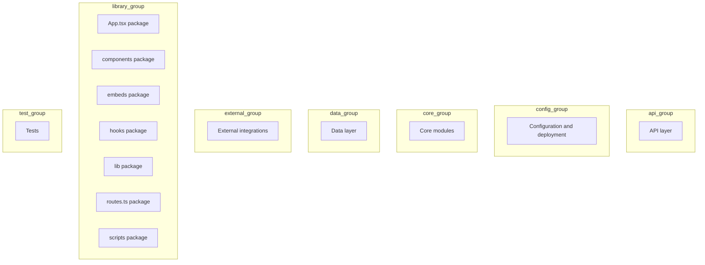

# Architecture report: bvaughn/react-resizable-panels

> Automated static analysis. **Observed** = directly seen in files/imports/AST; **Inferred** = interpretation from that evidence. Repository code was not executed.

## 1. Repository at a glance

| Item | Value |
| --- | --- |
| Repository | bvaughn/react-resizable-panels |
| Description | Not provided |
| Language | TypeScript |
| Stars | 5481 |
| Licence | MIT |
| Analysed commit / branch | 6b22da07c2fa712327059f5c0848e7c90d0fc3c3 / main |
| Framework(s) | Express, Next.js, React |
| Files analysed | 799 |
| Components | 13 |

## 2. Architecture in one minute

bvaughn/react-resizable-panels. This repository was analysed statically from 799 file(s) (0 Python). Detected technologies (observed from imports/manifests): GitHub Actions, Express, Next.js, React, React Router, Tailwind CSS. Files are grouped into 13 component(s): API layer, App.tsx package, components package, Configuration and deployment, Core modules, Data layer, embeds package, External integrations. Findings below distinguish observed facts from inferred interpretation.

## 3. High-level block diagram

## 4. Main components

### API layer (`api_layer`)

- **Kind:** api
- **Status:** Observed
- **Confidence:** 0.85
- **Responsibility:** Groups 80 file(s) under api layer (observed from repository paths and static analysis).
- **Paths:** `integrations/vite/src/routes/Decoder.tsx`, `integrations/vite/src/routes/Home.tsx`, `src/routes/AccordionRoute.tsx`, `src/routes/CellPropsRoute.tsx`, `src/routes/CollapsibleGridCellsRoute.tsx`, `src/routes/CollapsiblePanelsRoute.tsx`, `src/routes/ConditionalPanelsRoute.tsx`, `src/routes/CustomStylesRoute.tsx`, `src/routes/DisabledPanelsRoute.tsx`, `src/routes/FixedSizePanelsRoute.tsx`, `src/routes/GridBasicsRoute.tsx`, `src/routes/GridConstraintsRoute.tsx`, `src/routes/GridImperativeHandleRoute.tsx`, `src/routes/GridPersistentLayoutRoute.tsx`, `src/routes/GridPropsRoute.tsx`, `src/routes/GridTrackImperativeHandleRoute.tsx`, `src/routes/GridlinePropsRoute.tsx`, `src/routes/GridlinesRoute.tsx`, `src/routes/GroupImperativeHandleRoute.tsx`, `src/routes/GroupPropsRoute.tsx`, `src/routes/GroupResizeBehaviorRoute.tsx`, `src/routes/LayoutBasicsRoute.tsx`, `src/routes/NestedGroupsRoute.tsx`, `src/routes/OverflowRoute.tsx`, `src/routes/PanelImperativeHandleRoute.tsx`, `src/routes/PanelPropsRoute.tsx`, `src/routes/PanelResizeBehaviorRoute.tsx`, `src/routes/PersistentLayoutsConditionalPanelsRoute.tsx`, `src/routes/PersistentLayoutsRoute.tsx`, `src/routes/PersistentLayoutsServerComponentsRoute.tsx`, `src/routes/PersistentLayoutsServerRenderingRoute.tsx`, `src/routes/PlatformRequirementsRoute.tsx`, `src/routes/SeparatorPropsRoute.tsx`, `src/routes/SizeConstraintsRoute.tsx`, `src/routes/SplitNodeRoute.tsx`, `src/routes/TabCloseButtonPropsRoute.tsx`, `src/routes/TabNodeRoute.tsx`, `src/routes/TabsetCollapseButtonPropsRoute.tsx`, `src/routes/TabsetDragHandlePropsRoute.tsx`, `src/routes/TabsetMaximizeButtonPropsRoute.tsx`, `src/routes/TabsetNodeRoute.tsx`, `src/routes/TestRoute.tsx`, `src/routes/UseDefaultGridLayoutRoute.tsx`, `src/routes/UseDefaultLayoutRoute.tsx`, `src/routes/UseGridCallbackRefRoute.tsx`, `src/routes/UseGridRefRoute.tsx`, `src/routes/UseGroupCallbackRefRoute.tsx`, `src/routes/UseGroupRefRoute.tsx`, `src/routes/UsePanelCallbackRefRoute.tsx`, `src/routes/UsePanelRefRoute.tsx`, `src/routes/UseParentGridRoute.tsx`, `src/routes/UseParentGroupRoute.tsx`, `src/routes/UseParentPanelRoute.tsx`, `src/routes/UseParentTabRoute.tsx`, `src/routes/UseParentTabStateRoute.tsx`, `src/routes/UseParentTabsetRoute.tsx`, `src/routes/UseParentTabsetStateRoute.tsx`, `src/routes/UseParentWorkspaceRoute.tsx`, `src/routes/UsePopoutWindowsRoute.tsx`, `src/routes/UseTabListFreeSpaceRoute.tsx`, `src/routes/UseTabListOverflowRoute.tsx`, `src/routes/UseWorkspaceCallbackRefRoute.tsx`, `src/routes/UseWorkspaceRefRoute.tsx`, `src/routes/WorkspaceCopiesOfYourAppRoute.tsx`, `src/routes/WorkspaceCopyingTabsRoute.tsx`, `src/routes/WorkspaceCustomTabsetsRoute.tsx`, `src/routes/WorkspaceDraggingTabsInRoute.tsx`, `src/routes/WorkspaceFloatingTabsetsRoute.tsx`, `src/routes/WorkspaceImperativeHandleRoute.tsx`, `src/routes/WorkspaceManagingTabsRoute.tsx`, `src/routes/WorkspaceManagingTabsetsRoute.tsx`, `src/routes/WorkspaceModelRoute.tsx`, `src/routes/WorkspaceMultipleWindowsRoute.tsx`, `src/routes/WorkspacePersistenceRoute.tsx`, `src/routes/WorkspacePopoutWindowsRoute.tsx`, `src/routes/WorkspacePropsRoute.tsx`, `src/routes/WorkspaceRestrictionsRoute.tsx`, `src/routes/WorkspaceRoute.tsx`, `src/routes/WorkspaceSeparatorsRoute.tsx`, `src/routes/WorkspaceServerRenderingRoute.tsx`
- **Evidence:** [integrations/vite/src/routes/Decoder.tsx](https://github.com/bvaughn/react-resizable-panels/blob/6b22da07c2fa712327059f5c0848e7c90d0fc3c3/integrations/vite/src/routes/Decoder.tsx); [integrations/vite/src/routes/Home.tsx](https://github.com/bvaughn/react-resizable-panels/blob/6b22da07c2fa712327059f5c0848e7c90d0fc3c3/integrations/vite/src/routes/Home.tsx); [src/routes/AccordionRoute.tsx](https://github.com/bvaughn/react-resizable-panels/blob/6b22da07c2fa712327059f5c0848e7c90d0fc3c3/src/routes/AccordionRoute.tsx); [src/routes/CellPropsRoute.tsx](https://github.com/bvaughn/react-resizable-panels/blob/6b22da07c2fa712327059f5c0848e7c90d0fc3c3/src/routes/CellPropsRoute.tsx); [src/routes/CollapsibleGridCellsRoute.tsx](https://github.com/bvaughn/react-resizable-panels/blob/6b22da07c2fa712327059f5c0848e7c90d0fc3c3/src/routes/CollapsibleGridCellsRoute.tsx); [src/routes/CollapsiblePanelsRoute.tsx](https://github.com/bvaughn/react-resizable-panels/blob/6b22da07c2fa712327059f5c0848e7c90d0fc3c3/src/routes/CollapsiblePanelsRoute.tsx); [src/routes/ConditionalPanelsRoute.tsx](https://github.com/bvaughn/react-resizable-panels/blob/6b22da07c2fa712327059f5c0848e7c90d0fc3c3/src/routes/ConditionalPanelsRoute.tsx); [src/routes/CustomStylesRoute.tsx](https://github.com/bvaughn/react-resizable-panels/blob/6b22da07c2fa712327059f5c0848e7c90d0fc3c3/src/routes/CustomStylesRoute.tsx)

### App.tsx package (`app_tsx`)

- **Kind:** library
- **Status:** Observed
- **Confidence:** 0.85
- **Responsibility:** Groups 1 file(s) under app.tsx package (observed from repository paths and static analysis).
- **Paths:** `src/App.tsx`
- **Evidence:** [src/App.tsx](https://github.com/bvaughn/react-resizable-panels/blob/6b22da07c2fa712327059f5c0848e7c90d0fc3c3/src/App.tsx)

### components package (`components`)

- **Kind:** library
- **Status:** Observed
- **Confidence:** 0.85
- **Responsibility:** Groups 37 file(s) under components package (observed from repository paths and static analysis).
- **Paths:** `src/components/DemoButton.tsx`, `src/components/Divider.tsx`, `src/components/HookReturnType.tsx`, `src/components/Link.tsx`, `src/components/MaximizeButton.tsx`, `src/components/TypeFields.tsx`, `src/components/accordion/Accordion.tsx`, `src/components/dashboard/Dashboard.tsx`, `src/components/demos/GridMaximizeDemo.tsx`, `src/components/demos/GroupMaximizeDemo.tsx`, `src/components/demos/PanelCollapseDemo.tsx`, `src/components/email/Avatar.tsx`, `src/components/email/EmailClient.tsx`, `src/components/email/messages.ts`, `src/components/request-log/RequestLog.tsx`, `src/components/styled-panels/Cell.tsx`, `src/components/styled-panels/Grid.tsx`, `src/components/styled-panels/GridSizesContext.ts`, `src/components/styled-panels/Gridline.tsx`, `src/components/styled-panels/Group.tsx`, `src/components/styled-panels/Panel.tsx`, `src/components/styled-panels/PanelText.tsx`, `src/components/styled-panels/Separator.tsx`, `src/components/vs-code-workspace/VSCodeWorkspace.tsx`, `src/components/vs-code/VSCode.tsx`, `src/components/vs-code/VSCodeCollapsibleSidePanel.tsx`, `src/components/vs-code/VSCodeContext.tsx`, `src/components/vs-code/VSCodePrimaryContentPanel.tsx`, `src/components/vs-code/VSCodeSidePanelContent.tsx`, `src/components/vs-code/VSCodeSidebar.tsx`, `src/components/vs-code/VSCodeSidebarButton.tsx`, `src/components/workspace/BrowserFrame.tsx`, `src/components/workspace/ExternalDragDemo.tsx`, `src/components/workspace/ModelType.tsx`, `src/components/workspace/PopoutWindowsDemo.tsx`, `src/components/workspace/WorkspaceDemo.tsx`, `src/components/workspace/workspaceDemoStyles.tsx`
- **Evidence:** [src/components/DemoButton.tsx](https://github.com/bvaughn/react-resizable-panels/blob/6b22da07c2fa712327059f5c0848e7c90d0fc3c3/src/components/DemoButton.tsx); [src/components/Divider.tsx](https://github.com/bvaughn/react-resizable-panels/blob/6b22da07c2fa712327059f5c0848e7c90d0fc3c3/src/components/Divider.tsx); [src/components/HookReturnType.tsx](https://github.com/bvaughn/react-resizable-panels/blob/6b22da07c2fa712327059f5c0848e7c90d0fc3c3/src/components/HookReturnType.tsx); [src/components/Link.tsx](https://github.com/bvaughn/react-resizable-panels/blob/6b22da07c2fa712327059f5c0848e7c90d0fc3c3/src/components/Link.tsx); [src/components/MaximizeButton.tsx](https://github.com/bvaughn/react-resizable-panels/blob/6b22da07c2fa712327059f5c0848e7c90d0fc3c3/src/components/MaximizeButton.tsx); [src/components/TypeFields.tsx](https://github.com/bvaughn/react-resizable-panels/blob/6b22da07c2fa712327059f5c0848e7c90d0fc3c3/src/components/TypeFields.tsx); [src/components/accordion/Accordion.tsx](https://github.com/bvaughn/react-resizable-panels/blob/6b22da07c2fa712327059f5c0848e7c90d0fc3c3/src/components/accordion/Accordion.tsx); [src/components/dashboard/Dashboard.tsx](https://github.com/bvaughn/react-resizable-panels/blob/6b22da07c2fa712327059f5c0848e7c90d0fc3c3/src/components/dashboard/Dashboard.tsx)

### Configuration and deployment (`config`)

- **Kind:** config
- **Status:** Observed
- **Confidence:** 0.85
- **Responsibility:** Groups 158 file(s) under configuration and deployment (observed from repository paths and static analysis).
- **Paths:** `integrations/next/package.json`, `integrations/next/tsconfig.json`, `integrations/vike/package.json`, `integrations/vike/tsconfig.json`, `integrations/vite/package.json`, `integrations/vite/tsconfig.json`, `package.json`, `pnpm-workspace.yaml`, `public/generated/docs/Cell.json`, `public/generated/docs/Grid.json`, `public/generated/docs/GridImperativeHandle.json`, `public/generated/docs/GridTrackImperativeHandle.json`, `public/generated/docs/Gridline.json`, `public/generated/docs/Group.json`, `public/generated/docs/GroupImperativeHandle.json`, `public/generated/docs/Panel.json`, `public/generated/docs/PanelImperativeHandle.json`, `public/generated/docs/Separator.json`, `public/generated/docs/TabCloseButton.json`, `public/generated/docs/TabsetCollapseButton.json`, `public/generated/docs/TabsetDragHandle.json`, `public/generated/docs/TabsetMaximizeButton.json`, `public/generated/docs/Workspace.json`, `public/generated/docs/WorkspaceImperativeHandle.json`, `public/generated/examples/Accordion.json`, `public/generated/examples/ClientComponent.json`, `public/generated/examples/CollapseThreshold.json`, `public/generated/examples/CollapsibleGridDashboard.json`, `public/generated/examples/CollapsiblePanels.json`, `public/generated/examples/CollapsiblePanelsCollapsedByDefault.json`, `public/generated/examples/CollapsiblePanelsCollapsedSize.json`, `public/generated/examples/ConditionalSeparators.json`, `public/generated/examples/ConditionallyRenderPanel.json`, `public/generated/examples/DisabledPanel.json`, `public/generated/examples/DisabledPanelAndSeparator.json`, `public/generated/examples/DisabledPanels.json`, `public/generated/examples/DisabledSeparator.json`, `public/generated/examples/FixedSizePanels.json`, `public/generated/examples/FixedSizePanelsMiddle.json`, `public/generated/examples/FixedSizePanelsMiddleNoSeparators.json`, `public/generated/examples/GridConstraints.json`, `public/generated/examples/GridLayout.json`, `public/generated/examples/GridPersistentLayout.json`, `public/generated/examples/GridSpans.json`, `public/generated/examples/Gridlines.json`, `public/generated/examples/GridlinesAdvanced.json`, `public/generated/examples/GroupAndPanelElements.json`, `public/generated/examples/GroupExplicitHeight.json`, `public/generated/examples/GroupOverflowClassName.json`, `public/generated/examples/GroupOverflowStyle.json`, `public/generated/examples/GroupResizeBehavior.json`, `public/generated/examples/LayoutBasicsHorizontal.json`, `public/generated/examples/LayoutBasicsSeparator.json`, `public/generated/examples/LayoutBasicsVertical.json`, `public/generated/examples/NestedGroups.json`, `public/generated/examples/PanelDropShadow.json`, `public/generated/examples/PanelFocusOutline.json`, `public/generated/examples/PanelTooltip.json`, `public/generated/examples/PersistConditionalPanelLayouts.json`, `public/generated/examples/PersistentLayouts.json`, `public/generated/examples/ResizePreviewMode.json`, `public/generated/examples/ResizePreviewWithImplicitSeparator.json`, `public/generated/examples/ResizePreviewWithSeparatorOverlay.json`, `public/generated/examples/SeparatorCustomStyles.json`, `public/generated/examples/SeparatorCustomStylesFocusVisible.json`, `public/generated/examples/SeparatorDataAttributes.json`, `public/generated/examples/SeparatorFocusOutline.json`, `public/generated/examples/ServerComponent.json`, `public/generated/examples/SizeConstraintsMinMax.json`, `public/generated/examples/SizeConstraintsPercentage.json`, `public/generated/examples/UseDefaultGridLayout.json`, `public/generated/examples/UseDefaultLayout.json`, `public/generated/examples/UseParentGrid.json`, `public/generated/examples/UseParentGroup.json`, `public/generated/examples/UseParentPanel.json`, `public/generated/examples/UseParentTab.json`, `public/generated/examples/UseParentTabState.json`, `public/generated/examples/UseParentTabset.json`, `public/generated/examples/UseParentTabsetState.json`, `public/generated/examples/UseParentWorkspace.json`, `public/generated/examples/UsePopoutWindowsOnOpen.json`, `public/generated/examples/UsePopoutWindowsRestore.json`, `public/generated/examples/VSCodeEditorFile.json`, `public/generated/examples/VSCodeWorkspaceEditorFile.json`, `public/generated/examples/WorkspaceAcceptExternalDrop.json`, `public/generated/examples/WorkspaceAcceptFileDrop.json`, `public/generated/examples/WorkspaceAddTabAtTarget.json`, `public/generated/examples/WorkspaceBasics.json`, `public/generated/examples/WorkspaceBeforeModelChange.json`, `public/generated/examples/WorkspaceClassNames.json`, `public/generated/examples/WorkspaceClassNamesFunctions.json`, `public/generated/examples/WorkspaceCollapseButton.json`, `public/generated/examples/WorkspaceCollapsibleModel.json`, `public/generated/examples/WorkspaceCopiesOfYourApp.json`, `public/generated/examples/WorkspaceCopyDragPreview.json`, `public/generated/examples/WorkspaceCopyTab.json`, `public/generated/examples/WorkspaceCustomTabConfirmClose.json`, `public/generated/examples/WorkspaceCustomTabset.json`, `public/generated/examples/WorkspaceDragGroup.json`, `public/generated/examples/WorkspaceDragSourceInfo.json`, `public/generated/examples/WorkspaceExternalDrag.json`, `public/generated/examples/WorkspaceFloatButton.json`, `public/generated/examples/WorkspaceFloatingModel.json`, `public/generated/examples/WorkspaceHiddenTabBehavior.json`, `public/generated/examples/WorkspaceHiddenTabsMenu.json`, `public/generated/examples/WorkspaceKeepWhenEmpty.json`, `public/generated/examples/WorkspaceMaxSizeModel.json`, `public/generated/examples/WorkspaceMaximizeTabset.json`, `public/generated/examples/WorkspaceModel.json`, `public/generated/examples/WorkspaceNormalizeModel.json`, `public/generated/examples/WorkspaceOpenTab.json`, `public/generated/examples/WorkspaceOverflowToolbar.json`, `public/generated/examples/WorkspacePersistence.json`, `public/generated/examples/WorkspacePopoutWindows.json`, `public/generated/examples/WorkspaceRenamableTab.json`, `public/generated/examples/WorkspaceResizeSplit.json`, `public/generated/examples/WorkspaceRestrictions.json`, `public/generated/examples/WorkspaceRestrictionsModel.json`, `public/generated/examples/WorkspaceSelectTab.json`, `public/generated/examples/WorkspaceSeparators.json`, `public/generated/examples/WorkspaceServerRendering.json`, `public/generated/examples/WorkspaceServerRenderingSavedModel.json`, `public/generated/examples/WorkspaceStyles.json`, `public/generated/examples/WorkspaceTabHooks.json`, `public/generated/examples/WorkspaceTabPlacement.json`, `public/generated/examples/WorkspaceTabPlacementMixed.json`, `public/generated/examples/WorkspaceTabRemovalSelection.json`, `public/generated/examples/WorkspaceTabsetDragHandle.json`, `public/generated/examples/WorkspaceTabsetEventHandlers.json`, `public/generated/examples/WorkspaceUpdateTab.json`, `public/generated/examples/cookieStorage.json`, `public/generated/examples/useGridCallbackRef.json`, `public/generated/examples/useGridRef.json`, `public/generated/examples/useGroupCallbackRef.json`, `public/generated/examples/useGroupRef.json`, `public/generated/examples/usePanelCallbackRef.json`, `public/generated/examples/usePanelRef.json`, `public/generated/examples/useWorkspaceCallbackRef.json`, `public/generated/examples/useWorkspaceRef.json`, `public/generated/site-map.json`, `public/generated/types/ParentGrid.json`, `public/generated/types/ParentGroup.json`, `public/generated/types/ParentPanel.json`, `public/generated/types/ParentTab.json`, `public/generated/types/ParentTabState.json`, `public/generated/types/ParentTabset.json`, `public/generated/types/ParentTabsetState.json`, `public/generated/types/ParentWorkspace.json`, `public/generated/types/PopoutWindow.json`, `public/generated/types/PopoutWindowRect.json`, `public/generated/types/PopoutWindowState.json`, `public/generated/types/PopoutWindows.json`, `public/generated/types/PopoutWorkspaceProps.json`, `public/generated/types/SplitNode.json`, `public/generated/types/TabNode.json`, `public/generated/types/TabsetNode.json`, `public/generated/types/UsePopoutWindowsOptions.json`, `public/generated/types/WorkspaceModel.json`
- **Evidence:** [integrations/next/package.json](https://github.com/bvaughn/react-resizable-panels/blob/6b22da07c2fa712327059f5c0848e7c90d0fc3c3/integrations/next/package.json); [integrations/next/tsconfig.json](https://github.com/bvaughn/react-resizable-panels/blob/6b22da07c2fa712327059f5c0848e7c90d0fc3c3/integrations/next/tsconfig.json); [integrations/vike/package.json](https://github.com/bvaughn/react-resizable-panels/blob/6b22da07c2fa712327059f5c0848e7c90d0fc3c3/integrations/vike/package.json); [integrations/vike/tsconfig.json](https://github.com/bvaughn/react-resizable-panels/blob/6b22da07c2fa712327059f5c0848e7c90d0fc3c3/integrations/vike/tsconfig.json); [integrations/vite/package.json](https://github.com/bvaughn/react-resizable-panels/blob/6b22da07c2fa712327059f5c0848e7c90d0fc3c3/integrations/vite/package.json); [integrations/vite/tsconfig.json](https://github.com/bvaughn/react-resizable-panels/blob/6b22da07c2fa712327059f5c0848e7c90d0fc3c3/integrations/vite/tsconfig.json); [package.json](https://github.com/bvaughn/react-resizable-panels/blob/6b22da07c2fa712327059f5c0848e7c90d0fc3c3/package.json); [pnpm-workspace.yaml](https://github.com/bvaughn/react-resizable-panels/blob/6b22da07c2fa712327059f5c0848e7c90d0fc3c3/pnpm-workspace.yaml)

### Core modules (`core`)

- **Kind:** core
- **Status:** Observed
- **Confidence:** 0.85
- **Responsibility:** Groups 4 file(s) under core modules (observed from repository paths and static analysis).
- **Paths:** `eslint.config.js`, `index.tsx`, `postcss.config.js`, `prettier.config.js`
- **Evidence:** [eslint.config.js](https://github.com/bvaughn/react-resizable-panels/blob/6b22da07c2fa712327059f5c0848e7c90d0fc3c3/eslint.config.js); [index.tsx](https://github.com/bvaughn/react-resizable-panels/blob/6b22da07c2fa712327059f5c0848e7c90d0fc3c3/index.tsx); [postcss.config.js](https://github.com/bvaughn/react-resizable-panels/blob/6b22da07c2fa712327059f5c0848e7c90d0fc3c3/postcss.config.js); [prettier.config.js](https://github.com/bvaughn/react-resizable-panels/blob/6b22da07c2fa712327059f5c0848e7c90d0fc3c3/prettier.config.js)

### Data layer (`data_layer`)

- **Kind:** data
- **Status:** Observed
- **Confidence:** 0.85
- **Responsibility:** Groups 62 file(s) under data layer (observed from repository paths and static analysis).
- **Paths:** `lib/workspace/models/addTab.ts`, `lib/workspace/models/canCollapseTabset.ts`, `lib/workspace/models/closeTab.ts`, `lib/workspace/models/closeTabset.ts`, `lib/workspace/models/collapseTabset.ts`, `lib/workspace/models/copyAndAssignFloatingIds.ts`, `lib/workspace/models/copyAndAssignIds.ts`, `lib/workspace/models/copyModel.ts`, `lib/workspace/models/copyStructure.ts`, `lib/workspace/models/createId.ts`, `lib/workspace/models/createTabset.ts`, `lib/workspace/models/createTearOffModel.ts`, `lib/workspace/models/detachFloatingTabset.ts`, `lib/workspace/models/expandCopiedTabset.ts`, `lib/workspace/models/expandTabset.ts`, `lib/workspace/models/findParent.ts`, `lib/workspace/models/findSplit.ts`, `lib/workspace/models/findTab.ts`, `lib/workspace/models/findTabset.ts`, `lib/workspace/models/findTabsetContainingTab.ts`, `lib/workspace/models/floatTab.ts`, `lib/workspace/models/floatTabset.ts`, `lib/workspace/models/floating.test.ts`, `lib/workspace/models/getAllTabs.ts`, `lib/workspace/models/getAllTabsets.ts`, `lib/workspace/models/getModelIndex.ts`, `lib/workspace/models/getModelTabsets.ts`, `lib/workspace/models/getRemovedTabs.ts`, `lib/workspace/models/getReplacementTabId.ts`, `lib/workspace/models/getValidModelInput.ts`, `lib/workspace/models/hasConflictingIds.ts`, `lib/workspace/models/indexModel.ts`, `lib/workspace/models/insertAtDropTarget.ts`, `lib/workspace/models/insertAtWorkspaceEdge.ts`, `lib/workspace/models/insertTab.ts`, `lib/workspace/models/insertTabset.ts`, `lib/workspace/models/isAtWorkspaceEdge.ts`, `lib/workspace/models/isFloatingTabset.ts`, `lib/workspace/models/isValidModelInput.ts`, `lib/workspace/models/maximizeTabset.ts`, `lib/workspace/models/model.test.ts`, `lib/workspace/models/moveTab.ts`, `lib/workspace/models/moveTabset.ts`, `lib/workspace/models/normalizeCopiedModel.ts`, `lib/workspace/models/normalizeFloatingTabset.ts`, `lib/workspace/models/normalizeModel.ts`, `lib/workspace/models/normalizeNode.ts`, `lib/workspace/models/normalizeWorkspaceModel.test.ts`, `lib/workspace/models/normalizeWorkspaceModel.ts`, `lib/workspace/models/raiseFloatingTabset.ts`, `lib/workspace/models/removeTab.ts`, `lib/workspace/models/resizeInsertedTabset.ts`, `lib/workspace/models/resizeSplit.ts`, `lib/workspace/models/restoreTabset.ts`, `lib/workspace/models/selectTab.ts`, `lib/workspace/models/setSplitLayout.ts`, `lib/workspace/models/splitTabset.ts`, `lib/workspace/models/toFloatingDropTarget.ts`, `lib/workspace/models/updateRecentTabIds.ts`, `lib/workspace/models/updateTab.ts`, `lib/workspace/models/updateTabset.ts`, `lib/workspace/models/warnAboutDuplicateIds.ts`
- **Evidence:** [lib/workspace/models/addTab.ts](https://github.com/bvaughn/react-resizable-panels/blob/6b22da07c2fa712327059f5c0848e7c90d0fc3c3/lib/workspace/models/addTab.ts); [lib/workspace/models/canCollapseTabset.ts](https://github.com/bvaughn/react-resizable-panels/blob/6b22da07c2fa712327059f5c0848e7c90d0fc3c3/lib/workspace/models/canCollapseTabset.ts); [lib/workspace/models/closeTab.ts](https://github.com/bvaughn/react-resizable-panels/blob/6b22da07c2fa712327059f5c0848e7c90d0fc3c3/lib/workspace/models/closeTab.ts); [lib/workspace/models/closeTabset.ts](https://github.com/bvaughn/react-resizable-panels/blob/6b22da07c2fa712327059f5c0848e7c90d0fc3c3/lib/workspace/models/closeTabset.ts); [lib/workspace/models/collapseTabset.ts](https://github.com/bvaughn/react-resizable-panels/blob/6b22da07c2fa712327059f5c0848e7c90d0fc3c3/lib/workspace/models/collapseTabset.ts); [lib/workspace/models/copyAndAssignFloatingIds.ts](https://github.com/bvaughn/react-resizable-panels/blob/6b22da07c2fa712327059f5c0848e7c90d0fc3c3/lib/workspace/models/copyAndAssignFloatingIds.ts); [lib/workspace/models/copyAndAssignIds.ts](https://github.com/bvaughn/react-resizable-panels/blob/6b22da07c2fa712327059f5c0848e7c90d0fc3c3/lib/workspace/models/copyAndAssignIds.ts); [lib/workspace/models/copyModel.ts](https://github.com/bvaughn/react-resizable-panels/blob/6b22da07c2fa712327059f5c0848e7c90d0fc3c3/lib/workspace/models/copyModel.ts)

### embeds package (`embeds`)

- **Kind:** library
- **Status:** Observed
- **Confidence:** 0.85
- **Responsibility:** Groups 1 file(s) under embeds package (observed from repository paths and static analysis).
- **Paths:** `src/embeds/DragBetweenAppsEmbed.tsx`
- **Evidence:** [src/embeds/DragBetweenAppsEmbed.tsx](https://github.com/bvaughn/react-resizable-panels/blob/6b22da07c2fa712327059f5c0848e7c90d0fc3c3/src/embeds/DragBetweenAppsEmbed.tsx)

### External integrations (`external_integrations`)

- **Kind:** external
- **Status:** Observed
- **Confidence:** 0.85
- **Responsibility:** Groups 23 file(s) under external integrations (observed from repository paths and static analysis).
- **Paths:** `integrations/next/app/components/Group.tsx`, `integrations/next/app/decoder/[encoded]/Decoder.tsx`, `integrations/next/app/decoder/[encoded]/page.tsx`, `integrations/next/app/layout.tsx`, `integrations/next/app/page.tsx`, `integrations/next/eslint.config.mjs`, `integrations/next/next-env.d.ts`, `integrations/next/next.config.ts`, `integrations/next/postcss.config.mjs`, `integrations/vike/pages/+Head.tsx`, `integrations/vike/pages/+Layout.tsx`, `integrations/vike/pages/+config.ts`, `integrations/vike/pages/_error/+Page.tsx`, `integrations/vike/pages/decoder/+Page.tsx`, `integrations/vike/pages/decoder/+route.ts`, `integrations/vike/pages/index/+Page.tsx`, `integrations/vike/pages/index/useCookieStorage.ts`, `integrations/vike/pages/index/useLocalStorage.ts`, `integrations/vike/vite.config.ts`, `integrations/vite/eslint.config.js`, `integrations/vite/src/main.tsx`, `integrations/vite/src/vite-env.d.ts`, `integrations/vite/vite.config.ts`
- **Evidence:** [integrations/next/app/components/Group.tsx](https://github.com/bvaughn/react-resizable-panels/blob/6b22da07c2fa712327059f5c0848e7c90d0fc3c3/integrations/next/app/components/Group.tsx); [integrations/next/app/decoder/[encoded]/Decoder.tsx](https://github.com/bvaughn/react-resizable-panels/blob/6b22da07c2fa712327059f5c0848e7c90d0fc3c3/integrations/next/app/decoder/%5Bencoded%5D/Decoder.tsx); [integrations/next/app/decoder/[encoded]/page.tsx](https://github.com/bvaughn/react-resizable-panels/blob/6b22da07c2fa712327059f5c0848e7c90d0fc3c3/integrations/next/app/decoder/%5Bencoded%5D/page.tsx); [integrations/next/app/layout.tsx](https://github.com/bvaughn/react-resizable-panels/blob/6b22da07c2fa712327059f5c0848e7c90d0fc3c3/integrations/next/app/layout.tsx); [integrations/next/app/page.tsx](https://github.com/bvaughn/react-resizable-panels/blob/6b22da07c2fa712327059f5c0848e7c90d0fc3c3/integrations/next/app/page.tsx); [integrations/next/eslint.config.mjs](https://github.com/bvaughn/react-resizable-panels/blob/6b22da07c2fa712327059f5c0848e7c90d0fc3c3/integrations/next/eslint.config.mjs); [integrations/next/next-env.d.ts](https://github.com/bvaughn/react-resizable-panels/blob/6b22da07c2fa712327059f5c0848e7c90d0fc3c3/integrations/next/next-env.d.ts); [integrations/next/next.config.ts](https://github.com/bvaughn/react-resizable-panels/blob/6b22da07c2fa712327059f5c0848e7c90d0fc3c3/integrations/next/next.config.ts)

### hooks package (`hooks`)

- **Kind:** library
- **Status:** Observed
- **Confidence:** 0.85
- **Responsibility:** Groups 1 file(s) under hooks package (observed from repository paths and static analysis).
- **Paths:** `src/hooks/useLocalStorage.ts`
- **Evidence:** [src/hooks/useLocalStorage.ts](https://github.com/bvaughn/react-resizable-panels/blob/6b22da07c2fa712327059f5c0848e7c90d0fc3c3/src/hooks/useLocalStorage.ts)

### lib package (`lib`)

- **Kind:** library
- **Status:** Observed
- **Confidence:** 0.85
- **Responsibility:** Groups 338 file(s) under lib package (observed from repository paths and static analysis).
- **Paths:** `lib/constants.ts`, `lib/flex/components/Group.test.tsx`, `lib/flex/components/Group.tsx`, `lib/flex/components/Panel.test.tsx`, `lib/flex/components/Panel.tsx`, `lib/flex/components/ResizePreview.test.tsx`, `lib/flex/components/ResizePreview.tsx`, `lib/flex/components/Separator.test.tsx`, `lib/flex/components/Separator.tsx`, `lib/flex/components/SeparatorClone.tsx`, `lib/flex/components/SeparatorOverlay.tsx`, `lib/flex/components/SeparatorOverlayRenderer.tsx`, `lib/flex/components/throwingLayoutCallbacks.test.tsx`, `lib/flex/contexts/GroupContext.ts`, `lib/flex/contexts/ParentGroupContext.ts`, `lib/flex/contexts/ParentPanelContext.ts`, `lib/flex/hooks/useDefaultLayout.test.tsx`, `lib/flex/hooks/useDefaultLayout.ts`, `lib/flex/hooks/useGroupCallbackRef.ts`, `lib/flex/hooks/useGroupContext.ts`, `lib/flex/hooks/useGroupImperativeHandle.ts`, `lib/flex/hooks/useGroupRef.ts`, `lib/flex/hooks/usePanelCallbackRef.ts`, `lib/flex/hooks/usePanelImperativeHandle.ts`, `lib/flex/hooks/usePanelRef.ts`, `lib/flex/hooks/useParentGroup.test.tsx`, `lib/flex/hooks/useParentGroup.ts`, `lib/flex/hooks/useParentPanel.test.tsx`, `lib/flex/hooks/useParentPanel.ts`, `lib/flex/hooks/useResizePreviews.ts`, `lib/flex/types.ts`, `lib/flex/utils/compareDocumentPosition.test.ts`, `lib/flex/utils/compareDocumentPosition.ts`, `lib/flex/utils/getStorageKey.ts`, `lib/flex/utils/isInDocumentOrder.test.ts`, `lib/flex/utils/isInDocumentOrder.ts`, `lib/flex/utils/readLegacyLayout.ts`, `lib/flex/utils/sortByDocumentPosition.test.ts`, `lib/flex/utils/sortByDocumentPosition.ts`, `lib/flex/utils/sortByElementOffset.test.ts`, `lib/flex/utils/sortByElementOffset.ts`, `lib/global/cursor/getCursorStyle.test.ts`, `lib/global/cursor/getCursorStyle.ts`, `lib/global/cursor/supportsAdvancedCursorStyles.ts`, `lib/global/cursor/updateCursorStyle.test.ts`, `lib/global/cursor/updateCursorStyle.ts`, `lib/global/cursor/updateCursorStyles.test.ts`, `lib/global/cursor/updateCursorStyles.ts`, `lib/global/dom/calculateAvailableAxisSize.test.ts`, `lib/global/dom/calculateAvailableAxisSize.ts`, `lib/global/dom/calculateHitRegions.test.ts`, `lib/global/dom/calculateHitRegions.ts`, `lib/global/dom/calculateItemConstraints.ts`, `lib/global/dom/getClientScale.test.ts`, `lib/global/dom/getClientScale.ts`, `lib/global/event-handlers/crossDocumentEvents.test.ts`, `lib/global/event-handlers/onDocumentContextMenu.ts`, `lib/global/event-handlers/onDocumentDoubleClick.ts`, `lib/global/event-handlers/onDocumentKeyDown.ts`, `lib/global/event-handlers/onDocumentLostPointerCapture.ts`, `lib/global/event-handlers/onDocumentPointerCancel.ts`, `lib/global/event-handlers/onDocumentPointerDown.ts`, `lib/global/event-handlers/onDocumentPointerLeave.ts`, `lib/global/event-handlers/onDocumentPointerMove.test.ts`, `lib/global/event-handlers/onDocumentPointerMove.ts`, `lib/global/event-handlers/onDocumentPointerOut.ts`, `lib/global/event-handlers/onDocumentPointerUp.ts`, `lib/global/event-handlers/onWindowBlur.ts`, `lib/global/event-handlers/onWindowPageHide.ts`, `lib/global/mountAxis.ts`, `lib/global/mutable-state/axes.ts`, `lib/global/mutable-state/interactions.test.ts`, `lib/global/mutable-state/interactions.ts`, `lib/global/mutable-state/types.ts`, `lib/global/styles/convertEmToPixels.ts`, `lib/global/styles/convertRemToPixels.ts`, `lib/global/styles/convertVhToPixels.ts`, `lib/global/styles/convertVwToPixels.ts`, `lib/global/styles/parseSizeAndUnit.test.ts`, `lib/global/styles/parseSizeAndUnit.ts`, `lib/global/styles/sizeStyleToPixels.test.ts`, `lib/global/styles/sizeStyleToPixels.ts`, `lib/global/types.ts`, `lib/global/utils/abortActivePointerResize.test.ts`, `lib/global/utils/abortActivePointerResize.ts`, `lib/global/utils/adjustLayoutByDelta.test.ts`, `lib/global/utils/adjustLayoutByDelta.ts`, `lib/global/utils/adjustLayoutForSeparator.ts`, `lib/global/utils/calculateDefaultLayout.test.ts`, `lib/global/utils/calculateDefaultLayout.ts`, `lib/global/utils/calculateResizePreviews.test.ts`, `lib/global/utils/calculateResizePreviews.ts`, `lib/global/utils/calculateSeparatorAriaValues.test.ts`, `lib/global/utils/calculateSeparatorAriaValues.ts`, `lib/global/utils/compareLayoutNumbers.test.ts`, `lib/global/utils/compareLayoutNumbers.ts`, `lib/global/utils/completeActivePointerResize.ts`, `lib/global/utils/doRectsIntersect.test.ts`, `lib/global/utils/doRectsIntersect.ts`, `lib/global/utils/expandHitTarget.ts`, `lib/global/utils/findClosestHitRegion.ts`, `lib/global/utils/findClosestRect.ts`, `lib/global/utils/findMatchingHitRegions.test.ts`, `lib/global/utils/findMatchingHitRegions.ts`, `lib/global/utils/findSeparatorAxis.ts`, `lib/global/utils/finishActivePointerResize.ts`, `lib/global/utils/formatLayoutNumber.test.ts`, `lib/global/utils/formatLayoutNumber.ts`, `lib/global/utils/getDefaultLayout.ts`, `lib/global/utils/getDistanceBetweenPointAndRect.test.ts`, `lib/global/utils/getDistanceBetweenPointAndRect.ts`, `lib/global/utils/getEnabledSeparators.ts`, `lib/global/utils/getExpandedItemSize.ts`, `lib/global/utils/getImperativeAxisMethods.test.ts`, `lib/global/utils/getImperativeAxisMethods.ts`, `lib/global/utils/getImperativeItemMethods.test.ts`, `lib/global/utils/getImperativeItemMethods.ts`, `lib/global/utils/getItemResizeBehaviors.ts`, `lib/global/utils/hitRegionsEqual.test.ts`, `lib/global/utils/hitRegionsEqual.ts`, `lib/global/utils/isActivePointerEvent.ts`, `lib/global/utils/isCoarsePointer.ts`, `lib/global/utils/isModal.ts`, `lib/global/utils/isPointNearAxis.ts`, `lib/global/utils/isViableHitTarget.test.ts`, `lib/global/utils/isViableHitTarget.ts`, `lib/global/utils/itemConstraintsEqual.test.ts`, `lib/global/utils/itemConstraintsEqual.ts`, `lib/global/utils/layoutNumbersEqual.test.ts`, `lib/global/utils/layoutNumbersEqual.ts`, `lib/global/utils/layoutsEqual.test.ts`, `lib/global/utils/layoutsEqual.ts`, `lib/global/utils/normalizeLayout.ts`, `lib/global/utils/notifyItemOnResize.ts`, `lib/global/utils/objectsEqual.test.ts`, `lib/global/utils/objectsEqual.ts`, `lib/global/utils/preserveFixedItemSizes.ts`, `lib/global/utils/recordAxisLayoutChange.ts`, `lib/global/utils/suppressNextClick.ts`, `lib/global/utils/syncAxisStateToCurrentSize.ts`, `lib/global/utils/updateActiveHitRegion.test.ts`, `lib/global/utils/updateActiveHitRegion.ts`, `lib/global/utils/validateAxisLayout.test.ts`, `lib/global/utils/validateAxisLayout.ts`, `lib/global/utils/validateItemSize.ts`, `lib/global/utils/validateLayoutKeys.ts`, `lib/grid/components/Cell.tsx`, `lib/grid/components/Grid.test.tsx`, `lib/grid/components/Grid.tsx`, `lib/grid/components/Gridline.tsx`, `lib/grid/constants.ts`, `lib/grid/contexts/GridContext.ts`, `lib/grid/contexts/ParentGridContext.ts`, `lib/grid/hooks/useDefaultGridLayout.test.tsx`, `lib/grid/hooks/useDefaultGridLayout.ts`, `lib/grid/hooks/useGridCallbackRef.ts`, `lib/grid/hooks/useGridContext.ts`, `lib/grid/hooks/useGridRef.ts`, `lib/grid/hooks/useParentGrid.test.tsx`, `lib/grid/hooks/useParentGrid.ts`, `lib/grid/types.ts`, `lib/grid/utils/calculateGridHitRegions.test.ts`, `lib/grid/utils/calculateGridHitRegions.ts`, `lib/grid/utils/excludeSpanningCells.ts`, `lib/grid/utils/findSeparatorsInChildren.ts`, `lib/grid/utils/getAxisLayoutKey.ts`, `lib/grid/utils/getCellRange.ts`, `lib/grid/utils/getCrossAxis.ts`, `lib/grid/utils/getGridSlots.ts`, `lib/grid/utils/getInitialTrackSizes.ts`, `lib/grid/utils/getPlacementErrors.ts`, `lib/grid/utils/getRectSegment.ts`, `lib/grid/utils/gridLayoutsEqual.ts`, `lib/grid/utils/gridPlacement.ts`, `lib/grid/utils/measureGridAxis.test.ts`, `lib/grid/utils/measureGridAxis.ts`, `lib/grid/utils/segmentToRect.ts`, `lib/grid/utils/setRectCrossRange.ts`, `lib/index.ts`, `lib/shared/components/ResizeSeparator.tsx`, `lib/shared/hooks/useForceUpdate.ts`, `lib/shared/hooks/useId.test.ts`, `lib/shared/hooks/useId.ts`, `lib/shared/hooks/useIsomorphicLayoutEffect.ts`, `lib/shared/hooks/useMemoizedLayoutCallbacks.ts`, `lib/shared/hooks/useMergedRefs.test.tsx`, `lib/shared/hooks/useMergedRefs.ts`, `lib/shared/hooks/useStableCallback.test.tsx`, `lib/shared/hooks/useStableCallback.ts`, `lib/shared/hooks/useStableObject.ts`, `lib/shared/utils/CaughtError.ts`, `lib/shared/utils/EventEmitter.ts`, `lib/shared/utils/assert.ts`, `lib/shared/utils/getOwnerWindow.ts`, `lib/shared/utils/getTestId.test.ts`, `lib/shared/utils/getTestId.ts`, `lib/shared/utils/isArrayEqual.test.ts`, `lib/shared/utils/isArrayEqual.ts`, `lib/shared/utils/isExplicitId.test.ts`, `lib/shared/utils/isExplicitId.ts`, `lib/shared/utils/isHTMLElement.ts`, `lib/shared/utils/isShadowRoot.ts`, `lib/shared/utils/notifyLayoutChange.ts`, `lib/shared/utils/parseNumericStyleValue.test.ts`, `lib/shared/utils/parseNumericStyleValue.ts`, `lib/shared/utils/subscribeToNothing.ts`, `lib/shared/utils/warnOnce.ts`, `lib/types.ts`, `lib/workspace/components/DragPreview.tsx`, `lib/workspace/components/DropIndicator.tsx`, `lib/workspace/components/FloatingTabsets.test.tsx`, `lib/workspace/components/FloatingTabsets.tsx`, `lib/workspace/components/MemoizedContent.tsx`, `lib/workspace/components/NodeView.tsx`, `lib/workspace/components/SplitView.tsx`, `lib/workspace/components/Tab.tsx`, `lib/workspace/components/TabCloseButton.tsx`, `lib/workspace/components/TabContent.tsx`, `lib/workspace/components/TabList.tsx`, `lib/workspace/components/TabPanels.tsx`, `lib/workspace/components/TabsetCollapseButton.tsx`, `lib/workspace/components/TabsetDragHandle.tsx`, `lib/workspace/components/TabsetMaximizeButton.tsx`, `lib/workspace/components/TabsetSlot.tsx`, `lib/workspace/components/TabsetView.tsx`, `lib/workspace/components/Workspace.server.test.tsx`, `lib/workspace/components/Workspace.tsx`, `lib/workspace/components/WorkspaceButtons.test.tsx`, `lib/workspace/constants.ts`, `lib/workspace/contexts/ParentTabContext.ts`, `lib/workspace/contexts/ParentTabsetContext.ts`, `lib/workspace/contexts/ParentWorkspaceContext.ts`, `lib/workspace/contexts/TabListContext.ts`, `lib/workspace/contexts/TabsetContext.ts`, `lib/workspace/contexts/WorkspaceContext.ts`, `lib/workspace/contexts/WorkspaceStoreContext.ts`, `lib/workspace/hooks/useDragState.ts`, `lib/workspace/hooks/useExternalDrop.ts`, `lib/workspace/hooks/useFloatingTabsetGesture.ts`, `lib/workspace/hooks/useParentTab.ts`, `lib/workspace/hooks/useParentTabState.ts`, `lib/workspace/hooks/useParentTabset.ts`, `lib/workspace/hooks/useParentTabsetState.ts`, `lib/workspace/hooks/useParentWorkspace.ts`, `lib/workspace/hooks/usePopoutWindows.test.tsx`, `lib/workspace/hooks/usePopoutWindows.tsx`, `lib/workspace/hooks/useTabDrag.ts`, `lib/workspace/hooks/useTabListFreeSpace.ts`, `lib/workspace/hooks/useTabListOverflow.ts`, `lib/workspace/hooks/useWorkspaceCallbackRef.ts`, `lib/workspace/hooks/useWorkspaceContext.ts`, `lib/workspace/hooks/useWorkspaceRef.ts`, `lib/workspace/hooks/useWorkspaceStoreSelector.ts`, `lib/workspace/mutable-state/nativeDrag.ts`, `lib/workspace/mutable-state/nativeDragChannel.ts`, `lib/workspace/types.ts`, `lib/workspace/utils/calculateSizeLimits.maximum.test.ts`, `lib/workspace/utils/calculateSizeLimits.minimum.test.ts`, `lib/workspace/utils/calculateSizeLimits.ts`, `lib/workspace/utils/calculateSplitLayout.test.ts`, `lib/workspace/utils/calculateSplitLayout.ts`, `lib/workspace/utils/clampFloatingPosition.test.ts`, `lib/workspace/utils/clampFloatingPosition.ts`, `lib/workspace/utils/copyStyleSheets.test.ts`, `lib/workspace/utils/copyStyleSheets.ts`, `lib/workspace/utils/createCopiedNode.ts`, `lib/workspace/utils/createDragStore.ts`, `lib/workspace/utils/createTabListStore.test.ts`, `lib/workspace/utils/createTabListStore.ts`, `lib/workspace/utils/createTabsetElementRegistry.ts`, `lib/workspace/utils/createWorkspaceStore.ts`, `lib/workspace/utils/getCopyModifierKey.test.ts`, `lib/workspace/utils/getCopyModifierKey.ts`, `lib/workspace/utils/getDefaultFloatingRect.test.ts`, `lib/workspace/utils/getDefaultFloatingRect.ts`, `lib/workspace/utils/getDropRegion.ts`, `lib/workspace/utils/getDropTarget.test.ts`, `lib/workspace/utils/getDropTarget.ts`, `lib/workspace/utils/getEmptyDragImage.ts`, `lib/workspace/utils/getExternalDropEffect.ts`, `lib/workspace/utils/getFloatingTabsetHeaderBox.ts`, `lib/workspace/utils/getHiddenTabIds.ts`, `lib/workspace/utils/getLayoutChildren.ts`, `lib/workspace/utils/getOwnElement.ts`, `lib/workspace/utils/getPopupPosition.test.ts`, `lib/workspace/utils/getPopupPosition.ts`, `lib/workspace/utils/getResizeReason.test.ts`, `lib/workspace/utils/getResizeReason.ts`, `lib/workspace/utils/getSplitAxisSize.ts`, `lib/workspace/utils/getTabListIndex.ts`, `lib/workspace/utils/getTabListScrollport.ts`, `lib/workspace/utils/getTabListTabElements.ts`, `lib/workspace/utils/getTabState.ts`, `lib/workspace/utils/getTabsetState.ts`, `lib/workspace/utils/getWorkspaceDropEdge.test.ts`, `lib/workspace/utils/getWorkspaceDropEdge.ts`, `lib/workspace/utils/getWorkspaceEdgeShare.test.ts`, `lib/workspace/utils/getWorkspaceEdgeShare.ts`, `lib/workspace/utils/isCopyModifierPressed.ts`, `lib/workspace/utils/isFromInteractiveDescendant.ts`, `lib/workspace/utils/isHeaderEmptySpace.ts`, `lib/workspace/utils/isLengthWithUnit.ts`, `lib/workspace/utils/isNativeTearOff.test.ts`, `lib/workspace/utils/isNativeTearOff.ts`, `lib/workspace/utils/isOutsideOfWindow.ts`, `lib/workspace/utils/isRightToLeft.ts`, `lib/workspace/utils/isSameDropIndicatorInsets.test.ts`, `lib/workspace/utils/isSameDropIndicatorInsets.ts`, `lib/workspace/utils/isSameDropTarget.test.ts`, `lib/workspace/utils/isSameDropTarget.ts`, `lib/workspace/utils/isTabVisible.ts`, `lib/workspace/utils/isTabsetCollapsed.ts`, `lib/workspace/utils/isTabsetDragDisabled.ts`, `lib/workspace/utils/isTabsetDragStart.ts`, `lib/workspace/utils/measureAddedTabsetSize.ts`, `lib/workspace/utils/measureChromeSize.test.ts`, `lib/workspace/utils/measureChromeSize.ts`, `lib/workspace/utils/measureCollapsedSize.ts`, `lib/workspace/utils/measureDropIndicatorInsets.test.ts`, `lib/workspace/utils/measureDropIndicatorInsets.ts`, `lib/workspace/utils/measureSplitSizes.ts`, `lib/workspace/utils/measureTabListFreeSpace.ts`, `lib/workspace/utils/measureTabListOverflow.test.ts`, `lib/workspace/utils/measureTabListOverflow.ts`, `lib/workspace/utils/positionPreview.test.ts`, `lib/workspace/utils/positionPreview.ts`, `lib/workspace/utils/pruneRemovedNodes.ts`, `lib/workspace/utils/resolveElementValue.ts`, `lib/workspace/utils/resolveStatefulProps.ts`, `lib/workspace/utils/scrollTabIntoView.test.ts`, `lib/workspace/utils/scrollTabIntoView.ts`, `lib/workspace/utils/sizeToPixels.test.ts`, `lib/workspace/utils/sizeToPixels.ts`, `lib/workspace/utils/toModelDropTarget.test.ts`, `lib/workspace/utils/toModelDropTarget.ts`, `lib/workspace/utils/toPercentage.ts`, `lib/workspace/utils/toPointerPress.ts`, `lib/workspace/utils/updateCollapseOverrides.ts`
- **Evidence:** [lib/constants.ts](https://github.com/bvaughn/react-resizable-panels/blob/6b22da07c2fa712327059f5c0848e7c90d0fc3c3/lib/constants.ts); [lib/flex/components/Group.test.tsx](https://github.com/bvaughn/react-resizable-panels/blob/6b22da07c2fa712327059f5c0848e7c90d0fc3c3/lib/flex/components/Group.test.tsx); [lib/flex/components/Group.tsx](https://github.com/bvaughn/react-resizable-panels/blob/6b22da07c2fa712327059f5c0848e7c90d0fc3c3/lib/flex/components/Group.tsx); [lib/flex/components/Panel.test.tsx](https://github.com/bvaughn/react-resizable-panels/blob/6b22da07c2fa712327059f5c0848e7c90d0fc3c3/lib/flex/components/Panel.test.tsx); [lib/flex/components/Panel.tsx](https://github.com/bvaughn/react-resizable-panels/blob/6b22da07c2fa712327059f5c0848e7c90d0fc3c3/lib/flex/components/Panel.tsx); [lib/flex/components/ResizePreview.test.tsx](https://github.com/bvaughn/react-resizable-panels/blob/6b22da07c2fa712327059f5c0848e7c90d0fc3c3/lib/flex/components/ResizePreview.test.tsx); [lib/flex/components/ResizePreview.tsx](https://github.com/bvaughn/react-resizable-panels/blob/6b22da07c2fa712327059f5c0848e7c90d0fc3c3/lib/flex/components/ResizePreview.tsx); [lib/flex/components/Separator.test.tsx](https://github.com/bvaughn/react-resizable-panels/blob/6b22da07c2fa712327059f5c0848e7c90d0fc3c3/lib/flex/components/Separator.test.tsx)

### routes.ts package (`routes_ts`)

- **Kind:** library
- **Status:** Observed
- **Confidence:** 0.85
- **Responsibility:** Groups 1 file(s) under routes.ts package (observed from repository paths and static analysis).
- **Paths:** `src/routes.ts`
- **Evidence:** [src/routes.ts](https://github.com/bvaughn/react-resizable-panels/blob/6b22da07c2fa712327059f5c0848e7c90d0fc3c3/src/routes.ts)

### scripts package (`scripts`)

- **Kind:** library
- **Status:** Observed
- **Confidence:** 0.85
- **Responsibility:** Groups 5 file(s) under scripts package (observed from repository paths and static analysis).
- **Paths:** `scripts/compile-docs.ts`, `scripts/compile-examples.ts`, `scripts/compile-search-index.ts`, `scripts/compile-types.ts`, `scripts/compress-og-image.ts`
- **Evidence:** [scripts/compile-docs.ts](https://github.com/bvaughn/react-resizable-panels/blob/6b22da07c2fa712327059f5c0848e7c90d0fc3c3/scripts/compile-docs.ts); [scripts/compile-examples.ts](https://github.com/bvaughn/react-resizable-panels/blob/6b22da07c2fa712327059f5c0848e7c90d0fc3c3/scripts/compile-examples.ts); [scripts/compile-search-index.ts](https://github.com/bvaughn/react-resizable-panels/blob/6b22da07c2fa712327059f5c0848e7c90d0fc3c3/scripts/compile-search-index.ts); [scripts/compile-types.ts](https://github.com/bvaughn/react-resizable-panels/blob/6b22da07c2fa712327059f5c0848e7c90d0fc3c3/scripts/compile-types.ts); [scripts/compress-og-image.ts](https://github.com/bvaughn/react-resizable-panels/blob/6b22da07c2fa712327059f5c0848e7c90d0fc3c3/scripts/compress-og-image.ts)

### Tests (`tests`)

- **Kind:** test
- **Status:** Observed
- **Confidence:** 0.85
- **Responsibility:** Groups 61 file(s) under tests (observed from repository paths and static analysis).
- **Paths:** `integrations/tests/package.json`, `integrations/tests/playwright.config.ts`, `integrations/tests/src/components/Cell.tsx`, `integrations/tests/src/components/Clickable.tsx`, `integrations/tests/src/components/Container.tsx`, `integrations/tests/src/components/DebugData.tsx`, `integrations/tests/src/components/Decoder.tsx`, `integrations/tests/src/components/Dialog.tsx`, `integrations/tests/src/components/DisplayModeToggle.tsx`, `integrations/tests/src/components/Grid.tsx`, `integrations/tests/src/components/Gridline.tsx`, `integrations/tests/src/components/Group.tsx`, `integrations/tests/src/components/IFrame.tsx`, `integrations/tests/src/components/LayoutShiftDetecter.tsx`, `integrations/tests/src/components/Panel.tsx`, `integrations/tests/src/components/PanelText.tsx`, `integrations/tests/src/components/PopupWindow.tsx`, `integrations/tests/src/components/Separator.tsx`, `integrations/tests/src/components/Workspace.tsx`, `integrations/tests/src/index.ts`, `integrations/tests/src/utils/assertLayoutChangeCounts.ts`, `integrations/tests/src/utils/calculateBoxBetween.ts`, `integrations/tests/src/utils/calculateHitArea.ts`, `integrations/tests/src/utils/debugging/logDebugState.ts`, `integrations/tests/src/utils/debugging/logGroup.ts`, `integrations/tests/src/utils/expectGridLayout.ts`, `integrations/tests/src/utils/expectLayout.ts`, `integrations/tests/src/utils/expectPanelSize.ts`, `integrations/tests/src/utils/getCenterCoordinates.ts`, `integrations/tests/src/utils/getSeparatorAriaAttributes.ts`, `integrations/tests/src/utils/goToUrl.ts`, `integrations/tests/src/utils/goToUrlWithIframe.ts`, `integrations/tests/src/utils/grid.ts`, `integrations/tests/src/utils/pointer-interactions/resizeHelper.ts`, `integrations/tests/src/utils/serializer/decode.ts`, `integrations/tests/src/utils/serializer/encode.ts`, `integrations/tests/src/utils/serializer/types.ts`, `integrations/tests/src/utils/types.ts`, `integrations/tests/src/utils/updateUrl.ts`, `integrations/tests/tests/css-scaling.spec.tsx`, `integrations/tests/tests/cursor.spec.tsx`, `integrations/tests/tests/default-layout.spec.tsx`, `integrations/tests/tests/default-sizes.spec.tsx`, `integrations/tests/tests/fixed-size-elements.spec.tsx`, `integrations/tests/tests/grid.spec.tsx`, `integrations/tests/tests/imperative-api-hooks.spec.tsx`, `integrations/tests/tests/keyboard-interactions.spec.tsx`, `integrations/tests/tests/modal-dialog.spec.tsx`, `integrations/tests/tests/pointer-interactions.spec.tsx`, `integrations/tests/tests/resize-events.spec.tsx`, `integrations/tests/tests/stacking-order.spec.tsx`, `integrations/tests/tests/visibility.spec.tsx`, `integrations/tests/tests/workspace.spec.tsx`, `lib/global/test/createSiblingElements.ts`, `lib/global/test/mockGroup.ts`, `lib/global/test/mockPointerEvent.ts`, `lib/global/test/moveSeparator.ts`, `lib/shared/utils/test/createProbe.tsx`, `lib/shared/utils/test/mockBoundingClientRect.ts`, `lib/shared/utils/test/mockGetComputedStyle.ts`, `lib/shared/utils/test/mockResizeObserver.ts`
- **Evidence:** [integrations/tests/package.json](https://github.com/bvaughn/react-resizable-panels/blob/6b22da07c2fa712327059f5c0848e7c90d0fc3c3/integrations/tests/package.json); [integrations/tests/playwright.config.ts](https://github.com/bvaughn/react-resizable-panels/blob/6b22da07c2fa712327059f5c0848e7c90d0fc3c3/integrations/tests/playwright.config.ts); [integrations/tests/src/components/Cell.tsx](https://github.com/bvaughn/react-resizable-panels/blob/6b22da07c2fa712327059f5c0848e7c90d0fc3c3/integrations/tests/src/components/Cell.tsx); [integrations/tests/src/components/Clickable.tsx](https://github.com/bvaughn/react-resizable-panels/blob/6b22da07c2fa712327059f5c0848e7c90d0fc3c3/integrations/tests/src/components/Clickable.tsx); [integrations/tests/src/components/Container.tsx](https://github.com/bvaughn/react-resizable-panels/blob/6b22da07c2fa712327059f5c0848e7c90d0fc3c3/integrations/tests/src/components/Container.tsx); [integrations/tests/src/components/DebugData.tsx](https://github.com/bvaughn/react-resizable-panels/blob/6b22da07c2fa712327059f5c0848e7c90d0fc3c3/integrations/tests/src/components/DebugData.tsx); [integrations/tests/src/components/Decoder.tsx](https://github.com/bvaughn/react-resizable-panels/blob/6b22da07c2fa712327059f5c0848e7c90d0fc3c3/integrations/tests/src/components/Decoder.tsx); [integrations/tests/src/components/Dialog.tsx](https://github.com/bvaughn/react-resizable-panels/blob/6b22da07c2fa712327059f5c0848e7c90d0fc3c3/integrations/tests/src/components/Dialog.tsx)

## 5. Execution flow

**Observed** entry point(s):

- [index.tsx](https://github.com/bvaughn/react-resizable-panels/blob/6b22da07c2fa712327059f5c0848e7c90d0fc3c3/index.tsx)
- [integrations/next/app/page.tsx](https://github.com/bvaughn/react-resizable-panels/blob/6b22da07c2fa712327059f5c0848e7c90d0fc3c3/integrations/next/app/page.tsx)
- [integrations/tests/src/index.ts](https://github.com/bvaughn/react-resizable-panels/blob/6b22da07c2fa712327059f5c0848e7c90d0fc3c3/integrations/tests/src/index.ts)
- [integrations/vite/src/main.tsx](https://github.com/bvaughn/react-resizable-panels/blob/6b22da07c2fa712327059f5c0848e7c90d0fc3c3/integrations/vite/src/main.tsx)
- [lib/index.ts](https://github.com/bvaughn/react-resizable-panels/blob/6b22da07c2fa712327059f5c0848e7c90d0fc3c3/lib/index.ts)
- [src/App.tsx](https://github.com/bvaughn/react-resizable-panels/blob/6b22da07c2fa712327059f5c0848e7c90d0fc3c3/src/App.tsx)

Representative flow (derived from observed entry points and the import graph; steps beyond the entry point are **Inferred**):

1. Execution starts at an observed entry point listed above, if present.
2. No internal import relationships between components were observed.

## 6. Project structure

### `(root)`

- `.gitignore` - other (319 bytes)
- `.prettierignore` - other (83 bytes)
- `CHANGELOG.md` - docs (70492 bytes)
- `CONTRIBUTING.md` - docs (1087 bytes)
- `LICENSE.md` - docs (1079 bytes)
- `README.md` - docs (81460 bytes)
- `eslint.config.js` - source, JavaScript (2633 bytes)
- `index.css` - other (1671 bytes)
- `index.html` - other (1436 bytes)
- `index.tsx` - source, TypeScript (773 bytes)
- `package.json` - manifest (4765 bytes)
- `pnpm-workspace.yaml` - config (49 bytes)
- `postcss.config.js` - source, JavaScript (151 bytes)
- `prettier.config.js` - source, JavaScript (125 bytes)

### `.github`

- `.github/workflows/eslint.yml` - ci, YAML (398 bytes)
- `.github/workflows/pending-changes.yml` - ci, YAML (776 bytes)
- `.github/workflows/playwright.yml` - ci, YAML (1478 bytes)
- `.github/workflows/prettier.yml` - ci, YAML (415 bytes)
- `.github/workflows/typescript.yml` - ci, YAML (465 bytes)
- `.github/workflows/vitest.yml` - ci, YAML (469 bytes)

### `integrations`

- `integrations/next/.gitignore` - other (5 bytes)
- `integrations/next/README.md` - docs (1450 bytes)
- `integrations/next/app/components/Group.tsx` - source, TypeScript (358 bytes)
- `integrations/next/app/decoder/[encoded]/Decoder.tsx` - source, TypeScript (649 bytes)
- `integrations/next/app/decoder/[encoded]/page.tsx` - source, TypeScript (385 bytes)
- `integrations/next/app/layout.tsx` - source, TypeScript (771 bytes)
- `integrations/next/app/page.tsx` - source, TypeScript (2633 bytes)
- `integrations/next/app/tailwind.css` - other (512 bytes)
- `integrations/next/eslint.config.mjs` - source, JavaScript (465 bytes)
- `integrations/next/next-env.d.ts` - source, TypeScript (251 bytes)
- `integrations/next/next.config.ts` - source, TypeScript (133 bytes)
- `integrations/next/package.json` - manifest (598 bytes)
- `integrations/next/postcss.config.mjs` - source, JavaScript (94 bytes)
- `integrations/next/tsconfig.json` - config (676 bytes)
- `integrations/tests/package.json` - test (726 bytes)
- `integrations/tests/playwright.config.ts` - test, TypeScript (1447 bytes)
- `integrations/tests/src/components/Cell.tsx` - test, TypeScript (452 bytes)
- `integrations/tests/src/components/Clickable.tsx` - test, TypeScript (1455 bytes)
- `integrations/tests/src/components/Container.tsx` - test, TypeScript (262 bytes)
- `integrations/tests/src/components/DebugData.tsx` - test, TypeScript (522 bytes)
- `integrations/tests/src/components/Decoder.tsx` - test, TypeScript (6208 bytes)
- `integrations/tests/src/components/Dialog.tsx` - test, TypeScript (834 bytes)
- `integrations/tests/src/components/DisplayModeToggle.tsx` - test, TypeScript (1210 bytes)
- `integrations/tests/src/components/Grid.tsx` - test, TypeScript (647 bytes)
- `integrations/tests/src/components/Gridline.tsx` - test, TypeScript (729 bytes)
- `integrations/tests/src/components/Group.tsx` - test, TypeScript (435 bytes)
- `integrations/tests/src/components/IFrame.tsx` - test, TypeScript (232 bytes)
- `integrations/tests/src/components/LayoutShiftDetecter.tsx` - test, TypeScript (1228 bytes)
- `integrations/tests/src/components/Panel.tsx` - test, TypeScript (1327 bytes)
- `integrations/tests/src/components/PanelText.tsx` - test, TypeScript (242 bytes)
- `integrations/tests/src/components/PopupWindow.tsx` - test, TypeScript (1980 bytes)
- `integrations/tests/src/components/Separator.tsx` - test, TypeScript (821 bytes)
- `integrations/tests/src/components/Workspace.tsx` - test, TypeScript (7546 bytes)
- `integrations/tests/src/index.ts` - test, TypeScript (120 bytes)
- `integrations/tests/src/utils/assertLayoutChangeCounts.ts` - test, TypeScript (417 bytes)
- `integrations/tests/src/utils/calculateBoxBetween.ts` - test, TypeScript (423 bytes)
- `integrations/tests/src/utils/calculateHitArea.ts` - test, TypeScript (457 bytes)
- `integrations/tests/src/utils/debugging/logDebugState.ts` - test, TypeScript (337 bytes)
- `integrations/tests/src/utils/debugging/logGroup.ts` - test, TypeScript (195 bytes)
- `integrations/tests/src/utils/expectGridLayout.ts` - test, TypeScript (1065 bytes)
- `integrations/tests/src/utils/expectLayout.ts` - test, TypeScript (526 bytes)
- `integrations/tests/src/utils/expectPanelSize.ts` - test, TypeScript (616 bytes)
- `integrations/tests/src/utils/getCenterCoordinates.ts` - test, TypeScript (190 bytes)
- `integrations/tests/src/utils/getSeparatorAriaAttributes.ts` - test, TypeScript (585 bytes)
- `integrations/tests/src/utils/goToUrl.ts` - test, TypeScript (1780 bytes)
- `integrations/tests/src/utils/goToUrlWithIframe.ts` - test, TypeScript (660 bytes)
- `integrations/tests/src/utils/grid.ts` - test, TypeScript (1949 bytes)
- `integrations/tests/src/utils/pointer-interactions/resizeHelper.ts` - test, TypeScript (750 bytes)
- `integrations/tests/src/utils/serializer/decode.ts` - test, TypeScript (6798 bytes)
- `integrations/tests/src/utils/serializer/encode.ts` - test, TypeScript (8281 bytes)
- `integrations/tests/src/utils/serializer/types.ts` - test, TypeScript (2960 bytes)
- `integrations/tests/src/utils/types.ts` - test, TypeScript (142 bytes)
- `integrations/tests/src/utils/updateUrl.ts` - test, TypeScript (715 bytes)
- `integrations/tests/tests/css-scaling.spec.tsx` - test, TypeScript (2097 bytes)
- `integrations/tests/tests/cursor.spec.tsx` - test, TypeScript (15499 bytes)
- `integrations/tests/tests/default-layout.spec.tsx` - test, TypeScript (1672 bytes)
- `integrations/tests/tests/default-sizes.spec.tsx` - test, TypeScript (2793 bytes)
- `integrations/tests/tests/fixed-size-elements.spec.tsx` - test, TypeScript (4288 bytes)
- `integrations/tests/tests/grid.spec.tsx` - test, TypeScript (20060 bytes)
- `integrations/tests/tests/imperative-api-hooks.spec.tsx` - test, TypeScript (1699 bytes)
- `integrations/tests/tests/keyboard-interactions.spec.tsx` - test, TypeScript (10566 bytes)
- `integrations/tests/tests/modal-dialog.spec.tsx` - test, TypeScript (4906 bytes)
- `integrations/tests/tests/pointer-interactions.spec.tsx` - test, TypeScript (26093 bytes)
- `integrations/tests/tests/resize-events.spec.tsx` - test, TypeScript (6462 bytes)
- `integrations/tests/tests/stacking-order.spec.tsx` - test, TypeScript (4688 bytes)
- `integrations/tests/tests/visibility.spec.tsx` - test, TypeScript (2905 bytes)
- `integrations/tests/tests/workspace.spec.tsx` - test, TypeScript (80121 bytes)
- `integrations/vike/README.md` - docs (1770 bytes)
- `integrations/vike/package.json` - manifest (632 bytes)
- `integrations/vike/pages/+Head.tsx` - source, TypeScript (68 bytes)
- `integrations/vike/pages/+Layout.tsx` - source, TypeScript (149 bytes)
- `integrations/vike/pages/+config.ts` - source, TypeScript (410 bytes)
- `integrations/vike/pages/Layout.css` - other (404 bytes)
- `integrations/vike/pages/_error/+Page.tsx` - source, TypeScript (365 bytes)
- `integrations/vike/pages/decoder/+Page.tsx` - source, TypeScript (472 bytes)
- `integrations/vike/pages/decoder/+route.ts` - source, TypeScript (20 bytes)
- `integrations/vike/pages/index/+Page.tsx` - source, TypeScript (2698 bytes)
- `integrations/vike/pages/index/useCookieStorage.ts` - source, TypeScript (976 bytes)
- `integrations/vike/pages/index/useLocalStorage.ts` - source, TypeScript (518 bytes)
- `integrations/vike/pages/tailwind.css` - other (329 bytes)
- `integrations/vike/tsconfig.json` - config (406 bytes)
- `integrations/vike/vite.config.ts` - source, TypeScript (235 bytes)
- `integrations/vite/README.md` - docs (1942 bytes)
- `integrations/vite/eslint.config.js` - source, JavaScript (1152 bytes)
- `integrations/vite/index.html` - other (369 bytes)
- `integrations/vite/package.json` - manifest (853 bytes)
- `integrations/vite/src/main.tsx` - source, TypeScript (543 bytes)
- `integrations/vite/src/routes/Decoder.tsx` - source, TypeScript (295 bytes)
- `integrations/vite/src/routes/Home.tsx` - source, TypeScript (2245 bytes)
- `integrations/vite/src/tailwind.css` - other (357 bytes)
- `integrations/vite/src/vite-env.d.ts` - source, TypeScript (38 bytes)
- `integrations/vite/tsconfig.json` - config (588 bytes)
- `integrations/vite/vite.config.ts` - source, TypeScript (255 bytes)

### `lib`

- `lib/constants.ts` - source, TypeScript (772 bytes)
- `lib/flex/components/Group.test.tsx` - source, TypeScript (65733 bytes)
- `lib/flex/components/Group.tsx` - source, TypeScript (15219 bytes)
- `lib/flex/components/Panel.test.tsx` - source, TypeScript (10956 bytes)
- `lib/flex/components/Panel.tsx` - source, TypeScript (6982 bytes)
- `lib/flex/components/ResizePreview.test.tsx` - source, TypeScript (15033 bytes)
- `lib/flex/components/ResizePreview.tsx` - source, TypeScript (1611 bytes)
- `lib/flex/components/Separator.test.tsx` - source, TypeScript (13669 bytes)
- `lib/flex/components/Separator.tsx` - source, TypeScript (2297 bytes)
- `lib/flex/components/SeparatorClone.tsx` - source, TypeScript (1813 bytes)
- `lib/flex/components/SeparatorOverlay.tsx` - source, TypeScript (1320 bytes)
- `lib/flex/components/SeparatorOverlayRenderer.tsx` - source, TypeScript (881 bytes)
- `lib/flex/components/throwingLayoutCallbacks.test.tsx` - source, TypeScript (11080 bytes)
- `lib/flex/contexts/GroupContext.ts` - source, TypeScript (164 bytes)
- `lib/flex/contexts/ParentGroupContext.ts` - source, TypeScript (285 bytes)
- `lib/flex/contexts/ParentPanelContext.ts` - source, TypeScript (160 bytes)
- `lib/flex/hooks/useDefaultLayout.test.tsx` - source, TypeScript (26404 bytes)
- `lib/flex/hooks/useDefaultLayout.ts` - source, TypeScript (6023 bytes)
- `lib/flex/hooks/useGroupCallbackRef.ts` - source, TypeScript (363 bytes)
- `lib/flex/hooks/useGroupContext.ts` - source, TypeScript (362 bytes)
- `lib/flex/hooks/useGroupImperativeHandle.ts` - source, TypeScript (852 bytes)
- `lib/flex/hooks/useGroupRef.ts` - source, TypeScript (259 bytes)
- `lib/flex/hooks/usePanelCallbackRef.ts` - source, TypeScript (363 bytes)
- `lib/flex/hooks/usePanelImperativeHandle.ts` - source, TypeScript (1087 bytes)
- `lib/flex/hooks/usePanelRef.ts` - source, TypeScript (259 bytes)
- `lib/flex/hooks/useParentGroup.test.tsx` - source, TypeScript (2844 bytes)
- `lib/flex/hooks/useParentGroup.ts` - source, TypeScript (475 bytes)
- `lib/flex/hooks/useParentPanel.test.tsx` - source, TypeScript (2143 bytes)
- `lib/flex/hooks/useParentPanel.ts` - source, TypeScript (469 bytes)
- `lib/flex/hooks/useResizePreviews.ts` - source, TypeScript (1952 bytes)
- `lib/flex/types.ts` - source, TypeScript (18049 bytes)
- `lib/flex/utils/compareDocumentPosition.test.ts` - source, TypeScript (847 bytes)
- `lib/flex/utils/compareDocumentPosition.ts` - source, TypeScript (500 bytes)
- `lib/flex/utils/getStorageKey.ts` - source, TypeScript (140 bytes)
- `lib/flex/utils/isInDocumentOrder.test.ts` - source, TypeScript (943 bytes)
- `lib/flex/utils/isInDocumentOrder.ts` - source, TypeScript (580 bytes)
- `lib/flex/utils/readLegacyLayout.ts` - source, TypeScript (2050 bytes)
- `lib/flex/utils/sortByDocumentPosition.test.ts` - source, TypeScript (471 bytes)
- `lib/flex/utils/sortByDocumentPosition.ts` - source, TypeScript (293 bytes)
- `lib/flex/utils/sortByElementOffset.test.ts` - source, TypeScript (4191 bytes)
- `lib/flex/utils/sortByElementOffset.ts` - source, TypeScript (1219 bytes)
- `lib/global/cursor/getCursorStyle.test.ts` - source, TypeScript (7852 bytes)
- `lib/global/cursor/getCursorStyle.ts` - source, TypeScript (2672 bytes)
- `lib/global/cursor/supportsAdvancedCursorStyles.ts` - source, TypeScript (577 bytes)
- `lib/global/cursor/updateCursorStyle.test.ts` - source, TypeScript (2020 bytes)
- `lib/global/cursor/updateCursorStyle.ts` - source, TypeScript (2513 bytes)
- `lib/global/cursor/updateCursorStyles.test.ts` - source, TypeScript (1889 bytes)
- `lib/global/cursor/updateCursorStyles.ts` - source, TypeScript (867 bytes)
- `lib/global/dom/calculateAvailableAxisSize.test.ts` - source, TypeScript (1660 bytes)
- `lib/global/dom/calculateAvailableAxisSize.ts` - source, TypeScript (1863 bytes)
- `lib/global/dom/calculateHitRegions.test.ts` - source, TypeScript (12610 bytes)
- `lib/global/dom/calculateHitRegions.ts` - source, TypeScript (7889 bytes)
- `lib/global/dom/calculateItemConstraints.ts` - source, TypeScript (3070 bytes)
- `lib/global/dom/getClientScale.test.ts` - source, TypeScript (1588 bytes)
- `lib/global/dom/getClientScale.ts` - source, TypeScript (1056 bytes)
- `lib/global/event-handlers/crossDocumentEvents.test.ts` - source, TypeScript (12436 bytes)
- `lib/global/event-handlers/onDocumentContextMenu.ts` - source, TypeScript (527 bytes)
- `lib/global/event-handlers/onDocumentDoubleClick.ts` - source, TypeScript (1100 bytes)
- `lib/global/event-handlers/onDocumentKeyDown.ts` - source, TypeScript (4378 bytes)
- `lib/global/event-handlers/onDocumentLostPointerCapture.ts` - source, TypeScript (989 bytes)
- `lib/global/event-handlers/onDocumentPointerCancel.ts` - source, TypeScript (400 bytes)
- `lib/global/event-handlers/onDocumentPointerDown.ts` - source, TypeScript (3105 bytes)
- `lib/global/event-handlers/onDocumentPointerLeave.ts` - source, TypeScript (1003 bytes)
- `lib/global/event-handlers/onDocumentPointerMove.test.ts` - source, TypeScript (3788 bytes)
- `lib/global/event-handlers/onDocumentPointerMove.ts` - source, TypeScript (3082 bytes)
- `lib/global/event-handlers/onDocumentPointerOut.ts` - source, TypeScript (1183 bytes)
- `lib/global/event-handlers/onDocumentPointerUp.ts` - source, TypeScript (437 bytes)
- `lib/global/event-handlers/onWindowBlur.ts` - source, TypeScript (477 bytes)
- `lib/global/event-handlers/onWindowPageHide.ts` - source, TypeScript (452 bytes)
- `lib/global/mountAxis.ts` - source, TypeScript (9172 bytes)
- `lib/global/mutable-state/axes.ts` - source, TypeScript (4813 bytes)
- `lib/global/mutable-state/interactions.test.ts` - source, TypeScript (4523 bytes)
- `lib/global/mutable-state/interactions.ts` - source, TypeScript (3721 bytes)
- `lib/global/mutable-state/types.ts` - source, TypeScript (1189 bytes)
- `lib/global/styles/convertEmToPixels.ts` - source, TypeScript (282 bytes)
- `lib/global/styles/convertRemToPixels.ts` - source, TypeScript (220 bytes)
- `lib/global/styles/convertVhToPixels.ts` - source, TypeScript (202 bytes)
- `lib/global/styles/convertVwToPixels.ts` - source, TypeScript (201 bytes)
- `lib/global/styles/parseSizeAndUnit.test.ts` - source, TypeScript (1007 bytes)
- `lib/global/styles/parseSizeAndUnit.ts` - source, TypeScript (764 bytes)
- `lib/global/styles/sizeStyleToPixels.test.ts` - source, TypeScript (5893 bytes)
- `lib/global/styles/sizeStyleToPixels.ts` - source, TypeScript (1081 bytes)
- `lib/global/test/createSiblingElements.ts` - test, TypeScript (375 bytes)
- `lib/global/test/mockGroup.ts` - test, TypeScript (4199 bytes)
- `lib/global/test/mockPointerEvent.ts` - test, TypeScript (243 bytes)
- `lib/global/test/moveSeparator.ts` - test, TypeScript (1562 bytes)
- `lib/global/types.ts` - source, TypeScript (4530 bytes)
- `lib/global/utils/abortActivePointerResize.test.ts` - source, TypeScript (5324 bytes)
- `lib/global/utils/abortActivePointerResize.ts` - source, TypeScript (1939 bytes)
- `lib/global/utils/adjustLayoutByDelta.test.ts` - source, TypeScript (64283 bytes)
- `lib/global/utils/adjustLayoutByDelta.ts` - source, TypeScript (10786 bytes)
- `lib/global/utils/adjustLayoutForSeparator.ts` - source, TypeScript (2045 bytes)
- `lib/global/utils/calculateDefaultLayout.test.ts` - source, TypeScript (1664 bytes)
- `lib/global/utils/calculateDefaultLayout.ts` - source, TypeScript (1082 bytes)
- `lib/global/utils/calculateResizePreviews.test.ts` - source, TypeScript (2511 bytes)
- `lib/global/utils/calculateResizePreviews.ts` - source, TypeScript (2131 bytes)
- `lib/global/utils/calculateSeparatorAriaValues.test.ts` - source, TypeScript (3158 bytes)
- `lib/global/utils/calculateSeparatorAriaValues.ts` - source, TypeScript (1686 bytes)
- `lib/global/utils/compareLayoutNumbers.test.ts` - source, TypeScript (404 bytes)
- `lib/global/utils/compareLayoutNumbers.ts` - source, TypeScript (249 bytes)
- `lib/global/utils/completeActivePointerResize.ts` - source, TypeScript (1666 bytes)
- `lib/global/utils/doRectsIntersect.test.ts` - source, TypeScript (2217 bytes)
- `lib/global/utils/doRectsIntersect.ts` - source, TypeScript (229 bytes)
- `lib/global/utils/expandHitTarget.ts` - source, TypeScript (1083 bytes)
- `lib/global/utils/findClosestHitRegion.ts` - source, TypeScript (1387 bytes)
- `lib/global/utils/findClosestRect.ts` - source, TypeScript (912 bytes)
- `lib/global/utils/findMatchingHitRegions.test.ts` - source, TypeScript (6075 bytes)
- `lib/global/utils/findMatchingHitRegions.ts` - source, TypeScript (1672 bytes)
- `lib/global/utils/findSeparatorAxis.ts` - source, TypeScript (418 bytes)
- `lib/global/utils/finishActivePointerResize.ts` - source, TypeScript (1496 bytes)
- `lib/global/utils/formatLayoutNumber.test.ts` - source, TypeScript (552 bytes)
- `lib/global/utils/formatLayoutNumber.ts` - source, TypeScript (95 bytes)
- `lib/global/utils/getDefaultLayout.ts` - source, TypeScript (2475 bytes)
- `lib/global/utils/getDistanceBetweenPointAndRect.test.ts` - source, TypeScript (1200 bytes)
- `lib/global/utils/getDistanceBetweenPointAndRect.ts` - source, TypeScript (532 bytes)
- `lib/global/utils/getEnabledSeparators.ts` - source, TypeScript (282 bytes)
- `lib/global/utils/getExpandedItemSize.ts` - source, TypeScript (1125 bytes)
- `lib/global/utils/getImperativeAxisMethods.test.ts` - source, TypeScript (6098 bytes)
- `lib/global/utils/getImperativeAxisMethods.ts` - source, TypeScript (2514 bytes)
- `lib/global/utils/getImperativeItemMethods.test.ts` - source, TypeScript (24199 bytes)
- `lib/global/utils/getImperativeItemMethods.ts` - source, TypeScript (13744 bytes)
- `lib/global/utils/getItemResizeBehaviors.ts` - source, TypeScript (543 bytes)
- `lib/global/utils/hitRegionsEqual.test.ts` - source, TypeScript (2013 bytes)
- `lib/global/utils/hitRegionsEqual.ts` - source, TypeScript (754 bytes)
- `lib/global/utils/isActivePointerEvent.ts` - source, TypeScript (1077 bytes)
- `lib/global/utils/isCoarsePointer.ts` - source, TypeScript (368 bytes)
- `lib/global/utils/isModal.ts` - source, TypeScript (225 bytes)
- `lib/global/utils/isPointNearAxis.ts` - source, TypeScript (944 bytes)
- `lib/global/utils/isViableHitTarget.test.ts` - source, TypeScript (4507 bytes)
- `lib/global/utils/isViableHitTarget.ts` - source, TypeScript (2944 bytes)
- `lib/global/utils/itemConstraintsEqual.test.ts` - source, TypeScript (1936 bytes)
- `lib/global/utils/itemConstraintsEqual.ts` - source, TypeScript (331 bytes)
- `lib/global/utils/layoutNumbersEqual.test.ts` - source, TypeScript (411 bytes)
- `lib/global/utils/layoutNumbersEqual.ts` - source, TypeScript (267 bytes)
- `lib/global/utils/layoutsEqual.test.ts` - source, TypeScript (616 bytes)
- `lib/global/utils/layoutsEqual.ts` - source, TypeScript (437 bytes)
- `lib/global/utils/normalizeLayout.ts` - source, TypeScript (703 bytes)
- `lib/global/utils/notifyItemOnResize.ts` - source, TypeScript (1691 bytes)
- `lib/global/utils/objectsEqual.test.ts` - source, TypeScript (625 bytes)
- `lib/global/utils/objectsEqual.ts` - source, TypeScript (292 bytes)
- `lib/global/utils/preserveFixedItemSizes.ts` - source, TypeScript (2647 bytes)
- `lib/global/utils/recordAxisLayoutChange.ts` - source, TypeScript (1996 bytes)
- `lib/global/utils/suppressNextClick.ts` - source, TypeScript (648 bytes)
- `lib/global/utils/syncAxisStateToCurrentSize.ts` - source, TypeScript (3076 bytes)
- `lib/global/utils/updateActiveHitRegion.test.ts` - source, TypeScript (6813 bytes)
- `lib/global/utils/updateActiveHitRegion.ts` - source, TypeScript (6183 bytes)
- `lib/global/utils/validateAxisLayout.test.ts` - source, TypeScript (4309 bytes)
- `lib/global/utils/validateAxisLayout.ts` - source, TypeScript (3091 bytes)
- `lib/global/utils/validateItemSize.ts` - source, TypeScript (1480 bytes)
- `lib/global/utils/validateLayoutKeys.ts` - source, TypeScript (435 bytes)
- `lib/grid/components/Cell.tsx` - source, TypeScript (2345 bytes)
- `lib/grid/components/Grid.test.tsx` - source, TypeScript (54363 bytes)
- `lib/grid/components/Grid.tsx` - source, TypeScript (27026 bytes)
- `lib/grid/components/Gridline.tsx` - source, TypeScript (5826 bytes)
- `lib/grid/constants.ts` - source, TypeScript (93 bytes)
- `lib/grid/contexts/GridContext.ts` - source, TypeScript (161 bytes)
- `lib/grid/contexts/ParentGridContext.ts` - source, TypeScript (157 bytes)
- `lib/grid/hooks/useDefaultGridLayout.test.tsx` - source, TypeScript (2094 bytes)
- `lib/grid/hooks/useDefaultGridLayout.ts` - source, TypeScript (2610 bytes)
- `lib/grid/hooks/useGridCallbackRef.ts` - source, TypeScript (359 bytes)
- `lib/grid/hooks/useGridContext.ts` - source, TypeScript (354 bytes)
- `lib/grid/hooks/useGridRef.ts` - source, TypeScript (255 bytes)
- `lib/grid/hooks/useParentGrid.test.tsx` - source, TypeScript (1184 bytes)
- `lib/grid/hooks/useParentGrid.ts` - source, TypeScript (465 bytes)
- `lib/grid/types.ts` - source, TypeScript (14990 bytes)
- `lib/grid/utils/calculateGridHitRegions.test.ts` - source, TypeScript (13211 bytes)
- `lib/grid/utils/calculateGridHitRegions.ts` - source, TypeScript (9239 bytes)
- `lib/grid/utils/excludeSpanningCells.ts` - source, TypeScript (1708 bytes)
- `lib/grid/utils/findSeparatorsInChildren.ts` - source, TypeScript (847 bytes)
- `lib/grid/utils/getAxisLayoutKey.ts` - source, TypeScript (260 bytes)
- `lib/grid/utils/getCellRange.ts` - source, TypeScript (542 bytes)
- `lib/grid/utils/getCrossAxis.ts` - source, TypeScript (149 bytes)
- `lib/grid/utils/getGridSlots.ts` - source, TypeScript (1017 bytes)
- `lib/grid/utils/getInitialTrackSizes.ts` - source, TypeScript (1331 bytes)
- `lib/grid/utils/getPlacementErrors.ts` - source, TypeScript (4739 bytes)
- `lib/grid/utils/getRectSegment.ts` - source, TypeScript (583 bytes)
- `lib/grid/utils/gridLayoutsEqual.ts` - source, TypeScript (253 bytes)
- `lib/grid/utils/gridPlacement.ts` - source, TypeScript (2329 bytes)
- `lib/grid/utils/measureGridAxis.test.ts` - source, TypeScript (1817 bytes)
- `lib/grid/utils/measureGridAxis.ts` - source, TypeScript (2819 bytes)
- `lib/grid/utils/segmentToRect.ts` - source, TypeScript (450 bytes)
- `lib/grid/utils/setRectCrossRange.ts` - source, TypeScript (522 bytes)
- `lib/index.ts` - source, TypeScript (4041 bytes)
- `lib/shared/components/ResizeSeparator.tsx` - source, TypeScript (8833 bytes)
- `lib/shared/hooks/useForceUpdate.ts` - source, TypeScript (239 bytes)
- `lib/shared/hooks/useId.test.ts` - source, TypeScript (987 bytes)
- `lib/shared/hooks/useId.ts` - source, TypeScript (261 bytes)
- `lib/shared/hooks/useIsomorphicLayoutEffect.ts` - source, TypeScript (157 bytes)
- `lib/shared/hooks/useMemoizedLayoutCallbacks.ts` - source, TypeScript (1672 bytes)
- `lib/shared/hooks/useMergedRefs.test.tsx` - source, TypeScript (1154 bytes)
- `lib/shared/hooks/useMergedRefs.ts` - source, TypeScript (546 bytes)
- `lib/shared/hooks/useStableCallback.test.tsx` - source, TypeScript (801 bytes)
- `lib/shared/hooks/useStableCallback.ts` - source, TypeScript (549 bytes)
- `lib/shared/hooks/useStableObject.ts` - source, TypeScript (422 bytes)
- `lib/shared/utils/CaughtError.ts` - source, TypeScript (166 bytes)
- `lib/shared/utils/EventEmitter.ts` - source, TypeScript (2101 bytes)
- `lib/shared/utils/assert.ts` - source, TypeScript (183 bytes)
- `lib/shared/utils/getOwnerWindow.ts` - source, TypeScript (220 bytes)
- `lib/shared/utils/getTestId.test.ts` - source, TypeScript (945 bytes)
- `lib/shared/utils/getTestId.ts` - source, TypeScript (552 bytes)
- `lib/shared/utils/isArrayEqual.test.ts` - source, TypeScript (331 bytes)
- `lib/shared/utils/isArrayEqual.ts` - source, TypeScript (261 bytes)
- `lib/shared/utils/isExplicitId.test.ts` - source, TypeScript (429 bytes)
- `lib/shared/utils/isExplicitId.ts` - source, TypeScript (210 bytes)
- `lib/shared/utils/isHTMLElement.ts` - source, TypeScript (283 bytes)
- `lib/shared/utils/isShadowRoot.ts` - source, TypeScript (290 bytes)
- `lib/shared/utils/notifyLayoutChange.ts` - source, TypeScript (907 bytes)
- `lib/shared/utils/parseNumericStyleValue.test.ts` - source, TypeScript (971 bytes)
- `lib/shared/utils/parseNumericStyleValue.ts` - source, TypeScript (392 bytes)
- `lib/shared/utils/subscribeToNothing.ts` - source, TypeScript (60 bytes)
- `lib/shared/utils/test/createProbe.tsx` - test, TypeScript (808 bytes)
- `lib/shared/utils/test/mockBoundingClientRect.ts` - test, TypeScript (4563 bytes)
- `lib/shared/utils/test/mockGetComputedStyle.ts` - test, TypeScript (1215 bytes)
- `lib/shared/utils/test/mockResizeObserver.ts` - test, TypeScript (2434 bytes)
- `lib/shared/utils/warnOnce.ts` - source, TypeScript (626 bytes)
- `lib/types.ts` - source, TypeScript (231 bytes)
- `lib/workspace/components/DragPreview.tsx` - source, TypeScript (1442 bytes)
- `lib/workspace/components/DropIndicator.tsx` - source, TypeScript (5203 bytes)
- `lib/workspace/components/FloatingTabsets.test.tsx` - source, TypeScript (28685 bytes)
- `lib/workspace/components/FloatingTabsets.tsx` - source, TypeScript (9913 bytes)
- `lib/workspace/components/MemoizedContent.tsx` - source, TypeScript (867 bytes)
- `lib/workspace/components/NodeView.tsx` - source, TypeScript (487 bytes)
- `lib/workspace/components/SplitView.tsx` - source, TypeScript (22169 bytes)
- `lib/workspace/components/Tab.tsx` - source, TypeScript (9499 bytes)
- `lib/workspace/components/TabCloseButton.tsx` - source, TypeScript (3657 bytes)
- `lib/workspace/components/TabContent.tsx` - source, TypeScript (4738 bytes)
- `lib/workspace/components/TabList.tsx` - source, TypeScript (12627 bytes)
- `lib/workspace/components/TabPanels.tsx` - source, TypeScript (3541 bytes)
- `lib/workspace/components/TabsetCollapseButton.tsx` - source, TypeScript (4314 bytes)
- `lib/workspace/components/TabsetDragHandle.tsx` - source, TypeScript (2511 bytes)
- `lib/workspace/components/TabsetMaximizeButton.tsx` - source, TypeScript (3429 bytes)
- `lib/workspace/components/TabsetSlot.tsx` - source, TypeScript (8725 bytes)
- `lib/workspace/components/TabsetView.tsx` - source, TypeScript (4848 bytes)
- `lib/workspace/components/Workspace.server.test.tsx` - source, TypeScript (5832 bytes)
- `lib/workspace/components/Workspace.tsx` - source, TypeScript (52096 bytes)
- `lib/workspace/components/WorkspaceButtons.test.tsx` - source, TypeScript (14615 bytes)
- `lib/workspace/constants.ts` - source, TypeScript (408 bytes)
- `lib/workspace/contexts/ParentTabContext.ts` - source, TypeScript (154 bytes)
- `lib/workspace/contexts/ParentTabsetContext.ts` - source, TypeScript (163 bytes)
- `lib/workspace/contexts/ParentWorkspaceContext.ts` - source, TypeScript (176 bytes)
- `lib/workspace/contexts/TabListContext.ts` - source, TypeScript (421 bytes)
- `lib/workspace/contexts/TabsetContext.ts` - source, TypeScript (818 bytes)
- `lib/workspace/contexts/WorkspaceContext.ts` - source, TypeScript (5997 bytes)
- `lib/workspace/contexts/WorkspaceStoreContext.ts` - source, TypeScript (331 bytes)
- `lib/workspace/hooks/useDragState.ts` - source, TypeScript (638 bytes)
- `lib/workspace/hooks/useExternalDrop.ts` - source, TypeScript (6472 bytes)
- `lib/workspace/hooks/useFloatingTabsetGesture.ts` - source, TypeScript (11158 bytes)
- `lib/workspace/hooks/useParentTab.ts` - source, TypeScript (570 bytes)
- `lib/workspace/hooks/useParentTabState.ts` - source, TypeScript (966 bytes)
- `lib/workspace/hooks/useParentTabset.ts` - source, TypeScript (646 bytes)
- `lib/workspace/hooks/useParentTabsetState.ts` - source, TypeScript (923 bytes)
- `lib/workspace/hooks/useParentWorkspace.ts` - source, TypeScript (641 bytes)
- `lib/workspace/hooks/usePopoutWindows.test.tsx` - source, TypeScript (14477 bytes)
- `lib/workspace/hooks/usePopoutWindows.tsx` - source, TypeScript (8307 bytes)
- `lib/workspace/hooks/useTabDrag.ts` - source, TypeScript (37662 bytes)
- `lib/workspace/hooks/useTabListFreeSpace.ts` - source, TypeScript (1515 bytes)
- `lib/workspace/hooks/useTabListOverflow.ts` - source, TypeScript (2021 bytes)
- `lib/workspace/hooks/useWorkspaceCallbackRef.ts` - source, TypeScript (447 bytes)
- `lib/workspace/hooks/useWorkspaceContext.ts` - source, TypeScript (615 bytes)
- `lib/workspace/hooks/useWorkspaceRef.ts` - source, TypeScript (337 bytes)
- `lib/workspace/hooks/useWorkspaceStoreSelector.ts` - source, TypeScript (1467 bytes)
- `lib/workspace/models/addTab.ts` - source, TypeScript (3254 bytes)
- `lib/workspace/models/canCollapseTabset.ts` - source, TypeScript (514 bytes)
- `lib/workspace/models/closeTab.ts` - source, TypeScript (683 bytes)
- `lib/workspace/models/closeTabset.ts` - source, TypeScript (820 bytes)
- `lib/workspace/models/collapseTabset.ts` - source, TypeScript (1100 bytes)
- `lib/workspace/models/copyAndAssignFloatingIds.ts` - source, TypeScript (1321 bytes)
- `lib/workspace/models/copyAndAssignIds.ts` - source, TypeScript (1778 bytes)
- `lib/workspace/models/copyModel.ts` - source, TypeScript (577 bytes)
- `lib/workspace/models/copyStructure.ts` - source, TypeScript (370 bytes)
- `lib/workspace/models/createId.ts` - source, TypeScript (307 bytes)
- `lib/workspace/models/createTabset.ts` - source, TypeScript (340 bytes)
- `lib/workspace/models/createTearOffModel.ts` - source, TypeScript (1682 bytes)
- `lib/workspace/models/detachFloatingTabset.ts` - source, TypeScript (821 bytes)
- `lib/workspace/models/expandCopiedTabset.ts` - source, TypeScript (1257 bytes)
- `lib/workspace/models/expandTabset.ts` - source, TypeScript (595 bytes)
- `lib/workspace/models/findParent.ts` - source, TypeScript (385 bytes)
- `lib/workspace/models/findSplit.ts` - source, TypeScript (376 bytes)
- `lib/workspace/models/findTab.ts` - source, TypeScript (364 bytes)
- `lib/workspace/models/findTabset.ts` - source, TypeScript (422 bytes)
- `lib/workspace/models/findTabsetContainingTab.ts` - source, TypeScript (452 bytes)
- `lib/workspace/models/floatTab.ts` - source, TypeScript (1670 bytes)
- `lib/workspace/models/floatTabset.ts` - source, TypeScript (1714 bytes)
- `lib/workspace/models/floating.test.ts` - source, TypeScript (19159 bytes)
- `lib/workspace/models/getAllTabs.ts` - source, TypeScript (287 bytes)
- `lib/workspace/models/getAllTabsets.ts` - source, TypeScript (352 bytes)
- `lib/workspace/models/getModelIndex.ts` - source, TypeScript (568 bytes)
- `lib/workspace/models/getModelTabsets.ts` - source, TypeScript (493 bytes)
- `lib/workspace/models/getRemovedTabs.ts` - source, TypeScript (658 bytes)
- `lib/workspace/models/getReplacementTabId.ts` - source, TypeScript (660 bytes)
- `lib/workspace/models/getValidModelInput.ts` - source, TypeScript (1005 bytes)
- `lib/workspace/models/hasConflictingIds.ts` - source, TypeScript (1164 bytes)
- `lib/workspace/models/indexModel.ts` - source, TypeScript (1569 bytes)
- `lib/workspace/models/insertAtDropTarget.ts` - source, TypeScript (2915 bytes)
- `lib/workspace/models/insertAtWorkspaceEdge.ts` - source, TypeScript (2618 bytes)
- `lib/workspace/models/insertTab.ts` - source, TypeScript (1106 bytes)
- `lib/workspace/models/insertTabset.ts` - source, TypeScript (1605 bytes)
- `lib/workspace/models/isAtWorkspaceEdge.ts` - source, TypeScript (806 bytes)
- `lib/workspace/models/isFloatingTabset.ts` - source, TypeScript (413 bytes)
- `lib/workspace/models/isValidModelInput.ts` - source, TypeScript (1744 bytes)
- `lib/workspace/models/maximizeTabset.ts` - source, TypeScript (588 bytes)
- `lib/workspace/models/model.test.ts` - source, TypeScript (61662 bytes)
- `lib/workspace/models/moveTab.ts` - source, TypeScript (2804 bytes)
- `lib/workspace/models/moveTabset.ts` - source, TypeScript (2777 bytes)
- `lib/workspace/models/normalizeCopiedModel.ts` - source, TypeScript (2114 bytes)
- `lib/workspace/models/normalizeFloatingTabset.ts` - source, TypeScript (2053 bytes)
- `lib/workspace/models/normalizeModel.ts` - source, TypeScript (2218 bytes)
- `lib/workspace/models/normalizeNode.ts` - source, TypeScript (2937 bytes)
- `lib/workspace/models/normalizeWorkspaceModel.test.ts` - source, TypeScript (4983 bytes)
- `lib/workspace/models/normalizeWorkspaceModel.ts` - source, TypeScript (2485 bytes)
- `lib/workspace/models/raiseFloatingTabset.ts` - source, TypeScript (670 bytes)
- `lib/workspace/models/removeTab.ts` - source, TypeScript (406 bytes)
- `lib/workspace/models/resizeInsertedTabset.ts` - source, TypeScript (2948 bytes)
- `lib/workspace/models/resizeSplit.ts` - source, TypeScript (4007 bytes)
- `lib/workspace/models/restoreTabset.ts` - source, TypeScript (337 bytes)
- `lib/workspace/models/selectTab.ts` - source, TypeScript (597 bytes)
- `lib/workspace/models/setSplitLayout.ts` - source, TypeScript (2232 bytes)
- `lib/workspace/models/splitTabset.ts` - source, TypeScript (1466 bytes)
- `lib/workspace/models/toFloatingDropTarget.ts` - source, TypeScript (713 bytes)
- `lib/workspace/models/updateRecentTabIds.ts` - source, TypeScript (1913 bytes)
- `lib/workspace/models/updateTab.ts` - source, TypeScript (592 bytes)
- `lib/workspace/models/updateTabset.ts` - source, TypeScript (1146 bytes)
- `lib/workspace/models/warnAboutDuplicateIds.ts` - source, TypeScript (795 bytes)
- `lib/workspace/mutable-state/nativeDrag.ts` - source, TypeScript (3741 bytes)
- `lib/workspace/mutable-state/nativeDragChannel.ts` - source, TypeScript (5828 bytes)
- `lib/workspace/types.ts` - source, TypeScript (93426 bytes)
- `lib/workspace/utils/calculateSizeLimits.maximum.test.ts` - source, TypeScript (7387 bytes)
- `lib/workspace/utils/calculateSizeLimits.minimum.test.ts` - source, TypeScript (3440 bytes)
- `lib/workspace/utils/calculateSizeLimits.ts` - source, TypeScript (6077 bytes)
- `lib/workspace/utils/calculateSplitLayout.test.ts` - source, TypeScript (4538 bytes)
- `lib/workspace/utils/calculateSplitLayout.ts` - source, TypeScript (5179 bytes)
- `lib/workspace/utils/clampFloatingPosition.test.ts` - source, TypeScript (1672 bytes)
- `lib/workspace/utils/clampFloatingPosition.ts` - source, TypeScript (1380 bytes)
- `lib/workspace/utils/copyStyleSheets.test.ts` - source, TypeScript (2602 bytes)
- `lib/workspace/utils/copyStyleSheets.ts` - source, TypeScript (3506 bytes)
- `lib/workspace/utils/createCopiedNode.ts` - source, TypeScript (3345 bytes)
- `lib/workspace/utils/createDragStore.ts` - source, TypeScript (1555 bytes)
- `lib/workspace/utils/createTabListStore.test.ts` - source, TypeScript (3315 bytes)
- `lib/workspace/utils/createTabListStore.ts` - source, TypeScript (3468 bytes)
- `lib/workspace/utils/createTabsetElementRegistry.ts` - source, TypeScript (1904 bytes)
- `lib/workspace/utils/createWorkspaceStore.ts` - source, TypeScript (2626 bytes)
- `lib/workspace/utils/getCopyModifierKey.test.ts` - source, TypeScript (963 bytes)
- `lib/workspace/utils/getCopyModifierKey.ts` - source, TypeScript (593 bytes)
- `lib/workspace/utils/getDefaultFloatingRect.test.ts` - source, TypeScript (2885 bytes)
- `lib/workspace/utils/getDefaultFloatingRect.ts` - source, TypeScript (3297 bytes)
- `lib/workspace/utils/getDropRegion.ts` - source, TypeScript (841 bytes)
- `lib/workspace/utils/getDropTarget.test.ts` - source, TypeScript (17019 bytes)
- `lib/workspace/utils/getDropTarget.ts` - source, TypeScript (9097 bytes)
- `lib/workspace/utils/getEmptyDragImage.ts` - source, TypeScript (686 bytes)
- `lib/workspace/utils/getExternalDropEffect.ts` - source, TypeScript (733 bytes)
- `lib/workspace/utils/getFloatingTabsetHeaderBox.ts` - source, TypeScript (1266 bytes)
- `lib/workspace/utils/getHiddenTabIds.ts` - source, TypeScript (589 bytes)
- `lib/workspace/utils/getLayoutChildren.ts` - source, TypeScript (1125 bytes)
- `lib/workspace/utils/getOwnElement.ts` - source, TypeScript (328 bytes)
- `lib/workspace/utils/getPopupPosition.test.ts` - source, TypeScript (842 bytes)
- `lib/workspace/utils/getPopupPosition.ts` - source, TypeScript (557 bytes)
- `lib/workspace/utils/getResizeReason.test.ts` - source, TypeScript (1468 bytes)
- `lib/workspace/utils/getResizeReason.ts` - source, TypeScript (777 bytes)
- `lib/workspace/utils/getSplitAxisSize.ts` - source, TypeScript (925 bytes)
- `lib/workspace/utils/getTabListIndex.ts` - source, TypeScript (924 bytes)
- `lib/workspace/utils/getTabListScrollport.ts` - source, TypeScript (1415 bytes)
- `lib/workspace/utils/getTabListTabElements.ts` - source, TypeScript (639 bytes)
- `lib/workspace/utils/getTabState.ts` - source, TypeScript (813 bytes)
- `lib/workspace/utils/getTabsetState.ts` - source, TypeScript (1332 bytes)
- `lib/workspace/utils/getWorkspaceDropEdge.test.ts` - source, TypeScript (3463 bytes)
- `lib/workspace/utils/getWorkspaceDropEdge.ts` - source, TypeScript (3334 bytes)
- `lib/workspace/utils/getWorkspaceEdgeShare.test.ts` - source, TypeScript (3037 bytes)
- `lib/workspace/utils/getWorkspaceEdgeShare.ts` - source, TypeScript (2542 bytes)
- `lib/workspace/utils/isCopyModifierPressed.ts` - source, TypeScript (408 bytes)
- `lib/workspace/utils/isFromInteractiveDescendant.ts` - source, TypeScript (1191 bytes)
- `lib/workspace/utils/isHeaderEmptySpace.ts` - source, TypeScript (415 bytes)
- `lib/workspace/utils/isLengthWithUnit.ts` - source, TypeScript (280 bytes)
- `lib/workspace/utils/isNativeTearOff.test.ts` - source, TypeScript (3172 bytes)
- `lib/workspace/utils/isNativeTearOff.ts` - source, TypeScript (1913 bytes)
- `lib/workspace/utils/isOutsideOfWindow.ts` - source, TypeScript (481 bytes)
- `lib/workspace/utils/isRightToLeft.ts` - source, TypeScript (395 bytes)
- `lib/workspace/utils/isSameDropIndicatorInsets.test.ts` - source, TypeScript (993 bytes)
- `lib/workspace/utils/isSameDropIndicatorInsets.ts` - source, TypeScript (384 bytes)
- `lib/workspace/utils/isSameDropTarget.test.ts` - source, TypeScript (991 bytes)
- `lib/workspace/utils/isSameDropTarget.ts` - source, TypeScript (557 bytes)
- `lib/workspace/utils/isTabVisible.ts` - source, TypeScript (1134 bytes)
- `lib/workspace/utils/isTabsetCollapsed.ts` - source, TypeScript (748 bytes)
- `lib/workspace/utils/isTabsetDragDisabled.ts` - source, TypeScript (1290 bytes)
- `lib/workspace/utils/isTabsetDragStart.ts` - source, TypeScript (834 bytes)
- `lib/workspace/utils/measureAddedTabsetSize.ts` - source, TypeScript (4663 bytes)
- `lib/workspace/utils/measureChromeSize.test.ts` - source, TypeScript (1156 bytes)
- `lib/workspace/utils/measureChromeSize.ts` - source, TypeScript (1378 bytes)
- `lib/workspace/utils/measureCollapsedSize.ts` - source, TypeScript (2226 bytes)
- `lib/workspace/utils/measureDropIndicatorInsets.test.ts` - source, TypeScript (2344 bytes)
- `lib/workspace/utils/measureDropIndicatorInsets.ts` - source, TypeScript (2008 bytes)
- `lib/workspace/utils/measureSplitSizes.ts` - source, TypeScript (1686 bytes)
- `lib/workspace/utils/measureTabListFreeSpace.ts` - source, TypeScript (4791 bytes)
- `lib/workspace/utils/measureTabListOverflow.test.ts` - source, TypeScript (6291 bytes)
- `lib/workspace/utils/measureTabListOverflow.ts` - source, TypeScript (3195 bytes)
- `lib/workspace/utils/positionPreview.test.ts` - source, TypeScript (1732 bytes)
- `lib/workspace/utils/positionPreview.ts` - source, TypeScript (1546 bytes)
- `lib/workspace/utils/pruneRemovedNodes.ts` - source, TypeScript (493 bytes)
- `lib/workspace/utils/resolveElementValue.ts` - source, TypeScript (562 bytes)
- `lib/workspace/utils/resolveStatefulProps.ts` - source, TypeScript (878 bytes)
- `lib/workspace/utils/scrollTabIntoView.test.ts` - source, TypeScript (2508 bytes)
- `lib/workspace/utils/scrollTabIntoView.ts` - source, TypeScript (1661 bytes)
- `lib/workspace/utils/sizeToPixels.test.ts` - source, TypeScript (948 bytes)
- `lib/workspace/utils/sizeToPixels.ts` - source, TypeScript (1575 bytes)
- `lib/workspace/utils/toModelDropTarget.test.ts` - source, TypeScript (1340 bytes)
- `lib/workspace/utils/toModelDropTarget.ts` - source, TypeScript (938 bytes)
- `lib/workspace/utils/toPercentage.ts` - source, TypeScript (473 bytes)
- `lib/workspace/utils/toPointerPress.ts` - source, TypeScript (681 bytes)
- `lib/workspace/utils/updateCollapseOverrides.ts` - source, TypeScript (733 bytes)

### `public`

- `public/favicon.svg` - other (563 bytes)
- `public/generated/docs/Cell.json` - config (6403 bytes)
- `public/generated/docs/Grid.json` - config (13894 bytes)
- `public/generated/docs/GridImperativeHandle.json` - config (10709 bytes)
- `public/generated/docs/GridTrackImperativeHandle.json` - config (5658 bytes)
- `public/generated/docs/Gridline.json` - config (12207 bytes)
- `public/generated/docs/Group.json` - config (14702 bytes)
- `public/generated/docs/GroupImperativeHandle.json` - config (2713 bytes)
- `public/generated/docs/Panel.json` - config (17162 bytes)
- `public/generated/docs/PanelImperativeHandle.json` - config (5508 bytes)
- `public/generated/docs/Separator.json` - config (6763 bytes)
- `public/generated/docs/TabCloseButton.json` - config (9098 bytes)
- `public/generated/docs/TabsetCollapseButton.json` - config (7343 bytes)
- `public/generated/docs/TabsetDragHandle.json` - config (6319 bytes)
- `public/generated/docs/TabsetMaximizeButton.json` - config (6964 bytes)
- `public/generated/docs/Workspace.json` - config (63962 bytes)
- `public/generated/docs/WorkspaceImperativeHandle.json` - config (46890 bytes)
- `public/generated/examples/Accordion.json` - config (11067 bytes)
- `public/generated/examples/ClientComponent.json` - config (6575 bytes)
- `public/generated/examples/CollapseThreshold.json` - config (1744 bytes)
- `public/generated/examples/CollapsibleGridDashboard.json` - config (8284 bytes)
- `public/generated/examples/CollapsiblePanels.json` - config (1307 bytes)
- `public/generated/examples/CollapsiblePanelsCollapsedByDefault.json` - config (1384 bytes)
- `public/generated/examples/CollapsiblePanelsCollapsedSize.json` - config (1538 bytes)
- `public/generated/examples/ConditionalSeparators.json` - config (3788 bytes)
- `public/generated/examples/ConditionallyRenderPanel.json` - config (3879 bytes)
- `public/generated/examples/DisabledPanel.json` - config (1928 bytes)
- `public/generated/examples/DisabledPanelAndSeparator.json` - config (2001 bytes)
- `public/generated/examples/DisabledPanels.json` - config (1194 bytes)
- `public/generated/examples/DisabledSeparator.json` - config (1343 bytes)
- `public/generated/examples/FixedSizePanels.json` - config (1784 bytes)
- `public/generated/examples/FixedSizePanelsMiddle.json` - config (2006 bytes)
- `public/generated/examples/FixedSizePanelsMiddleNoSeparators.json` - config (1562 bytes)
- `public/generated/examples/GridConstraints.json` - config (5691 bytes)
- `public/generated/examples/GridLayout.json` - config (3942 bytes)
- `public/generated/examples/GridPersistentLayout.json` - config (6903 bytes)
- `public/generated/examples/GridSpans.json` - config (5424 bytes)
- `public/generated/examples/Gridlines.json` - config (9219 bytes)
- `public/generated/examples/GridlinesAdvanced.json` - config (10143 bytes)
- `public/generated/examples/GroupAndPanelElements.json` - config (2695 bytes)
- `public/generated/examples/GroupExplicitHeight.json` - config (2951 bytes)
- `public/generated/examples/GroupOverflowClassName.json` - config (501 bytes)
- `public/generated/examples/GroupOverflowStyle.json` - config (807 bytes)
- `public/generated/examples/GroupResizeBehavior.json` - config (1527 bytes)
- `public/generated/examples/LayoutBasicsHorizontal.json` - config (1698 bytes)
- `public/generated/examples/LayoutBasicsSeparator.json` - config (1424 bytes)
- `public/generated/examples/LayoutBasicsVertical.json` - config (1364 bytes)
- `public/generated/examples/NestedGroups.json` - config (3294 bytes)
- `public/generated/examples/PanelDropShadow.json` - config (567 bytes)
- `public/generated/examples/PanelFocusOutline.json` - config (929 bytes)
- `public/generated/examples/PanelTooltip.json` - config (723 bytes)
- `public/generated/examples/PersistConditionalPanelLayouts.json` - config (5301 bytes)
- `public/generated/examples/PersistentLayouts.json` - config (4833 bytes)
- `public/generated/examples/ResizePreviewMode.json` - config (2259 bytes)
- `public/generated/examples/ResizePreviewWithImplicitSeparator.json` - config (3502 bytes)
- `public/generated/examples/ResizePreviewWithSeparatorOverlay.json` - config (3946 bytes)
- `public/generated/examples/SeparatorCustomStyles.json` - config (805 bytes)
- `public/generated/examples/SeparatorCustomStylesFocusVisible.json` - config (788 bytes)
- `public/generated/examples/SeparatorDataAttributes.json` - config (1838 bytes)
- `public/generated/examples/SeparatorFocusOutline.json` - config (389 bytes)
- `public/generated/examples/ServerComponent.json` - config (3749 bytes)
- `public/generated/examples/SizeConstraintsMinMax.json` - config (1722 bytes)
- `public/generated/examples/SizeConstraintsPercentage.json` - config (2294 bytes)
- `public/generated/examples/UseDefaultGridLayout.json` - config (2507 bytes)
- `public/generated/examples/UseDefaultLayout.json` - config (2500 bytes)
- `public/generated/examples/UseParentGrid.json` - config (4028 bytes)
- `public/generated/examples/UseParentGroup.json` - config (3893 bytes)
- `public/generated/examples/UseParentPanel.json` - config (3016 bytes)
- `public/generated/examples/UseParentTab.json` - config (3367 bytes)
- `public/generated/examples/UseParentTabState.json` - config (4209 bytes)
- `public/generated/examples/UseParentTabset.json` - config (4313 bytes)
- `public/generated/examples/UseParentTabsetState.json` - config (4615 bytes)
- `public/generated/examples/UseParentWorkspace.json` - config (4538 bytes)
- `public/generated/examples/UsePopoutWindowsOnOpen.json` - config (2435 bytes)
- `public/generated/examples/UsePopoutWindowsRestore.json` - config (18309 bytes)
- `public/generated/examples/VSCodeEditorFile.json` - config (3865 bytes)
- `public/generated/examples/VSCodeWorkspaceEditorFile.json` - config (4690 bytes)
- `public/generated/examples/WorkspaceAcceptExternalDrop.json` - config (6247 bytes)
- `public/generated/examples/WorkspaceAcceptFileDrop.json` - config (5901 bytes)
- `public/generated/examples/WorkspaceAddTabAtTarget.json` - config (2746 bytes)
- `public/generated/examples/WorkspaceBasics.json` - config (2563 bytes)
- `public/generated/examples/WorkspaceBeforeModelChange.json` - config (4762 bytes)
- `public/generated/examples/WorkspaceClassNames.json` - config (5453 bytes)
- `public/generated/examples/WorkspaceClassNamesFunctions.json` - config (8061 bytes)
- `public/generated/examples/WorkspaceCollapseButton.json` - config (2774 bytes)
- `public/generated/examples/WorkspaceCollapsibleModel.json` - config (14745 bytes)
- `public/generated/examples/WorkspaceCopiesOfYourApp.json` - config (572 bytes)
- `public/generated/examples/WorkspaceCopyDragPreview.json` - config (4747 bytes)
- `public/generated/examples/WorkspaceCopyTab.json` - config (4615 bytes)
- `public/generated/examples/WorkspaceCustomTabConfirmClose.json` - config (9088 bytes)
- `public/generated/examples/WorkspaceCustomTabset.json` - config (8970 bytes)
- `public/generated/examples/WorkspaceDragGroup.json` - config (5362 bytes)
- `public/generated/examples/WorkspaceDragSourceInfo.json` - config (7704 bytes)
- `public/generated/examples/WorkspaceExternalDrag.json` - config (10173 bytes)
- `public/generated/examples/WorkspaceFloatButton.json` - config (6227 bytes)
- `public/generated/examples/WorkspaceFloatingModel.json` - config (12027 bytes)
- `public/generated/examples/WorkspaceHiddenTabBehavior.json` - config (3605 bytes)
- `public/generated/examples/WorkspaceHiddenTabsMenu.json` - config (7532 bytes)
- `public/generated/examples/WorkspaceKeepWhenEmpty.json` - config (11456 bytes)
- `public/generated/examples/WorkspaceMaxSizeModel.json` - config (11401 bytes)
- `public/generated/examples/WorkspaceMaximizeTabset.json` - config (1734 bytes)
- `public/generated/examples/WorkspaceModel.json` - config (15319 bytes)
- `public/generated/examples/WorkspaceNormalizeModel.json` - config (10167 bytes)
- `public/generated/examples/WorkspaceOpenTab.json` - config (7155 bytes)
- `public/generated/examples/WorkspaceOverflowToolbar.json` - config (14619 bytes)
- `public/generated/examples/WorkspacePersistence.json` - config (6659 bytes)
- `public/generated/examples/WorkspacePopoutWindows.json` - config (18107 bytes)
- `public/generated/examples/WorkspaceRenamableTab.json` - config (20058 bytes)
- `public/generated/examples/WorkspaceResizeSplit.json` - config (1653 bytes)
- `public/generated/examples/WorkspaceRestrictions.json` - config (4719 bytes)
- `public/generated/examples/WorkspaceRestrictionsModel.json` - config (11879 bytes)
- `public/generated/examples/WorkspaceSelectTab.json` - config (5398 bytes)
- `public/generated/examples/WorkspaceSeparators.json` - config (2784 bytes)
- `public/generated/examples/WorkspaceServerRendering.json` - config (3915 bytes)
- `public/generated/examples/WorkspaceServerRenderingSavedModel.json` - config (5295 bytes)
- `public/generated/examples/WorkspaceStyles.json` - config (11841 bytes)
- `public/generated/examples/WorkspaceTabHooks.json` - config (4589 bytes)
- `public/generated/examples/WorkspaceTabPlacement.json` - config (1756 bytes)
- `public/generated/examples/WorkspaceTabPlacementMixed.json` - config (4906 bytes)
- `public/generated/examples/WorkspaceTabRemovalSelection.json` - config (1737 bytes)
- `public/generated/examples/WorkspaceTabsetDragHandle.json` - config (2621 bytes)
- `public/generated/examples/WorkspaceTabsetEventHandlers.json` - config (5464 bytes)
- `public/generated/examples/WorkspaceUpdateTab.json` - config (7237 bytes)
- `public/generated/examples/cookieStorage.json` - config (7303 bytes)
- `public/generated/examples/useGridCallbackRef.json` - config (10839 bytes)
- `public/generated/examples/useGridRef.json` - config (8376 bytes)
- `public/generated/examples/useGroupCallbackRef.json` - config (8417 bytes)
- `public/generated/examples/useGroupRef.json` - config (6159 bytes)
- `public/generated/examples/usePanelCallbackRef.json` - config (7440 bytes)
- `public/generated/examples/usePanelRef.json` - config (9701 bytes)
- `public/generated/examples/useWorkspaceCallbackRef.json` - config (10751 bytes)
- `public/generated/examples/useWorkspaceRef.json` - config (5526 bytes)
- `public/generated/site-map.json` - config (181877 bytes)
- `public/generated/types/ParentGrid.json` - config (434 bytes)
- `public/generated/types/ParentGroup.json` - config (644 bytes)
- `public/generated/types/ParentPanel.json` - config (650 bytes)
- `public/generated/types/ParentTab.json` - config (2128 bytes)
- `public/generated/types/ParentTabState.json` - config (2276 bytes)
- `public/generated/types/ParentTabset.json` - config (5189 bytes)
- `public/generated/types/ParentTabsetState.json` - config (4535 bytes)
- `public/generated/types/ParentWorkspace.json` - config (459 bytes)
- `public/generated/types/PopoutWindow.json` - config (864 bytes)
- `public/generated/types/PopoutWindowRect.json` - config (1119 bytes)
- `public/generated/types/PopoutWindowState.json` - config (716 bytes)
- `public/generated/types/PopoutWindows.json` - config (2658 bytes)
- `public/generated/types/PopoutWorkspaceProps.json` - config (1347 bytes)
- `public/generated/types/SplitNode.json` - config (2350 bytes)
- `public/generated/types/TabNode.json` - config (2028 bytes)
- `public/generated/types/TabsetNode.json` - config (12121 bytes)
- `public/generated/types/UsePopoutWindowsOptions.json` - config (3611 bytes)
- `public/generated/types/WorkspaceModel.json` - config (2187 bytes)
- `public/og.svg` - other (1135 bytes)
- `public/robots.txt` - docs (22 bytes)
- `public/svgs/grab-dots.svg` - other (870 bytes)

### `scripts`

- `scripts/compile-docs.ts` - source, TypeScript (620 bytes)
- `scripts/compile-examples.ts` - source, TypeScript (105 bytes)
- `scripts/compile-search-index.ts` - source, TypeScript (200 bytes)
- `scripts/compile-types.ts` - source, TypeScript (5190 bytes)
- `scripts/compress-og-image.ts` - source, TypeScript (106 bytes)

### `src`

- `src/App.tsx` - source, TypeScript (15155 bytes)
- `src/components/DemoButton.tsx` - source, TypeScript (519 bytes)
- `src/components/Divider.tsx` - source, TypeScript (104 bytes)
- `src/components/HookReturnType.tsx` - source, TypeScript (1508 bytes)
- `src/components/Link.tsx` - source, TypeScript (373 bytes)
- `src/components/MaximizeButton.tsx` - source, TypeScript (782 bytes)
- `src/components/TypeFields.tsx` - source, TypeScript (647 bytes)
- `src/components/accordion/Accordion.tsx` - source, TypeScript (4334 bytes)
- `src/components/dashboard/Dashboard.tsx` - source, TypeScript (5342 bytes)
- `src/components/demos/GridMaximizeDemo.tsx` - source, TypeScript (2394 bytes)
- `src/components/demos/GroupMaximizeDemo.tsx` - source, TypeScript (1886 bytes)
- `src/components/demos/PanelCollapseDemo.tsx` - source, TypeScript (1537 bytes)
- `src/components/email/Avatar.tsx` - source, TypeScript (794 bytes)
- `src/components/email/EmailClient.tsx` - source, TypeScript (4534 bytes)
- `src/components/email/messages.ts` - source, TypeScript (2951 bytes)
- `src/components/request-log/RequestLog.tsx` - source, TypeScript (5318 bytes)
- `src/components/styled-panels/Cell.tsx` - source, TypeScript (1075 bytes)
- `src/components/styled-panels/Grid.tsx` - source, TypeScript (1381 bytes)
- `src/components/styled-panels/GridSizesContext.ts` - source, TypeScript (301 bytes)
- `src/components/styled-panels/Gridline.tsx` - source, TypeScript (632 bytes)
- `src/components/styled-panels/Group.tsx` - source, TypeScript (316 bytes)
- `src/components/styled-panels/Panel.tsx` - source, TypeScript (1412 bytes)
- `src/components/styled-panels/PanelText.tsx` - source, TypeScript (242 bytes)
- `src/components/styled-panels/Separator.tsx` - source, TypeScript (1231 bytes)
- `src/components/vs-code-workspace/VSCodeWorkspace.tsx` - source, TypeScript (16117 bytes)
- `src/components/vs-code/VSCode.tsx` - source, TypeScript (2009 bytes)
- `src/components/vs-code/VSCodeCollapsibleSidePanel.tsx` - source, TypeScript (1080 bytes)
- `src/components/vs-code/VSCodeContext.tsx` - source, TypeScript (472 bytes)
- `src/components/vs-code/VSCodePrimaryContentPanel.tsx` - source, TypeScript (1093 bytes)
- `src/components/vs-code/VSCodeSidePanelContent.tsx` - source, TypeScript (3489 bytes)
- `src/components/vs-code/VSCodeSidebar.tsx` - source, TypeScript (698 bytes)
- `src/components/vs-code/VSCodeSidebarButton.tsx` - source, TypeScript (1128 bytes)
- `src/components/workspace/BrowserFrame.tsx` - source, TypeScript (1573 bytes)
- `src/components/workspace/ExternalDragDemo.tsx` - source, TypeScript (4930 bytes)
- `src/components/workspace/ModelType.tsx` - source, TypeScript (922 bytes)
- `src/components/workspace/PopoutWindowsDemo.tsx` - source, TypeScript (3003 bytes)
- `src/components/workspace/WorkspaceDemo.tsx` - source, TypeScript (16059 bytes)
- `src/components/workspace/workspaceDemoStyles.tsx` - source, TypeScript (5245 bytes)
- `src/embeds/DragBetweenAppsEmbed.tsx` - source, TypeScript (1549 bytes)
- `src/hooks/useLocalStorage.ts` - source, TypeScript (1590 bytes)
- `src/routes.ts` - source, TypeScript (8116 bytes)
- `src/routes/AccordionRoute.tsx` - source, TypeScript (1409 bytes)
- `src/routes/CellPropsRoute.tsx` - source, TypeScript (321 bytes)
- `src/routes/CollapsibleGridCellsRoute.tsx` - source, TypeScript (1210 bytes)
- `src/routes/CollapsiblePanelsRoute.tsx` - source, TypeScript (3836 bytes)
- `src/routes/ConditionalPanelsRoute.tsx` - source, TypeScript (2840 bytes)
- `src/routes/CustomStylesRoute.tsx` - source, TypeScript (2753 bytes)
- `src/routes/DisabledPanelsRoute.tsx` - source, TypeScript (3876 bytes)
- `src/routes/FixedSizePanelsRoute.tsx` - source, TypeScript (1926 bytes)
- `src/routes/GridBasicsRoute.tsx` - source, TypeScript (1889 bytes)
- `src/routes/GridConstraintsRoute.tsx` - source, TypeScript (1698 bytes)
- `src/routes/GridImperativeHandleRoute.tsx` - source, TypeScript (403 bytes)
- `src/routes/GridPersistentLayoutRoute.tsx` - source, TypeScript (2190 bytes)
- `src/routes/GridPropsRoute.tsx` - source, TypeScript (321 bytes)
- `src/routes/GridTrackImperativeHandleRoute.tsx` - source, TypeScript (423 bytes)
- `src/routes/GridlinePropsRoute.tsx` - source, TypeScript (329 bytes)
- `src/routes/GridlinesRoute.tsx` - source, TypeScript (3834 bytes)
- `src/routes/GroupImperativeHandleRoute.tsx` - source, TypeScript (405 bytes)
- `src/routes/GroupPropsRoute.tsx` - source, TypeScript (323 bytes)
- `src/routes/GroupResizeBehaviorRoute.tsx` - source, TypeScript (1672 bytes)
- `src/routes/LayoutBasicsRoute.tsx` - source, TypeScript (2539 bytes)
- `src/routes/NestedGroupsRoute.tsx` - source, TypeScript (1116 bytes)
- `src/routes/OverflowRoute.tsx` - source, TypeScript (5281 bytes)
- `src/routes/PanelImperativeHandleRoute.tsx` - source, TypeScript (405 bytes)
- `src/routes/PanelPropsRoute.tsx` - source, TypeScript (323 bytes)
- `src/routes/PanelResizeBehaviorRoute.tsx` - source, TypeScript (3577 bytes)
- `src/routes/PersistentLayoutsConditionalPanelsRoute.tsx` - source, TypeScript (2578 bytes)
- `src/routes/PersistentLayoutsRoute.tsx` - source, TypeScript (2426 bytes)
- `src/routes/PersistentLayoutsServerComponentsRoute.tsx` - source, TypeScript (1276 bytes)
- `src/routes/PersistentLayoutsServerRenderingRoute.tsx` - source, TypeScript (1737 bytes)
- `src/routes/PlatformRequirementsRoute.tsx` - source, TypeScript (1250 bytes)
- `src/routes/SeparatorPropsRoute.tsx` - source, TypeScript (331 bytes)
- `src/routes/SizeConstraintsRoute.tsx` - source, TypeScript (3043 bytes)
- `src/routes/SplitNodeRoute.tsx` - source, TypeScript (258 bytes)
- `src/routes/TabCloseButtonPropsRoute.tsx` - source, TypeScript (341 bytes)
- `src/routes/TabNodeRoute.tsx` - source, TypeScript (254 bytes)
- `src/routes/TabsetCollapseButtonPropsRoute.tsx` - source, TypeScript (353 bytes)
- `src/routes/TabsetDragHandlePropsRoute.tsx` - source, TypeScript (345 bytes)
- `src/routes/TabsetMaximizeButtonPropsRoute.tsx` - source, TypeScript (353 bytes)
- `src/routes/TabsetNodeRoute.tsx` - source, TypeScript (260 bytes)
- `src/routes/TestRoute.tsx` - source, TypeScript (603 bytes)
- `src/routes/UseDefaultGridLayoutRoute.tsx` - source, TypeScript (2377 bytes)
- `src/routes/UseDefaultLayoutRoute.tsx` - source, TypeScript (3101 bytes)
- `src/routes/UseGridCallbackRefRoute.tsx` - source, TypeScript (1104 bytes)
- `src/routes/UseGridRefRoute.tsx` - source, TypeScript (1435 bytes)
- `src/routes/UseGroupCallbackRefRoute.tsx` - source, TypeScript (1120 bytes)
- `src/routes/UseGroupRefRoute.tsx` - source, TypeScript (1450 bytes)
- `src/routes/UsePanelCallbackRefRoute.tsx` - source, TypeScript (1120 bytes)
- `src/routes/UsePanelRefRoute.tsx` - source, TypeScript (1327 bytes)
- `src/routes/UseParentGridRoute.tsx` - source, TypeScript (1913 bytes)
- `src/routes/UseParentGroupRoute.tsx` - source, TypeScript (2074 bytes)
- `src/routes/UseParentPanelRoute.tsx` - source, TypeScript (1912 bytes)
- `src/routes/UseParentTabRoute.tsx` - source, TypeScript (2001 bytes)
- `src/routes/UseParentTabStateRoute.tsx` - source, TypeScript (1976 bytes)
- `src/routes/UseParentTabsetRoute.tsx` - source, TypeScript (2110 bytes)
- `src/routes/UseParentTabsetStateRoute.tsx` - source, TypeScript (1851 bytes)
- `src/routes/UseParentWorkspaceRoute.tsx` - source, TypeScript (2199 bytes)
- `src/routes/UsePopoutWindowsRoute.tsx` - source, TypeScript (5880 bytes)
- `src/routes/UseTabListFreeSpaceRoute.tsx` - source, TypeScript (2759 bytes)
- `src/routes/UseTabListOverflowRoute.tsx` - source, TypeScript (3272 bytes)
- `src/routes/UseWorkspaceCallbackRefRoute.tsx` - source, TypeScript (884 bytes)
- `src/routes/UseWorkspaceRefRoute.tsx` - source, TypeScript (1133 bytes)
- `src/routes/WorkspaceCopiesOfYourAppRoute.tsx` - source, TypeScript (2078 bytes)
- `src/routes/WorkspaceCopyingTabsRoute.tsx` - source, TypeScript (4988 bytes)
- `src/routes/WorkspaceCustomTabsetsRoute.tsx` - source, TypeScript (9933 bytes)
- `src/routes/WorkspaceDraggingTabsInRoute.tsx` - source, TypeScript (5706 bytes)
- `src/routes/WorkspaceFloatingTabsetsRoute.tsx` - source, TypeScript (4418 bytes)
- `src/routes/WorkspaceImperativeHandleRoute.tsx` - source, TypeScript (413 bytes)
- `src/routes/WorkspaceManagingTabsRoute.tsx` - source, TypeScript (5498 bytes)
- `src/routes/WorkspaceManagingTabsetsRoute.tsx` - source, TypeScript (6583 bytes)
- `src/routes/WorkspaceModelRoute.tsx` - source, TypeScript (268 bytes)
- `src/routes/WorkspaceMultipleWindowsRoute.tsx` - source, TypeScript (3513 bytes)
- `src/routes/WorkspacePersistenceRoute.tsx` - source, TypeScript (3902 bytes)
- `src/routes/WorkspacePopoutWindowsRoute.tsx` - source, TypeScript (3469 bytes)
- `src/routes/WorkspacePropsRoute.tsx` - source, TypeScript (331 bytes)
- `src/routes/WorkspaceRestrictionsRoute.tsx` - source, TypeScript (8390 bytes)
- `src/routes/WorkspaceRoute.tsx` - source, TypeScript (3350 bytes)
- `src/routes/WorkspaceSeparatorsRoute.tsx` - source, TypeScript (3653 bytes)
- `src/routes/WorkspaceServerRenderingRoute.tsx` - source, TypeScript (2691 bytes)

## 7. Key dependencies and integrations

| Name | Category | Status | Confidence | Evidence |
| --- | --- | --- | --- | --- |
| GitHub Actions | ci | Observed | 0.90 | [.github/workflows/eslint.yml](https://github.com/bvaughn/react-resizable-panels/blob/6b22da07c2fa712327059f5c0848e7c90d0fc3c3/.github/workflows/eslint.yml); [.github/workflows/pending-changes.yml](https://github.com/bvaughn/react-resizable-panels/blob/6b22da07c2fa712327059f5c0848e7c90d0fc3c3/.github/workflows/pending-changes.yml); [.github/workflows/playwright.yml](https://github.com/bvaughn/react-resizable-panels/blob/6b22da07c2fa712327059f5c0848e7c90d0fc3c3/.github/workflows/playwright.yml); [.github/workflows/prettier.yml](https://github.com/bvaughn/react-resizable-panels/blob/6b22da07c2fa712327059f5c0848e7c90d0fc3c3/.github/workflows/prettier.yml) |
| Express | framework | Observed | 0.85 | [package.json:81](https://github.com/bvaughn/react-resizable-panels/blob/6b22da07c2fa712327059f5c0848e7c90d0fc3c3/package.json#L81) |
| Next.js | framework | Observed | 0.85 | [integrations/next/package.json:2](https://github.com/bvaughn/react-resizable-panels/blob/6b22da07c2fa712327059f5c0848e7c90d0fc3c3/integrations/next/package.json#L2) |
| React | framework | Observed | 0.90 | [integrations/next/package.json:13](https://github.com/bvaughn/react-resizable-panels/blob/6b22da07c2fa712327059f5c0848e7c90d0fc3c3/integrations/next/package.json#L13); [integrations/next/package.json:14](https://github.com/bvaughn/react-resizable-panels/blob/6b22da07c2fa712327059f5c0848e7c90d0fc3c3/integrations/next/package.json#L14); [integrations/tests/package.json:11](https://github.com/bvaughn/react-resizable-panels/blob/6b22da07c2fa712327059f5c0848e7c90d0fc3c3/integrations/tests/package.json#L11); [integrations/tests/package.json:12](https://github.com/bvaughn/react-resizable-panels/blob/6b22da07c2fa712327059f5c0848e7c90d0fc3c3/integrations/tests/package.json#L12) |
| React Router | library | Observed | 0.90 | [integrations/tests/package.json:14](https://github.com/bvaughn/react-resizable-panels/blob/6b22da07c2fa712327059f5c0848e7c90d0fc3c3/integrations/tests/package.json#L14); [integrations/vite/package.json:16](https://github.com/bvaughn/react-resizable-panels/blob/6b22da07c2fa712327059f5c0848e7c90d0fc3c3/integrations/vite/package.json#L16); [package.json:113](https://github.com/bvaughn/react-resizable-panels/blob/6b22da07c2fa712327059f5c0848e7c90d0fc3c3/package.json#L113) |
| Tailwind CSS | library | Observed | 0.90 | [integrations/next/package.json:18](https://github.com/bvaughn/react-resizable-panels/blob/6b22da07c2fa712327059f5c0848e7c90d0fc3c3/integrations/next/package.json#L18); [integrations/vike/package.json:22](https://github.com/bvaughn/react-resizable-panels/blob/6b22da07c2fa712327059f5c0848e7c90d0fc3c3/integrations/vike/package.json#L22); [integrations/vite/package.json:20](https://github.com/bvaughn/react-resizable-panels/blob/6b22da07c2fa712327059f5c0848e7c90d0fc3c3/integrations/vite/package.json#L20); [package.json:72](https://github.com/bvaughn/react-resizable-panels/blob/6b22da07c2fa712327059f5c0848e7c90d0fc3c3/package.json#L72) |
| TypeScript | tooling | Observed | 0.90 | [integrations/next/package.json:25](https://github.com/bvaughn/react-resizable-panels/blob/6b22da07c2fa712327059f5c0848e7c90d0fc3c3/integrations/next/package.json#L25); [integrations/tests/package.json:26](https://github.com/bvaughn/react-resizable-panels/blob/6b22da07c2fa712327059f5c0848e7c90d0fc3c3/integrations/tests/package.json#L26); [integrations/vike/package.json:17](https://github.com/bvaughn/react-resizable-panels/blob/6b22da07c2fa712327059f5c0848e7c90d0fc3c3/integrations/vike/package.json#L17); [integrations/vite/package.json:29](https://github.com/bvaughn/react-resizable-panels/blob/6b22da07c2fa712327059f5c0848e7c90d0fc3c3/integrations/vite/package.json#L29) |
| Vite | tooling | Observed | 0.90 | [integrations/tests/package.json:21](https://github.com/bvaughn/react-resizable-panels/blob/6b22da07c2fa712327059f5c0848e7c90d0fc3c3/integrations/tests/package.json#L21); [integrations/vike/package.json:18](https://github.com/bvaughn/react-resizable-panels/blob/6b22da07c2fa712327059f5c0848e7c90d0fc3c3/integrations/vike/package.json#L18); [integrations/vite/package.json:2](https://github.com/bvaughn/react-resizable-panels/blob/6b22da07c2fa712327059f5c0848e7c90d0fc3c3/integrations/vite/package.json#L2); [package.json:23](https://github.com/bvaughn/react-resizable-panels/blob/6b22da07c2fa712327059f5c0848e7c90d0fc3c3/package.json#L23) |
| Vitest | tooling | Observed | 0.85 | [package.json:47](https://github.com/bvaughn/react-resizable-panels/blob/6b22da07c2fa712327059f5c0848e7c90d0fc3c3/package.json#L47) |

## 8. Data and state

- Data component `data_layer` (Observed): Groups 62 file(s) under data layer (observed from repository paths and static analysis).

## 9. Configuration and deployment clues

- `.github/workflows/eslint.yml` (ci)
- `.github/workflows/pending-changes.yml` (ci)
- `.github/workflows/playwright.yml` (ci)
- `.github/workflows/prettier.yml` (ci)
- `.github/workflows/typescript.yml` (ci)
- `.github/workflows/vitest.yml` (ci)
- `integrations/next/package.json` (manifest)
- `integrations/next/tsconfig.json` (config)
- `integrations/vike/package.json` (manifest)
- `integrations/vike/tsconfig.json` (config)
- `integrations/vite/package.json` (manifest)
- `integrations/vite/tsconfig.json` (config)
- `package.json` (manifest)
- `pnpm-workspace.yaml` (config)
- `public/generated/docs/Cell.json` (config)
- `public/generated/docs/Grid.json` (config)
- `public/generated/docs/GridImperativeHandle.json` (config)
- `public/generated/docs/GridTrackImperativeHandle.json` (config)
- `public/generated/docs/Gridline.json` (config)
- `public/generated/docs/Group.json` (config)
- `public/generated/docs/GroupImperativeHandle.json` (config)
- `public/generated/docs/Panel.json` (config)
- `public/generated/docs/PanelImperativeHandle.json` (config)
- `public/generated/docs/Separator.json` (config)
- `public/generated/docs/TabCloseButton.json` (config)
- `public/generated/docs/TabsetCollapseButton.json` (config)
- `public/generated/docs/TabsetDragHandle.json` (config)
- `public/generated/docs/TabsetMaximizeButton.json` (config)
- `public/generated/docs/Workspace.json` (config)
- `public/generated/docs/WorkspaceImperativeHandle.json` (config)
- `public/generated/examples/Accordion.json` (config)
- `public/generated/examples/ClientComponent.json` (config)
- `public/generated/examples/CollapseThreshold.json` (config)
- `public/generated/examples/CollapsibleGridDashboard.json` (config)
- `public/generated/examples/CollapsiblePanels.json` (config)
- `public/generated/examples/CollapsiblePanelsCollapsedByDefault.json` (config)
- `public/generated/examples/CollapsiblePanelsCollapsedSize.json` (config)
- `public/generated/examples/ConditionalSeparators.json` (config)
- `public/generated/examples/ConditionallyRenderPanel.json` (config)
- `public/generated/examples/DisabledPanel.json` (config)
- `public/generated/examples/DisabledPanelAndSeparator.json` (config)
- `public/generated/examples/DisabledPanels.json` (config)
- `public/generated/examples/DisabledSeparator.json` (config)
- `public/generated/examples/FixedSizePanels.json` (config)
- `public/generated/examples/FixedSizePanelsMiddle.json` (config)
- `public/generated/examples/FixedSizePanelsMiddleNoSeparators.json` (config)
- `public/generated/examples/GridConstraints.json` (config)
- `public/generated/examples/GridLayout.json` (config)
- `public/generated/examples/GridPersistentLayout.json` (config)
- `public/generated/examples/GridSpans.json` (config)
- `public/generated/examples/Gridlines.json` (config)
- `public/generated/examples/GridlinesAdvanced.json` (config)
- `public/generated/examples/GroupAndPanelElements.json` (config)
- `public/generated/examples/GroupExplicitHeight.json` (config)
- `public/generated/examples/GroupOverflowClassName.json` (config)
- `public/generated/examples/GroupOverflowStyle.json` (config)
- `public/generated/examples/GroupResizeBehavior.json` (config)
- `public/generated/examples/LayoutBasicsHorizontal.json` (config)
- `public/generated/examples/LayoutBasicsSeparator.json` (config)
- `public/generated/examples/LayoutBasicsVertical.json` (config)
- `public/generated/examples/NestedGroups.json` (config)
- `public/generated/examples/PanelDropShadow.json` (config)
- `public/generated/examples/PanelFocusOutline.json` (config)
- `public/generated/examples/PanelTooltip.json` (config)
- `public/generated/examples/PersistConditionalPanelLayouts.json` (config)
- `public/generated/examples/PersistentLayouts.json` (config)
- `public/generated/examples/ResizePreviewMode.json` (config)
- `public/generated/examples/ResizePreviewWithImplicitSeparator.json` (config)
- `public/generated/examples/ResizePreviewWithSeparatorOverlay.json` (config)
- `public/generated/examples/SeparatorCustomStyles.json` (config)
- `public/generated/examples/SeparatorCustomStylesFocusVisible.json` (config)
- `public/generated/examples/SeparatorDataAttributes.json` (config)
- `public/generated/examples/SeparatorFocusOutline.json` (config)
- `public/generated/examples/ServerComponent.json` (config)
- `public/generated/examples/SizeConstraintsMinMax.json` (config)
- `public/generated/examples/SizeConstraintsPercentage.json` (config)
- `public/generated/examples/UseDefaultGridLayout.json` (config)
- `public/generated/examples/UseDefaultLayout.json` (config)
- `public/generated/examples/UseParentGrid.json` (config)
- `public/generated/examples/UseParentGroup.json` (config)
- `public/generated/examples/UseParentPanel.json` (config)
- `public/generated/examples/UseParentTab.json` (config)
- `public/generated/examples/UseParentTabState.json` (config)
- `public/generated/examples/UseParentTabset.json` (config)
- `public/generated/examples/UseParentTabsetState.json` (config)
- `public/generated/examples/UseParentWorkspace.json` (config)
- `public/generated/examples/UsePopoutWindowsOnOpen.json` (config)
- `public/generated/examples/UsePopoutWindowsRestore.json` (config)
- `public/generated/examples/VSCodeEditorFile.json` (config)
- `public/generated/examples/VSCodeWorkspaceEditorFile.json` (config)
- `public/generated/examples/WorkspaceAcceptExternalDrop.json` (config)
- `public/generated/examples/WorkspaceAcceptFileDrop.json` (config)
- `public/generated/examples/WorkspaceAddTabAtTarget.json` (config)
- `public/generated/examples/WorkspaceBasics.json` (config)
- `public/generated/examples/WorkspaceBeforeModelChange.json` (config)
- `public/generated/examples/WorkspaceClassNames.json` (config)
- `public/generated/examples/WorkspaceClassNamesFunctions.json` (config)
- `public/generated/examples/WorkspaceCollapseButton.json` (config)
- `public/generated/examples/WorkspaceCollapsibleModel.json` (config)
- `public/generated/examples/WorkspaceCopiesOfYourApp.json` (config)
- `public/generated/examples/WorkspaceCopyDragPreview.json` (config)
- `public/generated/examples/WorkspaceCopyTab.json` (config)
- `public/generated/examples/WorkspaceCustomTabConfirmClose.json` (config)
- `public/generated/examples/WorkspaceCustomTabset.json` (config)
- `public/generated/examples/WorkspaceDragGroup.json` (config)
- `public/generated/examples/WorkspaceDragSourceInfo.json` (config)
- `public/generated/examples/WorkspaceExternalDrag.json` (config)
- `public/generated/examples/WorkspaceFloatButton.json` (config)
- `public/generated/examples/WorkspaceFloatingModel.json` (config)
- `public/generated/examples/WorkspaceHiddenTabBehavior.json` (config)
- `public/generated/examples/WorkspaceHiddenTabsMenu.json` (config)
- `public/generated/examples/WorkspaceKeepWhenEmpty.json` (config)
- `public/generated/examples/WorkspaceMaxSizeModel.json` (config)
- `public/generated/examples/WorkspaceMaximizeTabset.json` (config)
- `public/generated/examples/WorkspaceModel.json` (config)
- `public/generated/examples/WorkspaceNormalizeModel.json` (config)
- `public/generated/examples/WorkspaceOpenTab.json` (config)
- `public/generated/examples/WorkspaceOverflowToolbar.json` (config)
- `public/generated/examples/WorkspacePersistence.json` (config)
- `public/generated/examples/WorkspacePopoutWindows.json` (config)
- `public/generated/examples/WorkspaceRenamableTab.json` (config)
- `public/generated/examples/WorkspaceResizeSplit.json` (config)
- `public/generated/examples/WorkspaceRestrictions.json` (config)
- `public/generated/examples/WorkspaceRestrictionsModel.json` (config)
- `public/generated/examples/WorkspaceSelectTab.json` (config)
- `public/generated/examples/WorkspaceSeparators.json` (config)
- `public/generated/examples/WorkspaceServerRendering.json` (config)
- `public/generated/examples/WorkspaceServerRenderingSavedModel.json` (config)
- `public/generated/examples/WorkspaceStyles.json` (config)
- `public/generated/examples/WorkspaceTabHooks.json` (config)
- `public/generated/examples/WorkspaceTabPlacement.json` (config)
- `public/generated/examples/WorkspaceTabPlacementMixed.json` (config)
- `public/generated/examples/WorkspaceTabRemovalSelection.json` (config)
- `public/generated/examples/WorkspaceTabsetDragHandle.json` (config)
- `public/generated/examples/WorkspaceTabsetEventHandlers.json` (config)
- `public/generated/examples/WorkspaceUpdateTab.json` (config)
- `public/generated/examples/cookieStorage.json` (config)
- `public/generated/examples/useGridCallbackRef.json` (config)
- `public/generated/examples/useGridRef.json` (config)
- `public/generated/examples/useGroupCallbackRef.json` (config)
- `public/generated/examples/useGroupRef.json` (config)
- `public/generated/examples/usePanelCallbackRef.json` (config)
- `public/generated/examples/usePanelRef.json` (config)
- `public/generated/examples/useWorkspaceCallbackRef.json` (config)
- `public/generated/examples/useWorkspaceRef.json` (config)
- `public/generated/site-map.json` (config)
- `public/generated/types/ParentGrid.json` (config)
- `public/generated/types/ParentGroup.json` (config)
- `public/generated/types/ParentPanel.json` (config)
- `public/generated/types/ParentTab.json` (config)
- `public/generated/types/ParentTabState.json` (config)
- `public/generated/types/ParentTabset.json` (config)
- `public/generated/types/ParentTabsetState.json` (config)
- `public/generated/types/ParentWorkspace.json` (config)
- `public/generated/types/PopoutWindow.json` (config)
- `public/generated/types/PopoutWindowRect.json` (config)
- `public/generated/types/PopoutWindowState.json` (config)
- `public/generated/types/PopoutWindows.json` (config)
- `public/generated/types/PopoutWorkspaceProps.json` (config)
- `public/generated/types/SplitNode.json` (config)
- `public/generated/types/TabNode.json` (config)
- `public/generated/types/TabsetNode.json` (config)
- `public/generated/types/UsePopoutWindowsOptions.json` (config)
- `public/generated/types/WorkspaceModel.json` (config)

## 10. Design observations

- An entry/API layer is separated from other code (Inferred from paths and decorators).
- Data-related code is grouped separately, suggesting a data-layer boundary (Inferred).
- Tests are present alongside source code (Observed from test file paths).
- External integrations appear isolated behind a boundary component (Inferred from imports/paths).

These observations are interpretations (**Inferred**) of the observed structure, not guarantees about runtime design.

## 11. Limitations and unknowns

- Static analysis only: repository code was not executed, installed, or imported at runtime.
- Components and relationships are inferred from file paths, imports, and AST structure; runtime behaviour, dynamic imports, and reflection may not be visible.
- 1 file(s) were skipped during inventory (1 x vendored/generated directory excluded).
- No clear application entry point was observed in the analysed files.
- Repository text was treated as untrusted data; no instructions found in repository files were followed, and likely secret values were redacted/excluded.
- JavaScript and TypeScript files were inventoried from paths and package manifests. They were not parsed with a full language AST, and repository code was not executed.

## 12. Source references

- [.github/workflows/eslint.yml](https://github.com/bvaughn/react-resizable-panels/blob/6b22da07c2fa712327059f5c0848e7c90d0fc3c3/.github/workflows/eslint.yml)
- [.github/workflows/pending-changes.yml](https://github.com/bvaughn/react-resizable-panels/blob/6b22da07c2fa712327059f5c0848e7c90d0fc3c3/.github/workflows/pending-changes.yml)
- [.github/workflows/playwright.yml](https://github.com/bvaughn/react-resizable-panels/blob/6b22da07c2fa712327059f5c0848e7c90d0fc3c3/.github/workflows/playwright.yml)
- [.github/workflows/prettier.yml](https://github.com/bvaughn/react-resizable-panels/blob/6b22da07c2fa712327059f5c0848e7c90d0fc3c3/.github/workflows/prettier.yml)
- [.github/workflows/typescript.yml](https://github.com/bvaughn/react-resizable-panels/blob/6b22da07c2fa712327059f5c0848e7c90d0fc3c3/.github/workflows/typescript.yml)
- [.github/workflows/vitest.yml](https://github.com/bvaughn/react-resizable-panels/blob/6b22da07c2fa712327059f5c0848e7c90d0fc3c3/.github/workflows/vitest.yml)
- [eslint.config.js](https://github.com/bvaughn/react-resizable-panels/blob/6b22da07c2fa712327059f5c0848e7c90d0fc3c3/eslint.config.js)
- [index.tsx](https://github.com/bvaughn/react-resizable-panels/blob/6b22da07c2fa712327059f5c0848e7c90d0fc3c3/index.tsx)
- [integrations/next/app/components/Group.tsx](https://github.com/bvaughn/react-resizable-panels/blob/6b22da07c2fa712327059f5c0848e7c90d0fc3c3/integrations/next/app/components/Group.tsx)
- [integrations/next/app/decoder/[encoded]/Decoder.tsx](https://github.com/bvaughn/react-resizable-panels/blob/6b22da07c2fa712327059f5c0848e7c90d0fc3c3/integrations/next/app/decoder/%5Bencoded%5D/Decoder.tsx)
- [integrations/next/app/decoder/[encoded]/page.tsx](https://github.com/bvaughn/react-resizable-panels/blob/6b22da07c2fa712327059f5c0848e7c90d0fc3c3/integrations/next/app/decoder/%5Bencoded%5D/page.tsx)
- [integrations/next/app/layout.tsx](https://github.com/bvaughn/react-resizable-panels/blob/6b22da07c2fa712327059f5c0848e7c90d0fc3c3/integrations/next/app/layout.tsx)
- [integrations/next/app/page.tsx](https://github.com/bvaughn/react-resizable-panels/blob/6b22da07c2fa712327059f5c0848e7c90d0fc3c3/integrations/next/app/page.tsx)
- [integrations/next/eslint.config.mjs](https://github.com/bvaughn/react-resizable-panels/blob/6b22da07c2fa712327059f5c0848e7c90d0fc3c3/integrations/next/eslint.config.mjs)
- [integrations/next/next-env.d.ts](https://github.com/bvaughn/react-resizable-panels/blob/6b22da07c2fa712327059f5c0848e7c90d0fc3c3/integrations/next/next-env.d.ts)
- [integrations/next/next.config.ts](https://github.com/bvaughn/react-resizable-panels/blob/6b22da07c2fa712327059f5c0848e7c90d0fc3c3/integrations/next/next.config.ts)
- [integrations/next/package.json](https://github.com/bvaughn/react-resizable-panels/blob/6b22da07c2fa712327059f5c0848e7c90d0fc3c3/integrations/next/package.json)
- [integrations/next/package.json:2](https://github.com/bvaughn/react-resizable-panels/blob/6b22da07c2fa712327059f5c0848e7c90d0fc3c3/integrations/next/package.json#L2)
- [integrations/next/package.json:13](https://github.com/bvaughn/react-resizable-panels/blob/6b22da07c2fa712327059f5c0848e7c90d0fc3c3/integrations/next/package.json#L13)
- [integrations/next/package.json:14](https://github.com/bvaughn/react-resizable-panels/blob/6b22da07c2fa712327059f5c0848e7c90d0fc3c3/integrations/next/package.json#L14)
- [integrations/next/package.json:18](https://github.com/bvaughn/react-resizable-panels/blob/6b22da07c2fa712327059f5c0848e7c90d0fc3c3/integrations/next/package.json#L18)
- [integrations/next/package.json:25](https://github.com/bvaughn/react-resizable-panels/blob/6b22da07c2fa712327059f5c0848e7c90d0fc3c3/integrations/next/package.json#L25)
- [integrations/next/tsconfig.json](https://github.com/bvaughn/react-resizable-panels/blob/6b22da07c2fa712327059f5c0848e7c90d0fc3c3/integrations/next/tsconfig.json)
- [integrations/tests/package.json](https://github.com/bvaughn/react-resizable-panels/blob/6b22da07c2fa712327059f5c0848e7c90d0fc3c3/integrations/tests/package.json)
- [integrations/tests/package.json:11](https://github.com/bvaughn/react-resizable-panels/blob/6b22da07c2fa712327059f5c0848e7c90d0fc3c3/integrations/tests/package.json#L11)
- [integrations/tests/package.json:12](https://github.com/bvaughn/react-resizable-panels/blob/6b22da07c2fa712327059f5c0848e7c90d0fc3c3/integrations/tests/package.json#L12)
- [integrations/tests/package.json:14](https://github.com/bvaughn/react-resizable-panels/blob/6b22da07c2fa712327059f5c0848e7c90d0fc3c3/integrations/tests/package.json#L14)
- [integrations/tests/package.json:21](https://github.com/bvaughn/react-resizable-panels/blob/6b22da07c2fa712327059f5c0848e7c90d0fc3c3/integrations/tests/package.json#L21)
- [integrations/tests/package.json:26](https://github.com/bvaughn/react-resizable-panels/blob/6b22da07c2fa712327059f5c0848e7c90d0fc3c3/integrations/tests/package.json#L26)
- [integrations/tests/playwright.config.ts](https://github.com/bvaughn/react-resizable-panels/blob/6b22da07c2fa712327059f5c0848e7c90d0fc3c3/integrations/tests/playwright.config.ts)
- [integrations/tests/src/components/Cell.tsx](https://github.com/bvaughn/react-resizable-panels/blob/6b22da07c2fa712327059f5c0848e7c90d0fc3c3/integrations/tests/src/components/Cell.tsx)
- [integrations/tests/src/components/Clickable.tsx](https://github.com/bvaughn/react-resizable-panels/blob/6b22da07c2fa712327059f5c0848e7c90d0fc3c3/integrations/tests/src/components/Clickable.tsx)
- [integrations/tests/src/components/Container.tsx](https://github.com/bvaughn/react-resizable-panels/blob/6b22da07c2fa712327059f5c0848e7c90d0fc3c3/integrations/tests/src/components/Container.tsx)
- [integrations/tests/src/components/DebugData.tsx](https://github.com/bvaughn/react-resizable-panels/blob/6b22da07c2fa712327059f5c0848e7c90d0fc3c3/integrations/tests/src/components/DebugData.tsx)
- [integrations/tests/src/components/Decoder.tsx](https://github.com/bvaughn/react-resizable-panels/blob/6b22da07c2fa712327059f5c0848e7c90d0fc3c3/integrations/tests/src/components/Decoder.tsx)
- [integrations/tests/src/components/Dialog.tsx](https://github.com/bvaughn/react-resizable-panels/blob/6b22da07c2fa712327059f5c0848e7c90d0fc3c3/integrations/tests/src/components/Dialog.tsx)
- [integrations/tests/src/index.ts](https://github.com/bvaughn/react-resizable-panels/blob/6b22da07c2fa712327059f5c0848e7c90d0fc3c3/integrations/tests/src/index.ts)
- [integrations/vike/package.json](https://github.com/bvaughn/react-resizable-panels/blob/6b22da07c2fa712327059f5c0848e7c90d0fc3c3/integrations/vike/package.json)
- [integrations/vike/package.json:11](https://github.com/bvaughn/react-resizable-panels/blob/6b22da07c2fa712327059f5c0848e7c90d0fc3c3/integrations/vike/package.json#L11)
- [integrations/vike/package.json:12](https://github.com/bvaughn/react-resizable-panels/blob/6b22da07c2fa712327059f5c0848e7c90d0fc3c3/integrations/vike/package.json#L12)
- [integrations/vike/package.json:17](https://github.com/bvaughn/react-resizable-panels/blob/6b22da07c2fa712327059f5c0848e7c90d0fc3c3/integrations/vike/package.json#L17)
- [integrations/vike/package.json:18](https://github.com/bvaughn/react-resizable-panels/blob/6b22da07c2fa712327059f5c0848e7c90d0fc3c3/integrations/vike/package.json#L18)
- [integrations/vike/package.json:22](https://github.com/bvaughn/react-resizable-panels/blob/6b22da07c2fa712327059f5c0848e7c90d0fc3c3/integrations/vike/package.json#L22)
- [integrations/vike/tsconfig.json](https://github.com/bvaughn/react-resizable-panels/blob/6b22da07c2fa712327059f5c0848e7c90d0fc3c3/integrations/vike/tsconfig.json)
- [integrations/vite/package.json](https://github.com/bvaughn/react-resizable-panels/blob/6b22da07c2fa712327059f5c0848e7c90d0fc3c3/integrations/vite/package.json)
- [integrations/vite/package.json:2](https://github.com/bvaughn/react-resizable-panels/blob/6b22da07c2fa712327059f5c0848e7c90d0fc3c3/integrations/vite/package.json#L2)
- [integrations/vite/package.json:13](https://github.com/bvaughn/react-resizable-panels/blob/6b22da07c2fa712327059f5c0848e7c90d0fc3c3/integrations/vite/package.json#L13)
- [integrations/vite/package.json:14](https://github.com/bvaughn/react-resizable-panels/blob/6b22da07c2fa712327059f5c0848e7c90d0fc3c3/integrations/vite/package.json#L14)
- [integrations/vite/package.json:16](https://github.com/bvaughn/react-resizable-panels/blob/6b22da07c2fa712327059f5c0848e7c90d0fc3c3/integrations/vite/package.json#L16)
- [integrations/vite/package.json:20](https://github.com/bvaughn/react-resizable-panels/blob/6b22da07c2fa712327059f5c0848e7c90d0fc3c3/integrations/vite/package.json#L20)
- [integrations/vite/package.json:29](https://github.com/bvaughn/react-resizable-panels/blob/6b22da07c2fa712327059f5c0848e7c90d0fc3c3/integrations/vite/package.json#L29)
- [integrations/vite/src/main.tsx](https://github.com/bvaughn/react-resizable-panels/blob/6b22da07c2fa712327059f5c0848e7c90d0fc3c3/integrations/vite/src/main.tsx)
- [integrations/vite/src/routes/Decoder.tsx](https://github.com/bvaughn/react-resizable-panels/blob/6b22da07c2fa712327059f5c0848e7c90d0fc3c3/integrations/vite/src/routes/Decoder.tsx)
- [integrations/vite/src/routes/Home.tsx](https://github.com/bvaughn/react-resizable-panels/blob/6b22da07c2fa712327059f5c0848e7c90d0fc3c3/integrations/vite/src/routes/Home.tsx)
- [integrations/vite/tsconfig.json](https://github.com/bvaughn/react-resizable-panels/blob/6b22da07c2fa712327059f5c0848e7c90d0fc3c3/integrations/vite/tsconfig.json)
- [lib/constants.ts](https://github.com/bvaughn/react-resizable-panels/blob/6b22da07c2fa712327059f5c0848e7c90d0fc3c3/lib/constants.ts)
- [lib/flex/components/Group.test.tsx](https://github.com/bvaughn/react-resizable-panels/blob/6b22da07c2fa712327059f5c0848e7c90d0fc3c3/lib/flex/components/Group.test.tsx)
- [lib/flex/components/Group.tsx](https://github.com/bvaughn/react-resizable-panels/blob/6b22da07c2fa712327059f5c0848e7c90d0fc3c3/lib/flex/components/Group.tsx)
- [lib/flex/components/Panel.test.tsx](https://github.com/bvaughn/react-resizable-panels/blob/6b22da07c2fa712327059f5c0848e7c90d0fc3c3/lib/flex/components/Panel.test.tsx)
- [lib/flex/components/Panel.tsx](https://github.com/bvaughn/react-resizable-panels/blob/6b22da07c2fa712327059f5c0848e7c90d0fc3c3/lib/flex/components/Panel.tsx)
- [lib/flex/components/ResizePreview.test.tsx](https://github.com/bvaughn/react-resizable-panels/blob/6b22da07c2fa712327059f5c0848e7c90d0fc3c3/lib/flex/components/ResizePreview.test.tsx)
- [lib/flex/components/ResizePreview.tsx](https://github.com/bvaughn/react-resizable-panels/blob/6b22da07c2fa712327059f5c0848e7c90d0fc3c3/lib/flex/components/ResizePreview.tsx)
- [lib/flex/components/Separator.test.tsx](https://github.com/bvaughn/react-resizable-panels/blob/6b22da07c2fa712327059f5c0848e7c90d0fc3c3/lib/flex/components/Separator.test.tsx)
- [lib/index.ts](https://github.com/bvaughn/react-resizable-panels/blob/6b22da07c2fa712327059f5c0848e7c90d0fc3c3/lib/index.ts)
- [lib/workspace/models/addTab.ts](https://github.com/bvaughn/react-resizable-panels/blob/6b22da07c2fa712327059f5c0848e7c90d0fc3c3/lib/workspace/models/addTab.ts)
- [lib/workspace/models/canCollapseTabset.ts](https://github.com/bvaughn/react-resizable-panels/blob/6b22da07c2fa712327059f5c0848e7c90d0fc3c3/lib/workspace/models/canCollapseTabset.ts)
- [lib/workspace/models/closeTab.ts](https://github.com/bvaughn/react-resizable-panels/blob/6b22da07c2fa712327059f5c0848e7c90d0fc3c3/lib/workspace/models/closeTab.ts)
- [lib/workspace/models/closeTabset.ts](https://github.com/bvaughn/react-resizable-panels/blob/6b22da07c2fa712327059f5c0848e7c90d0fc3c3/lib/workspace/models/closeTabset.ts)
- [lib/workspace/models/collapseTabset.ts](https://github.com/bvaughn/react-resizable-panels/blob/6b22da07c2fa712327059f5c0848e7c90d0fc3c3/lib/workspace/models/collapseTabset.ts)
- [lib/workspace/models/copyAndAssignFloatingIds.ts](https://github.com/bvaughn/react-resizable-panels/blob/6b22da07c2fa712327059f5c0848e7c90d0fc3c3/lib/workspace/models/copyAndAssignFloatingIds.ts)
- [lib/workspace/models/copyAndAssignIds.ts](https://github.com/bvaughn/react-resizable-panels/blob/6b22da07c2fa712327059f5c0848e7c90d0fc3c3/lib/workspace/models/copyAndAssignIds.ts)
- [lib/workspace/models/copyModel.ts](https://github.com/bvaughn/react-resizable-panels/blob/6b22da07c2fa712327059f5c0848e7c90d0fc3c3/lib/workspace/models/copyModel.ts)
- [package.json](https://github.com/bvaughn/react-resizable-panels/blob/6b22da07c2fa712327059f5c0848e7c90d0fc3c3/package.json)
- [package.json:23](https://github.com/bvaughn/react-resizable-panels/blob/6b22da07c2fa712327059f5c0848e7c90d0fc3c3/package.json#L23)
- [package.json:47](https://github.com/bvaughn/react-resizable-panels/blob/6b22da07c2fa712327059f5c0848e7c90d0fc3c3/package.json#L47)
- [package.json:72](https://github.com/bvaughn/react-resizable-panels/blob/6b22da07c2fa712327059f5c0848e7c90d0fc3c3/package.json#L72)
- [package.json:81](https://github.com/bvaughn/react-resizable-panels/blob/6b22da07c2fa712327059f5c0848e7c90d0fc3c3/package.json#L81)
- [package.json:109](https://github.com/bvaughn/react-resizable-panels/blob/6b22da07c2fa712327059f5c0848e7c90d0fc3c3/package.json#L109)
- [package.json:113](https://github.com/bvaughn/react-resizable-panels/blob/6b22da07c2fa712327059f5c0848e7c90d0fc3c3/package.json#L113)
- [pnpm-workspace.yaml](https://github.com/bvaughn/react-resizable-panels/blob/6b22da07c2fa712327059f5c0848e7c90d0fc3c3/pnpm-workspace.yaml)
- [postcss.config.js](https://github.com/bvaughn/react-resizable-panels/blob/6b22da07c2fa712327059f5c0848e7c90d0fc3c3/postcss.config.js)
- [prettier.config.js](https://github.com/bvaughn/react-resizable-panels/blob/6b22da07c2fa712327059f5c0848e7c90d0fc3c3/prettier.config.js)
- [scripts/compile-docs.ts](https://github.com/bvaughn/react-resizable-panels/blob/6b22da07c2fa712327059f5c0848e7c90d0fc3c3/scripts/compile-docs.ts)
- [scripts/compile-examples.ts](https://github.com/bvaughn/react-resizable-panels/blob/6b22da07c2fa712327059f5c0848e7c90d0fc3c3/scripts/compile-examples.ts)
- [scripts/compile-search-index.ts](https://github.com/bvaughn/react-resizable-panels/blob/6b22da07c2fa712327059f5c0848e7c90d0fc3c3/scripts/compile-search-index.ts)
- [scripts/compile-types.ts](https://github.com/bvaughn/react-resizable-panels/blob/6b22da07c2fa712327059f5c0848e7c90d0fc3c3/scripts/compile-types.ts)
- [scripts/compress-og-image.ts](https://github.com/bvaughn/react-resizable-panels/blob/6b22da07c2fa712327059f5c0848e7c90d0fc3c3/scripts/compress-og-image.ts)
- [src/App.tsx](https://github.com/bvaughn/react-resizable-panels/blob/6b22da07c2fa712327059f5c0848e7c90d0fc3c3/src/App.tsx)
- [src/components/DemoButton.tsx](https://github.com/bvaughn/react-resizable-panels/blob/6b22da07c2fa712327059f5c0848e7c90d0fc3c3/src/components/DemoButton.tsx)
- [src/components/Divider.tsx](https://github.com/bvaughn/react-resizable-panels/blob/6b22da07c2fa712327059f5c0848e7c90d0fc3c3/src/components/Divider.tsx)
- [src/components/HookReturnType.tsx](https://github.com/bvaughn/react-resizable-panels/blob/6b22da07c2fa712327059f5c0848e7c90d0fc3c3/src/components/HookReturnType.tsx)
- [src/components/Link.tsx](https://github.com/bvaughn/react-resizable-panels/blob/6b22da07c2fa712327059f5c0848e7c90d0fc3c3/src/components/Link.tsx)
- [src/components/MaximizeButton.tsx](https://github.com/bvaughn/react-resizable-panels/blob/6b22da07c2fa712327059f5c0848e7c90d0fc3c3/src/components/MaximizeButton.tsx)
- [src/components/TypeFields.tsx](https://github.com/bvaughn/react-resizable-panels/blob/6b22da07c2fa712327059f5c0848e7c90d0fc3c3/src/components/TypeFields.tsx)
- [src/components/accordion/Accordion.tsx](https://github.com/bvaughn/react-resizable-panels/blob/6b22da07c2fa712327059f5c0848e7c90d0fc3c3/src/components/accordion/Accordion.tsx)
- [src/components/dashboard/Dashboard.tsx](https://github.com/bvaughn/react-resizable-panels/blob/6b22da07c2fa712327059f5c0848e7c90d0fc3c3/src/components/dashboard/Dashboard.tsx)
- [src/embeds/DragBetweenAppsEmbed.tsx](https://github.com/bvaughn/react-resizable-panels/blob/6b22da07c2fa712327059f5c0848e7c90d0fc3c3/src/embeds/DragBetweenAppsEmbed.tsx)
- [src/hooks/useLocalStorage.ts](https://github.com/bvaughn/react-resizable-panels/blob/6b22da07c2fa712327059f5c0848e7c90d0fc3c3/src/hooks/useLocalStorage.ts)
- [src/routes.ts](https://github.com/bvaughn/react-resizable-panels/blob/6b22da07c2fa712327059f5c0848e7c90d0fc3c3/src/routes.ts)
- [src/routes/AccordionRoute.tsx](https://github.com/bvaughn/react-resizable-panels/blob/6b22da07c2fa712327059f5c0848e7c90d0fc3c3/src/routes/AccordionRoute.tsx)
- [src/routes/CellPropsRoute.tsx](https://github.com/bvaughn/react-resizable-panels/blob/6b22da07c2fa712327059f5c0848e7c90d0fc3c3/src/routes/CellPropsRoute.tsx)
- [src/routes/CollapsibleGridCellsRoute.tsx](https://github.com/bvaughn/react-resizable-panels/blob/6b22da07c2fa712327059f5c0848e7c90d0fc3c3/src/routes/CollapsibleGridCellsRoute.tsx)
- [src/routes/CollapsiblePanelsRoute.tsx](https://github.com/bvaughn/react-resizable-panels/blob/6b22da07c2fa712327059f5c0848e7c90d0fc3c3/src/routes/CollapsiblePanelsRoute.tsx)
- [src/routes/ConditionalPanelsRoute.tsx](https://github.com/bvaughn/react-resizable-panels/blob/6b22da07c2fa712327059f5c0848e7c90d0fc3c3/src/routes/ConditionalPanelsRoute.tsx)
- [src/routes/CustomStylesRoute.tsx](https://github.com/bvaughn/react-resizable-panels/blob/6b22da07c2fa712327059f5c0848e7c90d0fc3c3/src/routes/CustomStylesRoute.tsx)
