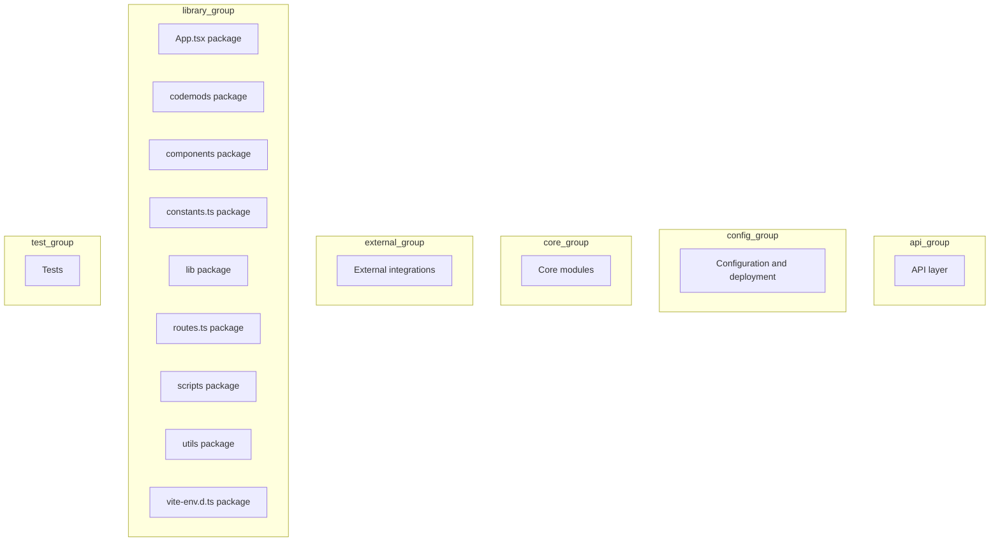

# Architecture report: bvaughn/react-virtualized

> Automated static analysis. **Observed** = directly seen in files/imports/AST; **Inferred** = interpretation from that evidence. Repository code was not executed.

## 1. Repository at a glance

| Item | Value |
| --- | --- |
| Repository | bvaughn/react-virtualized |
| Description | React components for efficiently rendering large lists and tabular data |
| Language | TypeScript |
| Stars | 27067 |
| Licence | MIT |
| Analysed commit / branch | d54281d5d4f0e93746009a5513ce350ced8ef4bf / main |
| Framework(s) | React |
| Files analysed | 404 |
| Components | 14 |

## 2. Architecture in one minute

bvaughn/react-virtualized - React components for efficiently rendering large lists and tabular data. This repository was analysed statically from 404 file(s) (0 Python). Detected technologies (observed from imports/manifests): GitHub Actions, React, React Router, Tailwind CSS, TypeScript, Vite. Files are grouped into 14 component(s): API layer, App.tsx package, codemods package, components package, Configuration and deployment, constants.ts package, Core modules, External integrations. Findings below distinguish observed facts from inferred interpretation.

## 3. High-level block diagram

## 4. Main components

### API layer (`api_layer`)

- **Kind:** api
- **Status:** Observed
- **Confidence:** 0.85
- **Responsibility:** Groups 135 file(s) under api layer (observed from repository paths and static analysis).
- **Paths:** `integrations/vite/src/routes/GridRoute.tsx`, `integrations/vite/src/routes/Home.tsx`, `integrations/vite/src/routes/ListRoute.tsx`, `integrations/vite/src/routes/MasonryRoute.tsx`, `integrations/vite/src/routes/TableRoute.tsx`, `src/routes/cell-measurer/CellMeasurerCacheRoute.tsx`, `src/routes/cell-measurer/CellMeasurerColumnWidthsRoute.tsx`, `src/routes/cell-measurer/CellMeasurerLimitationsRoute.tsx`, `src/routes/cell-measurer/CellMeasurerPropsRoute.tsx`, `src/routes/cell-measurer/CellMeasurerRoute.tsx`, `src/routes/cell-measurer/examples/CellMeasurerCacheClear.tsx`, `src/routes/cell-measurer/examples/CellMeasurerDynamicHeightGrid.tsx`, `src/routes/cell-measurer/examples/CellMeasurerDynamicHeightList.tsx`, `src/routes/cell-measurer/examples/CellMeasurerDynamicHeightTableColumn.tsx`, `src/routes/cell-measurer/examples/CellMeasurerDynamicWidthGrid.tsx`, `src/routes/cell-measurer/examples/CellMeasurerDynamicWidthMultiGrid.tsx`, `src/routes/cell-measurer/examples/CellMeasurerFunctionComponent.tsx`, `src/routes/cell-measurer/examples/CellMeasurerImages.tsx`, `src/routes/cell-measurer/examples/CellMeasurerKeyMapper.ts`, `src/routes/cell-measurer/routes.ts`, `src/routes/grid/CellRangeRendererRoute.tsx`, `src/routes/grid/FixedRowsAndColumnsRoute.tsx`, `src/routes/grid/GridMethodsRoute.tsx`, `src/routes/grid/GridPropsRoute.tsx`, `src/routes/grid/GridRoute.tsx`, `src/routes/grid/MultiGridMethodsRoute.tsx`, `src/routes/grid/MultiGridPropsRoute.tsx`, `src/routes/grid/OverscanRoute.tsx`, `src/routes/grid/ScrollToCellRoute.tsx`, `src/routes/grid/VariableSizesRoute.tsx`, `src/routes/grid/examples/GridBasic.tsx`, `src/routes/grid/examples/GridCellRangeRenderer.tsx`, `src/routes/grid/examples/GridCellRenderer.tsx`, `src/routes/grid/examples/GridMethodsRef.tsx`, `src/routes/grid/examples/GridOverscanIndicesGetter.ts`, `src/routes/grid/examples/GridScrollToCell.tsx`, `src/routes/grid/examples/GridVariableSizes.tsx`, `src/routes/grid/examples/MultiGridFixedRowsAndColumns.tsx`, `src/routes/grid/examples/OverscanDemo.tsx`, `src/routes/grid/routes.ts`, `src/routes/guides/CustomizingStylesRoute.tsx`, `src/routes/guides/InfiniteLoadingListRoute.tsx`, `src/routes/guides/MultiColumnSortTableRoute.tsx`, `src/routes/guides/NaturalSortTableRoute.tsx`, `src/routes/guides/ReverseListRoute.tsx`, `src/routes/guides/ServerRenderingRoute.tsx`, `src/routes/guides/SizingComponentsRoute.tsx`, `src/routes/guides/examples/AutoSizerGrid.tsx`, `src/routes/guides/examples/AutoSizerList.tsx`, `src/routes/guides/examples/AutoSizerTable.tsx`, `src/routes/guides/examples/CustomizingStylesClassNames.tsx`, `src/routes/guides/examples/CustomizingStylesCssModules.tsx`, `src/routes/guides/examples/CustomizingStylesImport.ts`, `src/routes/guides/examples/CustomizingStylesInlineStyles.tsx`, `src/routes/guides/examples/InfiniteLoadingList.tsx`, `src/routes/guides/examples/InfiniteLoadingListDemo.tsx`, `src/routes/guides/examples/MultiColumnSortTable.tsx`, `src/routes/guides/examples/MultiColumnSortTableCallback.tsx`, `src/routes/guides/examples/MultiColumnSortTableDefaults.tsx`, `src/routes/guides/examples/NaturalSortTable.tsx`, `src/routes/guides/examples/ReverseList.tsx`, `src/routes/guides/examples/ServerRenderingInitialScroll.tsx`, `src/routes/guides/examples/ServerRenderingSizes.tsx`, `src/routes/guides/examples/UsingAutoSizerChildComponent.tsx`, `src/routes/guides/examples/UsingAutoSizerFlexContainer.tsx`, `src/routes/guides/examples/UsingAutoSizerInfiniteLoader.tsx`, `src/routes/guides/examples/UsingAutoSizerWidthOnly.tsx`, `src/routes/hoc/ArrowKeyStepperRoute.tsx`, `src/routes/hoc/ColumnSizerRoute.tsx`, `src/routes/hoc/InfiniteLoaderRoute.tsx`, `src/routes/hoc/ScrollSyncRoute.tsx`, `src/routes/hoc/examples/ArrowKeyStepperControlled.tsx`, `src/routes/hoc/examples/ArrowKeyStepperGrid.tsx`, `src/routes/hoc/examples/ColumnSizerGrid.tsx`, `src/routes/hoc/examples/InfiniteLoaderBasic.tsx`, `src/routes/hoc/examples/InfiniteLoaderGrid.tsx`, `src/routes/hoc/examples/InfiniteLoaderList.tsx`, `src/routes/hoc/examples/InfiniteLoaderResetCache.tsx`, `src/routes/hoc/examples/ScrollSyncSpreadsheet.tsx`, `src/routes/list/ListMethodsRoute.tsx`, `src/routes/list/ListPropsRoute.tsx`, `src/routes/list/ListRenderingRowsRoute.tsx`, `src/routes/list/ListRoute.tsx`, `src/routes/list/ListScrollToRowRoute.tsx`, `src/routes/list/ListVariableRowHeightsRoute.tsx`, `src/routes/list/examples/ListBasic.tsx`, `src/routes/list/examples/ListMethods.tsx`, `src/routes/list/examples/ListNoRows.tsx`, `src/routes/list/examples/ListRecomputeRowHeights.tsx`, `src/routes/list/examples/ListRowRenderer.tsx`, `src/routes/list/examples/ListScrollToRow.tsx`, `src/routes/list/examples/ListScrollingPlaceholder.tsx`, `src/routes/list/examples/ListVariableRowHeights.tsx`, `src/routes/list/routes.ts`, `src/routes/masonry/MasonryCellPositionersRoute.tsx`, `src/routes/masonry/MasonryImagesRoute.tsx`, `src/routes/masonry/MasonryMeasuringRoute.tsx`, `src/routes/masonry/MasonryMethodsRoute.tsx`, `src/routes/masonry/MasonryPropsRoute.tsx`, `src/routes/masonry/MasonryRoute.tsx`, `src/routes/masonry/examples/MasonryCellPositioner.tsx`, `src/routes/masonry/examples/MasonryCellPositionerReset.tsx`, `src/routes/masonry/examples/MasonryCustomPositioner.tsx`, `src/routes/masonry/examples/MasonryExample.tsx`, `src/routes/masonry/routes.ts`, `src/routes/table/ColumnPropsRoute.tsx`, `src/routes/table/SortingRoute.tsx`, `src/routes/table/TableCellRenderersRoute.tsx`, `src/routes/table/TableMethodsRoute.tsx`, `src/routes/table/TablePropsRoute.tsx`, `src/routes/table/TableRoute.tsx`, `src/routes/table/TableRowRenderersRoute.tsx`, `src/routes/table/TableRowStylesRoute.tsx`, `src/routes/table/examples/SortIndicatorHeader.tsx`, `src/routes/table/examples/SortTableBasic.tsx`, `src/routes/table/examples/TableBasic.tsx`, `src/routes/table/examples/TableColumnRenderers.tsx`, `src/routes/table/examples/TableFullFeatured.tsx`, `src/routes/table/examples/TableImperativeMethods.tsx`, `src/routes/table/examples/TableRowRenderer.tsx`, `src/routes/table/routes.ts`, `src/routes/types.ts`, `src/routes/window-scrolling/ScrollingAnElementRoute.tsx`, `src/routes/window-scrolling/ScrollingWithThePageRoute.tsx`, `src/routes/window-scrolling/examples/WindowScrollingContentAbove.tsx`, `src/routes/window-scrolling/examples/WindowScrollingGrid.tsx`, `src/routes/window-scrolling/examples/WindowScrollingList.tsx`, `src/routes/window-scrolling/examples/WindowScrollingMasonry.tsx`, `src/routes/window-scrolling/examples/WindowScrollingMigrationAfter.tsx`, `src/routes/window-scrolling/examples/WindowScrollingMigrationBefore.tsx`, `src/routes/window-scrolling/examples/WindowScrollingScrollElement.tsx`, `src/routes/window-scrolling/examples/WindowScrollingScrollToRow.tsx`, `src/routes/window-scrolling/examples/WindowScrollingSmoothScroll.ts`, `src/routes/window-scrolling/examples/WindowScrollingTable.tsx`, `src/routes/window-scrolling/routes.ts`
- **Evidence:** [integrations/vite/src/routes/GridRoute.tsx](https://github.com/bvaughn/react-virtualized/blob/d54281d5d4f0e93746009a5513ce350ced8ef4bf/integrations/vite/src/routes/GridRoute.tsx); [integrations/vite/src/routes/Home.tsx](https://github.com/bvaughn/react-virtualized/blob/d54281d5d4f0e93746009a5513ce350ced8ef4bf/integrations/vite/src/routes/Home.tsx); [integrations/vite/src/routes/ListRoute.tsx](https://github.com/bvaughn/react-virtualized/blob/d54281d5d4f0e93746009a5513ce350ced8ef4bf/integrations/vite/src/routes/ListRoute.tsx); [integrations/vite/src/routes/MasonryRoute.tsx](https://github.com/bvaughn/react-virtualized/blob/d54281d5d4f0e93746009a5513ce350ced8ef4bf/integrations/vite/src/routes/MasonryRoute.tsx); [integrations/vite/src/routes/TableRoute.tsx](https://github.com/bvaughn/react-virtualized/blob/d54281d5d4f0e93746009a5513ce350ced8ef4bf/integrations/vite/src/routes/TableRoute.tsx); [src/routes/cell-measurer/CellMeasurerCacheRoute.tsx](https://github.com/bvaughn/react-virtualized/blob/d54281d5d4f0e93746009a5513ce350ced8ef4bf/src/routes/cell-measurer/CellMeasurerCacheRoute.tsx); [src/routes/cell-measurer/CellMeasurerColumnWidthsRoute.tsx](https://github.com/bvaughn/react-virtualized/blob/d54281d5d4f0e93746009a5513ce350ced8ef4bf/src/routes/cell-measurer/CellMeasurerColumnWidthsRoute.tsx); [src/routes/cell-measurer/CellMeasurerLimitationsRoute.tsx](https://github.com/bvaughn/react-virtualized/blob/d54281d5d4f0e93746009a5513ce350ced8ef4bf/src/routes/cell-measurer/CellMeasurerLimitationsRoute.tsx)

### App.tsx package (`app_tsx`)

- **Kind:** library
- **Status:** Observed
- **Confidence:** 0.85
- **Responsibility:** Groups 1 file(s) under app.tsx package (observed from repository paths and static analysis).
- **Paths:** `src/App.tsx`
- **Evidence:** [src/App.tsx](https://github.com/bvaughn/react-virtualized/blob/d54281d5d4f0e93746009a5513ce350ced8ef4bf/src/App.tsx)

### codemods package (`codemods`)

- **Kind:** library
- **Status:** Observed
- **Confidence:** 0.85
- **Responsibility:** Groups 2 file(s) under codemods package (observed from repository paths and static analysis).
- **Paths:** `codemods/6-to-7/rename-properties.js`, `codemods/7-to-8/rename-components.js`
- **Evidence:** [codemods/6-to-7/rename-properties.js](https://github.com/bvaughn/react-virtualized/blob/d54281d5d4f0e93746009a5513ce350ced8ef4bf/codemods/6-to-7/rename-properties.js); [codemods/7-to-8/rename-components.js](https://github.com/bvaughn/react-virtualized/blob/d54281d5d4f0e93746009a5513ce350ced8ef4bf/codemods/7-to-8/rename-components.js)

### components package (`components`)

- **Kind:** library
- **Status:** Observed
- **Confidence:** 0.85
- **Responsibility:** Groups 2 file(s) under components package (observed from repository paths and static analysis).
- **Paths:** `src/components/Link.tsx`, `src/components/Methods.tsx`
- **Evidence:** [src/components/Link.tsx](https://github.com/bvaughn/react-virtualized/blob/d54281d5d4f0e93746009a5513ce350ced8ef4bf/src/components/Link.tsx); [src/components/Methods.tsx](https://github.com/bvaughn/react-virtualized/blob/d54281d5d4f0e93746009a5513ce350ced8ef4bf/src/components/Methods.tsx)

### Configuration and deployment (`config`)

- **Kind:** config
- **Status:** Observed
- **Confidence:** 0.85
- **Responsibility:** Groups 103 file(s) under configuration and deployment (observed from repository paths and static analysis).
- **Paths:** `integrations/vite/package.json`, `integrations/vite/tsconfig.json`, `package.json`, `pnpm-workspace.yaml`, `public/generated/docs/ArrowKeyStepper.json`, `public/generated/docs/ArrowKeyStepperImperativeAPI.json`, `public/generated/docs/CellMeasurer.json`, `public/generated/docs/CellMeasurerCacheAPI.json`, `public/generated/docs/CellMeasurerCacheOptions.json`, `public/generated/docs/Column.json`, `public/generated/docs/ColumnSizer.json`, `public/generated/docs/Grid.json`, `public/generated/docs/GridImperativeAPI.json`, `public/generated/docs/InfiniteLoader.json`, `public/generated/docs/InfiniteLoaderImperativeAPI.json`, `public/generated/docs/List.json`, `public/generated/docs/ListImperativeAPI.json`, `public/generated/docs/Masonry.json`, `public/generated/docs/MasonryImperativeAPI.json`, `public/generated/docs/MultiGrid.json`, `public/generated/docs/MultiGridImperativeAPI.json`, `public/generated/docs/ScrollSync.json`, `public/generated/docs/Table.json`, `public/generated/docs/TableImperativeAPI.json`, `public/generated/examples/ArrowKeyStepperControlled.json`, `public/generated/examples/ArrowKeyStepperGrid.json`, `public/generated/examples/AutoSizerGrid.json`, `public/generated/examples/AutoSizerList.json`, `public/generated/examples/AutoSizerTable.json`, `public/generated/examples/CellMeasurerCacheClear.json`, `public/generated/examples/CellMeasurerDynamicHeightGrid.json`, `public/generated/examples/CellMeasurerDynamicHeightList.json`, `public/generated/examples/CellMeasurerDynamicHeightTableColumn.json`, `public/generated/examples/CellMeasurerDynamicWidthGrid.json`, `public/generated/examples/CellMeasurerDynamicWidthMultiGrid.json`, `public/generated/examples/CellMeasurerFunctionComponent.json`, `public/generated/examples/CellMeasurerImages.json`, `public/generated/examples/CellMeasurerKeyMapper.json`, `public/generated/examples/ColumnSizerGrid.json`, `public/generated/examples/CustomizingStylesClassNames.json`, `public/generated/examples/CustomizingStylesCssModules.json`, `public/generated/examples/CustomizingStylesCssModules.module.json`, `public/generated/examples/CustomizingStylesGlobal.json`, `public/generated/examples/CustomizingStylesImport.json`, `public/generated/examples/CustomizingStylesInlineStyles.json`, `public/generated/examples/GridBasic.json`, `public/generated/examples/GridCellRangeRenderer.json`, `public/generated/examples/GridCellRenderer.json`, `public/generated/examples/GridMethodsRef.json`, `public/generated/examples/GridOverscanIndicesGetter.json`, `public/generated/examples/GridScrollToCell.json`, `public/generated/examples/GridVariableSizes.json`, `public/generated/examples/InfiniteLoaderBasic.json`, `public/generated/examples/InfiniteLoaderGrid.json`, `public/generated/examples/InfiniteLoaderList.json`, `public/generated/examples/InfiniteLoaderResetCache.json`, `public/generated/examples/InfiniteLoadingList.json`, `public/generated/examples/InfiniteLoadingListDemo.json`, `public/generated/examples/ListBasic.json`, `public/generated/examples/ListMethods.json`, `public/generated/examples/ListNoRows.json`, `public/generated/examples/ListRecomputeRowHeights.json`, `public/generated/examples/ListRowRenderer.json`, `public/generated/examples/ListScrollToRow.json`, `public/generated/examples/ListScrollingPlaceholder.json`, `public/generated/examples/ListVariableRowHeights.json`, `public/generated/examples/MasonryCellPositioner.json`, `public/generated/examples/MasonryCellPositionerReset.json`, `public/generated/examples/MasonryCustomPositioner.json`, `public/generated/examples/MasonryExample.json`, `public/generated/examples/MultiColumnSortTable.json`, `public/generated/examples/MultiColumnSortTableCallback.json`, `public/generated/examples/MultiColumnSortTableDefaults.json`, `public/generated/examples/MultiGridFixedRowsAndColumns.json`, `public/generated/examples/NaturalSortTable.json`, `public/generated/examples/OverscanDemo.json`, `public/generated/examples/ReverseList.json`, `public/generated/examples/ScrollSyncSpreadsheet.json`, `public/generated/examples/ServerRenderingInitialScroll.json`, `public/generated/examples/ServerRenderingSizes.json`, `public/generated/examples/SortIndicatorHeader.json`, `public/generated/examples/SortTableBasic.json`, `public/generated/examples/TableBasic.json`, `public/generated/examples/TableColumnRenderers.json`, `public/generated/examples/TableFullFeatured.json`, `public/generated/examples/TableImperativeMethods.json`, `public/generated/examples/TableRowRenderer.json`, `public/generated/examples/UsingAutoSizerChildComponent.json`, `public/generated/examples/UsingAutoSizerFlexContainer.json`, `public/generated/examples/UsingAutoSizerInfiniteLoader.json`, `public/generated/examples/UsingAutoSizerWidthOnly.json`, `public/generated/examples/WindowScrollingContentAbove.json`, `public/generated/examples/WindowScrollingGrid.json`, `public/generated/examples/WindowScrollingList.json`, `public/generated/examples/WindowScrollingMasonry.json`, `public/generated/examples/WindowScrollingMigrationAfter.json`, `public/generated/examples/WindowScrollingMigrationBefore.json`, `public/generated/examples/WindowScrollingScrollElement.json`, `public/generated/examples/WindowScrollingScrollToRow.json`, `public/generated/examples/WindowScrollingSmoothScroll.json`, `public/generated/examples/WindowScrollingTable.json`, `tsconfig.json`, `vercel.json`
- **Evidence:** [integrations/vite/package.json](https://github.com/bvaughn/react-virtualized/blob/d54281d5d4f0e93746009a5513ce350ced8ef4bf/integrations/vite/package.json); [integrations/vite/tsconfig.json](https://github.com/bvaughn/react-virtualized/blob/d54281d5d4f0e93746009a5513ce350ced8ef4bf/integrations/vite/tsconfig.json); [package.json](https://github.com/bvaughn/react-virtualized/blob/d54281d5d4f0e93746009a5513ce350ced8ef4bf/package.json); [pnpm-workspace.yaml](https://github.com/bvaughn/react-virtualized/blob/d54281d5d4f0e93746009a5513ce350ced8ef4bf/pnpm-workspace.yaml); [public/generated/docs/ArrowKeyStepper.json](https://github.com/bvaughn/react-virtualized/blob/d54281d5d4f0e93746009a5513ce350ced8ef4bf/public/generated/docs/ArrowKeyStepper.json); [public/generated/docs/ArrowKeyStepperImperativeAPI.json](https://github.com/bvaughn/react-virtualized/blob/d54281d5d4f0e93746009a5513ce350ced8ef4bf/public/generated/docs/ArrowKeyStepperImperativeAPI.json); [public/generated/docs/CellMeasurer.json](https://github.com/bvaughn/react-virtualized/blob/d54281d5d4f0e93746009a5513ce350ced8ef4bf/public/generated/docs/CellMeasurer.json); [public/generated/docs/CellMeasurerCacheAPI.json](https://github.com/bvaughn/react-virtualized/blob/d54281d5d4f0e93746009a5513ce350ced8ef4bf/public/generated/docs/CellMeasurerCacheAPI.json)

### constants.ts package (`constants_ts`)

- **Kind:** library
- **Status:** Observed
- **Confidence:** 0.85
- **Responsibility:** Groups 1 file(s) under constants.ts package (observed from repository paths and static analysis).
- **Paths:** `src/constants.ts`
- **Evidence:** [src/constants.ts](https://github.com/bvaughn/react-virtualized/blob/d54281d5d4f0e93746009a5513ce350ced8ef4bf/src/constants.ts)

### Core modules (`core`)

- **Kind:** core
- **Status:** Observed
- **Confidence:** 0.85
- **Responsibility:** Groups 7 file(s) under core modules (observed from repository paths and static analysis).
- **Paths:** `eslint.config.js`, `index.tsx`, `postcss.config.js`, `prettier.config.js`, `vite.config.ts`, `vitest.config.ts`, `vitest.setup.ts`
- **Evidence:** [eslint.config.js](https://github.com/bvaughn/react-virtualized/blob/d54281d5d4f0e93746009a5513ce350ced8ef4bf/eslint.config.js); [index.tsx](https://github.com/bvaughn/react-virtualized/blob/d54281d5d4f0e93746009a5513ce350ced8ef4bf/index.tsx); [postcss.config.js](https://github.com/bvaughn/react-virtualized/blob/d54281d5d4f0e93746009a5513ce350ced8ef4bf/postcss.config.js); [prettier.config.js](https://github.com/bvaughn/react-virtualized/blob/d54281d5d4f0e93746009a5513ce350ced8ef4bf/prettier.config.js); [vite.config.ts](https://github.com/bvaughn/react-virtualized/blob/d54281d5d4f0e93746009a5513ce350ced8ef4bf/vite.config.ts); [vitest.config.ts](https://github.com/bvaughn/react-virtualized/blob/d54281d5d4f0e93746009a5513ce350ced8ef4bf/vitest.config.ts); [vitest.setup.ts](https://github.com/bvaughn/react-virtualized/blob/d54281d5d4f0e93746009a5513ce350ced8ef4bf/vitest.setup.ts)

### External integrations (`external_integrations`)

- **Kind:** external
- **Status:** Observed
- **Confidence:** 0.85
- **Responsibility:** Groups 6 file(s) under external integrations (observed from repository paths and static analysis).
- **Paths:** `integrations/vite/src/components/Header.tsx`, `integrations/vite/src/components/ScrollContainer.tsx`, `integrations/vite/src/main.tsx`, `integrations/vite/src/utils/searchParams.ts`, `integrations/vite/src/vite-env.d.ts`, `integrations/vite/vite.config.ts`
- **Evidence:** [integrations/vite/src/components/Header.tsx](https://github.com/bvaughn/react-virtualized/blob/d54281d5d4f0e93746009a5513ce350ced8ef4bf/integrations/vite/src/components/Header.tsx); [integrations/vite/src/components/ScrollContainer.tsx](https://github.com/bvaughn/react-virtualized/blob/d54281d5d4f0e93746009a5513ce350ced8ef4bf/integrations/vite/src/components/ScrollContainer.tsx); [integrations/vite/src/main.tsx](https://github.com/bvaughn/react-virtualized/blob/d54281d5d4f0e93746009a5513ce350ced8ef4bf/integrations/vite/src/main.tsx); [integrations/vite/src/utils/searchParams.ts](https://github.com/bvaughn/react-virtualized/blob/d54281d5d4f0e93746009a5513ce350ced8ef4bf/integrations/vite/src/utils/searchParams.ts); [integrations/vite/src/vite-env.d.ts](https://github.com/bvaughn/react-virtualized/blob/d54281d5d4f0e93746009a5513ce350ced8ef4bf/integrations/vite/src/vite-env.d.ts); [integrations/vite/vite.config.ts](https://github.com/bvaughn/react-virtualized/blob/d54281d5d4f0e93746009a5513ce350ced8ef4bf/integrations/vite/vite.config.ts)

### lib package (`lib`)

- **Kind:** library
- **Status:** Observed
- **Confidence:** 0.85
- **Responsibility:** Groups 99 file(s) under lib package (observed from repository paths and static analysis).
- **Paths:** `lib/components/ArrowKeyStepper/ArrowKeyStepper.test.tsx`, `lib/components/ArrowKeyStepper/ArrowKeyStepper.tsx`, `lib/components/ArrowKeyStepper/defaultArrowKeyStepperProps.ts`, `lib/components/ArrowKeyStepper/types.ts`, `lib/components/CellMeasurer/CellMeasurer.react18.test.tsx`, `lib/components/CellMeasurer/CellMeasurer.test.tsx`, `lib/components/CellMeasurer/CellMeasurer.tsx`, `lib/components/CellMeasurer/CellMeasurerCache.test.ts`, `lib/components/CellMeasurer/CellMeasurerCache.ts`, `lib/components/CellMeasurer/types.ts`, `lib/components/ColumnSizer/ColumnSizer.test.tsx`, `lib/components/ColumnSizer/ColumnSizer.tsx`, `lib/components/ColumnSizer/types.ts`, `lib/components/Grid/Grid.ssr.test.tsx`, `lib/components/Grid/Grid.test.tsx`, `lib/components/Grid/Grid.tsx`, `lib/components/Grid/accessibilityOverscanIndicesGetter.test.ts`, `lib/components/Grid/accessibilityOverscanIndicesGetter.ts`, `lib/components/Grid/constants.ts`, `lib/components/Grid/defaultCellRangeRenderer.ts`, `lib/components/Grid/defaultGridProps.ts`, `lib/components/Grid/defaultOverscanIndicesGetter.test.ts`, `lib/components/Grid/defaultOverscanIndicesGetter.ts`, `lib/components/Grid/types.ts`, `lib/components/Grid/utils/CellSizeAndPositionManager.test.ts`, `lib/components/Grid/utils/CellSizeAndPositionManager.ts`, `lib/components/Grid/utils/ScalingCellSizeAndPositionManager.test.ts`, `lib/components/Grid/utils/ScalingCellSizeAndPositionManager.ts`, `lib/components/Grid/utils/calculateSizeAndPositionDataAndUpdateScrollOffset.test.ts`, `lib/components/Grid/utils/calculateSizeAndPositionDataAndUpdateScrollOffset.ts`, `lib/components/Grid/utils/getScrollbarSizes.ts`, `lib/components/Grid/utils/maxElementSize.ts`, `lib/components/Grid/utils/updateScrollIndexHelper.test.ts`, `lib/components/Grid/utils/updateScrollIndexHelper.ts`, `lib/components/InfiniteLoader/InfiniteLoader.test.tsx`, `lib/components/InfiniteLoader/InfiniteLoader.tsx`, `lib/components/InfiniteLoader/defaultInfiniteLoaderProps.ts`, `lib/components/InfiniteLoader/types.ts`, `lib/components/InfiniteLoader/utils.ts`, `lib/components/List/List.test.tsx`, `lib/components/List/List.tsx`, `lib/components/List/defaultListProps.ts`, `lib/components/List/types.ts`, `lib/components/Masonry/Masonry.test.tsx`, `lib/components/Masonry/Masonry.tsx`, `lib/components/Masonry/PositionCache.test.ts`, `lib/components/Masonry/PositionCache.ts`, `lib/components/Masonry/constants.ts`, `lib/components/Masonry/createCellPositioner.test.ts`, `lib/components/Masonry/createCellPositioner.ts`, `lib/components/Masonry/defaultMasonryProps.ts`, `lib/components/Masonry/types.ts`, `lib/components/MultiGrid/CellMeasurerCacheDecorator.test.ts`, `lib/components/MultiGrid/CellMeasurerCacheDecorator.ts`, `lib/components/MultiGrid/MultiGrid.test.tsx`, `lib/components/MultiGrid/MultiGrid.tsx`, `lib/components/MultiGrid/defaultMultiGridProps.ts`, `lib/components/MultiGrid/types.ts`, `lib/components/ScrollSync/ScrollSync.test.tsx`, `lib/components/ScrollSync/ScrollSync.tsx`, `lib/components/ScrollSync/types.ts`, `lib/components/Table/Column.test.tsx`, `lib/components/Table/Column.tsx`, `lib/components/Table/SortDirection.ts`, `lib/components/Table/SortIndicator.tsx`, `lib/components/Table/Table.test.tsx`, `lib/components/Table/Table.tsx`, `lib/components/Table/createMultiSort.test.ts`, `lib/components/Table/createMultiSort.ts`, `lib/components/Table/defaultCellDataGetter.ts`, `lib/components/Table/defaultCellRenderer.ts`, `lib/components/Table/defaultColumnProps.ts`, `lib/components/Table/defaultHeaderRenderer.tsx`, `lib/components/Table/defaultHeaderRowRenderer.tsx`, `lib/components/Table/defaultRowRenderer.tsx`, `lib/components/Table/defaultTableProps.ts`, `lib/components/Table/types.ts`, `lib/index.ts`, `lib/utils/TestHelper.ts`, `lib/utils/animationFrame.ts`, `lib/utils/createCallbackMemoizer.test.ts`, `lib/utils/createCallbackMemoizer.ts`, `lib/utils/createInnerGridRef.test.ts`, `lib/utils/createInnerGridRef.ts`, `lib/utils/getUpdatedOffsetForIndex.test.ts`, `lib/utils/getUpdatedOffsetForIndex.ts`, `lib/utils/initCellMetadata.ts`, `lib/utils/requestAnimationTimeout.ts`, `lib/utils/scrollElement/dimensions.test.ts`, `lib/utils/scrollElement/dimensions.ts`, `lib/utils/scrollElement/scrollElement.hydration.test.tsx`, `lib/utils/scrollElement/scrollElement.ssr.test.tsx`, `lib/utils/scrollElement/scrollListeners.test.ts`, `lib/utils/scrollElement/scrollListeners.ts`, `lib/utils/scrollElement/types.ts`, `lib/utils/scrollElement/useMissingHeightWarning.ts`, `lib/utils/scrollElement/useScrollElementLink.test.tsx`, `lib/utils/scrollElement/useScrollElementLink.ts`, `lib/utils/useIsomorphicLayoutEffect.ts`
- **Evidence:** [lib/components/ArrowKeyStepper/ArrowKeyStepper.test.tsx](https://github.com/bvaughn/react-virtualized/blob/d54281d5d4f0e93746009a5513ce350ced8ef4bf/lib/components/ArrowKeyStepper/ArrowKeyStepper.test.tsx); [lib/components/ArrowKeyStepper/ArrowKeyStepper.tsx](https://github.com/bvaughn/react-virtualized/blob/d54281d5d4f0e93746009a5513ce350ced8ef4bf/lib/components/ArrowKeyStepper/ArrowKeyStepper.tsx); [lib/components/ArrowKeyStepper/defaultArrowKeyStepperProps.ts](https://github.com/bvaughn/react-virtualized/blob/d54281d5d4f0e93746009a5513ce350ced8ef4bf/lib/components/ArrowKeyStepper/defaultArrowKeyStepperProps.ts); [lib/components/ArrowKeyStepper/types.ts](https://github.com/bvaughn/react-virtualized/blob/d54281d5d4f0e93746009a5513ce350ced8ef4bf/lib/components/ArrowKeyStepper/types.ts); [lib/components/CellMeasurer/CellMeasurer.react18.test.tsx](https://github.com/bvaughn/react-virtualized/blob/d54281d5d4f0e93746009a5513ce350ced8ef4bf/lib/components/CellMeasurer/CellMeasurer.react18.test.tsx); [lib/components/CellMeasurer/CellMeasurer.test.tsx](https://github.com/bvaughn/react-virtualized/blob/d54281d5d4f0e93746009a5513ce350ced8ef4bf/lib/components/CellMeasurer/CellMeasurer.test.tsx); [lib/components/CellMeasurer/CellMeasurer.tsx](https://github.com/bvaughn/react-virtualized/blob/d54281d5d4f0e93746009a5513ce350ced8ef4bf/lib/components/CellMeasurer/CellMeasurer.tsx); [lib/components/CellMeasurer/CellMeasurerCache.test.ts](https://github.com/bvaughn/react-virtualized/blob/d54281d5d4f0e93746009a5513ce350ced8ef4bf/lib/components/CellMeasurer/CellMeasurerCache.test.ts)

### routes.ts package (`routes_ts`)

- **Kind:** library
- **Status:** Observed
- **Confidence:** 0.85
- **Responsibility:** Groups 1 file(s) under routes.ts package (observed from repository paths and static analysis).
- **Paths:** `src/routes.ts`
- **Evidence:** [src/routes.ts](https://github.com/bvaughn/react-virtualized/blob/d54281d5d4f0e93746009a5513ce350ced8ef4bf/src/routes.ts)

### scripts package (`scripts`)

- **Kind:** library
- **Status:** Observed
- **Confidence:** 0.85
- **Responsibility:** Groups 5 file(s) under scripts package (observed from repository paths and static analysis).
- **Paths:** `scripts/compile-docs.ts`, `scripts/compile-examples.ts`, `scripts/compile-search-index.ts`, `scripts/compress-og-image.ts`, `scripts/docs-stubs/CellMeasurerCacheOptions.tsx`
- **Evidence:** [scripts/compile-docs.ts](https://github.com/bvaughn/react-virtualized/blob/d54281d5d4f0e93746009a5513ce350ced8ef4bf/scripts/compile-docs.ts); [scripts/compile-examples.ts](https://github.com/bvaughn/react-virtualized/blob/d54281d5d4f0e93746009a5513ce350ced8ef4bf/scripts/compile-examples.ts); [scripts/compile-search-index.ts](https://github.com/bvaughn/react-virtualized/blob/d54281d5d4f0e93746009a5513ce350ced8ef4bf/scripts/compile-search-index.ts); [scripts/compress-og-image.ts](https://github.com/bvaughn/react-virtualized/blob/d54281d5d4f0e93746009a5513ce350ced8ef4bf/scripts/compress-og-image.ts); [scripts/docs-stubs/CellMeasurerCacheOptions.tsx](https://github.com/bvaughn/react-virtualized/blob/d54281d5d4f0e93746009a5513ce350ced8ef4bf/scripts/docs-stubs/CellMeasurerCacheOptions.tsx)

### Tests (`tests`)

- **Kind:** test
- **Status:** Observed
- **Confidence:** 0.85
- **Responsibility:** Groups 13 file(s) under tests (observed from repository paths and static analysis).
- **Paths:** `integrations/tests/package.json`, `integrations/tests/playwright.config.ts`, `integrations/tests/src/index.ts`, `integrations/tests/tests/scroll-element-grid.spec.tsx`, `integrations/tests/tests/scroll-element-header-resize.spec.tsx`, `integrations/tests/tests/scroll-element-list.spec.tsx`, `integrations/tests/tests/scroll-element-masonry.spec.tsx`, `integrations/tests/tests/scroll-element-resize.spec.tsx`, `integrations/tests/tests/scroll-element-table.spec.tsx`, `integrations/tests/tests/utils.ts`, `lib/utils/test/mockResizeObserver.ts`, `lib/utils/test/render.ts`, `lib/utils/test/scrollElement.ts`
- **Evidence:** [integrations/tests/package.json](https://github.com/bvaughn/react-virtualized/blob/d54281d5d4f0e93746009a5513ce350ced8ef4bf/integrations/tests/package.json); [integrations/tests/playwright.config.ts](https://github.com/bvaughn/react-virtualized/blob/d54281d5d4f0e93746009a5513ce350ced8ef4bf/integrations/tests/playwright.config.ts); [integrations/tests/src/index.ts](https://github.com/bvaughn/react-virtualized/blob/d54281d5d4f0e93746009a5513ce350ced8ef4bf/integrations/tests/src/index.ts); [integrations/tests/tests/scroll-element-grid.spec.tsx](https://github.com/bvaughn/react-virtualized/blob/d54281d5d4f0e93746009a5513ce350ced8ef4bf/integrations/tests/tests/scroll-element-grid.spec.tsx); [integrations/tests/tests/scroll-element-header-resize.spec.tsx](https://github.com/bvaughn/react-virtualized/blob/d54281d5d4f0e93746009a5513ce350ced8ef4bf/integrations/tests/tests/scroll-element-header-resize.spec.tsx); [integrations/tests/tests/scroll-element-list.spec.tsx](https://github.com/bvaughn/react-virtualized/blob/d54281d5d4f0e93746009a5513ce350ced8ef4bf/integrations/tests/tests/scroll-element-list.spec.tsx); [integrations/tests/tests/scroll-element-masonry.spec.tsx](https://github.com/bvaughn/react-virtualized/blob/d54281d5d4f0e93746009a5513ce350ced8ef4bf/integrations/tests/tests/scroll-element-masonry.spec.tsx); [integrations/tests/tests/scroll-element-resize.spec.tsx](https://github.com/bvaughn/react-virtualized/blob/d54281d5d4f0e93746009a5513ce350ced8ef4bf/integrations/tests/tests/scroll-element-resize.spec.tsx)

### utils package (`utils`)

- **Kind:** library
- **Status:** Observed
- **Confidence:** 0.85
- **Responsibility:** Groups 1 file(s) under utils package (observed from repository paths and static analysis).
- **Paths:** `src/utils/data.ts`
- **Evidence:** [src/utils/data.ts](https://github.com/bvaughn/react-virtualized/blob/d54281d5d4f0e93746009a5513ce350ced8ef4bf/src/utils/data.ts)

### vite-env.d.ts package (`vite_env_d_ts`)

- **Kind:** library
- **Status:** Observed
- **Confidence:** 0.85
- **Responsibility:** Groups 1 file(s) under vite-env.d.ts package (observed from repository paths and static analysis).
- **Paths:** `src/vite-env.d.ts`
- **Evidence:** [src/vite-env.d.ts](https://github.com/bvaughn/react-virtualized/blob/d54281d5d4f0e93746009a5513ce350ced8ef4bf/src/vite-env.d.ts)

## 5. Execution flow

**Observed** entry point(s):

- [index.tsx](https://github.com/bvaughn/react-virtualized/blob/d54281d5d4f0e93746009a5513ce350ced8ef4bf/index.tsx)
- [integrations/tests/src/index.ts](https://github.com/bvaughn/react-virtualized/blob/d54281d5d4f0e93746009a5513ce350ced8ef4bf/integrations/tests/src/index.ts)
- [integrations/vite/src/main.tsx](https://github.com/bvaughn/react-virtualized/blob/d54281d5d4f0e93746009a5513ce350ced8ef4bf/integrations/vite/src/main.tsx)
- [lib/index.ts](https://github.com/bvaughn/react-virtualized/blob/d54281d5d4f0e93746009a5513ce350ced8ef4bf/lib/index.ts)
- [src/App.tsx](https://github.com/bvaughn/react-virtualized/blob/d54281d5d4f0e93746009a5513ce350ced8ef4bf/src/App.tsx)

Representative flow (derived from observed entry points and the import graph; steps beyond the entry point are **Inferred**):

1. Execution starts at an observed entry point listed above, if present.
2. No internal import relationships between components were observed.

## 6. Project structure

### `(root)`

- `.gitignore` - other (327 bytes)
- `.prettierignore` - other (134 bytes)
- `CHANGELOG.md` - docs (102442 bytes)
- `CODE_OF_CONDUCT.md` - docs (11120 bytes)
- `CONTRIBUTING.md` - docs (5882 bytes)
- `LICENSE` - docs (1080 bytes)
- `README.md` - docs (19458 bytes)
- `eslint.config.js` - source, JavaScript (739 bytes)
- `index.css` - other (921 bytes)
- `index.html` - other (1178 bytes)
- `index.tsx` - source, TypeScript (265 bytes)
- `package.json` - manifest (4154 bytes)
- `pnpm-workspace.yaml` - config (29 bytes)
- `postcss.config.js` - source, JavaScript (151 bytes)
- `prettier.config.js` - source, JavaScript (125 bytes)
- `tsconfig.json` - config (999 bytes)
- `vercel.json` - config (96 bytes)
- `vite.config.ts` - source, TypeScript (2700 bytes)
- `vitest.config.ts` - source, TypeScript (315 bytes)
- `vitest.setup.ts` - source, TypeScript (365 bytes)

### `.github`

- `.github/ISSUE_TEMPLATE/bug-report.md` - docs (1086 bytes)
- `.github/ISSUE_TEMPLATE/feature-request.md` - docs (520 bytes)
- `.github/ISSUE_TEMPLATE/question.md` - docs (230 bytes)
- `.github/PULL_REQUEST_TEMPLATE.md` - docs (1136 bytes)
- `.github/workflows/eslint.yml` - ci, YAML (398 bytes)
- `.github/workflows/playwright.yml` - ci, YAML (1350 bytes)
- `.github/workflows/prettier.yml` - ci, YAML (415 bytes)
- `.github/workflows/stale.yml` - ci, YAML (324 bytes)
- `.github/workflows/typescript.yml` - ci, YAML (465 bytes)
- `.github/workflows/vitest.yml` - ci, YAML (469 bytes)

### `codemods`

- `codemods/6-to-7/rename-properties.js` - source, JavaScript (1872 bytes)
- `codemods/7-to-8/rename-components.js` - source, JavaScript (404 bytes)

### `integrations`

- `integrations/tests/package.json` - test (308 bytes)
- `integrations/tests/playwright.config.ts` - test, TypeScript (481 bytes)
- `integrations/tests/src/index.ts` - test, TypeScript (1734 bytes)
- `integrations/tests/tests/scroll-element-grid.spec.tsx` - test, TypeScript (5222 bytes)
- `integrations/tests/tests/scroll-element-header-resize.spec.tsx` - test, TypeScript (4624 bytes)
- `integrations/tests/tests/scroll-element-list.spec.tsx` - test, TypeScript (7304 bytes)
- `integrations/tests/tests/scroll-element-masonry.spec.tsx` - test, TypeScript (4175 bytes)
- `integrations/tests/tests/scroll-element-resize.spec.tsx` - test, TypeScript (2040 bytes)
- `integrations/tests/tests/scroll-element-table.spec.tsx` - test, TypeScript (3283 bytes)
- `integrations/tests/tests/utils.ts` - test, TypeScript (5300 bytes)
- `integrations/vite/index.html` - other (721 bytes)
- `integrations/vite/package.json` - manifest (541 bytes)
- `integrations/vite/src/components/Header.tsx` - source, TypeScript (652 bytes)
- `integrations/vite/src/components/ScrollContainer.tsx` - source, TypeScript (599 bytes)
- `integrations/vite/src/main.tsx` - source, TypeScript (963 bytes)
- `integrations/vite/src/routes/GridRoute.tsx` - source, TypeScript (1661 bytes)
- `integrations/vite/src/routes/Home.tsx` - source, TypeScript (986 bytes)
- `integrations/vite/src/routes/ListRoute.tsx` - source, TypeScript (2095 bytes)
- `integrations/vite/src/routes/MasonryRoute.tsx` - source, TypeScript (2415 bytes)
- `integrations/vite/src/routes/TableRoute.tsx` - source, TypeScript (1119 bytes)
- `integrations/vite/src/utils/searchParams.ts` - source, TypeScript (1108 bytes)
- `integrations/vite/src/vite-env.d.ts` - source, TypeScript (38 bytes)
- `integrations/vite/tsconfig.json` - config (588 bytes)
- `integrations/vite/tsconfig.tsbuildinfo` - other (226 bytes)
- `integrations/vite/vite.config.ts` - source, TypeScript (364 bytes)

### `lib`

- `lib/components/ArrowKeyStepper/ArrowKeyStepper.test.tsx` - source, TypeScript (17943 bytes)
- `lib/components/ArrowKeyStepper/ArrowKeyStepper.tsx` - source, TypeScript (7880 bytes)
- `lib/components/ArrowKeyStepper/defaultArrowKeyStepperProps.ts` - source, TypeScript (478 bytes)
- `lib/components/ArrowKeyStepper/types.ts` - source, TypeScript (4468 bytes)
- `lib/components/CellMeasurer/CellMeasurer.react18.test.tsx` - source, TypeScript (2921 bytes)
- `lib/components/CellMeasurer/CellMeasurer.test.tsx` - source, TypeScript (25187 bytes)
- `lib/components/CellMeasurer/CellMeasurer.tsx` - source, TypeScript (11337 bytes)
- `lib/components/CellMeasurer/CellMeasurerCache.test.ts` - source, TypeScript (15056 bytes)
- `lib/components/CellMeasurer/CellMeasurerCache.ts` - source, TypeScript (12391 bytes)
- `lib/components/CellMeasurer/types.ts` - source, TypeScript (8895 bytes)
- `lib/components/ColumnSizer/ColumnSizer.test.tsx` - source, TypeScript (8605 bytes)
- `lib/components/ColumnSizer/ColumnSizer.tsx` - source, TypeScript (2500 bytes)
- `lib/components/ColumnSizer/types.ts` - source, TypeScript (2358 bytes)
- `lib/components/Grid/Grid.ssr.test.tsx` - source, TypeScript (695 bytes)
- `lib/components/Grid/Grid.test.tsx` - source, TypeScript (137164 bytes)
- `lib/components/Grid/Grid.tsx` - source, TypeScript (59967 bytes)
- `lib/components/Grid/accessibilityOverscanIndicesGetter.test.ts` - source, TypeScript (2708 bytes)
- `lib/components/Grid/accessibilityOverscanIndicesGetter.ts` - source, TypeScript (1289 bytes)
- `lib/components/Grid/constants.ts` - source, TypeScript (235 bytes)
- `lib/components/Grid/defaultCellRangeRenderer.ts` - source, TypeScript (6524 bytes)
- `lib/components/Grid/defaultGridProps.ts` - source, TypeScript (1769 bytes)
- `lib/components/Grid/defaultOverscanIndicesGetter.test.ts` - source, TypeScript (2663 bytes)
- `lib/components/Grid/defaultOverscanIndicesGetter.ts` - source, TypeScript (1001 bytes)
- `lib/components/Grid/types.ts` - source, TypeScript (20032 bytes)
- `lib/components/Grid/utils/CellSizeAndPositionManager.test.ts` - source, TypeScript (17782 bytes)
- `lib/components/Grid/utils/CellSizeAndPositionManager.ts` - source, TypeScript (9813 bytes)
- `lib/components/Grid/utils/ScalingCellSizeAndPositionManager.test.ts` - source, TypeScript (5668 bytes)
- `lib/components/Grid/utils/ScalingCellSizeAndPositionManager.ts` - source, TypeScript (5545 bytes)
- `lib/components/Grid/utils/calculateSizeAndPositionDataAndUpdateScrollOffset.test.ts` - source, TypeScript (3126 bytes)
- `lib/components/Grid/utils/calculateSizeAndPositionDataAndUpdateScrollOffset.ts` - source, TypeScript (1878 bytes)
- `lib/components/Grid/utils/getScrollbarSizes.ts` - source, TypeScript (1334 bytes)
- `lib/components/Grid/utils/maxElementSize.ts` - source, TypeScript (524 bytes)
- `lib/components/Grid/utils/updateScrollIndexHelper.test.ts` - source, TypeScript (3763 bytes)
- `lib/components/Grid/utils/updateScrollIndexHelper.ts` - source, TypeScript (1768 bytes)
- `lib/components/InfiniteLoader/InfiniteLoader.test.tsx` - source, TypeScript (25050 bytes)
- `lib/components/InfiniteLoader/InfiniteLoader.tsx` - source, TypeScript (6231 bytes)
- `lib/components/InfiniteLoader/defaultInfiniteLoaderProps.ts` - source, TypeScript (299 bytes)
- `lib/components/InfiniteLoader/types.ts` - source, TypeScript (4740 bytes)
- `lib/components/InfiniteLoader/utils.ts` - source, TypeScript (4477 bytes)
- `lib/components/List/List.test.tsx` - source, TypeScript (39135 bytes)
- `lib/components/List/List.tsx` - source, TypeScript (7708 bytes)
- `lib/components/List/defaultListProps.ts` - source, TypeScript (872 bytes)
- `lib/components/List/types.ts` - source, TypeScript (11796 bytes)
- `lib/components/Masonry/Masonry.test.tsx` - source, TypeScript (35690 bytes)
- `lib/components/Masonry/Masonry.tsx` - source, TypeScript (19708 bytes)
- `lib/components/Masonry/PositionCache.test.ts` - source, TypeScript (1973 bytes)
- `lib/components/Masonry/PositionCache.ts` - source, TypeScript (2994 bytes)
- `lib/components/Masonry/constants.ts` - source, TypeScript (235 bytes)
- `lib/components/Masonry/createCellPositioner.test.ts` - source, TypeScript (1878 bytes)
- `lib/components/Masonry/createCellPositioner.ts` - source, TypeScript (1491 bytes)
- `lib/components/Masonry/defaultMasonryProps.ts` - source, TypeScript (886 bytes)
- `lib/components/Masonry/types.ts` - source, TypeScript (10682 bytes)
- `lib/components/MultiGrid/CellMeasurerCacheDecorator.test.ts` - source, TypeScript (997 bytes)
- `lib/components/MultiGrid/CellMeasurerCacheDecorator.ts` - source, TypeScript (2680 bytes)
- `lib/components/MultiGrid/MultiGrid.test.tsx` - source, TypeScript (45241 bytes)
- `lib/components/MultiGrid/MultiGrid.tsx` - source, TypeScript (30796 bytes)
- `lib/components/MultiGrid/defaultMultiGridProps.ts` - source, TypeScript (1334 bytes)
- `lib/components/MultiGrid/types.ts` - source, TypeScript (5136 bytes)
- `lib/components/ScrollSync/ScrollSync.test.tsx` - source, TypeScript (16518 bytes)
- `lib/components/ScrollSync/ScrollSync.tsx` - source, TypeScript (5741 bytes)
- `lib/components/ScrollSync/types.ts` - source, TypeScript (3591 bytes)
- `lib/components/Table/Column.test.tsx` - source, TypeScript (3088 bytes)
- `lib/components/Table/Column.tsx` - source, TypeScript (599 bytes)
- `lib/components/Table/SortDirection.ts` - source, TypeScript (455 bytes)
- `lib/components/Table/SortIndicator.tsx` - source, TypeScript (866 bytes)
- `lib/components/Table/Table.test.tsx` - source, TypeScript (75268 bytes)
- `lib/components/Table/Table.tsx` - source, TypeScript (19606 bytes)
- `lib/components/Table/createMultiSort.test.ts` - source, TypeScript (9319 bytes)
- `lib/components/Table/createMultiSort.ts` - source, TypeScript (3284 bytes)
- `lib/components/Table/defaultCellDataGetter.ts` - source, TypeScript (559 bytes)
- `lib/components/Table/defaultCellRenderer.ts` - source, TypeScript (402 bytes)
- `lib/components/Table/defaultColumnProps.ts` - source, TypeScript (1241 bytes)
- `lib/components/Table/defaultHeaderRenderer.tsx` - source, TypeScript (894 bytes)
- `lib/components/Table/defaultHeaderRowRenderer.tsx` - source, TypeScript (302 bytes)
- `lib/components/Table/defaultRowRenderer.tsx` - source, TypeScript (1388 bytes)
- `lib/components/Table/defaultTableProps.ts` - source, TypeScript (1273 bytes)
- `lib/components/Table/types.ts` - source, TypeScript (27476 bytes)
- `lib/index.ts` - source, TypeScript (4687 bytes)
- `lib/styles.css` - other (1296 bytes)
- `lib/utils/TestHelper.ts` - source, TypeScript (487 bytes)
- `lib/utils/animationFrame.ts` - source, TypeScript (1868 bytes)
- `lib/utils/createCallbackMemoizer.test.ts` - source, TypeScript (5985 bytes)
- `lib/utils/createCallbackMemoizer.ts` - source, TypeScript (1144 bytes)
- `lib/utils/createInnerGridRef.test.ts` - source, TypeScript (2796 bytes)
- `lib/utils/createInnerGridRef.ts` - source, TypeScript (2788 bytes)
- `lib/utils/getUpdatedOffsetForIndex.test.ts` - source, TypeScript (2523 bytes)
- `lib/utils/getUpdatedOffsetForIndex.ts` - source, TypeScript (1615 bytes)
- `lib/utils/initCellMetadata.ts` - source, TypeScript (1046 bytes)
- `lib/utils/requestAnimationTimeout.ts` - source, TypeScript (987 bytes)
- `lib/utils/scrollElement/dimensions.test.ts` - source, TypeScript (3637 bytes)
- `lib/utils/scrollElement/dimensions.ts` - source, TypeScript (2884 bytes)
- `lib/utils/scrollElement/scrollElement.hydration.test.tsx` - source, TypeScript (3174 bytes)
- `lib/utils/scrollElement/scrollElement.ssr.test.tsx` - source, TypeScript (3300 bytes)
- `lib/utils/scrollElement/scrollListeners.test.ts` - source, TypeScript (6629 bytes)
- `lib/utils/scrollElement/scrollListeners.ts` - source, TypeScript (3637 bytes)
- `lib/utils/scrollElement/types.ts` - source, TypeScript (1913 bytes)
- `lib/utils/scrollElement/useMissingHeightWarning.ts` - source, TypeScript (667 bytes)
- `lib/utils/scrollElement/useScrollElementLink.test.tsx` - source, TypeScript (13141 bytes)
- `lib/utils/scrollElement/useScrollElementLink.ts` - source, TypeScript (6696 bytes)
- `lib/utils/test/mockResizeObserver.ts` - test, TypeScript (3542 bytes)
- `lib/utils/test/render.ts` - test, TypeScript (4773 bytes)
- `lib/utils/test/scrollElement.ts` - test, TypeScript (12131 bytes)
- `lib/utils/useIsomorphicLayoutEffect.ts` - source, TypeScript (281 bytes)

### `public`

- `public/favicon.svg` - other (613 bytes)
- `public/generated/docs/ArrowKeyStepper.json` - config (7899 bytes)
- `public/generated/docs/ArrowKeyStepperImperativeAPI.json` - config (932 bytes)
- `public/generated/docs/CellMeasurer.json` - config (5479 bytes)
- `public/generated/docs/CellMeasurerCacheAPI.json` - config (10332 bytes)
- `public/generated/docs/CellMeasurerCacheOptions.json` - config (5475 bytes)
- `public/generated/docs/Column.json` - config (11996 bytes)
- `public/generated/docs/ColumnSizer.json` - config (3409 bytes)
- `public/generated/docs/Grid.json` - config (28085 bytes)
- `public/generated/docs/GridImperativeAPI.json` - config (11965 bytes)
- `public/generated/docs/InfiniteLoader.json` - config (6027 bytes)
- `public/generated/docs/InfiniteLoaderImperativeAPI.json` - config (1214 bytes)
- `public/generated/docs/List.json` - config (23336 bytes)
- `public/generated/docs/ListImperativeAPI.json` - config (11904 bytes)
- `public/generated/docs/Masonry.json` - config (15115 bytes)
- `public/generated/docs/MasonryImperativeAPI.json` - config (4664 bytes)
- `public/generated/docs/MultiGrid.json` - config (35894 bytes)
- `public/generated/docs/MultiGridImperativeAPI.json` - config (6520 bytes)
- `public/generated/docs/ScrollSync.json` - config (1735 bytes)
- `public/generated/docs/Table.json` - config (38089 bytes)
- `public/generated/docs/TableImperativeAPI.json` - config (12154 bytes)
- `public/generated/examples/ArrowKeyStepperControlled.json` - config (17050 bytes)
- `public/generated/examples/ArrowKeyStepperGrid.json` - config (10651 bytes)
- `public/generated/examples/AutoSizerGrid.json` - config (10948 bytes)
- `public/generated/examples/AutoSizerList.json` - config (9631 bytes)
- `public/generated/examples/AutoSizerTable.json` - config (9302 bytes)
- `public/generated/examples/CellMeasurerCacheClear.json` - config (19441 bytes)
- `public/generated/examples/CellMeasurerDynamicHeightGrid.json` - config (13139 bytes)
- `public/generated/examples/CellMeasurerDynamicHeightList.json` - config (16554 bytes)
- `public/generated/examples/CellMeasurerDynamicHeightTableColumn.json` - config (17690 bytes)
- `public/generated/examples/CellMeasurerDynamicWidthGrid.json` - config (19200 bytes)
- `public/generated/examples/CellMeasurerDynamicWidthMultiGrid.json` - config (13883 bytes)
- `public/generated/examples/CellMeasurerFunctionComponent.json` - config (29999 bytes)
- `public/generated/examples/CellMeasurerImages.json` - config (13939 bytes)
- `public/generated/examples/CellMeasurerKeyMapper.json` - config (2728 bytes)
- `public/generated/examples/ColumnSizerGrid.json` - config (8638 bytes)
- `public/generated/examples/CustomizingStylesClassNames.json` - config (15433 bytes)
- `public/generated/examples/CustomizingStylesCssModules.json` - config (7609 bytes)
- `public/generated/examples/CustomizingStylesCssModules.module.json` - config (2994 bytes)
- `public/generated/examples/CustomizingStylesGlobal.json` - config (2326 bytes)
- `public/generated/examples/CustomizingStylesImport.json` - config (360 bytes)
- `public/generated/examples/CustomizingStylesInlineStyles.json` - config (9463 bytes)
- `public/generated/examples/GridBasic.json` - config (11771 bytes)
- `public/generated/examples/GridCellRangeRenderer.json` - config (17810 bytes)
- `public/generated/examples/GridCellRenderer.json` - config (6975 bytes)
- `public/generated/examples/GridMethodsRef.json` - config (12032 bytes)
- `public/generated/examples/GridOverscanIndicesGetter.json` - config (4843 bytes)
- `public/generated/examples/GridScrollToCell.json` - config (25467 bytes)
- `public/generated/examples/GridVariableSizes.json` - config (23082 bytes)
- `public/generated/examples/InfiniteLoaderBasic.json` - config (16206 bytes)
- `public/generated/examples/InfiniteLoaderGrid.json` - config (14862 bytes)
- `public/generated/examples/InfiniteLoaderList.json` - config (37092 bytes)
- `public/generated/examples/InfiniteLoaderResetCache.json` - config (16166 bytes)
- `public/generated/examples/InfiniteLoadingList.json` - config (20001 bytes)
- `public/generated/examples/InfiniteLoadingListDemo.json` - config (8511 bytes)
- `public/generated/examples/ListBasic.json` - config (13188 bytes)
- `public/generated/examples/ListMethods.json` - config (18746 bytes)
- `public/generated/examples/ListNoRows.json` - config (7192 bytes)
- `public/generated/examples/ListRecomputeRowHeights.json` - config (10092 bytes)
- `public/generated/examples/ListRowRenderer.json` - config (6495 bytes)
- `public/generated/examples/ListScrollToRow.json` - config (26164 bytes)
- `public/generated/examples/ListScrollingPlaceholder.json` - config (10886 bytes)
- `public/generated/examples/ListVariableRowHeights.json` - config (17677 bytes)
- `public/generated/examples/MasonryCellPositioner.json` - config (4627 bytes)
- `public/generated/examples/MasonryCellPositionerReset.json` - config (4208 bytes)
- `public/generated/examples/MasonryCustomPositioner.json` - config (7625 bytes)
- `public/generated/examples/MasonryExample.json` - config (30908 bytes)
- `public/generated/examples/MultiColumnSortTable.json` - config (33801 bytes)
- `public/generated/examples/MultiColumnSortTableCallback.json` - config (3074 bytes)
- `public/generated/examples/MultiColumnSortTableDefaults.json` - config (2545 bytes)
- `public/generated/examples/MultiGridFixedRowsAndColumns.json` - config (12367 bytes)
- `public/generated/examples/NaturalSortTable.json` - config (22717 bytes)
- `public/generated/examples/OverscanDemo.json` - config (7226 bytes)
- `public/generated/examples/ReverseList.json` - config (22730 bytes)
- `public/generated/examples/ScrollSyncSpreadsheet.json` - config (25018 bytes)
- `public/generated/examples/ServerRenderingInitialScroll.json` - config (5215 bytes)
- `public/generated/examples/ServerRenderingSizes.json` - config (7015 bytes)
- `public/generated/examples/SortIndicatorHeader.json` - config (4264 bytes)
- `public/generated/examples/SortTableBasic.json` - config (23181 bytes)
- `public/generated/examples/TableBasic.json` - config (8404 bytes)
- `public/generated/examples/TableColumnRenderers.json` - config (14867 bytes)
- `public/generated/examples/TableFullFeatured.json` - config (32373 bytes)
- `public/generated/examples/TableImperativeMethods.json` - config (27112 bytes)
- `public/generated/examples/TableRowRenderer.json` - config (18474 bytes)
- `public/generated/examples/UsingAutoSizerChildComponent.json` - config (9695 bytes)
- `public/generated/examples/UsingAutoSizerFlexContainer.json` - config (9390 bytes)
- `public/generated/examples/UsingAutoSizerInfiniteLoader.json` - config (11932 bytes)
- `public/generated/examples/UsingAutoSizerWidthOnly.json` - config (6255 bytes)
- `public/generated/examples/WindowScrollingContentAbove.json` - config (9661 bytes)
- `public/generated/examples/WindowScrollingGrid.json` - config (4820 bytes)
- `public/generated/examples/WindowScrollingList.json` - config (7936 bytes)
- `public/generated/examples/WindowScrollingMasonry.json` - config (12562 bytes)
- `public/generated/examples/WindowScrollingMigrationAfter.json` - config (2922 bytes)
- `public/generated/examples/WindowScrollingMigrationBefore.json` - config (5664 bytes)
- `public/generated/examples/WindowScrollingScrollElement.json` - config (12071 bytes)
- `public/generated/examples/WindowScrollingScrollToRow.json` - config (19424 bytes)
- `public/generated/examples/WindowScrollingSmoothScroll.json` - config (5368 bytes)
- `public/generated/examples/WindowScrollingTable.json` - config (6787 bytes)
- `public/og.svg` - other (1169 bytes)
- `public/robots.txt` - docs (23 bytes)

### `scripts`

- `scripts/compile-docs.ts` - source, TypeScript (4346 bytes)
- `scripts/compile-examples.ts` - source, TypeScript (105 bytes)
- `scripts/compile-search-index.ts` - source, TypeScript (477 bytes)
- `scripts/compress-og-image.ts` - source, TypeScript (106 bytes)
- `scripts/docs-stubs/CellMeasurerCacheOptions.tsx` - source, TypeScript (507 bytes)

### `src`

- `src/App.tsx` - source, TypeScript (10915 bytes)
- `src/components/Link.tsx` - source, TypeScript (402 bytes)
- `src/components/Methods.tsx` - source, TypeScript (1568 bytes)
- `src/constants.ts` - source, TypeScript (113 bytes)
- `src/routes.ts` - source, TypeScript (1739 bytes)
- `src/routes/cell-measurer/CellMeasurerCacheRoute.tsx` - source, TypeScript (2931 bytes)
- `src/routes/cell-measurer/CellMeasurerColumnWidthsRoute.tsx` - source, TypeScript (1564 bytes)
- `src/routes/cell-measurer/CellMeasurerLimitationsRoute.tsx` - source, TypeScript (1580 bytes)
- `src/routes/cell-measurer/CellMeasurerPropsRoute.tsx` - source, TypeScript (891 bytes)
- `src/routes/cell-measurer/CellMeasurerRoute.tsx` - source, TypeScript (8761 bytes)
- `src/routes/cell-measurer/examples/CellMeasurerCacheClear.tsx` - source, TypeScript (1560 bytes)
- `src/routes/cell-measurer/examples/CellMeasurerDynamicHeightGrid.tsx` - source, TypeScript (1200 bytes)
- `src/routes/cell-measurer/examples/CellMeasurerDynamicHeightList.tsx` - source, TypeScript (1677 bytes)
- `src/routes/cell-measurer/examples/CellMeasurerDynamicHeightTableColumn.tsx` - source, TypeScript (1888 bytes)
- `src/routes/cell-measurer/examples/CellMeasurerDynamicWidthGrid.tsx` - source, TypeScript (1838 bytes)
- `src/routes/cell-measurer/examples/CellMeasurerDynamicWidthMultiGrid.tsx` - source, TypeScript (1299 bytes)
- `src/routes/cell-measurer/examples/CellMeasurerFunctionComponent.tsx` - source, TypeScript (2531 bytes)
- `src/routes/cell-measurer/examples/CellMeasurerImages.tsx` - source, TypeScript (1263 bytes)
- `src/routes/cell-measurer/examples/CellMeasurerKeyMapper.ts` - source, TypeScript (457 bytes)
- `src/routes/cell-measurer/routes.ts` - source, TypeScript (1269 bytes)
- `src/routes/grid/CellRangeRendererRoute.tsx` - source, TypeScript (4384 bytes)
- `src/routes/grid/FixedRowsAndColumnsRoute.tsx` - source, TypeScript (4588 bytes)
- `src/routes/grid/GridMethodsRoute.tsx` - source, TypeScript (1465 bytes)
- `src/routes/grid/GridPropsRoute.tsx` - source, TypeScript (323 bytes)
- `src/routes/grid/GridRoute.tsx` - source, TypeScript (3622 bytes)
- `src/routes/grid/MultiGridMethodsRoute.tsx` - source, TypeScript (1224 bytes)
- `src/routes/grid/MultiGridPropsRoute.tsx` - source, TypeScript (1548 bytes)
- `src/routes/grid/OverscanRoute.tsx` - source, TypeScript (8138 bytes)
- `src/routes/grid/ScrollToCellRoute.tsx` - source, TypeScript (3247 bytes)
- `src/routes/grid/VariableSizesRoute.tsx` - source, TypeScript (2633 bytes)
- `src/routes/grid/examples/GridBasic.tsx` - source, TypeScript (1228 bytes)
- `src/routes/grid/examples/GridCellRangeRenderer.tsx` - source, TypeScript (2343 bytes)
- `src/routes/grid/examples/GridCellRenderer.tsx` - source, TypeScript (1560 bytes)
- `src/routes/grid/examples/GridMethodsRef.tsx` - source, TypeScript (1698 bytes)
- `src/routes/grid/examples/GridOverscanIndicesGetter.ts` - source, TypeScript (819 bytes)
- `src/routes/grid/examples/GridScrollToCell.tsx` - source, TypeScript (3093 bytes)
- `src/routes/grid/examples/GridVariableSizes.tsx` - source, TypeScript (2098 bytes)
- `src/routes/grid/examples/MultiGridFixedRowsAndColumns.tsx` - source, TypeScript (1462 bytes)
- `src/routes/grid/examples/OverscanDemo.tsx` - source, TypeScript (1350 bytes)
- `src/routes/grid/routes.ts` - source, TypeScript (1686 bytes)
- `src/routes/guides/CustomizingStylesRoute.tsx` - source, TypeScript (5686 bytes)
- `src/routes/guides/InfiniteLoadingListRoute.tsx` - source, TypeScript (2234 bytes)
- `src/routes/guides/MultiColumnSortTableRoute.tsx` - source, TypeScript (3788 bytes)
- `src/routes/guides/NaturalSortTableRoute.tsx` - source, TypeScript (2046 bytes)
- `src/routes/guides/ReverseListRoute.tsx` - source, TypeScript (1483 bytes)
- `src/routes/guides/ServerRenderingRoute.tsx` - source, TypeScript (5925 bytes)
- `src/routes/guides/SizingComponentsRoute.tsx` - source, TypeScript (9628 bytes)
- `src/routes/guides/examples/AutoSizerGrid.tsx` - source, TypeScript (1076 bytes)
- `src/routes/guides/examples/AutoSizerList.tsx` - source, TypeScript (892 bytes)
- `src/routes/guides/examples/AutoSizerTable.tsx` - source, TypeScript (924 bytes)
- `src/routes/guides/examples/CustomizingStylesClassNames.tsx` - source, TypeScript (1747 bytes)
- `src/routes/guides/examples/CustomizingStylesCssModules.module.css` - other (183 bytes)
- `src/routes/guides/examples/CustomizingStylesCssModules.tsx` - source, TypeScript (694 bytes)
- `src/routes/guides/examples/CustomizingStylesGlobal.css` - other (282 bytes)
- `src/routes/guides/examples/CustomizingStylesImport.ts` - source, TypeScript (127 bytes)
- `src/routes/guides/examples/CustomizingStylesInlineStyles.tsx` - source, TypeScript (797 bytes)
- `src/routes/guides/examples/InfiniteLoadingList.tsx` - source, TypeScript (2383 bytes)
- `src/routes/guides/examples/InfiniteLoadingListDemo.tsx` - source, TypeScript (1109 bytes)
- `src/routes/guides/examples/MultiColumnSortTable.tsx` - source, TypeScript (3394 bytes)
- `src/routes/guides/examples/MultiColumnSortTableCallback.tsx` - source, TypeScript (644 bytes)
- `src/routes/guides/examples/MultiColumnSortTableDefaults.tsx` - source, TypeScript (352 bytes)
- `src/routes/guides/examples/NaturalSortTable.tsx` - source, TypeScript (2160 bytes)
- `src/routes/guides/examples/ReverseList.tsx` - source, TypeScript (2306 bytes)
- `src/routes/guides/examples/ServerRenderingInitialScroll.tsx` - source, TypeScript (696 bytes)
- `src/routes/guides/examples/ServerRenderingSizes.tsx` - source, TypeScript (807 bytes)
- `src/routes/guides/examples/UsingAutoSizerChildComponent.tsx` - source, TypeScript (1042 bytes)
- `src/routes/guides/examples/UsingAutoSizerFlexContainer.tsx` - source, TypeScript (1022 bytes)
- `src/routes/guides/examples/UsingAutoSizerInfiniteLoader.tsx` - source, TypeScript (1223 bytes)
- `src/routes/guides/examples/UsingAutoSizerWidthOnly.tsx` - source, TypeScript (716 bytes)
- `src/routes/hoc/ArrowKeyStepperRoute.tsx` - source, TypeScript (5438 bytes)
- `src/routes/hoc/ColumnSizerRoute.tsx` - source, TypeScript (4516 bytes)
- `src/routes/hoc/InfiniteLoaderRoute.tsx` - source, TypeScript (6403 bytes)
- `src/routes/hoc/ScrollSyncRoute.tsx` - source, TypeScript (3845 bytes)
- `src/routes/hoc/examples/ArrowKeyStepperControlled.tsx` - source, TypeScript (1881 bytes)
- `src/routes/hoc/examples/ArrowKeyStepperGrid.tsx` - source, TypeScript (1817 bytes)
- `src/routes/hoc/examples/ColumnSizerGrid.tsx` - source, TypeScript (1434 bytes)
- `src/routes/hoc/examples/InfiniteLoaderBasic.tsx` - source, TypeScript (1389 bytes)
- `src/routes/hoc/examples/InfiniteLoaderGrid.tsx` - source, TypeScript (1536 bytes)
- `src/routes/hoc/examples/InfiniteLoaderList.tsx` - source, TypeScript (3847 bytes)
- `src/routes/hoc/examples/InfiniteLoaderResetCache.tsx` - source, TypeScript (1592 bytes)
- `src/routes/hoc/examples/ScrollSyncSpreadsheet.tsx` - source, TypeScript (4011 bytes)
- `src/routes/list/ListMethodsRoute.tsx` - source, TypeScript (2084 bytes)
- `src/routes/list/ListPropsRoute.tsx` - source, TypeScript (323 bytes)
- `src/routes/list/ListRenderingRowsRoute.tsx` - source, TypeScript (1783 bytes)
- `src/routes/list/ListRoute.tsx` - source, TypeScript (3046 bytes)
- `src/routes/list/ListScrollToRowRoute.tsx` - source, TypeScript (2557 bytes)
- `src/routes/list/ListVariableRowHeightsRoute.tsx` - source, TypeScript (1516 bytes)
- `src/routes/list/examples/ListBasic.tsx` - source, TypeScript (1458 bytes)
- `src/routes/list/examples/ListMethods.tsx` - source, TypeScript (2000 bytes)
- `src/routes/list/examples/ListNoRows.tsx` - source, TypeScript (706 bytes)
- `src/routes/list/examples/ListRecomputeRowHeights.tsx` - source, TypeScript (949 bytes)
- `src/routes/list/examples/ListRowRenderer.tsx` - source, TypeScript (1385 bytes)
- `src/routes/list/examples/ListScrollToRow.tsx` - source, TypeScript (2803 bytes)
- `src/routes/list/examples/ListScrollingPlaceholder.tsx` - source, TypeScript (1176 bytes)
- `src/routes/list/examples/ListVariableRowHeights.tsx` - source, TypeScript (1732 bytes)
- `src/routes/list/routes.ts` - source, TypeScript (1141 bytes)
- `src/routes/masonry/MasonryCellPositionersRoute.tsx` - source, TypeScript (2646 bytes)
- `src/routes/masonry/MasonryImagesRoute.tsx` - source, TypeScript (2224 bytes)
- `src/routes/masonry/MasonryMeasuringRoute.tsx` - source, TypeScript (3930 bytes)
- `src/routes/masonry/MasonryMethodsRoute.tsx` - source, TypeScript (2559 bytes)
- `src/routes/masonry/MasonryPropsRoute.tsx` - source, TypeScript (332 bytes)
- `src/routes/masonry/MasonryRoute.tsx` - source, TypeScript (4057 bytes)
- `src/routes/masonry/examples/MasonryCellPositioner.tsx` - source, TypeScript (624 bytes)
- `src/routes/masonry/examples/MasonryCellPositionerReset.tsx` - source, TypeScript (651 bytes)
- `src/routes/masonry/examples/MasonryCustomPositioner.tsx` - source, TypeScript (1113 bytes)
- `src/routes/masonry/examples/MasonryExample.tsx` - source, TypeScript (3202 bytes)
- `src/routes/masonry/routes.ts` - source, TypeScript (1197 bytes)
- `src/routes/table/ColumnPropsRoute.tsx` - source, TypeScript (799 bytes)
- `src/routes/table/SortingRoute.tsx` - source, TypeScript (4558 bytes)
- `src/routes/table/TableCellRenderersRoute.tsx` - source, TypeScript (2517 bytes)
- `src/routes/table/TableMethodsRoute.tsx` - source, TypeScript (1500 bytes)
- `src/routes/table/TablePropsRoute.tsx` - source, TypeScript (326 bytes)
- `src/routes/table/TableRoute.tsx` - source, TypeScript (4539 bytes)
- `src/routes/table/TableRowRenderersRoute.tsx` - source, TypeScript (2231 bytes)
- `src/routes/table/TableRowStylesRoute.tsx` - source, TypeScript (4771 bytes)
- `src/routes/table/examples/SortIndicatorHeader.tsx` - source, TypeScript (438 bytes)
- `src/routes/table/examples/SortTableBasic.tsx` - source, TypeScript (2275 bytes)
- `src/routes/table/examples/TableBasic.tsx` - source, TypeScript (963 bytes)
- `src/routes/table/examples/TableColumnRenderers.tsx` - source, TypeScript (1876 bytes)
- `src/routes/table/examples/TableFullFeatured.tsx` - source, TypeScript (3273 bytes)
- `src/routes/table/examples/TableImperativeMethods.tsx` - source, TypeScript (2895 bytes)
- `src/routes/table/examples/TableRowRenderer.tsx` - source, TypeScript (2004 bytes)
- `src/routes/table/routes.ts` - source, TypeScript (1346 bytes)
- `src/routes/types.ts` - source, TypeScript (131 bytes)
- `src/routes/window-scrolling/ScrollingAnElementRoute.tsx` - source, TypeScript (1900 bytes)
- `src/routes/window-scrolling/ScrollingWithThePageRoute.tsx` - source, TypeScript (12793 bytes)
- `src/routes/window-scrolling/examples/WindowScrollingContentAbove.tsx` - source, TypeScript (1026 bytes)
- `src/routes/window-scrolling/examples/WindowScrollingGrid.tsx` - source, TypeScript (624 bytes)
- `src/routes/window-scrolling/examples/WindowScrollingList.tsx` - source, TypeScript (929 bytes)
- `src/routes/window-scrolling/examples/WindowScrollingMasonry.tsx` - source, TypeScript (1609 bytes)
- `src/routes/window-scrolling/examples/WindowScrollingMigrationAfter.tsx` - source, TypeScript (462 bytes)
- `src/routes/window-scrolling/examples/WindowScrollingMigrationBefore.tsx` - source, TypeScript (1194 bytes)
- `src/routes/window-scrolling/examples/WindowScrollingScrollElement.tsx` - source, TypeScript (1331 bytes)
- `src/routes/window-scrolling/examples/WindowScrollingScrollToRow.tsx` - source, TypeScript (2141 bytes)
- `src/routes/window-scrolling/examples/WindowScrollingSmoothScroll.ts` - source, TypeScript (838 bytes)
- `src/routes/window-scrolling/examples/WindowScrollingTable.tsx` - source, TypeScript (637 bytes)
- `src/routes/window-scrolling/routes.ts` - source, TypeScript (746 bytes)
- `src/utils/data.ts` - source, TypeScript (7253 bytes)
- `src/vite-env.d.ts` - source, TypeScript (88 bytes)

## 7. Key dependencies and integrations

| Name | Category | Status | Confidence | Evidence |
| --- | --- | --- | --- | --- |
| GitHub Actions | ci | Observed | 0.90 | [.github/workflows/eslint.yml](https://github.com/bvaughn/react-virtualized/blob/d54281d5d4f0e93746009a5513ce350ced8ef4bf/.github/workflows/eslint.yml); [.github/workflows/playwright.yml](https://github.com/bvaughn/react-virtualized/blob/d54281d5d4f0e93746009a5513ce350ced8ef4bf/.github/workflows/playwright.yml); [.github/workflows/prettier.yml](https://github.com/bvaughn/react-virtualized/blob/d54281d5d4f0e93746009a5513ce350ced8ef4bf/.github/workflows/prettier.yml); [.github/workflows/stale.yml](https://github.com/bvaughn/react-virtualized/blob/d54281d5d4f0e93746009a5513ce350ced8ef4bf/.github/workflows/stale.yml) |
| React | framework | Observed | 0.90 | [integrations/vite/package.json:12](https://github.com/bvaughn/react-virtualized/blob/d54281d5d4f0e93746009a5513ce350ced8ef4bf/integrations/vite/package.json#L12); [integrations/vite/package.json:13](https://github.com/bvaughn/react-virtualized/blob/d54281d5d4f0e93746009a5513ce350ced8ef4bf/integrations/vite/package.json#L13); [package.json:2](https://github.com/bvaughn/react-virtualized/blob/d54281d5d4f0e93746009a5513ce350ced8ef4bf/package.json#L2); [package.json:84](https://github.com/bvaughn/react-virtualized/blob/d54281d5d4f0e93746009a5513ce350ced8ef4bf/package.json#L84) |
| React Router | library | Observed | 0.85 | [integrations/vite/package.json:14](https://github.com/bvaughn/react-virtualized/blob/d54281d5d4f0e93746009a5513ce350ced8ef4bf/integrations/vite/package.json#L14) |
| Tailwind CSS | library | Observed | 0.85 | [package.json:89](https://github.com/bvaughn/react-virtualized/blob/d54281d5d4f0e93746009a5513ce350ced8ef4bf/package.json#L89) |
| TypeScript | tooling | Observed | 0.90 | [integrations/tests/package.json:15](https://github.com/bvaughn/react-virtualized/blob/d54281d5d4f0e93746009a5513ce350ced8ef4bf/integrations/tests/package.json#L15); [integrations/vite/package.json:21](https://github.com/bvaughn/react-virtualized/blob/d54281d5d4f0e93746009a5513ce350ced8ef4bf/integrations/vite/package.json#L21); [package.json:113](https://github.com/bvaughn/react-virtualized/blob/d54281d5d4f0e93746009a5513ce350ced8ef4bf/package.json#L113) |
| Vite | tooling | Observed | 0.90 | [integrations/vite/package.json:2](https://github.com/bvaughn/react-virtualized/blob/d54281d5d4f0e93746009a5513ce350ced8ef4bf/integrations/vite/package.json#L2); [package.json:56](https://github.com/bvaughn/react-virtualized/blob/d54281d5d4f0e93746009a5513ce350ced8ef4bf/package.json#L56) |
| Vitest | tooling | Observed | 0.85 | [package.json:73](https://github.com/bvaughn/react-virtualized/blob/d54281d5d4f0e93746009a5513ce350ced8ef4bf/package.json#L73) |

## 8. Data and state

No database, cache, queue, or persistent-state usage was observed in the analysed files. State handling, if any, may be in-memory or in files that were not analysed.

## 9. Configuration and deployment clues

- `.github/workflows/eslint.yml` (ci)
- `.github/workflows/playwright.yml` (ci)
- `.github/workflows/prettier.yml` (ci)
- `.github/workflows/stale.yml` (ci)
- `.github/workflows/typescript.yml` (ci)
- `.github/workflows/vitest.yml` (ci)
- `integrations/vite/package.json` (manifest)
- `integrations/vite/tsconfig.json` (config)
- `package.json` (manifest)
- `pnpm-workspace.yaml` (config)
- `public/generated/docs/ArrowKeyStepper.json` (config)
- `public/generated/docs/ArrowKeyStepperImperativeAPI.json` (config)
- `public/generated/docs/CellMeasurer.json` (config)
- `public/generated/docs/CellMeasurerCacheAPI.json` (config)
- `public/generated/docs/CellMeasurerCacheOptions.json` (config)
- `public/generated/docs/Column.json` (config)
- `public/generated/docs/ColumnSizer.json` (config)
- `public/generated/docs/Grid.json` (config)
- `public/generated/docs/GridImperativeAPI.json` (config)
- `public/generated/docs/InfiniteLoader.json` (config)
- `public/generated/docs/InfiniteLoaderImperativeAPI.json` (config)
- `public/generated/docs/List.json` (config)
- `public/generated/docs/ListImperativeAPI.json` (config)
- `public/generated/docs/Masonry.json` (config)
- `public/generated/docs/MasonryImperativeAPI.json` (config)
- `public/generated/docs/MultiGrid.json` (config)
- `public/generated/docs/MultiGridImperativeAPI.json` (config)
- `public/generated/docs/ScrollSync.json` (config)
- `public/generated/docs/Table.json` (config)
- `public/generated/docs/TableImperativeAPI.json` (config)
- `public/generated/examples/ArrowKeyStepperControlled.json` (config)
- `public/generated/examples/ArrowKeyStepperGrid.json` (config)
- `public/generated/examples/AutoSizerGrid.json` (config)
- `public/generated/examples/AutoSizerList.json` (config)
- `public/generated/examples/AutoSizerTable.json` (config)
- `public/generated/examples/CellMeasurerCacheClear.json` (config)
- `public/generated/examples/CellMeasurerDynamicHeightGrid.json` (config)
- `public/generated/examples/CellMeasurerDynamicHeightList.json` (config)
- `public/generated/examples/CellMeasurerDynamicHeightTableColumn.json` (config)
- `public/generated/examples/CellMeasurerDynamicWidthGrid.json` (config)
- `public/generated/examples/CellMeasurerDynamicWidthMultiGrid.json` (config)
- `public/generated/examples/CellMeasurerFunctionComponent.json` (config)
- `public/generated/examples/CellMeasurerImages.json` (config)
- `public/generated/examples/CellMeasurerKeyMapper.json` (config)
- `public/generated/examples/ColumnSizerGrid.json` (config)
- `public/generated/examples/CustomizingStylesClassNames.json` (config)
- `public/generated/examples/CustomizingStylesCssModules.json` (config)
- `public/generated/examples/CustomizingStylesCssModules.module.json` (config)
- `public/generated/examples/CustomizingStylesGlobal.json` (config)
- `public/generated/examples/CustomizingStylesImport.json` (config)
- `public/generated/examples/CustomizingStylesInlineStyles.json` (config)
- `public/generated/examples/GridBasic.json` (config)
- `public/generated/examples/GridCellRangeRenderer.json` (config)
- `public/generated/examples/GridCellRenderer.json` (config)
- `public/generated/examples/GridMethodsRef.json` (config)
- `public/generated/examples/GridOverscanIndicesGetter.json` (config)
- `public/generated/examples/GridScrollToCell.json` (config)
- `public/generated/examples/GridVariableSizes.json` (config)
- `public/generated/examples/InfiniteLoaderBasic.json` (config)
- `public/generated/examples/InfiniteLoaderGrid.json` (config)
- `public/generated/examples/InfiniteLoaderList.json` (config)
- `public/generated/examples/InfiniteLoaderResetCache.json` (config)
- `public/generated/examples/InfiniteLoadingList.json` (config)
- `public/generated/examples/InfiniteLoadingListDemo.json` (config)
- `public/generated/examples/ListBasic.json` (config)
- `public/generated/examples/ListMethods.json` (config)
- `public/generated/examples/ListNoRows.json` (config)
- `public/generated/examples/ListRecomputeRowHeights.json` (config)
- `public/generated/examples/ListRowRenderer.json` (config)
- `public/generated/examples/ListScrollToRow.json` (config)
- `public/generated/examples/ListScrollingPlaceholder.json` (config)
- `public/generated/examples/ListVariableRowHeights.json` (config)
- `public/generated/examples/MasonryCellPositioner.json` (config)
- `public/generated/examples/MasonryCellPositionerReset.json` (config)
- `public/generated/examples/MasonryCustomPositioner.json` (config)
- `public/generated/examples/MasonryExample.json` (config)
- `public/generated/examples/MultiColumnSortTable.json` (config)
- `public/generated/examples/MultiColumnSortTableCallback.json` (config)
- `public/generated/examples/MultiColumnSortTableDefaults.json` (config)
- `public/generated/examples/MultiGridFixedRowsAndColumns.json` (config)
- `public/generated/examples/NaturalSortTable.json` (config)
- `public/generated/examples/OverscanDemo.json` (config)
- `public/generated/examples/ReverseList.json` (config)
- `public/generated/examples/ScrollSyncSpreadsheet.json` (config)
- `public/generated/examples/ServerRenderingInitialScroll.json` (config)
- `public/generated/examples/ServerRenderingSizes.json` (config)
- `public/generated/examples/SortIndicatorHeader.json` (config)
- `public/generated/examples/SortTableBasic.json` (config)
- `public/generated/examples/TableBasic.json` (config)
- `public/generated/examples/TableColumnRenderers.json` (config)
- `public/generated/examples/TableFullFeatured.json` (config)
- `public/generated/examples/TableImperativeMethods.json` (config)
- `public/generated/examples/TableRowRenderer.json` (config)
- `public/generated/examples/UsingAutoSizerChildComponent.json` (config)
- `public/generated/examples/UsingAutoSizerFlexContainer.json` (config)
- `public/generated/examples/UsingAutoSizerInfiniteLoader.json` (config)
- `public/generated/examples/UsingAutoSizerWidthOnly.json` (config)
- `public/generated/examples/WindowScrollingContentAbove.json` (config)
- `public/generated/examples/WindowScrollingGrid.json` (config)
- `public/generated/examples/WindowScrollingList.json` (config)
- `public/generated/examples/WindowScrollingMasonry.json` (config)
- `public/generated/examples/WindowScrollingMigrationAfter.json` (config)
- `public/generated/examples/WindowScrollingMigrationBefore.json` (config)
- `public/generated/examples/WindowScrollingScrollElement.json` (config)
- `public/generated/examples/WindowScrollingScrollToRow.json` (config)
- `public/generated/examples/WindowScrollingSmoothScroll.json` (config)
- `public/generated/examples/WindowScrollingTable.json` (config)
- `tsconfig.json` (config)
- `vercel.json` (config)

## 10. Design observations

- An entry/API layer is separated from other code (Inferred from paths and decorators).
- Tests are present alongside source code (Observed from test file paths).
- External integrations appear isolated behind a boundary component (Inferred from imports/paths).

These observations are interpretations (**Inferred**) of the observed structure, not guarantees about runtime design.

## 11. Limitations and unknowns

- Static analysis only: repository code was not executed, installed, or imported at runtime.
- Components and relationships are inferred from file paths, imports, and AST structure; runtime behaviour, dynamic imports, and reflection may not be visible.
- 4 file(s) were skipped during inventory (1 x lockfile excluded; 3 x vendored/generated directory excluded).
- No clear application entry point was observed in the analysed files.
- Repository text was treated as untrusted data; no instructions found in repository files were followed, and likely secret values were redacted/excluded.
- JavaScript and TypeScript files were inventoried from paths and package manifests. They were not parsed with a full language AST, and repository code was not executed.

## 12. Source references

- [.github/workflows/eslint.yml](https://github.com/bvaughn/react-virtualized/blob/d54281d5d4f0e93746009a5513ce350ced8ef4bf/.github/workflows/eslint.yml)
- [.github/workflows/playwright.yml](https://github.com/bvaughn/react-virtualized/blob/d54281d5d4f0e93746009a5513ce350ced8ef4bf/.github/workflows/playwright.yml)
- [.github/workflows/prettier.yml](https://github.com/bvaughn/react-virtualized/blob/d54281d5d4f0e93746009a5513ce350ced8ef4bf/.github/workflows/prettier.yml)
- [.github/workflows/stale.yml](https://github.com/bvaughn/react-virtualized/blob/d54281d5d4f0e93746009a5513ce350ced8ef4bf/.github/workflows/stale.yml)
- [.github/workflows/typescript.yml](https://github.com/bvaughn/react-virtualized/blob/d54281d5d4f0e93746009a5513ce350ced8ef4bf/.github/workflows/typescript.yml)
- [.github/workflows/vitest.yml](https://github.com/bvaughn/react-virtualized/blob/d54281d5d4f0e93746009a5513ce350ced8ef4bf/.github/workflows/vitest.yml)
- [codemods/6-to-7/rename-properties.js](https://github.com/bvaughn/react-virtualized/blob/d54281d5d4f0e93746009a5513ce350ced8ef4bf/codemods/6-to-7/rename-properties.js)
- [codemods/7-to-8/rename-components.js](https://github.com/bvaughn/react-virtualized/blob/d54281d5d4f0e93746009a5513ce350ced8ef4bf/codemods/7-to-8/rename-components.js)
- [eslint.config.js](https://github.com/bvaughn/react-virtualized/blob/d54281d5d4f0e93746009a5513ce350ced8ef4bf/eslint.config.js)
- [index.tsx](https://github.com/bvaughn/react-virtualized/blob/d54281d5d4f0e93746009a5513ce350ced8ef4bf/index.tsx)
- [integrations/tests/package.json](https://github.com/bvaughn/react-virtualized/blob/d54281d5d4f0e93746009a5513ce350ced8ef4bf/integrations/tests/package.json)
- [integrations/tests/package.json:15](https://github.com/bvaughn/react-virtualized/blob/d54281d5d4f0e93746009a5513ce350ced8ef4bf/integrations/tests/package.json#L15)
- [integrations/tests/playwright.config.ts](https://github.com/bvaughn/react-virtualized/blob/d54281d5d4f0e93746009a5513ce350ced8ef4bf/integrations/tests/playwright.config.ts)
- [integrations/tests/src/index.ts](https://github.com/bvaughn/react-virtualized/blob/d54281d5d4f0e93746009a5513ce350ced8ef4bf/integrations/tests/src/index.ts)
- [integrations/tests/tests/scroll-element-grid.spec.tsx](https://github.com/bvaughn/react-virtualized/blob/d54281d5d4f0e93746009a5513ce350ced8ef4bf/integrations/tests/tests/scroll-element-grid.spec.tsx)
- [integrations/tests/tests/scroll-element-header-resize.spec.tsx](https://github.com/bvaughn/react-virtualized/blob/d54281d5d4f0e93746009a5513ce350ced8ef4bf/integrations/tests/tests/scroll-element-header-resize.spec.tsx)
- [integrations/tests/tests/scroll-element-list.spec.tsx](https://github.com/bvaughn/react-virtualized/blob/d54281d5d4f0e93746009a5513ce350ced8ef4bf/integrations/tests/tests/scroll-element-list.spec.tsx)
- [integrations/tests/tests/scroll-element-masonry.spec.tsx](https://github.com/bvaughn/react-virtualized/blob/d54281d5d4f0e93746009a5513ce350ced8ef4bf/integrations/tests/tests/scroll-element-masonry.spec.tsx)
- [integrations/tests/tests/scroll-element-resize.spec.tsx](https://github.com/bvaughn/react-virtualized/blob/d54281d5d4f0e93746009a5513ce350ced8ef4bf/integrations/tests/tests/scroll-element-resize.spec.tsx)
- [integrations/vite/package.json](https://github.com/bvaughn/react-virtualized/blob/d54281d5d4f0e93746009a5513ce350ced8ef4bf/integrations/vite/package.json)
- [integrations/vite/package.json:2](https://github.com/bvaughn/react-virtualized/blob/d54281d5d4f0e93746009a5513ce350ced8ef4bf/integrations/vite/package.json#L2)
- [integrations/vite/package.json:12](https://github.com/bvaughn/react-virtualized/blob/d54281d5d4f0e93746009a5513ce350ced8ef4bf/integrations/vite/package.json#L12)
- [integrations/vite/package.json:13](https://github.com/bvaughn/react-virtualized/blob/d54281d5d4f0e93746009a5513ce350ced8ef4bf/integrations/vite/package.json#L13)
- [integrations/vite/package.json:14](https://github.com/bvaughn/react-virtualized/blob/d54281d5d4f0e93746009a5513ce350ced8ef4bf/integrations/vite/package.json#L14)
- [integrations/vite/package.json:21](https://github.com/bvaughn/react-virtualized/blob/d54281d5d4f0e93746009a5513ce350ced8ef4bf/integrations/vite/package.json#L21)
- [integrations/vite/src/components/Header.tsx](https://github.com/bvaughn/react-virtualized/blob/d54281d5d4f0e93746009a5513ce350ced8ef4bf/integrations/vite/src/components/Header.tsx)
- [integrations/vite/src/components/ScrollContainer.tsx](https://github.com/bvaughn/react-virtualized/blob/d54281d5d4f0e93746009a5513ce350ced8ef4bf/integrations/vite/src/components/ScrollContainer.tsx)
- [integrations/vite/src/main.tsx](https://github.com/bvaughn/react-virtualized/blob/d54281d5d4f0e93746009a5513ce350ced8ef4bf/integrations/vite/src/main.tsx)
- [integrations/vite/src/routes/GridRoute.tsx](https://github.com/bvaughn/react-virtualized/blob/d54281d5d4f0e93746009a5513ce350ced8ef4bf/integrations/vite/src/routes/GridRoute.tsx)
- [integrations/vite/src/routes/Home.tsx](https://github.com/bvaughn/react-virtualized/blob/d54281d5d4f0e93746009a5513ce350ced8ef4bf/integrations/vite/src/routes/Home.tsx)
- [integrations/vite/src/routes/ListRoute.tsx](https://github.com/bvaughn/react-virtualized/blob/d54281d5d4f0e93746009a5513ce350ced8ef4bf/integrations/vite/src/routes/ListRoute.tsx)
- [integrations/vite/src/routes/MasonryRoute.tsx](https://github.com/bvaughn/react-virtualized/blob/d54281d5d4f0e93746009a5513ce350ced8ef4bf/integrations/vite/src/routes/MasonryRoute.tsx)
- [integrations/vite/src/routes/TableRoute.tsx](https://github.com/bvaughn/react-virtualized/blob/d54281d5d4f0e93746009a5513ce350ced8ef4bf/integrations/vite/src/routes/TableRoute.tsx)
- [integrations/vite/src/utils/searchParams.ts](https://github.com/bvaughn/react-virtualized/blob/d54281d5d4f0e93746009a5513ce350ced8ef4bf/integrations/vite/src/utils/searchParams.ts)
- [integrations/vite/src/vite-env.d.ts](https://github.com/bvaughn/react-virtualized/blob/d54281d5d4f0e93746009a5513ce350ced8ef4bf/integrations/vite/src/vite-env.d.ts)
- [integrations/vite/tsconfig.json](https://github.com/bvaughn/react-virtualized/blob/d54281d5d4f0e93746009a5513ce350ced8ef4bf/integrations/vite/tsconfig.json)
- [integrations/vite/vite.config.ts](https://github.com/bvaughn/react-virtualized/blob/d54281d5d4f0e93746009a5513ce350ced8ef4bf/integrations/vite/vite.config.ts)
- [lib/components/ArrowKeyStepper/ArrowKeyStepper.test.tsx](https://github.com/bvaughn/react-virtualized/blob/d54281d5d4f0e93746009a5513ce350ced8ef4bf/lib/components/ArrowKeyStepper/ArrowKeyStepper.test.tsx)
- [lib/components/ArrowKeyStepper/ArrowKeyStepper.tsx](https://github.com/bvaughn/react-virtualized/blob/d54281d5d4f0e93746009a5513ce350ced8ef4bf/lib/components/ArrowKeyStepper/ArrowKeyStepper.tsx)
- [lib/components/ArrowKeyStepper/defaultArrowKeyStepperProps.ts](https://github.com/bvaughn/react-virtualized/blob/d54281d5d4f0e93746009a5513ce350ced8ef4bf/lib/components/ArrowKeyStepper/defaultArrowKeyStepperProps.ts)
- [lib/components/ArrowKeyStepper/types.ts](https://github.com/bvaughn/react-virtualized/blob/d54281d5d4f0e93746009a5513ce350ced8ef4bf/lib/components/ArrowKeyStepper/types.ts)
- [lib/components/CellMeasurer/CellMeasurer.react18.test.tsx](https://github.com/bvaughn/react-virtualized/blob/d54281d5d4f0e93746009a5513ce350ced8ef4bf/lib/components/CellMeasurer/CellMeasurer.react18.test.tsx)
- [lib/components/CellMeasurer/CellMeasurer.test.tsx](https://github.com/bvaughn/react-virtualized/blob/d54281d5d4f0e93746009a5513ce350ced8ef4bf/lib/components/CellMeasurer/CellMeasurer.test.tsx)
- [lib/components/CellMeasurer/CellMeasurer.tsx](https://github.com/bvaughn/react-virtualized/blob/d54281d5d4f0e93746009a5513ce350ced8ef4bf/lib/components/CellMeasurer/CellMeasurer.tsx)
- [lib/components/CellMeasurer/CellMeasurerCache.test.ts](https://github.com/bvaughn/react-virtualized/blob/d54281d5d4f0e93746009a5513ce350ced8ef4bf/lib/components/CellMeasurer/CellMeasurerCache.test.ts)
- [lib/index.ts](https://github.com/bvaughn/react-virtualized/blob/d54281d5d4f0e93746009a5513ce350ced8ef4bf/lib/index.ts)
- [package.json](https://github.com/bvaughn/react-virtualized/blob/d54281d5d4f0e93746009a5513ce350ced8ef4bf/package.json)
- [package.json:2](https://github.com/bvaughn/react-virtualized/blob/d54281d5d4f0e93746009a5513ce350ced8ef4bf/package.json#L2)
- [package.json:56](https://github.com/bvaughn/react-virtualized/blob/d54281d5d4f0e93746009a5513ce350ced8ef4bf/package.json#L56)
- [package.json:73](https://github.com/bvaughn/react-virtualized/blob/d54281d5d4f0e93746009a5513ce350ced8ef4bf/package.json#L73)
- [package.json:84](https://github.com/bvaughn/react-virtualized/blob/d54281d5d4f0e93746009a5513ce350ced8ef4bf/package.json#L84)
- [package.json:89](https://github.com/bvaughn/react-virtualized/blob/d54281d5d4f0e93746009a5513ce350ced8ef4bf/package.json#L89)
- [package.json:113](https://github.com/bvaughn/react-virtualized/blob/d54281d5d4f0e93746009a5513ce350ced8ef4bf/package.json#L113)
- [pnpm-workspace.yaml](https://github.com/bvaughn/react-virtualized/blob/d54281d5d4f0e93746009a5513ce350ced8ef4bf/pnpm-workspace.yaml)
- [postcss.config.js](https://github.com/bvaughn/react-virtualized/blob/d54281d5d4f0e93746009a5513ce350ced8ef4bf/postcss.config.js)
- [prettier.config.js](https://github.com/bvaughn/react-virtualized/blob/d54281d5d4f0e93746009a5513ce350ced8ef4bf/prettier.config.js)
- [public/generated/docs/ArrowKeyStepper.json](https://github.com/bvaughn/react-virtualized/blob/d54281d5d4f0e93746009a5513ce350ced8ef4bf/public/generated/docs/ArrowKeyStepper.json)
- [public/generated/docs/ArrowKeyStepperImperativeAPI.json](https://github.com/bvaughn/react-virtualized/blob/d54281d5d4f0e93746009a5513ce350ced8ef4bf/public/generated/docs/ArrowKeyStepperImperativeAPI.json)
- [public/generated/docs/CellMeasurer.json](https://github.com/bvaughn/react-virtualized/blob/d54281d5d4f0e93746009a5513ce350ced8ef4bf/public/generated/docs/CellMeasurer.json)
- [public/generated/docs/CellMeasurerCacheAPI.json](https://github.com/bvaughn/react-virtualized/blob/d54281d5d4f0e93746009a5513ce350ced8ef4bf/public/generated/docs/CellMeasurerCacheAPI.json)
- [scripts/compile-docs.ts](https://github.com/bvaughn/react-virtualized/blob/d54281d5d4f0e93746009a5513ce350ced8ef4bf/scripts/compile-docs.ts)
- [scripts/compile-examples.ts](https://github.com/bvaughn/react-virtualized/blob/d54281d5d4f0e93746009a5513ce350ced8ef4bf/scripts/compile-examples.ts)
- [scripts/compile-search-index.ts](https://github.com/bvaughn/react-virtualized/blob/d54281d5d4f0e93746009a5513ce350ced8ef4bf/scripts/compile-search-index.ts)
- [scripts/compress-og-image.ts](https://github.com/bvaughn/react-virtualized/blob/d54281d5d4f0e93746009a5513ce350ced8ef4bf/scripts/compress-og-image.ts)
- [scripts/docs-stubs/CellMeasurerCacheOptions.tsx](https://github.com/bvaughn/react-virtualized/blob/d54281d5d4f0e93746009a5513ce350ced8ef4bf/scripts/docs-stubs/CellMeasurerCacheOptions.tsx)
- [src/App.tsx](https://github.com/bvaughn/react-virtualized/blob/d54281d5d4f0e93746009a5513ce350ced8ef4bf/src/App.tsx)
- [src/components/Link.tsx](https://github.com/bvaughn/react-virtualized/blob/d54281d5d4f0e93746009a5513ce350ced8ef4bf/src/components/Link.tsx)
- [src/components/Methods.tsx](https://github.com/bvaughn/react-virtualized/blob/d54281d5d4f0e93746009a5513ce350ced8ef4bf/src/components/Methods.tsx)
- [src/constants.ts](https://github.com/bvaughn/react-virtualized/blob/d54281d5d4f0e93746009a5513ce350ced8ef4bf/src/constants.ts)
- [src/routes.ts](https://github.com/bvaughn/react-virtualized/blob/d54281d5d4f0e93746009a5513ce350ced8ef4bf/src/routes.ts)
- [src/routes/cell-measurer/CellMeasurerCacheRoute.tsx](https://github.com/bvaughn/react-virtualized/blob/d54281d5d4f0e93746009a5513ce350ced8ef4bf/src/routes/cell-measurer/CellMeasurerCacheRoute.tsx)
- [src/routes/cell-measurer/CellMeasurerColumnWidthsRoute.tsx](https://github.com/bvaughn/react-virtualized/blob/d54281d5d4f0e93746009a5513ce350ced8ef4bf/src/routes/cell-measurer/CellMeasurerColumnWidthsRoute.tsx)
- [src/routes/cell-measurer/CellMeasurerLimitationsRoute.tsx](https://github.com/bvaughn/react-virtualized/blob/d54281d5d4f0e93746009a5513ce350ced8ef4bf/src/routes/cell-measurer/CellMeasurerLimitationsRoute.tsx)
- [src/utils/data.ts](https://github.com/bvaughn/react-virtualized/blob/d54281d5d4f0e93746009a5513ce350ced8ef4bf/src/utils/data.ts)
- [src/vite-env.d.ts](https://github.com/bvaughn/react-virtualized/blob/d54281d5d4f0e93746009a5513ce350ced8ef4bf/src/vite-env.d.ts)
- [vite.config.ts](https://github.com/bvaughn/react-virtualized/blob/d54281d5d4f0e93746009a5513ce350ced8ef4bf/vite.config.ts)
- [vitest.config.ts](https://github.com/bvaughn/react-virtualized/blob/d54281d5d4f0e93746009a5513ce350ced8ef4bf/vitest.config.ts)
- [vitest.setup.ts](https://github.com/bvaughn/react-virtualized/blob/d54281d5d4f0e93746009a5513ce350ced8ef4bf/vitest.setup.ts)
