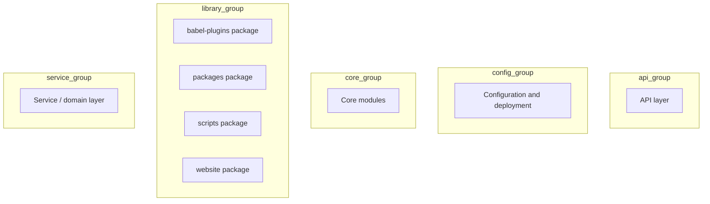

# Architecture report: callstack/linaria

> Automated static analysis. **Observed** = directly seen in files/imports/AST; **Inferred** = interpretation from that evidence. Repository code was not executed.

## 1. Repository at a glance

| Item | Value |
| --- | --- |
| Repository | callstack/linaria |
| Description | Zero-runtime CSS in JS library |
| Language | TypeScript |
| Stars | 12351 |
| Licence | MIT |
| Analysed commit / branch | 63a958afeebb0be3bb66cc8f31a0b1a54238b36e / master |
| Framework(s) | Express, Koa, React |
| Files analysed | 293 |
| Components | 8 |

## 2. Architecture in one minute

callstack/linaria - Zero-runtime CSS in JS library. This repository was analysed statically from 293 file(s) (0 Python). Detected technologies (observed from imports/manifests): GitHub Actions, Express, Koa, React, Jest, TypeScript. Files are grouped into 8 component(s): API layer, babel-plugins package, Configuration and deployment, Core modules, packages package, scripts package, Service / domain layer, website package. Findings below distinguish observed facts from inferred interpretation.

## 3. High-level block diagram

## 4. Main components

### API layer (`api_layer`)

- **Kind:** api
- **Status:** Observed
- **Confidence:** 0.85
- **Responsibility:** Groups 2 file(s) under api layer (observed from repository paths and static analysis).
- **Paths:** `website/src/api/index.js`, `website/src/api/react/index.js`
- **Evidence:** [website/src/api/index.js](https://github.com/callstack/linaria/blob/63a958afeebb0be3bb66cc8f31a0b1a54238b36e/website/src/api/index.js); [website/src/api/react/index.js](https://github.com/callstack/linaria/blob/63a958afeebb0be3bb66cc8f31a0b1a54238b36e/website/src/api/react/index.js)

### babel-plugins package (`babel_plugins`)

- **Kind:** library
- **Status:** Observed
- **Confidence:** 0.85
- **Responsibility:** Groups 1 file(s) under babel-plugins package (observed from repository paths and static analysis).
- **Paths:** `babel-plugins/transform-import-meta.cjs`
- **Evidence:** [babel-plugins/transform-import-meta.cjs](https://github.com/callstack/linaria/blob/63a958afeebb0be3bb66cc8f31a0b1a54238b36e/babel-plugins/transform-import-meta.cjs)

### Configuration and deployment (`config`)

- **Kind:** config
- **Status:** Observed
- **Confidence:** 0.85
- **Responsibility:** Groups 50 file(s) under configuration and deployment (observed from repository paths and static analysis).
- **Paths:** `greenkeeper.json`, `package.json`, `packages/atomic/package.json`, `packages/atomic/processors/styled.processor.json`, `packages/atomic/tsconfig.json`, `packages/core/__dtslint__/tsconfig.eslint.json`, `packages/core/__dtslint__/tsconfig.json`, `packages/core/package.json`, `packages/core/processors/css.processor.json`, `packages/core/tsconfig.json`, `packages/core/tstyche.json`, `packages/interop/package.json`, `packages/interop/tsconfig.json`, `packages/linaria/babel/package.json`, `packages/linaria/evaluators/package.json`, `packages/linaria/loader/package.json`, `packages/linaria/package.json`, `packages/linaria/react/package.json`, `packages/linaria/rollup/package.json`, `packages/linaria/server/package.json`, `packages/linaria/stylelint-config/package.json`, `packages/linaria/tsconfig.json`, `packages/postcss-linaria/package.json`, `packages/postcss-linaria/tsconfig.json`, `packages/react/__dtslint-react17__/tsconfig.eslint.json`, `packages/react/__dtslint-react17__/tsconfig.json`, `packages/react/__dtslint__/tsconfig.eslint.json`, `packages/react/__dtslint__/tsconfig.json`, `packages/react/package.json`, `packages/react/processors/styled.processor.json`, `packages/react/tsconfig.json`, `packages/react/tstyche.json`, `packages/server/package.json`, `packages/server/tsconfig.json`, `packages/stylelint-config-standard-linaria/package.json`, `packages/stylelint-config-standard-linaria/tsconfig.json`, `packages/stylelint/package.json`, `packages/stylelint/tsconfig.json`, `packages/testkit/package.json`, `packages/testkit/src/__fixtures__/linaria-ui-library/package.json`, `packages/testkit/src/__fixtures__/non-linaria-ui-library/package.json`, `packages/testkit/src/__fixtures__/sample-data.json`, `packages/testkit/tsconfig.json`, `pnpm-workspace.yaml`, `react/package.json`, `tsconfig.eslint.json`, `tsconfig.json`, `tsconfig.prod.json`, `turbo.json`, `website/package.json`
- **Evidence:** [greenkeeper.json](https://github.com/callstack/linaria/blob/63a958afeebb0be3bb66cc8f31a0b1a54238b36e/greenkeeper.json); [package.json](https://github.com/callstack/linaria/blob/63a958afeebb0be3bb66cc8f31a0b1a54238b36e/package.json); [packages/atomic/package.json](https://github.com/callstack/linaria/blob/63a958afeebb0be3bb66cc8f31a0b1a54238b36e/packages/atomic/package.json); [packages/atomic/processors/styled.processor.json](https://github.com/callstack/linaria/blob/63a958afeebb0be3bb66cc8f31a0b1a54238b36e/packages/atomic/processors/styled.processor.json); [packages/atomic/tsconfig.json](https://github.com/callstack/linaria/blob/63a958afeebb0be3bb66cc8f31a0b1a54238b36e/packages/atomic/tsconfig.json); [packages/core/__dtslint__/tsconfig.eslint.json](https://github.com/callstack/linaria/blob/63a958afeebb0be3bb66cc8f31a0b1a54238b36e/packages/core/__dtslint__/tsconfig.eslint.json); [packages/core/__dtslint__/tsconfig.json](https://github.com/callstack/linaria/blob/63a958afeebb0be3bb66cc8f31a0b1a54238b36e/packages/core/__dtslint__/tsconfig.json); [packages/core/package.json](https://github.com/callstack/linaria/blob/63a958afeebb0be3bb66cc8f31a0b1a54238b36e/packages/core/package.json)

### Core modules (`core`)

- **Kind:** core
- **Status:** Observed
- **Confidence:** 0.85
- **Responsibility:** Groups 5 file(s) under core modules (observed from repository paths and static analysis).
- **Paths:** `babel.config.js`, `commitlint.config.mjs`, `eslint.config.js`, `jest.config.js`, `link-wyw.sh`
- **Evidence:** [babel.config.js](https://github.com/callstack/linaria/blob/63a958afeebb0be3bb66cc8f31a0b1a54238b36e/babel.config.js); [commitlint.config.mjs](https://github.com/callstack/linaria/blob/63a958afeebb0be3bb66cc8f31a0b1a54238b36e/commitlint.config.mjs); [eslint.config.js](https://github.com/callstack/linaria/blob/63a958afeebb0be3bb66cc8f31a0b1a54238b36e/eslint.config.js); [jest.config.js](https://github.com/callstack/linaria/blob/63a958afeebb0be3bb66cc8f31a0b1a54238b36e/jest.config.js); [link-wyw.sh](https://github.com/callstack/linaria/blob/63a958afeebb0be3bb66cc8f31a0b1a54238b36e/link-wyw.sh)

### packages package (`packages`)

- **Kind:** library
- **Status:** Observed
- **Confidence:** 0.85
- **Responsibility:** Groups 98 file(s) under packages package (observed from repository paths and static analysis).
- **Paths:** `packages/atomic/babel.config.js`, `packages/atomic/processors/css.js`, `packages/atomic/processors/styled.js`, `packages/atomic/src/CSSProperties.ts`, `packages/atomic/src/css.ts`, `packages/atomic/src/index.ts`, `packages/atomic/src/processors/css.ts`, `packages/atomic/src/processors/helpers/atomize.ts`, `packages/atomic/src/processors/helpers/propertyPriority.ts`, `packages/atomic/src/processors/styled.ts`, `packages/interop/__tests__/index.test.ts`, `packages/interop/babel.config.js`, `packages/interop/src/index.ts`, `packages/linaria/babel.config.js`, `packages/linaria/src/core.ts`, `packages/linaria/src/react.ts`, `packages/linaria/src/server.ts`, `packages/postcss-linaria/__tests__/__utils__/index.ts`, `packages/postcss-linaria/__tests__/locationCorrection.test.ts`, `packages/postcss-linaria/__tests__/parse.test.ts`, `packages/postcss-linaria/__tests__/stringify.test.ts`, `packages/postcss-linaria/__tests__/stylelint.test.ts`, `packages/postcss-linaria/__tests__/utils.test.ts`, `packages/postcss-linaria/babel.config.js`, `packages/postcss-linaria/src/index.ts`, `packages/postcss-linaria/src/locationCorrection.ts`, `packages/postcss-linaria/src/originalState.ts`, `packages/postcss-linaria/src/parse.ts`, `packages/postcss-linaria/src/stringify.ts`, `packages/postcss-linaria/src/util.ts`, `packages/react/__dtslint-react17__/react17.tsx`, `packages/react/__dtslint-react17__/stubs/jsx-runtime.d.ts`, `packages/react/__dtslint-react17__/stubs/react17.d.ts`, `packages/react/__dtslint__/styled-jsx.tsx`, `packages/react/__dtslint__/styled.ts`, `packages/react/__tests__/detect-core-js.test.ts`, `packages/react/__tests__/styled.test.tsx`, `packages/react/babel.config.js`, `packages/react/processors/styled.js`, `packages/react/src/index.ts`, `packages/react/src/processors/styled.ts`, `packages/react/src/react-html-attributes.d.ts`, `packages/react/src/styled.ts`, `packages/server/__tests__/collect.test.ts`, `packages/server/babel.config.js`, `packages/server/src/collect.ts`, `packages/server/src/index.ts`, `packages/stylelint-config-standard-linaria/babel.config.js`, `packages/stylelint-config-standard-linaria/src/index.js`, `packages/stylelint/babel.config.js`, `packages/stylelint/src/index.ts`, `packages/stylelint/src/preprocessor.ts`, `packages/testkit/src/__fixtures__/assignToExport.js`, `packages/testkit/src/__fixtures__/bar.js`, `packages/testkit/src/__fixtures__/circular-imports/bar.js`, `packages/testkit/src/__fixtures__/circular-imports/constants.js`, `packages/testkit/src/__fixtures__/circular-imports/foo.js`, `packages/testkit/src/__fixtures__/circular-imports/index.js`, `packages/testkit/src/__fixtures__/complex-component.js`, `packages/testkit/src/__fixtures__/components-library.js`, `packages/testkit/src/__fixtures__/computedKeys.js`, `packages/testkit/src/__fixtures__/enums.ts`, `packages/testkit/src/__fixtures__/escape-character.js`, `packages/testkit/src/__fixtures__/foo-nonstatic.js`, `packages/testkit/src/__fixtures__/foo-static.js`, `packages/testkit/src/__fixtures__/foo.js`, `packages/testkit/src/__fixtures__/linaria-ui-library/components/index.js`, `packages/testkit/src/__fixtures__/linaria-ui-library/hocs.js`, `packages/testkit/src/__fixtures__/linaria-ui-library/non-linaria-components.js`, `packages/testkit/src/__fixtures__/linaria-ui-library/types.ts`, `packages/testkit/src/__fixtures__/loop/a.js`, `packages/testkit/src/__fixtures__/loop/ab.js`, `packages/testkit/src/__fixtures__/loop/b.js`, `packages/testkit/src/__fixtures__/loop/ba.js`, `packages/testkit/src/__fixtures__/loop/index.js`, `packages/testkit/src/__fixtures__/module-reexport.js`, `packages/testkit/src/__fixtures__/non-linaria-ui-library/index.js`, `packages/testkit/src/__fixtures__/objectExport.js`, `packages/testkit/src/__fixtures__/re-exports/constants.js`, `packages/testkit/src/__fixtures__/re-exports/empty.js`, `packages/testkit/src/__fixtures__/re-exports/foo.js`, `packages/testkit/src/__fixtures__/re-exports/index.js`, `packages/testkit/src/__fixtures__/reexports.js`, `packages/testkit/src/__fixtures__/runNearFramePaint.js`, `packages/testkit/src/__fixtures__/sample-script.cjs`, `packages/testkit/src/__fixtures__/sample-script.js`, `packages/testkit/src/__fixtures__/sample-typescript.tsx`, `packages/testkit/src/__fixtures__/self-import.js`, `packages/testkit/src/__fixtures__/sequenceExport.js`, `packages/testkit/src/__fixtures__/slugify.js`, `packages/testkit/src/__fixtures__/ts-compiled-re-exports/constants.js`, `packages/testkit/src/__fixtures__/ts-compiled-re-exports/index.js`, `packages/testkit/src/__fixtures__/ts-data.ts`, `packages/testkit/src/__fixtures__/with-babelrc/index.js`, `packages/testkit/src/__fixtures__/with-babelrc/wyw-in-js.config.cjs`, `packages/testkit/src/__utils__/linaria-snapshot-serializer.ts`, `packages/testkit/src/babel.test.ts`, `packages/testkit/src/transform.test.ts`
- **Evidence:** [packages/atomic/babel.config.js](https://github.com/callstack/linaria/blob/63a958afeebb0be3bb66cc8f31a0b1a54238b36e/packages/atomic/babel.config.js); [packages/atomic/processors/css.js](https://github.com/callstack/linaria/blob/63a958afeebb0be3bb66cc8f31a0b1a54238b36e/packages/atomic/processors/css.js); [packages/atomic/processors/styled.js](https://github.com/callstack/linaria/blob/63a958afeebb0be3bb66cc8f31a0b1a54238b36e/packages/atomic/processors/styled.js); [packages/atomic/src/CSSProperties.ts](https://github.com/callstack/linaria/blob/63a958afeebb0be3bb66cc8f31a0b1a54238b36e/packages/atomic/src/CSSProperties.ts); [packages/atomic/src/css.ts](https://github.com/callstack/linaria/blob/63a958afeebb0be3bb66cc8f31a0b1a54238b36e/packages/atomic/src/css.ts); [packages/atomic/src/index.ts](https://github.com/callstack/linaria/blob/63a958afeebb0be3bb66cc8f31a0b1a54238b36e/packages/atomic/src/index.ts); [packages/atomic/src/processors/css.ts](https://github.com/callstack/linaria/blob/63a958afeebb0be3bb66cc8f31a0b1a54238b36e/packages/atomic/src/processors/css.ts); [packages/atomic/src/processors/helpers/atomize.ts](https://github.com/callstack/linaria/blob/63a958afeebb0be3bb66cc8f31a0b1a54238b36e/packages/atomic/src/processors/helpers/atomize.ts)

### scripts package (`scripts`)

- **Kind:** library
- **Status:** Observed
- **Confidence:** 0.85
- **Responsibility:** Groups 3 file(s) under scripts package (observed from repository paths and static analysis).
- **Paths:** `scripts/check-astro-solid-example.sh`, `scripts/check-eslint-flat-config.sh`, `scripts/typecheck-postcss-8-5.sh`
- **Evidence:** [scripts/check-astro-solid-example.sh](https://github.com/callstack/linaria/blob/63a958afeebb0be3bb66cc8f31a0b1a54238b36e/scripts/check-astro-solid-example.sh); [scripts/check-eslint-flat-config.sh](https://github.com/callstack/linaria/blob/63a958afeebb0be3bb66cc8f31a0b1a54238b36e/scripts/check-eslint-flat-config.sh); [scripts/typecheck-postcss-8-5.sh](https://github.com/callstack/linaria/blob/63a958afeebb0be3bb66cc8f31a0b1a54238b36e/scripts/typecheck-postcss-8-5.sh)

### Service / domain layer (`service_layer`)

- **Kind:** service
- **Status:** Observed
- **Confidence:** 0.85
- **Responsibility:** Groups 10 file(s) under service / domain layer (observed from repository paths and static analysis).
- **Paths:** `packages/core/__dtslint__/core.ts`, `packages/core/__tests__/cx.test.ts`, `packages/core/__tests__/detect-core-js.test.ts`, `packages/core/babel.config.js`, `packages/core/processors/css.js`, `packages/core/src/CSSProperties.ts`, `packages/core/src/css.ts`, `packages/core/src/cx.ts`, `packages/core/src/index.ts`, `packages/core/src/processors/css.ts`
- **Evidence:** [packages/core/__dtslint__/core.ts](https://github.com/callstack/linaria/blob/63a958afeebb0be3bb66cc8f31a0b1a54238b36e/packages/core/__dtslint__/core.ts); [packages/core/__tests__/cx.test.ts](https://github.com/callstack/linaria/blob/63a958afeebb0be3bb66cc8f31a0b1a54238b36e/packages/core/__tests__/cx.test.ts); [packages/core/__tests__/detect-core-js.test.ts](https://github.com/callstack/linaria/blob/63a958afeebb0be3bb66cc8f31a0b1a54238b36e/packages/core/__tests__/detect-core-js.test.ts); [packages/core/babel.config.js](https://github.com/callstack/linaria/blob/63a958afeebb0be3bb66cc8f31a0b1a54238b36e/packages/core/babel.config.js); [packages/core/processors/css.js](https://github.com/callstack/linaria/blob/63a958afeebb0be3bb66cc8f31a0b1a54238b36e/packages/core/processors/css.js); [packages/core/src/CSSProperties.ts](https://github.com/callstack/linaria/blob/63a958afeebb0be3bb66cc8f31a0b1a54238b36e/packages/core/src/CSSProperties.ts); [packages/core/src/css.ts](https://github.com/callstack/linaria/blob/63a958afeebb0be3bb66cc8f31a0b1a54238b36e/packages/core/src/css.ts); [packages/core/src/cx.ts](https://github.com/callstack/linaria/blob/63a958afeebb0be3bb66cc8f31a0b1a54238b36e/packages/core/src/cx.ts)

### website package (`website`)

- **Kind:** library
- **Status:** Observed
- **Confidence:** 0.85
- **Responsibility:** Groups 15 file(s) under website package (observed from repository paths and static analysis).
- **Paths:** `website/babel.config.js`, `website/babel.server-jsx.config.js`, `website/linaria.config.js`, `website/serve.config.js`, `website/src/components/App.jsx`, `website/src/components/Container.js`, `website/src/components/Example.js`, `website/src/components/Header.jsx`, `website/src/components/Hero.jsx`, `website/src/index.jsx`, `website/src/server.jsx`, `website/src/styles/constants.js`, `website/src/styles/utils.js`, `website/stylelint.config.js`, `website/webpack.config.js`
- **Evidence:** [website/babel.config.js](https://github.com/callstack/linaria/blob/63a958afeebb0be3bb66cc8f31a0b1a54238b36e/website/babel.config.js); [website/babel.server-jsx.config.js](https://github.com/callstack/linaria/blob/63a958afeebb0be3bb66cc8f31a0b1a54238b36e/website/babel.server-jsx.config.js); [website/linaria.config.js](https://github.com/callstack/linaria/blob/63a958afeebb0be3bb66cc8f31a0b1a54238b36e/website/linaria.config.js); [website/serve.config.js](https://github.com/callstack/linaria/blob/63a958afeebb0be3bb66cc8f31a0b1a54238b36e/website/serve.config.js); [website/src/components/App.jsx](https://github.com/callstack/linaria/blob/63a958afeebb0be3bb66cc8f31a0b1a54238b36e/website/src/components/App.jsx); [website/src/components/Container.js](https://github.com/callstack/linaria/blob/63a958afeebb0be3bb66cc8f31a0b1a54238b36e/website/src/components/Container.js); [website/src/components/Example.js](https://github.com/callstack/linaria/blob/63a958afeebb0be3bb66cc8f31a0b1a54238b36e/website/src/components/Example.js); [website/src/components/Header.jsx](https://github.com/callstack/linaria/blob/63a958afeebb0be3bb66cc8f31a0b1a54238b36e/website/src/components/Header.jsx)

## 5. Execution flow

**Observed** entry point(s):

- [packages/atomic/src/index.ts](https://github.com/callstack/linaria/blob/63a958afeebb0be3bb66cc8f31a0b1a54238b36e/packages/atomic/src/index.ts)
- [packages/core/src/index.ts](https://github.com/callstack/linaria/blob/63a958afeebb0be3bb66cc8f31a0b1a54238b36e/packages/core/src/index.ts)
- [packages/interop/src/index.ts](https://github.com/callstack/linaria/blob/63a958afeebb0be3bb66cc8f31a0b1a54238b36e/packages/interop/src/index.ts)
- [packages/linaria/src/server.ts](https://github.com/callstack/linaria/blob/63a958afeebb0be3bb66cc8f31a0b1a54238b36e/packages/linaria/src/server.ts)
- [packages/postcss-linaria/src/index.ts](https://github.com/callstack/linaria/blob/63a958afeebb0be3bb66cc8f31a0b1a54238b36e/packages/postcss-linaria/src/index.ts)
- [packages/react/src/index.ts](https://github.com/callstack/linaria/blob/63a958afeebb0be3bb66cc8f31a0b1a54238b36e/packages/react/src/index.ts)
- [packages/server/src/index.ts](https://github.com/callstack/linaria/blob/63a958afeebb0be3bb66cc8f31a0b1a54238b36e/packages/server/src/index.ts)
- [packages/stylelint-config-standard-linaria/src/index.js](https://github.com/callstack/linaria/blob/63a958afeebb0be3bb66cc8f31a0b1a54238b36e/packages/stylelint-config-standard-linaria/src/index.js)
- [packages/stylelint/src/index.ts](https://github.com/callstack/linaria/blob/63a958afeebb0be3bb66cc8f31a0b1a54238b36e/packages/stylelint/src/index.ts)
- [website/src/api/index.js](https://github.com/callstack/linaria/blob/63a958afeebb0be3bb66cc8f31a0b1a54238b36e/website/src/api/index.js)
- [website/src/components/App.jsx](https://github.com/callstack/linaria/blob/63a958afeebb0be3bb66cc8f31a0b1a54238b36e/website/src/components/App.jsx)
- [website/src/index.jsx](https://github.com/callstack/linaria/blob/63a958afeebb0be3bb66cc8f31a0b1a54238b36e/website/src/index.jsx)

Representative flow (derived from observed entry points and the import graph; steps beyond the entry point are **Inferred**):

1. Execution starts at an observed entry point listed above, if present.
2. No internal import relationships between components were observed.

## 6. Project structure

### `(root)`

- `.all-contributorsrc` - other (28274 bytes)
- `.codecov.yml` - config (137 bytes)
- `.editorconfig` - config (415 bytes)
- `.git-blame-ignore-revs` - other (0 bytes)
- `.gitignore` - other (1082 bytes)
- `.prettierrc` - other (75 bytes)
- `.syncpackrc.js` - source, JavaScript (2695 bytes)
- `CODE_OF_CONDUCT.md` - docs (3213 bytes)
- `CONTRIBUTING.md` - docs (5325 bytes)
- `LICENSE` - docs (1066 bytes)
- `README.md` - docs (50421 bytes)
- `babel.config.js` - source, JavaScript (2521 bytes)
- `commitlint.config.mjs` - source, JavaScript (68 bytes)
- `eslint.config.js` - source, JavaScript (16810 bytes)
- `greenkeeper.json` - config (128 bytes)
- `jest.config.js` - source, JavaScript (360 bytes)
- `link-wyw.sh` - source, Shell (854 bytes)
- `package.json` - manifest (3212 bytes)
- `pnpm-workspace.yaml` - config (186 bytes)
- `tsconfig.eslint.json` - config (142 bytes)
- `tsconfig.json` - config (862 bytes)
- `tsconfig.prod.json` - config (85 bytes)
- `turbo.json` - config (1116 bytes)

### `.changeset`

- `.changeset/README.md` - docs (510 bytes)
- `.changeset/config.json` - config (595 bytes)

### `.github`

- `.github/ISSUE_TEMPLATE/bug_report.md` - docs (796 bytes)
- `.github/ISSUE_TEMPLATE/config.yml` - config (192 bytes)
- `.github/ISSUE_TEMPLATE/enhancement_request.md` - docs (432 bytes)
- `.github/ISSUE_TEMPLATE/feature_request.md` - docs (399 bytes)
- `.github/PULL_REQUEST_TEMPLATE.md` - docs (763 bytes)
- `.github/labels.json` - config (11423 bytes)
- `.github/workflows/check.yml` - ci, YAML (1629 bytes)
- `.github/workflows/main.yml` - ci, YAML (687 bytes)
- `.github/workflows/release.yml` - ci, YAML (1213 bytes)
- `.github/workflows/site-deploy.yml` - ci, YAML (910 bytes)

### `.husky`

- `.husky/commit-msg` - other (33 bytes)
- `.husky/pre-commit` - other (15 bytes)

### `.vscode`

- `.vscode/settings.json` - config (63 bytes)

### `babel-plugins`

- `babel-plugins/transform-import-meta.cjs` - source, JavaScript (916 bytes)

### `docs`

- `docs/API.md` - docs (4752 bytes)
- `docs/ATOMIC_CSS.md` - docs (7651 bytes)
- `docs/BASICS.md` - docs (10025 bytes)
- `docs/BENEFITS.md` - docs (5892 bytes)
- `docs/BUNDLERS_INTEGRATION.md` - docs (12762 bytes)
- `docs/CLI.md` - docs (1517 bytes)
- `docs/CONFIGURATION.md` - docs (16696 bytes)
- `docs/CRITICAL_CSS.md` - docs (2420 bytes)
- `docs/DYNAMIC_STYLES.md` - docs (3084 bytes)
- `docs/FEATURE_FLAGS.md` - docs (4960 bytes)
- `docs/HOW_IT_WORKS.md` - docs (6740 bytes)
- `docs/LINTING.md` - docs (3444 bytes)
- `docs/MIGRATION_GUIDE.md` - docs (6712 bytes)
- `docs/THEMING.md` - docs (2952 bytes)
- `docs/TYPESCRIPT.md` - docs (5146 bytes)

### `examples`

- `examples/astro-solid/astro.config.js` - source, JavaScript (680 bytes)
- `examples/astro-solid/components/csr.tsx` - source, TypeScript (1175 bytes)
- `examples/astro-solid/components/csr_child.tsx` - source, TypeScript (359 bytes)
- `examples/astro-solid/components/external.ts` - source, TypeScript (40 bytes)
- `examples/astro-solid/package.json` - manifest (502 bytes)
- `examples/astro-solid/pages/index.astro` - other (271 bytes)
- `examples/astro-solid/tsconfig.json` - config (219 bytes)
- `examples/esbuild/.gitignore` - other (7 bytes)
- `examples/esbuild/app.js` - source, JavaScript (26 bytes)
- `examples/esbuild/build.js` - source, JavaScript (401 bytes)
- `examples/esbuild/package.json` - manifest (323 bytes)
- `examples/rollup/.gitignore` - other (7 bytes)
- `examples/rollup/app.js` - source, JavaScript (26 bytes)
- `examples/rollup/babel.config.js` - source, JavaScript (58 bytes)
- `examples/rollup/package.json` - manifest (586 bytes)
- `examples/rollup/rollup.config.mjs` - source, JavaScript (944 bytes)
- `examples/vite/.linariarc.mjs` - source, JavaScript (526 bytes)
- `examples/vite/app.js` - source, JavaScript (26 bytes)
- `examples/vite/index.html` - other (307 bytes)
- `examples/vite/package.json` - manifest (435 bytes)
- `examples/vite/vite.config.js` - source, JavaScript (582 bytes)
- `examples/vpssr-linaria-solid/check-vite-version.mjs` - source, JavaScript (1440 bytes)
- `examples/vpssr-linaria-solid/package.json` - manifest (632 bytes)
- `examples/vpssr-linaria-solid/pages/+config.ts` - source, TypeScript (384 bytes)
- `examples/vpssr-linaria-solid/pages/html-js/+Page.server.tsx` - source, TypeScript (473 bytes)
- `examples/vpssr-linaria-solid/pages/html-js/+client.js` - source, JavaScript (336 bytes)
- `examples/vpssr-linaria-solid/pages/html-only/+Page.server.tsx` - source, TypeScript (678 bytes)
- `examples/vpssr-linaria-solid/pages/index/+Page.server.tsx` - source, TypeScript (503 bytes)
- `examples/vpssr-linaria-solid/pages/spa/+Page.client.tsx` - source, TypeScript (397 bytes)
- `examples/vpssr-linaria-solid/pages/ssr/+Page.tsx` - source, TypeScript (376 bytes)
- `examples/vpssr-linaria-solid/pages/ssr/Counter.tsx` - source, TypeScript (238 bytes)
- `examples/vpssr-linaria-solid/server.js` - source, JavaScript (1214 bytes)
- `examples/vpssr-linaria-solid/tsconfig.json` - config (439 bytes)
- `examples/vpssr-linaria-solid/vite.config.js` - source, JavaScript (636 bytes)
- `examples/webpack5/app.js` - source, JavaScript (26 bytes)
- `examples/webpack5/babel.config.js` - source, JavaScript (58 bytes)
- `examples/webpack5/package.json` - manifest (678 bytes)
- `examples/webpack5/webpack.config.js` - source, JavaScript (1496 bytes)

### `packages`

- `packages/atomic/CHANGELOG.md` - docs (23698 bytes)
- `packages/atomic/README.md` - docs (1063 bytes)
- `packages/atomic/babel.config.js` - source, JavaScript (72 bytes)
- `packages/atomic/package.json` - manifest (2820 bytes)
- `packages/atomic/processors/css.js` - source, JavaScript (128 bytes)
- `packages/atomic/processors/styled.js` - source, JavaScript (131 bytes)
- `packages/atomic/processors/styled.processor.json` - config (248 bytes)
- `packages/atomic/src/CSSProperties.ts` - source, TypeScript (83 bytes)
- `packages/atomic/src/css.ts` - source, TypeScript (586 bytes)
- `packages/atomic/src/index.ts` - source, TypeScript (172 bytes)
- `packages/atomic/src/processors/css.ts` - source, TypeScript (1554 bytes)
- `packages/atomic/src/processors/helpers/atomize.ts` - source, TypeScript (4254 bytes)
- `packages/atomic/src/processors/helpers/propertyPriority.ts` - source, TypeScript (5327 bytes)
- `packages/atomic/src/processors/styled.ts` - source, TypeScript (2242 bytes)
- `packages/atomic/tsconfig.json` - config (194 bytes)
- `packages/core/CHANGELOG.md` - docs (20173 bytes)
- `packages/core/README.md` - docs (1063 bytes)
- `packages/core/__dtslint__/core.ts` - source, TypeScript (391 bytes)
- `packages/core/__dtslint__/tsconfig.eslint.json` - config (35 bytes)
- `packages/core/__dtslint__/tsconfig.json` - config (289 bytes)
- `packages/core/__tests__/cx.test.ts` - source, TypeScript (568 bytes)
- `packages/core/__tests__/detect-core-js.test.ts` - source, TypeScript (1063 bytes)
- `packages/core/babel.config.js` - source, JavaScript (72 bytes)
- `packages/core/package.json` - manifest (2461 bytes)
- `packages/core/processors/css.js` - source, JavaScript (128 bytes)
- `packages/core/processors/css.processor.json` - config (351 bytes)
- `packages/core/src/CSSProperties.ts` - source, TypeScript (83 bytes)
- `packages/core/src/css.ts` - source, TypeScript (681 bytes)
- `packages/core/src/cx.ts` - source, TypeScript (1969 bytes)
- `packages/core/src/index.ts` - source, TypeScript (178 bytes)
- `packages/core/src/processors/css.ts` - source, TypeScript (1296 bytes)
- `packages/core/tsconfig.json` - config (149 bytes)
- `packages/core/tstyche.json` - config (44 bytes)
- `packages/interop/CHANGELOG.md` - docs (8333 bytes)
- `packages/interop/README.md` - docs (892 bytes)
- `packages/interop/__tests__/__snapshots__/index.test.ts.snap` - other (4030 bytes)
- `packages/interop/__tests__/index.test.ts` - source, TypeScript (2382 bytes)
- `packages/interop/babel.config.js` - source, JavaScript (72 bytes)
- `packages/interop/package.json` - manifest (1387 bytes)
- `packages/interop/src/index.ts` - source, TypeScript (2416 bytes)
- `packages/interop/tsconfig.json` - config (116 bytes)
- `packages/linaria/CHANGELOG.md` - docs (23885 bytes)
- `packages/linaria/README.md` - docs (1063 bytes)
- `packages/linaria/babel.config.js` - source, JavaScript (72 bytes)
- `packages/linaria/babel/package.json` - manifest (97 bytes)
- `packages/linaria/evaluators/package.json` - manifest (112 bytes)
- `packages/linaria/loader/package.json` - manifest (127 bytes)
- `packages/linaria/package.json` - manifest (1617 bytes)
- `packages/linaria/react/package.json` - manifest (97 bytes)
- `packages/linaria/rollup/package.json` - manifest (100 bytes)
- `packages/linaria/server/package.json` - manifest (100 bytes)
- `packages/linaria/src/core.ts` - source, TypeScript (31 bytes)
- `packages/linaria/src/react.ts` - source, TypeScript (32 bytes)
- `packages/linaria/src/server.ts` - source, TypeScript (33 bytes)
- `packages/linaria/stylelint-config/package.json` - manifest (109 bytes)
- `packages/linaria/tsconfig.json` - config (202 bytes)
- `packages/postcss-linaria/CHANGELOG.md` - docs (11476 bytes)
- `packages/postcss-linaria/README.md` - docs (767 bytes)
- `packages/postcss-linaria/__tests__/__utils__/index.ts` - source, TypeScript (4989 bytes)
- `packages/postcss-linaria/__tests__/locationCorrection.test.ts` - source, TypeScript (9273 bytes)
- `packages/postcss-linaria/__tests__/parse.test.ts` - source, TypeScript (12165 bytes)
- `packages/postcss-linaria/__tests__/stringify.test.ts` - source, TypeScript (18906 bytes)
- `packages/postcss-linaria/__tests__/stylelint.test.ts` - source, TypeScript (4001 bytes)
- `packages/postcss-linaria/__tests__/utils.test.ts` - source, TypeScript (2065 bytes)
- `packages/postcss-linaria/babel.config.js` - source, JavaScript (72 bytes)
- `packages/postcss-linaria/package.json` - manifest (1624 bytes)
- `packages/postcss-linaria/src/index.ts` - source, TypeScript (141 bytes)
- `packages/postcss-linaria/src/locationCorrection.ts` - source, TypeScript (8911 bytes)
- `packages/postcss-linaria/src/originalState.ts` - source, TypeScript (2489 bytes)
- `packages/postcss-linaria/src/parse.ts` - source, TypeScript (7569 bytes)
- `packages/postcss-linaria/src/stringify.ts` - source, TypeScript (14009 bytes)
- `packages/postcss-linaria/src/util.ts` - source, TypeScript (2737 bytes)
- `packages/postcss-linaria/tsconfig.json` - config (116 bytes)
- `packages/react/CHANGELOG.md` - docs (26226 bytes)
- `packages/react/README.md` - docs (1063 bytes)
- `packages/react/__dtslint-react17__/react17.tsx` - source, TypeScript (313 bytes)
- `packages/react/__dtslint-react17__/stubs/jsx-runtime.d.ts` - source, TypeScript (440 bytes)
- `packages/react/__dtslint-react17__/stubs/react17.d.ts` - source, TypeScript (576 bytes)
- `packages/react/__dtslint-react17__/tsconfig.eslint.json` - config (35 bytes)
- `packages/react/__dtslint-react17__/tsconfig.json` - config (551 bytes)
- `packages/react/__dtslint__/styled-jsx.tsx` - source, TypeScript (522 bytes)
- `packages/react/__dtslint__/styled.ts` - source, TypeScript (5220 bytes)
- `packages/react/__dtslint__/tsconfig.eslint.json` - config (35 bytes)
- `packages/react/__dtslint__/tsconfig.json` - config (395 bytes)
- `packages/react/__tests__/__snapshots__/styled.test.tsx.snap` - other (2810 bytes)
- `packages/react/__tests__/detect-core-js.test.ts` - source, TypeScript (1067 bytes)
- `packages/react/__tests__/styled.test.tsx` - source, TypeScript (8362 bytes)
- `packages/react/babel.config.js` - source, JavaScript (72 bytes)
- `packages/react/package.json` - manifest (2814 bytes)
- `packages/react/processors/styled.js` - source, JavaScript (131 bytes)
- `packages/react/processors/styled.processor.json` - config (247 bytes)
- `packages/react/src/index.ts` - source, TypeScript (254 bytes)
- `packages/react/src/processors/styled.ts` - source, TypeScript (16018 bytes)
- `packages/react/src/react-html-attributes.d.ts` - source, TypeScript (253 bytes)
- `packages/react/src/styled.ts` - source, TypeScript (11090 bytes)
- `packages/react/tsconfig.json` - config (205 bytes)
- `packages/react/tstyche.json` - config (113 bytes)
- `packages/server/CHANGELOG.md` - docs (10382 bytes)
- `packages/server/README.md` - docs (1063 bytes)
- `packages/server/__tests__/__snapshots__/collect.test.ts.snap` - other (3524 bytes)
- `packages/server/__tests__/collect.test.ts` - source, TypeScript (10032 bytes)
- `packages/server/babel.config.js` - source, JavaScript (72 bytes)
- `packages/server/package.json` - manifest (1390 bytes)
- `packages/server/src/collect.ts` - source, TypeScript (6838 bytes)
- `packages/server/src/index.ts` - source, TypeScript (48 bytes)
- `packages/server/tsconfig.json` - config (106 bytes)
- `packages/stylelint-config-standard-linaria/CHANGELOG.md` - docs (7975 bytes)
- `packages/stylelint-config-standard-linaria/README.md` - docs (767 bytes)
- `packages/stylelint-config-standard-linaria/babel.config.js` - source, JavaScript (72 bytes)
- `packages/stylelint-config-standard-linaria/package.json` - manifest (1426 bytes)
- `packages/stylelint-config-standard-linaria/src/index.js` - source, JavaScript (729 bytes)
- `packages/stylelint-config-standard-linaria/tsconfig.json` - config (116 bytes)
- `packages/stylelint/CHANGELOG.md` - docs (19282 bytes)
- `packages/stylelint/README.md` - docs (476 bytes)
- `packages/stylelint/babel.config.js` - source, JavaScript (72 bytes)
- `packages/stylelint/package.json` - manifest (1357 bytes)
- `packages/stylelint/src/index.ts` - source, TypeScript (273 bytes)
- `packages/stylelint/src/preprocessor.ts` - source, TypeScript (6377 bytes)
- `packages/stylelint/tsconfig.json` - config (135 bytes)
- `packages/testkit/CHANGELOG.md` - docs (19529 bytes)
- `packages/testkit/package.json` - manifest (1230 bytes)
- `packages/testkit/src/__fixtures__/assignToExport.js` - source, JavaScript (26 bytes)
- `packages/testkit/src/__fixtures__/bar.js` - source, JavaScript (97 bytes)
- `packages/testkit/src/__fixtures__/circular-imports/bar.js` - source, JavaScript (26 bytes)
- `packages/testkit/src/__fixtures__/circular-imports/constants.js` - source, JavaScript (87 bytes)
- `packages/testkit/src/__fixtures__/circular-imports/foo.js` - source, JavaScript (65 bytes)
- `packages/testkit/src/__fixtures__/circular-imports/index.js` - source, JavaScript (46 bytes)
- `packages/testkit/src/__fixtures__/complex-component.js` - source, JavaScript (453 bytes)
- `packages/testkit/src/__fixtures__/components-library.js` - source, JavaScript (262 bytes)
- `packages/testkit/src/__fixtures__/computedKeys.js` - source, JavaScript (102 bytes)
- `packages/testkit/src/__fixtures__/enums.ts` - source, TypeScript (43 bytes)
- `packages/testkit/src/__fixtures__/escape-character.js` - source, JavaScript (188 bytes)
- `packages/testkit/src/__fixtures__/foo-nonstatic.js` - source, JavaScript (106 bytes)
- `packages/testkit/src/__fixtures__/foo-static.js` - source, JavaScript (56 bytes)
- `packages/testkit/src/__fixtures__/foo.js` - source, JavaScript (90 bytes)
- `packages/testkit/src/__fixtures__/linaria-ui-library/components/index.js` - source, JavaScript (36 bytes)
- `packages/testkit/src/__fixtures__/linaria-ui-library/hocs.js` - source, JavaScript (33 bytes)
- `packages/testkit/src/__fixtures__/linaria-ui-library/non-linaria-components.js` - source, JavaScript (90 bytes)
- `packages/testkit/src/__fixtures__/linaria-ui-library/package.json` - manifest (138 bytes)
- `packages/testkit/src/__fixtures__/linaria-ui-library/types.ts` - source, TypeScript (86 bytes)
- `packages/testkit/src/__fixtures__/loop/a.js` - source, JavaScript (81 bytes)
- `packages/testkit/src/__fixtures__/loop/ab.js` - source, JavaScript (56 bytes)
- `packages/testkit/src/__fixtures__/loop/b.js` - source, JavaScript (81 bytes)
- `packages/testkit/src/__fixtures__/loop/ba.js` - source, JavaScript (56 bytes)
- `packages/testkit/src/__fixtures__/loop/index.js` - source, JavaScript (97 bytes)
- `packages/testkit/src/__fixtures__/module-reexport.js` - source, JavaScript (52 bytes)
- `packages/testkit/src/__fixtures__/non-linaria-ui-library/index.js` - source, JavaScript (90 bytes)
- `packages/testkit/src/__fixtures__/non-linaria-ui-library/package.json` - manifest (86 bytes)
- `packages/testkit/src/__fixtures__/objectExport.js` - source, JavaScript (33 bytes)
- `packages/testkit/src/__fixtures__/re-exports/constants.js` - source, JavaScript (52 bytes)
- `packages/testkit/src/__fixtures__/re-exports/empty.js` - source, JavaScript (32 bytes)
- `packages/testkit/src/__fixtures__/re-exports/foo.js` - source, JavaScript (89 bytes)
- `packages/testkit/src/__fixtures__/re-exports/index.js` - source, JavaScript (48 bytes)
- `packages/testkit/src/__fixtures__/reexports.js` - source, JavaScript (46 bytes)
- `packages/testkit/src/__fixtures__/runNearFramePaint.js` - source, JavaScript (354 bytes)
- `packages/testkit/src/__fixtures__/sample-data.json` - config (183 bytes)
- `packages/testkit/src/__fixtures__/sample-script.cjs` - source, JavaScript (21 bytes)
- `packages/testkit/src/__fixtures__/sample-script.js` - source, JavaScript (19 bytes)
- `packages/testkit/src/__fixtures__/sample-typescript.tsx` - source, TypeScript (19 bytes)
- `packages/testkit/src/__fixtures__/self-import.js` - source, JavaScript (152 bytes)
- `packages/testkit/src/__fixtures__/sequenceExport.js` - source, JavaScript (40 bytes)
- `packages/testkit/src/__fixtures__/slugify.js` - source, JavaScript (1547 bytes)
- `packages/testkit/src/__fixtures__/ts-compiled-re-exports/constants.js` - source, JavaScript (119 bytes)
- `packages/testkit/src/__fixtures__/ts-compiled-re-exports/index.js` - source, JavaScript (768 bytes)
- `packages/testkit/src/__fixtures__/ts-data.ts` - source, TypeScript (54 bytes)
- `packages/testkit/src/__fixtures__/with-babelrc/index.js` - source, JavaScript (165 bytes)
- `packages/testkit/src/__fixtures__/with-babelrc/wyw-in-js.config.cjs` - source, JavaScript (340 bytes)
- `packages/testkit/src/__snapshots__/babel.test.ts.snap` - other (71700 bytes)
- `packages/testkit/src/__snapshots__/transform.test.ts.snap` - other (576 bytes)
- `packages/testkit/src/__utils__/linaria-snapshot-serializer.ts` - source, TypeScript (1626 bytes)
- `packages/testkit/src/babel.test.ts` - source, TypeScript (85470 bytes)
- `packages/testkit/src/transform.test.ts` - source, TypeScript (5029 bytes)
- `packages/testkit/tsconfig.json` - config (571 bytes)

### `react`

- `react/package.json` - manifest (113 bytes)

### `scripts`

- `scripts/check-astro-solid-example.sh` - source, Shell (2501 bytes)
- `scripts/check-eslint-flat-config.sh` - source, Shell (2176 bytes)
- `scripts/typecheck-postcss-8-5.sh` - source, Shell (1864 bytes)

### `website`

- `website/CHANGELOG.md` - docs (14739 bytes)
- `website/assets/callstack-logo.svg` - other (5413 bytes)
- `website/assets/linaria-logo.svg` - other (2954 bytes)
- `website/assets/linaria-logomark.svg` - other (939 bytes)
- `website/assets/serverscom-logo-black.svg` - other (5034 bytes)
- `website/babel.config.js` - source, JavaScript (413 bytes)
- `website/babel.server-jsx.config.js` - source, JavaScript (58 bytes)
- `website/index.html` - other (371 bytes)
- `website/linaria.config.js` - source, JavaScript (76 bytes)
- `website/package.json` - manifest (2041 bytes)
- `website/serve.config.js` - source, JavaScript (153 bytes)
- `website/src/api/index.js` - source, JavaScript (0 bytes)
- `website/src/api/react/index.js` - source, JavaScript (32 bytes)
- `website/src/components/App.jsx` - source, JavaScript (427 bytes)
- `website/src/components/Container.js` - source, JavaScript (163 bytes)
- `website/src/components/Example.js` - source, JavaScript (459 bytes)
- `website/src/components/Header.jsx` - source, JavaScript (2018 bytes)
- `website/src/components/Hero.jsx` - source, JavaScript (2798 bytes)
- `website/src/index.jsx` - source, JavaScript (687 bytes)
- `website/src/server.jsx` - source, JavaScript (1946 bytes)
- `website/src/styles/constants.js` - source, JavaScript (280 bytes)
- `website/src/styles/utils.js` - source, JavaScript (223 bytes)
- `website/stylelint.config.js` - source, JavaScript (119 bytes)
- `website/webpack.config.js` - source, JavaScript (1969 bytes)

## 7. Key dependencies and integrations

| Name | Category | Status | Confidence | Evidence |
| --- | --- | --- | --- | --- |
| GitHub Actions | ci | Observed | 0.90 | [.github/workflows/check.yml](https://github.com/callstack/linaria/blob/63a958afeebb0be3bb66cc8f31a0b1a54238b36e/.github/workflows/check.yml); [.github/workflows/main.yml](https://github.com/callstack/linaria/blob/63a958afeebb0be3bb66cc8f31a0b1a54238b36e/.github/workflows/main.yml); [.github/workflows/release.yml](https://github.com/callstack/linaria/blob/63a958afeebb0be3bb66cc8f31a0b1a54238b36e/.github/workflows/release.yml); [.github/workflows/site-deploy.yml](https://github.com/callstack/linaria/blob/63a958afeebb0be3bb66cc8f31a0b1a54238b36e/.github/workflows/site-deploy.yml) |
| Express | framework | Observed | 0.85 | [examples/vpssr-linaria-solid/package.json:18](https://github.com/callstack/linaria/blob/63a958afeebb0be3bb66cc8f31a0b1a54238b36e/examples/vpssr-linaria-solid/package.json#L18) |
| Koa | framework | Observed | 0.85 | [website/package.json:34](https://github.com/callstack/linaria/blob/63a958afeebb0be3bb66cc8f31a0b1a54238b36e/website/package.json#L34) |
| React | framework | Observed | 0.90 | [package.json:42](https://github.com/callstack/linaria/blob/63a958afeebb0be3bb66cc8f31a0b1a54238b36e/package.json#L42); [packages/atomic/package.json:9](https://github.com/callstack/linaria/blob/63a958afeebb0be3bb66cc8f31a0b1a54238b36e/packages/atomic/package.json#L9); [packages/react/package.json:2](https://github.com/callstack/linaria/blob/63a958afeebb0be3bb66cc8f31a0b1a54238b36e/packages/react/package.json#L2); [website/package.json:28](https://github.com/callstack/linaria/blob/63a958afeebb0be3bb66cc8f31a0b1a54238b36e/website/package.json#L28) |
| Jest | tooling | Observed | 0.90 | [package.json:50](https://github.com/callstack/linaria/blob/63a958afeebb0be3bb66cc8f31a0b1a54238b36e/package.json#L50); [packages/testkit/package.json:20](https://github.com/callstack/linaria/blob/63a958afeebb0be3bb66cc8f31a0b1a54238b36e/packages/testkit/package.json#L20) |
| TypeScript | tooling | Observed | 0.90 | [package.json:32](https://github.com/callstack/linaria/blob/63a958afeebb0be3bb66cc8f31a0b1a54238b36e/package.json#L32); [packages/testkit/package.json:29](https://github.com/callstack/linaria/blob/63a958afeebb0be3bb66cc8f31a0b1a54238b36e/packages/testkit/package.json#L29) |
| Vite | tooling | Observed | 0.90 | [examples/astro-solid/package.json:11](https://github.com/callstack/linaria/blob/63a958afeebb0be3bb66cc8f31a0b1a54238b36e/examples/astro-solid/package.json#L11); [examples/vite/package.json:3](https://github.com/callstack/linaria/blob/63a958afeebb0be3bb66cc8f31a0b1a54238b36e/examples/vite/package.json#L3); [examples/vpssr-linaria-solid/package.json:15](https://github.com/callstack/linaria/blob/63a958afeebb0be3bb66cc8f31a0b1a54238b36e/examples/vpssr-linaria-solid/package.json#L15) |
| webpack | tooling | Observed | 0.90 | [examples/webpack5/package.json:3](https://github.com/callstack/linaria/blob/63a958afeebb0be3bb66cc8f31a0b1a54238b36e/examples/webpack5/package.json#L3); [website/package.json:13](https://github.com/callstack/linaria/blob/63a958afeebb0be3bb66cc8f31a0b1a54238b36e/website/package.json#L13) |

## 8. Data and state

No database, cache, queue, or persistent-state usage was observed in the analysed files. State handling, if any, may be in-memory or in files that were not analysed.

## 9. Configuration and deployment clues

- `.changeset/config.json` (config)
- `.codecov.yml` (config)
- `.editorconfig` (config)
- `.github/ISSUE_TEMPLATE/config.yml` (config)
- `.github/labels.json` (config)
- `.github/workflows/check.yml` (ci)
- `.github/workflows/main.yml` (ci)
- `.github/workflows/release.yml` (ci)
- `.github/workflows/site-deploy.yml` (ci)
- `.vscode/settings.json` (config)
- `examples/astro-solid/package.json` (manifest)
- `examples/astro-solid/tsconfig.json` (config)
- `examples/esbuild/package.json` (manifest)
- `examples/rollup/package.json` (manifest)
- `examples/vite/package.json` (manifest)
- `examples/vpssr-linaria-solid/package.json` (manifest)
- `examples/vpssr-linaria-solid/tsconfig.json` (config)
- `examples/webpack5/package.json` (manifest)
- `greenkeeper.json` (config)
- `package.json` (manifest)
- `packages/atomic/package.json` (manifest)
- `packages/atomic/processors/styled.processor.json` (config)
- `packages/atomic/tsconfig.json` (config)
- `packages/core/__dtslint__/tsconfig.eslint.json` (config)
- `packages/core/__dtslint__/tsconfig.json` (config)
- `packages/core/package.json` (manifest)
- `packages/core/processors/css.processor.json` (config)
- `packages/core/tsconfig.json` (config)
- `packages/core/tstyche.json` (config)
- `packages/interop/package.json` (manifest)
- `packages/interop/tsconfig.json` (config)
- `packages/linaria/babel/package.json` (manifest)
- `packages/linaria/evaluators/package.json` (manifest)
- `packages/linaria/loader/package.json` (manifest)
- `packages/linaria/package.json` (manifest)
- `packages/linaria/react/package.json` (manifest)
- `packages/linaria/rollup/package.json` (manifest)
- `packages/linaria/server/package.json` (manifest)
- `packages/linaria/stylelint-config/package.json` (manifest)
- `packages/linaria/tsconfig.json` (config)
- `packages/postcss-linaria/package.json` (manifest)
- `packages/postcss-linaria/tsconfig.json` (config)
- `packages/react/__dtslint-react17__/tsconfig.eslint.json` (config)
- `packages/react/__dtslint-react17__/tsconfig.json` (config)
- `packages/react/__dtslint__/tsconfig.eslint.json` (config)
- `packages/react/__dtslint__/tsconfig.json` (config)
- `packages/react/package.json` (manifest)
- `packages/react/processors/styled.processor.json` (config)
- `packages/react/tsconfig.json` (config)
- `packages/react/tstyche.json` (config)
- `packages/server/package.json` (manifest)
- `packages/server/tsconfig.json` (config)
- `packages/stylelint-config-standard-linaria/package.json` (manifest)
- `packages/stylelint-config-standard-linaria/tsconfig.json` (config)
- `packages/stylelint/package.json` (manifest)
- `packages/stylelint/tsconfig.json` (config)
- `packages/testkit/package.json` (manifest)
- `packages/testkit/src/__fixtures__/linaria-ui-library/package.json` (manifest)
- `packages/testkit/src/__fixtures__/non-linaria-ui-library/package.json` (manifest)
- `packages/testkit/src/__fixtures__/sample-data.json` (config)
- `packages/testkit/tsconfig.json` (config)
- `pnpm-workspace.yaml` (config)
- `react/package.json` (manifest)
- `tsconfig.eslint.json` (config)
- `tsconfig.json` (config)
- `tsconfig.prod.json` (config)
- `turbo.json` (config)
- `website/package.json` (manifest)

## 10. Design observations

- An entry/API layer is separated from other code (Inferred from paths and decorators).
- Service/domain code is distinct from entry and data code, suggesting layered separation (Inferred).

These observations are interpretations (**Inferred**) of the observed structure, not guarantees about runtime design.

## 11. Limitations and unknowns

- Static analysis only: repository code was not executed, installed, or imported at runtime.
- Components and relationships are inferred from file paths, imports, and AST structure; runtime behaviour, dynamic imports, and reflection may not be visible.
- 1 file(s) were skipped during inventory (1 x likely secret file excluded).
- No clear application entry point was observed in the analysed files.
- Repository text was treated as untrusted data; no instructions found in repository files were followed, and likely secret values were redacted/excluded.
- JavaScript and TypeScript files were inventoried from paths and package manifests. They were not parsed with a full language AST, and repository code was not executed.

## 12. Source references

- [.github/workflows/check.yml](https://github.com/callstack/linaria/blob/63a958afeebb0be3bb66cc8f31a0b1a54238b36e/.github/workflows/check.yml)
- [.github/workflows/main.yml](https://github.com/callstack/linaria/blob/63a958afeebb0be3bb66cc8f31a0b1a54238b36e/.github/workflows/main.yml)
- [.github/workflows/release.yml](https://github.com/callstack/linaria/blob/63a958afeebb0be3bb66cc8f31a0b1a54238b36e/.github/workflows/release.yml)
- [.github/workflows/site-deploy.yml](https://github.com/callstack/linaria/blob/63a958afeebb0be3bb66cc8f31a0b1a54238b36e/.github/workflows/site-deploy.yml)
- [babel-plugins/transform-import-meta.cjs](https://github.com/callstack/linaria/blob/63a958afeebb0be3bb66cc8f31a0b1a54238b36e/babel-plugins/transform-import-meta.cjs)
- [babel.config.js](https://github.com/callstack/linaria/blob/63a958afeebb0be3bb66cc8f31a0b1a54238b36e/babel.config.js)
- [commitlint.config.mjs](https://github.com/callstack/linaria/blob/63a958afeebb0be3bb66cc8f31a0b1a54238b36e/commitlint.config.mjs)
- [eslint.config.js](https://github.com/callstack/linaria/blob/63a958afeebb0be3bb66cc8f31a0b1a54238b36e/eslint.config.js)
- [examples/astro-solid/package.json:11](https://github.com/callstack/linaria/blob/63a958afeebb0be3bb66cc8f31a0b1a54238b36e/examples/astro-solid/package.json#L11)
- [examples/vite/package.json:3](https://github.com/callstack/linaria/blob/63a958afeebb0be3bb66cc8f31a0b1a54238b36e/examples/vite/package.json#L3)
- [examples/vpssr-linaria-solid/package.json:15](https://github.com/callstack/linaria/blob/63a958afeebb0be3bb66cc8f31a0b1a54238b36e/examples/vpssr-linaria-solid/package.json#L15)
- [examples/vpssr-linaria-solid/package.json:18](https://github.com/callstack/linaria/blob/63a958afeebb0be3bb66cc8f31a0b1a54238b36e/examples/vpssr-linaria-solid/package.json#L18)
- [examples/webpack5/package.json:3](https://github.com/callstack/linaria/blob/63a958afeebb0be3bb66cc8f31a0b1a54238b36e/examples/webpack5/package.json#L3)
- [greenkeeper.json](https://github.com/callstack/linaria/blob/63a958afeebb0be3bb66cc8f31a0b1a54238b36e/greenkeeper.json)
- [jest.config.js](https://github.com/callstack/linaria/blob/63a958afeebb0be3bb66cc8f31a0b1a54238b36e/jest.config.js)
- [link-wyw.sh](https://github.com/callstack/linaria/blob/63a958afeebb0be3bb66cc8f31a0b1a54238b36e/link-wyw.sh)
- [package.json](https://github.com/callstack/linaria/blob/63a958afeebb0be3bb66cc8f31a0b1a54238b36e/package.json)
- [package.json:32](https://github.com/callstack/linaria/blob/63a958afeebb0be3bb66cc8f31a0b1a54238b36e/package.json#L32)
- [package.json:42](https://github.com/callstack/linaria/blob/63a958afeebb0be3bb66cc8f31a0b1a54238b36e/package.json#L42)
- [package.json:50](https://github.com/callstack/linaria/blob/63a958afeebb0be3bb66cc8f31a0b1a54238b36e/package.json#L50)
- [packages/atomic/babel.config.js](https://github.com/callstack/linaria/blob/63a958afeebb0be3bb66cc8f31a0b1a54238b36e/packages/atomic/babel.config.js)
- [packages/atomic/package.json](https://github.com/callstack/linaria/blob/63a958afeebb0be3bb66cc8f31a0b1a54238b36e/packages/atomic/package.json)
- [packages/atomic/package.json:9](https://github.com/callstack/linaria/blob/63a958afeebb0be3bb66cc8f31a0b1a54238b36e/packages/atomic/package.json#L9)
- [packages/atomic/processors/css.js](https://github.com/callstack/linaria/blob/63a958afeebb0be3bb66cc8f31a0b1a54238b36e/packages/atomic/processors/css.js)
- [packages/atomic/processors/styled.js](https://github.com/callstack/linaria/blob/63a958afeebb0be3bb66cc8f31a0b1a54238b36e/packages/atomic/processors/styled.js)
- [packages/atomic/processors/styled.processor.json](https://github.com/callstack/linaria/blob/63a958afeebb0be3bb66cc8f31a0b1a54238b36e/packages/atomic/processors/styled.processor.json)
- [packages/atomic/src/CSSProperties.ts](https://github.com/callstack/linaria/blob/63a958afeebb0be3bb66cc8f31a0b1a54238b36e/packages/atomic/src/CSSProperties.ts)
- [packages/atomic/src/css.ts](https://github.com/callstack/linaria/blob/63a958afeebb0be3bb66cc8f31a0b1a54238b36e/packages/atomic/src/css.ts)
- [packages/atomic/src/index.ts](https://github.com/callstack/linaria/blob/63a958afeebb0be3bb66cc8f31a0b1a54238b36e/packages/atomic/src/index.ts)
- [packages/atomic/src/processors/css.ts](https://github.com/callstack/linaria/blob/63a958afeebb0be3bb66cc8f31a0b1a54238b36e/packages/atomic/src/processors/css.ts)
- [packages/atomic/src/processors/helpers/atomize.ts](https://github.com/callstack/linaria/blob/63a958afeebb0be3bb66cc8f31a0b1a54238b36e/packages/atomic/src/processors/helpers/atomize.ts)
- [packages/atomic/tsconfig.json](https://github.com/callstack/linaria/blob/63a958afeebb0be3bb66cc8f31a0b1a54238b36e/packages/atomic/tsconfig.json)
- [packages/core/__dtslint__/core.ts](https://github.com/callstack/linaria/blob/63a958afeebb0be3bb66cc8f31a0b1a54238b36e/packages/core/__dtslint__/core.ts)
- [packages/core/__dtslint__/tsconfig.eslint.json](https://github.com/callstack/linaria/blob/63a958afeebb0be3bb66cc8f31a0b1a54238b36e/packages/core/__dtslint__/tsconfig.eslint.json)
- [packages/core/__dtslint__/tsconfig.json](https://github.com/callstack/linaria/blob/63a958afeebb0be3bb66cc8f31a0b1a54238b36e/packages/core/__dtslint__/tsconfig.json)
- [packages/core/__tests__/cx.test.ts](https://github.com/callstack/linaria/blob/63a958afeebb0be3bb66cc8f31a0b1a54238b36e/packages/core/__tests__/cx.test.ts)
- [packages/core/__tests__/detect-core-js.test.ts](https://github.com/callstack/linaria/blob/63a958afeebb0be3bb66cc8f31a0b1a54238b36e/packages/core/__tests__/detect-core-js.test.ts)
- [packages/core/babel.config.js](https://github.com/callstack/linaria/blob/63a958afeebb0be3bb66cc8f31a0b1a54238b36e/packages/core/babel.config.js)
- [packages/core/package.json](https://github.com/callstack/linaria/blob/63a958afeebb0be3bb66cc8f31a0b1a54238b36e/packages/core/package.json)
- [packages/core/processors/css.js](https://github.com/callstack/linaria/blob/63a958afeebb0be3bb66cc8f31a0b1a54238b36e/packages/core/processors/css.js)
- [packages/core/src/CSSProperties.ts](https://github.com/callstack/linaria/blob/63a958afeebb0be3bb66cc8f31a0b1a54238b36e/packages/core/src/CSSProperties.ts)
- [packages/core/src/css.ts](https://github.com/callstack/linaria/blob/63a958afeebb0be3bb66cc8f31a0b1a54238b36e/packages/core/src/css.ts)
- [packages/core/src/cx.ts](https://github.com/callstack/linaria/blob/63a958afeebb0be3bb66cc8f31a0b1a54238b36e/packages/core/src/cx.ts)
- [packages/core/src/index.ts](https://github.com/callstack/linaria/blob/63a958afeebb0be3bb66cc8f31a0b1a54238b36e/packages/core/src/index.ts)
- [packages/interop/src/index.ts](https://github.com/callstack/linaria/blob/63a958afeebb0be3bb66cc8f31a0b1a54238b36e/packages/interop/src/index.ts)
- [packages/linaria/src/server.ts](https://github.com/callstack/linaria/blob/63a958afeebb0be3bb66cc8f31a0b1a54238b36e/packages/linaria/src/server.ts)
- [packages/postcss-linaria/src/index.ts](https://github.com/callstack/linaria/blob/63a958afeebb0be3bb66cc8f31a0b1a54238b36e/packages/postcss-linaria/src/index.ts)
- [packages/react/package.json:2](https://github.com/callstack/linaria/blob/63a958afeebb0be3bb66cc8f31a0b1a54238b36e/packages/react/package.json#L2)
- [packages/react/src/index.ts](https://github.com/callstack/linaria/blob/63a958afeebb0be3bb66cc8f31a0b1a54238b36e/packages/react/src/index.ts)
- [packages/server/src/index.ts](https://github.com/callstack/linaria/blob/63a958afeebb0be3bb66cc8f31a0b1a54238b36e/packages/server/src/index.ts)
- [packages/stylelint-config-standard-linaria/src/index.js](https://github.com/callstack/linaria/blob/63a958afeebb0be3bb66cc8f31a0b1a54238b36e/packages/stylelint-config-standard-linaria/src/index.js)
- [packages/stylelint/src/index.ts](https://github.com/callstack/linaria/blob/63a958afeebb0be3bb66cc8f31a0b1a54238b36e/packages/stylelint/src/index.ts)
- [packages/testkit/package.json:20](https://github.com/callstack/linaria/blob/63a958afeebb0be3bb66cc8f31a0b1a54238b36e/packages/testkit/package.json#L20)
- [packages/testkit/package.json:29](https://github.com/callstack/linaria/blob/63a958afeebb0be3bb66cc8f31a0b1a54238b36e/packages/testkit/package.json#L29)
- [scripts/check-astro-solid-example.sh](https://github.com/callstack/linaria/blob/63a958afeebb0be3bb66cc8f31a0b1a54238b36e/scripts/check-astro-solid-example.sh)
- [scripts/check-eslint-flat-config.sh](https://github.com/callstack/linaria/blob/63a958afeebb0be3bb66cc8f31a0b1a54238b36e/scripts/check-eslint-flat-config.sh)
- [scripts/typecheck-postcss-8-5.sh](https://github.com/callstack/linaria/blob/63a958afeebb0be3bb66cc8f31a0b1a54238b36e/scripts/typecheck-postcss-8-5.sh)
- [website/babel.config.js](https://github.com/callstack/linaria/blob/63a958afeebb0be3bb66cc8f31a0b1a54238b36e/website/babel.config.js)
- [website/babel.server-jsx.config.js](https://github.com/callstack/linaria/blob/63a958afeebb0be3bb66cc8f31a0b1a54238b36e/website/babel.server-jsx.config.js)
- [website/linaria.config.js](https://github.com/callstack/linaria/blob/63a958afeebb0be3bb66cc8f31a0b1a54238b36e/website/linaria.config.js)
- [website/package.json:13](https://github.com/callstack/linaria/blob/63a958afeebb0be3bb66cc8f31a0b1a54238b36e/website/package.json#L13)
- [website/package.json:28](https://github.com/callstack/linaria/blob/63a958afeebb0be3bb66cc8f31a0b1a54238b36e/website/package.json#L28)
- [website/package.json:34](https://github.com/callstack/linaria/blob/63a958afeebb0be3bb66cc8f31a0b1a54238b36e/website/package.json#L34)
- [website/package.json:39](https://github.com/callstack/linaria/blob/63a958afeebb0be3bb66cc8f31a0b1a54238b36e/website/package.json#L39)
- [website/serve.config.js](https://github.com/callstack/linaria/blob/63a958afeebb0be3bb66cc8f31a0b1a54238b36e/website/serve.config.js)
- [website/src/api/index.js](https://github.com/callstack/linaria/blob/63a958afeebb0be3bb66cc8f31a0b1a54238b36e/website/src/api/index.js)
- [website/src/api/react/index.js](https://github.com/callstack/linaria/blob/63a958afeebb0be3bb66cc8f31a0b1a54238b36e/website/src/api/react/index.js)
- [website/src/components/App.jsx](https://github.com/callstack/linaria/blob/63a958afeebb0be3bb66cc8f31a0b1a54238b36e/website/src/components/App.jsx)
- [website/src/components/Container.js](https://github.com/callstack/linaria/blob/63a958afeebb0be3bb66cc8f31a0b1a54238b36e/website/src/components/Container.js)
- [website/src/components/Example.js](https://github.com/callstack/linaria/blob/63a958afeebb0be3bb66cc8f31a0b1a54238b36e/website/src/components/Example.js)
- [website/src/components/Header.jsx](https://github.com/callstack/linaria/blob/63a958afeebb0be3bb66cc8f31a0b1a54238b36e/website/src/components/Header.jsx)
- [website/src/index.jsx](https://github.com/callstack/linaria/blob/63a958afeebb0be3bb66cc8f31a0b1a54238b36e/website/src/index.jsx)
