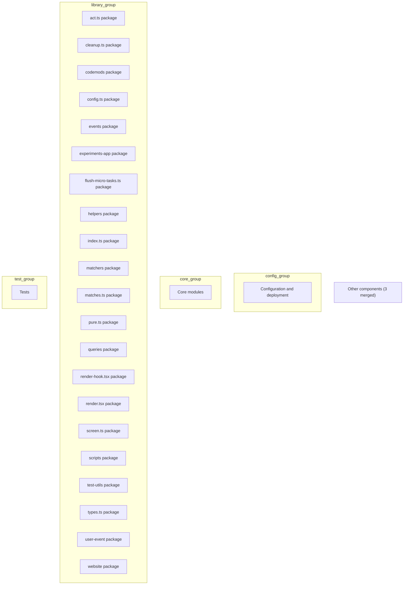

# Architecture report: callstack/react-native-testing-library

> Automated static analysis. **Observed** = directly seen in files/imports/AST; **Inferred** = interpretation from that evidence. Repository code was not executed.

## 1. Repository at a glance

| Item | Value |
| --- | --- |
| Repository | callstack/react-native-testing-library |
| Description | 🦉 Simple and complete React Native testing utilities that encourage good testing practices. |
| Language | TypeScript |
| Stars | 3429 |
| Licence | MIT |
| Analysed commit / branch | 564a84294717d8e4b0831f3e3a5e115cc3832e01 / main |
| Framework(s) | React |
| Files analysed | 630 |
| Components | 27 |

## 2. Architecture in one minute

callstack/react-native-testing-library - 🦉 Simple and complete React Native testing utilities that encourage good testing practices.. This repository was analysed statically from 630 file(s) (0 Python). Detected technologies (observed from imports/manifests): GitHub Actions, React, Jest, TypeScript. Files are grouped into 27 component(s): act.ts package, cleanup.ts package, codemods package, Configuration and deployment, config.ts package, Core modules, events package, experiments-app package. Findings below distinguish observed facts from inferred interpretation.

## 3. High-level block diagram

## 4. Main components

### act.ts package (`act_ts`)

- **Kind:** library
- **Status:** Observed
- **Confidence:** 0.85
- **Responsibility:** Groups 1 file(s) under act.ts package (observed from repository paths and static analysis).
- **Paths:** `src/act.ts`
- **Evidence:** [src/act.ts](https://github.com/callstack/react-native-testing-library/blob/564a84294717d8e4b0831f3e3a5e115cc3832e01/src/act.ts)

### cleanup.ts package (`cleanup_ts`)

- **Kind:** library
- **Status:** Observed
- **Confidence:** 0.85
- **Responsibility:** Groups 1 file(s) under cleanup.ts package (observed from repository paths and static analysis).
- **Paths:** `src/cleanup.ts`
- **Evidence:** [src/cleanup.ts](https://github.com/callstack/react-native-testing-library/blob/564a84294717d8e4b0831f3e3a5e115cc3832e01/src/cleanup.ts)

### codemods package (`codemods`)

- **Kind:** library
- **Status:** Observed
- **Confidence:** 0.85
- **Responsibility:** Groups 3 file(s) under codemods package (observed from repository paths and static analysis).
- **Paths:** `codemods/v14-async-functions/scripts/codemod.ts`, `codemods/v14-update-deps/scripts/codemod.ts`, `codemods/v14-update-deps/scripts/test.js`
- **Evidence:** [codemods/v14-async-functions/scripts/codemod.ts](https://github.com/callstack/react-native-testing-library/blob/564a84294717d8e4b0831f3e3a5e115cc3832e01/codemods/v14-async-functions/scripts/codemod.ts); [codemods/v14-update-deps/scripts/codemod.ts](https://github.com/callstack/react-native-testing-library/blob/564a84294717d8e4b0831f3e3a5e115cc3832e01/codemods/v14-update-deps/scripts/codemod.ts); [codemods/v14-update-deps/scripts/test.js](https://github.com/callstack/react-native-testing-library/blob/564a84294717d8e4b0831f3e3a5e115cc3832e01/codemods/v14-update-deps/scripts/test.js)

### Configuration and deployment (`config`)

- **Kind:** config
- **Status:** Observed
- **Confidence:** 0.85
- **Responsibility:** Groups 57 file(s) under configuration and deployment (observed from repository paths and static analysis).
- **Paths:** `codemods/v14-async-functions/codemod.yaml`, `codemods/v14-async-functions/package.json`, `codemods/v14-async-functions/tsconfig.json`, `codemods/v14-async-functions/workflow.yaml`, `codemods/v14-update-deps/codemod.yaml`, `codemods/v14-update-deps/package.json`, `codemods/v14-update-deps/tsconfig.json`, `codemods/v14-update-deps/workflow.yaml`, `experiments-app/app.json`, `experiments-app/package.json`, `experiments-app/tsconfig.json`, `package.json`, `tsconfig.json`, `tsconfig.react-19_2.json`, `tsconfig.release.json`, `website/docs/12.x/_nav.json`, `website/docs/12.x/cookbook/_meta.json`, `website/docs/12.x/cookbook/advanced/_meta.json`, `website/docs/12.x/cookbook/basics/_meta.json`, `website/docs/12.x/cookbook/state-management/_meta.json`, `website/docs/12.x/docs/_meta.json`, `website/docs/12.x/docs/advanced/_meta.json`, `website/docs/12.x/docs/api/_meta.json`, `website/docs/12.x/docs/api/events/_meta.json`, `website/docs/12.x/docs/api/misc/_meta.json`, `website/docs/12.x/docs/guides/_meta.json`, `website/docs/12.x/docs/migration/_meta.json`, `website/docs/12.x/docs/migration/previous/_meta.json`, `website/docs/12.x/docs/start/_meta.json`, `website/docs/13.x/_nav.json`, `website/docs/13.x/cookbook/_meta.json`, `website/docs/13.x/cookbook/advanced/_meta.json`, `website/docs/13.x/cookbook/basics/_meta.json`, `website/docs/13.x/cookbook/state-management/_meta.json`, `website/docs/13.x/docs/_meta.json`, `website/docs/13.x/docs/advanced/_meta.json`, `website/docs/13.x/docs/api/_meta.json`, `website/docs/13.x/docs/api/events/_meta.json`, `website/docs/13.x/docs/api/misc/_meta.json`, `website/docs/13.x/docs/guides/_meta.json`, `website/docs/13.x/docs/migration/_meta.json`, `website/docs/13.x/docs/migration/previous/_meta.json`, `website/docs/13.x/docs/start/_meta.json`, `website/docs/14.x/_nav.json`, `website/docs/14.x/cookbook/_meta.json`, `website/docs/14.x/cookbook/advanced/_meta.json`, `website/docs/14.x/cookbook/basics/_meta.json`, `website/docs/14.x/cookbook/state-management/_meta.json`, `website/docs/14.x/docs/_meta.json`, `website/docs/14.x/docs/advanced/_meta.json`, `website/docs/14.x/docs/api/_meta.json`, `website/docs/14.x/docs/api/events/_meta.json`, `website/docs/14.x/docs/api/misc/_meta.json`, `website/docs/14.x/docs/guides/_meta.json`, `website/docs/14.x/docs/start/_meta.json`, `website/package.json`, `website/tsconfig.json`
- **Evidence:** [codemods/v14-async-functions/codemod.yaml](https://github.com/callstack/react-native-testing-library/blob/564a84294717d8e4b0831f3e3a5e115cc3832e01/codemods/v14-async-functions/codemod.yaml); [codemods/v14-async-functions/package.json](https://github.com/callstack/react-native-testing-library/blob/564a84294717d8e4b0831f3e3a5e115cc3832e01/codemods/v14-async-functions/package.json); [codemods/v14-async-functions/tsconfig.json](https://github.com/callstack/react-native-testing-library/blob/564a84294717d8e4b0831f3e3a5e115cc3832e01/codemods/v14-async-functions/tsconfig.json); [codemods/v14-async-functions/workflow.yaml](https://github.com/callstack/react-native-testing-library/blob/564a84294717d8e4b0831f3e3a5e115cc3832e01/codemods/v14-async-functions/workflow.yaml); [codemods/v14-update-deps/codemod.yaml](https://github.com/callstack/react-native-testing-library/blob/564a84294717d8e4b0831f3e3a5e115cc3832e01/codemods/v14-update-deps/codemod.yaml); [codemods/v14-update-deps/package.json](https://github.com/callstack/react-native-testing-library/blob/564a84294717d8e4b0831f3e3a5e115cc3832e01/codemods/v14-update-deps/package.json); [codemods/v14-update-deps/tsconfig.json](https://github.com/callstack/react-native-testing-library/blob/564a84294717d8e4b0831f3e3a5e115cc3832e01/codemods/v14-update-deps/tsconfig.json); [codemods/v14-update-deps/workflow.yaml](https://github.com/callstack/react-native-testing-library/blob/564a84294717d8e4b0831f3e3a5e115cc3832e01/codemods/v14-update-deps/workflow.yaml)

### config.ts package (`config_ts`)

- **Kind:** library
- **Status:** Observed
- **Confidence:** 0.85
- **Responsibility:** Groups 1 file(s) under config.ts package (observed from repository paths and static analysis).
- **Paths:** `src/config.ts`
- **Evidence:** [src/config.ts](https://github.com/callstack/react-native-testing-library/blob/564a84294717d8e4b0831f3e3a5e115cc3832e01/src/config.ts)

### Core modules (`core`)

- **Kind:** core
- **Status:** Observed
- **Confidence:** 0.85
- **Responsibility:** Groups 9 file(s) under core modules (observed from repository paths and static analysis).
- **Paths:** `babel.config.js`, `dont-cleanup-after-each.js`, `eslint.config.mjs`, `jest-setup.ts`, `jest.config.js`, `matchers.d.ts`, `matchers.js`, `pure.d.ts`, `pure.js`
- **Evidence:** [babel.config.js](https://github.com/callstack/react-native-testing-library/blob/564a84294717d8e4b0831f3e3a5e115cc3832e01/babel.config.js); [dont-cleanup-after-each.js](https://github.com/callstack/react-native-testing-library/blob/564a84294717d8e4b0831f3e3a5e115cc3832e01/dont-cleanup-after-each.js); [eslint.config.mjs](https://github.com/callstack/react-native-testing-library/blob/564a84294717d8e4b0831f3e3a5e115cc3832e01/eslint.config.mjs); [jest-setup.ts](https://github.com/callstack/react-native-testing-library/blob/564a84294717d8e4b0831f3e3a5e115cc3832e01/jest-setup.ts); [jest.config.js](https://github.com/callstack/react-native-testing-library/blob/564a84294717d8e4b0831f3e3a5e115cc3832e01/jest.config.js); [matchers.d.ts](https://github.com/callstack/react-native-testing-library/blob/564a84294717d8e4b0831f3e3a5e115cc3832e01/matchers.d.ts); [matchers.js](https://github.com/callstack/react-native-testing-library/blob/564a84294717d8e4b0831f3e3a5e115cc3832e01/matchers.js); [pure.d.ts](https://github.com/callstack/react-native-testing-library/blob/564a84294717d8e4b0831f3e3a5e115cc3832e01/pure.d.ts)

### events package (`events`)

- **Kind:** library
- **Status:** Observed
- **Confidence:** 0.85
- **Responsibility:** Groups 25 file(s) under events package (observed from repository paths and static analysis).
- **Paths:** `src/events/__tests__/dispatch.test.tsx`, `src/events/__tests__/fire-event.test.tsx`, `src/events/__tests__/handler.test.tsx`, `src/events/builders/__tests__/base.test.ts`, `src/events/builders/__tests__/common.test.ts`, `src/events/builders/__tests__/index.test.ts`, `src/events/builders/__tests__/merge.test.ts`, `src/events/builders/__tests__/scroll.test.ts`, `src/events/builders/__tests__/text.test.ts`, `src/events/builders/base.ts`, `src/events/builders/common.ts`, `src/events/builders/index.ts`, `src/events/builders/merge.ts`, `src/events/builders/scroll.ts`, `src/events/builders/text.ts`, `src/events/dispatch.ts`, `src/events/fire-event.ts`, `src/events/handler.ts`, `src/events/index.ts`, `src/events/is-enabled.ts`, `src/events/native-state.ts`, `src/events/propagation.ts`, `src/events/types.ts`, `src/events/update-native-state.ts`, `src/events/warnings.ts`
- **Evidence:** [src/events/__tests__/dispatch.test.tsx](https://github.com/callstack/react-native-testing-library/blob/564a84294717d8e4b0831f3e3a5e115cc3832e01/src/events/__tests__/dispatch.test.tsx); [src/events/__tests__/fire-event.test.tsx](https://github.com/callstack/react-native-testing-library/blob/564a84294717d8e4b0831f3e3a5e115cc3832e01/src/events/__tests__/fire-event.test.tsx); [src/events/__tests__/handler.test.tsx](https://github.com/callstack/react-native-testing-library/blob/564a84294717d8e4b0831f3e3a5e115cc3832e01/src/events/__tests__/handler.test.tsx); [src/events/builders/__tests__/base.test.ts](https://github.com/callstack/react-native-testing-library/blob/564a84294717d8e4b0831f3e3a5e115cc3832e01/src/events/builders/__tests__/base.test.ts); [src/events/builders/__tests__/common.test.ts](https://github.com/callstack/react-native-testing-library/blob/564a84294717d8e4b0831f3e3a5e115cc3832e01/src/events/builders/__tests__/common.test.ts); [src/events/builders/__tests__/index.test.ts](https://github.com/callstack/react-native-testing-library/blob/564a84294717d8e4b0831f3e3a5e115cc3832e01/src/events/builders/__tests__/index.test.ts); [src/events/builders/__tests__/merge.test.ts](https://github.com/callstack/react-native-testing-library/blob/564a84294717d8e4b0831f3e3a5e115cc3832e01/src/events/builders/__tests__/merge.test.ts); [src/events/builders/__tests__/scroll.test.ts](https://github.com/callstack/react-native-testing-library/blob/564a84294717d8e4b0831f3e3a5e115cc3832e01/src/events/builders/__tests__/scroll.test.ts)

### experiments-app package (`experiments_app`)

- **Kind:** library
- **Status:** Observed
- **Confidence:** 0.85
- **Responsibility:** Groups 13 file(s) under experiments-app package (observed from repository paths and static analysis).
- **Paths:** `experiments-app/App.tsx`, `experiments-app/babel.config.js`, `experiments-app/index.ts`, `experiments-app/src/MainScreen.tsx`, `experiments-app/src/experiments.ts`, `experiments-app/src/screens/Accessibility.tsx`, `experiments-app/src/screens/FlatListEvents.tsx`, `experiments-app/src/screens/PressEvents.tsx`, `experiments-app/src/screens/ScrollViewEvents.tsx`, `experiments-app/src/screens/SectionListEvents.tsx`, `experiments-app/src/screens/TextInputEventPropagation.tsx`, `experiments-app/src/screens/TextInputEvents.tsx`, `experiments-app/src/utils/helpers.ts`
- **Evidence:** [experiments-app/App.tsx](https://github.com/callstack/react-native-testing-library/blob/564a84294717d8e4b0831f3e3a5e115cc3832e01/experiments-app/App.tsx); [experiments-app/babel.config.js](https://github.com/callstack/react-native-testing-library/blob/564a84294717d8e4b0831f3e3a5e115cc3832e01/experiments-app/babel.config.js); [experiments-app/index.ts](https://github.com/callstack/react-native-testing-library/blob/564a84294717d8e4b0831f3e3a5e115cc3832e01/experiments-app/index.ts); [experiments-app/src/MainScreen.tsx](https://github.com/callstack/react-native-testing-library/blob/564a84294717d8e4b0831f3e3a5e115cc3832e01/experiments-app/src/MainScreen.tsx); [experiments-app/src/experiments.ts](https://github.com/callstack/react-native-testing-library/blob/564a84294717d8e4b0831f3e3a5e115cc3832e01/experiments-app/src/experiments.ts); [experiments-app/src/screens/Accessibility.tsx](https://github.com/callstack/react-native-testing-library/blob/564a84294717d8e4b0831f3e3a5e115cc3832e01/experiments-app/src/screens/Accessibility.tsx); [experiments-app/src/screens/FlatListEvents.tsx](https://github.com/callstack/react-native-testing-library/blob/564a84294717d8e4b0831f3e3a5e115cc3832e01/experiments-app/src/screens/FlatListEvents.tsx); [experiments-app/src/screens/PressEvents.tsx](https://github.com/callstack/react-native-testing-library/blob/564a84294717d8e4b0831f3e3a5e115cc3832e01/experiments-app/src/screens/PressEvents.tsx)

### flush-micro-tasks.ts package (`flush_micro_tasks_ts`)

- **Kind:** library
- **Status:** Observed
- **Confidence:** 0.85
- **Responsibility:** Groups 1 file(s) under flush-micro-tasks.ts package (observed from repository paths and static analysis).
- **Paths:** `src/flush-micro-tasks.ts`
- **Evidence:** [src/flush-micro-tasks.ts](https://github.com/callstack/react-native-testing-library/blob/564a84294717d8e4b0831f3e3a5e115cc3832e01/src/flush-micro-tasks.ts)

### helpers package (`helpers`)

- **Kind:** library
- **Status:** Observed
- **Confidence:** 0.85
- **Responsibility:** Groups 36 file(s) under helpers package (observed from repository paths and static analysis).
- **Paths:** `src/helpers/__tests__/accessibility.test.tsx`, `src/helpers/__tests__/component-tree.test.tsx`, `src/helpers/__tests__/errors.test.ts`, `src/helpers/__tests__/format-element.test.tsx`, `src/helpers/__tests__/include-hidden-elements.test.tsx`, `src/helpers/__tests__/logger.test.ts`, `src/helpers/__tests__/map-props.test.tsx`, `src/helpers/__tests__/text-content.test.tsx`, `src/helpers/__tests__/text-input.test.tsx`, `src/helpers/__tests__/timers.test.ts`, `src/helpers/__tests__/validate-options.test.ts`, `src/helpers/accessibility.ts`, `src/helpers/component-tree.ts`, `src/helpers/debug.ts`, `src/helpers/errors.ts`, `src/helpers/find-all.ts`, `src/helpers/format-element.ts`, `src/helpers/host-component-names.ts`, `src/helpers/logger.ts`, `src/helpers/map-props.ts`, `src/helpers/matchers/__tests__/match-array-value.test.ts`, `src/helpers/matchers/__tests__/match-object.test.ts`, `src/helpers/matchers/__tests__/match-string-value.test.ts`, `src/helpers/matchers/match-accessibility-state.ts`, `src/helpers/matchers/match-accessibility-value.ts`, `src/helpers/matchers/match-array-prop.ts`, `src/helpers/matchers/match-label-text.ts`, `src/helpers/matchers/match-object-prop.ts`, `src/helpers/matchers/match-string-prop.ts`, `src/helpers/matchers/match-text-content.ts`, `src/helpers/object.ts`, `src/helpers/text-content.ts`, `src/helpers/text-input.ts`, `src/helpers/timers.ts`, `src/helpers/validate-options.ts`, `src/helpers/wrap-async.ts`
- **Evidence:** [src/helpers/__tests__/accessibility.test.tsx](https://github.com/callstack/react-native-testing-library/blob/564a84294717d8e4b0831f3e3a5e115cc3832e01/src/helpers/__tests__/accessibility.test.tsx); [src/helpers/__tests__/component-tree.test.tsx](https://github.com/callstack/react-native-testing-library/blob/564a84294717d8e4b0831f3e3a5e115cc3832e01/src/helpers/__tests__/component-tree.test.tsx); [src/helpers/__tests__/errors.test.ts](https://github.com/callstack/react-native-testing-library/blob/564a84294717d8e4b0831f3e3a5e115cc3832e01/src/helpers/__tests__/errors.test.ts); [src/helpers/__tests__/format-element.test.tsx](https://github.com/callstack/react-native-testing-library/blob/564a84294717d8e4b0831f3e3a5e115cc3832e01/src/helpers/__tests__/format-element.test.tsx); [src/helpers/__tests__/include-hidden-elements.test.tsx](https://github.com/callstack/react-native-testing-library/blob/564a84294717d8e4b0831f3e3a5e115cc3832e01/src/helpers/__tests__/include-hidden-elements.test.tsx); [src/helpers/__tests__/logger.test.ts](https://github.com/callstack/react-native-testing-library/blob/564a84294717d8e4b0831f3e3a5e115cc3832e01/src/helpers/__tests__/logger.test.ts); [src/helpers/__tests__/map-props.test.tsx](https://github.com/callstack/react-native-testing-library/blob/564a84294717d8e4b0831f3e3a5e115cc3832e01/src/helpers/__tests__/map-props.test.tsx); [src/helpers/__tests__/text-content.test.tsx](https://github.com/callstack/react-native-testing-library/blob/564a84294717d8e4b0831f3e3a5e115cc3832e01/src/helpers/__tests__/text-content.test.tsx)

### index.ts package (`index_ts`)

- **Kind:** library
- **Status:** Observed
- **Confidence:** 0.85
- **Responsibility:** Groups 1 file(s) under index.ts package (observed from repository paths and static analysis).
- **Paths:** `src/index.ts`
- **Evidence:** [src/index.ts](https://github.com/callstack/react-native-testing-library/blob/564a84294717d8e4b0831f3e3a5e115cc3832e01/src/index.ts)

### matchers package (`matchers`)

- **Kind:** library
- **Status:** Observed
- **Confidence:** 0.85
- **Responsibility:** Groups 37 file(s) under matchers package (observed from repository paths and static analysis).
- **Paths:** `src/matchers/__tests__/to-be-busy.test.tsx`, `src/matchers/__tests__/to-be-checked.test.tsx`, `src/matchers/__tests__/to-be-disabled.test.tsx`, `src/matchers/__tests__/to-be-empty-element.test.tsx`, `src/matchers/__tests__/to-be-expanded.test.tsx`, `src/matchers/__tests__/to-be-on-the-screen.test.tsx`, `src/matchers/__tests__/to-be-partially-checked.test.tsx`, `src/matchers/__tests__/to-be-selected.test.tsx`, `src/matchers/__tests__/to-be-visible.test.tsx`, `src/matchers/__tests__/to-contain-element.test.tsx`, `src/matchers/__tests__/to-have-accessibility-value.test.tsx`, `src/matchers/__tests__/to-have-accessible-name.test.tsx`, `src/matchers/__tests__/to-have-display-value.test.tsx`, `src/matchers/__tests__/to-have-prop.test.tsx`, `src/matchers/__tests__/to-have-style.test.tsx`, `src/matchers/__tests__/to-have-text-content.test.tsx`, `src/matchers/__tests__/utils.test.tsx`, `src/matchers/extend-expect.ts`, `src/matchers/index.ts`, `src/matchers/to-be-busy.ts`, `src/matchers/to-be-checked.ts`, `src/matchers/to-be-disabled.ts`, `src/matchers/to-be-empty-element.ts`, `src/matchers/to-be-expanded.ts`, `src/matchers/to-be-on-the-screen.ts`, `src/matchers/to-be-partially-checked.ts`, `src/matchers/to-be-selected.ts`, `src/matchers/to-be-visible.ts`, `src/matchers/to-contain-element.ts`, `src/matchers/to-have-accessibility-value.ts`, `src/matchers/to-have-accessible-name.ts`, `src/matchers/to-have-display-value.ts`, `src/matchers/to-have-prop.ts`, `src/matchers/to-have-style.ts`, `src/matchers/to-have-text-content.ts`, `src/matchers/types.ts`, `src/matchers/utils.ts`
- **Evidence:** [src/matchers/__tests__/to-be-busy.test.tsx](https://github.com/callstack/react-native-testing-library/blob/564a84294717d8e4b0831f3e3a5e115cc3832e01/src/matchers/__tests__/to-be-busy.test.tsx); [src/matchers/__tests__/to-be-checked.test.tsx](https://github.com/callstack/react-native-testing-library/blob/564a84294717d8e4b0831f3e3a5e115cc3832e01/src/matchers/__tests__/to-be-checked.test.tsx); [src/matchers/__tests__/to-be-disabled.test.tsx](https://github.com/callstack/react-native-testing-library/blob/564a84294717d8e4b0831f3e3a5e115cc3832e01/src/matchers/__tests__/to-be-disabled.test.tsx); [src/matchers/__tests__/to-be-empty-element.test.tsx](https://github.com/callstack/react-native-testing-library/blob/564a84294717d8e4b0831f3e3a5e115cc3832e01/src/matchers/__tests__/to-be-empty-element.test.tsx); [src/matchers/__tests__/to-be-expanded.test.tsx](https://github.com/callstack/react-native-testing-library/blob/564a84294717d8e4b0831f3e3a5e115cc3832e01/src/matchers/__tests__/to-be-expanded.test.tsx); [src/matchers/__tests__/to-be-on-the-screen.test.tsx](https://github.com/callstack/react-native-testing-library/blob/564a84294717d8e4b0831f3e3a5e115cc3832e01/src/matchers/__tests__/to-be-on-the-screen.test.tsx); [src/matchers/__tests__/to-be-partially-checked.test.tsx](https://github.com/callstack/react-native-testing-library/blob/564a84294717d8e4b0831f3e3a5e115cc3832e01/src/matchers/__tests__/to-be-partially-checked.test.tsx); [src/matchers/__tests__/to-be-selected.test.tsx](https://github.com/callstack/react-native-testing-library/blob/564a84294717d8e4b0831f3e3a5e115cc3832e01/src/matchers/__tests__/to-be-selected.test.tsx)

### matches.ts package (`matches_ts`)

- **Kind:** library
- **Status:** Observed
- **Confidence:** 0.85
- **Responsibility:** Groups 1 file(s) under matches.ts package (observed from repository paths and static analysis).
- **Paths:** `src/matches.ts`
- **Evidence:** [src/matches.ts](https://github.com/callstack/react-native-testing-library/blob/564a84294717d8e4b0831f3e3a5e115cc3832e01/src/matches.ts)

### pure.ts package (`pure_ts`)

- **Kind:** library
- **Status:** Observed
- **Confidence:** 0.85
- **Responsibility:** Groups 1 file(s) under pure.ts package (observed from repository paths and static analysis).
- **Paths:** `src/pure.ts`
- **Evidence:** [src/pure.ts](https://github.com/callstack/react-native-testing-library/blob/564a84294717d8e4b0831f3e3a5e115cc3832e01/src/pure.ts)

### queries package (`queries`)

- **Kind:** library
- **Status:** Observed
- **Confidence:** 0.85
- **Responsibility:** Groups 19 file(s) under queries package (observed from repository paths and static analysis).
- **Paths:** `src/queries/__tests__/display-value.test.tsx`, `src/queries/__tests__/find-by.test.tsx`, `src/queries/__tests__/hint-text.test.tsx`, `src/queries/__tests__/label-text.test.tsx`, `src/queries/__tests__/make-queries.test.tsx`, `src/queries/__tests__/placeholder-text.test.tsx`, `src/queries/__tests__/role-value.test.tsx`, `src/queries/__tests__/role.test.tsx`, `src/queries/__tests__/test-id.test.tsx`, `src/queries/__tests__/text.test.tsx`, `src/queries/display-value.ts`, `src/queries/hint-text.ts`, `src/queries/label-text.ts`, `src/queries/make-queries.ts`, `src/queries/options.ts`, `src/queries/placeholder-text.ts`, `src/queries/role.ts`, `src/queries/test-id.ts`, `src/queries/text.ts`
- **Evidence:** [src/queries/__tests__/display-value.test.tsx](https://github.com/callstack/react-native-testing-library/blob/564a84294717d8e4b0831f3e3a5e115cc3832e01/src/queries/__tests__/display-value.test.tsx); [src/queries/__tests__/find-by.test.tsx](https://github.com/callstack/react-native-testing-library/blob/564a84294717d8e4b0831f3e3a5e115cc3832e01/src/queries/__tests__/find-by.test.tsx); [src/queries/__tests__/hint-text.test.tsx](https://github.com/callstack/react-native-testing-library/blob/564a84294717d8e4b0831f3e3a5e115cc3832e01/src/queries/__tests__/hint-text.test.tsx); [src/queries/__tests__/label-text.test.tsx](https://github.com/callstack/react-native-testing-library/blob/564a84294717d8e4b0831f3e3a5e115cc3832e01/src/queries/__tests__/label-text.test.tsx); [src/queries/__tests__/make-queries.test.tsx](https://github.com/callstack/react-native-testing-library/blob/564a84294717d8e4b0831f3e3a5e115cc3832e01/src/queries/__tests__/make-queries.test.tsx); [src/queries/__tests__/placeholder-text.test.tsx](https://github.com/callstack/react-native-testing-library/blob/564a84294717d8e4b0831f3e3a5e115cc3832e01/src/queries/__tests__/placeholder-text.test.tsx); [src/queries/__tests__/role-value.test.tsx](https://github.com/callstack/react-native-testing-library/blob/564a84294717d8e4b0831f3e3a5e115cc3832e01/src/queries/__tests__/role-value.test.tsx); [src/queries/__tests__/role.test.tsx](https://github.com/callstack/react-native-testing-library/blob/564a84294717d8e4b0831f3e3a5e115cc3832e01/src/queries/__tests__/role.test.tsx)

### render-hook.tsx package (`render_hook_tsx`)

- **Kind:** library
- **Status:** Observed
- **Confidence:** 0.85
- **Responsibility:** Groups 1 file(s) under render-hook.tsx package (observed from repository paths and static analysis).
- **Paths:** `src/render-hook.tsx`
- **Evidence:** [src/render-hook.tsx](https://github.com/callstack/react-native-testing-library/blob/564a84294717d8e4b0831f3e3a5e115cc3832e01/src/render-hook.tsx)

### render.tsx package (`render_tsx`)

- **Kind:** library
- **Status:** Observed
- **Confidence:** 0.85
- **Responsibility:** Groups 1 file(s) under render.tsx package (observed from repository paths and static analysis).
- **Paths:** `src/render.tsx`
- **Evidence:** [src/render.tsx](https://github.com/callstack/react-native-testing-library/blob/564a84294717d8e4b0831f3e3a5e115cc3832e01/src/render.tsx)

### screen.ts package (`screen_ts`)

- **Kind:** library
- **Status:** Observed
- **Confidence:** 0.85
- **Responsibility:** Groups 1 file(s) under screen.ts package (observed from repository paths and static analysis).
- **Paths:** `src/screen.ts`
- **Evidence:** [src/screen.ts](https://github.com/callstack/react-native-testing-library/blob/564a84294717d8e4b0831f3e3a5e115cc3832e01/src/screen.ts)

### scripts package (`scripts`)

- **Kind:** library
- **Status:** Observed
- **Confidence:** 0.85
- **Responsibility:** Groups 2 file(s) under scripts package (observed from repository paths and static analysis).
- **Paths:** `scripts/generate-package-docs.mjs`, `scripts/test-codemods.mjs`
- **Evidence:** [scripts/generate-package-docs.mjs](https://github.com/callstack/react-native-testing-library/blob/564a84294717d8e4b0831f3e3a5e115cc3832e01/scripts/generate-package-docs.mjs); [scripts/test-codemods.mjs](https://github.com/callstack/react-native-testing-library/blob/564a84294717d8e4b0831f3e3a5e115cc3832e01/scripts/test-codemods.mjs)

### test-utils package (`test_utils`)

- **Kind:** library
- **Status:** Observed
- **Confidence:** 0.85
- **Responsibility:** Groups 6 file(s) under test-utils package (observed from repository paths and static analysis).
- **Paths:** `src/test-utils/console.ts`, `src/test-utils/events.ts`, `src/test-utils/json.ts`, `src/test-utils/react-version-gates.ts`, `src/test-utils/timers.ts`, `src/test-utils/version.ts`
- **Evidence:** [src/test-utils/console.ts](https://github.com/callstack/react-native-testing-library/blob/564a84294717d8e4b0831f3e3a5e115cc3832e01/src/test-utils/console.ts); [src/test-utils/events.ts](https://github.com/callstack/react-native-testing-library/blob/564a84294717d8e4b0831f3e3a5e115cc3832e01/src/test-utils/events.ts); [src/test-utils/json.ts](https://github.com/callstack/react-native-testing-library/blob/564a84294717d8e4b0831f3e3a5e115cc3832e01/src/test-utils/json.ts); [src/test-utils/react-version-gates.ts](https://github.com/callstack/react-native-testing-library/blob/564a84294717d8e4b0831f3e3a5e115cc3832e01/src/test-utils/react-version-gates.ts); [src/test-utils/timers.ts](https://github.com/callstack/react-native-testing-library/blob/564a84294717d8e4b0831f3e3a5e115cc3832e01/src/test-utils/timers.ts); [src/test-utils/version.ts](https://github.com/callstack/react-native-testing-library/blob/564a84294717d8e4b0831f3e3a5e115cc3832e01/src/test-utils/version.ts)

### Tests (`tests`)

- **Kind:** test
- **Status:** Observed
- **Confidence:** 0.85
- **Responsibility:** Groups 111 file(s) under tests (observed from repository paths and static analysis).
- **Paths:** `codemods/v14-async-functions/tests/fixtures/act-call/expected.tsx`, `codemods/v14-async-functions/tests/fixtures/act-call/input.tsx`, `codemods/v14-async-functions/tests/fixtures/aftereach-hook/expected.tsx`, `codemods/v14-async-functions/tests/fixtures/aftereach-hook/input.tsx`, `codemods/v14-async-functions/tests/fixtures/already-async/expected.tsx`, `codemods/v14-async-functions/tests/fixtures/already-async/input.tsx`, `codemods/v14-async-functions/tests/fixtures/already-awaited/expected.tsx`, `codemods/v14-async-functions/tests/fixtures/already-awaited/input.tsx`, `codemods/v14-async-functions/tests/fixtures/async-variants-rename/expected.tsx`, `codemods/v14-async-functions/tests/fixtures/async-variants-rename/input.tsx`, `codemods/v14-async-functions/tests/fixtures/basic-sync-test/expected.tsx`, `codemods/v14-async-functions/tests/fixtures/basic-sync-test/input.tsx`, `codemods/v14-async-functions/tests/fixtures/beforeeach-hook/expected.tsx`, `codemods/v14-async-functions/tests/fixtures/beforeeach-hook/input.tsx`, `codemods/v14-async-functions/tests/fixtures/both-renderhook-renderer/expected.tsx`, `codemods/v14-async-functions/tests/fixtures/both-renderhook-renderer/input.tsx`, `codemods/v14-async-functions/tests/fixtures/combined-functions/expected.tsx`, `codemods/v14-async-functions/tests/fixtures/combined-functions/input.tsx`, `codemods/v14-async-functions/tests/fixtures/custom-render-function/expected.tsx`, `codemods/v14-async-functions/tests/fixtures/custom-render-function/input.tsx`, `codemods/v14-async-functions/tests/fixtures/describe-block/expected.tsx`, `codemods/v14-async-functions/tests/fixtures/describe-block/input.tsx`, `codemods/v14-async-functions/tests/fixtures/duplicate-imports/expected.tsx`, `codemods/v14-async-functions/tests/fixtures/duplicate-imports/input.tsx`, `codemods/v14-async-functions/tests/fixtures/fireevent-call/expected.tsx`, `codemods/v14-async-functions/tests/fixtures/fireevent-call/input.tsx`, `codemods/v14-async-functions/tests/fixtures/fireevent-methods/expected.tsx`, `codemods/v14-async-functions/tests/fixtures/fireevent-methods/input.tsx`, `codemods/v14-async-functions/tests/fixtures/function-declaration/expected.tsx`, `codemods/v14-async-functions/tests/fixtures/function-declaration/input.tsx`, `codemods/v14-async-functions/tests/fixtures/helper-function/expected.tsx`, `codemods/v14-async-functions/tests/fixtures/helper-function/input.tsx`, `codemods/v14-async-functions/tests/fixtures/it-instead-of-test/expected.tsx`, `codemods/v14-async-functions/tests/fixtures/it-instead-of-test/input.tsx`, `codemods/v14-async-functions/tests/fixtures/multiple-renders/expected.tsx`, `codemods/v14-async-functions/tests/fixtures/multiple-renders/input.tsx`, `codemods/v14-async-functions/tests/fixtures/no-rntl-import/expected.tsx`, `codemods/v14-async-functions/tests/fixtures/no-rntl-import/input.tsx`, `codemods/v14-async-functions/tests/fixtures/render-with-options/expected.tsx`, `codemods/v14-async-functions/tests/fixtures/render-with-options/input.tsx`, `codemods/v14-async-functions/tests/fixtures/renderer-rerender/expected.tsx`, `codemods/v14-async-functions/tests/fixtures/renderer-rerender/input.tsx`, `codemods/v14-async-functions/tests/fixtures/renderer-unmount/expected.tsx`, `codemods/v14-async-functions/tests/fixtures/renderer-unmount/input.tsx`, `codemods/v14-async-functions/tests/fixtures/renderhook-call/expected.tsx`, `codemods/v14-async-functions/tests/fixtures/renderhook-call/input.tsx`, `codemods/v14-async-functions/tests/fixtures/renderhook-destructured/expected.tsx`, `codemods/v14-async-functions/tests/fixtures/renderhook-destructured/input.tsx`, `codemods/v14-async-functions/tests/fixtures/renderhook-rerender/expected.tsx`, `codemods/v14-async-functions/tests/fixtures/renderhook-rerender/input.tsx`, `codemods/v14-async-functions/tests/fixtures/renderhook-unmount/expected.tsx`, `codemods/v14-async-functions/tests/fixtures/renderhook-unmount/input.tsx`, `codemods/v14-async-functions/tests/fixtures/screen-rerender/expected.tsx`, `codemods/v14-async-functions/tests/fixtures/screen-rerender/input.tsx`, `codemods/v14-async-functions/tests/fixtures/screen-unmount/expected.tsx`, `codemods/v14-async-functions/tests/fixtures/screen-unmount/input.tsx`, `codemods/v14-async-functions/tests/fixtures/skip-variants/expected.tsx`, `codemods/v14-async-functions/tests/fixtures/skip-variants/input.tsx`, `codemods/v14-async-functions/tests/fixtures/test-each-combined/expected.tsx`, `codemods/v14-async-functions/tests/fixtures/test-each-combined/input.tsx`, `codemods/v14-async-functions/tests/fixtures/test-each/expected.tsx`, `codemods/v14-async-functions/tests/fixtures/test-each/input.tsx`, `codemods/v14-async-functions/tests/fixtures/test-only/expected.tsx`, `codemods/v14-async-functions/tests/fixtures/test-only/input.tsx`, `codemods/v14-async-functions/tests/fixtures/test-skip/expected.tsx`, `codemods/v14-async-functions/tests/fixtures/test-skip/input.tsx`, `codemods/v14-update-deps/tests/fixtures/already-alpha/expected.json`, `codemods/v14-update-deps/tests/fixtures/already-alpha/input.json`, `codemods/v14-update-deps/tests/fixtures/basic-update/expected.json`, `codemods/v14-update-deps/tests/fixtures/basic-update/input.json`, `codemods/v14-update-deps/tests/fixtures/move-from-deps/expected.json`, `codemods/v14-update-deps/tests/fixtures/move-from-deps/input.json`, `codemods/v14-update-deps/tests/fixtures/no-rntl-or-utr/expected.json`, `codemods/v14-update-deps/tests/fixtures/no-rntl-or-utr/input.json`, `codemods/v14-update-deps/tests/fixtures/no-rntl/expected.json`, `codemods/v14-update-deps/tests/fixtures/no-rntl/input.json`, `codemods/v14-update-deps/tests/fixtures/react-19-0/expected.json`, `codemods/v14-update-deps/tests/fixtures/react-19-0/input.json`, `codemods/v14-update-deps/tests/fixtures/react-19-1/expected.json`, `codemods/v14-update-deps/tests/fixtures/react-19-1/input.json`, `codemods/v14-update-deps/tests/fixtures/react-19-2/expected.json`, `codemods/v14-update-deps/tests/fixtures/react-19-2/input.json`, `codemods/v14-update-deps/tests/fixtures/react-19-ambiguous-range/expected.json`, `codemods/v14-update-deps/tests/fixtures/react-19-ambiguous-range/input.json`, `codemods/v14-update-deps/tests/fixtures/react-non-19/expected.json`, `codemods/v14-update-deps/tests/fixtures/react-non-19/input.json`, `codemods/v14-update-deps/tests/fixtures/rntl-in-devdeps/expected.json`, `codemods/v14-update-deps/tests/fixtures/rntl-in-devdeps/input.json`, `codemods/v14-update-deps/tests/fixtures/with-peer-deps/expected.json`, `codemods/v14-update-deps/tests/fixtures/with-peer-deps/input.json`, `src/__tests__/act.test.tsx`, `src/__tests__/auto-cleanup-skip.test.tsx`, `src/__tests__/auto-cleanup.test.tsx`, `src/__tests__/cleanup.test.tsx`, `src/__tests__/config.test.ts`, `src/__tests__/host-component-names.test.tsx`, `src/__tests__/host-text-nesting.test.tsx`, `src/__tests__/questionsBoard.test.tsx`, `src/__tests__/react-19_2/activity.test.tsx`, `src/__tests__/react-native-animated.test.tsx`, `src/__tests__/react-native-api.test.tsx`, `src/__tests__/render-debug.test.tsx`, `src/__tests__/render-hook.test.tsx`, `src/__tests__/render.test.tsx`, `src/__tests__/screen.test.tsx`, `src/__tests__/suspense-fake-timers.test.tsx`, `src/__tests__/suspense.test.tsx`, `src/__tests__/timers.test.ts`, `src/__tests__/wait-for-element-to-be-removed.test.tsx`, `src/__tests__/wait-for.test.tsx`, `src/__tests__/within.test.tsx`
- **Evidence:** [codemods/v14-async-functions/tests/fixtures/act-call/expected.tsx](https://github.com/callstack/react-native-testing-library/blob/564a84294717d8e4b0831f3e3a5e115cc3832e01/codemods/v14-async-functions/tests/fixtures/act-call/expected.tsx); [codemods/v14-async-functions/tests/fixtures/act-call/input.tsx](https://github.com/callstack/react-native-testing-library/blob/564a84294717d8e4b0831f3e3a5e115cc3832e01/codemods/v14-async-functions/tests/fixtures/act-call/input.tsx); [codemods/v14-async-functions/tests/fixtures/aftereach-hook/expected.tsx](https://github.com/callstack/react-native-testing-library/blob/564a84294717d8e4b0831f3e3a5e115cc3832e01/codemods/v14-async-functions/tests/fixtures/aftereach-hook/expected.tsx); [codemods/v14-async-functions/tests/fixtures/aftereach-hook/input.tsx](https://github.com/callstack/react-native-testing-library/blob/564a84294717d8e4b0831f3e3a5e115cc3832e01/codemods/v14-async-functions/tests/fixtures/aftereach-hook/input.tsx); [codemods/v14-async-functions/tests/fixtures/already-async/expected.tsx](https://github.com/callstack/react-native-testing-library/blob/564a84294717d8e4b0831f3e3a5e115cc3832e01/codemods/v14-async-functions/tests/fixtures/already-async/expected.tsx); [codemods/v14-async-functions/tests/fixtures/already-async/input.tsx](https://github.com/callstack/react-native-testing-library/blob/564a84294717d8e4b0831f3e3a5e115cc3832e01/codemods/v14-async-functions/tests/fixtures/already-async/input.tsx); [codemods/v14-async-functions/tests/fixtures/already-awaited/expected.tsx](https://github.com/callstack/react-native-testing-library/blob/564a84294717d8e4b0831f3e3a5e115cc3832e01/codemods/v14-async-functions/tests/fixtures/already-awaited/expected.tsx); [codemods/v14-async-functions/tests/fixtures/already-awaited/input.tsx](https://github.com/callstack/react-native-testing-library/blob/564a84294717d8e4b0831f3e3a5e115cc3832e01/codemods/v14-async-functions/tests/fixtures/already-awaited/input.tsx)

### types.ts package (`types_ts`)

- **Kind:** library
- **Status:** Observed
- **Confidence:** 0.85
- **Responsibility:** Groups 1 file(s) under types.ts package (observed from repository paths and static analysis).
- **Paths:** `src/types.ts`
- **Evidence:** [src/types.ts](https://github.com/callstack/react-native-testing-library/blob/564a84294717d8e4b0831f3e3a5e115cc3832e01/src/types.ts)

### user-event package (`user_event`)

- **Kind:** library
- **Status:** Observed
- **Confidence:** 0.85
- **Responsibility:** Groups 37 file(s) under user-event package (observed from repository paths and static analysis).
- **Paths:** `src/user-event/__tests__/clear.test.tsx`, `src/user-event/__tests__/event-diagnostics.test.tsx`, `src/user-event/__tests__/paste.test.tsx`, `src/user-event/accessibility-action/__tests__/accessibility-action.test.tsx`, `src/user-event/accessibility-action/accessibility-action.ts`, `src/user-event/accessibility-action/index.ts`, `src/user-event/clear.ts`, `src/user-event/index.ts`, `src/user-event/paste.ts`, `src/user-event/press/__tests__/longPress.real-timers.test.tsx`, `src/user-event/press/__tests__/longPress.test.tsx`, `src/user-event/press/__tests__/press.real-timers.test.tsx`, `src/user-event/press/__tests__/press.test.tsx`, `src/user-event/press/index.ts`, `src/user-event/press/press.ts`, `src/user-event/scroll/__tests__/pull-to-refresh.test.tsx`, `src/user-event/scroll/__tests__/scroll-to-flat-list.test.tsx`, `src/user-event/scroll/__tests__/scroll-to.test.tsx`, `src/user-event/scroll/index.ts`, `src/user-event/scroll/pull-to-refresh.ts`, `src/user-event/scroll/scroll-to.ts`, `src/user-event/scroll/utils.ts`, `src/user-event/setup/__tests__/setup.test.ts`, `src/user-event/setup/index.ts`, `src/user-event/setup/setup.ts`, `src/user-event/type/__tests__/parseKeys.test.ts`, `src/user-event/type/__tests__/type-managed.test.tsx`, `src/user-event/type/__tests__/type.test.tsx`, `src/user-event/type/index.ts`, `src/user-event/type/parse-keys.ts`, `src/user-event/type/type.ts`, `src/user-event/utils/__tests__/wait.test.ts`, `src/user-event/utils/content-size.ts`, `src/user-event/utils/index.ts`, `src/user-event/utils/interaction.ts`, `src/user-event/utils/wait.ts`, `src/user-event/utils/warnings.ts`
- **Evidence:** [src/user-event/__tests__/clear.test.tsx](https://github.com/callstack/react-native-testing-library/blob/564a84294717d8e4b0831f3e3a5e115cc3832e01/src/user-event/__tests__/clear.test.tsx); [src/user-event/__tests__/event-diagnostics.test.tsx](https://github.com/callstack/react-native-testing-library/blob/564a84294717d8e4b0831f3e3a5e115cc3832e01/src/user-event/__tests__/event-diagnostics.test.tsx); [src/user-event/__tests__/paste.test.tsx](https://github.com/callstack/react-native-testing-library/blob/564a84294717d8e4b0831f3e3a5e115cc3832e01/src/user-event/__tests__/paste.test.tsx); [src/user-event/accessibility-action/__tests__/accessibility-action.test.tsx](https://github.com/callstack/react-native-testing-library/blob/564a84294717d8e4b0831f3e3a5e115cc3832e01/src/user-event/accessibility-action/__tests__/accessibility-action.test.tsx); [src/user-event/accessibility-action/accessibility-action.ts](https://github.com/callstack/react-native-testing-library/blob/564a84294717d8e4b0831f3e3a5e115cc3832e01/src/user-event/accessibility-action/accessibility-action.ts); [src/user-event/accessibility-action/index.ts](https://github.com/callstack/react-native-testing-library/blob/564a84294717d8e4b0831f3e3a5e115cc3832e01/src/user-event/accessibility-action/index.ts); [src/user-event/clear.ts](https://github.com/callstack/react-native-testing-library/blob/564a84294717d8e4b0831f3e3a5e115cc3832e01/src/user-event/clear.ts); [src/user-event/index.ts](https://github.com/callstack/react-native-testing-library/blob/564a84294717d8e4b0831f3e3a5e115cc3832e01/src/user-event/index.ts)

### wait-for-element-to-be-removed.ts package (`wait_for_element_to_be_removed_ts`)

- **Kind:** library
- **Status:** Observed
- **Confidence:** 0.85
- **Responsibility:** Groups 1 file(s) under wait-for-element-to-be-removed.ts package (observed from repository paths and static analysis).
- **Paths:** `src/wait-for-element-to-be-removed.ts`
- **Evidence:** [src/wait-for-element-to-be-removed.ts](https://github.com/callstack/react-native-testing-library/blob/564a84294717d8e4b0831f3e3a5e115cc3832e01/src/wait-for-element-to-be-removed.ts)

### wait-for.ts package (`wait_for_ts`)

- **Kind:** library
- **Status:** Observed
- **Confidence:** 0.85
- **Responsibility:** Groups 1 file(s) under wait-for.ts package (observed from repository paths and static analysis).
- **Paths:** `src/wait-for.ts`
- **Evidence:** [src/wait-for.ts](https://github.com/callstack/react-native-testing-library/blob/564a84294717d8e4b0831f3e3a5e115cc3832e01/src/wait-for.ts)

### website package (`website`)

- **Kind:** library
- **Status:** Observed
- **Confidence:** 0.85
- **Responsibility:** Groups 2 file(s) under website package (observed from repository paths and static analysis).
- **Paths:** `website/rspress.config.ts`, `website/theme/index.tsx`
- **Evidence:** [website/rspress.config.ts](https://github.com/callstack/react-native-testing-library/blob/564a84294717d8e4b0831f3e3a5e115cc3832e01/website/rspress.config.ts); [website/theme/index.tsx](https://github.com/callstack/react-native-testing-library/blob/564a84294717d8e4b0831f3e3a5e115cc3832e01/website/theme/index.tsx)

### within.ts package (`within_ts`)

- **Kind:** library
- **Status:** Observed
- **Confidence:** 0.85
- **Responsibility:** Groups 1 file(s) under within.ts package (observed from repository paths and static analysis).
- **Paths:** `src/within.ts`
- **Evidence:** [src/within.ts](https://github.com/callstack/react-native-testing-library/blob/564a84294717d8e4b0831f3e3a5e115cc3832e01/src/within.ts)

## 5. Execution flow

**Observed** entry point(s):

- [examples/basic/index.ts](https://github.com/callstack/react-native-testing-library/blob/564a84294717d8e4b0831f3e3a5e115cc3832e01/examples/basic/index.ts)
- [experiments-app/App.tsx](https://github.com/callstack/react-native-testing-library/blob/564a84294717d8e4b0831f3e3a5e115cc3832e01/experiments-app/App.tsx)
- [experiments-app/index.ts](https://github.com/callstack/react-native-testing-library/blob/564a84294717d8e4b0831f3e3a5e115cc3832e01/experiments-app/index.ts)
- [src/events/builders/index.ts](https://github.com/callstack/react-native-testing-library/blob/564a84294717d8e4b0831f3e3a5e115cc3832e01/src/events/builders/index.ts)
- [src/events/index.ts](https://github.com/callstack/react-native-testing-library/blob/564a84294717d8e4b0831f3e3a5e115cc3832e01/src/events/index.ts)
- [src/index.ts](https://github.com/callstack/react-native-testing-library/blob/564a84294717d8e4b0831f3e3a5e115cc3832e01/src/index.ts)
- [src/matchers/index.ts](https://github.com/callstack/react-native-testing-library/blob/564a84294717d8e4b0831f3e3a5e115cc3832e01/src/matchers/index.ts)
- [src/user-event/accessibility-action/index.ts](https://github.com/callstack/react-native-testing-library/blob/564a84294717d8e4b0831f3e3a5e115cc3832e01/src/user-event/accessibility-action/index.ts)
- [src/user-event/index.ts](https://github.com/callstack/react-native-testing-library/blob/564a84294717d8e4b0831f3e3a5e115cc3832e01/src/user-event/index.ts)
- [src/user-event/press/index.ts](https://github.com/callstack/react-native-testing-library/blob/564a84294717d8e4b0831f3e3a5e115cc3832e01/src/user-event/press/index.ts)
- [src/user-event/scroll/index.ts](https://github.com/callstack/react-native-testing-library/blob/564a84294717d8e4b0831f3e3a5e115cc3832e01/src/user-event/scroll/index.ts)
- [src/user-event/setup/index.ts](https://github.com/callstack/react-native-testing-library/blob/564a84294717d8e4b0831f3e3a5e115cc3832e01/src/user-event/setup/index.ts)

Representative flow (derived from observed entry points and the import graph; steps beyond the entry point are **Inferred**):

1. Execution starts at an observed entry point listed above, if present.
2. No internal import relationships between components were observed.

## 6. Project structure

### `(root)`

- `.codecov.yml` - config (322 bytes)
- `.editorconfig` - config (306 bytes)
- `.gitignore` - other (375 bytes)
- `.gitmodules` - other (665 bytes)
- `.nvmrc` - other (3 bytes)
- `.oxfmtrc.json` - config (423 bytes)
- `.release-it.json` - config (1099 bytes)
- `.yarnrc.yml` - config (246 bytes)
- `AGENTS.md` - docs (4210 bytes)
- `CHANGELOG.md` - docs (8110 bytes)
- `CODE_OF_CONDUCT.md` - docs (3213 bytes)
- `CONTRIBUTING.md` - docs (2860 bytes)
- `LICENSE` - docs (1083 bytes)
- `README-v13.md` - docs (7849 bytes)
- `README.md` - docs (7728 bytes)
- `babel.config.js` - source, JavaScript (397 bytes)
- `dont-cleanup-after-each.js` - source, JavaScript (43 bytes)
- `eslint.config.mjs` - source, JavaScript (1866 bytes)
- `jest-setup.ts` - source, TypeScript (102 bytes)
- `jest.config.js` - source, JavaScript (596 bytes)
- `matchers.d.ts` - source, TypeScript (33 bytes)
- `matchers.js` - source, JavaScript (124 bytes)
- `package.json` - manifest (4312 bytes)
- `pure.d.ts` - source, TypeScript (29 bytes)
- `pure.js` - source, JavaScript (116 bytes)
- `tsconfig.json` - config (477 bytes)
- `tsconfig.react-19_2.json` - config (100 bytes)
- `tsconfig.release.json` - config (149 bytes)

### `.gemini`

- `.gemini/settings.json` - config (58 bytes)

### `.github`

- `.github/ISSUE_TEMPLATE/bug_report.md` - docs (897 bytes)
- `.github/ISSUE_TEMPLATE/feature_request.md` - docs (315 bytes)
- `.github/ISSUE_TEMPLATE/question.md` - docs (153 bytes)
- `.github/PULL_REQUEST_TEMPLATE.md` - docs (408 bytes)
- `.github/actions/setup-deps-react-18/action.yml` - config (1637 bytes)
- `.github/actions/setup-deps-rn-latest/action.yml` - config (1912 bytes)
- `.github/actions/setup-deps-rn-next/action.yml` - config (1902 bytes)
- `.github/actions/setup-deps-rn-nightly/action.yml` - config (1928 bytes)
- `.github/actions/setup-deps/action.yml` - config (3076 bytes)
- `.github/actions/setup-website-deps/action.yml` - config (761 bytes)
- `.github/actions/typecheck-react-19_2-if-supported/action.yml` - config (786 bytes)
- `.github/dependabot.yml` - config (263 bytes)
- `.github/workflows/ci.yml` - ci, YAML (14265 bytes)
- `.github/workflows/example-apps.yml` - ci, YAML (941 bytes)
- `.github/workflows/nightly-v13.yaml` - ci, YAML (3226 bytes)
- `.github/workflows/nightly.yaml` - ci, YAML (6135 bytes)
- `.github/workflows/website.yml` - ci, YAML (1915 bytes)

### `.vscode`

- `.vscode/settings.json` - config (208 bytes)

### `codemods`

- `codemods/v14-async-functions/.gitignore` - other (300 bytes)
- `codemods/v14-async-functions/README.md` - docs (1879 bytes)
- `codemods/v14-async-functions/codemod.yaml` - config (415 bytes)
- `codemods/v14-async-functions/package.json` - manifest (420 bytes)
- `codemods/v14-async-functions/scripts/codemod.ts` - source, TypeScript (41450 bytes)
- `codemods/v14-async-functions/tests/fixtures/act-call/expected.tsx` - test, TypeScript (167 bytes)
- `codemods/v14-async-functions/tests/fixtures/act-call/input.tsx` - test, TypeScript (155 bytes)
- `codemods/v14-async-functions/tests/fixtures/aftereach-hook/expected.tsx` - test, TypeScript (191 bytes)
- `codemods/v14-async-functions/tests/fixtures/aftereach-hook/input.tsx` - test, TypeScript (179 bytes)
- `codemods/v14-async-functions/tests/fixtures/already-async/expected.tsx` - test, TypeScript (197 bytes)
- `codemods/v14-async-functions/tests/fixtures/already-async/input.tsx` - test, TypeScript (191 bytes)
- `codemods/v14-async-functions/tests/fixtures/already-awaited/expected.tsx` - test, TypeScript (130 bytes)
- `codemods/v14-async-functions/tests/fixtures/already-awaited/input.tsx` - test, TypeScript (130 bytes)
- `codemods/v14-async-functions/tests/fixtures/async-variants-rename/expected.tsx` - test, TypeScript (291 bytes)
- `codemods/v14-async-functions/tests/fixtures/async-variants-rename/input.tsx` - test, TypeScript (321 bytes)
- `codemods/v14-async-functions/tests/fixtures/basic-sync-test/expected.tsx` - test, TypeScript (197 bytes)
- `codemods/v14-async-functions/tests/fixtures/basic-sync-test/input.tsx` - test, TypeScript (185 bytes)
- `codemods/v14-async-functions/tests/fixtures/beforeeach-hook/expected.tsx` - test, TypeScript (168 bytes)
- `codemods/v14-async-functions/tests/fixtures/beforeeach-hook/input.tsx` - test, TypeScript (156 bytes)
- `codemods/v14-async-functions/tests/fixtures/both-renderhook-renderer/expected.tsx` - test, TypeScript (354 bytes)
- `codemods/v14-async-functions/tests/fixtures/both-renderhook-renderer/input.tsx` - test, TypeScript (324 bytes)
- `codemods/v14-async-functions/tests/fixtures/combined-functions/expected.tsx` - test, TypeScript (394 bytes)
- `codemods/v14-async-functions/tests/fixtures/combined-functions/input.tsx` - test, TypeScript (370 bytes)
- `codemods/v14-async-functions/tests/fixtures/custom-render-function/expected.tsx` - test, TypeScript (733 bytes)
- `codemods/v14-async-functions/tests/fixtures/custom-render-function/input.tsx` - test, TypeScript (661 bytes)
- `codemods/v14-async-functions/tests/fixtures/describe-block/expected.tsx` - test, TypeScript (484 bytes)
- `codemods/v14-async-functions/tests/fixtures/describe-block/input.tsx` - test, TypeScript (472 bytes)
- `codemods/v14-async-functions/tests/fixtures/duplicate-imports/expected.tsx` - test, TypeScript (587 bytes)
- `codemods/v14-async-functions/tests/fixtures/duplicate-imports/input.tsx` - test, TypeScript (654 bytes)
- `codemods/v14-async-functions/tests/fixtures/fireevent-call/expected.tsx` - test, TypeScript (288 bytes)
- `codemods/v14-async-functions/tests/fixtures/fireevent-call/input.tsx` - test, TypeScript (270 bytes)
- `codemods/v14-async-functions/tests/fixtures/fireevent-methods/expected.tsx` - test, TypeScript (540 bytes)
- `codemods/v14-async-functions/tests/fixtures/fireevent-methods/input.tsx` - test, TypeScript (510 bytes)
- `codemods/v14-async-functions/tests/fixtures/function-declaration/expected.tsx` - test, TypeScript (141 bytes)
- `codemods/v14-async-functions/tests/fixtures/function-declaration/input.tsx` - test, TypeScript (129 bytes)
- `codemods/v14-async-functions/tests/fixtures/helper-function/expected.tsx` - test, TypeScript (213 bytes)
- `codemods/v14-async-functions/tests/fixtures/helper-function/input.tsx` - test, TypeScript (213 bytes)
- `codemods/v14-async-functions/tests/fixtures/it-instead-of-test/expected.tsx` - test, TypeScript (126 bytes)
- `codemods/v14-async-functions/tests/fixtures/it-instead-of-test/input.tsx` - test, TypeScript (114 bytes)
- `codemods/v14-async-functions/tests/fixtures/multiple-renders/expected.tsx` - test, TypeScript (154 bytes)
- `codemods/v14-async-functions/tests/fixtures/multiple-renders/input.tsx` - test, TypeScript (136 bytes)
- `codemods/v14-async-functions/tests/fixtures/no-rntl-import/expected.tsx` - test, TypeScript (112 bytes)
- `codemods/v14-async-functions/tests/fixtures/no-rntl-import/input.tsx` - test, TypeScript (112 bytes)
- `codemods/v14-async-functions/tests/fixtures/render-with-options/expected.tsx` - test, TypeScript (157 bytes)
- `codemods/v14-async-functions/tests/fixtures/render-with-options/input.tsx` - test, TypeScript (145 bytes)
- `codemods/v14-async-functions/tests/fixtures/renderer-rerender/expected.tsx` - test, TypeScript (265 bytes)
- `codemods/v14-async-functions/tests/fixtures/renderer-rerender/input.tsx` - test, TypeScript (247 bytes)
- `codemods/v14-async-functions/tests/fixtures/renderer-unmount/expected.tsx` - test, TypeScript (228 bytes)
- `codemods/v14-async-functions/tests/fixtures/renderer-unmount/input.tsx` - test, TypeScript (204 bytes)
- `codemods/v14-async-functions/tests/fixtures/renderhook-call/expected.tsx` - test, TypeScript (222 bytes)
- `codemods/v14-async-functions/tests/fixtures/renderhook-call/input.tsx` - test, TypeScript (210 bytes)
- `codemods/v14-async-functions/tests/fixtures/renderhook-destructured/expected.tsx` - test, TypeScript (316 bytes)
- `codemods/v14-async-functions/tests/fixtures/renderhook-destructured/input.tsx` - test, TypeScript (292 bytes)
- `codemods/v14-async-functions/tests/fixtures/renderhook-rerender/expected.tsx` - test, TypeScript (278 bytes)
- `codemods/v14-async-functions/tests/fixtures/renderhook-rerender/input.tsx` - test, TypeScript (260 bytes)
- `codemods/v14-async-functions/tests/fixtures/renderhook-unmount/expected.tsx` - test, TypeScript (211 bytes)
- `codemods/v14-async-functions/tests/fixtures/renderhook-unmount/input.tsx` - test, TypeScript (193 bytes)
- `codemods/v14-async-functions/tests/fixtures/screen-rerender/expected.tsx` - test, TypeScript (248 bytes)
- `codemods/v14-async-functions/tests/fixtures/screen-rerender/input.tsx` - test, TypeScript (230 bytes)
- `codemods/v14-async-functions/tests/fixtures/screen-unmount/expected.tsx` - test, TypeScript (230 bytes)
- `codemods/v14-async-functions/tests/fixtures/screen-unmount/input.tsx` - test, TypeScript (212 bytes)
- `codemods/v14-async-functions/tests/fixtures/skip-variants/expected.tsx` - test, TypeScript (317 bytes)
- `codemods/v14-async-functions/tests/fixtures/skip-variants/input.tsx` - test, TypeScript (317 bytes)
- `codemods/v14-async-functions/tests/fixtures/test-each-combined/expected.tsx` - test, TypeScript (401 bytes)
- `codemods/v14-async-functions/tests/fixtures/test-each-combined/input.tsx` - test, TypeScript (377 bytes)
- `codemods/v14-async-functions/tests/fixtures/test-each/expected.tsx` - test, TypeScript (358 bytes)
- `codemods/v14-async-functions/tests/fixtures/test-each/input.tsx` - test, TypeScript (334 bytes)
- `codemods/v14-async-functions/tests/fixtures/test-only/expected.tsx` - test, TypeScript (208 bytes)
- `codemods/v14-async-functions/tests/fixtures/test-only/input.tsx` - test, TypeScript (184 bytes)
- `codemods/v14-async-functions/tests/fixtures/test-skip/expected.tsx` - test, TypeScript (132 bytes)
- `codemods/v14-async-functions/tests/fixtures/test-skip/input.tsx` - test, TypeScript (120 bytes)
- `codemods/v14-async-functions/tsconfig.json` - config (443 bytes)
- `codemods/v14-async-functions/workflow.yaml` - config (663 bytes)
- `codemods/v14-update-deps/.gitignore` - other (57 bytes)
- `codemods/v14-update-deps/README.md` - docs (1837 bytes)
- `codemods/v14-update-deps/codemod.yaml` - config (370 bytes)
- `codemods/v14-update-deps/package.json` - manifest (297 bytes)
- `codemods/v14-update-deps/scripts/codemod.ts` - source, TypeScript (5688 bytes)
- `codemods/v14-update-deps/scripts/test.js` - source, JavaScript (2954 bytes)
- `codemods/v14-update-deps/tests/fixtures/already-alpha/expected.json` - test (159 bytes)
- `codemods/v14-update-deps/tests/fixtures/already-alpha/input.json` - test (241 bytes)
- `codemods/v14-update-deps/tests/fixtures/basic-update/expected.json` - test (159 bytes)
- `codemods/v14-update-deps/tests/fixtures/basic-update/input.json` - test (233 bytes)
- `codemods/v14-update-deps/tests/fixtures/move-from-deps/expected.json` - test (159 bytes)
- `codemods/v14-update-deps/tests/fixtures/move-from-deps/input.json` - test (195 bytes)
- `codemods/v14-update-deps/tests/fixtures/no-rntl-or-utr/expected.json` - test (221 bytes)
- `codemods/v14-update-deps/tests/fixtures/no-rntl-or-utr/input.json` - test (221 bytes)
- `codemods/v14-update-deps/tests/fixtures/no-rntl/expected.json` - test (161 bytes)
- `codemods/v14-update-deps/tests/fixtures/no-rntl/input.json` - test (161 bytes)
- `codemods/v14-update-deps/tests/fixtures/react-19-0/expected.json` - test (158 bytes)
- `codemods/v14-update-deps/tests/fixtures/react-19-0/input.json` - test (162 bytes)
- `codemods/v14-update-deps/tests/fixtures/react-19-1/expected.json` - test (159 bytes)
- `codemods/v14-update-deps/tests/fixtures/react-19-1/input.json` - test (163 bytes)
- `codemods/v14-update-deps/tests/fixtures/react-19-2/expected.json` - test (158 bytes)
- `codemods/v14-update-deps/tests/fixtures/react-19-2/input.json` - test (162 bytes)
- `codemods/v14-update-deps/tests/fixtures/react-19-ambiguous-range/expected.json` - test (159 bytes)
- `codemods/v14-update-deps/tests/fixtures/react-19-ambiguous-range/input.json` - test (163 bytes)
- `codemods/v14-update-deps/tests/fixtures/react-non-19/expected.json` - test (159 bytes)
- `codemods/v14-update-deps/tests/fixtures/react-non-19/input.json` - test (163 bytes)
- `codemods/v14-update-deps/tests/fixtures/rntl-in-devdeps/expected.json` - test (111 bytes)
- `codemods/v14-update-deps/tests/fixtures/rntl-in-devdeps/input.json` - test (116 bytes)
- `codemods/v14-update-deps/tests/fixtures/with-peer-deps/expected.json` - test (159 bytes)
- `codemods/v14-update-deps/tests/fixtures/with-peer-deps/input.json` - test (261 bytes)
- `codemods/v14-update-deps/tsconfig.json` - config (443 bytes)
- `codemods/v14-update-deps/workflow.yaml` - config (627 bytes)

### `contributing`

- `contributing/accessibility.md` - docs (1662 bytes)
- `contributing/architecture.md` - docs (1197 bytes)
- `contributing/async-and-timers.md` - docs (1864 bytes)
- `contributing/build-and-validation.md` - docs (1947 bytes)
- `contributing/code-style.md` - docs (628 bytes)
- `contributing/event-dispatch.md` - docs (5097 bytes)
- `contributing/example-apps.md` - docs (1708 bytes)
- `contributing/git-workflow.md` - docs (909 bytes)
- `contributing/native-events.md` - docs (4428 bytes)
- `contributing/native-state.md` - docs (1442 bytes)
- `contributing/testing.md` - docs (534 bytes)

### `docs`

- `docs/README.md` - docs (2163 bytes)
- `docs/api/accessibility.md` - docs (4368 bytes)
- `docs/api/async-utilities.md` - docs (5537 bytes)
- `docs/api/configuration.md` - docs (3847 bytes)
- `docs/api/fire-event.md` - docs (8000 bytes)
- `docs/api/jest-matchers.md` - docs (5512 bytes)
- `docs/api/other-helpers.md` - docs (3088 bytes)
- `docs/api/overview.md` - docs (1240 bytes)
- `docs/api/queries.md` - docs (20787 bytes)
- `docs/api/render-hook.md` - docs (5507 bytes)
- `docs/api/render.md` - docs (2499 bytes)
- `docs/api/screen.md` - docs (5868 bytes)
- `docs/api/user-event.md` - docs (11339 bytes)
- `docs/cookbook/async-events.md` - docs (6083 bytes)
- `docs/cookbook/custom-render.md` - docs (2693 bytes)
- `docs/cookbook/network-requests.md` - docs (13868 bytes)
- `docs/guides/common-mistakes.md` - docs (17002 bytes)
- `docs/guides/how-to-query.md` - docs (9111 bytes)
- `docs/guides/llm-guidelines.md` - docs (11105 bytes)
- `docs/guides/migration-v14.md` - docs (21566 bytes)
- `docs/guides/quick-start.md` - docs (2736 bytes)
- `docs/guides/testing-environment.md` - docs (8103 bytes)
- `docs/guides/troubleshooting.md` - docs (2622 bytes)
- `docs/guides/understanding-act.md` - docs (8595 bytes)

### `examples`

- `examples/basic/.expo-shared/assets.json` - config (155 bytes)
- `examples/basic/.gitignore` - other (541 bytes)
- `examples/basic/AGENTS.md` - docs (458 bytes)
- `examples/basic/App.tsx` - source, TypeScript (510 bytes)
- `examples/basic/README.md` - docs (541 bytes)
- `examples/basic/__tests__/App.test.tsx` - source, TypeScript (5028 bytes)
- `examples/basic/app.json` - config (707 bytes)
- `examples/basic/babel.config.js` - source, JavaScript (108 bytes)
- `examples/basic/components/AnimatedView.tsx` - source, TypeScript (793 bytes)
- `examples/basic/components/Home.tsx` - source, TypeScript (492 bytes)
- `examples/basic/components/LoginForm.tsx` - source, TypeScript (3087 bytes)
- `examples/basic/components/__tests__/AnimatedView.test.tsx` - source, TypeScript (1152 bytes)
- `examples/basic/eslint.config.mjs` - source, JavaScript (449 bytes)
- `examples/basic/index.ts` - source, TypeScript (307 bytes)
- `examples/basic/jest-setup.ts` - source, TypeScript (149 bytes)
- `examples/basic/jest.config.js` - source, JavaScript (261 bytes)
- `examples/basic/package.json` - manifest (1111 bytes)
- `examples/basic/theme.ts` - source, TypeScript (514 bytes)
- `examples/basic/tsconfig.json` - config (130 bytes)
- `examples/cookbook/.expo-shared/assets.json` - config (155 bytes)
- `examples/cookbook/.gitignore` - other (402 bytes)
- `examples/cookbook/AGENTS.md` - docs (458 bytes)
- `examples/cookbook/README.md` - docs (1903 bytes)
- `examples/cookbook/app.json` - config (786 bytes)
- `examples/cookbook/app/_layout.tsx` - source, TypeScript (471 bytes)
- `examples/cookbook/app/custom-render/WelcomeScreen.tsx` - source, TypeScript (580 bytes)
- `examples/cookbook/app/custom-render/__tests__/index.test.tsx` - source, TypeScript (965 bytes)
- `examples/cookbook/app/custom-render/__tests__/test-utils.tsx` - source, TypeScript (679 bytes)
- `examples/cookbook/app/custom-render/index.tsx` - source, TypeScript (426 bytes)
- `examples/cookbook/app/custom-render/providers/theme-provider.tsx` - source, TypeScript (351 bytes)
- `examples/cookbook/app/custom-render/providers/user-provider.tsx` - source, TypeScript (210 bytes)
- `examples/cookbook/app/index.tsx` - source, TypeScript (2372 bytes)
- `examples/cookbook/app/network-requests/PhoneBook.tsx` - source, TypeScript (1421 bytes)
- `examples/cookbook/app/network-requests/__tests__/PhoneBook.test.tsx` - source, TypeScript (1364 bytes)
- `examples/cookbook/app/network-requests/__tests__/test-utils.ts` - source, TypeScript (3437 bytes)
- `examples/cookbook/app/network-requests/api/getAllContacts.ts` - source, TypeScript (276 bytes)
- `examples/cookbook/app/network-requests/api/getAllFavorites.ts` - source, TypeScript (277 bytes)
- `examples/cookbook/app/network-requests/components/ContactsList.tsx` - source, TypeScript (1621 bytes)
- `examples/cookbook/app/network-requests/components/FavoritesList.tsx` - source, TypeScript (1527 bytes)
- `examples/cookbook/app/network-requests/index.tsx` - source, TypeScript (133 bytes)
- `examples/cookbook/app/network-requests/types.ts` - source, TypeScript (258 bytes)
- `examples/cookbook/app/state-management/jotai/TaskList.tsx` - source, TypeScript (1282 bytes)
- `examples/cookbook/app/state-management/jotai/__tests__/TaskList.test.tsx` - source, TypeScript (1576 bytes)
- `examples/cookbook/app/state-management/jotai/__tests__/test-utils.tsx` - source, TypeScript (1838 bytes)
- `examples/cookbook/app/state-management/jotai/index.tsx` - source, TypeScript (134 bytes)
- `examples/cookbook/app/state-management/jotai/state.ts` - source, TypeScript (434 bytes)
- `examples/cookbook/app/state-management/jotai/types.ts` - source, TypeScript (55 bytes)
- `examples/cookbook/babel.config.js` - source, JavaScript (108 bytes)
- `examples/cookbook/basics-tutorial-react-strict-dom/1-basics-rsd.test.tsx` - source, TypeScript (677 bytes)
- `examples/cookbook/basics-tutorial-react-strict-dom/2.1-query-variants-rsd.test.tsx` - source, TypeScript (1463 bytes)
- `examples/cookbook/basics-tutorial-react-strict-dom/2.2-query-predicates-rsd.test.tsx` - source, TypeScript (2106 bytes)
- `examples/cookbook/basics-tutorial-react-strict-dom/3-jest-matchers-rsd.test.tsx` - source, TypeScript (5396 bytes)
- `examples/cookbook/basics-tutorial-react-strict-dom/4-events-rsd.test.tsx` - source, TypeScript (7401 bytes)
- `examples/cookbook/basics-tutorial/1-basics.test.tsx` - source, TypeScript (2810 bytes)
- `examples/cookbook/basics-tutorial/2.1-query-variants.test.tsx` - source, TypeScript (4517 bytes)
- `examples/cookbook/basics-tutorial/2.2-query-predicates.test.tsx` - source, TypeScript (6483 bytes)
- `examples/cookbook/basics-tutorial/3-jest-matchers.test.tsx` - source, TypeScript (16172 bytes)
- `examples/cookbook/basics-tutorial/4-events.test.tsx` - source, TypeScript (6726 bytes)
- `examples/cookbook/basics-tutorial/5-screen-object.test.tsx` - source, TypeScript (3236 bytes)
- `examples/cookbook/eslint.config.mjs` - source, JavaScript (705 bytes)
- `examples/cookbook/jest-setup.ts` - source, TypeScript (346 bytes)
- `examples/cookbook/jest.config.js` - source, JavaScript (324 bytes)
- `examples/cookbook/package.json` - manifest (1538 bytes)
- `examples/cookbook/theme.ts` - source, TypeScript (130 bytes)
- `examples/cookbook/tsconfig.json` - config (192 bytes)

### `experiments-app`

- `experiments-app/.gitignore` - other (440 bytes)
- `experiments-app/App.tsx` - source, TypeScript (860 bytes)
- `experiments-app/app.json` - config (627 bytes)
- `experiments-app/babel.config.js` - source, JavaScript (108 bytes)
- `experiments-app/index.ts` - source, TypeScript (307 bytes)
- `experiments-app/package.json` - manifest (850 bytes)
- `experiments-app/src/MainScreen.tsx` - source, TypeScript (984 bytes)
- `experiments-app/src/experiments.ts` - source, TypeScript (1258 bytes)
- `experiments-app/src/screens/Accessibility.tsx` - source, TypeScript (2187 bytes)
- `experiments-app/src/screens/FlatListEvents.tsx` - source, TypeScript (1491 bytes)
- `experiments-app/src/screens/PressEvents.tsx` - source, TypeScript (2072 bytes)
- `experiments-app/src/screens/ScrollViewEvents.tsx` - source, TypeScript (2959 bytes)
- `experiments-app/src/screens/SectionListEvents.tsx` - source, TypeScript (2081 bytes)
- `experiments-app/src/screens/TextInputEventPropagation.tsx` - source, TypeScript (1106 bytes)
- `experiments-app/src/screens/TextInputEvents.tsx` - source, TypeScript (1342 bytes)
- `experiments-app/src/utils/helpers.ts` - source, TypeScript (615 bytes)
- `experiments-app/tsconfig.json` - config (85 bytes)

### `scripts`

- `scripts/generate-package-docs.mjs` - source, JavaScript (9541 bytes)
- `scripts/test-codemods.mjs` - source, JavaScript (1163 bytes)

### `skills`

- `skills/react-native-testing/SKILL.md` - docs (7315 bytes)
- `skills/react-native-testing/references/anti-patterns.md` - docs (7104 bytes)
- `skills/react-native-testing/references/api-reference-v13.md` - docs (20021 bytes)
- `skills/react-native-testing/references/api-reference-v14.md` - docs (19208 bytes)

### `src`

- `src/__tests__/__snapshots__/render-debug.test.tsx.snap` - other (6870 bytes)
- `src/__tests__/act.test.tsx` - source, TypeScript (2462 bytes)
- `src/__tests__/auto-cleanup-skip.test.tsx` - source, TypeScript (1076 bytes)
- `src/__tests__/auto-cleanup.test.tsx` - source, TypeScript (1253 bytes)
- `src/__tests__/cleanup.test.tsx` - source, TypeScript (568 bytes)
- `src/__tests__/config.test.ts` - source, TypeScript (2491 bytes)
- `src/__tests__/host-component-names.test.tsx` - source, TypeScript (1452 bytes)
- `src/__tests__/host-text-nesting.test.tsx` - source, TypeScript (2095 bytes)
- `src/__tests__/questionsBoard.test.tsx` - source, TypeScript (1592 bytes)
- `src/__tests__/react-19_2/activity.test.tsx` - source, TypeScript (1262 bytes)
- `src/__tests__/react-native-animated.test.tsx` - source, TypeScript (1887 bytes)
- `src/__tests__/react-native-api.test.tsx` - source, TypeScript (9105 bytes)
- `src/__tests__/render-debug.test.tsx` - source, TypeScript (4923 bytes)
- `src/__tests__/render-hook.test.tsx` - source, TypeScript (8756 bytes)
- `src/__tests__/render.test.tsx` - source, TypeScript (14972 bytes)
- `src/__tests__/screen.test.tsx` - source, TypeScript (1987 bytes)
- `src/__tests__/suspense-fake-timers.test.tsx` - source, TypeScript (6562 bytes)
- `src/__tests__/suspense.test.tsx` - source, TypeScript (6480 bytes)
- `src/__tests__/timers.test.ts` - source, TypeScript (595 bytes)
- `src/__tests__/wait-for-element-to-be-removed.test.tsx` - source, TypeScript (4353 bytes)
- `src/__tests__/wait-for.test.tsx` - source, TypeScript (14256 bytes)
- `src/__tests__/within.test.tsx` - source, TypeScript (3602 bytes)
- `src/act.ts` - source, TypeScript (2735 bytes)
- `src/cleanup.ts` - source, TypeScript (465 bytes)
- `src/config.ts` - source, TypeScript (1923 bytes)
- `src/events/__tests__/dispatch.test.tsx` - source, TypeScript (1133 bytes)
- `src/events/__tests__/fire-event.test.tsx` - source, TypeScript (58518 bytes)
- `src/events/__tests__/handler.test.tsx` - source, TypeScript (4178 bytes)
- `src/events/builders/__tests__/base.test.ts` - source, TypeScript (1217 bytes)
- `src/events/builders/__tests__/common.test.ts` - source, TypeScript (1830 bytes)
- `src/events/builders/__tests__/index.test.ts` - source, TypeScript (999 bytes)
- `src/events/builders/__tests__/merge.test.ts` - source, TypeScript (1215 bytes)
- `src/events/builders/__tests__/scroll.test.ts` - source, TypeScript (1050 bytes)
- `src/events/builders/__tests__/text.test.ts` - source, TypeScript (1478 bytes)
- `src/events/builders/base.ts` - source, TypeScript (723 bytes)
- `src/events/builders/common.ts` - source, TypeScript (2869 bytes)
- `src/events/builders/index.ts` - source, TypeScript (101 bytes)
- `src/events/builders/merge.ts` - source, TypeScript (925 bytes)
- `src/events/builders/scroll.ts` - source, TypeScript (1574 bytes)
- `src/events/builders/text.ts` - source, TypeScript (2004 bytes)
- `src/events/dispatch.ts` - source, TypeScript (802 bytes)
- `src/events/fire-event.ts` - source, TypeScript (2883 bytes)
- `src/events/handler.ts` - source, TypeScript (1649 bytes)
- `src/events/index.ts` - source, TypeScript (393 bytes)
- `src/events/is-enabled.ts` - source, TypeScript (3714 bytes)
- `src/events/native-state.ts` - source, TypeScript (607 bytes)
- `src/events/propagation.ts` - source, TypeScript (5383 bytes)
- `src/events/types.ts` - source, TypeScript (897 bytes)
- `src/events/update-native-state.ts` - source, TypeScript (2376 bytes)
- `src/events/warnings.ts` - source, TypeScript (5335 bytes)
- `src/flush-micro-tasks.ts` - source, TypeScript (146 bytes)
- `src/helpers/__tests__/accessibility.test.tsx` - source, TypeScript (31379 bytes)
- `src/helpers/__tests__/component-tree.test.tsx` - source, TypeScript (1353 bytes)
- `src/helpers/__tests__/errors.test.ts` - source, TypeScript (3050 bytes)
- `src/helpers/__tests__/format-element.test.tsx` - source, TypeScript (646 bytes)
- `src/helpers/__tests__/include-hidden-elements.test.tsx` - source, TypeScript (1923 bytes)
- `src/helpers/__tests__/logger.test.ts` - source, TypeScript (1306 bytes)
- `src/helpers/__tests__/map-props.test.tsx` - source, TypeScript (3614 bytes)
- `src/helpers/__tests__/text-content.test.tsx` - source, TypeScript (1316 bytes)
- `src/helpers/__tests__/text-input.test.tsx` - source, TypeScript (2149 bytes)
- `src/helpers/__tests__/timers.test.ts` - source, TypeScript (1900 bytes)
- `src/helpers/__tests__/validate-options.test.ts` - source, TypeScript (1878 bytes)
- `src/helpers/accessibility.ts` - source, TypeScript (10454 bytes)
- `src/helpers/component-tree.ts` - source, TypeScript (1206 bytes)
- `src/helpers/debug.ts` - source, TypeScript (590 bytes)
- `src/helpers/errors.ts` - source, TypeScript (578 bytes)
- `src/helpers/find-all.ts` - source, TypeScript (1048 bytes)
- `src/helpers/format-element.ts` - source, TypeScript (2640 bytes)
- `src/helpers/host-component-names.ts` - source, TypeScript (1895 bytes)
- `src/helpers/logger.ts` - source, TypeScript (1112 bytes)
- `src/helpers/map-props.ts` - source, TypeScript (2146 bytes)
- `src/helpers/matchers/__tests__/match-array-value.test.ts` - source, TypeScript (1040 bytes)
- `src/helpers/matchers/__tests__/match-object.test.ts` - source, TypeScript (1021 bytes)
- `src/helpers/matchers/__tests__/match-string-value.test.ts` - source, TypeScript (501 bytes)
- `src/helpers/matchers/match-accessibility-state.ts` - source, TypeScript (1326 bytes)
- `src/helpers/matchers/match-accessibility-value.ts` - source, TypeScript (779 bytes)
- `src/helpers/matchers/match-array-prop.ts` - source, TypeScript (592 bytes)
- `src/helpers/matchers/match-label-text.ts` - source, TypeScript (442 bytes)
- `src/helpers/matchers/match-object-prop.ts` - source, TypeScript (729 bytes)
- `src/helpers/matchers/match-string-prop.ts` - source, TypeScript (532 bytes)
- `src/helpers/matchers/match-text-content.ts` - source, TypeScript (760 bytes)
- `src/helpers/object.ts` - source, TypeScript (751 bytes)
- `src/helpers/text-content.ts` - source, TypeScript (384 bytes)
- `src/helpers/text-input.ts` - source, TypeScript (960 bytes)
- `src/helpers/timers.ts` - source, TypeScript (3086 bytes)
- `src/helpers/validate-options.ts` - source, TypeScript (1446 bytes)
- `src/helpers/wrap-async.ts` - source, TypeScript (773 bytes)
- `src/index.ts` - source, TypeScript (1136 bytes)
- `src/matchers/__tests__/to-be-busy.test.tsx` - source, TypeScript (2499 bytes)
- `src/matchers/__tests__/to-be-checked.test.tsx` - source, TypeScript (7874 bytes)
- `src/matchers/__tests__/to-be-disabled.test.tsx` - source, TypeScript (9766 bytes)
- `src/matchers/__tests__/to-be-empty-element.test.tsx` - source, TypeScript (1767 bytes)
- `src/matchers/__tests__/to-be-expanded.test.tsx` - source, TypeScript (5342 bytes)
- `src/matchers/__tests__/to-be-on-the-screen.test.tsx` - source, TypeScript (1875 bytes)
- `src/matchers/__tests__/to-be-partially-checked.test.tsx` - source, TypeScript (3003 bytes)
- `src/matchers/__tests__/to-be-selected.test.tsx` - source, TypeScript (2710 bytes)
- `src/matchers/__tests__/to-be-visible.test.tsx` - source, TypeScript (7354 bytes)
- `src/matchers/__tests__/to-contain-element.test.tsx` - source, TypeScript (3338 bytes)
- `src/matchers/__tests__/to-have-accessibility-value.test.tsx` - source, TypeScript (6258 bytes)
- `src/matchers/__tests__/to-have-accessible-name.test.tsx` - source, TypeScript (4664 bytes)
- `src/matchers/__tests__/to-have-display-value.test.tsx` - source, TypeScript (2849 bytes)
- `src/matchers/__tests__/to-have-prop.test.tsx` - source, TypeScript (2471 bytes)
- `src/matchers/__tests__/to-have-style.test.tsx` - source, TypeScript (4864 bytes)
- `src/matchers/__tests__/to-have-text-content.test.tsx` - source, TypeScript (2421 bytes)
- `src/matchers/__tests__/utils.test.tsx` - source, TypeScript (856 bytes)
- `src/matchers/extend-expect.ts` - source, TypeScript (1283 bytes)
- `src/matchers/index.ts` - source, TypeScript (902 bytes)
- `src/matchers/to-be-busy.ts` - source, TypeScript (767 bytes)
- `src/matchers/to-be-checked.ts` - source, TypeScript (1454 bytes)
- `src/matchers/to-be-disabled.ts` - source, TypeScript (1331 bytes)
- `src/matchers/to-be-empty-element.ts` - source, TypeScript (853 bytes)
- `src/matchers/to-be-expanded.ts` - source, TypeScript (1307 bytes)
- `src/matchers/to-be-on-the-screen.ts` - source, TypeScript (1140 bytes)
- `src/matchers/to-be-partially-checked.ts` - source, TypeScript (1282 bytes)
- `src/matchers/to-be-selected.ts` - source, TypeScript (782 bytes)
- `src/matchers/to-be-visible.ts` - source, TypeScript (1872 bytes)
- `src/matchers/to-contain-element.ts` - source, TypeScript (1060 bytes)
- `src/matchers/to-have-accessibility-value.ts` - source, TypeScript (1292 bytes)
- `src/matchers/to-have-accessible-name.ts` - source, TypeScript (1211 bytes)
- `src/matchers/to-have-display-value.ts` - source, TypeScript (1372 bytes)
- `src/matchers/to-have-prop.ts` - source, TypeScript (1434 bytes)
- `src/matchers/to-have-style.ts` - source, TypeScript (2125 bytes)
- `src/matchers/to-have-text-content.ts` - source, TypeScript (992 bytes)
- `src/matchers/types.ts` - source, TypeScript (9498 bytes)
- `src/matchers/utils.ts` - source, TypeScript (2052 bytes)
- `src/matches.ts` - source, TypeScript (1318 bytes)
- `src/pure.ts` - source, TypeScript (857 bytes)
- `src/queries/__tests__/display-value.test.tsx` - source, TypeScript (6492 bytes)
- `src/queries/__tests__/find-by.test.tsx` - source, TypeScript (810 bytes)
- `src/queries/__tests__/hint-text.test.tsx` - source, TypeScript (5284 bytes)
- `src/queries/__tests__/label-text.test.tsx` - source, TypeScript (9630 bytes)
- `src/queries/__tests__/make-queries.test.tsx` - source, TypeScript (7196 bytes)
- `src/queries/__tests__/placeholder-text.test.tsx` - source, TypeScript (3885 bytes)
- `src/queries/__tests__/role-value.test.tsx` - source, TypeScript (6583 bytes)
- `src/queries/__tests__/role.test.tsx` - source, TypeScript (35260 bytes)
- `src/queries/__tests__/test-id.test.tsx` - source, TypeScript (6132 bytes)
- `src/queries/__tests__/text.test.tsx` - source, TypeScript (14960 bytes)
- `src/queries/display-value.ts` - source, TypeScript (2502 bytes)
- `src/queries/hint-text.ts` - source, TypeScript (3810 bytes)
- `src/queries/label-text.ts` - source, TypeScript (1978 bytes)
- `src/queries/make-queries.ts` - source, TypeScript (7329 bytes)
- `src/queries/options.ts` - source, TypeScript (353 bytes)
- `src/queries/placeholder-text.ts` - source, TypeScript (2470 bytes)
- `src/queries/role.ts` - source, TypeScript (4313 bytes)
- `src/queries/test-id.ts` - source, TypeScript (2035 bytes)
- `src/queries/text.ts` - source, TypeScript (1912 bytes)
- `src/render-hook.tsx` - source, TypeScript (1780 bytes)
- `src/render.tsx` - source, TypeScript (3704 bytes)
- `src/screen.ts` - source, TypeScript (2792 bytes)
- `src/test-utils/console.ts` - source, TypeScript (297 bytes)
- `src/test-utils/events.ts` - source, TypeScript (613 bytes)
- `src/test-utils/json.ts` - source, TypeScript (784 bytes)
- `src/test-utils/react-version-gates.ts` - source, TypeScript (831 bytes)
- `src/test-utils/timers.ts` - source, TypeScript (325 bytes)
- `src/test-utils/version.ts` - source, TypeScript (444 bytes)
- `src/types.ts` - source, TypeScript (542 bytes)
- `src/user-event/__tests__/__snapshots__/clear.test.tsx.snap` - other (10659 bytes)
- `src/user-event/__tests__/__snapshots__/paste.test.tsx.snap` - other (12234 bytes)
- `src/user-event/__tests__/clear.test.tsx` - source, TypeScript (5834 bytes)
- `src/user-event/__tests__/event-diagnostics.test.tsx` - source, TypeScript (10582 bytes)
- `src/user-event/__tests__/paste.test.tsx` - source, TypeScript (6286 bytes)
- `src/user-event/accessibility-action/__tests__/accessibility-action.test.tsx` - source, TypeScript (3313 bytes)
- `src/user-event/accessibility-action/accessibility-action.ts` - source, TypeScript (2954 bytes)
- `src/user-event/accessibility-action/index.ts` - source, TypeScript (87 bytes)
- `src/user-event/clear.ts` - source, TypeScript (1881 bytes)
- `src/user-event/index.ts` - source, TypeScript (1187 bytes)
- `src/user-event/paste.ts` - source, TypeScript (2536 bytes)
- `src/user-event/press/__tests__/__snapshots__/longPress.test.tsx.snap` - other (3100 bytes)
- `src/user-event/press/__tests__/__snapshots__/press.test.tsx.snap` - other (2266 bytes)
- `src/user-event/press/__tests__/longPress.real-timers.test.tsx` - source, TypeScript (4434 bytes)
- `src/user-event/press/__tests__/longPress.test.tsx` - source, TypeScript (5667 bytes)
- `src/user-event/press/__tests__/press.real-timers.test.tsx` - source, TypeScript (8743 bytes)
- `src/user-event/press/__tests__/press.test.tsx` - source, TypeScript (10849 bytes)
- `src/user-event/press/index.ts` - source, TypeScript (58 bytes)
- `src/user-event/press/press.ts` - source, TypeScript (5370 bytes)
- `src/user-event/scroll/__tests__/__snapshots__/scroll-to-flat-list.test.tsx.snap` - other (5394 bytes)
- `src/user-event/scroll/__tests__/__snapshots__/scroll-to.test.tsx.snap` - other (5380 bytes)
- `src/user-event/scroll/__tests__/pull-to-refresh.test.tsx` - source, TypeScript (2582 bytes)
- `src/user-event/scroll/__tests__/scroll-to-flat-list.test.tsx` - source, TypeScript (4267 bytes)
- `src/user-event/scroll/__tests__/scroll-to.test.tsx` - source, TypeScript (8830 bytes)
- `src/user-event/scroll/index.ts` - source, TypeScript (108 bytes)
- `src/user-event/scroll/pull-to-refresh.ts` - source, TypeScript (1184 bytes)
- `src/user-event/scroll/scroll-to.ts` - source, TypeScript (5363 bytes)
- `src/user-event/scroll/utils.ts` - source, TypeScript (1837 bytes)
- `src/user-event/setup/__tests__/setup.test.ts` - source, TypeScript (935 bytes)
- `src/user-event/setup/index.ts` - source, TypeScript (100 bytes)
- `src/user-event/setup/setup.ts` - source, TypeScript (7425 bytes)
- `src/user-event/type/__tests__/__snapshots__/type-managed.test.tsx.snap` - other (13806 bytes)
- `src/user-event/type/__tests__/__snapshots__/type.test.tsx.snap` - other (24864 bytes)
- `src/user-event/type/__tests__/parseKeys.test.ts` - source, TypeScript (1020 bytes)
- `src/user-event/type/__tests__/type-managed.test.tsx` - source, TypeScript (3737 bytes)
- `src/user-event/type/__tests__/type.test.tsx` - source, TypeScript (12862 bytes)
- `src/user-event/type/index.ts` - source, TypeScript (44 bytes)
- `src/user-event/type/parse-keys.ts` - source, TypeScript (957 bytes)
- `src/user-event/type/type.ts` - source, TypeScript (4438 bytes)
- `src/user-event/utils/__tests__/wait.test.ts` - source, TypeScript (1868 bytes)
- `src/user-event/utils/content-size.ts` - source, TypeScript (631 bytes)
- `src/user-event/utils/index.ts` - source, TypeScript (115 bytes)
- `src/user-event/utils/interaction.ts` - source, TypeScript (1350 bytes)
- `src/user-event/utils/wait.ts` - source, TypeScript (428 bytes)
- `src/user-event/utils/warnings.ts` - source, TypeScript (2540 bytes)
- `src/wait-for-element-to-be-removed.ts` - source, TypeScript (1173 bytes)
- `src/wait-for.ts` - source, TypeScript (7874 bytes)
- `src/within.ts` - source, TypeScript (877 bytes)

### `website`

- `website/.gitignore` - other (263 bytes)
- `website/docs/12.x/_nav.json` - config (310 bytes)
- `website/docs/12.x/cookbook/_meta.json` - config (277 bytes)
- `website/docs/12.x/cookbook/advanced/_meta.json` - config (21 bytes)
- `website/docs/12.x/cookbook/advanced/network-requests.md` - docs (13845 bytes)
- `website/docs/12.x/cookbook/basics/_meta.json` - config (33 bytes)
- `website/docs/12.x/cookbook/basics/async-tests.md` - docs (6338 bytes)
- `website/docs/12.x/cookbook/basics/custom-render.md` - docs (2377 bytes)
- `website/docs/12.x/cookbook/index.md` - docs (1369 bytes)
- `website/docs/12.x/cookbook/state-management/_meta.json` - config (10 bytes)
- `website/docs/12.x/cookbook/state-management/jotai.md` - docs (7812 bytes)
- `website/docs/12.x/docs/_meta.json` - config (408 bytes)
- `website/docs/12.x/docs/advanced/_meta.json` - config (37 bytes)
- `website/docs/12.x/docs/advanced/testing-env.mdx` - docs (8685 bytes)
- `website/docs/12.x/docs/advanced/understanding-act.mdx` - docs (10048 bytes)
- `website/docs/12.x/docs/api.md` - docs (1357 bytes)
- `website/docs/12.x/docs/api/_meta.json` - config (301 bytes)
- `website/docs/12.x/docs/api/events/_meta.json` - config (137 bytes)
- `website/docs/12.x/docs/api/events/fire-event.mdx` - docs (4779 bytes)
- `website/docs/12.x/docs/api/events/user-event.mdx` - docs (9822 bytes)
- `website/docs/12.x/docs/api/jest-matchers.mdx` - docs (7355 bytes)
- `website/docs/12.x/docs/api/misc/_meta.json` - config (134 bytes)
- `website/docs/12.x/docs/api/misc/accessibility.mdx` - docs (1777 bytes)
- `website/docs/12.x/docs/api/misc/async.mdx` - docs (6211 bytes)
- `website/docs/12.x/docs/api/misc/config.mdx` - docs (2081 bytes)
- `website/docs/12.x/docs/api/misc/other.mdx` - docs (2667 bytes)
- `website/docs/12.x/docs/api/misc/render-hook.mdx` - docs (3979 bytes)
- `website/docs/12.x/docs/api/queries.mdx` - docs (22001 bytes)
- `website/docs/12.x/docs/api/render.mdx` - docs (3079 bytes)
- `website/docs/12.x/docs/api/screen.mdx` - docs (4505 bytes)
- `website/docs/12.x/docs/guides/_meta.json` - config (66 bytes)
- `website/docs/12.x/docs/guides/community-resources.mdx` - docs (1429 bytes)
- `website/docs/12.x/docs/guides/faq.mdx` - docs (2228 bytes)
- `website/docs/12.x/docs/guides/how-to-query.mdx` - docs (9323 bytes)
- `website/docs/12.x/docs/guides/troubleshooting.mdx` - docs (3962 bytes)
- `website/docs/12.x/docs/migration/_meta.json` - config (139 bytes)
- `website/docs/12.x/docs/migration/jest-matchers.mdx` - docs (3610 bytes)
- `website/docs/12.x/docs/migration/previous/_meta.json` - config (26 bytes)
- `website/docs/12.x/docs/migration/previous/v11.mdx` - docs (1962 bytes)
- `website/docs/12.x/docs/migration/previous/v2.mdx` - docs (5019 bytes)
- `website/docs/12.x/docs/migration/previous/v7.mdx` - docs (6152 bytes)
- `website/docs/12.x/docs/migration/previous/v9.mdx` - docs (2681 bytes)
- `website/docs/12.x/docs/migration/v12.mdx` - docs (4033 bytes)
- `website/docs/12.x/docs/start/_meta.json` - config (25 bytes)
- `website/docs/12.x/docs/start/intro.md` - docs (1950 bytes)
- `website/docs/12.x/docs/start/quick-start.mdx` - docs (1574 bytes)
- `website/docs/12.x/index.md` - docs (1024 bytes)
- `website/docs/13.x/_nav.json` - config (310 bytes)
- `website/docs/13.x/cookbook/_meta.json` - config (277 bytes)
- `website/docs/13.x/cookbook/advanced/_meta.json` - config (21 bytes)
- `website/docs/13.x/cookbook/advanced/network-requests.md` - docs (13722 bytes)
- `website/docs/13.x/cookbook/basics/_meta.json` - config (33 bytes)
- `website/docs/13.x/cookbook/basics/async-tests.md` - docs (6338 bytes)
- `website/docs/13.x/cookbook/basics/custom-render.md` - docs (2377 bytes)
- `website/docs/13.x/cookbook/index.md` - docs (1369 bytes)
- `website/docs/13.x/cookbook/state-management/_meta.json` - config (10 bytes)
- `website/docs/13.x/cookbook/state-management/jotai.md` - docs (7812 bytes)
- `website/docs/13.x/docs/_meta.json` - config (408 bytes)
- `website/docs/13.x/docs/advanced/_meta.json` - config (64 bytes)
- `website/docs/13.x/docs/advanced/testing-env.mdx` - docs (8645 bytes)
- `website/docs/13.x/docs/advanced/third-party-integration.mdx` - docs (2364 bytes)
- `website/docs/13.x/docs/advanced/understanding-act.mdx` - docs (9852 bytes)
- `website/docs/13.x/docs/api.md` - docs (1357 bytes)
- `website/docs/13.x/docs/api/_meta.json` - config (301 bytes)
- `website/docs/13.x/docs/api/events/_meta.json` - config (137 bytes)
- `website/docs/13.x/docs/api/events/fire-event.mdx` - docs (7726 bytes)
- `website/docs/13.x/docs/api/events/user-event.mdx` - docs (9457 bytes)
- `website/docs/13.x/docs/api/jest-matchers.mdx` - docs (5277 bytes)
- `website/docs/13.x/docs/api/misc/_meta.json` - config (134 bytes)
- `website/docs/13.x/docs/api/misc/accessibility.mdx` - docs (1790 bytes)
- `website/docs/13.x/docs/api/misc/async.mdx` - docs (5319 bytes)
- `website/docs/13.x/docs/api/misc/config.mdx` - docs (2055 bytes)
- `website/docs/13.x/docs/api/misc/other.mdx` - docs (2630 bytes)
- `website/docs/13.x/docs/api/misc/render-hook.mdx` - docs (5859 bytes)
- `website/docs/13.x/docs/api/queries.mdx` - docs (21799 bytes)
- `website/docs/13.x/docs/api/render.mdx` - docs (4315 bytes)
- `website/docs/13.x/docs/api/screen.mdx` - docs (5732 bytes)
- `website/docs/13.x/docs/guides/_meta.json` - config (78 bytes)
- `website/docs/13.x/docs/guides/common-mistakes.mdx` - docs (18373 bytes)
- `website/docs/13.x/docs/guides/community-resources.mdx` - docs (1429 bytes)
- `website/docs/13.x/docs/guides/faq.mdx` - docs (2219 bytes)
- `website/docs/13.x/docs/guides/how-to-query.mdx` - docs (9209 bytes)
- `website/docs/13.x/docs/guides/llm-guidelines.mdx` - docs (10974 bytes)
- `website/docs/13.x/docs/guides/react-19.mdx` - docs (2881 bytes)
- `website/docs/13.x/docs/guides/troubleshooting.mdx` - docs (3962 bytes)
- `website/docs/13.x/docs/migration/_meta.json` - config (139 bytes)
- `website/docs/13.x/docs/migration/jest-matchers.mdx` - docs (3449 bytes)
- `website/docs/13.x/docs/migration/previous/_meta.json` - config (33 bytes)
- `website/docs/13.x/docs/migration/previous/v11.mdx` - docs (1962 bytes)
- `website/docs/13.x/docs/migration/previous/v12.mdx` - docs (4033 bytes)
- `website/docs/13.x/docs/migration/previous/v2.mdx` - docs (5019 bytes)
- `website/docs/13.x/docs/migration/previous/v7.mdx` - docs (6152 bytes)
- `website/docs/13.x/docs/migration/previous/v9.mdx` - docs (2662 bytes)
- `website/docs/13.x/docs/migration/v13.mdx` - docs (4794 bytes)
- `website/docs/13.x/docs/start/_meta.json` - config (25 bytes)
- `website/docs/13.x/docs/start/intro.md` - docs (1833 bytes)
- `website/docs/13.x/docs/start/quick-start.mdx` - docs (1508 bytes)
- `website/docs/13.x/index.md` - docs (1014 bytes)
- `website/docs/14.x/_nav.json` - config (310 bytes)
- `website/docs/14.x/cookbook/_meta.json` - config (277 bytes)
- `website/docs/14.x/cookbook/advanced/_meta.json` - config (21 bytes)
- `website/docs/14.x/cookbook/advanced/network-requests.md` - docs (13857 bytes)
- `website/docs/14.x/cookbook/basics/_meta.json` - config (34 bytes)
- `website/docs/14.x/cookbook/basics/async-events.md` - docs (6071 bytes)
- `website/docs/14.x/cookbook/basics/custom-render.md` - docs (2693 bytes)
- `website/docs/14.x/cookbook/index.md` - docs (1369 bytes)
- `website/docs/14.x/cookbook/state-management/_meta.json` - config (10 bytes)
- `website/docs/14.x/cookbook/state-management/jotai.md` - docs (7840 bytes)
- `website/docs/14.x/docs/_meta.json` - config (300 bytes)
- `website/docs/14.x/docs/advanced/_meta.json` - config (64 bytes)
- `website/docs/14.x/docs/advanced/testing-env.mdx` - docs (8105 bytes)
- `website/docs/14.x/docs/advanced/third-party-integration.mdx` - docs (2365 bytes)
- `website/docs/14.x/docs/advanced/understanding-act.mdx` - docs (8595 bytes)
- `website/docs/14.x/docs/api.md` - docs (1377 bytes)
- `website/docs/14.x/docs/api/_meta.json` - config (301 bytes)
- `website/docs/14.x/docs/api/events/_meta.json` - config (137 bytes)
- `website/docs/14.x/docs/api/events/fire-event.mdx` - docs (8115 bytes)
- `website/docs/14.x/docs/api/events/user-event.mdx` - docs (11528 bytes)
- `website/docs/14.x/docs/api/jest-matchers.mdx` - docs (5591 bytes)
- `website/docs/14.x/docs/api/misc/_meta.json` - config (134 bytes)
- `website/docs/14.x/docs/api/misc/accessibility.mdx` - docs (4460 bytes)
- `website/docs/14.x/docs/api/misc/async.mdx` - docs (5546 bytes)
- `website/docs/14.x/docs/api/misc/config.mdx` - docs (3852 bytes)
- `website/docs/14.x/docs/api/misc/other.mdx` - docs (3105 bytes)
- `website/docs/14.x/docs/api/misc/render-hook.mdx` - docs (5524 bytes)
- `website/docs/14.x/docs/api/queries.mdx` - docs (21115 bytes)
- `website/docs/14.x/docs/api/render.mdx` - docs (2515 bytes)
- `website/docs/14.x/docs/api/screen.mdx` - docs (5923 bytes)
- `website/docs/14.x/docs/guides/_meta.json` - config (117 bytes)
- `website/docs/14.x/docs/guides/common-mistakes.mdx` - docs (18615 bytes)
- `website/docs/14.x/docs/guides/community-resources.mdx` - docs (1429 bytes)
- `website/docs/14.x/docs/guides/faq.mdx` - docs (2029 bytes)
- `website/docs/14.x/docs/guides/how-to-query.mdx` - docs (9224 bytes)
- `website/docs/14.x/docs/guides/llm-guidelines.mdx` - docs (11105 bytes)
- `website/docs/14.x/docs/guides/troubleshooting.mdx` - docs (2632 bytes)
- `website/docs/14.x/docs/start/_meta.json` - config (42 bytes)
- `website/docs/14.x/docs/start/intro.md` - docs (2010 bytes)
- `website/docs/14.x/docs/start/migration-v14.mdx` - docs (21619 bytes)
- `website/docs/14.x/docs/start/quick-start.mdx` - docs (2742 bytes)
- `website/docs/14.x/index.md` - docs (1014 bytes)
- `website/docs/404.mdx` - docs (87 bytes)
- `website/docs/public/img/icon-check-double.svg` - docs (780 bytes)
- `website/docs/public/img/icon-code.svg` - docs (1178 bytes)
- `website/docs/public/img/icon-users.svg` - docs (908 bytes)
- `website/docs/public/img/logo-dark.svg` - docs (14626 bytes)
- `website/docs/public/img/logo-light.svg` - docs (14680 bytes)
- `website/docs/styles/index.css` - docs (7789 bytes)
- `website/package.json` - manifest (516 bytes)
- `website/rspress.config.ts` - source, TypeScript (14864 bytes)
- `website/theme/index.tsx` - source, TypeScript (1035 bytes)
- `website/tsconfig.json` - config (83 bytes)

## 7. Key dependencies and integrations

| Name | Category | Status | Confidence | Evidence |
| --- | --- | --- | --- | --- |
| GitHub Actions | ci | Observed | 0.90 | [.github/workflows/ci.yml](https://github.com/callstack/react-native-testing-library/blob/564a84294717d8e4b0831f3e3a5e115cc3832e01/.github/workflows/ci.yml); [.github/workflows/example-apps.yml](https://github.com/callstack/react-native-testing-library/blob/564a84294717d8e4b0831f3e3a5e115cc3832e01/.github/workflows/example-apps.yml); [.github/workflows/nightly-v13.yaml](https://github.com/callstack/react-native-testing-library/blob/564a84294717d8e4b0831f3e3a5e115cc3832e01/.github/workflows/nightly-v13.yaml); [.github/workflows/nightly.yaml](https://github.com/callstack/react-native-testing-library/blob/564a84294717d8e4b0831f3e3a5e115cc3832e01/.github/workflows/nightly.yaml) |
| React | framework | Observed | 0.90 | [examples/basic/package.json:8](https://github.com/callstack/react-native-testing-library/blob/564a84294717d8e4b0831f3e3a5e115cc3832e01/examples/basic/package.json#L8); [examples/basic/package.json:9](https://github.com/callstack/react-native-testing-library/blob/564a84294717d8e4b0831f3e3a5e115cc3832e01/examples/basic/package.json#L9); [examples/cookbook/package.json:23](https://github.com/callstack/react-native-testing-library/blob/564a84294717d8e4b0831f3e3a5e115cc3832e01/examples/cookbook/package.json#L23); [examples/cookbook/package.json:24](https://github.com/callstack/react-native-testing-library/blob/564a84294717d8e4b0831f3e3a5e115cc3832e01/examples/cookbook/package.json#L24) |
| Jest | tooling | Observed | 0.90 | [examples/basic/package.json:16](https://github.com/callstack/react-native-testing-library/blob/564a84294717d8e4b0831f3e3a5e115cc3832e01/examples/basic/package.json#L16); [examples/cookbook/package.json:9](https://github.com/callstack/react-native-testing-library/blob/564a84294717d8e4b0831f3e3a5e115cc3832e01/examples/cookbook/package.json#L9); [package.json:27](https://github.com/callstack/react-native-testing-library/blob/564a84294717d8e4b0831f3e3a5e115cc3832e01/package.json#L27) |
| TypeScript | tooling | Observed | 0.90 | [codemods/v14-async-functions/package.json:12](https://github.com/callstack/react-native-testing-library/blob/564a84294717d8e4b0831f3e3a5e115cc3832e01/codemods/v14-async-functions/package.json#L12); [examples/basic/package.json:24](https://github.com/callstack/react-native-testing-library/blob/564a84294717d8e4b0831f3e3a5e115cc3832e01/examples/basic/package.json#L24); [examples/cookbook/package.json:46](https://github.com/callstack/react-native-testing-library/blob/564a84294717d8e4b0831f3e3a5e115cc3832e01/examples/cookbook/package.json#L46); [experiments-app/package.json:28](https://github.com/callstack/react-native-testing-library/blob/564a84294717d8e4b0831f3e3a5e115cc3832e01/experiments-app/package.json#L28) |

## 8. Data and state

No database, cache, queue, or persistent-state usage was observed in the analysed files. State handling, if any, may be in-memory or in files that were not analysed.

## 9. Configuration and deployment clues

- `.codecov.yml` (config)
- `.editorconfig` (config)
- `.gemini/settings.json` (config)
- `.github/actions/setup-deps-react-18/action.yml` (config)
- `.github/actions/setup-deps-rn-latest/action.yml` (config)
- `.github/actions/setup-deps-rn-next/action.yml` (config)
- `.github/actions/setup-deps-rn-nightly/action.yml` (config)
- `.github/actions/setup-deps/action.yml` (config)
- `.github/actions/setup-website-deps/action.yml` (config)
- `.github/actions/typecheck-react-19_2-if-supported/action.yml` (config)
- `.github/dependabot.yml` (config)
- `.github/workflows/ci.yml` (ci)
- `.github/workflows/example-apps.yml` (ci)
- `.github/workflows/nightly-v13.yaml` (ci)
- `.github/workflows/nightly.yaml` (ci)
- `.github/workflows/website.yml` (ci)
- `.oxfmtrc.json` (config)
- `.release-it.json` (config)
- `.vscode/settings.json` (config)
- `.yarnrc.yml` (config)
- `codemods/v14-async-functions/codemod.yaml` (config)
- `codemods/v14-async-functions/package.json` (manifest)
- `codemods/v14-async-functions/tsconfig.json` (config)
- `codemods/v14-async-functions/workflow.yaml` (config)
- `codemods/v14-update-deps/codemod.yaml` (config)
- `codemods/v14-update-deps/package.json` (manifest)
- `codemods/v14-update-deps/tsconfig.json` (config)
- `codemods/v14-update-deps/workflow.yaml` (config)
- `examples/basic/.expo-shared/assets.json` (config)
- `examples/basic/app.json` (config)
- `examples/basic/package.json` (manifest)
- `examples/basic/tsconfig.json` (config)
- `examples/cookbook/.expo-shared/assets.json` (config)
- `examples/cookbook/app.json` (config)
- `examples/cookbook/package.json` (manifest)
- `examples/cookbook/tsconfig.json` (config)
- `experiments-app/app.json` (config)
- `experiments-app/package.json` (manifest)
- `experiments-app/tsconfig.json` (config)
- `package.json` (manifest)
- `tsconfig.json` (config)
- `tsconfig.react-19_2.json` (config)
- `tsconfig.release.json` (config)
- `website/docs/12.x/_nav.json` (config)
- `website/docs/12.x/cookbook/_meta.json` (config)
- `website/docs/12.x/cookbook/advanced/_meta.json` (config)
- `website/docs/12.x/cookbook/basics/_meta.json` (config)
- `website/docs/12.x/cookbook/state-management/_meta.json` (config)
- `website/docs/12.x/docs/_meta.json` (config)
- `website/docs/12.x/docs/advanced/_meta.json` (config)
- `website/docs/12.x/docs/api/_meta.json` (config)
- `website/docs/12.x/docs/api/events/_meta.json` (config)
- `website/docs/12.x/docs/api/misc/_meta.json` (config)
- `website/docs/12.x/docs/guides/_meta.json` (config)
- `website/docs/12.x/docs/migration/_meta.json` (config)
- `website/docs/12.x/docs/migration/previous/_meta.json` (config)
- `website/docs/12.x/docs/start/_meta.json` (config)
- `website/docs/13.x/_nav.json` (config)
- `website/docs/13.x/cookbook/_meta.json` (config)
- `website/docs/13.x/cookbook/advanced/_meta.json` (config)
- `website/docs/13.x/cookbook/basics/_meta.json` (config)
- `website/docs/13.x/cookbook/state-management/_meta.json` (config)
- `website/docs/13.x/docs/_meta.json` (config)
- `website/docs/13.x/docs/advanced/_meta.json` (config)
- `website/docs/13.x/docs/api/_meta.json` (config)
- `website/docs/13.x/docs/api/events/_meta.json` (config)
- `website/docs/13.x/docs/api/misc/_meta.json` (config)
- `website/docs/13.x/docs/guides/_meta.json` (config)
- `website/docs/13.x/docs/migration/_meta.json` (config)
- `website/docs/13.x/docs/migration/previous/_meta.json` (config)
- `website/docs/13.x/docs/start/_meta.json` (config)
- `website/docs/14.x/_nav.json` (config)
- `website/docs/14.x/cookbook/_meta.json` (config)
- `website/docs/14.x/cookbook/advanced/_meta.json` (config)
- `website/docs/14.x/cookbook/basics/_meta.json` (config)
- `website/docs/14.x/cookbook/state-management/_meta.json` (config)
- `website/docs/14.x/docs/_meta.json` (config)
- `website/docs/14.x/docs/advanced/_meta.json` (config)
- `website/docs/14.x/docs/api/_meta.json` (config)
- `website/docs/14.x/docs/api/events/_meta.json` (config)
- `website/docs/14.x/docs/api/misc/_meta.json` (config)
- `website/docs/14.x/docs/guides/_meta.json` (config)
- `website/docs/14.x/docs/start/_meta.json` (config)
- `website/package.json` (manifest)
- `website/tsconfig.json` (config)

## 10. Design observations

- Tests are present alongside source code (Observed from test file paths).

These observations are interpretations (**Inferred**) of the observed structure, not guarantees about runtime design.

## 11. Limitations and unknowns

- Static analysis only: repository code was not executed, installed, or imported at runtime.
- Components and relationships are inferred from file paths, imports, and AST structure; runtime behaviour, dynamic imports, and reflection may not be visible.
- 1 file(s) were skipped during inventory (1 x lockfile excluded).
- No clear application entry point was observed in the analysed files.
- Repository text was treated as untrusted data; no instructions found in repository files were followed, and likely secret values were redacted/excluded.
- JavaScript and TypeScript files were inventoried from paths and package manifests. They were not parsed with a full language AST, and repository code was not executed.

## 12. Source references

- [.github/workflows/ci.yml](https://github.com/callstack/react-native-testing-library/blob/564a84294717d8e4b0831f3e3a5e115cc3832e01/.github/workflows/ci.yml)
- [.github/workflows/example-apps.yml](https://github.com/callstack/react-native-testing-library/blob/564a84294717d8e4b0831f3e3a5e115cc3832e01/.github/workflows/example-apps.yml)
- [.github/workflows/nightly-v13.yaml](https://github.com/callstack/react-native-testing-library/blob/564a84294717d8e4b0831f3e3a5e115cc3832e01/.github/workflows/nightly-v13.yaml)
- [.github/workflows/nightly.yaml](https://github.com/callstack/react-native-testing-library/blob/564a84294717d8e4b0831f3e3a5e115cc3832e01/.github/workflows/nightly.yaml)
- [.github/workflows/website.yml](https://github.com/callstack/react-native-testing-library/blob/564a84294717d8e4b0831f3e3a5e115cc3832e01/.github/workflows/website.yml)
- [babel.config.js](https://github.com/callstack/react-native-testing-library/blob/564a84294717d8e4b0831f3e3a5e115cc3832e01/babel.config.js)
- [codemods/v14-async-functions/codemod.yaml](https://github.com/callstack/react-native-testing-library/blob/564a84294717d8e4b0831f3e3a5e115cc3832e01/codemods/v14-async-functions/codemod.yaml)
- [codemods/v14-async-functions/package.json](https://github.com/callstack/react-native-testing-library/blob/564a84294717d8e4b0831f3e3a5e115cc3832e01/codemods/v14-async-functions/package.json)
- [codemods/v14-async-functions/package.json:12](https://github.com/callstack/react-native-testing-library/blob/564a84294717d8e4b0831f3e3a5e115cc3832e01/codemods/v14-async-functions/package.json#L12)
- [codemods/v14-async-functions/scripts/codemod.ts](https://github.com/callstack/react-native-testing-library/blob/564a84294717d8e4b0831f3e3a5e115cc3832e01/codemods/v14-async-functions/scripts/codemod.ts)
- [codemods/v14-async-functions/tests/fixtures/act-call/expected.tsx](https://github.com/callstack/react-native-testing-library/blob/564a84294717d8e4b0831f3e3a5e115cc3832e01/codemods/v14-async-functions/tests/fixtures/act-call/expected.tsx)
- [codemods/v14-async-functions/tests/fixtures/act-call/input.tsx](https://github.com/callstack/react-native-testing-library/blob/564a84294717d8e4b0831f3e3a5e115cc3832e01/codemods/v14-async-functions/tests/fixtures/act-call/input.tsx)
- [codemods/v14-async-functions/tests/fixtures/aftereach-hook/expected.tsx](https://github.com/callstack/react-native-testing-library/blob/564a84294717d8e4b0831f3e3a5e115cc3832e01/codemods/v14-async-functions/tests/fixtures/aftereach-hook/expected.tsx)
- [codemods/v14-async-functions/tests/fixtures/aftereach-hook/input.tsx](https://github.com/callstack/react-native-testing-library/blob/564a84294717d8e4b0831f3e3a5e115cc3832e01/codemods/v14-async-functions/tests/fixtures/aftereach-hook/input.tsx)
- [codemods/v14-async-functions/tests/fixtures/already-async/expected.tsx](https://github.com/callstack/react-native-testing-library/blob/564a84294717d8e4b0831f3e3a5e115cc3832e01/codemods/v14-async-functions/tests/fixtures/already-async/expected.tsx)
- [codemods/v14-async-functions/tests/fixtures/already-async/input.tsx](https://github.com/callstack/react-native-testing-library/blob/564a84294717d8e4b0831f3e3a5e115cc3832e01/codemods/v14-async-functions/tests/fixtures/already-async/input.tsx)
- [codemods/v14-async-functions/tests/fixtures/already-awaited/expected.tsx](https://github.com/callstack/react-native-testing-library/blob/564a84294717d8e4b0831f3e3a5e115cc3832e01/codemods/v14-async-functions/tests/fixtures/already-awaited/expected.tsx)
- [codemods/v14-async-functions/tests/fixtures/already-awaited/input.tsx](https://github.com/callstack/react-native-testing-library/blob/564a84294717d8e4b0831f3e3a5e115cc3832e01/codemods/v14-async-functions/tests/fixtures/already-awaited/input.tsx)
- [codemods/v14-async-functions/tsconfig.json](https://github.com/callstack/react-native-testing-library/blob/564a84294717d8e4b0831f3e3a5e115cc3832e01/codemods/v14-async-functions/tsconfig.json)
- [codemods/v14-async-functions/workflow.yaml](https://github.com/callstack/react-native-testing-library/blob/564a84294717d8e4b0831f3e3a5e115cc3832e01/codemods/v14-async-functions/workflow.yaml)
- [codemods/v14-update-deps/codemod.yaml](https://github.com/callstack/react-native-testing-library/blob/564a84294717d8e4b0831f3e3a5e115cc3832e01/codemods/v14-update-deps/codemod.yaml)
- [codemods/v14-update-deps/package.json](https://github.com/callstack/react-native-testing-library/blob/564a84294717d8e4b0831f3e3a5e115cc3832e01/codemods/v14-update-deps/package.json)
- [codemods/v14-update-deps/scripts/codemod.ts](https://github.com/callstack/react-native-testing-library/blob/564a84294717d8e4b0831f3e3a5e115cc3832e01/codemods/v14-update-deps/scripts/codemod.ts)
- [codemods/v14-update-deps/scripts/test.js](https://github.com/callstack/react-native-testing-library/blob/564a84294717d8e4b0831f3e3a5e115cc3832e01/codemods/v14-update-deps/scripts/test.js)
- [codemods/v14-update-deps/tsconfig.json](https://github.com/callstack/react-native-testing-library/blob/564a84294717d8e4b0831f3e3a5e115cc3832e01/codemods/v14-update-deps/tsconfig.json)
- [codemods/v14-update-deps/workflow.yaml](https://github.com/callstack/react-native-testing-library/blob/564a84294717d8e4b0831f3e3a5e115cc3832e01/codemods/v14-update-deps/workflow.yaml)
- [dont-cleanup-after-each.js](https://github.com/callstack/react-native-testing-library/blob/564a84294717d8e4b0831f3e3a5e115cc3832e01/dont-cleanup-after-each.js)
- [eslint.config.mjs](https://github.com/callstack/react-native-testing-library/blob/564a84294717d8e4b0831f3e3a5e115cc3832e01/eslint.config.mjs)
- [examples/basic/index.ts](https://github.com/callstack/react-native-testing-library/blob/564a84294717d8e4b0831f3e3a5e115cc3832e01/examples/basic/index.ts)
- [examples/basic/package.json:8](https://github.com/callstack/react-native-testing-library/blob/564a84294717d8e4b0831f3e3a5e115cc3832e01/examples/basic/package.json#L8)
- [examples/basic/package.json:9](https://github.com/callstack/react-native-testing-library/blob/564a84294717d8e4b0831f3e3a5e115cc3832e01/examples/basic/package.json#L9)
- [examples/basic/package.json:16](https://github.com/callstack/react-native-testing-library/blob/564a84294717d8e4b0831f3e3a5e115cc3832e01/examples/basic/package.json#L16)
- [examples/basic/package.json:24](https://github.com/callstack/react-native-testing-library/blob/564a84294717d8e4b0831f3e3a5e115cc3832e01/examples/basic/package.json#L24)
- [examples/cookbook/package.json:9](https://github.com/callstack/react-native-testing-library/blob/564a84294717d8e4b0831f3e3a5e115cc3832e01/examples/cookbook/package.json#L9)
- [examples/cookbook/package.json:23](https://github.com/callstack/react-native-testing-library/blob/564a84294717d8e4b0831f3e3a5e115cc3832e01/examples/cookbook/package.json#L23)
- [examples/cookbook/package.json:24](https://github.com/callstack/react-native-testing-library/blob/564a84294717d8e4b0831f3e3a5e115cc3832e01/examples/cookbook/package.json#L24)
- [examples/cookbook/package.json:46](https://github.com/callstack/react-native-testing-library/blob/564a84294717d8e4b0831f3e3a5e115cc3832e01/examples/cookbook/package.json#L46)
- [experiments-app/App.tsx](https://github.com/callstack/react-native-testing-library/blob/564a84294717d8e4b0831f3e3a5e115cc3832e01/experiments-app/App.tsx)
- [experiments-app/babel.config.js](https://github.com/callstack/react-native-testing-library/blob/564a84294717d8e4b0831f3e3a5e115cc3832e01/experiments-app/babel.config.js)
- [experiments-app/index.ts](https://github.com/callstack/react-native-testing-library/blob/564a84294717d8e4b0831f3e3a5e115cc3832e01/experiments-app/index.ts)
- [experiments-app/package.json:4](https://github.com/callstack/react-native-testing-library/blob/564a84294717d8e4b0831f3e3a5e115cc3832e01/experiments-app/package.json#L4)
- [experiments-app/package.json:28](https://github.com/callstack/react-native-testing-library/blob/564a84294717d8e4b0831f3e3a5e115cc3832e01/experiments-app/package.json#L28)
- [experiments-app/src/MainScreen.tsx](https://github.com/callstack/react-native-testing-library/blob/564a84294717d8e4b0831f3e3a5e115cc3832e01/experiments-app/src/MainScreen.tsx)
- [experiments-app/src/experiments.ts](https://github.com/callstack/react-native-testing-library/blob/564a84294717d8e4b0831f3e3a5e115cc3832e01/experiments-app/src/experiments.ts)
- [experiments-app/src/screens/Accessibility.tsx](https://github.com/callstack/react-native-testing-library/blob/564a84294717d8e4b0831f3e3a5e115cc3832e01/experiments-app/src/screens/Accessibility.tsx)
- [experiments-app/src/screens/FlatListEvents.tsx](https://github.com/callstack/react-native-testing-library/blob/564a84294717d8e4b0831f3e3a5e115cc3832e01/experiments-app/src/screens/FlatListEvents.tsx)
- [experiments-app/src/screens/PressEvents.tsx](https://github.com/callstack/react-native-testing-library/blob/564a84294717d8e4b0831f3e3a5e115cc3832e01/experiments-app/src/screens/PressEvents.tsx)
- [jest-setup.ts](https://github.com/callstack/react-native-testing-library/blob/564a84294717d8e4b0831f3e3a5e115cc3832e01/jest-setup.ts)
- [jest.config.js](https://github.com/callstack/react-native-testing-library/blob/564a84294717d8e4b0831f3e3a5e115cc3832e01/jest.config.js)
- [matchers.d.ts](https://github.com/callstack/react-native-testing-library/blob/564a84294717d8e4b0831f3e3a5e115cc3832e01/matchers.d.ts)
- [matchers.js](https://github.com/callstack/react-native-testing-library/blob/564a84294717d8e4b0831f3e3a5e115cc3832e01/matchers.js)
- [package.json:2](https://github.com/callstack/react-native-testing-library/blob/564a84294717d8e4b0831f3e3a5e115cc3832e01/package.json#L2)
- [package.json:27](https://github.com/callstack/react-native-testing-library/blob/564a84294717d8e4b0831f3e3a5e115cc3832e01/package.json#L27)
- [package.json:81](https://github.com/callstack/react-native-testing-library/blob/564a84294717d8e4b0831f3e3a5e115cc3832e01/package.json#L81)
- [pure.d.ts](https://github.com/callstack/react-native-testing-library/blob/564a84294717d8e4b0831f3e3a5e115cc3832e01/pure.d.ts)
- [scripts/generate-package-docs.mjs](https://github.com/callstack/react-native-testing-library/blob/564a84294717d8e4b0831f3e3a5e115cc3832e01/scripts/generate-package-docs.mjs)
- [scripts/test-codemods.mjs](https://github.com/callstack/react-native-testing-library/blob/564a84294717d8e4b0831f3e3a5e115cc3832e01/scripts/test-codemods.mjs)
- [src/act.ts](https://github.com/callstack/react-native-testing-library/blob/564a84294717d8e4b0831f3e3a5e115cc3832e01/src/act.ts)
- [src/cleanup.ts](https://github.com/callstack/react-native-testing-library/blob/564a84294717d8e4b0831f3e3a5e115cc3832e01/src/cleanup.ts)
- [src/config.ts](https://github.com/callstack/react-native-testing-library/blob/564a84294717d8e4b0831f3e3a5e115cc3832e01/src/config.ts)
- [src/events/__tests__/dispatch.test.tsx](https://github.com/callstack/react-native-testing-library/blob/564a84294717d8e4b0831f3e3a5e115cc3832e01/src/events/__tests__/dispatch.test.tsx)
- [src/events/__tests__/fire-event.test.tsx](https://github.com/callstack/react-native-testing-library/blob/564a84294717d8e4b0831f3e3a5e115cc3832e01/src/events/__tests__/fire-event.test.tsx)
- [src/events/__tests__/handler.test.tsx](https://github.com/callstack/react-native-testing-library/blob/564a84294717d8e4b0831f3e3a5e115cc3832e01/src/events/__tests__/handler.test.tsx)
- [src/events/builders/__tests__/base.test.ts](https://github.com/callstack/react-native-testing-library/blob/564a84294717d8e4b0831f3e3a5e115cc3832e01/src/events/builders/__tests__/base.test.ts)
- [src/events/builders/__tests__/common.test.ts](https://github.com/callstack/react-native-testing-library/blob/564a84294717d8e4b0831f3e3a5e115cc3832e01/src/events/builders/__tests__/common.test.ts)
- [src/events/builders/__tests__/index.test.ts](https://github.com/callstack/react-native-testing-library/blob/564a84294717d8e4b0831f3e3a5e115cc3832e01/src/events/builders/__tests__/index.test.ts)
- [src/events/builders/__tests__/merge.test.ts](https://github.com/callstack/react-native-testing-library/blob/564a84294717d8e4b0831f3e3a5e115cc3832e01/src/events/builders/__tests__/merge.test.ts)
- [src/events/builders/__tests__/scroll.test.ts](https://github.com/callstack/react-native-testing-library/blob/564a84294717d8e4b0831f3e3a5e115cc3832e01/src/events/builders/__tests__/scroll.test.ts)
- [src/events/builders/index.ts](https://github.com/callstack/react-native-testing-library/blob/564a84294717d8e4b0831f3e3a5e115cc3832e01/src/events/builders/index.ts)
- [src/events/index.ts](https://github.com/callstack/react-native-testing-library/blob/564a84294717d8e4b0831f3e3a5e115cc3832e01/src/events/index.ts)
- [src/flush-micro-tasks.ts](https://github.com/callstack/react-native-testing-library/blob/564a84294717d8e4b0831f3e3a5e115cc3832e01/src/flush-micro-tasks.ts)
- [src/helpers/__tests__/accessibility.test.tsx](https://github.com/callstack/react-native-testing-library/blob/564a84294717d8e4b0831f3e3a5e115cc3832e01/src/helpers/__tests__/accessibility.test.tsx)
- [src/helpers/__tests__/component-tree.test.tsx](https://github.com/callstack/react-native-testing-library/blob/564a84294717d8e4b0831f3e3a5e115cc3832e01/src/helpers/__tests__/component-tree.test.tsx)
- [src/helpers/__tests__/errors.test.ts](https://github.com/callstack/react-native-testing-library/blob/564a84294717d8e4b0831f3e3a5e115cc3832e01/src/helpers/__tests__/errors.test.ts)
- [src/helpers/__tests__/format-element.test.tsx](https://github.com/callstack/react-native-testing-library/blob/564a84294717d8e4b0831f3e3a5e115cc3832e01/src/helpers/__tests__/format-element.test.tsx)
- [src/helpers/__tests__/include-hidden-elements.test.tsx](https://github.com/callstack/react-native-testing-library/blob/564a84294717d8e4b0831f3e3a5e115cc3832e01/src/helpers/__tests__/include-hidden-elements.test.tsx)
- [src/helpers/__tests__/logger.test.ts](https://github.com/callstack/react-native-testing-library/blob/564a84294717d8e4b0831f3e3a5e115cc3832e01/src/helpers/__tests__/logger.test.ts)
- [src/helpers/__tests__/map-props.test.tsx](https://github.com/callstack/react-native-testing-library/blob/564a84294717d8e4b0831f3e3a5e115cc3832e01/src/helpers/__tests__/map-props.test.tsx)
- [src/helpers/__tests__/text-content.test.tsx](https://github.com/callstack/react-native-testing-library/blob/564a84294717d8e4b0831f3e3a5e115cc3832e01/src/helpers/__tests__/text-content.test.tsx)
- [src/index.ts](https://github.com/callstack/react-native-testing-library/blob/564a84294717d8e4b0831f3e3a5e115cc3832e01/src/index.ts)
- [src/matchers/__tests__/to-be-busy.test.tsx](https://github.com/callstack/react-native-testing-library/blob/564a84294717d8e4b0831f3e3a5e115cc3832e01/src/matchers/__tests__/to-be-busy.test.tsx)
- [src/matchers/__tests__/to-be-checked.test.tsx](https://github.com/callstack/react-native-testing-library/blob/564a84294717d8e4b0831f3e3a5e115cc3832e01/src/matchers/__tests__/to-be-checked.test.tsx)
- [src/matchers/__tests__/to-be-disabled.test.tsx](https://github.com/callstack/react-native-testing-library/blob/564a84294717d8e4b0831f3e3a5e115cc3832e01/src/matchers/__tests__/to-be-disabled.test.tsx)
- [src/matchers/__tests__/to-be-empty-element.test.tsx](https://github.com/callstack/react-native-testing-library/blob/564a84294717d8e4b0831f3e3a5e115cc3832e01/src/matchers/__tests__/to-be-empty-element.test.tsx)
- [src/matchers/__tests__/to-be-expanded.test.tsx](https://github.com/callstack/react-native-testing-library/blob/564a84294717d8e4b0831f3e3a5e115cc3832e01/src/matchers/__tests__/to-be-expanded.test.tsx)
- [src/matchers/__tests__/to-be-on-the-screen.test.tsx](https://github.com/callstack/react-native-testing-library/blob/564a84294717d8e4b0831f3e3a5e115cc3832e01/src/matchers/__tests__/to-be-on-the-screen.test.tsx)
- [src/matchers/__tests__/to-be-partially-checked.test.tsx](https://github.com/callstack/react-native-testing-library/blob/564a84294717d8e4b0831f3e3a5e115cc3832e01/src/matchers/__tests__/to-be-partially-checked.test.tsx)
- [src/matchers/__tests__/to-be-selected.test.tsx](https://github.com/callstack/react-native-testing-library/blob/564a84294717d8e4b0831f3e3a5e115cc3832e01/src/matchers/__tests__/to-be-selected.test.tsx)
- [src/matchers/index.ts](https://github.com/callstack/react-native-testing-library/blob/564a84294717d8e4b0831f3e3a5e115cc3832e01/src/matchers/index.ts)
- [src/matches.ts](https://github.com/callstack/react-native-testing-library/blob/564a84294717d8e4b0831f3e3a5e115cc3832e01/src/matches.ts)
- [src/pure.ts](https://github.com/callstack/react-native-testing-library/blob/564a84294717d8e4b0831f3e3a5e115cc3832e01/src/pure.ts)
- [src/queries/__tests__/display-value.test.tsx](https://github.com/callstack/react-native-testing-library/blob/564a84294717d8e4b0831f3e3a5e115cc3832e01/src/queries/__tests__/display-value.test.tsx)
- [src/queries/__tests__/find-by.test.tsx](https://github.com/callstack/react-native-testing-library/blob/564a84294717d8e4b0831f3e3a5e115cc3832e01/src/queries/__tests__/find-by.test.tsx)
- [src/queries/__tests__/hint-text.test.tsx](https://github.com/callstack/react-native-testing-library/blob/564a84294717d8e4b0831f3e3a5e115cc3832e01/src/queries/__tests__/hint-text.test.tsx)
- [src/queries/__tests__/label-text.test.tsx](https://github.com/callstack/react-native-testing-library/blob/564a84294717d8e4b0831f3e3a5e115cc3832e01/src/queries/__tests__/label-text.test.tsx)
- [src/queries/__tests__/make-queries.test.tsx](https://github.com/callstack/react-native-testing-library/blob/564a84294717d8e4b0831f3e3a5e115cc3832e01/src/queries/__tests__/make-queries.test.tsx)
- [src/queries/__tests__/placeholder-text.test.tsx](https://github.com/callstack/react-native-testing-library/blob/564a84294717d8e4b0831f3e3a5e115cc3832e01/src/queries/__tests__/placeholder-text.test.tsx)
- [src/queries/__tests__/role-value.test.tsx](https://github.com/callstack/react-native-testing-library/blob/564a84294717d8e4b0831f3e3a5e115cc3832e01/src/queries/__tests__/role-value.test.tsx)
- [src/queries/__tests__/role.test.tsx](https://github.com/callstack/react-native-testing-library/blob/564a84294717d8e4b0831f3e3a5e115cc3832e01/src/queries/__tests__/role.test.tsx)
- [src/render-hook.tsx](https://github.com/callstack/react-native-testing-library/blob/564a84294717d8e4b0831f3e3a5e115cc3832e01/src/render-hook.tsx)
- [src/render.tsx](https://github.com/callstack/react-native-testing-library/blob/564a84294717d8e4b0831f3e3a5e115cc3832e01/src/render.tsx)
- [src/screen.ts](https://github.com/callstack/react-native-testing-library/blob/564a84294717d8e4b0831f3e3a5e115cc3832e01/src/screen.ts)
- [src/test-utils/console.ts](https://github.com/callstack/react-native-testing-library/blob/564a84294717d8e4b0831f3e3a5e115cc3832e01/src/test-utils/console.ts)
- [src/test-utils/events.ts](https://github.com/callstack/react-native-testing-library/blob/564a84294717d8e4b0831f3e3a5e115cc3832e01/src/test-utils/events.ts)
- [src/test-utils/json.ts](https://github.com/callstack/react-native-testing-library/blob/564a84294717d8e4b0831f3e3a5e115cc3832e01/src/test-utils/json.ts)
- [src/test-utils/react-version-gates.ts](https://github.com/callstack/react-native-testing-library/blob/564a84294717d8e4b0831f3e3a5e115cc3832e01/src/test-utils/react-version-gates.ts)
- [src/test-utils/timers.ts](https://github.com/callstack/react-native-testing-library/blob/564a84294717d8e4b0831f3e3a5e115cc3832e01/src/test-utils/timers.ts)
- [src/test-utils/version.ts](https://github.com/callstack/react-native-testing-library/blob/564a84294717d8e4b0831f3e3a5e115cc3832e01/src/test-utils/version.ts)
- [src/types.ts](https://github.com/callstack/react-native-testing-library/blob/564a84294717d8e4b0831f3e3a5e115cc3832e01/src/types.ts)
- [src/user-event/__tests__/clear.test.tsx](https://github.com/callstack/react-native-testing-library/blob/564a84294717d8e4b0831f3e3a5e115cc3832e01/src/user-event/__tests__/clear.test.tsx)
- [src/user-event/__tests__/event-diagnostics.test.tsx](https://github.com/callstack/react-native-testing-library/blob/564a84294717d8e4b0831f3e3a5e115cc3832e01/src/user-event/__tests__/event-diagnostics.test.tsx)
- [src/user-event/__tests__/paste.test.tsx](https://github.com/callstack/react-native-testing-library/blob/564a84294717d8e4b0831f3e3a5e115cc3832e01/src/user-event/__tests__/paste.test.tsx)
- [src/user-event/accessibility-action/__tests__/accessibility-action.test.tsx](https://github.com/callstack/react-native-testing-library/blob/564a84294717d8e4b0831f3e3a5e115cc3832e01/src/user-event/accessibility-action/__tests__/accessibility-action.test.tsx)
- [src/user-event/accessibility-action/accessibility-action.ts](https://github.com/callstack/react-native-testing-library/blob/564a84294717d8e4b0831f3e3a5e115cc3832e01/src/user-event/accessibility-action/accessibility-action.ts)
- [src/user-event/accessibility-action/index.ts](https://github.com/callstack/react-native-testing-library/blob/564a84294717d8e4b0831f3e3a5e115cc3832e01/src/user-event/accessibility-action/index.ts)
- [src/user-event/clear.ts](https://github.com/callstack/react-native-testing-library/blob/564a84294717d8e4b0831f3e3a5e115cc3832e01/src/user-event/clear.ts)
- [src/user-event/index.ts](https://github.com/callstack/react-native-testing-library/blob/564a84294717d8e4b0831f3e3a5e115cc3832e01/src/user-event/index.ts)
- [src/user-event/press/index.ts](https://github.com/callstack/react-native-testing-library/blob/564a84294717d8e4b0831f3e3a5e115cc3832e01/src/user-event/press/index.ts)
- [src/user-event/scroll/index.ts](https://github.com/callstack/react-native-testing-library/blob/564a84294717d8e4b0831f3e3a5e115cc3832e01/src/user-event/scroll/index.ts)
- [src/user-event/setup/index.ts](https://github.com/callstack/react-native-testing-library/blob/564a84294717d8e4b0831f3e3a5e115cc3832e01/src/user-event/setup/index.ts)
- [src/wait-for-element-to-be-removed.ts](https://github.com/callstack/react-native-testing-library/blob/564a84294717d8e4b0831f3e3a5e115cc3832e01/src/wait-for-element-to-be-removed.ts)
- [src/wait-for.ts](https://github.com/callstack/react-native-testing-library/blob/564a84294717d8e4b0831f3e3a5e115cc3832e01/src/wait-for.ts)
- [src/within.ts](https://github.com/callstack/react-native-testing-library/blob/564a84294717d8e4b0831f3e3a5e115cc3832e01/src/within.ts)
- [website/package.json:14](https://github.com/callstack/react-native-testing-library/blob/564a84294717d8e4b0831f3e3a5e115cc3832e01/website/package.json#L14)
- [website/package.json:15](https://github.com/callstack/react-native-testing-library/blob/564a84294717d8e4b0831f3e3a5e115cc3832e01/website/package.json#L15)
- [website/package.json:21](https://github.com/callstack/react-native-testing-library/blob/564a84294717d8e4b0831f3e3a5e115cc3832e01/website/package.json#L21)
- [website/rspress.config.ts](https://github.com/callstack/react-native-testing-library/blob/564a84294717d8e4b0831f3e3a5e115cc3832e01/website/rspress.config.ts)
- [website/theme/index.tsx](https://github.com/callstack/react-native-testing-library/blob/564a84294717d8e4b0831f3e3a5e115cc3832e01/website/theme/index.tsx)
