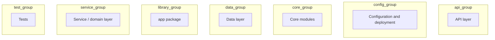

# Architecture report: chaskiq/chaskiq

> Automated static analysis. **Observed** = directly seen in files/imports/AST; **Inferred** = interpretation from that evidence. Repository code was not executed.

## 1. Repository at a glance

| Item | Value |
| --- | --- |
| Repository | chaskiq/chaskiq |
| Description | A full featured Live Chat, Support & Marketing platform, alternative to Intercom, Drift, Crisp. |
| Language | TypeScript |
| Stars | 3584 |
| Licence | Other |
| Analysed commit / branch | 46dfdd11c63c6849ecde16a0dcc54d388e2613a3 / main |
| Framework(s) | None detected |
| Files analysed | 800 |
| Components | 7 |

## 2. Architecture in one minute

chaskiq/chaskiq - A full featured Live Chat, Support & Marketing platform, alternative to Intercom, Drift, Crisp.. This repository was analysed statically from 800 file(s) (0 Python). Detected technologies (observed from imports/manifests): GitHub Actions, Docker. Files are grouped into 7 component(s): API layer, app package, Configuration and deployment, Core modules, Data layer, Service / domain layer, Tests. Findings below distinguish observed facts from inferred interpretation.

## 3. High-level block diagram

## 4. Main components

### API layer (`api_layer`)

- **Kind:** api
- **Status:** Observed
- **Confidence:** 0.85
- **Responsibility:** Groups 26 file(s) under api layer (observed from repository paths and static analysis).
- **Paths:** `app/controllers/agents/auth0_controller.rb`, `app/controllers/agents/invitations_controller.rb`, `app/controllers/agents/omniauth_callbacks_controller.rb`, `app/controllers/agents/passwords_controller.rb`, `app/controllers/agents/registrations_controller.rb`, `app/controllers/agents/sessions_controller.rb`, `app/controllers/agents/tokens_controller.rb`, `app/controllers/api/graphql_controller.rb`, `app/controllers/api/v1/credentials_controller.rb`, `app/controllers/api/v1/direct_uploads_controller.rb`, `app/controllers/api/v1/hooks/provider_controller.rb`, `app/controllers/api/v1/hooks_controller.rb`, `app/controllers/api/v1/subscriptions/paddle_hooks_controller.rb`, `app/controllers/api/v1/subscriptions/stripe_hooks_controller.rb`, `app/controllers/api_controller.rb`, `app/controllers/application_controller.rb`, `app/controllers/articles_controller.rb`, `app/controllers/client_tester_controller.rb`, `app/controllers/concerns/cors_headers.rb`, `app/controllers/concerns/hash_ensurer.rb`, `app/controllers/concerns/package_iframe_behavior.rb`, `app/controllers/concerns/trackeable.rb`, `app/controllers/graphql_controller.rb`, `app/controllers/home_controller.rb`, `app/controllers/oembed_controller.rb`, `app/controllers/widgets_controller.rb`
- **Evidence:** [app/controllers/agents/auth0_controller.rb](https://github.com/chaskiq/chaskiq/blob/46dfdd11c63c6849ecde16a0dcc54d388e2613a3/app/controllers/agents/auth0_controller.rb); [app/controllers/agents/invitations_controller.rb](https://github.com/chaskiq/chaskiq/blob/46dfdd11c63c6849ecde16a0dcc54d388e2613a3/app/controllers/agents/invitations_controller.rb); [app/controllers/agents/omniauth_callbacks_controller.rb](https://github.com/chaskiq/chaskiq/blob/46dfdd11c63c6849ecde16a0dcc54d388e2613a3/app/controllers/agents/omniauth_callbacks_controller.rb); [app/controllers/agents/passwords_controller.rb](https://github.com/chaskiq/chaskiq/blob/46dfdd11c63c6849ecde16a0dcc54d388e2613a3/app/controllers/agents/passwords_controller.rb); [app/controllers/agents/registrations_controller.rb](https://github.com/chaskiq/chaskiq/blob/46dfdd11c63c6849ecde16a0dcc54d388e2613a3/app/controllers/agents/registrations_controller.rb); [app/controllers/agents/sessions_controller.rb](https://github.com/chaskiq/chaskiq/blob/46dfdd11c63c6849ecde16a0dcc54d388e2613a3/app/controllers/agents/sessions_controller.rb); [app/controllers/agents/tokens_controller.rb](https://github.com/chaskiq/chaskiq/blob/46dfdd11c63c6849ecde16a0dcc54d388e2613a3/app/controllers/agents/tokens_controller.rb); [app/controllers/api/graphql_controller.rb](https://github.com/chaskiq/chaskiq/blob/46dfdd11c63c6849ecde16a0dcc54d388e2613a3/app/controllers/api/graphql_controller.rb)

### app package (`app`)

- **Kind:** library
- **Status:** Observed
- **Confidence:** 0.85
- **Responsibility:** Groups 479 file(s) under app package (observed from repository paths and static analysis).
- **Paths:** `app/channels/agent_channel.rb`, `app/channels/application_cable/channel.rb`, `app/channels/application_cable/connection.rb`, `app/channels/events_channel.rb`, `app/channels/messenger_events_channel.rb`, `app/channels/presence_channel.rb`, `app/channels/rtc_channel.rb`, `app/graphql/chaskiq_schema.rb`, `app/graphql/helpers/authorizator.rb`, `app/graphql/mutations/agents/destroy_agent_role.rb`, `app/graphql/mutations/agents/invite.rb`, `app/graphql/mutations/agents/update_agent.rb`, `app/graphql/mutations/agents/update_agent_role.rb`, `app/graphql/mutations/app_package_integrations/create_integration.rb`, `app/graphql/mutations/app_package_integrations/delete_integration.rb`, `app/graphql/mutations/app_package_integrations/update_integration.rb`, `app/graphql/mutations/app_packages/create_package.rb`, `app/graphql/mutations/app_packages/delete_package.rb`, `app/graphql/mutations/app_packages/update_package.rb`, `app/graphql/mutations/app_users/convert_user.rb`, `app/graphql/mutations/app_users/create_app_user.rb`, `app/graphql/mutations/app_users/create_external_profile.rb`, `app/graphql/mutations/app_users/delete_external_profile.rb`, `app/graphql/mutations/app_users/merge_contact.rb`, `app/graphql/mutations/app_users/privacy_consent.rb`, `app/graphql/mutations/app_users/sync_external_profile.rb`, `app/graphql/mutations/app_users/update_app_user.rb`, `app/graphql/mutations/app_users/update_app_user_state.rb`, `app/graphql/mutations/app_users/update_external_profile.rb`, `app/graphql/mutations/apps/create_app.rb`, `app/graphql/mutations/apps/destroy_app.rb`, `app/graphql/mutations/apps/import_contacts.rb`, `app/graphql/mutations/apps/update_app.rb`, `app/graphql/mutations/articles/add_articles_to_collection.rb`, `app/graphql/mutations/articles/article_blob_attach.rb`, `app/graphql/mutations/articles/article_settings_delete_lang.rb`, `app/graphql/mutations/articles/article_settings_update.rb`, `app/graphql/mutations/articles/assign_author.rb`, `app/graphql/mutations/articles/change_collection_article.rb`, `app/graphql/mutations/articles/collections/create_collection.rb`, `app/graphql/mutations/articles/collections/delete_collection.rb`, `app/graphql/mutations/articles/collections/edit_collection.rb`, `app/graphql/mutations/articles/collections/reorder_collection.rb`, `app/graphql/mutations/articles/create_article.rb`, `app/graphql/mutations/articles/delete_article.rb`, `app/graphql/mutations/articles/edit_article.rb`, `app/graphql/mutations/articles/reorder_article.rb`, `app/graphql/mutations/articles/sections/create_section.rb`, `app/graphql/mutations/articles/sections/delete_section.rb`, `app/graphql/mutations/articles/sections/edit_section.rb`, `app/graphql/mutations/articles/toggle_article.rb`, `app/graphql/mutations/assign_rule/create_assign_rule.rb`, `app/graphql/mutations/assign_rule/delete_assign_rule.rb`, `app/graphql/mutations/assign_rule/edit_assign_rule.rb`, `app/graphql/mutations/assign_rule/update_rule_priorities.rb`, `app/graphql/mutations/base_mutation.rb`, `app/graphql/mutations/bots/create_bot_task.rb`, `app/graphql/mutations/bots/delete_bot_task.rb`, `app/graphql/mutations/bots/reorder_bot_task.rb`, `app/graphql/mutations/bots/update_bot_task.rb`, `app/graphql/mutations/campaigns/create_campaign.rb`, `app/graphql/mutations/campaigns/delete_campaign.rb`, `app/graphql/mutations/campaigns/deliver_campaign.rb`, `app/graphql/mutations/campaigns/new_campaign.rb`, `app/graphql/mutations/campaigns/purge_metrics.rb`, `app/graphql/mutations/campaigns/update_campaign.rb`, `app/graphql/mutations/clone_message.rb`, `app/graphql/mutations/conversations/assign_user.rb`, `app/graphql/mutations/conversations/insert_app_block_comment.rb`, `app/graphql/mutations/conversations/insert_comment.rb`, `app/graphql/mutations/conversations/insert_note.rb`, `app/graphql/mutations/conversations/send_trigger.rb`, `app/graphql/mutations/conversations/sort_agent_list.rb`, `app/graphql/mutations/conversations/start_conversation.rb`, `app/graphql/mutations/conversations/toggle_priority.rb`, `app/graphql/mutations/conversations/typing_notifier.rb`, `app/graphql/mutations/conversations/update_state.rb`, `app/graphql/mutations/conversations/update_tags.rb`, `app/graphql/mutations/create_direct_upload.rb`, `app/graphql/mutations/create_url_upload.rb`, `app/graphql/mutations/messenger/auth.rb`, `app/graphql/mutations/messenger/create_comment.rb`, `app/graphql/mutations/oauth_apps/oauth_create.rb`, `app/graphql/mutations/oauth_apps/oauth_delete.rb`, `app/graphql/mutations/oauth_apps/oauth_update.rb`, `app/graphql/mutations/outgoing_webhooks/create_webhook.rb`, `app/graphql/mutations/outgoing_webhooks/delete_webhook.rb`, `app/graphql/mutations/outgoing_webhooks/update_webhook.rb`, `app/graphql/mutations/predicates/create_predicate.rb`, `app/graphql/mutations/predicates/delete_predicate.rb`, `app/graphql/mutations/predicates/save_predicate.rb`, `app/graphql/mutations/predicates/search_predicate.rb`, `app/graphql/mutations/quick_replies/create_quick_reply.rb`, `app/graphql/mutations/quick_replies/delete_quick_reply.rb`, `app/graphql/mutations/quick_replies/update_quick_reply.rb`, `app/graphql/mutations/stripe_subscriptions/create_intent.rb`, `app/graphql/mutations/stripe_subscriptions/customer_portal.rb`, `app/graphql/mutations/teams/add_team_agent.rb`, `app/graphql/mutations/teams/create_team.rb`, `app/graphql/mutations/teams/delete_team.rb`, `app/graphql/mutations/teams/delete_team_agent.rb`, `app/graphql/mutations/teams/update_team.rb`, `app/graphql/types/agent_type.rb`, `app/graphql/types/any_type.rb`, `app/graphql/types/app_package_integration_type.rb`, `app/graphql/types/app_package_type.rb`, `app/graphql/types/app_params_type.rb`, `app/graphql/types/app_type.rb`, `app/graphql/types/app_user_type.rb`, `app/graphql/types/article_settings_type.rb`, `app/graphql/types/article_type.rb`, `app/graphql/types/article_url_type.rb`, `app/graphql/types/assignment_rule_type.rb`, `app/graphql/types/author_type.rb`, `app/graphql/types/base_enum.rb`, `app/graphql/types/base_input_object.rb`, `app/graphql/types/base_interface.rb`, `app/graphql/types/base_object.rb`, `app/graphql/types/base_scalar.rb`, `app/graphql/types/base_union.rb`, `app/graphql/types/bot_path_type.rb`, `app/graphql/types/bot_task_filter_type.rb`, `app/graphql/types/bot_task_type.rb`, `app/graphql/types/campaign_params_type.rb`, `app/graphql/types/campaign_type.rb`, `app/graphql/types/collection_type.rb`, `app/graphql/types/conversation_message_input_type.rb`, `app/graphql/types/conversation_part_content_type.rb`, `app/graphql/types/conversation_part_type.rb`, `app/graphql/types/conversation_type.rb`, `app/graphql/types/external_profile_type.rb`, `app/graphql/types/json_type.rb`, `app/graphql/types/message_input_type.rb`, `app/graphql/types/messenger_type.rb`, `app/graphql/types/metric_type.rb`, `app/graphql/types/mutation_type.rb`, `app/graphql/types/oauth_application_type.rb`, `app/graphql/types/paginated_agent_teams_type.rb`, `app/graphql/types/paginated_app_users_type.rb`, `app/graphql/types/paginated_articles_type.rb`, `app/graphql/types/paginated_bot_tasks_type.rb`, `app/graphql/types/paginated_campaign_type.rb`, `app/graphql/types/paginated_conversation_parts_type.rb`, `app/graphql/types/paginated_conversations_type.rb`, `app/graphql/types/paginated_metrics_type.rb`, `app/graphql/types/paginated_public_conversations_type.rb`, `app/graphql/types/paginated_results_type.rb`, `app/graphql/types/paginated_teams_type.rb`, `app/graphql/types/paginated_visits_type.rb`, `app/graphql/types/predicate_type.rb`, `app/graphql/types/public_app_type.rb`, `app/graphql/types/public_conversation_type.rb`, `app/graphql/types/query_type.rb`, `app/graphql/types/quick_reply_type.rb`, `app/graphql/types/role_type.rb`, `app/graphql/types/section_type.rb`, `app/graphql/types/segment_type.rb`, `app/graphql/types/team_type.rb`, `app/graphql/types/user_type.rb`, `app/graphql/types/visit_type.rb`, `app/helpers/application_helper.rb`, `app/helpers/sanitize_helpers.rb`, `app/identities/app_identity.rb`, `app/importers/list_importer.rb`, `app/javascript/application.js`, `app/javascript/article.js`, `app/javascript/docs.js`, `app/javascript/embed.js`, `app/javascript/locales.js`, `app/javascript/packages/components/__tests__/components.test.js`, `app/javascript/packages/components/src/components/AccessDenied.tsx`, `app/javascript/packages/components/src/components/Accordeon.tsx`, `app/javascript/packages/components/src/components/Alert.tsx`, `app/javascript/packages/components/src/components/Avatar.tsx`, `app/javascript/packages/components/src/components/Badge.tsx`, `app/javascript/packages/components/src/components/Breadcrumbs.tsx`, `app/javascript/packages/components/src/components/BrowserSimulator.tsx`, `app/javascript/packages/components/src/components/Button.tsx`, `app/javascript/packages/components/src/components/ButtonTabSwitch.tsx`, `app/javascript/packages/components/src/components/Card.tsx`, `app/javascript/packages/components/src/components/ContactManager.tsx`, `app/javascript/packages/components/src/components/Content.tsx`, `app/javascript/packages/components/src/components/DeleteDialog.tsx`, `app/javascript/packages/components/src/components/Dropdown.tsx`, `app/javascript/packages/components/src/components/EmptyView.tsx`, `app/javascript/packages/components/src/components/ErrorBoundary.tsx`, `app/javascript/packages/components/src/components/FilterMenu.tsx`, `app/javascript/packages/components/src/components/FormDialog.tsx`, `app/javascript/packages/components/src/components/Hints.tsx`, `app/javascript/packages/components/src/components/ImageZoomOverlay.tsx`, `app/javascript/packages/components/src/components/InplaceInputEditor.tsx`, `app/javascript/packages/components/src/components/LangChooser.tsx`, `app/javascript/packages/components/src/components/List.tsx`, `app/javascript/packages/components/src/components/PageHeader.tsx`, `app/javascript/packages/components/src/components/Panel.tsx`, `app/javascript/packages/components/src/components/Progress.tsx`, `app/javascript/packages/components/src/components/RouterLink.tsx`, `app/javascript/packages/components/src/components/SearchInput.tsx`, `app/javascript/packages/components/src/components/Switch.tsx`, `app/javascript/packages/components/src/components/Table/index.tsx`, `app/javascript/packages/components/src/components/Table/userFormat.tsx`, `app/javascript/packages/components/src/components/Tabs.tsx`, `app/javascript/packages/components/src/components/TagDialog.tsx`, `app/javascript/packages/components/src/components/Tour.tsx`, `app/javascript/packages/components/src/components/UserData.tsx`, `app/javascript/packages/components/src/components/UserProfileCard.tsx`, `app/javascript/packages/components/src/components/UserSlide.tsx`, `app/javascript/packages/components/src/components/charts/charts.tsx`, `app/javascript/packages/components/src/components/charts/count.tsx`, `app/javascript/packages/components/src/components/charts/heatMap.tsx`, `app/javascript/packages/components/src/components/charts/pie.tsx`, `app/javascript/packages/components/src/components/connectivity.tsx`, `app/javascript/packages/components/src/components/danteEditor/appPackage.tsx`, `app/javascript/packages/components/src/components/danteEditor/audioRecorder.tsx`, `app/javascript/packages/components/src/components/danteEditor/container.tsx`, `app/javascript/packages/components/src/components/danteEditor/index.tsx`, `app/javascript/packages/components/src/components/danteEditor/onDemandTriggers.tsx`, `app/javascript/packages/components/src/components/danteEditor/quickReplies.tsx`, `app/javascript/packages/components/src/components/danteEditor/renderer.tsx`, `app/javascript/packages/components/src/components/dashboard/card.tsx`, `app/javascript/packages/components/src/components/fileUploader.tsx`, `app/javascript/packages/components/src/components/forms/ColorPicker.tsx`, `app/javascript/packages/components/src/components/forms/FieldRenderer.tsx`, `app/javascript/packages/components/src/components/forms/Input.tsx`, `app/javascript/packages/components/src/components/forms/Toggle.tsx`, `app/javascript/packages/components/src/components/hooks/useAutoLogout.js`, `app/javascript/packages/components/src/components/hooks/useClickOutside.ts`, `app/javascript/packages/components/src/components/hooks/useDarkMode.ts`, `app/javascript/packages/components/src/components/hooks/useDebounce.ts`, `app/javascript/packages/components/src/components/hooks/useLocalStorage.ts`, `app/javascript/packages/components/src/components/hooks/useMedia.ts`, `app/javascript/packages/components/src/components/hooks/usePortal.ts`, `app/javascript/packages/components/src/components/hooks/useScript.ts`, `app/javascript/packages/components/src/components/hooks/useTabActivity.ts`, `app/javascript/packages/components/src/components/icons.tsx`, `app/javascript/packages/components/src/components/jsonDebug.tsx`, `app/javascript/packages/components/src/components/loadingView.tsx`, `app/javascript/packages/components/src/components/map/index.tsx`, `app/javascript/packages/components/src/components/notifications/index.tsx`, `app/javascript/packages/components/src/components/packageBlocks/AppList.tsx`, `app/javascript/packages/components/src/components/packageBlocks/Button.tsx`, `app/javascript/packages/components/src/components/packageBlocks/CheckboxGroup.tsx`, `app/javascript/packages/components/src/components/packageBlocks/DataTable.tsx`, `app/javascript/packages/components/src/components/packageBlocks/DropDown.tsx`, `app/javascript/packages/components/src/components/packageBlocks/Image.tsx`, `app/javascript/packages/components/src/components/packageBlocks/InserterForm.tsx`, `app/javascript/packages/components/src/components/packageBlocks/List.tsx`, `app/javascript/packages/components/src/components/packageBlocks/Serapator.tsx`, `app/javascript/packages/components/src/components/packageBlocks/SingleSelect.tsx`, `app/javascript/packages/components/src/components/packageBlocks/Spacer.tsx`, `app/javascript/packages/components/src/components/packageBlocks/Text.tsx`, `app/javascript/packages/components/src/components/packageBlocks/TextArea.tsx`, `app/javascript/packages/components/src/components/packageBlocks/TextInput.tsx`, `app/javascript/packages/components/src/components/packageBlocks/baseInserter.tsx`, `app/javascript/packages/components/src/components/packageBlocks/components.tsx`, `app/javascript/packages/components/src/components/packageBlocks/shared.tsx`, `app/javascript/packages/components/src/components/packageBlocks/styled.js`, `app/javascript/packages/components/src/components/packageBlocks/styles.js`, `app/javascript/packages/components/src/components/packageBlocks/utils.ts`, `app/javascript/packages/components/src/components/rtc.tsx`, `app/javascript/packages/components/src/components/rtcView.tsx`, `app/javascript/packages/components/src/components/scrollingTabs.tsx`, `app/javascript/packages/components/src/components/segmentManager/container.tsx`, `app/javascript/packages/components/src/components/segmentManager/index.tsx`, `app/javascript/packages/components/src/components/segmentManager/itemButton.tsx`, `app/javascript/packages/components/src/components/segmentManager/types.ts`, `app/javascript/packages/components/src/components/stats.tsx`, `app/javascript/packages/components/src/components/textEditor/darkTheme.ts`, `app/javascript/packages/components/src/components/textEditor/editorStyles.tsx`, `app/javascript/packages/components/src/components/textEditor/theme.ts`, `app/javascript/packages/components/src/components/upgradeButton.tsx`, `app/javascript/packages/components/src/components/webSetup.tsx`, `app/javascript/packages/components/src/index.js`, `app/javascript/packages/components/src/utils/caseConverter.ts`, `app/javascript/packages/components/src/utils/defaultFields.ts`, `app/javascript/packages/components/src/utils/htmlSanitize.ts`, `app/javascript/packages/messenger/__tests__/messenger.test.js`, `app/javascript/packages/messenger/src/client_messenger/Banner.tsx`, `app/javascript/packages/messenger/src/client_messenger/UserTour.tsx`, `app/javascript/packages/messenger/src/client_messenger/activityUtils.js`, `app/javascript/packages/messenger/src/client_messenger/articles.tsx`, `app/javascript/packages/messenger/src/client_messenger/autolink.tsx`, `app/javascript/packages/messenger/src/client_messenger/consentView.tsx`, `app/javascript/packages/messenger/src/client_messenger/context.tsx`, `app/javascript/packages/messenger/src/client_messenger/conversations/appPackageBlock.tsx`, `app/javascript/packages/messenger/src/client_messenger/conversations/commentItem.tsx`, `app/javascript/packages/messenger/src/client_messenger/conversations/conversation.tsx`, `app/javascript/packages/messenger/src/client_messenger/conversations/conversations.tsx`, `app/javascript/packages/messenger/src/client_messenger/conversations/messageItemWrapper.tsx`, `app/javascript/packages/messenger/src/client_messenger/conversations/newConversationBlock.tsx`, `app/javascript/packages/messenger/src/client_messenger/cookies.ts`, `app/javascript/packages/messenger/src/client_messenger/frameBridge.tsx`, `app/javascript/packages/messenger/src/client_messenger/frameChild.tsx`, `app/javascript/packages/messenger/src/client_messenger/giphy.tsx`, `app/javascript/packages/messenger/src/client_messenger/graphql/client.ts`, `app/javascript/packages/messenger/src/client_messenger/graphql/queries.ts`, `app/javascript/packages/messenger/src/client_messenger/graphql/testEntry.ts`, `app/javascript/packages/messenger/src/client_messenger/homePanel.tsx`, `app/javascript/packages/messenger/src/client_messenger/html2Content.tsx`, `app/javascript/packages/messenger/src/client_messenger/icons/index.tsx`, `app/javascript/packages/messenger/src/client_messenger/loader.tsx`, `app/javascript/packages/messenger/src/client_messenger/messageContainer.tsx`, `app/javascript/packages/messenger/src/client_messenger/messageFrame.tsx`, `app/javascript/packages/messenger/src/client_messenger/messageWindow.tsx`, `app/javascript/packages/messenger/src/client_messenger/messenger.tsx`, `app/javascript/packages/messenger/src/client_messenger/messengerEncrypted.tsx`, `app/javascript/packages/messenger/src/client_messenger/packageFrame.tsx`, `app/javascript/packages/messenger/src/client_messenger/rtcView.tsx`, `app/javascript/packages/messenger/src/client_messenger/shared/absintheSubscription.ts`, `app/javascript/packages/messenger/src/client_messenger/shared/actionCableSubscription.ts`, `app/javascript/packages/messenger/src/client_messenger/shared/caseConverter.ts`, `app/javascript/packages/messenger/src/client_messenger/styledFrame.tsx`, `app/javascript/packages/messenger/src/client_messenger/styles/emojimart.tsx`, `app/javascript/packages/messenger/src/client_messenger/styles/reset.js`, `app/javascript/packages/messenger/src/client_messenger/styles/styled.tsx`, `app/javascript/packages/messenger/src/client_messenger/styles/utils.ts`, `app/javascript/packages/messenger/src/client_messenger/textEditor.tsx`, `app/javascript/packages/messenger/src/client_messenger/textEditor/darkTheme.tsx`, `app/javascript/packages/messenger/src/client_messenger/textEditor/editorStyles.tsx`, `app/javascript/packages/messenger/src/client_messenger/textEditor/index.tsx`, `app/javascript/packages/messenger/src/client_messenger/textEditor/theme.tsx`, `app/javascript/packages/messenger/src/client_messenger/textEditor/tourStyles.tsx`, `app/javascript/packages/messenger/src/client_messenger/themeConfig.ts`, `app/javascript/packages/messenger/src/client_messenger/tour/globalStyle.tsx`, `app/javascript/packages/messenger/src/client_messenger/tour/tooltip.tsx`, `app/javascript/packages/messenger/src/client_messenger/tour/tourHelper.tsx`, `app/javascript/packages/messenger/src/client_messenger/tourManager.tsx`, `app/javascript/packages/messenger/src/client_messenger/uploader.tsx`, `app/javascript/packages/messenger/src/index.ts`, `app/javascript/packages/store/__tests__/store.test.js`, `app/javascript/packages/store/src/actions/app.ts`, `app/javascript/packages/store/src/actions/app_user.ts`, `app/javascript/packages/store/src/actions/app_users.ts`, `app/javascript/packages/store/src/actions/auth.ts`, `app/javascript/packages/store/src/actions/campaigns.ts`, `app/javascript/packages/store/src/actions/conversation.ts`, `app/javascript/packages/store/src/actions/conversations.ts`, `app/javascript/packages/store/src/actions/current_user.ts`, `app/javascript/packages/store/src/actions/drawer.ts`, `app/javascript/packages/store/src/actions/error_status_code.ts`, `app/javascript/packages/store/src/actions/fixedSlider.ts`, `app/javascript/packages/store/src/actions/imageZoom.ts`, `app/javascript/packages/store/src/actions/navigation.ts`, `app/javascript/packages/store/src/actions/notifications.ts`, `app/javascript/packages/store/src/actions/paddleSubscription.ts`, `app/javascript/packages/store/src/actions/reconnection.ts`, `app/javascript/packages/store/src/actions/rtc.ts`, `app/javascript/packages/store/src/actions/segments.ts`, `app/javascript/packages/store/src/actions/status_messages.ts`, `app/javascript/packages/store/src/actions/theme.ts`, `app/javascript/packages/store/src/actions/upgradePages.ts`, `app/javascript/packages/store/src/constants/action_types.ts`, `app/javascript/packages/store/src/graphql/client.ts`, `app/javascript/packages/store/src/graphql/docsQueries.ts`, `app/javascript/packages/store/src/graphql/fragments.ts`, `app/javascript/packages/store/src/graphql/graphql.ts`, `app/javascript/packages/store/src/graphql/mutations.ts`, `app/javascript/packages/store/src/graphql/queries.ts`, `app/javascript/packages/store/src/graphql/testEntry.ts`, `app/javascript/packages/store/src/graphql/testEntryts.ts`, `app/javascript/packages/store/src/index.ts`, `app/javascript/packages/store/src/jwt.ts`, `app/javascript/packages/twilio/CallList.jsx`, `app/javascript/packages/twilio/PhoneCall.jsx`, `app/javascript/packages/twilio/index.js`, `app/javascript/packages/twilio/subscriptions.js`, `app/javascript/src/App.tsx`, `app/javascript/src/AppRoutes.js`, `app/javascript/src/dummyWhitelist.js`, `app/javascript/src/history.js`, `app/javascript/src/layout/layoutDefinitions.tsx`, `app/javascript/src/layout/mainMenu.tsx`, `app/javascript/src/layout/settingsItems.tsx`, `app/javascript/src/layout/sidebar.tsx`, `app/javascript/src/layout/subscriptionPlanFeatures.js`, `app/javascript/src/layout/user_menu.tsx`, `app/javascript/src/pages/AgentProfile.tsx`, `app/javascript/src/pages/Api.tsx`, `app/javascript/src/pages/AppContainer.tsx`, `app/javascript/src/pages/AppSettings.tsx`, `app/javascript/src/pages/Apps.tsx`, `app/javascript/src/pages/Articles.tsx`, `app/javascript/src/pages/Billing.tsx`, `app/javascript/src/pages/BlocksPlayground.tsx`, `app/javascript/src/pages/Bots.tsx`, `app/javascript/src/pages/Campaigns.tsx`, `app/javascript/src/pages/Conversations.tsx`, `app/javascript/src/pages/Dashboard.tsx`, `app/javascript/src/pages/Integrations.tsx`, `app/javascript/src/pages/MessengerSettings.tsx`, `app/javascript/src/pages/NewApp.tsx`, `app/javascript/src/pages/NotFound.tsx`, `app/javascript/src/pages/Platform.tsx`, `app/javascript/src/pages/Profile.tsx`, `app/javascript/src/pages/Reports.tsx`, `app/javascript/src/pages/Settings.tsx`, `app/javascript/src/pages/Team.tsx`, `app/javascript/src/pages/UnSubscribe.tsx`, `app/javascript/src/pages/UpgradePage.tsx`, `app/javascript/src/pages/Webhooks.tsx`, `app/javascript/src/pages/articles/collections/dnd.tsx`, `app/javascript/src/pages/articles/collections/index.tsx`, `app/javascript/src/pages/articles/collections/show.tsx`, `app/javascript/src/pages/articles/editor.tsx`, `app/javascript/src/pages/articles/new.tsx`, `app/javascript/src/pages/articles/settings.tsx`, `app/javascript/src/pages/auth/acceptInvitation.tsx`, `app/javascript/src/pages/auth/login.tsx`, `app/javascript/src/pages/auth/logout.tsx`, `app/javascript/src/pages/auth/signUp.tsx`, `app/javascript/src/pages/bots/editor.tsx`, `app/javascript/src/pages/bots/segment.tsx`, `app/javascript/src/pages/bots/settings.tsx`, `app/javascript/src/pages/bots/taskSettings.tsx`, `app/javascript/src/pages/campaigns/editor.tsx`, `app/javascript/src/pages/campaigns/home.tsx`, `app/javascript/src/pages/campaigns/icons.tsx`, `app/javascript/src/pages/campaigns/loader.tsx`, `app/javascript/src/pages/campaigns/settings.tsx`, `app/javascript/src/pages/conversations/AppInserter.tsx`, `app/javascript/src/pages/conversations/AssignmentRules.tsx`, `app/javascript/src/pages/conversations/Conversation.tsx`, `app/javascript/src/pages/conversations/DialogEditor.tsx`, `app/javascript/src/pages/conversations/Editor.tsx`, `app/javascript/src/pages/conversations/ItemList.tsx`, `app/javascript/src/pages/conversations/ParticipantBlock.tsx`, `app/javascript/src/pages/conversations/QuickReplyDialog.tsx`, `app/javascript/src/pages/conversations/Search.tsx`, `app/javascript/src/pages/conversations/Sidebar.tsx`, `app/javascript/src/pages/conversations/SidebarAgents.tsx`, `app/javascript/src/pages/conversations/appPackagePanel.tsx`, `app/javascript/src/pages/conversations/newEditor.tsx`, `app/javascript/src/pages/conversations/newEditorDraftJs.tsx`, `app/javascript/src/pages/conversations/packageSlider.tsx`, `app/javascript/src/pages/conversations/quickRepliesPanel.tsx`, `app/javascript/src/pages/conversations/tabs.tsx`, `app/javascript/src/pages/conversations/triggersPanel.tsx`, `app/javascript/src/pages/playground/catalog.tsx`, `app/javascript/src/pages/reports/Overview.tsx`, `app/javascript/src/pages/reports/Package.tsx`, `app/javascript/src/pages/reports/ReportItem.tsx`, `app/javascript/src/pages/reports/SidebarMenu.tsx`, `app/javascript/src/pages/reports/renderer.tsx`, `app/javascript/src/serviceWorker.js`, `app/javascript/src/setupTests.js`, `app/javascript/src/shared/FakeI18n.ts`, `app/javascript/src/shared/absintheCableSubscription.ts`, `app/javascript/src/shared/actionCableSubscription.ts`, `app/javascript/src/shared/langsOptions.ts`, `app/javascript/src/shared/logos.ts`, `app/javascript/src/shared/timezones.ts`, `app/javascript/twilio_phone_package.js`, `app/jobs/api_channel_notificator_job.rb`, `app/jobs/app_user_event_job.rb`, `app/jobs/app_user_trigger_job.rb`, `app/jobs/application_job.rb`, `app/jobs/audit_job.rb`, `app/jobs/contact_merger_job.rb`, `app/jobs/conversation_channel_sync_job.rb`, `app/jobs/data_enrichment_job.rb`, `app/jobs/email_chat_notifier_job.rb`, `app/jobs/event_trigger_processor_job.rb`, `app/jobs/hook_message_receiver_job.rb`, `app/jobs/list_importer_job.rb`, `app/jobs/mail_importer_job.rb`, `app/jobs/mail_sender_job.rb`, `app/jobs/offline_checker_job.rb`, `app/jobs/outgoing_webhook_dispatcher_job.rb`, `app/jobs/outgoing_webhook_job.rb`, `app/jobs/ses_sender_job.rb`, `app/jobs/sns_receiver_job.rb`, `app/mailers/application_mailer.rb`, `app/mailers/assignee_mailer.rb`, `app/mailers/campaign_mailer.rb`, `app/mailers/chat_notifier_mailer.rb`, `app/mailers/import_mailer.rb`, `app/policies/app_policy.rb`, `app/validators/hex_validator.rb`, `app/validators/url_validator.rb`
- **Evidence:** [app/channels/agent_channel.rb](https://github.com/chaskiq/chaskiq/blob/46dfdd11c63c6849ecde16a0dcc54d388e2613a3/app/channels/agent_channel.rb); [app/channels/application_cable/channel.rb](https://github.com/chaskiq/chaskiq/blob/46dfdd11c63c6849ecde16a0dcc54d388e2613a3/app/channels/application_cable/channel.rb); [app/channels/application_cable/connection.rb](https://github.com/chaskiq/chaskiq/blob/46dfdd11c63c6849ecde16a0dcc54d388e2613a3/app/channels/application_cable/connection.rb); [app/channels/events_channel.rb](https://github.com/chaskiq/chaskiq/blob/46dfdd11c63c6849ecde16a0dcc54d388e2613a3/app/channels/events_channel.rb); [app/channels/messenger_events_channel.rb](https://github.com/chaskiq/chaskiq/blob/46dfdd11c63c6849ecde16a0dcc54d388e2613a3/app/channels/messenger_events_channel.rb); [app/channels/presence_channel.rb](https://github.com/chaskiq/chaskiq/blob/46dfdd11c63c6849ecde16a0dcc54d388e2613a3/app/channels/presence_channel.rb); [app/channels/rtc_channel.rb](https://github.com/chaskiq/chaskiq/blob/46dfdd11c63c6849ecde16a0dcc54d388e2613a3/app/channels/rtc_channel.rb); [app/graphql/chaskiq_schema.rb](https://github.com/chaskiq/chaskiq/blob/46dfdd11c63c6849ecde16a0dcc54d388e2613a3/app/graphql/chaskiq_schema.rb)

### Configuration and deployment (`config`)

- **Kind:** config
- **Status:** Observed
- **Confidence:** 0.85
- **Responsibility:** Groups 40 file(s) under configuration and deployment (observed from repository paths and static analysis).
- **Paths:** `Dockerfile`, `Dockerfile.development`, `app.json`, `app/assets/config/manifest.js`, `app/javascript/packages/components/package.json`, `app/javascript/packages/docs/package.json`, `app/javascript/packages/messenger/package.json`, `app/javascript/packages/store/package.json`, `app/javascript/packages/store/src/graphql/package.json`, `app/javascript/src/locales/messenger-translations.json`, `app/javascript/src/pages/settings/AppInserter.tsx`, `app/javascript/src/pages/settings/Availability.tsx`, `app/javascript/src/pages/settings/ContactAvatars.tsx`, `app/javascript/src/pages/settings/EditorSettings.tsx`, `app/javascript/src/pages/settings/EmailRequirement.tsx`, `app/javascript/src/pages/settings/InboundSettings.tsx`, `app/javascript/src/pages/settings/Language.tsx`, `app/javascript/src/pages/settings/QuickReplies.tsx`, `app/javascript/src/pages/settings/Styling.tsx`, `app/javascript/src/pages/settings/Tags.tsx`, `app/javascript/src/pages/settings/UserDataFields.tsx`, `app/javascript/src/pages/settings/VerificationView.tsx`, `app/javascript/src/pages/settings/form.tsx`, `config/anycable.yml`, `config/application.rb`, `config/boot.rb`, `config/cable.yml`, `config/chaskiq_boot.rb`, `config/database.yml`, `config/environment.rb`, `config/environments/development.rb`, `config/environments/production.rb`, `config/environments/staging.rb`, `config/environments/test.rb`, `config/i18n.yml`, `config/initializers/app_subdomains.rb`, `config/initializers/application_controller_renderer.rb`, `config/initializers/assets.rb`, `config/initializers/backtrace_silencers.rb`, `config/initializers/before_start.rb`
- **Evidence:** [Dockerfile](https://github.com/chaskiq/chaskiq/blob/46dfdd11c63c6849ecde16a0dcc54d388e2613a3/Dockerfile); [Dockerfile.development](https://github.com/chaskiq/chaskiq/blob/46dfdd11c63c6849ecde16a0dcc54d388e2613a3/Dockerfile.development); [app.json](https://github.com/chaskiq/chaskiq/blob/46dfdd11c63c6849ecde16a0dcc54d388e2613a3/app.json); [app/assets/config/manifest.js](https://github.com/chaskiq/chaskiq/blob/46dfdd11c63c6849ecde16a0dcc54d388e2613a3/app/assets/config/manifest.js); [app/javascript/packages/components/package.json](https://github.com/chaskiq/chaskiq/blob/46dfdd11c63c6849ecde16a0dcc54d388e2613a3/app/javascript/packages/components/package.json); [app/javascript/packages/docs/package.json](https://github.com/chaskiq/chaskiq/blob/46dfdd11c63c6849ecde16a0dcc54d388e2613a3/app/javascript/packages/docs/package.json); [app/javascript/packages/messenger/package.json](https://github.com/chaskiq/chaskiq/blob/46dfdd11c63c6849ecde16a0dcc54d388e2613a3/app/javascript/packages/messenger/package.json); [app/javascript/packages/store/package.json](https://github.com/chaskiq/chaskiq/blob/46dfdd11c63c6849ecde16a0dcc54d388e2613a3/app/javascript/packages/store/package.json)

### Core modules (`core`)

- **Kind:** core
- **Status:** Observed
- **Confidence:** 0.85
- **Responsibility:** Groups 3 file(s) under core modules (observed from repository paths and static analysis).
- **Paths:** `babel-esbuild.mjs`, `babel-plugin-macros.config.js`, `babel.config.js`
- **Evidence:** [babel-esbuild.mjs](https://github.com/chaskiq/chaskiq/blob/46dfdd11c63c6849ecde16a0dcc54d388e2613a3/babel-esbuild.mjs); [babel-plugin-macros.config.js](https://github.com/chaskiq/chaskiq/blob/46dfdd11c63c6849ecde16a0dcc54d388e2613a3/babel-plugin-macros.config.js); [babel.config.js](https://github.com/chaskiq/chaskiq/blob/46dfdd11c63c6849ecde16a0dcc54d388e2613a3/babel.config.js)

### Data layer (`data_layer`)

- **Kind:** data
- **Status:** Observed
- **Confidence:** 0.85
- **Responsibility:** Groups 70 file(s) under data layer (observed from repository paths and static analysis).
- **Paths:** `app/models/agent.rb`, `app/models/agent_team.rb`, `app/models/app.rb`, `app/models/app_package.rb`, `app/models/app_package_integration.rb`, `app/models/app_user.rb`, `app/models/application_record.rb`, `app/models/article.rb`, `app/models/article_collection.rb`, `app/models/article_content.rb`, `app/models/article_setting.rb`, `app/models/assignment_rule.rb`, `app/models/audit.rb`, `app/models/auth_identity.rb`, `app/models/banner.rb`, `app/models/bot_task.rb`, `app/models/campaign.rb`, `app/models/collection_section.rb`, `app/models/concerns/auditable_behavior.rb`, `app/models/concerns/avatar.rb`, `app/models/concerns/connectivity.rb`, `app/models/concerns/email_validable.rb`, `app/models/concerns/eventable.rb`, `app/models/concerns/globalize_accessors.rb`, `app/models/concerns/inbound_address.rb`, `app/models/concerns/notificable.rb`, `app/models/concerns/subscribable.rb`, `app/models/concerns/tokenable.rb`, `app/models/concerns/union_scope.rb`, `app/models/concerns/user_handler.rb`, `app/models/conversation.rb`, `app/models/conversation_channel.rb`, `app/models/conversation_part.rb`, `app/models/conversation_part_block.rb`, `app/models/conversation_part_channel_source.rb`, `app/models/conversation_part_content.rb`, `app/models/conversation_part_event.rb`, `app/models/conversation_source.rb`, `app/models/event.rb`, `app/models/events/conversation_user_first_comment.rb`, `app/models/events/conversations_added.rb`, `app/models/events/conversations_assigned.rb`, `app/models/events/conversations_closed.rb`, `app/models/events/conversations_prioritized.rb`, `app/models/events/conversations_reopened.rb`, `app/models/events/conversations_started.rb`, `app/models/events/email_changed.rb`, `app/models/events/leads_convert.rb`, `app/models/events/leads_verified.rb`, `app/models/events/users_created.rb`, `app/models/events/visitors_convert.rb`, `app/models/external_profile.rb`, `app/models/lead.rb`, `app/models/message.rb`, `app/models/metric.rb`, `app/models/outgoing_webhook.rb`, `app/models/plan.rb`, `app/models/plugin.rb`, `app/models/preview_card.rb`, `app/models/quick_reply.rb`, `app/models/role.rb`, `app/models/segment.rb`, `app/models/segment_comparator.rb`, `app/models/session_finder.rb`, `app/models/team.rb`, `app/models/tour.rb`, `app/models/user.rb`, `app/models/user_auto_message.rb`, `app/models/visit.rb`, `app/models/visitor.rb`
- **Evidence:** [app/models/agent.rb](https://github.com/chaskiq/chaskiq/blob/46dfdd11c63c6849ecde16a0dcc54d388e2613a3/app/models/agent.rb); [app/models/agent_team.rb](https://github.com/chaskiq/chaskiq/blob/46dfdd11c63c6849ecde16a0dcc54d388e2613a3/app/models/agent_team.rb); [app/models/app.rb](https://github.com/chaskiq/chaskiq/blob/46dfdd11c63c6849ecde16a0dcc54d388e2613a3/app/models/app.rb); [app/models/app_package.rb](https://github.com/chaskiq/chaskiq/blob/46dfdd11c63c6849ecde16a0dcc54d388e2613a3/app/models/app_package.rb); [app/models/app_package_integration.rb](https://github.com/chaskiq/chaskiq/blob/46dfdd11c63c6849ecde16a0dcc54d388e2613a3/app/models/app_package_integration.rb); [app/models/app_user.rb](https://github.com/chaskiq/chaskiq/blob/46dfdd11c63c6849ecde16a0dcc54d388e2613a3/app/models/app_user.rb); [app/models/application_record.rb](https://github.com/chaskiq/chaskiq/blob/46dfdd11c63c6849ecde16a0dcc54d388e2613a3/app/models/application_record.rb); [app/models/article.rb](https://github.com/chaskiq/chaskiq/blob/46dfdd11c63c6849ecde16a0dcc54d388e2613a3/app/models/article.rb)

### Service / domain layer (`service_layer`)

- **Kind:** service
- **Status:** Observed
- **Confidence:** 0.85
- **Responsibility:** Groups 49 file(s) under service / domain layer (observed from repository paths and static analysis).
- **Paths:** `app/services/action_trigger.rb`, `app/services/action_trigger_factory.rb`, `app/services/agent_dashboard.rb`, `app/services/app_package_dashboard.rb`, `app/services/app_user_dashboard.rb`, `app/services/base_service.rb`, `app/services/dante/audio_recorder_renderer.rb`, `app/services/dante/converter.rb`, `app/services/dante/divider_block_renderer.rb`, `app/services/dante/embed_block_renderer.rb`, `app/services/dante/file_block_renderer.rb`, `app/services/dante/image_block_renderer.rb`, `app/services/dante/migrator.rb`, `app/services/dante/renderer.rb`, `app/services/dante/utils.rb`, `app/services/dante/video_block_renderer.rb`, `app/services/dashboard.rb`, `app/services/data_enrichment_service/base.rb`, `app/services/digital_ocean/api.rb`, `app/services/eu_countries.rb`, `app/services/fetch_link_card_service.rb`, `app/services/message_apis/article_search/api.rb`, `app/services/message_apis/article_search/presenter.rb`, `app/services/message_apis/audits_reports/api.rb`, `app/services/message_apis/base_package.rb`, `app/services/message_apis/block_manager.rb`, `app/services/message_apis/contact_fields/api.rb`, `app/services/message_apis/contact_fields/presenter.rb`, `app/services/message_apis/content_showcase/api.rb`, `app/services/message_apis/content_showcase/presenter.rb`, `app/services/message_apis/csat/api.rb`, `app/services/message_apis/csat/presenter.rb`, `app/services/message_apis/helpers.rb`, `app/services/message_apis/inbox_sections/api.rb`, `app/services/message_apis/inbox_sections/presenter.rb`, `app/services/message_apis/oauth_utils.rb`, `app/services/message_apis/presenter_helpers.rb`, `app/services/message_apis/ui_catalog/api.rb`, `app/services/message_apis/ui_catalog/presenter.rb`, `app/services/origin_validator.rb`, `app/services/outgoing_webhook_service.rb`, `app/services/payment_services/paddle.rb`, `app/services/payment_services/stripe_service.rb`, `app/services/permissions_service.rb`, `app/services/plugin_schema_validator.rb`, `app/services/plugins/tar_downloader.rb`, `app/services/segment_factory.rb`, `app/services/user_finder.rb`, `app/services/visit_collector.rb`
- **Evidence:** [app/services/action_trigger.rb](https://github.com/chaskiq/chaskiq/blob/46dfdd11c63c6849ecde16a0dcc54d388e2613a3/app/services/action_trigger.rb); [app/services/action_trigger_factory.rb](https://github.com/chaskiq/chaskiq/blob/46dfdd11c63c6849ecde16a0dcc54d388e2613a3/app/services/action_trigger_factory.rb); [app/services/agent_dashboard.rb](https://github.com/chaskiq/chaskiq/blob/46dfdd11c63c6849ecde16a0dcc54d388e2613a3/app/services/agent_dashboard.rb); [app/services/app_package_dashboard.rb](https://github.com/chaskiq/chaskiq/blob/46dfdd11c63c6849ecde16a0dcc54d388e2613a3/app/services/app_package_dashboard.rb); [app/services/app_user_dashboard.rb](https://github.com/chaskiq/chaskiq/blob/46dfdd11c63c6849ecde16a0dcc54d388e2613a3/app/services/app_user_dashboard.rb); [app/services/base_service.rb](https://github.com/chaskiq/chaskiq/blob/46dfdd11c63c6849ecde16a0dcc54d388e2613a3/app/services/base_service.rb); [app/services/dante/audio_recorder_renderer.rb](https://github.com/chaskiq/chaskiq/blob/46dfdd11c63c6849ecde16a0dcc54d388e2613a3/app/services/dante/audio_recorder_renderer.rb); [app/services/dante/converter.rb](https://github.com/chaskiq/chaskiq/blob/46dfdd11c63c6849ecde16a0dcc54d388e2613a3/app/services/dante/converter.rb)

### Tests (`tests`)

- **Kind:** test
- **Status:** Observed
- **Confidence:** 0.85
- **Responsibility:** Groups 1 file(s) under tests (observed from repository paths and static analysis).
- **Paths:** `bin/test`
- **Evidence:** [bin/test](https://github.com/chaskiq/chaskiq/blob/46dfdd11c63c6849ecde16a0dcc54d388e2613a3/bin/test)

## 5. Execution flow

**Observed** entry point(s):

- [app/javascript/src/App.tsx](https://github.com/chaskiq/chaskiq/blob/46dfdd11c63c6849ecde16a0dcc54d388e2613a3/app/javascript/src/App.tsx)

Representative flow (derived from observed entry points and the import graph; steps beyond the entry point are **Inferred**):

1. Execution starts at an observed entry point listed above, if present.
2. No internal import relationships between components were observed.

## 6. Project structure

### `(root)`

- `.codeclimate.yml` - config (1113 bytes)
- `.dockerignore` - container (664 bytes)
- `.env.example` - config (315 bytes)
- `.eslintignore` - other (141 bytes)
- `.eslintrc.js` - source, JavaScript (1525 bytes)
- `.gitignore` - other (1830 bytes)
- `.prettierignore` - other (92 bytes)
- `.rspec` - other (22 bytes)
- `.rubocop.yml` - config (1004 bytes)
- `.rubocop_todo.yml` - config (16831 bytes)
- `.ruby-version` - other (5 bytes)
- `.unimportedrc.json` - config (1238 bytes)
- `CODE_OF_CONDUCT.md` - docs (3357 bytes)
- `Dockerfile` - container (1968 bytes)
- `Dockerfile.development` - container (1106 bytes)
- `Gemfile` - other (5056 bytes)
- `Gemfile.lock` - other (20749 bytes)
- `LICENSE.txt` - docs (35477 bytes)
- `Procfile` - other (259 bytes)
- `Procfile.dev` - other (116 bytes)
- `Procfile.test` - other (145 bytes)
- `README.md` - docs (6015 bytes)
- `Rakefile` - other (784 bytes)
- `SECURITY.md` - docs (78 bytes)
- `app.json` - config (19899 bytes)
- `babel-esbuild.mjs` - source, JavaScript (1394 bytes)
- `babel-plugin-macros.config.js` - source, JavaScript (322 bytes)
- `babel.config.js` - source, JavaScript (1477 bytes)
- `config.ru` - other (253 bytes)

### `.devcontainer`

- `.devcontainer/devcontainer.json` - config (283 bytes)

### `.docker-files`

- `.docker-files/deps.sh` - source, Shell (234 bytes)
- `.docker-files/node.sh` - source, Shell (433 bytes)
- `.docker-files/pg.sh` - source, Shell (494 bytes)

### `.dockerdev`

- `.dockerdev/.bashrc` - other (22 bytes)
- `.dockerdev/.psqlrc` - other (777 bytes)
- `.dockerdev/Aptfile` - other (3 bytes)

### `.github`

- `.github/.stale.yml` - config (683 bytes)
- `.github/ISSUE_TEMPLATE/bug_report.md` - docs (834 bytes)
- `.github/ISSUE_TEMPLATE/config.yml` - config (190 bytes)
- `.github/ISSUE_TEMPLATE/feature_request.md` - docs (595 bytes)
- `.github/workflows/anchore-analysis.yml` - ci, YAML (994 bytes)
- `.github/workflows/docker-image-ghcr.yml` - ci, YAML (1424 bytes)
- `.github/workflows/dockerimage.yml` - ci, YAML (1869 bytes)
- `.github/workflows/rubocop-analysis.yml` - ci, YAML (1165 bytes)
- `.github/workflows/ruby.yml` - ci, YAML (2581 bytes)

### `.husky`

- `.husky/pre-commit` - other (96 bytes)

### `app`

- `app/assets/builds/.keep` - other (0 bytes)
- `app/assets/config/manifest.js` - source, JavaScript (126 bytes)
- `app/assets/images/.keep` - other (0 bytes)
- `app/assets/javascripts/channels/.keep` - other (0 bytes)
- `app/assets/stylesheets/application.tailwind.css` - other (385 bytes)
- `app/assets/stylesheets/inter.scss` - other (253 bytes)
- `app/assets/stylesheets/sessions.css` - other (0 bytes)
- `app/channels/agent_channel.rb` - source, Ruby (240 bytes)
- `app/channels/application_cable/channel.rb` - source, Ruby (110 bytes)
- `app/channels/application_cable/connection.rb` - source, Ruby (2769 bytes)
- `app/channels/events_channel.rb` - source, Ruby (1265 bytes)
- `app/channels/messenger_events_channel.rb` - source, Ruby (3790 bytes)
- `app/channels/presence_channel.rb` - source, Ruby (768 bytes)
- `app/channels/rtc_channel.rb` - source, Ruby (199 bytes)
- `app/controllers/agents/auth0_controller.rb` - source, Ruby (1158 bytes)
- `app/controllers/agents/invitations_controller.rb` - source, Ruby (1299 bytes)
- `app/controllers/agents/omniauth_callbacks_controller.rb` - source, Ruby (593 bytes)
- `app/controllers/agents/passwords_controller.rb` - source, Ruby (353 bytes)
- `app/controllers/agents/registrations_controller.rb` - source, Ruby (341 bytes)
- `app/controllers/agents/sessions_controller.rb` - source, Ruby (1943 bytes)
- `app/controllers/agents/tokens_controller.rb` - source, Ruby (593 bytes)
- `app/controllers/api/graphql_controller.rb` - source, Ruby (2117 bytes)
- `app/controllers/api/v1/credentials_controller.rb` - source, Ruby (356 bytes)
- `app/controllers/api/v1/direct_uploads_controller.rb` - source, Ruby (748 bytes)
- `app/controllers/api/v1/hooks/provider_controller.rb` - source, Ruby (1681 bytes)
- `app/controllers/api/v1/hooks_controller.rb` - source, Ruby (8166 bytes)
- `app/controllers/api/v1/subscriptions/paddle_hooks_controller.rb` - source, Ruby (2560 bytes)
- `app/controllers/api/v1/subscriptions/stripe_hooks_controller.rb` - source, Ruby (2268 bytes)
- `app/controllers/api_controller.rb` - source, Ruby (5004 bytes)
- `app/controllers/application_controller.rb` - source, Ruby (3269 bytes)
- `app/controllers/articles_controller.rb` - source, Ruby (808 bytes)
- `app/controllers/client_tester_controller.rb` - source, Ruby (1803 bytes)
- `app/controllers/concerns/.keep` - other (0 bytes)
- `app/controllers/concerns/cors_headers.rb` - source, Ruby (790 bytes)
- `app/controllers/concerns/hash_ensurer.rb` - source, Ruby (820 bytes)
- `app/controllers/concerns/package_iframe_behavior.rb` - source, Ruby (4350 bytes)
- `app/controllers/concerns/trackeable.rb` - source, Ruby (186 bytes)
- `app/controllers/graphql_controller.rb` - source, Ruby (3151 bytes)
- `app/controllers/home_controller.rb` - source, Ruby (96 bytes)
- `app/controllers/oembed_controller.rb` - source, Ruby (298 bytes)
- `app/controllers/widgets_controller.rb` - source, Ruby (405 bytes)
- `app/graphql/chaskiq_schema.rb` - source, Ruby (1437 bytes)
- `app/graphql/helpers/authorizator.rb` - source, Ruby (170 bytes)
- `app/graphql/mutations/.keep` - other (0 bytes)
- `app/graphql/mutations/agents/destroy_agent_role.rb` - source, Ruby (1016 bytes)
- `app/graphql/mutations/agents/invite.rb` - source, Ruby (836 bytes)
- `app/graphql/mutations/agents/update_agent.rb` - source, Ruby (973 bytes)
- `app/graphql/mutations/agents/update_agent_role.rb` - source, Ruby (1247 bytes)
- `app/graphql/mutations/app_package_integrations/create_integration.rb` - source, Ruby (1500 bytes)
- `app/graphql/mutations/app_package_integrations/delete_integration.rb` - source, Ruby (954 bytes)
- `app/graphql/mutations/app_package_integrations/update_integration.rb` - source, Ruby (986 bytes)
- `app/graphql/mutations/app_packages/create_package.rb` - source, Ruby (964 bytes)
- `app/graphql/mutations/app_packages/delete_package.rb` - source, Ruby (853 bytes)
- `app/graphql/mutations/app_packages/update_package.rb` - source, Ruby (908 bytes)
- `app/graphql/mutations/app_users/convert_user.rb` - source, Ruby (759 bytes)
- `app/graphql/mutations/app_users/create_app_user.rb` - source, Ruby (1243 bytes)
- `app/graphql/mutations/app_users/create_external_profile.rb` - source, Ruby (922 bytes)
- `app/graphql/mutations/app_users/delete_external_profile.rb` - source, Ruby (694 bytes)
- `app/graphql/mutations/app_users/merge_contact.rb` - source, Ruby (749 bytes)
- `app/graphql/mutations/app_users/privacy_consent.rb` - source, Ruby (517 bytes)
- `app/graphql/mutations/app_users/sync_external_profile.rb` - source, Ruby (717 bytes)
- `app/graphql/mutations/app_users/update_app_user.rb` - source, Ruby (1193 bytes)
- `app/graphql/mutations/app_users/update_app_user_state.rb` - source, Ruby (1082 bytes)
- `app/graphql/mutations/app_users/update_external_profile.rb` - source, Ruby (844 bytes)
- `app/graphql/mutations/apps/create_app.rb` - source, Ruby (749 bytes)
- `app/graphql/mutations/apps/destroy_app.rb` - source, Ruby (586 bytes)
- `app/graphql/mutations/apps/import_contacts.rb` - source, Ruby (1283 bytes)
- `app/graphql/mutations/apps/update_app.rb` - source, Ruby (716 bytes)
- `app/graphql/mutations/articles/add_articles_to_collection.rb` - source, Ruby (878 bytes)
- `app/graphql/mutations/articles/article_blob_attach.rb` - source, Ruby (1527 bytes)
- `app/graphql/mutations/articles/article_settings_delete_lang.rb` - source, Ruby (947 bytes)
- `app/graphql/mutations/articles/article_settings_update.rb` - source, Ruby (1020 bytes)
- `app/graphql/mutations/articles/assign_author.rb` - source, Ruby (764 bytes)
- `app/graphql/mutations/articles/change_collection_article.rb` - source, Ruby (806 bytes)
- `app/graphql/mutations/articles/collections/create_collection.rb` - source, Ruby (1147 bytes)
- `app/graphql/mutations/articles/collections/delete_collection.rb` - source, Ruby (744 bytes)
- `app/graphql/mutations/articles/collections/edit_collection.rb` - source, Ruby (1288 bytes)
- `app/graphql/mutations/articles/collections/reorder_collection.rb` - source, Ruby (934 bytes)
- `app/graphql/mutations/articles/create_article.rb` - source, Ruby (1076 bytes)
- `app/graphql/mutations/articles/delete_article.rb` - source, Ruby (638 bytes)
- `app/graphql/mutations/articles/edit_article.rb` - source, Ruby (1449 bytes)
- `app/graphql/mutations/articles/reorder_article.rb` - source, Ruby (1068 bytes)
- `app/graphql/mutations/articles/sections/create_section.rb` - source, Ruby (1017 bytes)
- `app/graphql/mutations/articles/sections/delete_section.rb` - source, Ruby (771 bytes)
- `app/graphql/mutations/articles/sections/edit_section.rb` - source, Ruby (1093 bytes)
- `app/graphql/mutations/articles/toggle_article.rb` - source, Ruby (720 bytes)
- `app/graphql/mutations/assign_rule/create_assign_rule.rb` - source, Ruby (1073 bytes)
- `app/graphql/mutations/assign_rule/delete_assign_rule.rb` - source, Ruby (821 bytes)
- `app/graphql/mutations/assign_rule/edit_assign_rule.rb` - source, Ruby (1167 bytes)
- `app/graphql/mutations/assign_rule/update_rule_priorities.rb` - source, Ruby (770 bytes)
- `app/graphql/mutations/base_mutation.rb` - source, Ruby (461 bytes)
- `app/graphql/mutations/bots/create_bot_task.rb` - source, Ruby (761 bytes)
- `app/graphql/mutations/bots/delete_bot_task.rb` - source, Ruby (734 bytes)
- `app/graphql/mutations/bots/reorder_bot_task.rb` - source, Ruby (1015 bytes)
- `app/graphql/mutations/bots/update_bot_task.rb` - source, Ruby (834 bytes)
- `app/graphql/mutations/campaigns/create_campaign.rb` - source, Ruby (1050 bytes)
- `app/graphql/mutations/campaigns/delete_campaign.rb` - source, Ruby (897 bytes)
- `app/graphql/mutations/campaigns/deliver_campaign.rb` - source, Ruby (892 bytes)
- `app/graphql/mutations/campaigns/new_campaign.rb` - source, Ruby (386 bytes)
- `app/graphql/mutations/campaigns/purge_metrics.rb` - source, Ruby (894 bytes)
- `app/graphql/mutations/campaigns/update_campaign.rb` - source, Ruby (989 bytes)
- `app/graphql/mutations/clone_message.rb` - source, Ruby (704 bytes)
- `app/graphql/mutations/conversations/assign_user.rb` - source, Ruby (1368 bytes)
- `app/graphql/mutations/conversations/insert_app_block_comment.rb` - source, Ruby (948 bytes)
- `app/graphql/mutations/conversations/insert_comment.rb` - source, Ruby (1416 bytes)
- `app/graphql/mutations/conversations/insert_note.rb` - source, Ruby (1469 bytes)
- `app/graphql/mutations/conversations/send_trigger.rb` - source, Ruby (1520 bytes)
- `app/graphql/mutations/conversations/sort_agent_list.rb` - source, Ruby (626 bytes)
- `app/graphql/mutations/conversations/start_conversation.rb` - source, Ruby (3852 bytes)
- `app/graphql/mutations/conversations/toggle_priority.rb` - source, Ruby (1185 bytes)
- `app/graphql/mutations/conversations/typing_notifier.rb` - source, Ruby (1547 bytes)
- `app/graphql/mutations/conversations/update_state.rb` - source, Ruby (1266 bytes)
- `app/graphql/mutations/conversations/update_tags.rb` - source, Ruby (1055 bytes)
- `app/graphql/mutations/create_direct_upload.rb` - source, Ruby (1748 bytes)
- `app/graphql/mutations/create_url_upload.rb` - source, Ruby (2115 bytes)
- `app/graphql/mutations/messenger/auth.rb` - source, Ruby (931 bytes)
- `app/graphql/mutations/messenger/create_comment.rb` - source, Ruby (1383 bytes)
- `app/graphql/mutations/oauth_apps/oauth_create.rb` - source, Ruby (891 bytes)
- `app/graphql/mutations/oauth_apps/oauth_delete.rb` - source, Ruby (785 bytes)
- `app/graphql/mutations/oauth_apps/oauth_update.rb` - source, Ruby (930 bytes)
- `app/graphql/mutations/outgoing_webhooks/create_webhook.rb` - source, Ruby (1141 bytes)
- `app/graphql/mutations/outgoing_webhooks/delete_webhook.rb` - source, Ruby (657 bytes)
- `app/graphql/mutations/outgoing_webhooks/update_webhook.rb` - source, Ruby (1078 bytes)
- `app/graphql/mutations/predicates/create_predicate.rb` - source, Ruby (951 bytes)
- `app/graphql/mutations/predicates/delete_predicate.rb` - source, Ruby (844 bytes)
- `app/graphql/mutations/predicates/save_predicate.rb` - source, Ruby (966 bytes)
- `app/graphql/mutations/predicates/search_predicate.rb` - source, Ruby (1552 bytes)
- `app/graphql/mutations/quick_replies/create_quick_reply.rb` - source, Ruby (977 bytes)
- `app/graphql/mutations/quick_replies/delete_quick_reply.rb` - source, Ruby (809 bytes)
- `app/graphql/mutations/quick_replies/update_quick_reply.rb` - source, Ruby (1081 bytes)
- `app/graphql/mutations/stripe_subscriptions/create_intent.rb` - source, Ruby (2738 bytes)
- `app/graphql/mutations/stripe_subscriptions/customer_portal.rb` - source, Ruby (931 bytes)
- `app/graphql/mutations/teams/add_team_agent.rb` - source, Ruby (826 bytes)
- `app/graphql/mutations/teams/create_team.rb` - source, Ruby (812 bytes)
- `app/graphql/mutations/teams/delete_team.rb` - source, Ruby (667 bytes)
- `app/graphql/mutations/teams/delete_team_agent.rb` - source, Ruby (775 bytes)
- `app/graphql/mutations/teams/update_team.rb` - source, Ruby (908 bytes)
- `app/graphql/types/.keep` - other (0 bytes)
- `app/graphql/types/agent_type.rb` - source, Ruby (2366 bytes)
- `app/graphql/types/any_type.rb` - source, Ruby (198 bytes)
- `app/graphql/types/app_package_integration_type.rb` - source, Ruby (1923 bytes)
- `app/graphql/types/app_package_type.rb` - source, Ruby (968 bytes)
- `app/graphql/types/app_params_type.rb` - source, Ruby (376 bytes)
- `app/graphql/types/app_type.rb` - source, Ruby (24941 bytes)
- `app/graphql/types/app_user_type.rb` - source, Ruby (2944 bytes)
- `app/graphql/types/article_settings_type.rb` - source, Ruby (3607 bytes)
- `app/graphql/types/article_type.rb` - source, Ruby (1418 bytes)
- `app/graphql/types/article_url_type.rb` - source, Ruby (207 bytes)
- `app/graphql/types/assignment_rule_type.rb` - source, Ruby (351 bytes)
- `app/graphql/types/author_type.rb` - source, Ruby (430 bytes)
- `app/graphql/types/base_enum.rb` - source, Ruby (95 bytes)
- `app/graphql/types/base_input_object.rb` - source, Ruby (109 bytes)
- `app/graphql/types/base_interface.rb` - source, Ruby (116 bytes)
- `app/graphql/types/base_object.rb` - source, Ruby (351 bytes)
- `app/graphql/types/base_scalar.rb` - source, Ruby (99 bytes)
- `app/graphql/types/base_union.rb` - source, Ruby (97 bytes)
- `app/graphql/types/bot_path_type.rb` - source, Ruby (413 bytes)
- `app/graphql/types/bot_task_filter_type.rb` - source, Ruby (199 bytes)
- `app/graphql/types/bot_task_type.rb` - source, Ruby (1283 bytes)
- `app/graphql/types/campaign_params_type.rb` - source, Ruby (528 bytes)
- `app/graphql/types/campaign_type.rb` - source, Ruby (1915 bytes)
- `app/graphql/types/collection_type.rb` - source, Ruby (1572 bytes)
- `app/graphql/types/conversation_message_input_type.rb` - source, Ruby (149 bytes)
- `app/graphql/types/conversation_part_content_type.rb` - source, Ruby (1135 bytes)
- `app/graphql/types/conversation_part_type.rb` - source, Ruby (1045 bytes)
- `app/graphql/types/conversation_type.rb` - source, Ruby (2092 bytes)
- `app/graphql/types/external_profile_type.rb` - source, Ruby (364 bytes)
- `app/graphql/types/json_type.rb` - source, Ruby (199 bytes)
- `app/graphql/types/message_input_type.rb` - source, Ruby (416 bytes)
- `app/graphql/types/messenger_type.rb` - source, Ruby (4573 bytes)
- `app/graphql/types/metric_type.rb` - source, Ruby (593 bytes)
- `app/graphql/types/mutation_type.rb` - source, Ruby (7149 bytes)
- `app/graphql/types/oauth_application_type.rb` - source, Ruby (488 bytes)
- `app/graphql/types/paginated_agent_teams_type.rb` - source, Ruby (154 bytes)
- `app/graphql/types/paginated_app_users_type.rb` - source, Ruby (234 bytes)
- `app/graphql/types/paginated_articles_type.rb` - source, Ruby (234 bytes)
- `app/graphql/types/paginated_bot_tasks_type.rb` - source, Ruby (234 bytes)
- `app/graphql/types/paginated_campaign_type.rb` - source, Ruby (235 bytes)
- `app/graphql/types/paginated_conversation_parts_type.rb` - source, Ruby (252 bytes)
- `app/graphql/types/paginated_conversations_type.rb` - source, Ruby (244 bytes)
- `app/graphql/types/paginated_metrics_type.rb` - source, Ruby (232 bytes)
- `app/graphql/types/paginated_public_conversations_type.rb` - source, Ruby (256 bytes)
- `app/graphql/types/paginated_results_type.rb` - source, Ruby (574 bytes)
- `app/graphql/types/paginated_teams_type.rb` - source, Ruby (148 bytes)
- `app/graphql/types/paginated_visits_type.rb` - source, Ruby (230 bytes)
- `app/graphql/types/predicate_type.rb` - source, Ruby (261 bytes)
- `app/graphql/types/public_app_type.rb` - source, Ruby (4257 bytes)
- `app/graphql/types/public_conversation_type.rb` - source, Ruby (692 bytes)
- `app/graphql/types/query_type.rb` - source, Ruby (2291 bytes)
- `app/graphql/types/quick_reply_type.rb` - source, Ruby (207 bytes)
- `app/graphql/types/role_type.rb` - source, Ruby (2203 bytes)
- `app/graphql/types/section_type.rb` - source, Ruby (300 bytes)
- `app/graphql/types/segment_type.rb` - source, Ruby (320 bytes)
- `app/graphql/types/team_type.rb` - source, Ruby (538 bytes)
- `app/graphql/types/user_type.rb` - source, Ruby (744 bytes)
- `app/graphql/types/visit_type.rb` - source, Ruby (398 bytes)
- `app/helpers/application_helper.rb` - source, Ruby (1175 bytes)
- `app/helpers/sanitize_helpers.rb` - source, Ruby (191 bytes)
- `app/identities/app_identity.rb` - source, Ruby (674 bytes)
- `app/importers/list_importer.rb` - source, Ruby (1695 bytes)
- `app/javascript/application.js` - source, JavaScript (903 bytes)
- `app/javascript/article.js` - source, JavaScript (338 bytes)
- `app/javascript/docs.js` - source, JavaScript (61 bytes)
- `app/javascript/docs/readme.md` - docs (80 bytes)
- `app/javascript/embed.js` - source, JavaScript (706 bytes)
- `app/javascript/locales.js` - source, JavaScript (221 bytes)
- `app/javascript/packages/components/README.md` - docs (141 bytes)
- `app/javascript/packages/components/__tests__/components.test.js` - source, JavaScript (115 bytes)
- `app/javascript/packages/components/package.json` - manifest (802 bytes)
- `app/javascript/packages/components/src/components/AccessDenied.tsx` - source, TypeScript (3111 bytes)
- `app/javascript/packages/components/src/components/Accordeon.tsx` - source, TypeScript (3429 bytes)
- `app/javascript/packages/components/src/components/Alert.tsx` - source, TypeScript (6725 bytes)
- `app/javascript/packages/components/src/components/Avatar.tsx` - source, TypeScript (1982 bytes)
- `app/javascript/packages/components/src/components/Badge.tsx` - source, TypeScript (806 bytes)
- `app/javascript/packages/components/src/components/Breadcrumbs.tsx` - source, TypeScript (1407 bytes)
- `app/javascript/packages/components/src/components/BrowserSimulator.tsx` - source, TypeScript (3964 bytes)
- `app/javascript/packages/components/src/components/Button.tsx` - source, TypeScript (7690 bytes)
- `app/javascript/packages/components/src/components/ButtonTabSwitch.tsx` - source, TypeScript (686 bytes)
- `app/javascript/packages/components/src/components/Card.tsx` - source, TypeScript (1235 bytes)
- `app/javascript/packages/components/src/components/ContactManager.tsx` - source, TypeScript (11955 bytes)
- `app/javascript/packages/components/src/components/Content.tsx` - source, TypeScript (737 bytes)
- `app/javascript/packages/components/src/components/DeleteDialog.tsx` - source, TypeScript (1246 bytes)
- `app/javascript/packages/components/src/components/Dropdown.tsx` - source, TypeScript (2274 bytes)
- `app/javascript/packages/components/src/components/EmptyView.tsx` - source, TypeScript (1103 bytes)
- `app/javascript/packages/components/src/components/ErrorBoundary.tsx` - source, TypeScript (3136 bytes)
- `app/javascript/packages/components/src/components/FilterMenu.tsx` - source, TypeScript (2727 bytes)
- `app/javascript/packages/components/src/components/FormDialog.tsx` - source, TypeScript (9523 bytes)
- `app/javascript/packages/components/src/components/Hints.tsx` - source, TypeScript (732 bytes)
- `app/javascript/packages/components/src/components/ImageZoomOverlay.tsx` - source, TypeScript (1310 bytes)
- `app/javascript/packages/components/src/components/InplaceInputEditor.tsx` - source, TypeScript (2850 bytes)
- `app/javascript/packages/components/src/components/LangChooser.tsx` - source, TypeScript (2353 bytes)
- `app/javascript/packages/components/src/components/List.tsx` - source, TypeScript (3304 bytes)
- `app/javascript/packages/components/src/components/PageHeader.tsx` - source, TypeScript (2985 bytes)
- `app/javascript/packages/components/src/components/Panel.tsx` - source, TypeScript (1166 bytes)
- `app/javascript/packages/components/src/components/Progress.tsx` - source, TypeScript (766 bytes)
- `app/javascript/packages/components/src/components/RouterLink.tsx` - source, TypeScript (692 bytes)
- `app/javascript/packages/components/src/components/SearchInput.tsx` - source, TypeScript (1615 bytes)
- `app/javascript/packages/components/src/components/Switch.tsx` - source, TypeScript (1001 bytes)
- `app/javascript/packages/components/src/components/Table/index.tsx` - source, TypeScript (8873 bytes)
- `app/javascript/packages/components/src/components/Table/userFormat.tsx` - source, TypeScript (4241 bytes)
- `app/javascript/packages/components/src/components/Tabs.tsx` - source, TypeScript (2169 bytes)
- `app/javascript/packages/components/src/components/TagDialog.tsx` - source, TypeScript (2676 bytes)
- `app/javascript/packages/components/src/components/Tour.tsx` - source, TypeScript (9303 bytes)
- `app/javascript/packages/components/src/components/UserData.tsx` - source, TypeScript (9906 bytes)
- `app/javascript/packages/components/src/components/UserProfileCard.tsx` - source, TypeScript (10085 bytes)
- `app/javascript/packages/components/src/components/UserSlide.tsx` - source, TypeScript (2772 bytes)
- `app/javascript/packages/components/src/components/charts/charts.tsx` - source, TypeScript (2002 bytes)
- `app/javascript/packages/components/src/components/charts/count.tsx` - source, TypeScript (927 bytes)
- `app/javascript/packages/components/src/components/charts/heatMap.tsx` - source, TypeScript (1865 bytes)
- `app/javascript/packages/components/src/components/charts/pie.tsx` - source, TypeScript (1946 bytes)
- `app/javascript/packages/components/src/components/connectivity.tsx` - source, TypeScript (1287 bytes)
- `app/javascript/packages/components/src/components/danteEditor/appPackage.tsx` - source, TypeScript (883 bytes)
- `app/javascript/packages/components/src/components/danteEditor/audioRecorder.tsx` - source, TypeScript (6960 bytes)
- `app/javascript/packages/components/src/components/danteEditor/container.tsx` - source, TypeScript (1568 bytes)
- `app/javascript/packages/components/src/components/danteEditor/index.tsx` - source, TypeScript (13175 bytes)
- `app/javascript/packages/components/src/components/danteEditor/onDemandTriggers.tsx` - source, TypeScript (924 bytes)
- `app/javascript/packages/components/src/components/danteEditor/quickReplies.tsx` - source, TypeScript (907 bytes)
- `app/javascript/packages/components/src/components/danteEditor/renderer.tsx` - source, TypeScript (1986 bytes)
- `app/javascript/packages/components/src/components/dashboard/card.tsx` - source, TypeScript (290 bytes)
- `app/javascript/packages/components/src/components/fileUploader.tsx` - source, TypeScript (976 bytes)
- `app/javascript/packages/components/src/components/forms/ColorPicker.tsx` - source, TypeScript (3491 bytes)
- `app/javascript/packages/components/src/components/forms/FieldRenderer.tsx` - source, TypeScript (2308 bytes)
- `app/javascript/packages/components/src/components/forms/Input.tsx` - source, TypeScript (12420 bytes)
- `app/javascript/packages/components/src/components/forms/Toggle.tsx` - source, TypeScript (2812 bytes)
- `app/javascript/packages/components/src/components/hooks/useAutoLogout.js` - source, JavaScript (933 bytes)
- `app/javascript/packages/components/src/components/hooks/useClickOutside.ts` - source, TypeScript (1064 bytes)
- `app/javascript/packages/components/src/components/hooks/useDarkMode.ts` - source, TypeScript (1978 bytes)
- `app/javascript/packages/components/src/components/hooks/useDebounce.ts` - source, TypeScript (782 bytes)
- `app/javascript/packages/components/src/components/hooks/useLocalStorage.ts` - source, TypeScript (1605 bytes)
- `app/javascript/packages/components/src/components/hooks/useMedia.ts` - source, TypeScript (2722 bytes)
- `app/javascript/packages/components/src/components/hooks/usePortal.ts` - source, TypeScript (2592 bytes)
- `app/javascript/packages/components/src/components/hooks/useScript.ts` - source, TypeScript (2332 bytes)
- `app/javascript/packages/components/src/components/hooks/useTabActivity.ts` - source, TypeScript (1256 bytes)
- `app/javascript/packages/components/src/components/icons.tsx` - source, TypeScript (63995 bytes)
- `app/javascript/packages/components/src/components/jsonDebug.tsx` - source, TypeScript (745 bytes)
- `app/javascript/packages/components/src/components/loadingView.tsx` - source, TypeScript (2242 bytes)
- `app/javascript/packages/components/src/components/map/index.tsx` - source, TypeScript (6385 bytes)
- `app/javascript/packages/components/src/components/notifications/index.tsx` - source, TypeScript (5785 bytes)
- `app/javascript/packages/components/src/components/packageBlocks/AppList.tsx` - source, TypeScript (2613 bytes)
- `app/javascript/packages/components/src/components/packageBlocks/Button.tsx` - source, TypeScript (3241 bytes)
- `app/javascript/packages/components/src/components/packageBlocks/CheckboxGroup.tsx` - source, TypeScript (1567 bytes)
- `app/javascript/packages/components/src/components/packageBlocks/DataTable.tsx` - source, TypeScript (1078 bytes)
- `app/javascript/packages/components/src/components/packageBlocks/DropDown.tsx` - source, TypeScript (3641 bytes)
- `app/javascript/packages/components/src/components/packageBlocks/Image.tsx` - source, TypeScript (1037 bytes)
- `app/javascript/packages/components/src/components/packageBlocks/InserterForm.tsx` - source, TypeScript (1363 bytes)
- `app/javascript/packages/components/src/components/packageBlocks/List.tsx` - source, TypeScript (5511 bytes)
- `app/javascript/packages/components/src/components/packageBlocks/Serapator.tsx` - source, TypeScript (193 bytes)
- `app/javascript/packages/components/src/components/packageBlocks/SingleSelect.tsx` - source, TypeScript (3273 bytes)
- `app/javascript/packages/components/src/components/packageBlocks/Spacer.tsx` - source, TypeScript (652 bytes)
- `app/javascript/packages/components/src/components/packageBlocks/Text.tsx` - source, TypeScript (1697 bytes)
- `app/javascript/packages/components/src/components/packageBlocks/TextArea.tsx` - source, TypeScript (1635 bytes)
- `app/javascript/packages/components/src/components/packageBlocks/TextInput.tsx` - source, TypeScript (6968 bytes)
- `app/javascript/packages/components/src/components/packageBlocks/baseInserter.tsx` - source, TypeScript (1817 bytes)
- `app/javascript/packages/components/src/components/packageBlocks/components.tsx` - source, TypeScript (6863 bytes)
- `app/javascript/packages/components/src/components/packageBlocks/shared.tsx` - source, TypeScript (1613 bytes)
- `app/javascript/packages/components/src/components/packageBlocks/styled.js` - source, JavaScript (659 bytes)
- `app/javascript/packages/components/src/components/packageBlocks/styles.js` - source, JavaScript (11653 bytes)
- `app/javascript/packages/components/src/components/packageBlocks/utils.ts` - source, TypeScript (471 bytes)
- `app/javascript/packages/components/src/components/rtc.tsx` - source, TypeScript (19720 bytes)
- `app/javascript/packages/components/src/components/rtcView.tsx` - source, TypeScript (4407 bytes)
- `app/javascript/packages/components/src/components/scrollingTabs.tsx` - source, TypeScript (724 bytes)
- `app/javascript/packages/components/src/components/segmentManager/container.tsx` - source, TypeScript (8266 bytes)
- `app/javascript/packages/components/src/components/segmentManager/index.tsx` - source, TypeScript (12071 bytes)
- `app/javascript/packages/components/src/components/segmentManager/itemButton.tsx` - source, TypeScript (22075 bytes)
- `app/javascript/packages/components/src/components/segmentManager/types.ts` - source, TypeScript (109 bytes)
- `app/javascript/packages/components/src/components/stats.tsx` - source, TypeScript (7077 bytes)
- `app/javascript/packages/components/src/components/textEditor/darkTheme.ts` - source, TypeScript (2526 bytes)
- `app/javascript/packages/components/src/components/textEditor/editorStyles.tsx` - source, TypeScript (2198 bytes)
- `app/javascript/packages/components/src/components/textEditor/theme.ts` - source, TypeScript (2660 bytes)
- `app/javascript/packages/components/src/components/upgradeButton.tsx` - source, TypeScript (3868 bytes)
- `app/javascript/packages/components/src/components/webSetup.tsx` - source, TypeScript (2655 bytes)
- `app/javascript/packages/components/src/index.js` - source, JavaScript (4521 bytes)
- `app/javascript/packages/components/src/utils/caseConverter.ts` - source, TypeScript (1188 bytes)
- `app/javascript/packages/components/src/utils/defaultFields.ts` - source, TypeScript (1153 bytes)
- `app/javascript/packages/components/src/utils/htmlSanitize.ts` - source, TypeScript (336 bytes)
- `app/javascript/packages/docs/README.md` - docs (123 bytes)
- `app/javascript/packages/docs/__tests__/docs.test.js` - docs (103 bytes)
- `app/javascript/packages/docs/package.json` - manifest (841 bytes)
- `app/javascript/packages/docs/src/index.tsx` - docs (113 bytes)
- `app/javascript/packages/docs/src/site/Dropdown.tsx` - docs (1866 bytes)
- `app/javascript/packages/docs/src/site/article.tsx` - docs (5418 bytes)
- `app/javascript/packages/docs/src/site/breadcrums.tsx` - docs (103 bytes)
- `app/javascript/packages/docs/src/site/collectionSections.tsx` - docs (7603 bytes)
- `app/javascript/packages/docs/src/site/collections.tsx` - docs (2330 bytes)
- `app/javascript/packages/docs/src/site/docs.tsx` - docs (6800 bytes)
- `app/javascript/packages/docs/src/site/icons.tsx` - docs (2017 bytes)
- `app/javascript/packages/docs/src/site/index.tsx` - docs (495 bytes)
- `app/javascript/packages/docs/src/site/searchBar.tsx` - docs (2896 bytes)
- `app/javascript/packages/docs/src/site/translation.tsx` - docs (90 bytes)
- `app/javascript/packages/messenger/README.md` - docs (138 bytes)
- `app/javascript/packages/messenger/__tests__/messenger.test.js` - source, JavaScript (113 bytes)
- `app/javascript/packages/messenger/package.json` - manifest (825 bytes)
- `app/javascript/packages/messenger/src/client_messenger/Banner.tsx` - source, TypeScript (7376 bytes)
- `app/javascript/packages/messenger/src/client_messenger/UserTour.tsx` - source, TypeScript (5525 bytes)
- `app/javascript/packages/messenger/src/client_messenger/activityUtils.js` - source, JavaScript (511 bytes)
- `app/javascript/packages/messenger/src/client_messenger/articles.tsx` - source, TypeScript (2354 bytes)
- `app/javascript/packages/messenger/src/client_messenger/autolink.tsx` - source, TypeScript (937 bytes)
- `app/javascript/packages/messenger/src/client_messenger/consentView.tsx` - source, TypeScript (2034 bytes)
- `app/javascript/packages/messenger/src/client_messenger/context.tsx` - source, TypeScript (437 bytes)
- `app/javascript/packages/messenger/src/client_messenger/conversations/appPackageBlock.tsx` - source, TypeScript (11348 bytes)
- `app/javascript/packages/messenger/src/client_messenger/conversations/commentItem.tsx` - source, TypeScript (4742 bytes)
- `app/javascript/packages/messenger/src/client_messenger/conversations/conversation.tsx` - source, TypeScript (13572 bytes)
- `app/javascript/packages/messenger/src/client_messenger/conversations/conversations.tsx` - source, TypeScript (2443 bytes)
- `app/javascript/packages/messenger/src/client_messenger/conversations/messageItemWrapper.tsx` - source, TypeScript (1314 bytes)
- `app/javascript/packages/messenger/src/client_messenger/conversations/newConversationBlock.tsx` - source, TypeScript (732 bytes)
- `app/javascript/packages/messenger/src/client_messenger/cookies.ts` - source, TypeScript (1593 bytes)
- `app/javascript/packages/messenger/src/client_messenger/frameBridge.tsx` - source, TypeScript (2352 bytes)
- `app/javascript/packages/messenger/src/client_messenger/frameChild.tsx` - source, TypeScript (1449 bytes)
- `app/javascript/packages/messenger/src/client_messenger/giphy.tsx` - source, TypeScript (4401 bytes)
- `app/javascript/packages/messenger/src/client_messenger/graphql/client.ts` - source, TypeScript (1452 bytes)
- `app/javascript/packages/messenger/src/client_messenger/graphql/queries.ts` - source, TypeScript (10582 bytes)
- `app/javascript/packages/messenger/src/client_messenger/graphql/testEntry.ts` - source, TypeScript (1080 bytes)
- `app/javascript/packages/messenger/src/client_messenger/homePanel.tsx` - source, TypeScript (11812 bytes)
- `app/javascript/packages/messenger/src/client_messenger/html2Content.tsx` - source, TypeScript (3485 bytes)
- `app/javascript/packages/messenger/src/client_messenger/icons/chat.svg` - other (2041 bytes)
- `app/javascript/packages/messenger/src/client_messenger/icons/index.tsx` - source, TypeScript (13832 bytes)
- `app/javascript/packages/messenger/src/client_messenger/loader.tsx` - source, TypeScript (1375 bytes)
- `app/javascript/packages/messenger/src/client_messenger/messageContainer.tsx` - source, TypeScript (1269 bytes)
- `app/javascript/packages/messenger/src/client_messenger/messageFrame.tsx` - source, TypeScript (1536 bytes)
- `app/javascript/packages/messenger/src/client_messenger/messageWindow.tsx` - source, TypeScript (2038 bytes)
- `app/javascript/packages/messenger/src/client_messenger/messenger.tsx` - source, TypeScript (57338 bytes)
- `app/javascript/packages/messenger/src/client_messenger/messengerEncrypted.tsx` - source, TypeScript (1157 bytes)
- `app/javascript/packages/messenger/src/client_messenger/packageFrame.tsx` - source, TypeScript (1559 bytes)
- `app/javascript/packages/messenger/src/client_messenger/rtcView.tsx` - source, TypeScript (6094 bytes)
- `app/javascript/packages/messenger/src/client_messenger/shared/absintheSubscription.ts` - source, TypeScript (4297 bytes)
- `app/javascript/packages/messenger/src/client_messenger/shared/actionCableSubscription.ts` - source, TypeScript (3143 bytes)
- `app/javascript/packages/messenger/src/client_messenger/shared/caseConverter.ts` - source, TypeScript (1218 bytes)
- `app/javascript/packages/messenger/src/client_messenger/styledFrame.tsx` - source, TypeScript (3187 bytes)
- `app/javascript/packages/messenger/src/client_messenger/styles/emojimart.tsx` - source, TypeScript (9366 bytes)
- `app/javascript/packages/messenger/src/client_messenger/styles/reset.js` - source, JavaScript (10959 bytes)
- `app/javascript/packages/messenger/src/client_messenger/styles/styled.tsx` - source, TypeScript (24959 bytes)
- `app/javascript/packages/messenger/src/client_messenger/styles/utils.ts` - source, TypeScript (221 bytes)
- `app/javascript/packages/messenger/src/client_messenger/textEditor.tsx` - source, TypeScript (12794 bytes)
- `app/javascript/packages/messenger/src/client_messenger/textEditor/darkTheme.tsx` - source, TypeScript (2526 bytes)
- `app/javascript/packages/messenger/src/client_messenger/textEditor/editorStyles.tsx` - source, TypeScript (2262 bytes)
- `app/javascript/packages/messenger/src/client_messenger/textEditor/index.tsx` - source, TypeScript (8424 bytes)
- `app/javascript/packages/messenger/src/client_messenger/textEditor/theme.tsx` - source, TypeScript (2596 bytes)
- `app/javascript/packages/messenger/src/client_messenger/textEditor/tourStyles.tsx` - source, TypeScript (570 bytes)
- `app/javascript/packages/messenger/src/client_messenger/themeConfig.ts` - source, TypeScript (242 bytes)
- `app/javascript/packages/messenger/src/client_messenger/tour/globalStyle.tsx` - source, TypeScript (404 bytes)
- `app/javascript/packages/messenger/src/client_messenger/tour/tooltip.tsx` - source, TypeScript (2715 bytes)
- `app/javascript/packages/messenger/src/client_messenger/tour/tourHelper.tsx` - source, TypeScript (2032 bytes)
- `app/javascript/packages/messenger/src/client_messenger/tourManager.tsx` - source, TypeScript (20151 bytes)
- `app/javascript/packages/messenger/src/client_messenger/uploader.tsx` - source, TypeScript (776 bytes)
- `app/javascript/packages/messenger/src/index.ts` - source, TypeScript (194 bytes)
- `app/javascript/packages/store/README.md` - docs (126 bytes)
- `app/javascript/packages/store/__tests__/store.test.js` - source, JavaScript (105 bytes)
- `app/javascript/packages/store/package.json` - manifest (707 bytes)
- `app/javascript/packages/store/src/actions/app.ts` - source, TypeScript (2009 bytes)
- `app/javascript/packages/store/src/actions/app_user.ts` - source, TypeScript (1549 bytes)
- `app/javascript/packages/store/src/actions/app_users.ts` - source, TypeScript (2907 bytes)
- `app/javascript/packages/store/src/actions/auth.ts` - source, TypeScript (5521 bytes)
- `app/javascript/packages/store/src/actions/campaigns.ts` - source, TypeScript (513 bytes)
- `app/javascript/packages/store/src/actions/conversation.ts` - source, TypeScript (9528 bytes)
- `app/javascript/packages/store/src/actions/conversations.ts` - source, TypeScript (4771 bytes)
- `app/javascript/packages/store/src/actions/current_user.ts` - source, TypeScript (1414 bytes)
- `app/javascript/packages/store/src/actions/drawer.ts` - source, TypeScript (421 bytes)
- `app/javascript/packages/store/src/actions/error_status_code.ts` - source, TypeScript (636 bytes)
- `app/javascript/packages/store/src/actions/fixedSlider.ts` - source, TypeScript (501 bytes)
- `app/javascript/packages/store/src/actions/imageZoom.ts` - source, TypeScript (456 bytes)
- `app/javascript/packages/store/src/actions/navigation.ts` - source, TypeScript (786 bytes)
- `app/javascript/packages/store/src/actions/notifications.ts` - source, TypeScript (1119 bytes)
- `app/javascript/packages/store/src/actions/paddleSubscription.ts` - source, TypeScript (779 bytes)
- `app/javascript/packages/store/src/actions/reconnection.ts` - source, TypeScript (460 bytes)
- `app/javascript/packages/store/src/actions/rtc.ts` - source, TypeScript (663 bytes)
- `app/javascript/packages/store/src/actions/segments.ts` - source, TypeScript (3870 bytes)
- `app/javascript/packages/store/src/actions/status_messages.ts` - source, TypeScript (1524 bytes)
- `app/javascript/packages/store/src/actions/theme.ts` - source, TypeScript (459 bytes)
- `app/javascript/packages/store/src/actions/upgradePages.ts` - source, TypeScript (570 bytes)
- `app/javascript/packages/store/src/constants/action_types.ts` - source, TypeScript (1099 bytes)
- `app/javascript/packages/store/src/graphql/README.md` - docs (132 bytes)
- `app/javascript/packages/store/src/graphql/client.ts` - source, TypeScript (3702 bytes)
- `app/javascript/packages/store/src/graphql/docsQueries.ts` - source, TypeScript (4633 bytes)
- `app/javascript/packages/store/src/graphql/fragments.ts` - source, TypeScript (2507 bytes)
- `app/javascript/packages/store/src/graphql/graphql.ts` - source, TypeScript (236 bytes)
- `app/javascript/packages/store/src/graphql/mutations.ts` - source, TypeScript (32618 bytes)
- `app/javascript/packages/store/src/graphql/package.json` - manifest (713 bytes)
- `app/javascript/packages/store/src/graphql/queries.ts` - source, TypeScript (20872 bytes)
- `app/javascript/packages/store/src/graphql/testEntry.ts` - source, TypeScript (7720 bytes)
- `app/javascript/packages/store/src/graphql/testEntryts.ts` - source, TypeScript (6355 bytes)
- `app/javascript/packages/store/src/index.ts` - source, TypeScript (1962 bytes)
- `app/javascript/packages/store/src/jwt.ts` - source, TypeScript (261 bytes)
- `app/javascript/packages/twilio/CallList.jsx` - source, JavaScript (8128 bytes)
- `app/javascript/packages/twilio/PhoneCall.jsx` - source, JavaScript (10001 bytes)
- `app/javascript/packages/twilio/index.js` - source, JavaScript (57 bytes)
- `app/javascript/packages/twilio/subscriptions.js` - source, JavaScript (1465 bytes)
- `app/javascript/src/App.tsx` - source, TypeScript (2167 bytes)
- `app/javascript/src/AppRoutes.js` - source, JavaScript (3054 bytes)
- `app/javascript/src/dummyWhitelist.js` - source, JavaScript (308 bytes)
- `app/javascript/src/history.js` - source, JavaScript (113 bytes)
- `app/javascript/src/images/bg/.keep` - other (0 bytes)
- `app/javascript/src/images/readme.txt` - docs (220 bytes)
- `app/javascript/src/layout/layoutDefinitions.tsx` - source, TypeScript (6622 bytes)
- `app/javascript/src/layout/mainMenu.tsx` - source, TypeScript (9065 bytes)
- `app/javascript/src/layout/settingsItems.tsx` - source, TypeScript (2343 bytes)
- `app/javascript/src/layout/sidebar.tsx` - source, TypeScript (18068 bytes)
- `app/javascript/src/layout/subscriptionPlanFeatures.js` - source, JavaScript (353 bytes)
- `app/javascript/src/layout/user_menu.tsx` - source, TypeScript (3194 bytes)
- `app/javascript/src/locales/messenger-translations.json` - config (9262 bytes)
- `app/javascript/src/pages/AgentProfile.tsx` - source, TypeScript (16324 bytes)
- `app/javascript/src/pages/Api.tsx` - source, TypeScript (17874 bytes)
- `app/javascript/src/pages/AppContainer.tsx` - source, TypeScript (11361 bytes)
- `app/javascript/src/pages/AppSettings.tsx` - source, TypeScript (9180 bytes)
- `app/javascript/src/pages/Apps.tsx` - source, TypeScript (6337 bytes)
- `app/javascript/src/pages/Articles.tsx` - source, TypeScript (17542 bytes)
- `app/javascript/src/pages/Billing.tsx` - source, TypeScript (40639 bytes)
- `app/javascript/src/pages/BlocksPlayground.tsx` - source, TypeScript (2600 bytes)
- `app/javascript/src/pages/Bots.tsx` - source, TypeScript (15207 bytes)
- `app/javascript/src/pages/Campaigns.tsx` - source, TypeScript (32191 bytes)
- `app/javascript/src/pages/Conversations.tsx` - source, TypeScript (11136 bytes)
- `app/javascript/src/pages/Dashboard.tsx` - source, TypeScript (8603 bytes)
- `app/javascript/src/pages/Integrations.tsx` - source, TypeScript (33671 bytes)
- `app/javascript/src/pages/MessengerSettings.tsx` - source, TypeScript (9268 bytes)
- `app/javascript/src/pages/NewApp.tsx` - source, TypeScript (4022 bytes)
- `app/javascript/src/pages/NotFound.tsx` - source, TypeScript (728 bytes)
- `app/javascript/src/pages/Platform.tsx` - source, TypeScript (4328 bytes)
- `app/javascript/src/pages/Profile.tsx` - source, TypeScript (21411 bytes)
- `app/javascript/src/pages/Reports.tsx` - source, TypeScript (1954 bytes)
- `app/javascript/src/pages/Settings.tsx` - source, TypeScript (2574 bytes)
- `app/javascript/src/pages/Team.tsx` - source, TypeScript (35437 bytes)
- `app/javascript/src/pages/UnSubscribe.tsx` - source, TypeScript (4149 bytes)
- `app/javascript/src/pages/UpgradePage.tsx` - source, TypeScript (2064 bytes)
- `app/javascript/src/pages/Webhooks.tsx` - source, TypeScript (13967 bytes)
- `app/javascript/src/pages/articles/collections/dnd.tsx` - source, TypeScript (8982 bytes)
- `app/javascript/src/pages/articles/collections/index.tsx` - source, TypeScript (14928 bytes)
- `app/javascript/src/pages/articles/collections/show.tsx` - source, TypeScript (13803 bytes)
- `app/javascript/src/pages/articles/editor.tsx` - source, TypeScript (2170 bytes)
- `app/javascript/src/pages/articles/new.tsx` - source, TypeScript (21326 bytes)
- `app/javascript/src/pages/articles/settings.tsx` - source, TypeScript (18373 bytes)
- `app/javascript/src/pages/auth/acceptInvitation.tsx` - source, TypeScript (4389 bytes)
- `app/javascript/src/pages/auth/login.tsx` - source, TypeScript (14399 bytes)
- `app/javascript/src/pages/auth/logout.tsx` - source, TypeScript (838 bytes)
- `app/javascript/src/pages/auth/signUp.tsx` - source, TypeScript (0 bytes)
- `app/javascript/src/pages/bots/editor.tsx` - source, TypeScript (51572 bytes)
- `app/javascript/src/pages/bots/segment.tsx` - source, TypeScript (4739 bytes)
- `app/javascript/src/pages/bots/settings.tsx` - source, TypeScript (9477 bytes)
- `app/javascript/src/pages/bots/taskSettings.tsx` - source, TypeScript (4887 bytes)
- `app/javascript/src/pages/campaigns/editor.tsx` - source, TypeScript (17241 bytes)
- `app/javascript/src/pages/campaigns/home.tsx` - source, TypeScript (1185 bytes)
- `app/javascript/src/pages/campaigns/icons.tsx` - source, TypeScript (21952 bytes)
- `app/javascript/src/pages/campaigns/loader.tsx` - source, TypeScript (1743 bytes)
- `app/javascript/src/pages/campaigns/settings.tsx` - source, TypeScript (4369 bytes)
- `app/javascript/src/pages/conversations/AppInserter.tsx` - source, TypeScript (7140 bytes)
- `app/javascript/src/pages/conversations/AssignmentRules.tsx` - source, TypeScript (14354 bytes)
- `app/javascript/src/pages/conversations/Conversation.tsx` - source, TypeScript (45037 bytes)
- `app/javascript/src/pages/conversations/DialogEditor.tsx` - source, TypeScript (1898 bytes)
- `app/javascript/src/pages/conversations/Editor.tsx` - source, TypeScript (6371 bytes)
- `app/javascript/src/pages/conversations/ItemList.tsx` - source, TypeScript (5420 bytes)
- `app/javascript/src/pages/conversations/ParticipantBlock.tsx` - source, TypeScript (769 bytes)
- `app/javascript/src/pages/conversations/QuickReplyDialog.tsx` - source, TypeScript (2739 bytes)
- `app/javascript/src/pages/conversations/Search.tsx` - source, TypeScript (2657 bytes)
- `app/javascript/src/pages/conversations/Sidebar.tsx` - source, TypeScript (11509 bytes)
- `app/javascript/src/pages/conversations/SidebarAgents.tsx` - source, TypeScript (15333 bytes)
- `app/javascript/src/pages/conversations/appPackagePanel.tsx` - source, TypeScript (5820 bytes)
- `app/javascript/src/pages/conversations/newEditor.tsx` - source, TypeScript (14628 bytes)
- `app/javascript/src/pages/conversations/newEditorDraftJs.tsx` - source, TypeScript (14632 bytes)
- `app/javascript/src/pages/conversations/packageSlider.tsx` - source, TypeScript (6185 bytes)
- `app/javascript/src/pages/conversations/quickRepliesPanel.tsx` - source, TypeScript (9078 bytes)
- `app/javascript/src/pages/conversations/tabs.tsx` - source, TypeScript (1043 bytes)
- `app/javascript/src/pages/conversations/triggersPanel.tsx` - source, TypeScript (5799 bytes)
- `app/javascript/src/pages/playground/catalog.tsx` - source, TypeScript (4238 bytes)
- `app/javascript/src/pages/playground/cm.css` - other (7298 bytes)
- `app/javascript/src/pages/playground/dracula.css` - other (2091 bytes)
- `app/javascript/src/pages/reports/Overview.tsx` - source, TypeScript (1780 bytes)
- `app/javascript/src/pages/reports/Package.tsx` - source, TypeScript (1188 bytes)
- `app/javascript/src/pages/reports/ReportItem.tsx` - source, TypeScript (4050 bytes)
- `app/javascript/src/pages/reports/SidebarMenu.tsx` - source, TypeScript (1603 bytes)
- `app/javascript/src/pages/reports/renderer.tsx` - source, TypeScript (1876 bytes)
- `app/javascript/src/pages/settings/AppInserter.tsx` - source, TypeScript (5932 bytes)
- `app/javascript/src/pages/settings/Availability.tsx` - source, TypeScript (6803 bytes)
- `app/javascript/src/pages/settings/ContactAvatars.tsx` - source, TypeScript (3547 bytes)
- `app/javascript/src/pages/settings/EditorSettings.tsx` - source, TypeScript (5388 bytes)
- `app/javascript/src/pages/settings/EmailRequirement.tsx` - source, TypeScript (1969 bytes)
- `app/javascript/src/pages/settings/InboundSettings.tsx` - source, TypeScript (17897 bytes)
- `app/javascript/src/pages/settings/Language.tsx` - source, TypeScript (5060 bytes)
- `app/javascript/src/pages/settings/QuickReplies.tsx` - source, TypeScript (12769 bytes)
- `app/javascript/src/pages/settings/Styling.tsx` - source, TypeScript (4869 bytes)
- `app/javascript/src/pages/settings/Tags.tsx` - source, TypeScript (6047 bytes)
- `app/javascript/src/pages/settings/UserDataFields.tsx` - source, TypeScript (8187 bytes)
- `app/javascript/src/pages/settings/VerificationView.tsx` - source, TypeScript (6103 bytes)
- `app/javascript/src/pages/settings/form.tsx` - source, TypeScript (2684 bytes)
- `app/javascript/src/serviceWorker.js` - source, JavaScript (5098 bytes)
- `app/javascript/src/setupTests.js` - source, JavaScript (255 bytes)
- `app/javascript/src/shared/FakeI18n.ts` - source, TypeScript (267 bytes)
- `app/javascript/src/shared/absintheCableSubscription.ts` - source, TypeScript (3971 bytes)
- `app/javascript/src/shared/actionCableSubscription.ts` - source, TypeScript (4199 bytes)
- `app/javascript/src/shared/langsOptions.ts` - source, TypeScript (1808 bytes)
- `app/javascript/src/shared/logos.ts` - source, TypeScript (1865 bytes)
- `app/javascript/src/shared/timezones.ts` - source, TypeScript (2824 bytes)
- `app/javascript/twilio_phone_package.js` - source, JavaScript (1181 bytes)
- `app/jobs/api_channel_notificator_job.rb` - source, Ruby (880 bytes)
- `app/jobs/app_user_event_job.rb` - source, Ruby (508 bytes)
- `app/jobs/app_user_trigger_job.rb` - source, Ruby (1686 bytes)
- `app/jobs/application_job.rb` - source, Ruby (74 bytes)
- `app/jobs/audit_job.rb` - source, Ruby (286 bytes)
- `app/jobs/contact_merger_job.rb` - source, Ruby (175 bytes)
- `app/jobs/conversation_channel_sync_job.rb` - source, Ruby (339 bytes)
- `app/jobs/data_enrichment_job.rb` - source, Ruby (587 bytes)
- `app/jobs/email_chat_notifier_job.rb` - source, Ruby (905 bytes)
- `app/jobs/event_trigger_processor_job.rb` - source, Ruby (460 bytes)
- `app/jobs/hook_message_receiver_job.rb` - source, Ruby (229 bytes)
- `app/jobs/list_importer_job.rb` - source, Ruby (348 bytes)
- `app/jobs/mail_importer_job.rb` - source, Ruby (306 bytes)
- `app/jobs/mail_sender_job.rb` - source, Ruby (424 bytes)
- `app/jobs/offline_checker_job.rb` - source, Ruby (260 bytes)
- `app/jobs/outgoing_webhook_dispatcher_job.rb` - source, Ruby (329 bytes)
- `app/jobs/outgoing_webhook_job.rb` - source, Ruby (837 bytes)
- `app/jobs/ses_sender_job.rb` - source, Ruby (309 bytes)
- `app/jobs/sns_receiver_job.rb` - source, Ruby (2632 bytes)
- `app/mailers/application_mailer.rb` - source, Ruby (133 bytes)
- `app/mailers/assignee_mailer.rb` - source, Ruby (615 bytes)
- `app/mailers/campaign_mailer.rb` - source, Ruby (1519 bytes)
- `app/mailers/chat_notifier_mailer.rb` - source, Ruby (3477 bytes)
- `app/mailers/import_mailer.rb` - source, Ruby (515 bytes)
- `app/models/agent.rb` - source, Ruby (4622 bytes)
- `app/models/agent_team.rb` - source, Ruby (133 bytes)
- `app/models/app.rb` - source, Ruby (10441 bytes)
- `app/models/app_package.rb` - source, Ruby (3324 bytes)
- `app/models/app_package_integration.rb` - source, Ruby (8865 bytes)
- `app/models/app_user.rb` - source, Ruby (12302 bytes)
- `app/models/application_record.rb` - source, Ruby (109 bytes)
- `app/models/article.rb` - source, Ruby (2091 bytes)
- `app/models/article_collection.rb` - source, Ruby (534 bytes)
- `app/models/article_content.rb` - source, Ruby (247 bytes)
- `app/models/article_setting.rb` - source, Ruby (1636 bytes)
- `app/models/assignment_rule.rb` - source, Ruby (617 bytes)
- `app/models/audit.rb` - source, Ruby (1443 bytes)
- `app/models/auth_identity.rb` - source, Ruby (265 bytes)
- `app/models/banner.rb` - source, Ruby (2935 bytes)
- `app/models/bot_task.rb` - source, Ruby (5535 bytes)
- `app/models/campaign.rb` - source, Ruby (7070 bytes)
- `app/models/collection_section.rb` - source, Ruby (668 bytes)
- `app/models/concerns/.keep` - other (0 bytes)
- `app/models/concerns/auditable_behavior.rb` - source, Ruby (648 bytes)
- `app/models/concerns/avatar.rb` - source, Ruby (286 bytes)
- `app/models/concerns/connectivity.rb` - source, Ruby (809 bytes)
- `app/models/concerns/email_validable.rb` - source, Ruby (313 bytes)
- `app/models/concerns/eventable.rb` - source, Ruby (309 bytes)
- `app/models/concerns/globalize_accessors.rb` - source, Ruby (2632 bytes)
- `app/models/concerns/inbound_address.rb` - source, Ruby (1090 bytes)
- `app/models/concerns/notificable.rb` - source, Ruby (1703 bytes)
- `app/models/concerns/subscribable.rb` - source, Ruby (1472 bytes)
- `app/models/concerns/tokenable.rb` - source, Ruby (326 bytes)
- `app/models/concerns/union_scope.rb` - source, Ruby (349 bytes)
- `app/models/concerns/user_handler.rb` - source, Ruby (4621 bytes)
- `app/models/conversation.rb` - source, Ruby (6252 bytes)
- `app/models/conversation_channel.rb` - source, Ruby (859 bytes)
- `app/models/conversation_part.rb` - source, Ruby (6303 bytes)
- `app/models/conversation_part_block.rb` - source, Ruby (1965 bytes)
- `app/models/conversation_part_channel_source.rb` - source, Ruby (92 bytes)
- `app/models/conversation_part_content.rb` - source, Ruby (572 bytes)
- `app/models/conversation_part_event.rb` - source, Ruby (157 bytes)
- `app/models/conversation_source.rb` - source, Ruby (210 bytes)
- `app/models/event.rb` - source, Ruby (2537 bytes)
- `app/models/events/conversation_user_first_comment.rb` - source, Ruby (280 bytes)
- `app/models/events/conversations_added.rb` - source, Ruby (411 bytes)
- `app/models/events/conversations_assigned.rb` - source, Ruby (373 bytes)
- `app/models/events/conversations_closed.rb` - source, Ruby (559 bytes)
- `app/models/events/conversations_prioritized.rb` - source, Ruby (305 bytes)
- `app/models/events/conversations_reopened.rb` - source, Ruby (302 bytes)
- `app/models/events/conversations_started.rb` - source, Ruby (295 bytes)
- `app/models/events/email_changed.rb` - source, Ruby (432 bytes)
- `app/models/events/leads_convert.rb` - source, Ruby (263 bytes)
- `app/models/events/leads_verified.rb` - source, Ruby (264 bytes)
- `app/models/events/users_created.rb` - source, Ruby (336 bytes)
- `app/models/events/visitors_convert.rb` - source, Ruby (267 bytes)
- `app/models/external_profile.rb` - source, Ruby (467 bytes)
- `app/models/lead.rb` - source, Ruby (944 bytes)
- `app/models/message.rb` - source, Ruby (3881 bytes)
- `app/models/metric.rb` - source, Ruby (780 bytes)
- `app/models/outgoing_webhook.rb` - source, Ruby (406 bytes)
- `app/models/plan.rb` - source, Ruby (1370 bytes)
- `app/models/plugin.rb` - source, Ruby (3289 bytes)
- `app/models/preview_card.rb` - source, Ruby (844 bytes)
- `app/models/quick_reply.rb` - source, Ruby (156 bytes)
- `app/models/role.rb` - source, Ruby (1440 bytes)
- `app/models/segment.rb` - source, Ruby (13196 bytes)
- `app/models/segment_comparator.rb` - source, Ruby (3060 bytes)
- `app/models/session_finder.rb` - source, Ruby (241 bytes)
- `app/models/team.rb` - source, Ruby (273 bytes)
- `app/models/tour.rb` - source, Ruby (2175 bytes)
- `app/models/user.rb` - source, Ruby (56 bytes)
- `app/models/user_auto_message.rb` - source, Ruby (3238 bytes)
- `app/models/visit.rb` - source, Ruby (359 bytes)
- `app/models/visitor.rb` - source, Ruby (160 bytes)
- `app/policies/app_policy.rb` - source, Ruby (2727 bytes)
- `app/services/action_trigger.rb` - source, Ruby (4739 bytes)
- `app/services/action_trigger_factory.rb` - source, Ruby (10461 bytes)
- `app/services/agent_dashboard.rb` - source, Ruby (661 bytes)
- `app/services/app_package_dashboard.rb` - source, Ruby (1977 bytes)
- `app/services/app_user_dashboard.rb` - source, Ruby (1112 bytes)
- `app/services/base_service.rb` - source, Ruby (168 bytes)
- `app/services/dante/audio_recorder_renderer.rb` - source, Ruby (910 bytes)
- `app/services/dante/converter.rb` - source, Ruby (3090 bytes)
- `app/services/dante/divider_block_renderer.rb` - source, Ruby (314 bytes)
- `app/services/dante/embed_block_renderer.rb` - source, Ruby (1408 bytes)
- `app/services/dante/file_block_renderer.rb` - source, Ruby (1169 bytes)
- `app/services/dante/image_block_renderer.rb` - source, Ruby (1818 bytes)
- `app/services/dante/migrator.rb` - source, Ruby (6466 bytes)
- `app/services/dante/renderer.rb` - source, Ruby (3664 bytes)
- `app/services/dante/utils.rb` - source, Ruby (425 bytes)
- `app/services/dante/video_block_renderer.rb` - source, Ruby (845 bytes)
- `app/services/dashboard.rb` - source, Ruby (2492 bytes)
- `app/services/data_enrichment_service/base.rb` - source, Ruby (773 bytes)
- `app/services/digital_ocean/api.rb` - source, Ruby (1418 bytes)
- `app/services/eu_countries.rb` - source, Ruby (192 bytes)
- `app/services/fetch_link_card_service.rb` - source, Ruby (4099 bytes)
- `app/services/message_apis/README.md` - docs (3705 bytes)
- `app/services/message_apis/article_search/api.rb` - source, Ruby (451 bytes)
- `app/services/message_apis/article_search/presenter.rb` - source, Ruby (6045 bytes)
- `app/services/message_apis/audits_reports/api.rb` - source, Ruby (2110 bytes)
- `app/services/message_apis/base_package.rb` - source, Ruby (1213 bytes)
- `app/services/message_apis/block_manager.rb` - source, Ruby (1263 bytes)
- `app/services/message_apis/contact_fields/api.rb` - source, Ruby (369 bytes)
- `app/services/message_apis/contact_fields/presenter.rb` - source, Ruby (4177 bytes)
- `app/services/message_apis/content_showcase/api.rb` - source, Ruby (432 bytes)
- `app/services/message_apis/content_showcase/presenter.rb` - source, Ruby (18522 bytes)
- `app/services/message_apis/csat/api.rb` - source, Ruby (3128 bytes)
- `app/services/message_apis/csat/presenter.rb` - source, Ruby (4869 bytes)
- `app/services/message_apis/helpers.rb` - source, Ruby (6365 bytes)
- `app/services/message_apis/inbox_sections/api.rb` - source, Ruby (378 bytes)
- `app/services/message_apis/inbox_sections/presenter.rb` - source, Ruby (11096 bytes)
- `app/services/message_apis/oauth_utils.rb` - source, Ruby (2721 bytes)
- `app/services/message_apis/presenter_helpers.rb` - source, Ruby (89 bytes)
- `app/services/message_apis/ui_catalog/api.rb` - source, Ruby (214 bytes)
- `app/services/message_apis/ui_catalog/presenter.rb` - source, Ruby (25907 bytes)
- `app/services/origin_validator.rb` - source, Ruby (815 bytes)
- `app/services/outgoing_webhook_service.rb` - source, Ruby (357 bytes)
- `app/services/payment_services/paddle.rb` - source, Ruby (2357 bytes)
- `app/services/payment_services/stripe_service.rb` - source, Ruby (1388 bytes)
- `app/services/permissions_service.rb` - source, Ruby (389 bytes)
- `app/services/plugin_schema_validator.rb` - source, Ruby (10439 bytes)
- `app/services/plugins/tar_downloader.rb` - source, Ruby (3298 bytes)
- `app/services/segment_factory.rb` - source, Ruby (1833 bytes)
- `app/services/user_finder.rb` - source, Ruby (322 bytes)
- `app/services/visit_collector.rb` - source, Ruby (1054 bytes)
- `app/validators/hex_validator.rb` - source, Ruby (282 bytes)
- `app/validators/url_validator.rb` - source, Ruby (501 bytes)
- `app/views/app_packages/calendly/show.erb` - other (2336 bytes)
- `app/views/app_packages/typeform/show.erb` - other (1692 bytes)
- `app/views/app_packages/zoom/show.erb` - other (1088 bytes)
- `app/views/assignee_mailer/notify.html.erb` - other (223 bytes)
- `app/views/campaign_mailer/_subscription_links.erb` - other (192 bytes)
- `app/views/campaign_mailer/newsletter.erb` - other (12 bytes)
- `app/views/campaigns/_campaign.json.jbuilder` - other (502 bytes)
- `app/views/campaigns/_form.html.erb` - other (1704 bytes)
- `app/views/campaigns/edit.html.erb` - other (143 bytes)
- `app/views/campaigns/iframe.html.haml` - other (9920 bytes)
- `app/views/campaigns/index.html.erb` - other (1339 bytes)
- `app/views/campaigns/index.json.jbuilder` - other (100 bytes)
- `app/views/campaigns/new.html.erb` - other (104 bytes)
- `app/views/campaigns/premailer_preview.haml` - other (9920 bytes)
- `app/views/campaigns/show.html.erb` - other (961 bytes)
- `app/views/campaigns/show.json.jbuilder` - other (87 bytes)
- `app/views/chat_notifier_mailer/agent_notify.html.haml` - other (17342 bytes)
- `app/views/chat_notifier_mailer/notify.html.haml` - other (9535 bytes)
- `app/views/client_tester/_html.erb` - other (2775 bytes)
- `app/views/client_tester/_simple.erb` - other (3021 bytes)
- `app/views/client_tester/_store.erb` - other (3708 bytes)
- `app/views/client_tester/_twitter.erb` - other (108609 bytes)
- `app/views/client_tester/show.erb` - other (2225 bytes)
- `app/views/devise/confirmations/new.html.erb` - other (887 bytes)
- `app/views/devise/mailer/confirmation_instructions.html.erb` - other (198 bytes)
- `app/views/devise/mailer/email_changed.html.erb` - other (314 bytes)
- `app/views/devise/mailer/password_change.html.erb` - other (117 bytes)
- `app/views/devise/mailer/reset_password_instructions.html.erb` - other (393 bytes)
- `app/views/devise/mailer/unlock_instructions.html.erb` - other (276 bytes)
- `app/views/devise/passwords/edit.html.erb` - other (2594 bytes)
- `app/views/devise/passwords/new.html.erb` - other (1753 bytes)
- `app/views/devise/registrations/edit.html.erb` - other (3940 bytes)
- `app/views/devise/registrations/new.html.erb` - other (2905 bytes)
- `app/views/devise/sessions/new.html.erb` - other (1083 bytes)
- `app/views/devise/shared/_error_messages.html.erb` - other (525 bytes)
- `app/views/devise/shared/_links.html.erb` - other (1055 bytes)
- `app/views/devise/unlocks/new.html.erb` - other (480 bytes)
- `app/views/home/package_frame.html.erb` - other (0 bytes)
- `app/views/home/show.erb` - other (21 bytes)
- `app/views/import_mailer/notify.erb` - other (221 bytes)
- `app/views/layouts/application.html.erb` - other (3423 bytes)
- `app/views/layouts/articles.html.erb` - other (2551 bytes)
- `app/views/layouts/client.html.erb` - other (241 bytes)
- `app/views/layouts/devise.erb` - other (486 bytes)
- `app/views/layouts/mailer.html.erb` - other (229 bytes)
- `app/views/layouts/mailer.text.erb` - other (13 bytes)
- `app/views/shared/_flash.erb` - other (691 bytes)

### `bin`

- `bin/bundle` - other (156 bytes)
- `bin/dev` - other (150 bytes)
- `bin/heroku-web` - other (168 bytes)
- `bin/heroku-worker` - other (120 bytes)
- `bin/rails` - other (141 bytes)
- `bin/rake` - other (90 bytes)
- `bin/setup` - other (1010 bytes)
- `bin/spring` - other (537 bytes)
- `bin/test` - test (151 bytes)
- `bin/update` - other (816 bytes)
- `bin/yarn` - other (294 bytes)

### `config`

- `config/anycable.yml` - config (256 bytes)
- `config/application.rb` - source, Ruby (2952 bytes)
- `config/boot.rb` - source, Ruby (207 bytes)
- `config/cable.yml` - config (524 bytes)
- `config/chaskiq_boot.rb` - source, Ruby (819 bytes)
- `config/credentials/README.md` - docs (127 bytes)
- `config/database.yml` - config (2514 bytes)
- `config/environment.rb` - source, Ruby (128 bytes)
- `config/environments/development.rb` - source, Ruby (5531 bytes)
- `config/environments/production.rb` - source, Ruby (5390 bytes)
- `config/environments/staging.rb` - source, Ruby (6594 bytes)
- `config/environments/test.rb` - source, Ruby (3118 bytes)
- `config/i18n.yml` - config (1059 bytes)
- `config/initializers/app_subdomains.rb` - source, Ruby (224 bytes)
- `config/initializers/application_controller_renderer.rb` - source, Ruby (246 bytes)
- `config/initializers/assets.rb` - source, Ruby (981 bytes)
- `config/initializers/backtrace_silencers.rb` - source, Ruby (434 bytes)
- `config/initializers/before_start.rb` - source, Ruby (279 bytes)

## 7. Key dependencies and integrations

| Name | Category | Status | Confidence | Evidence |
| --- | --- | --- | --- | --- |
| GitHub Actions | ci | Observed | 0.90 | [.github/workflows/anchore-analysis.yml](https://github.com/chaskiq/chaskiq/blob/46dfdd11c63c6849ecde16a0dcc54d388e2613a3/.github/workflows/anchore-analysis.yml); [.github/workflows/docker-image-ghcr.yml](https://github.com/chaskiq/chaskiq/blob/46dfdd11c63c6849ecde16a0dcc54d388e2613a3/.github/workflows/docker-image-ghcr.yml); [.github/workflows/dockerimage.yml](https://github.com/chaskiq/chaskiq/blob/46dfdd11c63c6849ecde16a0dcc54d388e2613a3/.github/workflows/dockerimage.yml); [.github/workflows/rubocop-analysis.yml](https://github.com/chaskiq/chaskiq/blob/46dfdd11c63c6849ecde16a0dcc54d388e2613a3/.github/workflows/rubocop-analysis.yml) |
| Docker | tooling | Observed | 0.90 | [.github/workflows/anchore-analysis.yml:19](https://github.com/chaskiq/chaskiq/blob/46dfdd11c63c6849ecde16a0dcc54d388e2613a3/.github/workflows/anchore-analysis.yml#L19); [.github/workflows/docker-image-ghcr.yml:1](https://github.com/chaskiq/chaskiq/blob/46dfdd11c63c6849ecde16a0dcc54d388e2613a3/.github/workflows/docker-image-ghcr.yml#L1); [.github/workflows/dockerimage.yml:1](https://github.com/chaskiq/chaskiq/blob/46dfdd11c63c6849ecde16a0dcc54d388e2613a3/.github/workflows/dockerimage.yml#L1); [Dockerfile](https://github.com/chaskiq/chaskiq/blob/46dfdd11c63c6849ecde16a0dcc54d388e2613a3/Dockerfile) |

## 8. Data and state

- Data component `data_layer` (Observed): Groups 70 file(s) under data layer (observed from repository paths and static analysis).

## 9. Configuration and deployment clues

- `.codeclimate.yml` (config)
- `.devcontainer/devcontainer.json` (config)
- `.dockerignore` (container)
- `.env.example` (config)
- `.github/.stale.yml` (config)
- `.github/ISSUE_TEMPLATE/config.yml` (config)
- `.github/workflows/anchore-analysis.yml` (ci)
- `.github/workflows/docker-image-ghcr.yml` (ci)
- `.github/workflows/dockerimage.yml` (ci)
- `.github/workflows/rubocop-analysis.yml` (ci)
- `.github/workflows/ruby.yml` (ci)
- `.rubocop.yml` (config)
- `.rubocop_todo.yml` (config)
- `.unimportedrc.json` (config)
- `Dockerfile` (container)
- `Dockerfile.development` (container)
- `app.json` (config)
- `app/javascript/packages/components/package.json` (manifest)
- `app/javascript/packages/docs/package.json` (manifest)
- `app/javascript/packages/messenger/package.json` (manifest)
- `app/javascript/packages/store/package.json` (manifest)
- `app/javascript/packages/store/src/graphql/package.json` (manifest)
- `app/javascript/src/locales/messenger-translations.json` (config)
- `config/anycable.yml` (config)
- `config/cable.yml` (config)
- `config/database.yml` (config)
- `config/i18n.yml` (config)

Environment variable *names* seen in example env files (values never recorded):

- `.env.example`: `ADMIN_EMAIL`, `ADMIN_PASSWORD`, `ASSET_HOST`, `AWS_ACCESS_KEY_ID`, `AWS_S3_BUCKET`, `AWS_S3_REGION`, `AWS_SECRET_ACCESS_KEY`, `DEFAULT_SENDER_EMAIL`, `FULLCONTACT_TOKEN`, `HOST`, `SNS_CONFIGURATION_SET`, `WS`

## 10. Design observations

- An entry/API layer is separated from other code (Inferred from paths and decorators).
- Data-related code is grouped separately, suggesting a data-layer boundary (Inferred).
- Service/domain code is distinct from entry and data code, suggesting layered separation (Inferred).
- Tests are present alongside source code (Observed from test file paths).

These observations are interpretations (**Inferred**) of the observed structure, not guarantees about runtime design.

## 11. Limitations and unknowns

- Static analysis only: repository code was not executed, installed, or imported at runtime.
- Components and relationships are inferred from file paths, imports, and AST structure; runtime behaviour, dynamic imports, and reflection may not be visible.
- No clear application entry point was observed in the analysed files.
- Repository text was treated as untrusted data; no instructions found in repository files were followed, and likely secret values were redacted/excluded.
- JavaScript and TypeScript files were inventoried from paths and package manifests. They were not parsed with a full language AST, and repository code was not executed.

## 12. Source references

- [.github/workflows/anchore-analysis.yml](https://github.com/chaskiq/chaskiq/blob/46dfdd11c63c6849ecde16a0dcc54d388e2613a3/.github/workflows/anchore-analysis.yml)
- [.github/workflows/anchore-analysis.yml:19](https://github.com/chaskiq/chaskiq/blob/46dfdd11c63c6849ecde16a0dcc54d388e2613a3/.github/workflows/anchore-analysis.yml#L19)
- [.github/workflows/docker-image-ghcr.yml](https://github.com/chaskiq/chaskiq/blob/46dfdd11c63c6849ecde16a0dcc54d388e2613a3/.github/workflows/docker-image-ghcr.yml)
- [.github/workflows/docker-image-ghcr.yml:1](https://github.com/chaskiq/chaskiq/blob/46dfdd11c63c6849ecde16a0dcc54d388e2613a3/.github/workflows/docker-image-ghcr.yml#L1)
- [.github/workflows/dockerimage.yml](https://github.com/chaskiq/chaskiq/blob/46dfdd11c63c6849ecde16a0dcc54d388e2613a3/.github/workflows/dockerimage.yml)
- [.github/workflows/dockerimage.yml:1](https://github.com/chaskiq/chaskiq/blob/46dfdd11c63c6849ecde16a0dcc54d388e2613a3/.github/workflows/dockerimage.yml#L1)
- [.github/workflows/rubocop-analysis.yml](https://github.com/chaskiq/chaskiq/blob/46dfdd11c63c6849ecde16a0dcc54d388e2613a3/.github/workflows/rubocop-analysis.yml)
- [.github/workflows/ruby.yml](https://github.com/chaskiq/chaskiq/blob/46dfdd11c63c6849ecde16a0dcc54d388e2613a3/.github/workflows/ruby.yml)
- [Dockerfile](https://github.com/chaskiq/chaskiq/blob/46dfdd11c63c6849ecde16a0dcc54d388e2613a3/Dockerfile)
- [Dockerfile.development](https://github.com/chaskiq/chaskiq/blob/46dfdd11c63c6849ecde16a0dcc54d388e2613a3/Dockerfile.development)
- [app.json](https://github.com/chaskiq/chaskiq/blob/46dfdd11c63c6849ecde16a0dcc54d388e2613a3/app.json)
- [app/assets/config/manifest.js](https://github.com/chaskiq/chaskiq/blob/46dfdd11c63c6849ecde16a0dcc54d388e2613a3/app/assets/config/manifest.js)
- [app/channels/agent_channel.rb](https://github.com/chaskiq/chaskiq/blob/46dfdd11c63c6849ecde16a0dcc54d388e2613a3/app/channels/agent_channel.rb)
- [app/channels/application_cable/channel.rb](https://github.com/chaskiq/chaskiq/blob/46dfdd11c63c6849ecde16a0dcc54d388e2613a3/app/channels/application_cable/channel.rb)
- [app/channels/application_cable/connection.rb](https://github.com/chaskiq/chaskiq/blob/46dfdd11c63c6849ecde16a0dcc54d388e2613a3/app/channels/application_cable/connection.rb)
- [app/channels/events_channel.rb](https://github.com/chaskiq/chaskiq/blob/46dfdd11c63c6849ecde16a0dcc54d388e2613a3/app/channels/events_channel.rb)
- [app/channels/messenger_events_channel.rb](https://github.com/chaskiq/chaskiq/blob/46dfdd11c63c6849ecde16a0dcc54d388e2613a3/app/channels/messenger_events_channel.rb)
- [app/channels/presence_channel.rb](https://github.com/chaskiq/chaskiq/blob/46dfdd11c63c6849ecde16a0dcc54d388e2613a3/app/channels/presence_channel.rb)
- [app/channels/rtc_channel.rb](https://github.com/chaskiq/chaskiq/blob/46dfdd11c63c6849ecde16a0dcc54d388e2613a3/app/channels/rtc_channel.rb)
- [app/controllers/agents/auth0_controller.rb](https://github.com/chaskiq/chaskiq/blob/46dfdd11c63c6849ecde16a0dcc54d388e2613a3/app/controllers/agents/auth0_controller.rb)
- [app/controllers/agents/invitations_controller.rb](https://github.com/chaskiq/chaskiq/blob/46dfdd11c63c6849ecde16a0dcc54d388e2613a3/app/controllers/agents/invitations_controller.rb)
- [app/controllers/agents/omniauth_callbacks_controller.rb](https://github.com/chaskiq/chaskiq/blob/46dfdd11c63c6849ecde16a0dcc54d388e2613a3/app/controllers/agents/omniauth_callbacks_controller.rb)
- [app/controllers/agents/passwords_controller.rb](https://github.com/chaskiq/chaskiq/blob/46dfdd11c63c6849ecde16a0dcc54d388e2613a3/app/controllers/agents/passwords_controller.rb)
- [app/controllers/agents/registrations_controller.rb](https://github.com/chaskiq/chaskiq/blob/46dfdd11c63c6849ecde16a0dcc54d388e2613a3/app/controllers/agents/registrations_controller.rb)
- [app/controllers/agents/sessions_controller.rb](https://github.com/chaskiq/chaskiq/blob/46dfdd11c63c6849ecde16a0dcc54d388e2613a3/app/controllers/agents/sessions_controller.rb)
- [app/controllers/agents/tokens_controller.rb](https://github.com/chaskiq/chaskiq/blob/46dfdd11c63c6849ecde16a0dcc54d388e2613a3/app/controllers/agents/tokens_controller.rb)
- [app/controllers/api/graphql_controller.rb](https://github.com/chaskiq/chaskiq/blob/46dfdd11c63c6849ecde16a0dcc54d388e2613a3/app/controllers/api/graphql_controller.rb)
- [app/graphql/chaskiq_schema.rb](https://github.com/chaskiq/chaskiq/blob/46dfdd11c63c6849ecde16a0dcc54d388e2613a3/app/graphql/chaskiq_schema.rb)
- [app/javascript/packages/components/package.json](https://github.com/chaskiq/chaskiq/blob/46dfdd11c63c6849ecde16a0dcc54d388e2613a3/app/javascript/packages/components/package.json)
- [app/javascript/packages/docs/package.json](https://github.com/chaskiq/chaskiq/blob/46dfdd11c63c6849ecde16a0dcc54d388e2613a3/app/javascript/packages/docs/package.json)
- [app/javascript/packages/messenger/package.json](https://github.com/chaskiq/chaskiq/blob/46dfdd11c63c6849ecde16a0dcc54d388e2613a3/app/javascript/packages/messenger/package.json)
- [app/javascript/packages/store/package.json](https://github.com/chaskiq/chaskiq/blob/46dfdd11c63c6849ecde16a0dcc54d388e2613a3/app/javascript/packages/store/package.json)
- [app/javascript/src/App.tsx](https://github.com/chaskiq/chaskiq/blob/46dfdd11c63c6849ecde16a0dcc54d388e2613a3/app/javascript/src/App.tsx)
- [app/models/agent.rb](https://github.com/chaskiq/chaskiq/blob/46dfdd11c63c6849ecde16a0dcc54d388e2613a3/app/models/agent.rb)
- [app/models/agent_team.rb](https://github.com/chaskiq/chaskiq/blob/46dfdd11c63c6849ecde16a0dcc54d388e2613a3/app/models/agent_team.rb)
- [app/models/app.rb](https://github.com/chaskiq/chaskiq/blob/46dfdd11c63c6849ecde16a0dcc54d388e2613a3/app/models/app.rb)
- [app/models/app_package.rb](https://github.com/chaskiq/chaskiq/blob/46dfdd11c63c6849ecde16a0dcc54d388e2613a3/app/models/app_package.rb)
- [app/models/app_package_integration.rb](https://github.com/chaskiq/chaskiq/blob/46dfdd11c63c6849ecde16a0dcc54d388e2613a3/app/models/app_package_integration.rb)
- [app/models/app_user.rb](https://github.com/chaskiq/chaskiq/blob/46dfdd11c63c6849ecde16a0dcc54d388e2613a3/app/models/app_user.rb)
- [app/models/application_record.rb](https://github.com/chaskiq/chaskiq/blob/46dfdd11c63c6849ecde16a0dcc54d388e2613a3/app/models/application_record.rb)
- [app/models/article.rb](https://github.com/chaskiq/chaskiq/blob/46dfdd11c63c6849ecde16a0dcc54d388e2613a3/app/models/article.rb)
- [app/services/action_trigger.rb](https://github.com/chaskiq/chaskiq/blob/46dfdd11c63c6849ecde16a0dcc54d388e2613a3/app/services/action_trigger.rb)
- [app/services/action_trigger_factory.rb](https://github.com/chaskiq/chaskiq/blob/46dfdd11c63c6849ecde16a0dcc54d388e2613a3/app/services/action_trigger_factory.rb)
- [app/services/agent_dashboard.rb](https://github.com/chaskiq/chaskiq/blob/46dfdd11c63c6849ecde16a0dcc54d388e2613a3/app/services/agent_dashboard.rb)
- [app/services/app_package_dashboard.rb](https://github.com/chaskiq/chaskiq/blob/46dfdd11c63c6849ecde16a0dcc54d388e2613a3/app/services/app_package_dashboard.rb)
- [app/services/app_user_dashboard.rb](https://github.com/chaskiq/chaskiq/blob/46dfdd11c63c6849ecde16a0dcc54d388e2613a3/app/services/app_user_dashboard.rb)
- [app/services/base_service.rb](https://github.com/chaskiq/chaskiq/blob/46dfdd11c63c6849ecde16a0dcc54d388e2613a3/app/services/base_service.rb)
- [app/services/dante/audio_recorder_renderer.rb](https://github.com/chaskiq/chaskiq/blob/46dfdd11c63c6849ecde16a0dcc54d388e2613a3/app/services/dante/audio_recorder_renderer.rb)
- [app/services/dante/converter.rb](https://github.com/chaskiq/chaskiq/blob/46dfdd11c63c6849ecde16a0dcc54d388e2613a3/app/services/dante/converter.rb)
- [babel-esbuild.mjs](https://github.com/chaskiq/chaskiq/blob/46dfdd11c63c6849ecde16a0dcc54d388e2613a3/babel-esbuild.mjs)
- [babel-plugin-macros.config.js](https://github.com/chaskiq/chaskiq/blob/46dfdd11c63c6849ecde16a0dcc54d388e2613a3/babel-plugin-macros.config.js)
- [babel.config.js](https://github.com/chaskiq/chaskiq/blob/46dfdd11c63c6849ecde16a0dcc54d388e2613a3/babel.config.js)
- [bin/test](https://github.com/chaskiq/chaskiq/blob/46dfdd11c63c6849ecde16a0dcc54d388e2613a3/bin/test)
