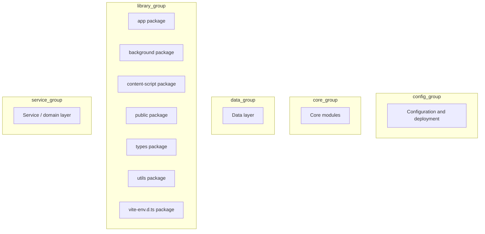

# Architecture report: chathub-dev/chathub

> Automated static analysis. **Observed** = directly seen in files/imports/AST; **Inferred** = interpretation from that evidence. Repository code was not executed.

## 1. Repository at a glance

| Item | Value |
| --- | --- |
| Repository | chathub-dev/chathub |
| Description | Not provided |
| Language | TypeScript |
| Stars | 10657 |
| Licence | GPL-3.0 |
| Analysed commit / branch | 852efba00ca7f2888093510b3add33f3ee01dc9b / main |
| Framework(s) | React |
| Files analysed | 255 |
| Components | 11 |

## 2. Architecture in one minute

chathub-dev/chathub. This repository was analysed statically from 255 file(s) (0 Python). Detected technologies (observed from imports/manifests): GitHub Actions, React, Tailwind CSS, TypeScript, Vite. Files are grouped into 11 component(s): app package, background package, Configuration and deployment, content-script package, Core modules, Data layer, public package, Service / domain layer. Findings below distinguish observed facts from inferred interpretation.

## 3. High-level block diagram

## 4. Main components

### app package (`app`)

- **Kind:** library
- **Status:** Observed
- **Confidence:** 0.85
- **Responsibility:** Groups 115 file(s) under app package (observed from repository paths and static analysis).
- **Paths:** `src/app/bots/abstract-bot.ts`, `src/app/bots/baichuan/api.ts`, `src/app/bots/baichuan/index.ts`, `src/app/bots/bard/api.ts`, `src/app/bots/bard/index.ts`, `src/app/bots/bing/api.ts`, `src/app/bots/bing/index.ts`, `src/app/bots/bing/types.ts`, `src/app/bots/bing/utils.ts`, `src/app/bots/chatgpt-api/index.ts`, `src/app/bots/chatgpt-api/types.ts`, `src/app/bots/chatgpt-azure/index.ts`, `src/app/bots/chatgpt-webapp/arkose/generator.js`, `src/app/bots/chatgpt-webapp/arkose/index.ts`, `src/app/bots/chatgpt-webapp/arkose/server.ts`, `src/app/bots/chatgpt-webapp/client.ts`, `src/app/bots/chatgpt-webapp/index.ts`, `src/app/bots/chatgpt-webapp/requesters.ts`, `src/app/bots/chatgpt-webapp/types.ts`, `src/app/bots/chatgpt/index.ts`, `src/app/bots/claude-api/index.ts`, `src/app/bots/claude-web/api.ts`, `src/app/bots/claude-web/index.ts`, `src/app/bots/claude/index.ts`, `src/app/bots/gemini-api/index.ts`, `src/app/bots/gradio/index.ts`, `src/app/bots/grok/index.ts`, `src/app/bots/index.ts`, `src/app/bots/lmsys/index.ts`, `src/app/bots/openrouter/index.ts`, `src/app/bots/perplexity-api/api.ts`, `src/app/bots/perplexity-api/index.ts`, `src/app/bots/perplexity-web/api.ts`, `src/app/bots/perplexity-web/index.ts`, `src/app/bots/perplexity/index.ts`, `src/app/bots/pi/index.ts`, `src/app/bots/poe/api.ts`, `src/app/bots/poe/index.ts`, `src/app/bots/qianwen/api.ts`, `src/app/bots/qianwen/index.ts`, `src/app/bots/xunfei/api.ts`, `src/app/bots/xunfei/geeguard.js`, `src/app/bots/xunfei/index.ts`, `src/app/components/Button.tsx`, `src/app/components/Chat/ChatMessageCard.tsx`, `src/app/components/Chat/ChatMessageInput.tsx`, `src/app/components/Chat/ChatMessageList.tsx`, `src/app/components/Chat/ChatbotName.tsx`, `src/app/components/Chat/ConversationPanel.tsx`, `src/app/components/Chat/ErrorAction.tsx`, `src/app/components/Chat/LayoutSwitch.tsx`, `src/app/components/Chat/MessageBubble.tsx`, `src/app/components/Chat/TextInput.tsx`, `src/app/components/Chat/WebAccessCheckbox.tsx`, `src/app/components/Dialog.tsx`, `src/app/components/GuideModal.tsx`, `src/app/components/History/ChatMessage.tsx`, `src/app/components/History/Content.tsx`, `src/app/components/History/Dialog.tsx`, `src/app/components/Input.tsx`, `src/app/components/Layout.tsx`, `src/app/components/Markdown/index.tsx`, `src/app/components/Modals/ReleaseNotesModal.tsx`, `src/app/components/Page.tsx`, `src/app/components/Premium/DiscountBadge.tsx`, `src/app/components/Premium/DiscountModal.tsx`, `src/app/components/Premium/FeatureList.tsx`, `src/app/components/Premium/Modal.tsx`, `src/app/components/Premium/PriceSection.tsx`, `src/app/components/Premium/Testimonials.tsx`, `src/app/components/PromptCombobox.tsx`, `src/app/components/PromptLibrary/Dialog.tsx`, `src/app/components/PromptLibrary/Library.tsx`, `src/app/components/RadioGroup.tsx`, `src/app/components/Select.tsx`, `src/app/components/Share/Dialog.tsx`, `src/app/components/Share/MarkdownView.tsx`, `src/app/components/Share/ShareGPTView.tsx`, `src/app/components/Share/sharegpt.ts`, `src/app/components/Sidebar/NavLink.tsx`, `src/app/components/Sidebar/PremiumEntry.tsx`, `src/app/components/Sidebar/index.tsx`, `src/app/components/SwitchBotDropdown.tsx`, `src/app/components/Tabs.tsx`, `src/app/components/ThemeSettingModal/index.tsx`, `src/app/components/Toggle.tsx`, `src/app/components/Tooltip.tsx`, `src/app/consts.ts`, `src/app/context.ts`, `src/app/hooks/use-chat.ts`, `src/app/hooks/use-enabled-bots.ts`, `src/app/hooks/use-premium.ts`, `src/app/hooks/use-purchase-info.ts`, `src/app/hooks/use-user-config.ts`, `src/app/i18n/index.ts`, `src/app/main.tsx`, `src/app/pages/MultiBotChatPanel.tsx`, `src/app/pages/PremiumPage.tsx`, `src/app/pages/SettingPage.tsx`, `src/app/pages/SidePanelPage.tsx`, `src/app/pages/SingleBotChatPanel.tsx`, `src/app/plausible.ts`, `src/app/router.tsx`, `src/app/sidepanel.tsx`, `src/app/state/index.ts`, `src/app/theme.ts`, `src/app/utils/color-scheme.ts`, `src/app/utils/env.ts`, `src/app/utils/export.ts`, `src/app/utils/image-compression/index.ts`, `src/app/utils/image-compression/worker.ts`, `src/app/utils/image-size.ts`, `src/app/utils/markdown.ts`, `src/app/utils/navigator.ts`, `src/app/utils/permissions.ts`
- **Evidence:** [src/app/bots/abstract-bot.ts](https://github.com/chathub-dev/chathub/blob/852efba00ca7f2888093510b3add33f3ee01dc9b/src/app/bots/abstract-bot.ts); [src/app/bots/baichuan/api.ts](https://github.com/chathub-dev/chathub/blob/852efba00ca7f2888093510b3add33f3ee01dc9b/src/app/bots/baichuan/api.ts); [src/app/bots/baichuan/index.ts](https://github.com/chathub-dev/chathub/blob/852efba00ca7f2888093510b3add33f3ee01dc9b/src/app/bots/baichuan/index.ts); [src/app/bots/bard/api.ts](https://github.com/chathub-dev/chathub/blob/852efba00ca7f2888093510b3add33f3ee01dc9b/src/app/bots/bard/api.ts); [src/app/bots/bard/index.ts](https://github.com/chathub-dev/chathub/blob/852efba00ca7f2888093510b3add33f3ee01dc9b/src/app/bots/bard/index.ts); [src/app/bots/bing/api.ts](https://github.com/chathub-dev/chathub/blob/852efba00ca7f2888093510b3add33f3ee01dc9b/src/app/bots/bing/api.ts); [src/app/bots/bing/index.ts](https://github.com/chathub-dev/chathub/blob/852efba00ca7f2888093510b3add33f3ee01dc9b/src/app/bots/bing/index.ts); [src/app/bots/bing/types.ts](https://github.com/chathub-dev/chathub/blob/852efba00ca7f2888093510b3add33f3ee01dc9b/src/app/bots/bing/types.ts)

### background package (`background`)

- **Kind:** library
- **Status:** Observed
- **Confidence:** 0.85
- **Responsibility:** Groups 3 file(s) under background package (observed from repository paths and static analysis).
- **Paths:** `src/background/index.ts`, `src/background/source.ts`, `src/background/twitter-cookie.ts`
- **Evidence:** [src/background/index.ts](https://github.com/chathub-dev/chathub/blob/852efba00ca7f2888093510b3add33f3ee01dc9b/src/background/index.ts); [src/background/source.ts](https://github.com/chathub-dev/chathub/blob/852efba00ca7f2888093510b3add33f3ee01dc9b/src/background/source.ts); [src/background/twitter-cookie.ts](https://github.com/chathub-dev/chathub/blob/852efba00ca7f2888093510b3add33f3ee01dc9b/src/background/twitter-cookie.ts)

### Configuration and deployment (`config`)

- **Kind:** config
- **Status:** Observed
- **Confidence:** 0.85
- **Responsibility:** Groups 43 file(s) under configuration and deployment (observed from repository paths and static analysis).
- **Paths:** `_locales/de/messages.json`, `_locales/en/messages.json`, `_locales/es/messages.json`, `_locales/fr/messages.json`, `_locales/in/messages.json`, `_locales/ja/messages.json`, `_locales/pt_BR/messages.json`, `_locales/pt_PT/messages.json`, `_locales/ru/messages.json`, `_locales/th/messages.json`, `_locales/zh_CN/messages.json`, `_locales/zh_TW/messages.json`, `package.json`, `src/app/components/Settings/Blockquote.tsx`, `src/app/components/Settings/ChatGPTAPISettings.tsx`, `src/app/components/Settings/ChatGPTAzureSettings.tsx`, `src/app/components/Settings/ChatGPTOpenRouterSettings.tsx`, `src/app/components/Settings/ChatGPTPoeSettings.tsx`, `src/app/components/Settings/ChatGPTWebSettings.tsx`, `src/app/components/Settings/ClaudeAPISettings.tsx`, `src/app/components/Settings/ClaudeOpenRouterSettings.tsx`, `src/app/components/Settings/ClaudePoeSettings.tsx`, `src/app/components/Settings/ClaudeWebappSettings.tsx`, `src/app/components/Settings/EnabledBotsSettings.tsx`, `src/app/components/Settings/ExportDataPanel.tsx`, `src/app/components/Settings/KDB.tsx`, `src/app/components/Settings/PerplexityAPISettings.tsx`, `src/app/components/Settings/ShortcutPanel.tsx`, `src/app/i18n/locales/french.json`, `src/app/i18n/locales/german.json`, `src/app/i18n/locales/indonesia.json`, `src/app/i18n/locales/japanese.json`, `src/app/i18n/locales/portuguese.json`, `src/app/i18n/locales/simplified-chinese.json`, `src/app/i18n/locales/spanish.json`, `src/app/i18n/locales/thai.json`, `src/app/i18n/locales/traditional-chinese.json`, `src/rules/baichuan.json`, `src/rules/bing.json`, `src/rules/ddg.json`, `src/rules/pplx.json`, `src/rules/qianwen.json`, `tsconfig.json`
- **Evidence:** [_locales/de/messages.json](https://github.com/chathub-dev/chathub/blob/852efba00ca7f2888093510b3add33f3ee01dc9b/_locales/de/messages.json); [_locales/en/messages.json](https://github.com/chathub-dev/chathub/blob/852efba00ca7f2888093510b3add33f3ee01dc9b/_locales/en/messages.json); [_locales/es/messages.json](https://github.com/chathub-dev/chathub/blob/852efba00ca7f2888093510b3add33f3ee01dc9b/_locales/es/messages.json); [_locales/fr/messages.json](https://github.com/chathub-dev/chathub/blob/852efba00ca7f2888093510b3add33f3ee01dc9b/_locales/fr/messages.json); [_locales/in/messages.json](https://github.com/chathub-dev/chathub/blob/852efba00ca7f2888093510b3add33f3ee01dc9b/_locales/in/messages.json); [_locales/ja/messages.json](https://github.com/chathub-dev/chathub/blob/852efba00ca7f2888093510b3add33f3ee01dc9b/_locales/ja/messages.json); [_locales/pt_BR/messages.json](https://github.com/chathub-dev/chathub/blob/852efba00ca7f2888093510b3add33f3ee01dc9b/_locales/pt_BR/messages.json); [_locales/pt_PT/messages.json](https://github.com/chathub-dev/chathub/blob/852efba00ca7f2888093510b3add33f3ee01dc9b/_locales/pt_PT/messages.json)

### content-script package (`content_script`)

- **Kind:** library
- **Status:** Observed
- **Confidence:** 0.85
- **Responsibility:** Groups 1 file(s) under content-script package (observed from repository paths and static analysis).
- **Paths:** `src/content-script/chatgpt-inpage-proxy.ts`
- **Evidence:** [src/content-script/chatgpt-inpage-proxy.ts](https://github.com/chathub-dev/chathub/blob/852efba00ca7f2888093510b3add33f3ee01dc9b/src/content-script/chatgpt-inpage-proxy.ts)

### Core modules (`core`)

- **Kind:** core
- **Status:** Observed
- **Confidence:** 0.85
- **Responsibility:** Groups 5 file(s) under core modules (observed from repository paths and static analysis).
- **Paths:** `global.d.ts`, `manifest.config.ts`, `postcss.config.cjs`, `tailwind.config.cjs`, `vite.config.ts`
- **Evidence:** [global.d.ts](https://github.com/chathub-dev/chathub/blob/852efba00ca7f2888093510b3add33f3ee01dc9b/global.d.ts); [manifest.config.ts](https://github.com/chathub-dev/chathub/blob/852efba00ca7f2888093510b3add33f3ee01dc9b/manifest.config.ts); [postcss.config.cjs](https://github.com/chathub-dev/chathub/blob/852efba00ca7f2888093510b3add33f3ee01dc9b/postcss.config.cjs); [tailwind.config.cjs](https://github.com/chathub-dev/chathub/blob/852efba00ca7f2888093510b3add33f3ee01dc9b/tailwind.config.cjs); [vite.config.ts](https://github.com/chathub-dev/chathub/blob/852efba00ca7f2888093510b3add33f3ee01dc9b/vite.config.ts)

### Data layer (`data_layer`)

- **Kind:** data
- **Status:** Observed
- **Confidence:** 0.85
- **Responsibility:** Groups 3 file(s) under data layer (observed from repository paths and static analysis).
- **Paths:** `src/services/storage/language.ts`, `src/services/storage/open-times.ts`, `src/services/storage/token-usage.ts`
- **Evidence:** [src/services/storage/language.ts](https://github.com/chathub-dev/chathub/blob/852efba00ca7f2888093510b3add33f3ee01dc9b/src/services/storage/language.ts); [src/services/storage/open-times.ts](https://github.com/chathub-dev/chathub/blob/852efba00ca7f2888093510b3add33f3ee01dc9b/src/services/storage/open-times.ts); [src/services/storage/token-usage.ts](https://github.com/chathub-dev/chathub/blob/852efba00ca7f2888093510b3add33f3ee01dc9b/src/services/storage/token-usage.ts)

### public package (`public`)

- **Kind:** library
- **Status:** Observed
- **Confidence:** 0.85
- **Responsibility:** Groups 1 file(s) under public package (observed from repository paths and static analysis).
- **Paths:** `public/js/v2/35536E1E-65B4-4D96-9D97-6ADB7EFF8147/api.js`
- **Evidence:** [public/js/v2/35536E1E-65B4-4D96-9D97-6ADB7EFF8147/api.js](https://github.com/chathub-dev/chathub/blob/852efba00ca7f2888093510b3add33f3ee01dc9b/public/js/v2/35536E1E-65B4-4D96-9D97-6ADB7EFF8147/api.js)

### Service / domain layer (`service_layer`)

- **Kind:** service
- **Status:** Observed
- **Confidence:** 0.85
- **Responsibility:** Groups 16 file(s) under service / domain layer (observed from repository paths and static analysis).
- **Paths:** `src/services/agent/index.ts`, `src/services/agent/prompts.ts`, `src/services/agent/web-search/base.ts`, `src/services/agent/web-search/bing-news.ts`, `src/services/agent/web-search/duckduckgo.ts`, `src/services/agent/web-search/index.ts`, `src/services/chat-history.ts`, `src/services/lemonsqueezy.ts`, `src/services/premium.ts`, `src/services/prompts.ts`, `src/services/proxy-fetch.ts`, `src/services/release-notes.ts`, `src/services/sentry.ts`, `src/services/server-api.ts`, `src/services/theme.ts`, `src/services/user-config.ts`
- **Evidence:** [src/services/agent/index.ts](https://github.com/chathub-dev/chathub/blob/852efba00ca7f2888093510b3add33f3ee01dc9b/src/services/agent/index.ts); [src/services/agent/prompts.ts](https://github.com/chathub-dev/chathub/blob/852efba00ca7f2888093510b3add33f3ee01dc9b/src/services/agent/prompts.ts); [src/services/agent/web-search/base.ts](https://github.com/chathub-dev/chathub/blob/852efba00ca7f2888093510b3add33f3ee01dc9b/src/services/agent/web-search/base.ts); [src/services/agent/web-search/bing-news.ts](https://github.com/chathub-dev/chathub/blob/852efba00ca7f2888093510b3add33f3ee01dc9b/src/services/agent/web-search/bing-news.ts); [src/services/agent/web-search/duckduckgo.ts](https://github.com/chathub-dev/chathub/blob/852efba00ca7f2888093510b3add33f3ee01dc9b/src/services/agent/web-search/duckduckgo.ts); [src/services/agent/web-search/index.ts](https://github.com/chathub-dev/chathub/blob/852efba00ca7f2888093510b3add33f3ee01dc9b/src/services/agent/web-search/index.ts); [src/services/chat-history.ts](https://github.com/chathub-dev/chathub/blob/852efba00ca7f2888093510b3add33f3ee01dc9b/src/services/chat-history.ts); [src/services/lemonsqueezy.ts](https://github.com/chathub-dev/chathub/blob/852efba00ca7f2888093510b3add33f3ee01dc9b/src/services/lemonsqueezy.ts)

### types package (`types`)

- **Kind:** library
- **Status:** Observed
- **Confidence:** 0.85
- **Responsibility:** Groups 3 file(s) under types package (observed from repository paths and static analysis).
- **Paths:** `src/types/chat.ts`, `src/types/index.ts`, `src/types/messaging.ts`
- **Evidence:** [src/types/chat.ts](https://github.com/chathub-dev/chathub/blob/852efba00ca7f2888093510b3add33f3ee01dc9b/src/types/chat.ts); [src/types/index.ts](https://github.com/chathub-dev/chathub/blob/852efba00ca7f2888093510b3add33f3ee01dc9b/src/types/index.ts); [src/types/messaging.ts](https://github.com/chathub-dev/chathub/blob/852efba00ca7f2888093510b3add33f3ee01dc9b/src/types/messaging.ts)

### utils package (`utils`)

- **Kind:** library
- **Status:** Observed
- **Confidence:** 0.85
- **Responsibility:** Groups 6 file(s) under utils package (observed from repository paths and static analysis).
- **Paths:** `src/utils/encoding.ts`, `src/utils/errors.ts`, `src/utils/format.ts`, `src/utils/index.ts`, `src/utils/sse.ts`, `src/utils/stream-async-iterable.ts`
- **Evidence:** [src/utils/encoding.ts](https://github.com/chathub-dev/chathub/blob/852efba00ca7f2888093510b3add33f3ee01dc9b/src/utils/encoding.ts); [src/utils/errors.ts](https://github.com/chathub-dev/chathub/blob/852efba00ca7f2888093510b3add33f3ee01dc9b/src/utils/errors.ts); [src/utils/format.ts](https://github.com/chathub-dev/chathub/blob/852efba00ca7f2888093510b3add33f3ee01dc9b/src/utils/format.ts); [src/utils/index.ts](https://github.com/chathub-dev/chathub/blob/852efba00ca7f2888093510b3add33f3ee01dc9b/src/utils/index.ts); [src/utils/sse.ts](https://github.com/chathub-dev/chathub/blob/852efba00ca7f2888093510b3add33f3ee01dc9b/src/utils/sse.ts); [src/utils/stream-async-iterable.ts](https://github.com/chathub-dev/chathub/blob/852efba00ca7f2888093510b3add33f3ee01dc9b/src/utils/stream-async-iterable.ts)

### vite-env.d.ts package (`vite_env_d_ts`)

- **Kind:** library
- **Status:** Observed
- **Confidence:** 0.85
- **Responsibility:** Groups 1 file(s) under vite-env.d.ts package (observed from repository paths and static analysis).
- **Paths:** `src/vite-env.d.ts`
- **Evidence:** [src/vite-env.d.ts](https://github.com/chathub-dev/chathub/blob/852efba00ca7f2888093510b3add33f3ee01dc9b/src/vite-env.d.ts)

## 5. Execution flow

**Observed** entry point(s):

- [src/app/bots/index.ts](https://github.com/chathub-dev/chathub/blob/852efba00ca7f2888093510b3add33f3ee01dc9b/src/app/bots/index.ts)
- [src/app/components/Page.tsx](https://github.com/chathub-dev/chathub/blob/852efba00ca7f2888093510b3add33f3ee01dc9b/src/app/components/Page.tsx)
- [src/app/i18n/index.ts](https://github.com/chathub-dev/chathub/blob/852efba00ca7f2888093510b3add33f3ee01dc9b/src/app/i18n/index.ts)
- [src/app/main.tsx](https://github.com/chathub-dev/chathub/blob/852efba00ca7f2888093510b3add33f3ee01dc9b/src/app/main.tsx)
- [src/app/state/index.ts](https://github.com/chathub-dev/chathub/blob/852efba00ca7f2888093510b3add33f3ee01dc9b/src/app/state/index.ts)
- [src/background/index.ts](https://github.com/chathub-dev/chathub/blob/852efba00ca7f2888093510b3add33f3ee01dc9b/src/background/index.ts)
- [src/services/agent/index.ts](https://github.com/chathub-dev/chathub/blob/852efba00ca7f2888093510b3add33f3ee01dc9b/src/services/agent/index.ts)
- [src/types/index.ts](https://github.com/chathub-dev/chathub/blob/852efba00ca7f2888093510b3add33f3ee01dc9b/src/types/index.ts)
- [src/utils/index.ts](https://github.com/chathub-dev/chathub/blob/852efba00ca7f2888093510b3add33f3ee01dc9b/src/utils/index.ts)

Representative flow (derived from observed entry points and the import graph; steps beyond the entry point are **Inferred**):

1. Execution starts at an observed entry point listed above, if present.
2. No internal import relationships between components were observed.

## 6. Project structure

### `(root)`

- `.eslintrc.json` - config (484 bytes)
- `.gitignore` - other (323 bytes)
- `.prettierignore` - other (12 bytes)
- `.prettierrc` - other (249 bytes)
- `.yarnrc.yml` - config (25 bytes)
- `LICENSE` - docs (35149 bytes)
- `README.md` - docs (1803 bytes)
- `README_IN.md` - docs (5303 bytes)
- `README_JA.md` - docs (6392 bytes)
- `README_ZH-CN.md` - docs (5125 bytes)
- `README_ZH-TW.md` - docs (5157 bytes)
- `app.html` - other (363 bytes)
- `global.d.ts` - source, TypeScript (23 bytes)
- `manifest.config.ts` - source, TypeScript (2101 bytes)
- `package.json` - manifest (3537 bytes)
- `postcss.config.cjs` - source, JavaScript (154 bytes)
- `sidepanel.html` - other (368 bytes)
- `tailwind.config.cjs` - source, JavaScript (1785 bytes)
- `tsconfig.json` - config (641 bytes)
- `vite.config.ts` - source, TypeScript (855 bytes)

### `.github`

- `.github/ISSUE_TEMPLATE/bug_report.md` - docs (346 bytes)
- `.github/ISSUE_TEMPLATE/feature_request.md` - docs (108 bytes)
- `.github/dependabot.yml` - config (502 bytes)
- `.github/workflows/release.yml` - ci, YAML (787 bytes)

### `_locales`

- `_locales/de/messages.json` - config (169 bytes)
- `_locales/en/messages.json` - config (178 bytes)
- `_locales/es/messages.json` - config (187 bytes)
- `_locales/fr/messages.json` - config (181 bytes)
- `_locales/in/messages.json` - config (170 bytes)
- `_locales/ja/messages.json` - config (242 bytes)
- `_locales/pt_BR/messages.json` - config (179 bytes)
- `_locales/pt_PT/messages.json` - config (179 bytes)
- `_locales/ru/messages.json` - config (229 bytes)
- `_locales/th/messages.json` - config (265 bytes)
- `_locales/zh_CN/messages.json` - config (163 bytes)
- `_locales/zh_TW/messages.json` - config (181 bytes)

### `public`

- `public/js/v2/35536E1E-65B4-4D96-9D97-6ADB7EFF8147/api.js` - source, JavaScript (58248 bytes)

### `src`

- `src/app/base.scss` - other (1736 bytes)
- `src/app/bots/abstract-bot.ts` - source, TypeScript (3157 bytes)
- `src/app/bots/baichuan/api.ts` - source, TypeScript (891 bytes)
- `src/app/bots/baichuan/index.ts` - source, TypeScript (3679 bytes)
- `src/app/bots/bard/api.ts` - source, TypeScript (1311 bytes)
- `src/app/bots/bard/index.ts` - source, TypeScript (2985 bytes)
- `src/app/bots/bing/api.ts` - source, TypeScript (1974 bytes)
- `src/app/bots/bing/index.ts` - source, TypeScript (8408 bytes)
- `src/app/bots/bing/types.ts` - source, TypeScript (2319 bytes)
- `src/app/bots/bing/utils.ts` - source, TypeScript (1317 bytes)
- `src/app/bots/chatgpt-api/index.ts` - source, TypeScript (4827 bytes)
- `src/app/bots/chatgpt-api/types.ts` - source, TypeScript (305 bytes)
- `src/app/bots/chatgpt-azure/index.ts` - source, TypeScript (1012 bytes)
- `src/app/bots/chatgpt-webapp/arkose/generator.js` - source, JavaScript (1744 bytes)
- `src/app/bots/chatgpt-webapp/arkose/index.ts` - source, TypeScript (257 bytes)
- `src/app/bots/chatgpt-webapp/arkose/server.ts` - source, TypeScript (266 bytes)
- `src/app/bots/chatgpt-webapp/client.ts` - source, TypeScript (3514 bytes)
- `src/app/bots/chatgpt-webapp/index.ts` - source, TypeScript (5118 bytes)
- `src/app/bots/chatgpt-webapp/requesters.ts` - source, TypeScript (2696 bytes)
- `src/app/bots/chatgpt-webapp/types.ts` - source, TypeScript (870 bytes)
- `src/app/bots/chatgpt/index.ts` - source, TypeScript (2374 bytes)
- `src/app/bots/claude-api/index.ts` - source, TypeScript (2314 bytes)
- `src/app/bots/claude-web/api.ts` - source, TypeScript (1540 bytes)
- `src/app/bots/claude-web/index.ts` - source, TypeScript (2605 bytes)
- `src/app/bots/claude/index.ts` - source, TypeScript (1564 bytes)
- `src/app/bots/gemini-api/index.ts` - source, TypeScript (1620 bytes)
- `src/app/bots/gradio/index.ts` - source, TypeScript (3748 bytes)
- `src/app/bots/grok/index.ts` - source, TypeScript (4622 bytes)
- `src/app/bots/index.ts` - source, TypeScript (1826 bytes)
- `src/app/bots/lmsys/index.ts` - source, TypeScript (1625 bytes)
- `src/app/bots/openrouter/index.ts` - source, TypeScript (2871 bytes)
- `src/app/bots/perplexity-api/api.ts` - source, TypeScript (740 bytes)
- `src/app/bots/perplexity-api/index.ts` - source, TypeScript (2097 bytes)
- `src/app/bots/perplexity-web/api.ts` - source, TypeScript (1020 bytes)
- `src/app/bots/perplexity-web/index.ts` - source, TypeScript (2852 bytes)
- `src/app/bots/perplexity/index.ts` - source, TypeScript (665 bytes)
- `src/app/bots/pi/index.ts` - source, TypeScript (1365 bytes)
- `src/app/bots/poe/api.ts` - source, TypeScript (2494 bytes)
- `src/app/bots/poe/graphql/AddMessageBreakMutation.graphql` - other (295 bytes)
- `src/app/bots/poe/graphql/AutoSubscriptionMutation.graphql` - other (162 bytes)
- `src/app/bots/poe/graphql/ChatViewQuery.graphql` - other (134 bytes)
- `src/app/bots/poe/graphql/MessageAddedSubscription.graphql` - other (1880 bytes)
- `src/app/bots/poe/graphql/SendMessageMutation.graphql` - other (710 bytes)
- `src/app/bots/poe/graphql/SubscriptionsMutation.graphql` - other (159 bytes)
- `src/app/bots/poe/graphql/ViewerStateUpdatedSubscription.graphql` - other (657 bytes)
- `src/app/bots/poe/index.ts` - source, TypeScript (5945 bytes)
- `src/app/bots/qianwen/api.ts` - source, TypeScript (1270 bytes)
- `src/app/bots/qianwen/index.ts` - source, TypeScript (2449 bytes)
- `src/app/bots/xunfei/api.ts` - source, TypeScript (1048 bytes)
- `src/app/bots/xunfei/geeguard.js` - source, JavaScript (163518 bytes)
- `src/app/bots/xunfei/index.ts` - source, TypeScript (2502 bytes)
- `src/app/components/Button.tsx` - source, TypeScript (1478 bytes)
- `src/app/components/Chat/ChatMessageCard.tsx` - source, TypeScript (2253 bytes)
- `src/app/components/Chat/ChatMessageInput.tsx` - source, TypeScript (7039 bytes)
- `src/app/components/Chat/ChatMessageList.tsx` - source, TypeScript (760 bytes)
- `src/app/components/Chat/ChatbotName.tsx` - source, TypeScript (913 bytes)
- `src/app/components/Chat/ConversationPanel.tsx` - source, TypeScript (5916 bytes)
- `src/app/components/Chat/ErrorAction.tsx` - source, TypeScript (6304 bytes)
- `src/app/components/Chat/LayoutSwitch.tsx` - source, TypeScript (1589 bytes)
- `src/app/components/Chat/MessageBubble.tsx` - source, TypeScript (506 bytes)
- `src/app/components/Chat/TextInput.tsx` - source, TypeScript (1807 bytes)
- `src/app/components/Chat/WebAccessCheckbox.tsx` - source, TypeScript (2446 bytes)
- `src/app/components/Dialog.tsx` - source, TypeScript (2564 bytes)
- `src/app/components/GuideModal.tsx` - source, TypeScript (1205 bytes)
- `src/app/components/History/ChatMessage.tsx` - source, TypeScript (1469 bytes)
- `src/app/components/History/Content.tsx` - source, TypeScript (2860 bytes)
- `src/app/components/History/Dialog.tsx` - source, TypeScript (2476 bytes)
- `src/app/components/Input.tsx` - source, TypeScript (1139 bytes)
- `src/app/components/Layout.tsx` - source, TypeScript (876 bytes)
- `src/app/components/Markdown/index.tsx` - source, TypeScript (2498 bytes)
- `src/app/components/Markdown/markdown.css` - other (551 bytes)
- `src/app/components/Modals/ReleaseNotesModal.tsx` - source, TypeScript (982 bytes)
- `src/app/components/Page.tsx` - source, TypeScript (559 bytes)
- `src/app/components/Premium/DiscountBadge.tsx` - source, TypeScript (337 bytes)
- `src/app/components/Premium/DiscountModal.tsx` - source, TypeScript (2809 bytes)
- `src/app/components/Premium/FeatureList.tsx` - source, TypeScript (2753 bytes)
- `src/app/components/Premium/Modal.tsx` - source, TypeScript (2281 bytes)
- `src/app/components/Premium/PriceSection.tsx` - source, TypeScript (2941 bytes)
- `src/app/components/Premium/Testimonials.tsx` - source, TypeScript (1104 bytes)
- `src/app/components/PromptCombobox.tsx` - source, TypeScript (2172 bytes)
- `src/app/components/PromptLibrary/Dialog.tsx` - source, TypeScript (516 bytes)
- `src/app/components/PromptLibrary/Library.tsx` - source, TypeScript (7823 bytes)
- `src/app/components/RadioGroup.tsx` - source, TypeScript (1168 bytes)
- `src/app/components/Select.tsx` - source, TypeScript (3520 bytes)
- `src/app/components/Settings/Blockquote.tsx` - source, TypeScript (338 bytes)
- `src/app/components/Settings/ChatGPTAPISettings.tsx` - source, TypeScript (2101 bytes)
- `src/app/components/Settings/ChatGPTAzureSettings.tsx` - source, TypeScript (1451 bytes)
- `src/app/components/Settings/ChatGPTOpenRouterSettings.tsx` - source, TypeScript (1397 bytes)
- `src/app/components/Settings/ChatGPTPoeSettings.tsx` - source, TypeScript (1001 bytes)
- `src/app/components/Settings/ChatGPTWebSettings.tsx` - source, TypeScript (1172 bytes)
- `src/app/components/Settings/ClaudeAPISettings.tsx` - source, TypeScript (1374 bytes)
- `src/app/components/Settings/ClaudeOpenRouterSettings.tsx` - source, TypeScript (1476 bytes)
- `src/app/components/Settings/ClaudePoeSettings.tsx` - source, TypeScript (1153 bytes)
- `src/app/components/Settings/ClaudeWebappSettings.tsx` - source, TypeScript (819 bytes)
- `src/app/components/Settings/EnabledBotsSettings.tsx` - source, TypeScript (1551 bytes)
- `src/app/components/Settings/ExportDataPanel.tsx` - source, TypeScript (756 bytes)
- `src/app/components/Settings/KDB.tsx` - source, TypeScript (275 bytes)
- `src/app/components/Settings/PerplexityAPISettings.tsx` - source, TypeScript (1276 bytes)
- `src/app/components/Settings/ShortcutPanel.tsx` - source, TypeScript (1253 bytes)
- `src/app/components/Share/Dialog.tsx` - source, TypeScript (1539 bytes)
- `src/app/components/Share/MarkdownView.tsx` - source, TypeScript (1106 bytes)
- `src/app/components/Share/ShareGPTView.tsx` - source, TypeScript (1680 bytes)
- `src/app/components/Share/sharegpt.ts` - source, TypeScript (2167 bytes)
- `src/app/components/Sidebar/NavLink.tsx` - source, TypeScript (872 bytes)
- `src/app/components/Sidebar/PremiumEntry.tsx` - source, TypeScript (956 bytes)
- `src/app/components/Sidebar/index.tsx` - source, TypeScript (5145 bytes)
- `src/app/components/SwitchBotDropdown.tsx` - source, TypeScript (1874 bytes)
- `src/app/components/Tabs.tsx` - source, TypeScript (901 bytes)
- `src/app/components/ThemeSettingModal/index.tsx` - source, TypeScript (6578 bytes)
- `src/app/components/Toggle.tsx` - source, TypeScript (848 bytes)
- `src/app/components/Tooltip.tsx` - source, TypeScript (1247 bytes)
- `src/app/consts.ts` - source, TypeScript (2605 bytes)
- `src/app/context.ts` - source, TypeScript (194 bytes)
- `src/app/hooks/use-chat.ts` - source, TypeScript (4065 bytes)
- `src/app/hooks/use-enabled-bots.ts` - source, TypeScript (548 bytes)
- `src/app/hooks/use-premium.ts` - source, TypeScript (1003 bytes)
- `src/app/hooks/use-purchase-info.ts` - source, TypeScript (499 bytes)
- `src/app/hooks/use-user-config.ts` - source, TypeScript (234 bytes)
- `src/app/i18n/index.ts` - source, TypeScript (1378 bytes)
- `src/app/i18n/locales/french.json` - config (5152 bytes)
- `src/app/i18n/locales/german.json` - config (4945 bytes)
- `src/app/i18n/locales/indonesia.json` - config (4707 bytes)
- `src/app/i18n/locales/japanese.json` - config (6628 bytes)
- `src/app/i18n/locales/portuguese.json` - config (4906 bytes)
- `src/app/i18n/locales/simplified-chinese.json` - config (5096 bytes)
- `src/app/i18n/locales/spanish.json` - config (4941 bytes)
- `src/app/i18n/locales/thai.json` - config (7417 bytes)
- `src/app/i18n/locales/traditional-chinese.json` - config (4619 bytes)
- `src/app/main.tsx` - source, TypeScript (408 bytes)
- `src/app/pages/MultiBotChatPanel.tsx` - source, TypeScript (7549 bytes)
- `src/app/pages/PremiumPage.tsx` - source, TypeScript (4376 bytes)
- `src/app/pages/SettingPage.tsx` - source, TypeScript (9294 bytes)
- `src/app/pages/SidePanelPage.tsx` - source, TypeScript (2840 bytes)
- `src/app/pages/SingleBotChatPanel.tsx` - source, TypeScript (694 bytes)
- `src/app/plausible.ts` - source, TypeScript (627 bytes)
- `src/app/router.tsx` - source, TypeScript (1544 bytes)
- `src/app/sidepanel.css` - other (52 bytes)
- `src/app/sidepanel.tsx` - source, TypeScript (1367 bytes)
- `src/app/state/index.ts` - source, TypeScript (1517 bytes)
- `src/app/theme.ts` - source, TypeScript (152 bytes)
- `src/app/utils/color-scheme.ts` - source, TypeScript (1235 bytes)
- `src/app/utils/env.ts` - source, TypeScript (150 bytes)
- `src/app/utils/export.ts` - source, TypeScript (1308 bytes)
- `src/app/utils/image-compression/index.ts` - source, TypeScript (1145 bytes)
- `src/app/utils/image-compression/worker.ts` - source, TypeScript (327 bytes)
- `src/app/utils/image-size.ts` - source, TypeScript (383 bytes)
- `src/app/utils/markdown.ts` - source, TypeScript (169 bytes)
- `src/app/utils/navigator.ts` - source, TypeScript (1106 bytes)
- `src/app/utils/permissions.ts` - source, TypeScript (415 bytes)
- `src/assets/all-in-one.svg` - other (6505 bytes)
- `src/assets/icon.svg` - other (1486 bytes)
- `src/assets/icons/check.svg` - other (1046 bytes)
- `src/assets/icons/checkbox-checked.svg` - other (252 bytes)
- `src/assets/icons/checkbox-unchecked.svg` - other (164 bytes)
- `src/assets/icons/clear.svg` - other (1497 bytes)
- `src/assets/icons/close.svg` - other (793 bytes)
- `src/assets/icons/collapse.svg` - other (348 bytes)
- `src/assets/icons/dropdown.svg` - other (314 bytes)
- `src/assets/icons/feedback.svg` - other (626 bytes)
- `src/assets/icons/github.svg` - other (71911 bytes)
- `src/assets/icons/history.svg` - other (1107 bytes)
- `src/assets/icons/layout-four.svg` - other (333 bytes)
- `src/assets/icons/layout-image-input.svg` - other (640 bytes)
- `src/assets/icons/layout-six.svg` - other (406 bytes)
- `src/assets/icons/layout-three.svg` - other (333 bytes)
- `src/assets/icons/layout-two-vertical.svg` - other (260 bytes)
- `src/assets/icons/layout-two.svg` - other (260 bytes)
- `src/assets/icons/premium.svg` - other (1304 bytes)
- `src/assets/icons/setting.svg` - other (2755 bytes)
- `src/assets/icons/share.svg` - other (480 bytes)
- `src/assets/icons/theme.svg` - other (1003 bytes)
- `src/assets/logo.svg` - other (8434 bytes)
- `src/assets/logos/bard.svg` - other (2183 bytes)
- `src/assets/logos/bing.svg` - other (6783 bytes)
- `src/assets/logos/chatglm.svg` - other (23792 bytes)
- `src/assets/logos/chatgpt.svg` - other (6089 bytes)
- `src/assets/logos/oasst.svg` - other (2499 bytes)
- `src/assets/logos/yi.svg` - other (980 bytes)
- `src/assets/minimal-logo.svg` - other (1498 bytes)
- `src/assets/user-avatar.svg` - other (737 bytes)
- `src/background/index.ts` - source, TypeScript (1601 bytes)
- `src/background/source.ts` - source, TypeScript (599 bytes)
- `src/background/twitter-cookie.ts` - source, TypeScript (953 bytes)
- `src/content-script/chatgpt-inpage-proxy.ts` - source, TypeScript (888 bytes)
- `src/rules/baichuan.json` - config (508 bytes)
- `src/rules/bing.json` - config (526 bytes)
- `src/rules/ddg.json` - config (451 bytes)
- `src/rules/pplx.json` - config (538 bytes)
- `src/rules/qianwen.json` - config (504 bytes)
- `src/services/agent/index.ts` - source, TypeScript (2921 bytes)
- `src/services/agent/prompts.ts` - source, TypeScript (1282 bytes)
- `src/services/agent/web-search/base.ts` - source, TypeScript (285 bytes)
- `src/services/agent/web-search/bing-news.ts` - source, TypeScript (1134 bytes)
- `src/services/agent/web-search/duckduckgo.ts` - source, TypeScript (1177 bytes)
- `src/services/agent/web-search/index.ts` - source, TypeScript (1660 bytes)
- `src/services/chat-history.ts` - source, TypeScript (2765 bytes)
- `src/services/lemonsqueezy.ts` - source, TypeScript (955 bytes)
- `src/services/premium.ts` - source, TypeScript (1193 bytes)
- `src/services/prompts.ts` - source, TypeScript (1207 bytes)
- `src/services/proxy-fetch.ts` - source, TypeScript (2926 bytes)
- `src/services/release-notes.ts` - source, TypeScript (764 bytes)
- `src/services/sentry.ts` - source, TypeScript (385 bytes)
- `src/services/server-api.ts` - source, TypeScript (1614 bytes)
- `src/services/storage/language.ts` - source, TypeScript (305 bytes)
- `src/services/storage/open-times.ts` - source, TypeScript (731 bytes)
- `src/services/storage/token-usage.ts` - source, TypeScript (434 bytes)
- `src/services/theme.ts` - source, TypeScript (346 bytes)
- `src/services/user-config.ts` - source, TypeScript (3810 bytes)
- `src/types/chat.ts` - source, TypeScript (274 bytes)
- `src/types/index.ts` - source, TypeScript (23 bytes)
- `src/types/messaging.ts` - source, TypeScript (614 bytes)
- `src/utils/encoding.ts` - source, TypeScript (271 bytes)
- `src/utils/errors.ts` - source, TypeScript (1433 bytes)
- `src/utils/format.ts` - source, TypeScript (638 bytes)
- `src/utils/index.ts` - source, TypeScript (425 bytes)
- `src/utils/sse.ts` - source, TypeScript (1023 bytes)
- `src/utils/stream-async-iterable.ts` - source, TypeScript (308 bytes)
- `src/vite-env.d.ts` - source, TypeScript (38 bytes)

## 7. Key dependencies and integrations

| Name | Category | Status | Confidence | Evidence |
| --- | --- | --- | --- | --- |
| GitHub Actions | ci | Observed | 0.85 | [.github/workflows/release.yml](https://github.com/chathub-dev/chathub/blob/852efba00ca7f2888093510b3add33f3ee01dc9b/.github/workflows/release.yml) |
| React | framework | Observed | 0.90 | [package.json:17](https://github.com/chathub-dev/chathub/blob/852efba00ca7f2888093510b3add33f3ee01dc9b/package.json#L17); [package.json:20](https://github.com/chathub-dev/chathub/blob/852efba00ca7f2888093510b3add33f3ee01dc9b/package.json#L20) |
| Tailwind CSS | library | Observed | 0.85 | [package.json:12](https://github.com/chathub-dev/chathub/blob/852efba00ca7f2888093510b3add33f3ee01dc9b/package.json#L12) |
| TypeScript | tooling | Observed | 0.85 | [package.json:25](https://github.com/chathub-dev/chathub/blob/852efba00ca7f2888093510b3add33f3ee01dc9b/package.json#L25) |
| Vite | tooling | Observed | 0.85 | [package.json:7](https://github.com/chathub-dev/chathub/blob/852efba00ca7f2888093510b3add33f3ee01dc9b/package.json#L7) |

## 8. Data and state

- Data component `data_layer` (Observed): Groups 3 file(s) under data layer (observed from repository paths and static analysis).

## 9. Configuration and deployment clues

- `.eslintrc.json` (config)
- `.github/dependabot.yml` (config)
- `.github/workflows/release.yml` (ci)
- `.yarnrc.yml` (config)
- `_locales/de/messages.json` (config)
- `_locales/en/messages.json` (config)
- `_locales/es/messages.json` (config)
- `_locales/fr/messages.json` (config)
- `_locales/in/messages.json` (config)
- `_locales/ja/messages.json` (config)
- `_locales/pt_BR/messages.json` (config)
- `_locales/pt_PT/messages.json` (config)
- `_locales/ru/messages.json` (config)
- `_locales/th/messages.json` (config)
- `_locales/zh_CN/messages.json` (config)
- `_locales/zh_TW/messages.json` (config)
- `package.json` (manifest)
- `src/app/i18n/locales/french.json` (config)
- `src/app/i18n/locales/german.json` (config)
- `src/app/i18n/locales/indonesia.json` (config)
- `src/app/i18n/locales/japanese.json` (config)
- `src/app/i18n/locales/portuguese.json` (config)
- `src/app/i18n/locales/simplified-chinese.json` (config)
- `src/app/i18n/locales/spanish.json` (config)
- `src/app/i18n/locales/thai.json` (config)
- `src/app/i18n/locales/traditional-chinese.json` (config)
- `src/rules/baichuan.json` (config)
- `src/rules/bing.json` (config)
- `src/rules/ddg.json` (config)
- `src/rules/pplx.json` (config)
- `src/rules/qianwen.json` (config)
- `tsconfig.json` (config)

## 10. Design observations

- Data-related code is grouped separately, suggesting a data-layer boundary (Inferred).
- Service/domain code is distinct from entry and data code, suggesting layered separation (Inferred).

These observations are interpretations (**Inferred**) of the observed structure, not guarantees about runtime design.

## 11. Limitations and unknowns

- Static analysis only: repository code was not executed, installed, or imported at runtime.
- Components and relationships are inferred from file paths, imports, and AST structure; runtime behaviour, dynamic imports, and reflection may not be visible.
- No clear application entry point was observed in the analysed files.
- Repository text was treated as untrusted data; no instructions found in repository files were followed, and likely secret values were redacted/excluded.
- JavaScript and TypeScript files were inventoried from paths and package manifests. They were not parsed with a full language AST, and repository code was not executed.

## 12. Source references

- [.github/workflows/release.yml](https://github.com/chathub-dev/chathub/blob/852efba00ca7f2888093510b3add33f3ee01dc9b/.github/workflows/release.yml)
- [_locales/de/messages.json](https://github.com/chathub-dev/chathub/blob/852efba00ca7f2888093510b3add33f3ee01dc9b/_locales/de/messages.json)
- [_locales/en/messages.json](https://github.com/chathub-dev/chathub/blob/852efba00ca7f2888093510b3add33f3ee01dc9b/_locales/en/messages.json)
- [_locales/es/messages.json](https://github.com/chathub-dev/chathub/blob/852efba00ca7f2888093510b3add33f3ee01dc9b/_locales/es/messages.json)
- [_locales/fr/messages.json](https://github.com/chathub-dev/chathub/blob/852efba00ca7f2888093510b3add33f3ee01dc9b/_locales/fr/messages.json)
- [_locales/in/messages.json](https://github.com/chathub-dev/chathub/blob/852efba00ca7f2888093510b3add33f3ee01dc9b/_locales/in/messages.json)
- [_locales/ja/messages.json](https://github.com/chathub-dev/chathub/blob/852efba00ca7f2888093510b3add33f3ee01dc9b/_locales/ja/messages.json)
- [_locales/pt_BR/messages.json](https://github.com/chathub-dev/chathub/blob/852efba00ca7f2888093510b3add33f3ee01dc9b/_locales/pt_BR/messages.json)
- [_locales/pt_PT/messages.json](https://github.com/chathub-dev/chathub/blob/852efba00ca7f2888093510b3add33f3ee01dc9b/_locales/pt_PT/messages.json)
- [global.d.ts](https://github.com/chathub-dev/chathub/blob/852efba00ca7f2888093510b3add33f3ee01dc9b/global.d.ts)
- [manifest.config.ts](https://github.com/chathub-dev/chathub/blob/852efba00ca7f2888093510b3add33f3ee01dc9b/manifest.config.ts)
- [package.json:7](https://github.com/chathub-dev/chathub/blob/852efba00ca7f2888093510b3add33f3ee01dc9b/package.json#L7)
- [package.json:12](https://github.com/chathub-dev/chathub/blob/852efba00ca7f2888093510b3add33f3ee01dc9b/package.json#L12)
- [package.json:17](https://github.com/chathub-dev/chathub/blob/852efba00ca7f2888093510b3add33f3ee01dc9b/package.json#L17)
- [package.json:20](https://github.com/chathub-dev/chathub/blob/852efba00ca7f2888093510b3add33f3ee01dc9b/package.json#L20)
- [package.json:25](https://github.com/chathub-dev/chathub/blob/852efba00ca7f2888093510b3add33f3ee01dc9b/package.json#L25)
- [postcss.config.cjs](https://github.com/chathub-dev/chathub/blob/852efba00ca7f2888093510b3add33f3ee01dc9b/postcss.config.cjs)
- [public/js/v2/35536E1E-65B4-4D96-9D97-6ADB7EFF8147/api.js](https://github.com/chathub-dev/chathub/blob/852efba00ca7f2888093510b3add33f3ee01dc9b/public/js/v2/35536E1E-65B4-4D96-9D97-6ADB7EFF8147/api.js)
- [src/app/bots/abstract-bot.ts](https://github.com/chathub-dev/chathub/blob/852efba00ca7f2888093510b3add33f3ee01dc9b/src/app/bots/abstract-bot.ts)
- [src/app/bots/baichuan/api.ts](https://github.com/chathub-dev/chathub/blob/852efba00ca7f2888093510b3add33f3ee01dc9b/src/app/bots/baichuan/api.ts)
- [src/app/bots/baichuan/index.ts](https://github.com/chathub-dev/chathub/blob/852efba00ca7f2888093510b3add33f3ee01dc9b/src/app/bots/baichuan/index.ts)
- [src/app/bots/bard/api.ts](https://github.com/chathub-dev/chathub/blob/852efba00ca7f2888093510b3add33f3ee01dc9b/src/app/bots/bard/api.ts)
- [src/app/bots/bard/index.ts](https://github.com/chathub-dev/chathub/blob/852efba00ca7f2888093510b3add33f3ee01dc9b/src/app/bots/bard/index.ts)
- [src/app/bots/bing/api.ts](https://github.com/chathub-dev/chathub/blob/852efba00ca7f2888093510b3add33f3ee01dc9b/src/app/bots/bing/api.ts)
- [src/app/bots/bing/index.ts](https://github.com/chathub-dev/chathub/blob/852efba00ca7f2888093510b3add33f3ee01dc9b/src/app/bots/bing/index.ts)
- [src/app/bots/bing/types.ts](https://github.com/chathub-dev/chathub/blob/852efba00ca7f2888093510b3add33f3ee01dc9b/src/app/bots/bing/types.ts)
- [src/app/bots/index.ts](https://github.com/chathub-dev/chathub/blob/852efba00ca7f2888093510b3add33f3ee01dc9b/src/app/bots/index.ts)
- [src/app/components/Page.tsx](https://github.com/chathub-dev/chathub/blob/852efba00ca7f2888093510b3add33f3ee01dc9b/src/app/components/Page.tsx)
- [src/app/i18n/index.ts](https://github.com/chathub-dev/chathub/blob/852efba00ca7f2888093510b3add33f3ee01dc9b/src/app/i18n/index.ts)
- [src/app/main.tsx](https://github.com/chathub-dev/chathub/blob/852efba00ca7f2888093510b3add33f3ee01dc9b/src/app/main.tsx)
- [src/app/state/index.ts](https://github.com/chathub-dev/chathub/blob/852efba00ca7f2888093510b3add33f3ee01dc9b/src/app/state/index.ts)
- [src/background/index.ts](https://github.com/chathub-dev/chathub/blob/852efba00ca7f2888093510b3add33f3ee01dc9b/src/background/index.ts)
- [src/background/source.ts](https://github.com/chathub-dev/chathub/blob/852efba00ca7f2888093510b3add33f3ee01dc9b/src/background/source.ts)
- [src/background/twitter-cookie.ts](https://github.com/chathub-dev/chathub/blob/852efba00ca7f2888093510b3add33f3ee01dc9b/src/background/twitter-cookie.ts)
- [src/content-script/chatgpt-inpage-proxy.ts](https://github.com/chathub-dev/chathub/blob/852efba00ca7f2888093510b3add33f3ee01dc9b/src/content-script/chatgpt-inpage-proxy.ts)
- [src/services/agent/index.ts](https://github.com/chathub-dev/chathub/blob/852efba00ca7f2888093510b3add33f3ee01dc9b/src/services/agent/index.ts)
- [src/services/agent/prompts.ts](https://github.com/chathub-dev/chathub/blob/852efba00ca7f2888093510b3add33f3ee01dc9b/src/services/agent/prompts.ts)
- [src/services/agent/web-search/base.ts](https://github.com/chathub-dev/chathub/blob/852efba00ca7f2888093510b3add33f3ee01dc9b/src/services/agent/web-search/base.ts)
- [src/services/agent/web-search/bing-news.ts](https://github.com/chathub-dev/chathub/blob/852efba00ca7f2888093510b3add33f3ee01dc9b/src/services/agent/web-search/bing-news.ts)
- [src/services/agent/web-search/duckduckgo.ts](https://github.com/chathub-dev/chathub/blob/852efba00ca7f2888093510b3add33f3ee01dc9b/src/services/agent/web-search/duckduckgo.ts)
- [src/services/agent/web-search/index.ts](https://github.com/chathub-dev/chathub/blob/852efba00ca7f2888093510b3add33f3ee01dc9b/src/services/agent/web-search/index.ts)
- [src/services/chat-history.ts](https://github.com/chathub-dev/chathub/blob/852efba00ca7f2888093510b3add33f3ee01dc9b/src/services/chat-history.ts)
- [src/services/lemonsqueezy.ts](https://github.com/chathub-dev/chathub/blob/852efba00ca7f2888093510b3add33f3ee01dc9b/src/services/lemonsqueezy.ts)
- [src/services/storage/language.ts](https://github.com/chathub-dev/chathub/blob/852efba00ca7f2888093510b3add33f3ee01dc9b/src/services/storage/language.ts)
- [src/services/storage/open-times.ts](https://github.com/chathub-dev/chathub/blob/852efba00ca7f2888093510b3add33f3ee01dc9b/src/services/storage/open-times.ts)
- [src/services/storage/token-usage.ts](https://github.com/chathub-dev/chathub/blob/852efba00ca7f2888093510b3add33f3ee01dc9b/src/services/storage/token-usage.ts)
- [src/types/chat.ts](https://github.com/chathub-dev/chathub/blob/852efba00ca7f2888093510b3add33f3ee01dc9b/src/types/chat.ts)
- [src/types/index.ts](https://github.com/chathub-dev/chathub/blob/852efba00ca7f2888093510b3add33f3ee01dc9b/src/types/index.ts)
- [src/types/messaging.ts](https://github.com/chathub-dev/chathub/blob/852efba00ca7f2888093510b3add33f3ee01dc9b/src/types/messaging.ts)
- [src/utils/encoding.ts](https://github.com/chathub-dev/chathub/blob/852efba00ca7f2888093510b3add33f3ee01dc9b/src/utils/encoding.ts)
- [src/utils/errors.ts](https://github.com/chathub-dev/chathub/blob/852efba00ca7f2888093510b3add33f3ee01dc9b/src/utils/errors.ts)
- [src/utils/format.ts](https://github.com/chathub-dev/chathub/blob/852efba00ca7f2888093510b3add33f3ee01dc9b/src/utils/format.ts)
- [src/utils/index.ts](https://github.com/chathub-dev/chathub/blob/852efba00ca7f2888093510b3add33f3ee01dc9b/src/utils/index.ts)
- [src/utils/sse.ts](https://github.com/chathub-dev/chathub/blob/852efba00ca7f2888093510b3add33f3ee01dc9b/src/utils/sse.ts)
- [src/utils/stream-async-iterable.ts](https://github.com/chathub-dev/chathub/blob/852efba00ca7f2888093510b3add33f3ee01dc9b/src/utils/stream-async-iterable.ts)
- [src/vite-env.d.ts](https://github.com/chathub-dev/chathub/blob/852efba00ca7f2888093510b3add33f3ee01dc9b/src/vite-env.d.ts)
- [tailwind.config.cjs](https://github.com/chathub-dev/chathub/blob/852efba00ca7f2888093510b3add33f3ee01dc9b/tailwind.config.cjs)
- [vite.config.ts](https://github.com/chathub-dev/chathub/blob/852efba00ca7f2888093510b3add33f3ee01dc9b/vite.config.ts)
