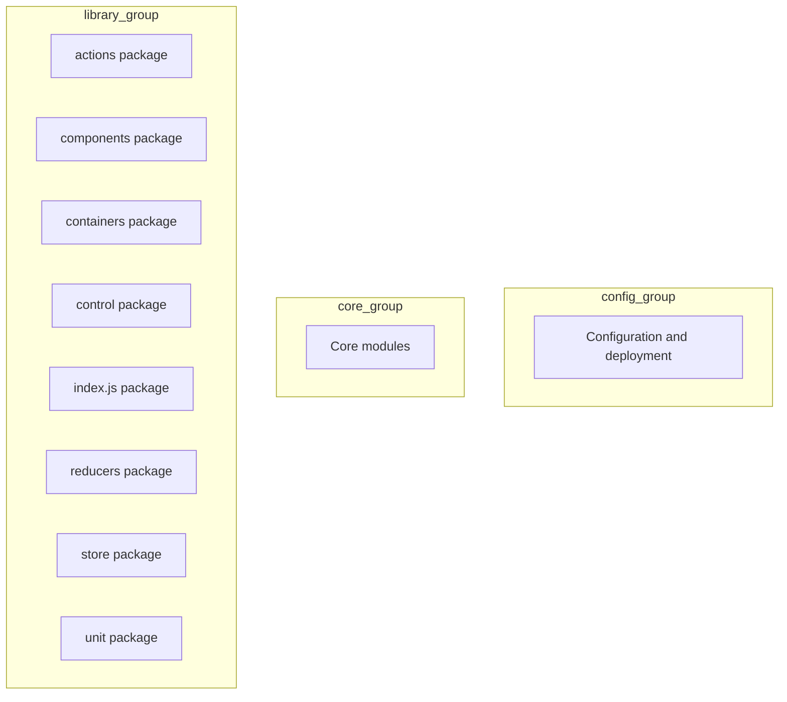

# Architecture report: chvin/react-tetris

> Automated static analysis. **Observed** = directly seen in files/imports/AST; **Inferred** = interpretation from that evidence. Repository code was not executed.

## 1. Repository at a glance

| Item | Value |
| --- | --- |
| Repository | chvin/react-tetris |
| Description | Use React, Redux, Immutable to code Tetris. 🎮 |
| Language | JavaScript |
| Stars | 8734 |
| Licence | Not detected |
| Analysed commit / branch | 89435b72f127b67f95870c515a130cbff38fd7cf / master |
| Framework(s) | React |
| Files analysed | 86 |
| Components | 10 |

## 2. Architecture in one minute

chvin/react-tetris - Use React, Redux, Immutable to code Tetris. 🎮. This repository was analysed statically from 86 file(s) (0 Python). Detected technologies (observed from imports/manifests): React, Redux, webpack. Files are grouped into 10 component(s): actions package, components package, Configuration and deployment, containers package, control package, Core modules, index.js package, reducers package. Findings below distinguish observed facts from inferred interpretation.

## 3. High-level block diagram

## 4. Main components

### actions package (`actions`)

- **Kind:** library
- **Status:** Observed
- **Confidence:** 0.85
- **Responsibility:** Groups 2 file(s) under actions package (observed from repository paths and static analysis).
- **Paths:** `src/actions/index.js`, `src/actions/keyboard.js`
- **Evidence:** [src/actions/index.js](https://github.com/chvin/react-tetris/blob/89435b72f127b67f95870c515a130cbff38fd7cf/src/actions/index.js); [src/actions/keyboard.js](https://github.com/chvin/react-tetris/blob/89435b72f127b67f95870c515a130cbff38fd7cf/src/actions/keyboard.js)

### components package (`components`)

- **Kind:** library
- **Status:** Observed
- **Confidence:** 0.85
- **Responsibility:** Groups 11 file(s) under components package (observed from repository paths and static analysis).
- **Paths:** `src/components/decorate/index.js`, `src/components/guide/index.js`, `src/components/keyboard/button/index.js`, `src/components/keyboard/index.js`, `src/components/logo/index.js`, `src/components/matrix/index.js`, `src/components/music/index.js`, `src/components/next/index.js`, `src/components/number/index.js`, `src/components/pause/index.js`, `src/components/point/index.js`
- **Evidence:** [src/components/decorate/index.js](https://github.com/chvin/react-tetris/blob/89435b72f127b67f95870c515a130cbff38fd7cf/src/components/decorate/index.js); [src/components/guide/index.js](https://github.com/chvin/react-tetris/blob/89435b72f127b67f95870c515a130cbff38fd7cf/src/components/guide/index.js); [src/components/keyboard/button/index.js](https://github.com/chvin/react-tetris/blob/89435b72f127b67f95870c515a130cbff38fd7cf/src/components/keyboard/button/index.js); [src/components/keyboard/index.js](https://github.com/chvin/react-tetris/blob/89435b72f127b67f95870c515a130cbff38fd7cf/src/components/keyboard/index.js); [src/components/logo/index.js](https://github.com/chvin/react-tetris/blob/89435b72f127b67f95870c515a130cbff38fd7cf/src/components/logo/index.js); [src/components/matrix/index.js](https://github.com/chvin/react-tetris/blob/89435b72f127b67f95870c515a130cbff38fd7cf/src/components/matrix/index.js); [src/components/music/index.js](https://github.com/chvin/react-tetris/blob/89435b72f127b67f95870c515a130cbff38fd7cf/src/components/music/index.js); [src/components/next/index.js](https://github.com/chvin/react-tetris/blob/89435b72f127b67f95870c515a130cbff38fd7cf/src/components/next/index.js)

### Configuration and deployment (`config`)

- **Kind:** config
- **Status:** Observed
- **Confidence:** 0.85
- **Responsibility:** Groups 2 file(s) under configuration and deployment (observed from repository paths and static analysis).
- **Paths:** `i18n.json`, `package.json`
- **Evidence:** [i18n.json](https://github.com/chvin/react-tetris/blob/89435b72f127b67f95870c515a130cbff38fd7cf/i18n.json); [package.json](https://github.com/chvin/react-tetris/blob/89435b72f127b67f95870c515a130cbff38fd7cf/package.json)

### containers package (`containers`)

- **Kind:** library
- **Status:** Observed
- **Confidence:** 0.85
- **Responsibility:** Groups 1 file(s) under containers package (observed from repository paths and static analysis).
- **Paths:** `src/containers/index.js`
- **Evidence:** [src/containers/index.js](https://github.com/chvin/react-tetris/blob/89435b72f127b67f95870c515a130cbff38fd7cf/src/containers/index.js)

### control package (`control`)

- **Kind:** library
- **Status:** Observed
- **Confidence:** 0.85
- **Responsibility:** Groups 11 file(s) under control package (observed from repository paths and static analysis).
- **Paths:** `src/control/index.js`, `src/control/states.js`, `src/control/todo/down.js`, `src/control/todo/index.js`, `src/control/todo/left.js`, `src/control/todo/p.js`, `src/control/todo/r.js`, `src/control/todo/right.js`, `src/control/todo/rotate.js`, `src/control/todo/s.js`, `src/control/todo/space.js`
- **Evidence:** [src/control/index.js](https://github.com/chvin/react-tetris/blob/89435b72f127b67f95870c515a130cbff38fd7cf/src/control/index.js); [src/control/states.js](https://github.com/chvin/react-tetris/blob/89435b72f127b67f95870c515a130cbff38fd7cf/src/control/states.js); [src/control/todo/down.js](https://github.com/chvin/react-tetris/blob/89435b72f127b67f95870c515a130cbff38fd7cf/src/control/todo/down.js); [src/control/todo/index.js](https://github.com/chvin/react-tetris/blob/89435b72f127b67f95870c515a130cbff38fd7cf/src/control/todo/index.js); [src/control/todo/left.js](https://github.com/chvin/react-tetris/blob/89435b72f127b67f95870c515a130cbff38fd7cf/src/control/todo/left.js); [src/control/todo/p.js](https://github.com/chvin/react-tetris/blob/89435b72f127b67f95870c515a130cbff38fd7cf/src/control/todo/p.js); [src/control/todo/r.js](https://github.com/chvin/react-tetris/blob/89435b72f127b67f95870c515a130cbff38fd7cf/src/control/todo/r.js); [src/control/todo/right.js](https://github.com/chvin/react-tetris/blob/89435b72f127b67f95870c515a130cbff38fd7cf/src/control/todo/right.js)

### Core modules (`core`)

- **Kind:** core
- **Status:** Observed
- **Confidence:** 0.85
- **Responsibility:** Groups 3 file(s) under core modules (observed from repository paths and static analysis).
- **Paths:** `w.config.js`, `webpack.config.js`, `webpack.production.config.js`
- **Evidence:** [w.config.js](https://github.com/chvin/react-tetris/blob/89435b72f127b67f95870c515a130cbff38fd7cf/w.config.js); [webpack.config.js](https://github.com/chvin/react-tetris/blob/89435b72f127b67f95870c515a130cbff38fd7cf/webpack.config.js); [webpack.production.config.js](https://github.com/chvin/react-tetris/blob/89435b72f127b67f95870c515a130cbff38fd7cf/webpack.production.config.js)

### index.js package (`index_js`)

- **Kind:** library
- **Status:** Observed
- **Confidence:** 0.85
- **Responsibility:** Groups 1 file(s) under index.js package (observed from repository paths and static analysis).
- **Paths:** `src/index.js`
- **Evidence:** [src/index.js](https://github.com/chvin/react-tetris/blob/89435b72f127b67f95870c515a130cbff38fd7cf/src/index.js)

### reducers package (`reducers`)

- **Kind:** library
- **Status:** Observed
- **Confidence:** 0.85
- **Responsibility:** Groups 25 file(s) under reducers package (observed from repository paths and static analysis).
- **Paths:** `src/reducers/clearLines/index.js`, `src/reducers/cur/index.js`, `src/reducers/drop/index.js`, `src/reducers/focus/index.js`, `src/reducers/index.js`, `src/reducers/keyboard/down.js`, `src/reducers/keyboard/drop.js`, `src/reducers/keyboard/index.js`, `src/reducers/keyboard/left.js`, `src/reducers/keyboard/music.js`, `src/reducers/keyboard/pause.js`, `src/reducers/keyboard/reset.js`, `src/reducers/keyboard/right.js`, `src/reducers/keyboard/rotate.js`, `src/reducers/lock/index.js`, `src/reducers/matrix/index.js`, `src/reducers/max/index.js`, `src/reducers/music/index.js`, `src/reducers/next/index.js`, `src/reducers/pause/index.js`, `src/reducers/points/index.js`, `src/reducers/reset/index.js`, `src/reducers/speedRun/index.js`, `src/reducers/speedStart/index.js`, `src/reducers/startLines/index.js`
- **Evidence:** [src/reducers/clearLines/index.js](https://github.com/chvin/react-tetris/blob/89435b72f127b67f95870c515a130cbff38fd7cf/src/reducers/clearLines/index.js); [src/reducers/cur/index.js](https://github.com/chvin/react-tetris/blob/89435b72f127b67f95870c515a130cbff38fd7cf/src/reducers/cur/index.js); [src/reducers/drop/index.js](https://github.com/chvin/react-tetris/blob/89435b72f127b67f95870c515a130cbff38fd7cf/src/reducers/drop/index.js); [src/reducers/focus/index.js](https://github.com/chvin/react-tetris/blob/89435b72f127b67f95870c515a130cbff38fd7cf/src/reducers/focus/index.js); [src/reducers/index.js](https://github.com/chvin/react-tetris/blob/89435b72f127b67f95870c515a130cbff38fd7cf/src/reducers/index.js); [src/reducers/keyboard/down.js](https://github.com/chvin/react-tetris/blob/89435b72f127b67f95870c515a130cbff38fd7cf/src/reducers/keyboard/down.js); [src/reducers/keyboard/drop.js](https://github.com/chvin/react-tetris/blob/89435b72f127b67f95870c515a130cbff38fd7cf/src/reducers/keyboard/drop.js); [src/reducers/keyboard/index.js](https://github.com/chvin/react-tetris/blob/89435b72f127b67f95870c515a130cbff38fd7cf/src/reducers/keyboard/index.js)

### store package (`store`)

- **Kind:** library
- **Status:** Observed
- **Confidence:** 0.85
- **Responsibility:** Groups 1 file(s) under store package (observed from repository paths and static analysis).
- **Paths:** `src/store/index.js`
- **Evidence:** [src/store/index.js](https://github.com/chvin/react-tetris/blob/89435b72f127b67f95870c515a130cbff38fd7cf/src/store/index.js)

### unit package (`unit`)

- **Kind:** library
- **Status:** Observed
- **Confidence:** 0.85
- **Responsibility:** Groups 6 file(s) under unit package (observed from repository paths and static analysis).
- **Paths:** `src/unit/block.js`, `src/unit/const.js`, `src/unit/event.js`, `src/unit/index.js`, `src/unit/music.js`, `src/unit/reducerType.js`
- **Evidence:** [src/unit/block.js](https://github.com/chvin/react-tetris/blob/89435b72f127b67f95870c515a130cbff38fd7cf/src/unit/block.js); [src/unit/const.js](https://github.com/chvin/react-tetris/blob/89435b72f127b67f95870c515a130cbff38fd7cf/src/unit/const.js); [src/unit/event.js](https://github.com/chvin/react-tetris/blob/89435b72f127b67f95870c515a130cbff38fd7cf/src/unit/event.js); [src/unit/index.js](https://github.com/chvin/react-tetris/blob/89435b72f127b67f95870c515a130cbff38fd7cf/src/unit/index.js); [src/unit/music.js](https://github.com/chvin/react-tetris/blob/89435b72f127b67f95870c515a130cbff38fd7cf/src/unit/music.js); [src/unit/reducerType.js](https://github.com/chvin/react-tetris/blob/89435b72f127b67f95870c515a130cbff38fd7cf/src/unit/reducerType.js)

## 5. Execution flow

**Observed** entry point(s):

- [src/actions/index.js](https://github.com/chvin/react-tetris/blob/89435b72f127b67f95870c515a130cbff38fd7cf/src/actions/index.js)
- [src/components/decorate/index.js](https://github.com/chvin/react-tetris/blob/89435b72f127b67f95870c515a130cbff38fd7cf/src/components/decorate/index.js)
- [src/components/guide/index.js](https://github.com/chvin/react-tetris/blob/89435b72f127b67f95870c515a130cbff38fd7cf/src/components/guide/index.js)
- [src/components/keyboard/index.js](https://github.com/chvin/react-tetris/blob/89435b72f127b67f95870c515a130cbff38fd7cf/src/components/keyboard/index.js)
- [src/components/logo/index.js](https://github.com/chvin/react-tetris/blob/89435b72f127b67f95870c515a130cbff38fd7cf/src/components/logo/index.js)
- [src/components/matrix/index.js](https://github.com/chvin/react-tetris/blob/89435b72f127b67f95870c515a130cbff38fd7cf/src/components/matrix/index.js)
- [src/components/music/index.js](https://github.com/chvin/react-tetris/blob/89435b72f127b67f95870c515a130cbff38fd7cf/src/components/music/index.js)
- [src/components/next/index.js](https://github.com/chvin/react-tetris/blob/89435b72f127b67f95870c515a130cbff38fd7cf/src/components/next/index.js)
- [src/components/number/index.js](https://github.com/chvin/react-tetris/blob/89435b72f127b67f95870c515a130cbff38fd7cf/src/components/number/index.js)
- [src/components/pause/index.js](https://github.com/chvin/react-tetris/blob/89435b72f127b67f95870c515a130cbff38fd7cf/src/components/pause/index.js)
- [src/components/point/index.js](https://github.com/chvin/react-tetris/blob/89435b72f127b67f95870c515a130cbff38fd7cf/src/components/point/index.js)
- [src/containers/index.js](https://github.com/chvin/react-tetris/blob/89435b72f127b67f95870c515a130cbff38fd7cf/src/containers/index.js)

Representative flow (derived from observed entry points and the import graph; steps beyond the entry point are **Inferred**):

1. Execution starts at an observed entry point listed above, if present.
2. No internal import relationships between components were observed.

## 6. Project structure

### `(root)`

- `.babelrc` - other (37 bytes)
- `.eslintrc.js` - source, JavaScript (411 bytes)
- `.gitignore` - other (786 bytes)
- `README-EN.md` - docs (13778 bytes)
- `README.md` - docs (12355 bytes)
- `i18n.json` - config (2516 bytes)
- `package.json` - manifest (2001 bytes)
- `w.config.js` - source, JavaScript (2814 bytes)
- `webpack.config.js` - source, JavaScript (359 bytes)
- `webpack.production.config.js` - source, JavaScript (361 bytes)

### `docs`

- `docs/css-1.0.1.css` - docs (7109 bytes)
- `docs/index.html` - docs (1041 bytes)
- `docs/loader.css` - docs (1500 bytes)

### `server`

- `server/index.html` - other (1038 bytes)
- `server/index.tmpl.html` - other (938 bytes)

### `src`

- `src/actions/index.js` - source, JavaScript (1696 bytes)
- `src/actions/keyboard.js` - source, JavaScript (819 bytes)
- `src/components/decorate/index.js` - source, JavaScript (3696 bytes)
- `src/components/decorate/index.less` - other (863 bytes)
- `src/components/guide/index.js` - source, JavaScript (2763 bytes)
- `src/components/guide/index.less` - other (2163 bytes)
- `src/components/keyboard/button/index.js` - source, JavaScript (1230 bytes)
- `src/components/keyboard/button/index.less` - other (2294 bytes)
- `src/components/keyboard/index.js` - source, JavaScript (4826 bytes)
- `src/components/keyboard/index.less` - other (89 bytes)
- `src/components/logo/index.js` - source, JavaScript (3417 bytes)
- `src/components/logo/index.less` - other (904 bytes)
- `src/components/matrix/index.js` - source, JavaScript (4346 bytes)
- `src/components/matrix/index.less` - other (120 bytes)
- `src/components/music/index.js` - source, JavaScript (530 bytes)
- `src/components/music/index.less` - other (176 bytes)
- `src/components/next/index.js` - source, JavaScript (1399 bytes)
- `src/components/next/index.less` - other (72 bytes)
- `src/components/number/index.js` - source, JavaScript (2208 bytes)
- `src/components/number/index.less` - other (665 bytes)
- `src/components/pause/index.js` - source, JavaScript (1389 bytes)
- `src/components/pause/index.less` - other (176 bytes)
- `src/components/point/index.js` - source, JavaScript (1802 bytes)
- `src/containers/index.js` - source, JavaScript (5260 bytes)
- `src/containers/index.less` - other (2392 bytes)
- `src/containers/loader.less` - other (1198 bytes)
- `src/control/index.js` - source, JavaScript (855 bytes)
- `src/control/states.js` - source, JavaScript (6262 bytes)
- `src/control/todo/down.js` - source, JavaScript (2189 bytes)
- `src/control/todo/index.js` - source, JavaScript (286 bytes)
- `src/control/todo/left.js` - source, JavaScript (1677 bytes)
- `src/control/todo/p.js` - source, JavaScript (713 bytes)
- `src/control/todo/r.js` - source, JavaScript (753 bytes)
- `src/control/todo/right.js` - source, JavaScript (1682 bytes)
- `src/control/todo/rotate.js` - source, JavaScript (1594 bytes)
- `src/control/todo/s.js` - source, JavaScript (568 bytes)
- `src/control/todo/space.js` - source, JavaScript (1724 bytes)
- `src/index.js` - source, JavaScript (422 bytes)
- `src/reducers/clearLines/index.js` - source, JavaScript (468 bytes)
- `src/reducers/cur/index.js` - source, JavaScript (714 bytes)
- `src/reducers/drop/index.js` - source, JavaScript (381 bytes)
- `src/reducers/focus/index.js` - source, JavaScript (313 bytes)
- `src/reducers/index.js` - source, JavaScript (780 bytes)
- `src/reducers/keyboard/down.js` - source, JavaScript (278 bytes)
- `src/reducers/keyboard/drop.js` - source, JavaScript (278 bytes)
- `src/reducers/keyboard/index.js` - source, JavaScript (429 bytes)
- `src/reducers/keyboard/left.js` - source, JavaScript (278 bytes)
- `src/reducers/keyboard/music.js` - source, JavaScript (279 bytes)
- `src/reducers/keyboard/pause.js` - source, JavaScript (279 bytes)
- `src/reducers/keyboard/reset.js` - source, JavaScript (279 bytes)
- `src/reducers/keyboard/right.js` - source, JavaScript (279 bytes)
- `src/reducers/keyboard/rotate.js` - source, JavaScript (280 bytes)
- `src/reducers/lock/index.js` - source, JavaScript (381 bytes)
- `src/reducers/matrix/index.js` - source, JavaScript (469 bytes)
- `src/reducers/max/index.js` - source, JavaScript (554 bytes)
- `src/reducers/music/index.js` - source, JavaScript (608 bytes)
- `src/reducers/next/index.js` - source, JavaScript (461 bytes)
- `src/reducers/pause/index.js` - source, JavaScript (385 bytes)
- `src/reducers/points/index.js` - source, JavaScript (569 bytes)
- `src/reducers/reset/index.js` - source, JavaScript (371 bytes)
- `src/reducers/speedRun/index.js` - source, JavaScript (475 bytes)
- `src/reducers/speedStart/index.js` - source, JavaScript (485 bytes)
- `src/reducers/startLines/index.js` - source, JavaScript (486 bytes)
- `src/resource/css/loader.css` - other (1500 bytes)
- `src/store/index.js` - source, JavaScript (196 bytes)
- `src/unit/block.js` - source, JavaScript (2621 bytes)
- `src/unit/const.js` - source, JavaScript (2353 bytes)
- `src/unit/event.js` - source, JavaScript (957 bytes)
- `src/unit/index.js` - source, JavaScript (2791 bytes)
- `src/unit/music.js` - source, JavaScript (2330 bytes)
- `src/unit/reducerType.js` - source, JavaScript (810 bytes)

## 7. Key dependencies and integrations

| Name | Category | Status | Confidence | Evidence |
| --- | --- | --- | --- | --- |
| React | framework | Observed | 0.90 | [package.json:2](https://github.com/chvin/react-tetris/blob/89435b72f127b67f95870c515a130cbff38fd7cf/package.json#L2); [package.json:63](https://github.com/chvin/react-tetris/blob/89435b72f127b67f95870c515a130cbff38fd7cf/package.json#L63) |
| Redux | library | Observed | 0.85 | [package.json:4](https://github.com/chvin/react-tetris/blob/89435b72f127b67f95870c515a130cbff38fd7cf/package.json#L4) |
| webpack | tooling | Observed | 0.85 | [package.json:6](https://github.com/chvin/react-tetris/blob/89435b72f127b67f95870c515a130cbff38fd7cf/package.json#L6) |

## 8. Data and state

No database, cache, queue, or persistent-state usage was observed in the analysed files. State handling, if any, may be in-memory or in files that were not analysed.

## 9. Configuration and deployment clues

- `i18n.json` (config)
- `package.json` (manifest)

## 10. Design observations

- No strong design patterns could be established from the available evidence.

These observations are interpretations (**Inferred**) of the observed structure, not guarantees about runtime design.

## 11. Limitations and unknowns

- Static analysis only: repository code was not executed, installed, or imported at runtime.
- Components and relationships are inferred from file paths, imports, and AST structure; runtime behaviour, dynamic imports, and reflection may not be visible.
- No clear application entry point was observed in the analysed files.
- Repository text was treated as untrusted data; no instructions found in repository files were followed, and likely secret values were redacted/excluded.
- JavaScript and TypeScript files were inventoried from paths and package manifests. They were not parsed with a full language AST, and repository code was not executed.

## 12. Source references

- [i18n.json](https://github.com/chvin/react-tetris/blob/89435b72f127b67f95870c515a130cbff38fd7cf/i18n.json)
- [package.json](https://github.com/chvin/react-tetris/blob/89435b72f127b67f95870c515a130cbff38fd7cf/package.json)
- [package.json:2](https://github.com/chvin/react-tetris/blob/89435b72f127b67f95870c515a130cbff38fd7cf/package.json#L2)
- [package.json:4](https://github.com/chvin/react-tetris/blob/89435b72f127b67f95870c515a130cbff38fd7cf/package.json#L4)
- [package.json:6](https://github.com/chvin/react-tetris/blob/89435b72f127b67f95870c515a130cbff38fd7cf/package.json#L6)
- [package.json:63](https://github.com/chvin/react-tetris/blob/89435b72f127b67f95870c515a130cbff38fd7cf/package.json#L63)
- [src/actions/index.js](https://github.com/chvin/react-tetris/blob/89435b72f127b67f95870c515a130cbff38fd7cf/src/actions/index.js)
- [src/actions/keyboard.js](https://github.com/chvin/react-tetris/blob/89435b72f127b67f95870c515a130cbff38fd7cf/src/actions/keyboard.js)
- [src/components/decorate/index.js](https://github.com/chvin/react-tetris/blob/89435b72f127b67f95870c515a130cbff38fd7cf/src/components/decorate/index.js)
- [src/components/guide/index.js](https://github.com/chvin/react-tetris/blob/89435b72f127b67f95870c515a130cbff38fd7cf/src/components/guide/index.js)
- [src/components/keyboard/button/index.js](https://github.com/chvin/react-tetris/blob/89435b72f127b67f95870c515a130cbff38fd7cf/src/components/keyboard/button/index.js)
- [src/components/keyboard/index.js](https://github.com/chvin/react-tetris/blob/89435b72f127b67f95870c515a130cbff38fd7cf/src/components/keyboard/index.js)
- [src/components/logo/index.js](https://github.com/chvin/react-tetris/blob/89435b72f127b67f95870c515a130cbff38fd7cf/src/components/logo/index.js)
- [src/components/matrix/index.js](https://github.com/chvin/react-tetris/blob/89435b72f127b67f95870c515a130cbff38fd7cf/src/components/matrix/index.js)
- [src/components/music/index.js](https://github.com/chvin/react-tetris/blob/89435b72f127b67f95870c515a130cbff38fd7cf/src/components/music/index.js)
- [src/components/next/index.js](https://github.com/chvin/react-tetris/blob/89435b72f127b67f95870c515a130cbff38fd7cf/src/components/next/index.js)
- [src/components/number/index.js](https://github.com/chvin/react-tetris/blob/89435b72f127b67f95870c515a130cbff38fd7cf/src/components/number/index.js)
- [src/components/pause/index.js](https://github.com/chvin/react-tetris/blob/89435b72f127b67f95870c515a130cbff38fd7cf/src/components/pause/index.js)
- [src/components/point/index.js](https://github.com/chvin/react-tetris/blob/89435b72f127b67f95870c515a130cbff38fd7cf/src/components/point/index.js)
- [src/containers/index.js](https://github.com/chvin/react-tetris/blob/89435b72f127b67f95870c515a130cbff38fd7cf/src/containers/index.js)
- [src/control/index.js](https://github.com/chvin/react-tetris/blob/89435b72f127b67f95870c515a130cbff38fd7cf/src/control/index.js)
- [src/control/states.js](https://github.com/chvin/react-tetris/blob/89435b72f127b67f95870c515a130cbff38fd7cf/src/control/states.js)
- [src/control/todo/down.js](https://github.com/chvin/react-tetris/blob/89435b72f127b67f95870c515a130cbff38fd7cf/src/control/todo/down.js)
- [src/control/todo/index.js](https://github.com/chvin/react-tetris/blob/89435b72f127b67f95870c515a130cbff38fd7cf/src/control/todo/index.js)
- [src/control/todo/left.js](https://github.com/chvin/react-tetris/blob/89435b72f127b67f95870c515a130cbff38fd7cf/src/control/todo/left.js)
- [src/control/todo/p.js](https://github.com/chvin/react-tetris/blob/89435b72f127b67f95870c515a130cbff38fd7cf/src/control/todo/p.js)
- [src/control/todo/r.js](https://github.com/chvin/react-tetris/blob/89435b72f127b67f95870c515a130cbff38fd7cf/src/control/todo/r.js)
- [src/control/todo/right.js](https://github.com/chvin/react-tetris/blob/89435b72f127b67f95870c515a130cbff38fd7cf/src/control/todo/right.js)
- [src/index.js](https://github.com/chvin/react-tetris/blob/89435b72f127b67f95870c515a130cbff38fd7cf/src/index.js)
- [src/reducers/clearLines/index.js](https://github.com/chvin/react-tetris/blob/89435b72f127b67f95870c515a130cbff38fd7cf/src/reducers/clearLines/index.js)
- [src/reducers/cur/index.js](https://github.com/chvin/react-tetris/blob/89435b72f127b67f95870c515a130cbff38fd7cf/src/reducers/cur/index.js)
- [src/reducers/drop/index.js](https://github.com/chvin/react-tetris/blob/89435b72f127b67f95870c515a130cbff38fd7cf/src/reducers/drop/index.js)
- [src/reducers/focus/index.js](https://github.com/chvin/react-tetris/blob/89435b72f127b67f95870c515a130cbff38fd7cf/src/reducers/focus/index.js)
- [src/reducers/index.js](https://github.com/chvin/react-tetris/blob/89435b72f127b67f95870c515a130cbff38fd7cf/src/reducers/index.js)
- [src/reducers/keyboard/down.js](https://github.com/chvin/react-tetris/blob/89435b72f127b67f95870c515a130cbff38fd7cf/src/reducers/keyboard/down.js)
- [src/reducers/keyboard/drop.js](https://github.com/chvin/react-tetris/blob/89435b72f127b67f95870c515a130cbff38fd7cf/src/reducers/keyboard/drop.js)
- [src/reducers/keyboard/index.js](https://github.com/chvin/react-tetris/blob/89435b72f127b67f95870c515a130cbff38fd7cf/src/reducers/keyboard/index.js)
- [src/store/index.js](https://github.com/chvin/react-tetris/blob/89435b72f127b67f95870c515a130cbff38fd7cf/src/store/index.js)
- [src/unit/block.js](https://github.com/chvin/react-tetris/blob/89435b72f127b67f95870c515a130cbff38fd7cf/src/unit/block.js)
- [src/unit/const.js](https://github.com/chvin/react-tetris/blob/89435b72f127b67f95870c515a130cbff38fd7cf/src/unit/const.js)
- [src/unit/event.js](https://github.com/chvin/react-tetris/blob/89435b72f127b67f95870c515a130cbff38fd7cf/src/unit/event.js)
- [src/unit/index.js](https://github.com/chvin/react-tetris/blob/89435b72f127b67f95870c515a130cbff38fd7cf/src/unit/index.js)
- [src/unit/music.js](https://github.com/chvin/react-tetris/blob/89435b72f127b67f95870c515a130cbff38fd7cf/src/unit/music.js)
- [src/unit/reducerType.js](https://github.com/chvin/react-tetris/blob/89435b72f127b67f95870c515a130cbff38fd7cf/src/unit/reducerType.js)
- [w.config.js](https://github.com/chvin/react-tetris/blob/89435b72f127b67f95870c515a130cbff38fd7cf/w.config.js)
- [webpack.config.js](https://github.com/chvin/react-tetris/blob/89435b72f127b67f95870c515a130cbff38fd7cf/webpack.config.js)
- [webpack.production.config.js](https://github.com/chvin/react-tetris/blob/89435b72f127b67f95870c515a130cbff38fd7cf/webpack.production.config.js)
