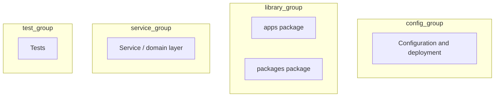

# Architecture report: clauderic/dnd-kit

> Automated static analysis. **Observed** = directly seen in files/imports/AST; **Inferred** = interpretation from that evidence. Repository code was not executed.

## 1. Repository at a glance

| Item | Value |
| --- | --- |
| Repository | clauderic/dnd-kit |
| Description | The modern toolkit for building drag and drop interfaces |
| Language | TypeScript |
| Stars | 17795 |
| Licence | MIT |
| Analysed commit / branch | ccaf3d583903a5d0b68616310a24aec891ee0d69 / main |
| Framework(s) | React, Svelte, Vue |
| Files analysed | 800 |
| Components | 5 |

## 2. Architecture in one minute

clauderic/dnd-kit - The modern toolkit for building drag and drop interfaces. This repository was analysed statically from 800 file(s) (0 Python). Detected technologies (observed from imports/manifests): GitHub Actions, React, Svelte, Vue, Tailwind CSS, TypeScript. Files are grouped into 5 component(s): apps package, Configuration and deployment, packages package, Service / domain layer, Tests. Findings below distinguish observed facts from inferred interpretation.

## 3. High-level block diagram

## 4. Main components

### apps package (`apps`)

- **Kind:** library
- **Status:** Observed
- **Confidence:** 0.85
- **Responsibility:** Groups 229 file(s) under apps package (observed from repository paths and static analysis).
- **Paths:** `apps/stories-shared/components/Container/Container.ts`, `apps/stories-shared/components/Container/index.ts`, `apps/stories-shared/components/Item/Item.ts`, `apps/stories-shared/components/Item/index.ts`, `apps/stories-shared/components/index.ts`, `apps/stories-shared/register.ts`, `apps/stories-shared/styles/index.ts`, `apps/stories-shared/styles/sandbox.ts`, `apps/stories-shared/utilities/classnames.ts`, `apps/stories-shared/utilities/createRange.ts`, `apps/stories-shared/utilities/index.ts`, `apps/stories-solid/.storybook/main.ts`, `apps/stories-solid/.storybook/manager.ts`, `apps/stories-solid/.storybook/preview.ts`, `apps/stories-solid/.storybook/theme.ts`, `apps/stories-solid/custom-elements.d.ts`, `apps/stories-solid/playwright.config.ts`, `apps/stories-solid/raw.d.ts`, `apps/stories-solid/stories/Draggable/DragHandles/DragHandles.stories.tsx`, `apps/stories-solid/stories/Draggable/DragHandles/DragHandlesApp.tsx`, `apps/stories-solid/stories/Draggable/Draggable.stories.tsx`, `apps/stories-solid/stories/Draggable/DraggableApp.tsx`, `apps/stories-solid/stories/Droppable/Droppable.stories.tsx`, `apps/stories-solid/stories/Droppable/DroppableApp.tsx`, `apps/stories-solid/stories/Droppable/MultipleDroppable/MultipleDroppable.stories.tsx`, `apps/stories-solid/stories/Droppable/MultipleDroppable/MultipleDroppableApp.tsx`, `apps/stories-solid/stories/Sortable/Grid/Grid.stories.tsx`, `apps/stories-solid/stories/Sortable/Grid/GridSortableApp.tsx`, `apps/stories-solid/stories/Sortable/Horizontal/Horizontal.stories.tsx`, `apps/stories-solid/stories/Sortable/Horizontal/HorizontalSortableApp.tsx`, `apps/stories-solid/stories/Sortable/MultipleLists/MultipleLists.stories.tsx`, `apps/stories-solid/stories/Sortable/MultipleLists/MultipleListsApp.tsx`, `apps/stories-solid/stories/Sortable/SortableApp.tsx`, `apps/stories-solid/stories/Sortable/SortableDragHandleApp.tsx`, `apps/stories-solid/stories/Sortable/SortableDynamicFeedbackApp.tsx`, `apps/stories-solid/stories/Sortable/Vertical/Vertical.stories.tsx`, `apps/stories-svelte/.storybook/main.ts`, `apps/stories-svelte/.storybook/manager.ts`, `apps/stories-svelte/.storybook/preview.ts`, `apps/stories-svelte/.storybook/theme.ts`, `apps/stories-svelte/playwright.config.ts`, `apps/stories-svelte/raw.d.ts`, `apps/stories-svelte/stories/Draggable/DragHandles/DragHandles.stories.ts`, `apps/stories-svelte/stories/Draggable/DragHandles/DragHandlesApp.svelte`, `apps/stories-svelte/stories/Draggable/DragHandles/DraggableWithHandle.svelte`, `apps/stories-svelte/stories/Draggable/DragOverlay/DragOverlay.stories.ts`, `apps/stories-svelte/stories/Draggable/DragOverlay/DragOverlayApp.svelte`, `apps/stories-svelte/stories/Draggable/DragOverlay/DraggableItem.svelte`, `apps/stories-svelte/stories/Draggable/Draggable.stories.ts`, `apps/stories-svelte/stories/Draggable/Draggable.svelte`, `apps/stories-svelte/stories/Draggable/DraggableApp.svelte`, `apps/stories-svelte/stories/Droppable/DraggableItem.svelte`, `apps/stories-svelte/stories/Droppable/Droppable.stories.ts`, `apps/stories-svelte/stories/Droppable/DroppableApp.svelte`, `apps/stories-svelte/stories/Droppable/DroppableZone.svelte`, `apps/stories-svelte/stories/Droppable/MultipleDroppable/MultipleDroppable.stories.ts`, `apps/stories-svelte/stories/Droppable/MultipleDroppable/MultipleDroppableApp.svelte`, `apps/stories-svelte/stories/Sortable/Grid/Grid.stories.ts`, `apps/stories-svelte/stories/Sortable/Grid/GridSortableApp.svelte`, `apps/stories-svelte/stories/Sortable/Grid/GridSortableItem.svelte`, `apps/stories-svelte/stories/Sortable/Horizontal/Horizontal.stories.ts`, `apps/stories-svelte/stories/Sortable/Horizontal/HorizontalSortableApp.svelte`, `apps/stories-svelte/stories/Sortable/Horizontal/HorizontalSortableItem.svelte`, `apps/stories-svelte/stories/Sortable/Horizontal/NestedScrollHorizontalSortableApp.svelte`, `apps/stories-svelte/stories/Sortable/MultipleLists/MultipleLists.stories.ts`, `apps/stories-svelte/stories/Sortable/MultipleLists/MultipleListsApp.svelte`, `apps/stories-svelte/stories/Sortable/MultipleLists/SortableColumn.svelte`, `apps/stories-svelte/stories/Sortable/MultipleLists/SortableItem.svelte`, `apps/stories-svelte/stories/Sortable/NestedScrollSortableApp.svelte`, `apps/stories-svelte/stories/Sortable/SortableApp.svelte`, `apps/stories-svelte/stories/Sortable/SortableDragHandleApp.svelte`, `apps/stories-svelte/stories/Sortable/SortableDynamicFeedbackApp.svelte`, `apps/stories-svelte/stories/Sortable/SortableDynamicFeedbackItem.svelte`, `apps/stories-svelte/stories/Sortable/SortableItem.svelte`, `apps/stories-svelte/stories/Sortable/SortableItemWithHandle.svelte`, `apps/stories-svelte/stories/Sortable/Vertical/Vertical.stories.ts`, `apps/stories-svelte/svelte.config.js`, `apps/stories-svelte/vite.config.ts`, `apps/stories-vanilla/.storybook/main.ts`, `apps/stories-vanilla/.storybook/manager.ts`, `apps/stories-vanilla/.storybook/preview.ts`, `apps/stories-vanilla/.storybook/theme.ts`, `apps/stories-vanilla/raw.d.ts`, `apps/stories-vanilla/stories/Draggable/DragHandle/DragHandle.stories.ts`, `apps/stories-vanilla/stories/Draggable/DragHandle/DragHandleApp.ts`, `apps/stories-vanilla/stories/Draggable/Draggable.stories.ts`, `apps/stories-vanilla/stories/Draggable/DraggableApp.ts`, `apps/stories-vanilla/stories/Droppable/Droppable.stories.ts`, `apps/stories-vanilla/stories/Droppable/DroppableApp.ts`, `apps/stories-vanilla/stories/Droppable/MultipleDroppable/MultipleDroppable.stories.ts`, `apps/stories-vanilla/stories/Droppable/MultipleDroppable/MultipleDroppableApp.ts`, `apps/stories-vanilla/stories/Sortable/Grid/Grid.stories.ts`, `apps/stories-vanilla/stories/Sortable/Grid/GridSortableApp.ts`, `apps/stories-vanilla/stories/Sortable/Horizontal/Horizontal.stories.ts`, `apps/stories-vanilla/stories/Sortable/Horizontal/HorizontalSortableApp.ts`, `apps/stories-vanilla/stories/Sortable/Sortable.stories.ts`, `apps/stories-vanilla/stories/Sortable/SortableApp.ts`, `apps/stories-vanilla/stories/Sortable/SortableDynamicFeedbackApp.ts`, `apps/stories-vue/.storybook/main.ts`, `apps/stories-vue/.storybook/manager.ts`, `apps/stories-vue/.storybook/preview.ts`, `apps/stories-vue/.storybook/theme.ts`, `apps/stories-vue/playwright.config.ts`, `apps/stories-vue/raw.d.ts`, `apps/stories-vue/stories/Draggable/DragHandles/DragHandles.stories.ts`, `apps/stories-vue/stories/Draggable/DragHandles/DragHandlesApp.vue`, `apps/stories-vue/stories/Draggable/DragOverlay/DragOverlay.stories.ts`, `apps/stories-vue/stories/Draggable/DragOverlay/DragOverlayApp.vue`, `apps/stories-vue/stories/Draggable/Draggable.stories.ts`, `apps/stories-vue/stories/Draggable/DraggableApp.vue`, `apps/stories-vue/stories/Droppable/Droppable.stories.ts`, `apps/stories-vue/stories/Droppable/DroppableApp.vue`, `apps/stories-vue/stories/Droppable/MultipleDroppable/MultipleDroppable.stories.ts`, `apps/stories-vue/stories/Droppable/MultipleDroppable/MultipleDroppableApp.vue`, `apps/stories-vue/stories/Sortable/Grid/Grid.stories.ts`, `apps/stories-vue/stories/Sortable/Grid/GridSortableApp.vue`, `apps/stories-vue/stories/Sortable/Horizontal/Horizontal.stories.ts`, `apps/stories-vue/stories/Sortable/Horizontal/HorizontalSortableApp.vue`, `apps/stories-vue/stories/Sortable/MultipleLists/MultipleLists.stories.ts`, `apps/stories-vue/stories/Sortable/MultipleLists/MultipleListsApp.vue`, `apps/stories-vue/stories/Sortable/MultipleLists/SortableColumn.vue`, `apps/stories-vue/stories/Sortable/MultipleLists/SortableItem.vue`, `apps/stories-vue/stories/Sortable/SortableApp.vue`, `apps/stories-vue/stories/Sortable/SortableDragHandleApp.vue`, `apps/stories-vue/stories/Sortable/SortableDynamicFeedbackApp.vue`, `apps/stories-vue/stories/Sortable/Vertical/Vertical.stories.ts`, `apps/stories/.eslintrc.js`, `apps/stories/.storybook/main.ts`, `apps/stories/.storybook/manager.ts`, `apps/stories/.storybook/preview.tsx`, `apps/stories/.storybook/theme.ts`, `apps/stories/playwright.config.ts`, `apps/stories/raw.d.ts`, `apps/stories/stories/components/index.ts`, `apps/stories/stories/react/Draggable/DragHandles/DragHandles.stories.tsx`, `apps/stories/stories/react/Draggable/DragOverlay/DragOverlay.stories.tsx`, `apps/stories/stories/react/Draggable/Draggable.stories.tsx`, `apps/stories/stories/react/Draggable/DraggableApp.tsx`, `apps/stories/stories/react/Draggable/DraggableExample.tsx`, `apps/stories/stories/react/Draggable/Modifiers/Modifiers.stories.tsx`, `apps/stories/stories/react/Draggable/Modifiers/SnapToGridExample.tsx`, `apps/stories/stories/react/Draggable/Popup.stories.tsx`, `apps/stories/stories/react/Draggable/Sensors/Sensors.stories.tsx`, `apps/stories/stories/react/Droppable/Droppable.stories.tsx`, `apps/stories/stories/react/Droppable/DroppableApp.tsx`, `apps/stories/stories/react/Droppable/DroppableExample.tsx`, `apps/stories/stories/react/Droppable/MultipleDroppable/MultipleDroppable.stories.tsx`, `apps/stories/stories/react/Droppable/MultipleDroppable/MultipleDroppableApp.tsx`, `apps/stories/stories/react/Resizeable/Resizeable.tsx`, `apps/stories/stories/react/Resizeable/index.ts`, `apps/stories/stories/react/Sortable/CSSLayers/CSSLayers.stories.tsx`, `apps/stories/stories/react/Sortable/CSSLayers/CSSLayersExample.tsx`, `apps/stories/stories/react/Sortable/ConditionalStateExample.tsx`, `apps/stories/stories/react/Sortable/Grid/Grid.stories.tsx`, `apps/stories/stories/react/Sortable/Grid/GridSortableApp.tsx`, `apps/stories/stories/react/Sortable/Horizontal/Horizontal.stories.tsx`, `apps/stories/stories/react/Sortable/Horizontal/HorizontalSortableApp.tsx`, `apps/stories/stories/react/Sortable/Iframe/Iframe.stories.tsx`, `apps/stories/stories/react/Sortable/Iframe/IframeExample.tsx`, `apps/stories/stories/react/Sortable/MultipleLists/MultipleLists.stories.tsx`, `apps/stories/stories/react/Sortable/MultipleLists/MultipleLists.tsx`, `apps/stories/stories/react/Sortable/MultipleLists/MultipleListsApp.tsx`, `apps/stories/stories/react/Sortable/Quickstart.tsx`, `apps/stories/stories/react/Sortable/Sortable.stories.tsx`, `apps/stories/stories/react/Sortable/SortableApp.tsx`, `apps/stories/stories/react/Sortable/SortableExample.tsx`, `apps/stories/stories/react/Sortable/Table/Table.stories.tsx`, `apps/stories/stories/react/Sortable/Table/TableExample.tsx`, `apps/stories/stories/react/Sortable/Table/TanstackTableExample.tsx`, `apps/stories/stories/react/Sortable/Transformed/Transformed.stories.tsx`, `apps/stories/stories/react/Sortable/Transformed/TransformedExample.tsx`, `apps/stories/stories/react/Sortable/Tree/Tree.stories.tsx`, `apps/stories/stories/react/Sortable/Tree/Tree.tsx`, `apps/stories/stories/react/Sortable/Tree/TreeItem.tsx`, `apps/stories/stories/react/Sortable/Tree/TreeItemOverlay.tsx`, `apps/stories/stories/react/Sortable/Tree/types.ts`, `apps/stories/stories/react/Sortable/Tree/utilities.ts`, `apps/stories/stories/react/Sortable/Vertical/AnchorElementsExample.tsx`, `apps/stories/stories/react/Sortable/Vertical/AutoScrollExample.tsx`, `apps/stories/stories/react/Sortable/Vertical/Vertical.stories.tsx`, `apps/stories/stories/react/Sortable/Virtualized/ReactTinyVirtualListExample.tsx`, `apps/stories/stories/react/Sortable/Virtualized/ReactVirtualExample.tsx`, `apps/stories/stories/react/Sortable/Virtualized/ReactWindowExample.tsx`, `apps/stories/stories/react/Sortable/Virtualized/Virtualized.stories.tsx`, `apps/stories/stories/react/components/Actions/Action.tsx`, `apps/stories/stories/react/components/Actions/Actions.tsx`, `apps/stories/stories/react/components/Actions/Remove.tsx`, `apps/stories/stories/react/components/Actions/index.ts`, `apps/stories/stories/react/components/Button/Button.tsx`, `apps/stories/stories/react/components/Container/Container.tsx`, `apps/stories/stories/react/components/Dropzone/Dropzone.tsx`, `apps/stories/stories/react/components/Grid/Grid.tsx`, `apps/stories/stories/react/components/Handle/Handle.tsx`, `apps/stories/stories/react/components/Item/Item.tsx`, `apps/stories/stories/react/components/index.ts`, `apps/stories/stories/react/icons/SortableIcon.tsx`, `apps/stories/stories/react/icons/index.ts`, `apps/templates/react-draggable/src/App.jsx`, `apps/templates/react-draggable/src/Droppable.jsx`, `apps/templates/react-draggable/src/main.jsx`, `apps/templates/react-draggable/vite.config.js`, `apps/templates/react-sortable/src/App.jsx`, `apps/templates/react-sortable/src/main.jsx`, `apps/templates/react-sortable/vite.config.js`, `apps/templates/solid-draggable/src/App.tsx`, `apps/templates/solid-draggable/src/Droppable.tsx`, `apps/templates/solid-draggable/src/main.tsx`, `apps/templates/solid-draggable/vite.config.js`, `apps/templates/solid-sortable/src/App.tsx`, `apps/templates/solid-sortable/src/main.tsx`, `apps/templates/solid-sortable/vite.config.js`, `apps/templates/svelte-draggable/src/App.svelte`, `apps/templates/svelte-draggable/src/main.js`, `apps/templates/svelte-draggable/svelte.config.js`, `apps/templates/svelte-draggable/vite.config.js`, `apps/templates/svelte-sortable/src/App.svelte`, `apps/templates/svelte-sortable/src/SortableItem.svelte`, `apps/templates/svelte-sortable/src/main.js`, `apps/templates/svelte-sortable/svelte.config.js`, `apps/templates/svelte-sortable/vite.config.js`, `apps/templates/vue-draggable/src/App.vue`, `apps/templates/vue-draggable/src/Draggable.vue`, `apps/templates/vue-draggable/src/Droppable.vue`, `apps/templates/vue-draggable/src/main.js`, `apps/templates/vue-draggable/vite.config.js`, `apps/templates/vue-sortable/src/App.vue`, `apps/templates/vue-sortable/src/SortableItem.vue`, `apps/templates/vue-sortable/src/main.js`, `apps/templates/vue-sortable/vite.config.js`
- **Evidence:** [apps/stories-shared/components/Container/Container.ts](https://github.com/clauderic/dnd-kit/blob/ccaf3d583903a5d0b68616310a24aec891ee0d69/apps/stories-shared/components/Container/Container.ts); [apps/stories-shared/components/Container/index.ts](https://github.com/clauderic/dnd-kit/blob/ccaf3d583903a5d0b68616310a24aec891ee0d69/apps/stories-shared/components/Container/index.ts); [apps/stories-shared/components/Item/Item.ts](https://github.com/clauderic/dnd-kit/blob/ccaf3d583903a5d0b68616310a24aec891ee0d69/apps/stories-shared/components/Item/Item.ts); [apps/stories-shared/components/Item/index.ts](https://github.com/clauderic/dnd-kit/blob/ccaf3d583903a5d0b68616310a24aec891ee0d69/apps/stories-shared/components/Item/index.ts); [apps/stories-shared/components/index.ts](https://github.com/clauderic/dnd-kit/blob/ccaf3d583903a5d0b68616310a24aec891ee0d69/apps/stories-shared/components/index.ts); [apps/stories-shared/register.ts](https://github.com/clauderic/dnd-kit/blob/ccaf3d583903a5d0b68616310a24aec891ee0d69/apps/stories-shared/register.ts); [apps/stories-shared/styles/index.ts](https://github.com/clauderic/dnd-kit/blob/ccaf3d583903a5d0b68616310a24aec891ee0d69/apps/stories-shared/styles/index.ts); [apps/stories-shared/styles/sandbox.ts](https://github.com/clauderic/dnd-kit/blob/ccaf3d583903a5d0b68616310a24aec891ee0d69/apps/stories-shared/styles/sandbox.ts)

### Configuration and deployment (`config`)

- **Kind:** config
- **Status:** Observed
- **Confidence:** 0.85
- **Responsibility:** Groups 36 file(s) under configuration and deployment (observed from repository paths and static analysis).
- **Paths:** `apps/docs/.env.example`, `apps/docs/docs/docs.json`, `apps/docs/package.json`, `apps/docs/tsconfig.json`, `apps/docs/wrangler.json`, `apps/stories-shared/package.json`, `apps/stories-solid/package.json`, `apps/stories-solid/tsconfig.json`, `apps/stories-svelte/package.json`, `apps/stories-vanilla/package.json`, `apps/stories-vue/package.json`, `apps/stories/package.json`, `apps/stories/tsconfig.json`, `apps/templates/react-draggable/package.json`, `apps/templates/react-sortable/package.json`, `apps/templates/solid-draggable/package.json`, `apps/templates/solid-sortable/package.json`, `apps/templates/svelte-draggable/package.json`, `apps/templates/svelte-sortable/package.json`, `apps/templates/vue-draggable/package.json`, `apps/templates/vue-sortable/package.json`, `config/typescript/base.json`, `config/typescript/react.json`, `config/typescript/solid.json`, `config/typescript/svelte.json`, `config/typescript/vanilla.json`, `config/typescript/vue.json`, `package.json`, `packages/abstract/package.json`, `packages/abstract/tsconfig.json`, `packages/collision/package.json`, `packages/collision/tsconfig.json`, `packages/dom/package.json`, `packages/dom/tsconfig.json`, `packages/eslint-config/package.json`, `packages/geometry/package.json`
- **Evidence:** [apps/docs/.env.example](https://github.com/clauderic/dnd-kit/blob/ccaf3d583903a5d0b68616310a24aec891ee0d69/apps/docs/.env.example); [apps/docs/docs/docs.json](https://github.com/clauderic/dnd-kit/blob/ccaf3d583903a5d0b68616310a24aec891ee0d69/apps/docs/docs/docs.json); [apps/docs/package.json](https://github.com/clauderic/dnd-kit/blob/ccaf3d583903a5d0b68616310a24aec891ee0d69/apps/docs/package.json); [apps/docs/tsconfig.json](https://github.com/clauderic/dnd-kit/blob/ccaf3d583903a5d0b68616310a24aec891ee0d69/apps/docs/tsconfig.json); [apps/docs/wrangler.json](https://github.com/clauderic/dnd-kit/blob/ccaf3d583903a5d0b68616310a24aec891ee0d69/apps/docs/wrangler.json); [apps/stories-shared/package.json](https://github.com/clauderic/dnd-kit/blob/ccaf3d583903a5d0b68616310a24aec891ee0d69/apps/stories-shared/package.json); [apps/stories-solid/package.json](https://github.com/clauderic/dnd-kit/blob/ccaf3d583903a5d0b68616310a24aec891ee0d69/apps/stories-solid/package.json); [apps/stories-solid/tsconfig.json](https://github.com/clauderic/dnd-kit/blob/ccaf3d583903a5d0b68616310a24aec891ee0d69/apps/stories-solid/tsconfig.json)

### packages package (`packages`)

- **Kind:** library
- **Status:** Observed
- **Confidence:** 0.85
- **Responsibility:** Groups 118 file(s) under packages package (observed from repository paths and static analysis).
- **Paths:** `packages/abstract/.eslintrc.js`, `packages/abstract/src/modifiers/axis.ts`, `packages/abstract/src/modifiers/boundingRectangle.ts`, `packages/abstract/src/modifiers/index.ts`, `packages/abstract/src/modifiers/snap.ts`, `packages/abstract/tsup.config.ts`, `packages/collision/src/algorithms/closestCenter.ts`, `packages/collision/src/algorithms/closestCorners.ts`, `packages/collision/src/algorithms/default.ts`, `packages/collision/src/algorithms/directionBiased.ts`, `packages/collision/src/algorithms/index.ts`, `packages/collision/src/algorithms/pointerDistance.ts`, `packages/collision/src/algorithms/pointerIntersection.ts`, `packages/collision/src/algorithms/shapeIntersection.ts`, `packages/collision/src/index.ts`, `packages/dom/src/modifiers/RestrictToElement.ts`, `packages/dom/src/modifiers/RestrictToWindow.ts`, `packages/dom/src/modifiers/index.ts`, `packages/dom/src/plugins/debug/debug.ts`, `packages/dom/src/plugins/debug/index.ts`, `packages/dom/src/sortable/index.ts`, `packages/dom/src/sortable/plugins/OptimisticSortingPlugin.helpers.ts`, `packages/dom/src/sortable/plugins/OptimisticSortingPlugin.ts`, `packages/dom/src/sortable/plugins/SortableKeyboardPlugin.ts`, `packages/dom/src/sortable/sortable.ts`, `packages/dom/src/sortable/utilities.ts`, `packages/dom/src/utilities/animations/forceFinishAnimations.ts`, `packages/dom/src/utilities/animations/getFinalKeyframe.ts`, `packages/dom/src/utilities/bounding-rectangle/getBoundingRectangle.ts`, `packages/dom/src/utilities/bounding-rectangle/getViewportBoundingRectangle.ts`, `packages/dom/src/utilities/bounding-rectangle/getVisibleBoundingRectangle.ts`, `packages/dom/src/utilities/bounding-rectangle/index.ts`, `packages/dom/src/utilities/bounding-rectangle/isOverflowVisible.ts`, `packages/dom/src/utilities/bounding-rectangle/isRectEqual.ts`, `packages/dom/src/utilities/bounding-rectangle/isVisible.ts`, `packages/dom/src/utilities/coordinates/getEventCoordinates.ts`, `packages/dom/src/utilities/element/cloneElement.ts`, `packages/dom/src/utilities/element/getElementFromPoint.ts`, `packages/dom/src/utilities/element/index.ts`, `packages/dom/src/utilities/element/isInteractiveElement.ts`, `packages/dom/src/utilities/element/proxiedElements.ts`, `packages/dom/src/utilities/event-listeners/Listeners.ts`, `packages/dom/src/utilities/event-listeners/index.ts`, `packages/dom/src/utilities/execution-context/canUseDOM.ts`, `packages/dom/src/utilities/execution-context/getDocument.ts`, `packages/dom/src/utilities/execution-context/getDocuments.ts`, `packages/dom/src/utilities/execution-context/getFixedPositionOffset.ts`, `packages/dom/src/utilities/execution-context/getRoot.ts`, `packages/dom/src/utilities/execution-context/getWindow.ts`, `packages/dom/src/utilities/execution-context/isSafari.ts`, `packages/dom/src/utilities/execution-context/prefersReducedMotion.ts`, `packages/dom/src/utilities/frame/getFrameElement.ts`, `packages/dom/src/utilities/frame/getFrameElements.ts`, `packages/dom/src/utilities/frame/getFrameTransform.ts`, `packages/dom/src/utilities/index.ts`, `packages/dom/src/utilities/misc/generateUniqueId.ts`, `packages/dom/src/utilities/observers/FrameObserver.ts`, `packages/dom/src/utilities/observers/PositionObserver.ts`, `packages/dom/src/utilities/observers/ResizeNotifier.ts`, `packages/dom/src/utilities/observers/index.ts`, `packages/dom/src/utilities/popover/hidePopover.ts`, `packages/dom/src/utilities/popover/index.ts`, `packages/dom/src/utilities/popover/showPopover.ts`, `packages/dom/src/utilities/popover/supportsPopover.ts`, `packages/dom/src/utilities/scheduling/index.ts`, `packages/dom/src/utilities/scheduling/scheduler.ts`, `packages/dom/src/utilities/scheduling/throttle.ts`, `packages/dom/src/utilities/scheduling/timeout.ts`, `packages/dom/src/utilities/scroll/canScroll.ts`, `packages/dom/src/utilities/scroll/detectScrollIntent.ts`, `packages/dom/src/utilities/scroll/documentScrollingElement.ts`, `packages/dom/src/utilities/scroll/getScrollPosition.ts`, `packages/dom/src/utilities/scroll/getScrollableAncestors.ts`, `packages/dom/src/utilities/scroll/getScrollableElement.ts`, `packages/dom/src/utilities/scroll/index.ts`, `packages/dom/src/utilities/scroll/isFixed.ts`, `packages/dom/src/utilities/scroll/isScrollable.ts`, `packages/dom/src/utilities/scroll/scrollIntoViewIfNeeded.ts`, `packages/dom/src/utilities/shapes/DOMRectangle.ts`, `packages/dom/src/utilities/shapes/index.ts`, `packages/dom/src/utilities/styles/Styles.ts`, `packages/dom/src/utilities/styles/getComputedStyles.ts`, `packages/dom/src/utilities/styles/index.ts`, `packages/dom/src/utilities/transform/animateTransform.ts`, `packages/dom/src/utilities/transform/applyTransform.ts`, `packages/dom/src/utilities/transform/computeTranslate.ts`, `packages/dom/src/utilities/transform/index.ts`, `packages/dom/src/utilities/transform/inverseTransform.ts`, `packages/dom/src/utilities/transform/parseScale.ts`, `packages/dom/src/utilities/transform/parseTransform.ts`, `packages/dom/src/utilities/transform/parseTranslate.ts`, `packages/dom/src/utilities/type-guards/index.ts`, `packages/dom/src/utilities/type-guards/isDocument.ts`, `packages/dom/src/utilities/type-guards/isElement.ts`, `packages/dom/src/utilities/type-guards/isHTMLElement.ts`, `packages/dom/src/utilities/type-guards/isHTMLTableRowElement.ts`, `packages/dom/src/utilities/type-guards/isKeyboardEvent.ts`, `packages/dom/src/utilities/type-guards/isKeyframeEffect.ts`, `packages/dom/src/utilities/type-guards/isNode.ts`, `packages/dom/src/utilities/type-guards/isPointerEvent.ts`, `packages/dom/src/utilities/type-guards/isSVGElement.ts`, `packages/dom/src/utilities/type-guards/isShadowRoot.ts`, `packages/dom/src/utilities/type-guards/isTextInput.ts`, `packages/dom/src/utilities/type-guards/isWindow.ts`, `packages/dom/src/utilities/type-guards/supportsStyle.ts`, `packages/dom/src/utilities/type-guards/supportsViewTransition.ts`, `packages/dom/tsup.config.ts`, `packages/geometry/.eslintrc.js`, `packages/geometry/src/distance/distance.ts`, `packages/geometry/src/distance/index.ts`, `packages/geometry/src/distance/types.ts`, `packages/geometry/src/index.ts`, `packages/geometry/src/point/Point.ts`, `packages/geometry/src/point/index.ts`, `packages/geometry/src/position/index.ts`, `packages/geometry/src/position/position.ts`, `packages/geometry/src/shapes/Rectangle.ts`, `packages/geometry/src/shapes/Shape.ts`
- **Evidence:** [packages/abstract/.eslintrc.js](https://github.com/clauderic/dnd-kit/blob/ccaf3d583903a5d0b68616310a24aec891ee0d69/packages/abstract/.eslintrc.js); [packages/abstract/src/modifiers/axis.ts](https://github.com/clauderic/dnd-kit/blob/ccaf3d583903a5d0b68616310a24aec891ee0d69/packages/abstract/src/modifiers/axis.ts); [packages/abstract/src/modifiers/boundingRectangle.ts](https://github.com/clauderic/dnd-kit/blob/ccaf3d583903a5d0b68616310a24aec891ee0d69/packages/abstract/src/modifiers/boundingRectangle.ts); [packages/abstract/src/modifiers/index.ts](https://github.com/clauderic/dnd-kit/blob/ccaf3d583903a5d0b68616310a24aec891ee0d69/packages/abstract/src/modifiers/index.ts); [packages/abstract/src/modifiers/snap.ts](https://github.com/clauderic/dnd-kit/blob/ccaf3d583903a5d0b68616310a24aec891ee0d69/packages/abstract/src/modifiers/snap.ts); [packages/abstract/tsup.config.ts](https://github.com/clauderic/dnd-kit/blob/ccaf3d583903a5d0b68616310a24aec891ee0d69/packages/abstract/tsup.config.ts); [packages/collision/src/algorithms/closestCenter.ts](https://github.com/clauderic/dnd-kit/blob/ccaf3d583903a5d0b68616310a24aec891ee0d69/packages/collision/src/algorithms/closestCenter.ts); [packages/collision/src/algorithms/closestCorners.ts](https://github.com/clauderic/dnd-kit/blob/ccaf3d583903a5d0b68616310a24aec891ee0d69/packages/collision/src/algorithms/closestCorners.ts)

### Service / domain layer (`service_layer`)

- **Kind:** service
- **Status:** Observed
- **Confidence:** 0.85
- **Responsibility:** Groups 79 file(s) under service / domain layer (observed from repository paths and static analysis).
- **Paths:** `packages/abstract/src/core/collision/index.ts`, `packages/abstract/src/core/collision/notifier.ts`, `packages/abstract/src/core/collision/observer.ts`, `packages/abstract/src/core/collision/types.ts`, `packages/abstract/src/core/collision/utilities.ts`, `packages/abstract/src/core/entities/draggable/draggable.ts`, `packages/abstract/src/core/entities/draggable/index.ts`, `packages/abstract/src/core/entities/droppable/droppable.ts`, `packages/abstract/src/core/entities/droppable/index.ts`, `packages/abstract/src/core/entities/entity/entity.ts`, `packages/abstract/src/core/entities/entity/index.ts`, `packages/abstract/src/core/entities/entity/registry.ts`, `packages/abstract/src/core/entities/entity/types.ts`, `packages/abstract/src/core/entities/index.ts`, `packages/abstract/src/core/index.ts`, `packages/abstract/src/core/manager/actions.ts`, `packages/abstract/src/core/manager/events.ts`, `packages/abstract/src/core/manager/index.ts`, `packages/abstract/src/core/manager/manager.ts`, `packages/abstract/src/core/manager/operation.ts`, `packages/abstract/src/core/manager/registry.ts`, `packages/abstract/src/core/manager/renderer.ts`, `packages/abstract/src/core/manager/status.ts`, `packages/abstract/src/core/manager/types.ts`, `packages/abstract/src/core/modifiers/index.ts`, `packages/abstract/src/core/modifiers/modifier.ts`, `packages/abstract/src/core/plugins/index.ts`, `packages/abstract/src/core/plugins/plugin.ts`, `packages/abstract/src/core/plugins/registry.ts`, `packages/abstract/src/core/plugins/types.ts`, `packages/abstract/src/core/plugins/utilities.ts`, `packages/abstract/src/core/sensors/activation.ts`, `packages/abstract/src/core/sensors/index.ts`, `packages/abstract/src/core/sensors/sensor.ts`, `packages/dom/src/core/entities/draggable/draggable.ts`, `packages/dom/src/core/entities/draggable/index.ts`, `packages/dom/src/core/entities/droppable/droppable.ts`, `packages/dom/src/core/entities/droppable/index.ts`, `packages/dom/src/core/entities/index.ts`, `packages/dom/src/core/index.ts`, `packages/dom/src/core/manager/events.ts`, `packages/dom/src/core/manager/index.ts`, `packages/dom/src/core/manager/manager.ts`, `packages/dom/src/core/plugins/accessibility/Accessibility.ts`, `packages/dom/src/core/plugins/accessibility/HiddenText.ts`, `packages/dom/src/core/plugins/accessibility/LiveRegion.ts`, `packages/dom/src/core/plugins/accessibility/defaults.ts`, `packages/dom/src/core/plugins/accessibility/index.ts`, `packages/dom/src/core/plugins/accessibility/types.ts`, `packages/dom/src/core/plugins/accessibility/utilities.ts`, `packages/dom/src/core/plugins/cursor/Cursor.ts`, `packages/dom/src/core/plugins/cursor/index.ts`, `packages/dom/src/core/plugins/feedback/Feedback.ts`, `packages/dom/src/core/plugins/feedback/constants.ts`, `packages/dom/src/core/plugins/feedback/dropAnimation.ts`, `packages/dom/src/core/plugins/feedback/index.ts`, `packages/dom/src/core/plugins/feedback/observers.ts`, `packages/dom/src/core/plugins/feedback/types.ts`, `packages/dom/src/core/plugins/feedback/utilities.ts`, `packages/dom/src/core/plugins/index.ts`, `packages/dom/src/core/plugins/scrolling/AutoScroller.ts`, `packages/dom/src/core/plugins/scrolling/ScrollIntent.ts`, `packages/dom/src/core/plugins/scrolling/ScrollListener.ts`, `packages/dom/src/core/plugins/scrolling/ScrollLock.ts`, `packages/dom/src/core/plugins/scrolling/Scroller.ts`, `packages/dom/src/core/plugins/scrolling/index.ts`, `packages/dom/src/core/plugins/selection/PreventSelection.ts`, `packages/dom/src/core/plugins/stylesheet/StyleInjector.ts`, `packages/dom/src/core/sensors/drag/DragSensor.ts`, `packages/dom/src/core/sensors/drag/encoding.ts`, `packages/dom/src/core/sensors/drag/index.ts`, `packages/dom/src/core/sensors/keyboard/KeyboardSensor.helpers.ts`, `packages/dom/src/core/sensors/keyboard/KeyboardSensor.ts`, `packages/dom/src/core/sensors/keyboard/index.ts`, `packages/dom/src/core/sensors/pointer/DelayConstraint.ts`, `packages/dom/src/core/sensors/pointer/DistanceConstraint.ts`, `packages/dom/src/core/sensors/pointer/PointerActivationConstraints.ts`, `packages/dom/src/core/sensors/pointer/PointerSensor.ts`, `packages/dom/src/core/sensors/types.ts`
- **Evidence:** [packages/abstract/src/core/collision/index.ts](https://github.com/clauderic/dnd-kit/blob/ccaf3d583903a5d0b68616310a24aec891ee0d69/packages/abstract/src/core/collision/index.ts); [packages/abstract/src/core/collision/notifier.ts](https://github.com/clauderic/dnd-kit/blob/ccaf3d583903a5d0b68616310a24aec891ee0d69/packages/abstract/src/core/collision/notifier.ts); [packages/abstract/src/core/collision/observer.ts](https://github.com/clauderic/dnd-kit/blob/ccaf3d583903a5d0b68616310a24aec891ee0d69/packages/abstract/src/core/collision/observer.ts); [packages/abstract/src/core/collision/types.ts](https://github.com/clauderic/dnd-kit/blob/ccaf3d583903a5d0b68616310a24aec891ee0d69/packages/abstract/src/core/collision/types.ts); [packages/abstract/src/core/collision/utilities.ts](https://github.com/clauderic/dnd-kit/blob/ccaf3d583903a5d0b68616310a24aec891ee0d69/packages/abstract/src/core/collision/utilities.ts); [packages/abstract/src/core/entities/draggable/draggable.ts](https://github.com/clauderic/dnd-kit/blob/ccaf3d583903a5d0b68616310a24aec891ee0d69/packages/abstract/src/core/entities/draggable/draggable.ts); [packages/abstract/src/core/entities/draggable/index.ts](https://github.com/clauderic/dnd-kit/blob/ccaf3d583903a5d0b68616310a24aec891ee0d69/packages/abstract/src/core/entities/draggable/index.ts); [packages/abstract/src/core/entities/droppable/droppable.ts](https://github.com/clauderic/dnd-kit/blob/ccaf3d583903a5d0b68616310a24aec891ee0d69/packages/abstract/src/core/entities/droppable/droppable.ts)

### Tests (`tests`)

- **Kind:** test
- **Status:** Observed
- **Confidence:** 0.85
- **Responsibility:** Groups 54 file(s) under tests (observed from repository paths and static analysis).
- **Paths:** `apps/stories-shared/tests/deep-signal.tests.ts`, `apps/stories-shared/tests/drag-offset.tests.ts`, `apps/stories-shared/tests/draggable.tests.ts`, `apps/stories-shared/tests/droppable.tests.ts`, `apps/stories-shared/tests/fixtureBundle.ts`, `apps/stories-shared/tests/fixtures.ts`, `apps/stories-shared/tests/fixtures/deep-signal.ts`, `apps/stories-shared/tests/sortable-transformed.tests.ts`, `apps/stories-shared/tests/sortable-vertical.tests.ts`, `apps/stories-solid/tests/deep-signal.spec.ts`, `apps/stories-solid/tests/draggable.spec.ts`, `apps/stories-solid/tests/droppable.spec.ts`, `apps/stories-solid/tests/fixtures/deep-signal.ts`, `apps/stories-solid/tests/sortable-vertical.spec.ts`, `apps/stories-svelte/tests/deep-signal.spec.ts`, `apps/stories-svelte/tests/draggable.spec.ts`, `apps/stories-svelte/tests/droppable.spec.ts`, `apps/stories-svelte/tests/fixtures/DeepSignal.svelte`, `apps/stories-svelte/tests/fixtures/deep-signal.ts`, `apps/stories-svelte/tests/sortable-vertical.spec.ts`, `apps/stories-vue/tests/deep-signal.spec.ts`, `apps/stories-vue/tests/draggable.spec.ts`, `apps/stories-vue/tests/droppable.spec.ts`, `apps/stories-vue/tests/fixtures/deep-signal.ts`, `apps/stories-vue/tests/sortable-vertical.spec.ts`, `apps/stories/tests/deep-signal.spec.ts`, `apps/stories/tests/drag-offset.spec.ts`, `apps/stories/tests/draggable-popup.spec.ts`, `apps/stories/tests/draggable.spec.ts`, `apps/stories/tests/droppable.spec.ts`, `apps/stories/tests/fixtures/deep-signal.ts`, `apps/stories/tests/sortable-autoscroll-options.spec.ts`, `apps/stories/tests/sortable-css-layers.spec.ts`, `apps/stories/tests/sortable-grid.spec.ts`, `apps/stories/tests/sortable-horizontal.spec.ts`, `apps/stories/tests/sortable-iframe.spec.ts`, `apps/stories/tests/sortable-multiple.spec.ts`, `apps/stories/tests/sortable-reactivity.spec.ts`, `apps/stories/tests/sortable-scroll.spec.ts`, `apps/stories/tests/sortable-table.spec.ts`, `apps/stories/tests/sortable-transformed.spec.ts`, `apps/stories/tests/sortable-vertical.spec.ts`, `packages/abstract/tests/drag-event-order.test.ts`, `packages/abstract/tests/manager-modifiers.test.ts`, `packages/abstract/tests/plugin-registry.test.ts`, `packages/dom/tests/accessibility-utilities.test.ts`, `packages/dom/tests/keyboard-sensor.test.ts`, `packages/dom/tests/modifiers-import.test.ts`, `packages/dom/tests/optimistic-sorting-plugin.test.ts`, `packages/dom/tests/pointer-sensor.test.ts`, `packages/dom/tests/scroll-utilities.test.ts`, `packages/dom/tests/sortable-initial-index.test.ts`, `packages/dom/tests/sortable-transition.test.ts`, `packages/dom/tests/sortable-utilities.test.ts`
- **Evidence:** [apps/stories-shared/tests/deep-signal.tests.ts](https://github.com/clauderic/dnd-kit/blob/ccaf3d583903a5d0b68616310a24aec891ee0d69/apps/stories-shared/tests/deep-signal.tests.ts); [apps/stories-shared/tests/drag-offset.tests.ts](https://github.com/clauderic/dnd-kit/blob/ccaf3d583903a5d0b68616310a24aec891ee0d69/apps/stories-shared/tests/drag-offset.tests.ts); [apps/stories-shared/tests/draggable.tests.ts](https://github.com/clauderic/dnd-kit/blob/ccaf3d583903a5d0b68616310a24aec891ee0d69/apps/stories-shared/tests/draggable.tests.ts); [apps/stories-shared/tests/droppable.tests.ts](https://github.com/clauderic/dnd-kit/blob/ccaf3d583903a5d0b68616310a24aec891ee0d69/apps/stories-shared/tests/droppable.tests.ts); [apps/stories-shared/tests/fixtureBundle.ts](https://github.com/clauderic/dnd-kit/blob/ccaf3d583903a5d0b68616310a24aec891ee0d69/apps/stories-shared/tests/fixtureBundle.ts); [apps/stories-shared/tests/fixtures.ts](https://github.com/clauderic/dnd-kit/blob/ccaf3d583903a5d0b68616310a24aec891ee0d69/apps/stories-shared/tests/fixtures.ts); [apps/stories-shared/tests/fixtures/deep-signal.ts](https://github.com/clauderic/dnd-kit/blob/ccaf3d583903a5d0b68616310a24aec891ee0d69/apps/stories-shared/tests/fixtures/deep-signal.ts); [apps/stories-shared/tests/sortable-transformed.tests.ts](https://github.com/clauderic/dnd-kit/blob/ccaf3d583903a5d0b68616310a24aec891ee0d69/apps/stories-shared/tests/sortable-transformed.tests.ts)

## 5. Execution flow

**Observed** entry point(s):

- [apps/stories-shared/components/index.ts](https://github.com/clauderic/dnd-kit/blob/ccaf3d583903a5d0b68616310a24aec891ee0d69/apps/stories-shared/components/index.ts)
- [apps/stories-shared/styles/index.ts](https://github.com/clauderic/dnd-kit/blob/ccaf3d583903a5d0b68616310a24aec891ee0d69/apps/stories-shared/styles/index.ts)
- [apps/stories-shared/utilities/index.ts](https://github.com/clauderic/dnd-kit/blob/ccaf3d583903a5d0b68616310a24aec891ee0d69/apps/stories-shared/utilities/index.ts)
- [apps/stories-solid/.storybook/main.ts](https://github.com/clauderic/dnd-kit/blob/ccaf3d583903a5d0b68616310a24aec891ee0d69/apps/stories-solid/.storybook/main.ts)
- [apps/stories-svelte/.storybook/main.ts](https://github.com/clauderic/dnd-kit/blob/ccaf3d583903a5d0b68616310a24aec891ee0d69/apps/stories-svelte/.storybook/main.ts)
- [apps/stories-vanilla/.storybook/main.ts](https://github.com/clauderic/dnd-kit/blob/ccaf3d583903a5d0b68616310a24aec891ee0d69/apps/stories-vanilla/.storybook/main.ts)
- [apps/stories-vue/.storybook/main.ts](https://github.com/clauderic/dnd-kit/blob/ccaf3d583903a5d0b68616310a24aec891ee0d69/apps/stories-vue/.storybook/main.ts)
- [apps/stories/.storybook/main.ts](https://github.com/clauderic/dnd-kit/blob/ccaf3d583903a5d0b68616310a24aec891ee0d69/apps/stories/.storybook/main.ts)
- [packages/collision/src/index.ts](https://github.com/clauderic/dnd-kit/blob/ccaf3d583903a5d0b68616310a24aec891ee0d69/packages/collision/src/index.ts)
- [packages/geometry/src/index.ts](https://github.com/clauderic/dnd-kit/blob/ccaf3d583903a5d0b68616310a24aec891ee0d69/packages/geometry/src/index.ts)

Representative flow (derived from observed entry points and the import graph; steps beyond the entry point are **Inferred**):

1. Execution starts at an observed entry point listed above, if present.
2. No internal import relationships between components were observed.

## 6. Project structure

### `(root)`

- `.browserslistrc` - other (43 bytes)
- `.eslintrc.js` - source, JavaScript (127 bytes)
- `.gitignore` - other (343 bytes)
- `.nvmrc` - other (3 bytes)
- `.prettierrc` - other (95 bytes)
- `CONTRIBUTING.md` - docs (3436 bytes)
- `LICENSE` - docs (1074 bytes)
- `README.md` - docs (5461 bytes)
- `package.json` - manifest (981 bytes)

### `.changeset`

- `.changeset/README.md` - docs (512 bytes)
- `.changeset/config.json` - config (616 bytes)

### `.github`

- `.github/FUNDING.yml` - config (67 bytes)
- `.github/assets/dnd-kit-hero-banner.svg` - other (41653 bytes)
- `.github/workflows/chromatic.yml` - ci, YAML (10149 bytes)
- `.github/workflows/continous-release.yml` - ci, YAML (654 bytes)
- `.github/workflows/playwright.yml` - ci, YAML (1256 bytes)
- `.github/workflows/release.yml` - ci, YAML (1651 bytes)
- `.github/workflows/tests.yml` - ci, YAML (430 bytes)

### `.vscode`

- `.vscode/settings.json` - config (749 bytes)

### `apps`

- `apps/docs/.env.example` - config (94 bytes)
- `apps/docs/.gitignore` - docs (405 bytes)
- `apps/docs/.prettierignore` - docs (35 bytes)
- `apps/docs/.prettierrc` - docs (179 bytes)
- `apps/docs/astro.config.mjs` - docs (4871 bytes)
- `apps/docs/docs/README.md` - docs (704 bytes)
- `apps/docs/docs/changelog.mdx` - docs (9235 bytes)
- `apps/docs/docs/concepts/drag-drop-manager.mdx` - docs (17096 bytes)
- `apps/docs/docs/concepts/draggable.mdx` - docs (5630 bytes)
- `apps/docs/docs/concepts/droppable.mdx` - docs (6529 bytes)
- `apps/docs/docs/concepts/sortable.mdx` - docs (13455 bytes)
- `apps/docs/docs/docs.json` - config (11631 bytes)
- `apps/docs/docs/extend/modifiers.mdx` - docs (4689 bytes)
- `apps/docs/docs/extend/plugins.mdx` - docs (5020 bytes)
- `apps/docs/docs/extend/plugins/accessibility.mdx` - docs (8194 bytes)
- `apps/docs/docs/extend/plugins/auto-scroller.mdx` - docs (7226 bytes)
- `apps/docs/docs/extend/plugins/cursor.mdx` - docs (2069 bytes)
- `apps/docs/docs/extend/plugins/debug.mdx` - docs (2526 bytes)
- `apps/docs/docs/extend/plugins/feedback.mdx` - docs (5766 bytes)
- `apps/docs/docs/extend/plugins/style-injector.mdx` - docs (5274 bytes)
- `apps/docs/docs/extend/sensors.mdx` - docs (4557 bytes)
- `apps/docs/docs/extend/sensors/keyboard-sensor.mdx` - docs (4832 bytes)
- `apps/docs/docs/extend/sensors/pointer-sensor.mdx` - docs (8859 bytes)
- `apps/docs/docs/images/background-animated.svg` - docs (1096 bytes)
- `apps/docs/docs/images/background.svg` - docs (790 bytes)
- `apps/docs/docs/images/droppable/closest-center.svg` - docs (100497 bytes)
- `apps/docs/docs/images/droppable/shape-intersection.svg` - docs (68391 bytes)
- `apps/docs/docs/images/hero.svg` - docs (63134 bytes)
- `apps/docs/docs/images/logo/logo-arrows.svg` - docs (542 bytes)
- `apps/docs/docs/images/logo/logo.svg` - docs (4771 bytes)
- `apps/docs/docs/images/logo/solid.svg` - docs (1150 bytes)
- `apps/docs/docs/images/logo/svelte.svg` - docs (1517 bytes)
- `apps/docs/docs/images/sponsors/any-do-logo-dark.svg` - docs (3343 bytes)
- `apps/docs/docs/images/sponsors/any-do-logo.svg` - docs (3346 bytes)
- `apps/docs/docs/images/sponsors/doist-logo-dark.svg` - docs (3496 bytes)
- `apps/docs/docs/images/sponsors/doist-logo.svg` - docs (3496 bytes)
- `apps/docs/docs/images/sponsors/httpie-logo-dark.svg` - docs (2706 bytes)
- `apps/docs/docs/images/sponsors/httpie-logo.svg` - docs (2705 bytes)
- `apps/docs/docs/images/sponsors/mintlify-logo-dark.svg` - docs (5007 bytes)
- `apps/docs/docs/images/sponsors/mintlify-logo.svg` - docs (5010 bytes)
- `apps/docs/docs/images/sponsors/puck-logo-dark.svg` - docs (1025 bytes)
- `apps/docs/docs/images/sponsors/puck-logo.svg` - docs (1025 bytes)
- `apps/docs/docs/images/sponsors/sentry-logo-dark.svg` - docs (1501 bytes)
- `apps/docs/docs/images/sponsors/sentry-logo.svg` - docs (1501 bytes)
- `apps/docs/docs/index.mdx` - docs (5586 bytes)
- `apps/docs/docs/legacy/api-documentation/context-provider/collision-detection-algorithms.mdx` - docs (9714 bytes)
- `apps/docs/docs/legacy/api-documentation/context-provider/dnd-context.mdx` - docs (10526 bytes)
- `apps/docs/docs/legacy/api-documentation/context-provider/use-dnd-context.mdx` - docs (701 bytes)
- `apps/docs/docs/legacy/api-documentation/context-provider/use-dnd-monitor.mdx` - docs (1062 bytes)
- `apps/docs/docs/legacy/api-documentation/draggable.mdx` - docs (11177 bytes)
- `apps/docs/docs/legacy/api-documentation/draggable/drag-overlay.mdx` - docs (10881 bytes)
- `apps/docs/docs/legacy/api-documentation/draggable/use-draggable.mdx` - docs (11952 bytes)
- `apps/docs/docs/legacy/api-documentation/droppable.mdx` - docs (2740 bytes)
- `apps/docs/docs/legacy/api-documentation/droppable/use-droppable.mdx` - docs (3707 bytes)
- `apps/docs/docs/legacy/api-documentation/modifiers.mdx` - docs (2995 bytes)
- `apps/docs/docs/legacy/api-documentation/sensors.mdx` - docs (3885 bytes)
- `apps/docs/docs/legacy/api-documentation/sensors/keyboard.mdx` - docs (4747 bytes)
- `apps/docs/docs/legacy/api-documentation/sensors/mouse.mdx` - docs (1792 bytes)
- `apps/docs/docs/legacy/api-documentation/sensors/pointer.mdx` - docs (5070 bytes)
- `apps/docs/docs/legacy/api-documentation/sensors/touch.mdx` - docs (2757 bytes)
- `apps/docs/docs/legacy/guides/accessibility.mdx` - docs (15949 bytes)
- `apps/docs/docs/legacy/introduction/getting-started.mdx` - docs (9171 bytes)
- `apps/docs/docs/legacy/introduction/installation.mdx` - docs (3378 bytes)
- `apps/docs/docs/legacy/presets/sortable/overview.mdx` - docs (22749 bytes)
- `apps/docs/docs/legacy/presets/sortable/sortable-context.mdx` - docs (4006 bytes)
- `apps/docs/docs/legacy/presets/sortable/use-sortable.mdx` - docs (9371 bytes)
- `apps/docs/docs/quickstart.mdx` - docs (6777 bytes)
- `apps/docs/docs/react/components/drag-drop-provider.mdx` - docs (6770 bytes)
- `apps/docs/docs/react/components/drag-overlay.mdx` - docs (3864 bytes)
- `apps/docs/docs/react/guides/collision-detection.mdx` - docs (6459 bytes)
- `apps/docs/docs/react/guides/feedback.mdx` - docs (4432 bytes)
- `apps/docs/docs/react/guides/migration.mdx` - docs (11927 bytes)
- `apps/docs/docs/react/guides/modifiers.mdx` - docs (5454 bytes)
- `apps/docs/docs/react/guides/multiple-sortable-lists.mdx` - docs (13410 bytes)
- `apps/docs/docs/react/guides/sensors.mdx` - docs (8713 bytes)
- `apps/docs/docs/react/guides/sortable-state-management.mdx` - docs (9622 bytes)
- `apps/docs/docs/react/hooks/use-drag-drop-manager.mdx` - docs (2401 bytes)
- `apps/docs/docs/react/hooks/use-drag-drop-monitor.mdx` - docs (2318 bytes)
- `apps/docs/docs/react/hooks/use-drag-operation.mdx` - docs (2309 bytes)
- `apps/docs/docs/react/hooks/use-draggable.mdx` - docs (9234 bytes)
- `apps/docs/docs/react/hooks/use-droppable.mdx` - docs (5814 bytes)
- `apps/docs/docs/react/hooks/use-sortable.mdx` - docs (8468 bytes)
- `apps/docs/docs/react/quickstart.mdx` - docs (6301 bytes)
- `apps/docs/docs/sandpack.js` - docs (6776 bytes)
- `apps/docs/docs/snippets/code.mdx` - docs (14880 bytes)
- `apps/docs/docs/snippets/quickstart/intro.mdx` - docs (207 bytes)
- `apps/docs/docs/snippets/sandbox.mdx` - docs (598 bytes)
- `apps/docs/docs/snippets/story.mdx` - docs (1009 bytes)
- `apps/docs/docs/solid/components/drag-drop-provider.mdx` - docs (2326 bytes)
- `apps/docs/docs/solid/components/drag-overlay.mdx` - docs (3607 bytes)
- `apps/docs/docs/solid/hooks/use-draggable.mdx` - docs (4627 bytes)
- `apps/docs/docs/solid/hooks/use-droppable.mdx` - docs (3336 bytes)
- `apps/docs/docs/solid/hooks/use-sortable.mdx` - docs (7722 bytes)
- `apps/docs/docs/solid/quickstart.mdx` - docs (3759 bytes)
- `apps/docs/docs/style.css` - docs (7120 bytes)
- `apps/docs/docs/svelte/components/drag-drop-provider.mdx` - docs (2455 bytes)
- `apps/docs/docs/svelte/components/drag-overlay.mdx` - docs (3747 bytes)
- `apps/docs/docs/svelte/primitives/create-draggable.mdx` - docs (4790 bytes)
- `apps/docs/docs/svelte/primitives/create-droppable.mdx` - docs (3520 bytes)
- `apps/docs/docs/svelte/primitives/create-sortable.mdx` - docs (8549 bytes)
- `apps/docs/docs/svelte/quickstart.mdx` - docs (4547 bytes)
- `apps/docs/docs/vue/components/drag-drop-provider.mdx` - docs (2434 bytes)
- `apps/docs/docs/vue/components/drag-overlay.mdx` - docs (3848 bytes)
- `apps/docs/docs/vue/composables/use-draggable.mdx` - docs (5247 bytes)
- `apps/docs/docs/vue/composables/use-droppable.mdx` - docs (3767 bytes)
- `apps/docs/docs/vue/composables/use-sortable.mdx` - docs (7432 bytes)
- `apps/docs/docs/vue/quickstart.mdx` - docs (5116 bytes)
- `apps/docs/eslint.config.js` - docs (179 bytes)
- `apps/docs/package.json` - manifest (1500 bytes)
- `apps/docs/public/_redirects` - docs (1278 bytes)
- `apps/docs/public/llms.txt` - docs (1473 bytes)
- `apps/docs/public/robots.txt` - docs (70 bytes)
- `apps/docs/scripts/diff-screenshots.mjs` - docs (7201 bytes)
- `apps/docs/scripts/generate-og-image.mjs` - docs (10698 bytes)
- `apps/docs/src/components/Assistant/AssistantButton.tsx` - docs (746 bytes)
- `apps/docs/src/components/Assistant/AssistantEmptyState.tsx` - docs (373 bytes)
- `apps/docs/src/components/Assistant/AssistantHistoryList.tsx` - docs (1897 bytes)
- `apps/docs/src/components/Assistant/AssistantProvider.tsx` - docs (488 bytes)
- `apps/docs/src/components/Assistant/AssistantSheet.tsx` - docs (10321 bytes)
- `apps/docs/src/components/Assistant/AssistantTextArea.tsx` - docs (3585 bytes)
- `apps/docs/src/components/Assistant/ChatItem.tsx` - docs (696 bytes)
- `apps/docs/src/components/Assistant/ChatMessage.tsx` - docs (1183 bytes)
- `apps/docs/src/components/Assistant/ChatResponse.tsx` - docs (16839 bytes)
- `apps/docs/src/components/Assistant/LazyAssistant.tsx` - docs (5504 bytes)
- `apps/docs/src/components/Assistant/events.ts` - docs (587 bytes)
- `apps/docs/src/components/Assistant/index.tsx` - docs (187 bytes)
- `apps/docs/src/components/AssistantBar.tsx` - docs (58 bytes)
- `apps/docs/src/components/Card.tsx` - docs (1756 bytes)
- `apps/docs/src/components/CodeBlock.tsx` - docs (6589 bytes)
- `apps/docs/src/components/CodeGroup.tsx` - docs (2047 bytes)
- `apps/docs/src/components/CodeSandbox.tsx` - docs (4886 bytes)
- `apps/docs/src/components/Footer.tsx` - docs (1512 bytes)
- `apps/docs/src/components/Header.astro` - docs (12179 bytes)
- `apps/docs/src/components/HeroSvg.astro` - docs (452 bytes)
- `apps/docs/src/components/Icon.tsx` - docs (2639 bytes)
- `apps/docs/src/components/LogoContextMenu.ts` - docs (5778 bytes)
- `apps/docs/src/components/MobileHeaderActions.tsx` - docs (3485 bytes)
- `apps/docs/src/components/PageContextMenu.tsx` - docs (5972 bytes)
- `apps/docs/src/components/ParamField.tsx` - docs (3325 bytes)
- `apps/docs/src/components/PreElement.tsx` - docs (2853 bytes)
- `apps/docs/src/components/SandpackCodeEditor.tsx` - docs (6596 bytes)
- `apps/docs/src/components/SearchBar.tsx` - docs (18784 bytes)
- `apps/docs/src/components/Sidebar/Anchor.tsx` - docs (1430 bytes)
- `apps/docs/src/components/Sidebar/Anchors.tsx` - docs (560 bytes)
- `apps/docs/src/components/Sidebar/MobileSidebar.tsx` - docs (5039 bytes)
- `apps/docs/src/components/Sidebar/SideNavItem.tsx` - docs (3592 bytes)
- `apps/docs/src/components/Sidebar/Sidebar.tsx` - docs (1345 bytes)
- `apps/docs/src/components/Sidebar/SidebarEntries.tsx` - docs (2318 bytes)
- `apps/docs/src/components/Sidebar/SidebarGroupItem.tsx` - docs (4301 bytes)
- `apps/docs/src/components/Sidebar/TabsDropdown.tsx` - docs (2185 bytes)
- `apps/docs/src/components/Sidebar/index.ts` - docs (429 bytes)
- `apps/docs/src/components/Sidebar/types.ts` - docs (234 bytes)
- `apps/docs/src/components/SiteFooter.tsx` - docs (1763 bytes)
- `apps/docs/src/components/TableOfContents.tsx` - docs (3547 bytes)
- `apps/docs/src/components/ThemeToggle.tsx` - docs (2626 bytes)
- `apps/docs/src/components/mintlify/Accordion.tsx` - docs (1986 bytes)
- `apps/docs/src/components/mintlify/Callout.tsx` - docs (6522 bytes)
- `apps/docs/src/components/mintlify/Expandable.tsx` - docs (1240 bytes)
- `apps/docs/src/components/mintlify/Frame.tsx` - docs (1791 bytes)
- `apps/docs/src/components/mintlify/Steps.tsx` - docs (2149 bytes)
- `apps/docs/src/components/mintlify/Tabs.tsx` - docs (1570 bytes)
- `apps/docs/src/components/mintlify/Update.tsx` - docs (1390 bytes)
- `apps/docs/src/components/mintlify/index.ts` - docs (285 bytes)
- `apps/docs/src/content.config.ts` - docs (810 bytes)
- `apps/docs/src/env.d.ts` - docs (278 bytes)
- `apps/docs/src/hooks/useAssistant.ts` - docs (4369 bytes)
- `apps/docs/src/hooks/useContextualOptions.ts` - docs (2995 bytes)
- `apps/docs/src/hooks/useMessagesStore.ts` - docs (644 bytes)
- `apps/docs/src/hooks/useSwipeToDismiss.ts` - docs (3605 bytes)
- `apps/docs/src/icons/ContextMenuIcons.tsx` - docs (7125 bytes)
- `apps/docs/src/icons/MintlifyLogo.tsx` - docs (3836 bytes)
- `apps/docs/src/layouts/Layout.astro` - docs (4474 bytes)
- `apps/docs/src/lib/analytics.ts` - docs (376 bytes)
- `apps/docs/src/lib/cn.ts` - docs (322 bytes)
- `apps/docs/src/lib/mintlify-components-extended.tsx` - docs (450 bytes)
- `apps/docs/src/lib/mintlify-components.tsx` - docs (2294 bytes)
- `apps/docs/src/pages/[...slug].astro` - docs (10320 bytes)
- `apps/docs/src/scripts/mintlify-analytics.ts` - docs (5994 bytes)
- `apps/docs/src/styles/color-scheme.css` - docs (313 bytes)
- `apps/docs/src/styles/fonts.css` - docs (748 bytes)
- `apps/docs/src/styles/global.css` - docs (9674 bytes)
- `apps/docs/src/styles/kbd.css` - docs (44 bytes)
- `apps/docs/src/styles/prose-components.css` - docs (728 bytes)
- `apps/docs/src/styles/prose.css` - docs (2996 bytes)
- `apps/docs/src/styles/typography.css` - docs (775 bytes)
- `apps/docs/tsconfig.json` - config (109 bytes)
- `apps/docs/wrangler.json` - config (112 bytes)
- `apps/stories-shared/assets/draggableIcon.svg` - other (9524 bytes)
- `apps/stories-shared/assets/droppableIcon.svg` - other (9466 bytes)
- `apps/stories-shared/assets/sortableIcon.svg` - other (8300 bytes)
- `apps/stories-shared/components/Container/Container.css` - other (1610 bytes)
- `apps/stories-shared/components/Container/Container.ts` - source, TypeScript (73 bytes)
- `apps/stories-shared/components/Container/index.ts` - source, TypeScript (42 bytes)
- `apps/stories-shared/components/Item/Item.css` - other (1481 bytes)
- `apps/stories-shared/components/Item/Item.ts` - source, TypeScript (124 bytes)
- `apps/stories-shared/components/Item/index.ts` - source, TypeScript (32 bytes)
- `apps/stories-shared/components/index.ts` - source, TypeScript (86 bytes)
- `apps/stories-shared/package.json` - manifest (421 bytes)
- `apps/stories-shared/preview-head.html` - other (1984 bytes)
- `apps/stories-shared/register.ts` - source, TypeScript (1271 bytes)
- `apps/stories-shared/styles/index.ts` - source, TypeScript (27 bytes)
- `apps/stories-shared/styles/sandbox.ts` - source, TypeScript (18966 bytes)
- `apps/stories-shared/tests/deep-signal.tests.ts` - test, TypeScript (9708 bytes)
- `apps/stories-shared/tests/drag-offset.tests.ts` - test, TypeScript (5947 bytes)
- `apps/stories-shared/tests/draggable.tests.ts` - test, TypeScript (3332 bytes)
- `apps/stories-shared/tests/droppable.tests.ts` - test, TypeScript (2891 bytes)
- `apps/stories-shared/tests/fixtureBundle.ts` - test, TypeScript (787 bytes)
- `apps/stories-shared/tests/fixtures.ts` - test, TypeScript (5872 bytes)
- `apps/stories-shared/tests/fixtures/deep-signal.ts` - test, TypeScript (1747 bytes)
- `apps/stories-shared/tests/sortable-transformed.tests.ts` - test, TypeScript (5390 bytes)
- `apps/stories-shared/tests/sortable-vertical.tests.ts` - test, TypeScript (3522 bytes)
- `apps/stories-shared/utilities/classnames.ts` - source, TypeScript (132 bytes)
- `apps/stories-shared/utilities/createRange.ts` - source, TypeScript (180 bytes)
- `apps/stories-shared/utilities/index.ts` - source, TypeScript (90 bytes)
- `apps/stories-solid/.storybook/assets/dnd-kit-banner.svg` - other (4771 bytes)
- `apps/stories-solid/.storybook/main.ts` - source, TypeScript (920 bytes)
- `apps/stories-solid/.storybook/manager-head.html` - other (416 bytes)
- `apps/stories-solid/.storybook/manager.ts` - source, TypeScript (131 bytes)
- `apps/stories-solid/.storybook/preview.ts` - source, TypeScript (2334 bytes)
- `apps/stories-solid/.storybook/theme.ts` - source, TypeScript (202 bytes)
- `apps/stories-solid/custom-elements.d.ts` - source, TypeScript (691 bytes)
- `apps/stories-solid/package.json` - manifest (867 bytes)
- `apps/stories-solid/playwright.config.ts` - source, TypeScript (600 bytes)
- `apps/stories-solid/raw.d.ts` - source, TypeScript (164 bytes)
- `apps/stories-solid/stories/Draggable/DragHandles/DragHandles.stories.tsx` - source, TypeScript (852 bytes)
- `apps/stories-solid/stories/Draggable/DragHandles/DragHandlesApp.tsx` - source, TypeScript (451 bytes)
- `apps/stories-solid/stories/Draggable/Draggable.stories.tsx` - source, TypeScript (567 bytes)
- `apps/stories-solid/stories/Draggable/DraggableApp.tsx` - source, TypeScript (316 bytes)
- `apps/stories-solid/stories/Droppable/Droppable.stories.tsx` - source, TypeScript (601 bytes)
- `apps/stories-solid/stories/Droppable/DroppableApp.tsx` - source, TypeScript (998 bytes)
- `apps/stories-solid/stories/Droppable/MultipleDroppable/MultipleDroppable.stories.tsx` - source, TypeScript (643 bytes)
- `apps/stories-solid/stories/Droppable/MultipleDroppable/MultipleDroppableApp.tsx` - source, TypeScript (1340 bytes)
- `apps/stories-solid/stories/Sortable/Grid/Grid.stories.tsx` - source, TypeScript (595 bytes)
- `apps/stories-solid/stories/Sortable/Grid/GridSortableApp.tsx` - source, TypeScript (1288 bytes)
- `apps/stories-solid/stories/Sortable/Horizontal/Horizontal.stories.tsx` - source, TypeScript (824 bytes)
- `apps/stories-solid/stories/Sortable/Horizontal/HorizontalSortableApp.tsx` - source, TypeScript (1185 bytes)
- `apps/stories-solid/stories/Sortable/MultipleLists/MultipleLists.stories.tsx` - source, TypeScript (800 bytes)
- `apps/stories-solid/stories/Sortable/MultipleLists/MultipleListsApp.tsx` - source, TypeScript (3336 bytes)
- `apps/stories-solid/stories/Sortable/SortableApp.tsx` - source, TypeScript (994 bytes)
- `apps/stories-solid/stories/Sortable/SortableDragHandleApp.tsx` - source, TypeScript (1053 bytes)
- `apps/stories-solid/stories/Sortable/SortableDynamicFeedbackApp.tsx` - source, TypeScript (1365 bytes)
- `apps/stories-solid/stories/Sortable/Vertical/Vertical.stories.tsx` - source, TypeScript (1811 bytes)
- `apps/stories-solid/tests/deep-signal.spec.ts` - test, TypeScript (253 bytes)
- `apps/stories-solid/tests/draggable.spec.ts` - test, TypeScript (194 bytes)
- `apps/stories-solid/tests/droppable.spec.ts` - test, TypeScript (212 bytes)
- `apps/stories-solid/tests/fixtures/deep-signal.ts` - test, TypeScript (1277 bytes)
- `apps/stories-solid/tests/sortable-vertical.spec.ts` - test, TypeScript (237 bytes)
- `apps/stories-solid/tsconfig.json` - config (122 bytes)
- `apps/stories-svelte/.storybook/assets/dnd-kit-banner.svg` - other (4771 bytes)
- `apps/stories-svelte/.storybook/main.ts` - source, TypeScript (755 bytes)
- `apps/stories-svelte/.storybook/manager.ts` - source, TypeScript (131 bytes)
- `apps/stories-svelte/.storybook/preview.ts` - source, TypeScript (2250 bytes)
- `apps/stories-svelte/.storybook/theme.ts` - source, TypeScript (202 bytes)
- `apps/stories-svelte/package.json` - manifest (877 bytes)
- `apps/stories-svelte/playwright.config.ts` - source, TypeScript (600 bytes)
- `apps/stories-svelte/raw.d.ts` - source, TypeScript (85 bytes)
- `apps/stories-svelte/stories/Draggable/DragHandles/DragHandles.stories.ts` - source, TypeScript (862 bytes)
- `apps/stories-svelte/stories/Draggable/DragHandles/DragHandlesApp.svelte` - source, Svelte (213 bytes)
- `apps/stories-svelte/stories/Draggable/DragHandles/DraggableWithHandle.svelte` - source, Svelte (358 bytes)
- `apps/stories-svelte/stories/Draggable/DragOverlay/DragOverlay.stories.ts` - source, TypeScript (788 bytes)
- `apps/stories-svelte/stories/Draggable/DragOverlay/DragOverlayApp.svelte` - source, Svelte (379 bytes)
- `apps/stories-svelte/stories/Draggable/DragOverlay/DraggableItem.svelte` - source, Svelte (260 bytes)
- `apps/stories-svelte/stories/Draggable/Draggable.stories.ts` - source, TypeScript (773 bytes)
- `apps/stories-svelte/stories/Draggable/Draggable.svelte` - source, Svelte (204 bytes)
- `apps/stories-svelte/stories/Draggable/DraggableApp.svelte` - source, Svelte (183 bytes)
- `apps/stories-svelte/stories/Droppable/DraggableItem.svelte` - source, Svelte (204 bytes)
- `apps/stories-svelte/stories/Droppable/Droppable.stories.ts` - source, TypeScript (946 bytes)
- `apps/stories-svelte/stories/Droppable/DroppableApp.svelte` - source, Svelte (642 bytes)
- `apps/stories-svelte/stories/Droppable/DroppableZone.svelte` - source, Svelte (381 bytes)
- `apps/stories-svelte/stories/Droppable/MultipleDroppable/MultipleDroppable.stories.ts` - source, TypeScript (1106 bytes)
- `apps/stories-svelte/stories/Droppable/MultipleDroppable/MultipleDroppableApp.svelte` - source, Svelte (887 bytes)
- `apps/stories-svelte/stories/Sortable/Grid/Grid.stories.ts` - source, TypeScript (793 bytes)
- `apps/stories-svelte/stories/Sortable/Grid/GridSortableApp.svelte` - source, Svelte (890 bytes)
- `apps/stories-svelte/stories/Sortable/Grid/GridSortableItem.svelte` - source, Svelte (426 bytes)
- `apps/stories-svelte/stories/Sortable/Horizontal/Horizontal.stories.ts` - source, TypeScript (1088 bytes)
- `apps/stories-svelte/stories/Sortable/Horizontal/HorizontalSortableApp.svelte` - source, Svelte (814 bytes)
- `apps/stories-svelte/stories/Sortable/Horizontal/HorizontalSortableItem.svelte` - source, Svelte (429 bytes)
- `apps/stories-svelte/stories/Sortable/Horizontal/NestedScrollHorizontalSortableApp.svelte` - source, Svelte (199 bytes)
- `apps/stories-svelte/stories/Sortable/MultipleLists/MultipleLists.stories.ts` - source, TypeScript (1016 bytes)
- `apps/stories-svelte/stories/Sortable/MultipleLists/MultipleListsApp.svelte` - source, Svelte (1759 bytes)
- `apps/stories-svelte/stories/Sortable/MultipleLists/SortableColumn.svelte` - source, Svelte (1005 bytes)
- `apps/stories-svelte/stories/Sortable/MultipleLists/SortableItem.svelte` - source, Svelte (774 bytes)
- `apps/stories-svelte/stories/Sortable/NestedScrollSortableApp.svelte` - source, Svelte (169 bytes)
- `apps/stories-svelte/stories/Sortable/SortableApp.svelte` - source, Svelte (680 bytes)
- `apps/stories-svelte/stories/Sortable/SortableDragHandleApp.svelte` - source, Svelte (710 bytes)
- `apps/stories-svelte/stories/Sortable/SortableDynamicFeedbackApp.svelte` - source, Svelte (766 bytes)
- `apps/stories-svelte/stories/Sortable/SortableDynamicFeedbackItem.svelte` - source, Svelte (726 bytes)
- `apps/stories-svelte/stories/Sortable/SortableItem.svelte` - source, Svelte (375 bytes)
- `apps/stories-svelte/stories/Sortable/SortableItemWithHandle.svelte` - source, Svelte (467 bytes)
- `apps/stories-svelte/stories/Sortable/Vertical/Vertical.stories.ts` - source, TypeScript (2292 bytes)
- `apps/stories-svelte/svelte.config.js` - source, JavaScript (114 bytes)
- `apps/stories-svelte/tests/deep-signal.spec.ts` - test, TypeScript (376 bytes)
- `apps/stories-svelte/tests/draggable.spec.ts` - test, TypeScript (194 bytes)
- `apps/stories-svelte/tests/droppable.spec.ts` - test, TypeScript (212 bytes)
- `apps/stories-svelte/tests/fixtures/DeepSignal.svelte` - test, Svelte (1024 bytes)
- `apps/stories-svelte/tests/fixtures/deep-signal.ts` - test, TypeScript (528 bytes)
- `apps/stories-svelte/tests/sortable-vertical.spec.ts` - test, TypeScript (237 bytes)
- `apps/stories-svelte/vite.config.ts` - source, TypeScript (155 bytes)
- `apps/stories-vanilla/.storybook/assets/dnd-kit-banner.svg` - other (4771 bytes)
- `apps/stories-vanilla/.storybook/main.ts` - source, TypeScript (917 bytes)
- `apps/stories-vanilla/.storybook/manager-head.html` - other (416 bytes)
- `apps/stories-vanilla/.storybook/manager.ts` - source, TypeScript (131 bytes)
- `apps/stories-vanilla/.storybook/preview.ts` - source, TypeScript (1002 bytes)
- `apps/stories-vanilla/.storybook/theme.ts` - source, TypeScript (202 bytes)
- `apps/stories-vanilla/package.json` - manifest (666 bytes)
- `apps/stories-vanilla/raw.d.ts` - source, TypeScript (163 bytes)
- `apps/stories-vanilla/stories/Draggable/DragHandle/DragHandle.stories.ts` - source, TypeScript (608 bytes)
- `apps/stories-vanilla/stories/Draggable/DragHandle/DragHandleApp.ts` - source, TypeScript (553 bytes)
- `apps/stories-vanilla/stories/Draggable/Draggable.stories.ts` - source, TypeScript (576 bytes)
- `apps/stories-vanilla/stories/Draggable/DraggableApp.ts` - source, TypeScript (402 bytes)
- `apps/stories-vanilla/stories/Droppable/Droppable.stories.ts` - source, TypeScript (639 bytes)
- `apps/stories-vanilla/stories/Droppable/DroppableApp.ts` - source, TypeScript (1225 bytes)
- `apps/stories-vanilla/stories/Droppable/MultipleDroppable/MultipleDroppable.stories.ts` - source, TypeScript (681 bytes)
- `apps/stories-vanilla/stories/Droppable/MultipleDroppable/MultipleDroppableApp.ts` - source, TypeScript (2002 bytes)
- `apps/stories-vanilla/stories/Sortable/Grid/Grid.stories.ts` - source, TypeScript (604 bytes)
- `apps/stories-vanilla/stories/Sortable/Grid/GridSortableApp.ts` - source, TypeScript (1345 bytes)
- `apps/stories-vanilla/stories/Sortable/Horizontal/Horizontal.stories.ts` - source, TypeScript (947 bytes)
- `apps/stories-vanilla/stories/Sortable/Horizontal/HorizontalSortableApp.ts` - source, TypeScript (1203 bytes)
- `apps/stories-vanilla/stories/Sortable/Sortable.stories.ts` - source, TypeScript (1355 bytes)
- `apps/stories-vanilla/stories/Sortable/SortableApp.ts` - source, TypeScript (889 bytes)
- `apps/stories-vanilla/stories/Sortable/SortableDynamicFeedbackApp.ts` - source, TypeScript (1235 bytes)
- `apps/stories-vue/.storybook/assets/dnd-kit-banner.svg` - other (4771 bytes)
- `apps/stories-vue/.storybook/main.ts` - source, TypeScript (1147 bytes)
- `apps/stories-vue/.storybook/manager-head.html` - other (416 bytes)
- `apps/stories-vue/.storybook/manager.ts` - source, TypeScript (131 bytes)
- `apps/stories-vue/.storybook/preview.ts` - source, TypeScript (1994 bytes)
- `apps/stories-vue/.storybook/theme.ts` - source, TypeScript (202 bytes)
- `apps/stories-vue/package.json` - manifest (858 bytes)
- `apps/stories-vue/playwright.config.ts` - source, TypeScript (600 bytes)
- `apps/stories-vue/raw.d.ts` - source, TypeScript (164 bytes)
- `apps/stories-vue/stories/Draggable/DragHandles/DragHandles.stories.ts` - source, TypeScript (998 bytes)
- `apps/stories-vue/stories/Draggable/DragHandles/DragHandlesApp.vue` - source, Vue (775 bytes)
- `apps/stories-vue/stories/Draggable/DragOverlay/DragOverlay.stories.ts` - source, TypeScript (910 bytes)
- `apps/stories-vue/stories/Draggable/DragOverlay/DragOverlayApp.vue` - source, Vue (841 bytes)
- `apps/stories-vue/stories/Draggable/Draggable.stories.ts` - source, TypeScript (893 bytes)
- `apps/stories-vue/stories/Draggable/DraggableApp.vue` - source, Vue (578 bytes)
- `apps/stories-vue/stories/Droppable/Droppable.stories.ts` - source, TypeScript (668 bytes)
- `apps/stories-vue/stories/Droppable/DroppableApp.vue` - source, Vue (1293 bytes)
- `apps/stories-vue/stories/Droppable/MultipleDroppable/MultipleDroppable.stories.ts` - source, TypeScript (742 bytes)
- `apps/stories-vue/stories/Droppable/MultipleDroppable/MultipleDroppableApp.vue` - source, Vue (1634 bytes)
- `apps/stories-vue/stories/Sortable/Grid/Grid.stories.ts` - source, TypeScript (680 bytes)
- `apps/stories-vue/stories/Sortable/Grid/GridSortableApp.vue` - source, Vue (1501 bytes)
- `apps/stories-vue/stories/Sortable/Horizontal/Horizontal.stories.ts` - source, TypeScript (977 bytes)
- `apps/stories-vue/stories/Sortable/Horizontal/HorizontalSortableApp.vue` - source, Vue (1410 bytes)
- `apps/stories-vue/stories/Sortable/MultipleLists/MultipleLists.stories.ts` - source, TypeScript (1125 bytes)
- `apps/stories-vue/stories/Sortable/MultipleLists/MultipleListsApp.vue` - source, Vue (1762 bytes)
- `apps/stories-vue/stories/Sortable/MultipleLists/SortableColumn.vue` - source, Vue (1089 bytes)
- `apps/stories-vue/stories/Sortable/MultipleLists/SortableItem.vue` - source, Vue (857 bytes)
- `apps/stories-vue/stories/Sortable/SortableApp.vue` - source, Vue (1232 bytes)
- `apps/stories-vue/stories/Sortable/SortableDragHandleApp.vue` - source, Vue (1349 bytes)
- `apps/stories-vue/stories/Sortable/SortableDynamicFeedbackApp.vue` - source, Vue (1684 bytes)
- `apps/stories-vue/stories/Sortable/Vertical/Vertical.stories.ts` - source, TypeScript (1945 bytes)
- `apps/stories-vue/tests/deep-signal.spec.ts` - test, TypeScript (253 bytes)
- `apps/stories-vue/tests/draggable.spec.ts` - test, TypeScript (194 bytes)
- `apps/stories-vue/tests/droppable.spec.ts` - test, TypeScript (212 bytes)
- `apps/stories-vue/tests/fixtures/deep-signal.ts` - test, TypeScript (1178 bytes)
- `apps/stories-vue/tests/sortable-vertical.spec.ts` - test, TypeScript (237 bytes)
- `apps/stories/.eslintrc.js` - source, JavaScript (93 bytes)
- `apps/stories/.storybook/assets/dnd-kit-banner.svg` - other (4771 bytes)
- `apps/stories/.storybook/main.ts` - source, TypeScript (1827 bytes)
- `apps/stories/.storybook/manager-head.html` - other (416 bytes)
- `apps/stories/.storybook/manager.ts` - source, TypeScript (405 bytes)
- `apps/stories/.storybook/preview-head.html` - other (1894 bytes)
- `apps/stories/.storybook/preview.tsx` - source, TypeScript (2158 bytes)
- `apps/stories/.storybook/theme.ts` - source, TypeScript (202 bytes)
- `apps/stories/package.json` - manifest (1459 bytes)
- `apps/stories/playwright.config.ts` - source, TypeScript (721 bytes)
- `apps/stories/raw.d.ts` - source, TypeScript (164 bytes)
- `apps/stories/stories/components/docs/Code/Code.module.css` - docs (1559 bytes)
- `apps/stories/stories/components/docs/Code/Code.tsx` - docs (1363 bytes)
- `apps/stories/stories/components/docs/Code/components/CodeHighlighter/CodeHighlighter.module.css` - docs (3427 bytes)
- `apps/stories/stories/components/docs/Code/components/CodeHighlighter/CodeHighlighter.tsx` - docs (2495 bytes)
- `apps/stories/stories/components/docs/Code/components/CodeHighlighter/copy.svg` - docs (1623 bytes)
- `apps/stories/stories/components/docs/Code/components/CodeHighlighter/index.ts` - docs (51 bytes)
- `apps/stories/stories/components/docs/Code/components/index.ts` - docs (51 bytes)
- `apps/stories/stories/components/docs/Code/index.ts` - docs (29 bytes)
- `apps/stories/stories/components/docs/Info/Info.module.css` - docs (380 bytes)
- `apps/stories/stories/components/docs/Info/Info.tsx` - docs (1336 bytes)
- `apps/stories/stories/components/docs/Info/index.ts` - docs (29 bytes)
- `apps/stories/stories/components/docs/Preview/Preview.module.css` - docs (1542 bytes)
- `apps/stories/stories/components/docs/Preview/Preview.tsx` - docs (868 bytes)
- `apps/stories/stories/components/docs/Preview/index.ts` - docs (35 bytes)
- `apps/stories/stories/components/docs/index.ts` - docs (93 bytes)
- `apps/stories/stories/components/index.ts` - source, TypeScript (44 bytes)
- `apps/stories/stories/react/Draggable/DragHandles/DragHandles.stories.tsx` - source, TypeScript (870 bytes)
- `apps/stories/stories/react/Draggable/DragHandles/docs/DragHandles.mdx` - docs (1198 bytes)
- `apps/stories/stories/react/Draggable/DragOverlay/DragOverlay.stories.tsx` - source, TypeScript (403 bytes)
- `apps/stories/stories/react/Draggable/Draggable.stories.tsx` - source, TypeScript (752 bytes)
- `apps/stories/stories/react/Draggable/DraggableApp.tsx` - source, TypeScript (347 bytes)
- `apps/stories/stories/react/Draggable/DraggableExample.tsx` - source, TypeScript (1748 bytes)
- `apps/stories/stories/react/Draggable/Modifiers/Modifiers.stories.tsx` - source, TypeScript (1584 bytes)
- `apps/stories/stories/react/Draggable/Modifiers/SnapToGridExample.tsx` - source, TypeScript (1551 bytes)
- `apps/stories/stories/react/Draggable/Modifiers/docs/ModifierDocs.mdx` - docs (1903 bytes)
- `apps/stories/stories/react/Draggable/Modifiers/styles.module.css` - other (364 bytes)
- `apps/stories/stories/react/Draggable/Popup.stories.tsx` - source, TypeScript (2219 bytes)
- `apps/stories/stories/react/Draggable/Sensors/Sensors.stories.tsx` - source, TypeScript (486 bytes)
- `apps/stories/stories/react/Draggable/Sensors/docs/SensorDocs.mdx` - docs (6210 bytes)
- `apps/stories/stories/react/Draggable/docs/DraggableDocs.mdx` - docs (1268 bytes)
- `apps/stories/stories/react/Draggable/docs/examples/Draggable.jsx` - docs (224 bytes)
- `apps/stories/stories/react/Draggable/docs/examples/MultipleDraggable.jsx` - docs (416 bytes)
- `apps/stories/stories/react/Draggable/docs/examples/QuickStart.jsx` - docs (245 bytes)
- `apps/stories/stories/react/Droppable/Droppable.stories.tsx` - source, TypeScript (786 bytes)
- `apps/stories/stories/react/Droppable/DroppableApp.tsx` - source, TypeScript (1085 bytes)
- `apps/stories/stories/react/Droppable/DroppableExample.tsx` - source, TypeScript (1964 bytes)
- `apps/stories/stories/react/Droppable/MultipleDroppable/MultipleDroppable.stories.tsx` - source, TypeScript (745 bytes)
- `apps/stories/stories/react/Droppable/MultipleDroppable/MultipleDroppableApp.tsx` - source, TypeScript (1341 bytes)
- `apps/stories/stories/react/Droppable/docs/DroppableDocs.mdx` - docs (1929 bytes)
- `apps/stories/stories/react/Droppable/docs/examples/Draggable.jsx` - docs (224 bytes)
- `apps/stories/stories/react/Droppable/docs/examples/Droppable.jsx` - docs (543 bytes)
- `apps/stories/stories/react/Droppable/docs/examples/MultipleDroppable.jsx` - docs (806 bytes)
- `apps/stories/stories/react/Droppable/docs/examples/QuickStart.jsx` - docs (727 bytes)
- `apps/stories/stories/react/Resizeable/Resizeable.css` - other (3485 bytes)
- `apps/stories/stories/react/Resizeable/Resizeable.tsx` - source, TypeScript (8814 bytes)
- `apps/stories/stories/react/Resizeable/index.ts` - source, TypeScript (34 bytes)
- `apps/stories/stories/react/Sortable/CSSLayers/CSSLayers.stories.tsx` - source, TypeScript (384 bytes)
- `apps/stories/stories/react/Sortable/CSSLayers/CSSLayersExample.tsx` - source, TypeScript (1946 bytes)
- `apps/stories/stories/react/Sortable/ConditionalStateExample.tsx` - source, TypeScript (1271 bytes)
- `apps/stories/stories/react/Sortable/Grid/Grid.stories.tsx` - source, TypeScript (2046 bytes)
- `apps/stories/stories/react/Sortable/Grid/GridSortableApp.tsx` - source, TypeScript (1240 bytes)
- `apps/stories/stories/react/Sortable/Horizontal/Horizontal.stories.tsx` - source, TypeScript (2273 bytes)
- `apps/stories/stories/react/Sortable/Horizontal/HorizontalSortableApp.tsx` - source, TypeScript (1153 bytes)
- `apps/stories/stories/react/Sortable/Iframe/Iframe.stories.tsx` - source, TypeScript (531 bytes)
- `apps/stories/stories/react/Sortable/Iframe/IframeExample.tsx` - source, TypeScript (4227 bytes)
- `apps/stories/stories/react/Sortable/MultipleLists/MultipleLists.stories.tsx` - source, TypeScript (2032 bytes)
- `apps/stories/stories/react/Sortable/MultipleLists/MultipleLists.tsx` - source, TypeScript (6106 bytes)
- `apps/stories/stories/react/Sortable/MultipleLists/MultipleListsApp.tsx` - source, TypeScript (3924 bytes)
- `apps/stories/stories/react/Sortable/MultipleLists/docs/MultipleLists.mdx` - docs (737 bytes)
- `apps/stories/stories/react/Sortable/MultipleLists/docs/examples/Column.jsx` - docs (550 bytes)
- `apps/stories/stories/react/Sortable/MultipleLists/docs/examples/Item.jsx` - docs (284 bytes)
- `apps/stories/stories/react/Sortable/MultipleLists/docs/examples/QuickStart.jsx` - docs (855 bytes)
- `apps/stories/stories/react/Sortable/Quickstart.tsx` - source, TypeScript (427 bytes)
- `apps/stories/stories/react/Sortable/Sortable.stories.tsx` - source, TypeScript (1216 bytes)
- `apps/stories/stories/react/Sortable/SortableApp.tsx` - source, TypeScript (1105 bytes)
- `apps/stories/stories/react/Sortable/SortableExample.tsx` - source, TypeScript (4189 bytes)
- `apps/stories/stories/react/Sortable/Table/Table.stories.tsx` - source, TypeScript (509 bytes)
- `apps/stories/stories/react/Sortable/Table/TableExample.tsx` - source, TypeScript (6156 bytes)
- `apps/stories/stories/react/Sortable/Table/TanstackTableExample.tsx` - source, TypeScript (7194 bytes)
- `apps/stories/stories/react/Sortable/Transformed/Transformed.stories.tsx` - source, TypeScript (516 bytes)
- `apps/stories/stories/react/Sortable/Transformed/TransformedExample.tsx` - source, TypeScript (2740 bytes)
- `apps/stories/stories/react/Sortable/Tree/Tree.module.css` - other (1041 bytes)
- `apps/stories/stories/react/Sortable/Tree/Tree.stories.tsx` - source, TypeScript (1020 bytes)
- `apps/stories/stories/react/Sortable/Tree/Tree.tsx` - source, TypeScript (5264 bytes)
- `apps/stories/stories/react/Sortable/Tree/TreeItem.tsx` - source, TypeScript (1105 bytes)
- `apps/stories/stories/react/Sortable/Tree/TreeItemOverlay.tsx` - source, TypeScript (455 bytes)
- `apps/stories/stories/react/Sortable/Tree/types.ts` - source, TypeScript (193 bytes)
- `apps/stories/stories/react/Sortable/Tree/utilities.ts` - source, TypeScript (2869 bytes)
- `apps/stories/stories/react/Sortable/Vertical/AnchorElementsExample.tsx` - source, TypeScript (1952 bytes)
- `apps/stories/stories/react/Sortable/Vertical/AutoScrollExample.tsx` - source, TypeScript (1768 bytes)
- `apps/stories/stories/react/Sortable/Vertical/Vertical.stories.tsx` - source, TypeScript (3656 bytes)
- `apps/stories/stories/react/Sortable/Virtualized/ReactTinyVirtualListExample.tsx` - source, TypeScript (1976 bytes)
- `apps/stories/stories/react/Sortable/Virtualized/ReactVirtualExample.tsx` - source, TypeScript (3314 bytes)
- `apps/stories/stories/react/Sortable/Virtualized/ReactWindowExample.tsx` - source, TypeScript (2133 bytes)
- `apps/stories/stories/react/Sortable/Virtualized/Virtualized.stories.tsx` - source, TypeScript (730 bytes)
- `apps/stories/stories/react/Sortable/docs/SortableDocs.mdx` - docs (2548 bytes)
- `apps/stories/stories/react/Sortable/docs/examples/ControlledExample.jsx` - docs (771 bytes)
- `apps/stories/stories/react/Sortable/docs/examples/Example.jsx` - docs (776 bytes)
- `apps/stories/stories/react/Sortable/docs/examples/UncontrolledExample.jsx` - docs (589 bytes)
- `apps/stories/stories/react/components/Actions/Action.tsx` - source, TypeScript (727 bytes)
- `apps/stories/stories/react/components/Actions/Actions.module.css` - other (1095 bytes)
- `apps/stories/stories/react/components/Actions/Actions.tsx` - source, TypeScript (217 bytes)
- `apps/stories/stories/react/components/Actions/Remove.tsx` - source, TypeScript (1042 bytes)
- `apps/stories/stories/react/components/Actions/index.ts` - source, TypeScript (155 bytes)
- `apps/stories/stories/react/components/Button/Button.tsx` - source, TypeScript (577 bytes)
- `apps/stories/stories/react/components/Container/Container.tsx` - source, TypeScript (1081 bytes)
- `apps/stories/stories/react/components/Dropzone/Dropzone.tsx` - source, TypeScript (352 bytes)
- `apps/stories/stories/react/components/Grid/Grid.module.css` - other (485 bytes)
- `apps/stories/stories/react/components/Grid/Grid.tsx` - source, TypeScript (407 bytes)
- `apps/stories/stories/react/components/Handle/Handle.tsx` - source, TypeScript (314 bytes)
- `apps/stories/stories/react/components/Item/Item.tsx` - source, TypeScript (932 bytes)
- `apps/stories/stories/react/components/index.ts` - source, TypeScript (333 bytes)
- `apps/stories/stories/react/icons/SortableIcon.tsx` - source, TypeScript (290 bytes)
- `apps/stories/stories/react/icons/index.ts` - source, TypeScript (49 bytes)
- `apps/stories/tests/deep-signal.spec.ts` - test, TypeScript (14397 bytes)
- `apps/stories/tests/drag-offset.spec.ts` - test, TypeScript (210 bytes)
- `apps/stories/tests/draggable-popup.spec.ts` - test, TypeScript (1415 bytes)
- `apps/stories/tests/draggable.spec.ts` - test, TypeScript (198 bytes)
- `apps/stories/tests/droppable.spec.ts` - test, TypeScript (212 bytes)
- `apps/stories/tests/fixtures/deep-signal.ts` - test, TypeScript (1425 bytes)
- `apps/stories/tests/sortable-autoscroll-options.spec.ts` - test, TypeScript (2205 bytes)
- `apps/stories/tests/sortable-css-layers.spec.ts` - test, TypeScript (1596 bytes)
- `apps/stories/tests/sortable-grid.spec.ts` - test, TypeScript (913 bytes)
- `apps/stories/tests/sortable-horizontal.spec.ts` - test, TypeScript (1051 bytes)
- `apps/stories/tests/sortable-iframe.spec.ts` - test, TypeScript (3089 bytes)
- `apps/stories/tests/sortable-multiple.spec.ts` - test, TypeScript (2786 bytes)
- `apps/stories/tests/sortable-reactivity.spec.ts` - test, TypeScript (2073 bytes)
- `apps/stories/tests/sortable-scroll.spec.ts` - test, TypeScript (3581 bytes)
- `apps/stories/tests/sortable-table.spec.ts` - test, TypeScript (2171 bytes)
- `apps/stories/tests/sortable-transformed.spec.ts` - test, TypeScript (255 bytes)
- `apps/stories/tests/sortable-vertical.spec.ts` - test, TypeScript (950 bytes)
- `apps/stories/tsconfig.json` - config (176 bytes)
- `apps/templates/react-draggable/index.html` - other (326 bytes)
- `apps/templates/react-draggable/package.json` - manifest (359 bytes)
- `apps/templates/react-draggable/src/App.jsx` - source, JavaScript (765 bytes)
- `apps/templates/react-draggable/src/Droppable.jsx` - source, JavaScript (276 bytes)
- `apps/templates/react-draggable/src/main.jsx` - source, JavaScript (230 bytes)
- `apps/templates/react-draggable/src/styles.css` - other (13714 bytes)
- `apps/templates/react-draggable/vite.config.js` - source, JavaScript (136 bytes)
- `apps/templates/react-sortable/index.html` - other (313 bytes)
- `apps/templates/react-sortable/package.json` - manifest (390 bytes)
- `apps/templates/react-sortable/src/App.jsx` - source, JavaScript (738 bytes)
- `apps/templates/react-sortable/src/main.jsx` - source, JavaScript (230 bytes)
- `apps/templates/react-sortable/src/styles.css` - other (1045 bytes)
- `apps/templates/react-sortable/vite.config.js` - source, JavaScript (136 bytes)
- `apps/templates/solid-draggable/index.html` - other (326 bytes)
- `apps/templates/solid-draggable/package.json` - manifest (331 bytes)
- `apps/templates/solid-draggable/src/App.tsx` - source, TypeScript (772 bytes)
- `apps/templates/solid-draggable/src/Droppable.tsx` - source, TypeScript (275 bytes)
- `apps/templates/solid-draggable/src/main.tsx` - source, TypeScript (145 bytes)
- `apps/templates/solid-draggable/src/styles.css` - other (13714 bytes)
- `apps/templates/solid-draggable/vite.config.js` - source, JavaScript (133 bytes)
- `apps/templates/solid-sortable/index.html` - other (313 bytes)
- `apps/templates/solid-sortable/package.json` - manifest (362 bytes)
- `apps/templates/solid-sortable/src/App.tsx` - source, TypeScript (809 bytes)
- `apps/templates/solid-sortable/src/main.tsx` - source, TypeScript (145 bytes)
- `apps/templates/solid-sortable/src/styles.css` - other (1045 bytes)
- `apps/templates/solid-sortable/vite.config.js` - source, JavaScript (133 bytes)
- `apps/templates/svelte-draggable/index.html` - other (325 bytes)
- `apps/templates/svelte-draggable/package.json` - manifest (342 bytes)
- `apps/templates/svelte-draggable/src/App.svelte` - source, Svelte (780 bytes)
- `apps/templates/svelte-draggable/src/main.js` - source, JavaScript (177 bytes)
- `apps/templates/svelte-draggable/src/styles.css` - other (13714 bytes)
- `apps/templates/svelte-draggable/svelte.config.js` - source, JavaScript (116 bytes)
- `apps/templates/svelte-draggable/vite.config.js` - source, JavaScript (150 bytes)
- `apps/templates/svelte-sortable/index.html` - other (312 bytes)
- `apps/templates/svelte-sortable/package.json` - manifest (373 bytes)
- `apps/templates/svelte-sortable/src/App.svelte` - source, Svelte (620 bytes)
- `apps/templates/svelte-sortable/src/SortableItem.svelte` - source, Svelte (279 bytes)
- `apps/templates/svelte-sortable/src/main.js` - source, JavaScript (177 bytes)
- `apps/templates/svelte-sortable/src/styles.css` - other (1045 bytes)
- `apps/templates/svelte-sortable/svelte.config.js` - source, JavaScript (116 bytes)
- `apps/templates/svelte-sortable/vite.config.js` - source, JavaScript (150 bytes)
- `apps/templates/vue-draggable/index.html` - other (322 bytes)
- `apps/templates/vue-draggable/package.json` - manifest (323 bytes)
- `apps/templates/vue-draggable/src/App.vue` - source, Vue (602 bytes)
- `apps/templates/vue-draggable/src/Draggable.vue` - source, Vue (248 bytes)
- `apps/templates/vue-draggable/src/Droppable.vue` - source, Vue (311 bytes)
- `apps/templates/vue-draggable/src/main.js` - source, JavaScript (116 bytes)
- `apps/templates/vue-draggable/src/styles.css` - other (13714 bytes)
- `apps/templates/vue-draggable/vite.config.js` - source, JavaScript (130 bytes)
- `apps/templates/vue-sortable/index.html` - other (309 bytes)
- `apps/templates/vue-sortable/package.json` - manifest (354 bytes)
- `apps/templates/vue-sortable/src/App.vue` - source, Vue (563 bytes)
- `apps/templates/vue-sortable/src/SortableItem.vue` - source, Vue (393 bytes)
- `apps/templates/vue-sortable/src/main.js` - source, JavaScript (116 bytes)
- `apps/templates/vue-sortable/src/styles.css` - other (1045 bytes)
- `apps/templates/vue-sortable/vite.config.js` - source, JavaScript (130 bytes)

### `config`

- `config/typescript/base.json` - config (562 bytes)
- `config/typescript/react.json` - config (298 bytes)
- `config/typescript/solid.json` - config (350 bytes)
- `config/typescript/svelte.json` - config (332 bytes)
- `config/typescript/vanilla.json` - config (299 bytes)
- `config/typescript/vue.json` - config (295 bytes)

### `packages`

- `packages/abstract/.eslintrc.js` - source, JavaScript (60 bytes)
- `packages/abstract/CHANGELOG.md` - docs (29395 bytes)
- `packages/abstract/LICENSE` - docs (1075 bytes)
- `packages/abstract/README.md` - docs (2419 bytes)
- `packages/abstract/package.json` - manifest (1543 bytes)
- `packages/abstract/src/core/collision/index.ts` - source, TypeScript (173 bytes)
- `packages/abstract/src/core/collision/notifier.ts` - source, TypeScript (1803 bytes)
- `packages/abstract/src/core/collision/observer.ts` - source, TypeScript (4492 bytes)
- `packages/abstract/src/core/collision/types.ts` - source, TypeScript (2563 bytes)
- `packages/abstract/src/core/collision/utilities.ts` - source, TypeScript (409 bytes)
- `packages/abstract/src/core/entities/draggable/draggable.ts` - source, TypeScript (4521 bytes)
- `packages/abstract/src/core/entities/draggable/index.ts` - source, TypeScript (103 bytes)
- `packages/abstract/src/core/entities/droppable/droppable.ts` - source, TypeScript (3863 bytes)
- `packages/abstract/src/core/entities/droppable/index.ts` - source, TypeScript (103 bytes)
- `packages/abstract/src/core/entities/entity/entity.ts` - source, TypeScript (4468 bytes)
- `packages/abstract/src/core/entities/entity/index.ts` - source, TypeScript (201 bytes)
- `packages/abstract/src/core/entities/entity/registry.ts` - source, TypeScript (3404 bytes)
- `packages/abstract/src/core/entities/entity/types.ts` - source, TypeScript (713 bytes)
- `packages/abstract/src/core/entities/index.ts` - source, TypeScript (111 bytes)
- `packages/abstract/src/core/index.ts` - source, TypeScript (1331 bytes)
- `packages/abstract/src/core/manager/actions.ts` - source, TypeScript (8827 bytes)
- `packages/abstract/src/core/manager/events.ts` - source, TypeScript (6923 bytes)
- `packages/abstract/src/core/manager/index.ts` - source, TypeScript (672 bytes)
- `packages/abstract/src/core/manager/manager.ts` - source, TypeScript (5894 bytes)
- `packages/abstract/src/core/manager/operation.ts` - source, TypeScript (5545 bytes)
- `packages/abstract/src/core/manager/registry.ts` - source, TypeScript (4815 bytes)
- `packages/abstract/src/core/manager/renderer.ts` - source, TypeScript (786 bytes)
- `packages/abstract/src/core/manager/status.ts` - source, TypeScript (2557 bytes)
- `packages/abstract/src/core/manager/types.ts` - source, TypeScript (877 bytes)
- `packages/abstract/src/core/modifiers/index.ts` - source, TypeScript (156 bytes)
- `packages/abstract/src/core/modifiers/modifier.ts` - source, TypeScript (2375 bytes)
- `packages/abstract/src/core/plugins/index.ts` - source, TypeScript (266 bytes)
- `packages/abstract/src/core/plugins/plugin.ts` - source, TypeScript (3468 bytes)
- `packages/abstract/src/core/plugins/registry.ts` - source, TypeScript (4241 bytes)
- `packages/abstract/src/core/plugins/types.ts` - source, TypeScript (1916 bytes)
- `packages/abstract/src/core/plugins/utilities.ts` - source, TypeScript (1724 bytes)
- `packages/abstract/src/core/sensors/activation.ts` - source, TypeScript (1732 bytes)
- `packages/abstract/src/core/sensors/index.ts` - source, TypeScript (285 bytes)
- `packages/abstract/src/core/sensors/sensor.ts` - source, TypeScript (2312 bytes)
- `packages/abstract/src/modifiers/axis.ts` - source, TypeScript (1881 bytes)
- `packages/abstract/src/modifiers/boundingRectangle.ts` - source, TypeScript (1859 bytes)
- `packages/abstract/src/modifiers/index.ts` - source, TypeScript (214 bytes)
- `packages/abstract/src/modifiers/snap.ts` - source, TypeScript (1661 bytes)
- `packages/abstract/tests/drag-event-order.test.ts` - test, TypeScript (2647 bytes)
- `packages/abstract/tests/manager-modifiers.test.ts` - test, TypeScript (7529 bytes)
- `packages/abstract/tests/plugin-registry.test.ts` - test, TypeScript (9518 bytes)
- `packages/abstract/tsconfig.json` - config (131 bytes)
- `packages/abstract/tsup.config.ts` - source, TypeScript (223 bytes)
- `packages/collision/CHANGELOG.md` - docs (12859 bytes)
- `packages/collision/LICENSE` - docs (1075 bytes)
- `packages/collision/package.json` - manifest (1156 bytes)
- `packages/collision/src/algorithms/closestCenter.ts` - source, TypeScript (886 bytes)
- `packages/collision/src/algorithms/closestCorners.ts` - source, TypeScript (1012 bytes)
- `packages/collision/src/algorithms/default.ts` - source, TypeScript (629 bytes)
- `packages/collision/src/algorithms/directionBiased.ts` - source, TypeScript (1281 bytes)
- `packages/collision/src/algorithms/index.ts` - source, TypeScript (386 bytes)
- `packages/collision/src/algorithms/pointerDistance.ts` - source, TypeScript (691 bytes)
- `packages/collision/src/algorithms/pointerIntersection.ts` - source, TypeScript (1370 bytes)
- `packages/collision/src/algorithms/shapeIntersection.ts` - source, TypeScript (1373 bytes)
- `packages/collision/src/index.ts` - source, TypeScript (245 bytes)
- `packages/collision/tsconfig.json` - config (131 bytes)
- `packages/dom/CHANGELOG.md` - docs (92656 bytes)
- `packages/dom/LICENSE` - docs (1075 bytes)
- `packages/dom/README.md` - docs (1976 bytes)
- `packages/dom/package.json` - manifest (2668 bytes)
- `packages/dom/src/core/entities/draggable/draggable.ts` - source, TypeScript (1783 bytes)
- `packages/dom/src/core/entities/draggable/index.ts` - source, TypeScript (103 bytes)
- `packages/dom/src/core/entities/droppable/droppable.ts` - source, TypeScript (3181 bytes)
- `packages/dom/src/core/entities/droppable/index.ts` - source, TypeScript (103 bytes)
- `packages/dom/src/core/entities/index.ts` - source, TypeScript (76 bytes)
- `packages/dom/src/core/index.ts` - source, TypeScript (1178 bytes)
- `packages/dom/src/core/manager/events.ts` - source, TypeScript (620 bytes)
- `packages/dom/src/core/manager/index.ts` - source, TypeScript (178 bytes)
- `packages/dom/src/core/manager/manager.ts` - source, TypeScript (1544 bytes)
- `packages/dom/src/core/plugins/accessibility/Accessibility.ts` - source, TypeScript (7021 bytes)
- `packages/dom/src/core/plugins/accessibility/HiddenText.ts` - source, TypeScript (231 bytes)
- `packages/dom/src/core/plugins/accessibility/LiveRegion.ts` - source, TypeScript (766 bytes)
- `packages/dom/src/core/plugins/accessibility/defaults.ts` - source, TypeScript (1451 bytes)
- `packages/dom/src/core/plugins/accessibility/index.ts` - source, TypeScript (50 bytes)
- `packages/dom/src/core/plugins/accessibility/types.ts` - source, TypeScript (707 bytes)
- `packages/dom/src/core/plugins/accessibility/utilities.ts` - source, TypeScript (419 bytes)
- `packages/dom/src/core/plugins/cursor/Cursor.ts` - source, TypeScript (957 bytes)
- `packages/dom/src/core/plugins/cursor/index.ts` - source, TypeScript (36 bytes)
- `packages/dom/src/core/plugins/feedback/Feedback.ts` - source, TypeScript (18691 bytes)
- `packages/dom/src/core/plugins/feedback/constants.ts` - source, TypeScript (2087 bytes)
- `packages/dom/src/core/plugins/feedback/dropAnimation.ts` - source, TypeScript (4397 bytes)
- `packages/dom/src/core/plugins/feedback/index.ts` - source, TypeScript (294 bytes)
- `packages/dom/src/core/plugins/feedback/observers.ts` - source, TypeScript (6611 bytes)
- `packages/dom/src/core/plugins/feedback/types.ts` - source, TypeScript (247 bytes)
- `packages/dom/src/core/plugins/feedback/utilities.ts` - source, TypeScript (3951 bytes)
- `packages/dom/src/core/plugins/index.ts` - source, TypeScript (653 bytes)
- `packages/dom/src/core/plugins/scrolling/AutoScroller.ts` - source, TypeScript (2412 bytes)
- `packages/dom/src/core/plugins/scrolling/ScrollIntent.ts` - source, TypeScript (1939 bytes)
- `packages/dom/src/core/plugins/scrolling/ScrollListener.ts` - source, TypeScript (1130 bytes)
- `packages/dom/src/core/plugins/scrolling/ScrollLock.ts` - source, TypeScript (745 bytes)
- `packages/dom/src/core/plugins/scrolling/Scroller.ts` - source, TypeScript (6063 bytes)
- `packages/dom/src/core/plugins/scrolling/index.ts` - source, TypeScript (200 bytes)
- `packages/dom/src/core/plugins/selection/PreventSelection.ts` - source, TypeScript (1316 bytes)
- `packages/dom/src/core/plugins/stylesheet/StyleInjector.ts` - source, TypeScript (9288 bytes)
- `packages/dom/src/core/sensors/drag/DragSensor.ts` - source, TypeScript (3920 bytes)
- `packages/dom/src/core/sensors/drag/encoding.ts` - source, TypeScript (655 bytes)
- `packages/dom/src/core/sensors/drag/index.ts` - source, TypeScript (44 bytes)
- `packages/dom/src/core/sensors/keyboard/KeyboardSensor.helpers.ts` - source, TypeScript (1056 bytes)
- `packages/dom/src/core/sensors/keyboard/KeyboardSensor.ts` - source, TypeScript (7000 bytes)
- `packages/dom/src/core/sensors/keyboard/index.ts` - source, TypeScript (52 bytes)
- `packages/dom/src/core/sensors/pointer/DelayConstraint.ts` - source, TypeScript (1311 bytes)
- `packages/dom/src/core/sensors/pointer/DistanceConstraint.ts` - source, TypeScript (1224 bytes)
- `packages/dom/src/core/sensors/pointer/PointerActivationConstraints.ts` - source, TypeScript (235 bytes)
- `packages/dom/src/core/sensors/pointer/PointerSensor.ts` - source, TypeScript (12292 bytes)
- `packages/dom/src/core/sensors/types.ts` - source, TypeScript (183 bytes)
- `packages/dom/src/modifiers/RestrictToElement.ts` - source, TypeScript (2733 bytes)
- `packages/dom/src/modifiers/RestrictToWindow.ts` - source, TypeScript (1710 bytes)
- `packages/dom/src/modifiers/index.ts` - source, TypeScript (114 bytes)
- `packages/dom/src/plugins/debug/debug.ts` - source, TypeScript (5674 bytes)
- `packages/dom/src/plugins/debug/index.ts` - source, TypeScript (34 bytes)
- `packages/dom/src/sortable/index.ts` - source, TypeScript (460 bytes)
- `packages/dom/src/sortable/plugins/OptimisticSortingPlugin.helpers.ts` - source, TypeScript (1054 bytes)
- `packages/dom/src/sortable/plugins/OptimisticSortingPlugin.ts` - source, TypeScript (7222 bytes)
- `packages/dom/src/sortable/plugins/SortableKeyboardPlugin.ts` - source, TypeScript (5451 bytes)
- `packages/dom/src/sortable/sortable.ts` - source, TypeScript (14870 bytes)
- `packages/dom/src/sortable/utilities.ts` - source, TypeScript (963 bytes)
- `packages/dom/src/utilities/animations/forceFinishAnimations.ts` - source, TypeScript (2473 bytes)
- `packages/dom/src/utilities/animations/getFinalKeyframe.ts` - source, TypeScript (698 bytes)
- `packages/dom/src/utilities/bounding-rectangle/getBoundingRectangle.ts` - source, TypeScript (274 bytes)
- `packages/dom/src/utilities/bounding-rectangle/getViewportBoundingRectangle.ts` - source, TypeScript (1020 bytes)
- `packages/dom/src/utilities/bounding-rectangle/getVisibleBoundingRectangle.ts` - source, TypeScript (3012 bytes)
- `packages/dom/src/utilities/bounding-rectangle/index.ts` - source, TypeScript (144 bytes)
- `packages/dom/src/utilities/bounding-rectangle/isOverflowVisible.ts` - source, TypeScript (578 bytes)
- `packages/dom/src/utilities/bounding-rectangle/isRectEqual.ts` - source, TypeScript (337 bytes)
- `packages/dom/src/utilities/bounding-rectangle/isVisible.ts` - source, TypeScript (327 bytes)
- `packages/dom/src/utilities/coordinates/getEventCoordinates.ts` - source, TypeScript (187 bytes)
- `packages/dom/src/utilities/element/cloneElement.ts` - source, TypeScript (1387 bytes)
- `packages/dom/src/utilities/element/getElementFromPoint.ts` - source, TypeScript (680 bytes)
- `packages/dom/src/utilities/element/index.ts` - source, TypeScript (164 bytes)
- `packages/dom/src/utilities/element/isInteractiveElement.ts` - source, TypeScript (407 bytes)
- `packages/dom/src/utilities/element/proxiedElements.ts` - source, TypeScript (64 bytes)
- `packages/dom/src/utilities/event-listeners/Listeners.ts` - source, TypeScript (1479 bytes)
- `packages/dom/src/utilities/event-listeners/index.ts` - source, TypeScript (42 bytes)
- `packages/dom/src/utilities/execution-context/canUseDOM.ts` - source, TypeScript (249 bytes)
- `packages/dom/src/utilities/execution-context/getDocument.ts` - source, TypeScript (680 bytes)
- `packages/dom/src/utilities/execution-context/getDocuments.ts` - source, TypeScript (1392 bytes)
- `packages/dom/src/utilities/execution-context/getFixedPositionOffset.ts` - source, TypeScript (443 bytes)
- `packages/dom/src/utilities/execution-context/getRoot.ts` - source, TypeScript (484 bytes)
- `packages/dom/src/utilities/execution-context/getWindow.ts` - source, TypeScript (495 bytes)
- `packages/dom/src/utilities/execution-context/isSafari.ts` - source, TypeScript (100 bytes)
- `packages/dom/src/utilities/execution-context/prefersReducedMotion.ts` - source, TypeScript (138 bytes)
- `packages/dom/src/utilities/frame/getFrameElement.ts` - source, TypeScript (210 bytes)
- `packages/dom/src/utilities/frame/getFrameElements.ts` - source, TypeScript (289 bytes)
- `packages/dom/src/utilities/frame/getFrameTransform.ts` - source, TypeScript (1554 bytes)
- `packages/dom/src/utilities/index.ts` - source, TypeScript (2398 bytes)
- `packages/dom/src/utilities/misc/generateUniqueId.ts` - source, TypeScript (199 bytes)
- `packages/dom/src/utilities/observers/FrameObserver.ts` - source, TypeScript (3702 bytes)
- `packages/dom/src/utilities/observers/PositionObserver.ts` - source, TypeScript (5803 bytes)
- `packages/dom/src/utilities/observers/ResizeNotifier.ts` - source, TypeScript (497 bytes)
- `packages/dom/src/utilities/observers/index.ts` - source, TypeScript (70 bytes)
- `packages/dom/src/utilities/popover/hidePopover.ts` - source, TypeScript (421 bytes)
- `packages/dom/src/utilities/popover/index.ts` - source, TypeScript (146 bytes)
- `packages/dom/src/utilities/popover/showPopover.ts` - source, TypeScript (422 bytes)
- `packages/dom/src/utilities/popover/supportsPopover.ts` - source, TypeScript (301 bytes)
- `packages/dom/src/utilities/scheduling/index.ts` - source, TypeScript (91 bytes)
- `packages/dom/src/utilities/scheduling/scheduler.ts` - source, TypeScript (969 bytes)
- `packages/dom/src/utilities/scheduling/throttle.ts` - source, TypeScript (630 bytes)
- `packages/dom/src/utilities/scheduling/timeout.ts` - source, TypeScript (159 bytes)
- `packages/dom/src/utilities/scroll/canScroll.ts` - source, TypeScript (773 bytes)
- `packages/dom/src/utilities/scroll/detectScrollIntent.ts` - source, TypeScript (4302 bytes)
- `packages/dom/src/utilities/scroll/documentScrollingElement.ts` - source, TypeScript (314 bytes)
- `packages/dom/src/utilities/scroll/getScrollPosition.ts` - source, TypeScript (3296 bytes)
- `packages/dom/src/utilities/scroll/getScrollableAncestors.ts` - source, TypeScript (2479 bytes)
- `packages/dom/src/utilities/scroll/getScrollableElement.ts` - source, TypeScript (763 bytes)
- `packages/dom/src/utilities/scroll/index.ts` - source, TypeScript (572 bytes)
- `packages/dom/src/utilities/scroll/isFixed.ts` - source, TypeScript (287 bytes)
- `packages/dom/src/utilities/scroll/isScrollable.ts` - source, TypeScript (513 bytes)
- `packages/dom/src/utilities/scroll/scrollIntoViewIfNeeded.ts` - source, TypeScript (4010 bytes)
- `packages/dom/src/utilities/shapes/DOMRectangle.ts` - source, TypeScript (5459 bytes)
- `packages/dom/src/utilities/shapes/index.ts` - source, TypeScript (108 bytes)
- `packages/dom/src/utilities/styles/Styles.ts` - source, TypeScript (1485 bytes)
- `packages/dom/src/utilities/styles/getComputedStyles.ts` - source, TypeScript (986 bytes)
- `packages/dom/src/utilities/styles/index.ts` - source, TypeScript (94 bytes)
- `packages/dom/src/utilities/transform/animateTransform.ts` - source, TypeScript (268 bytes)
- `packages/dom/src/utilities/transform/applyTransform.ts` - source, TypeScript (765 bytes)
- `packages/dom/src/utilities/transform/computeTranslate.ts` - source, TypeScript (916 bytes)
- `packages/dom/src/utilities/transform/index.ts` - source, TypeScript (324 bytes)
- `packages/dom/src/utilities/transform/inverseTransform.ts` - source, TypeScript (767 bytes)
- `packages/dom/src/utilities/transform/parseScale.ts` - source, TypeScript (329 bytes)
- `packages/dom/src/utilities/transform/parseTransform.ts` - source, TypeScript (1889 bytes)
- `packages/dom/src/utilities/transform/parseTranslate.ts` - source, TypeScript (444 bytes)
- `packages/dom/src/utilities/type-guards/index.ts` - source, TypeScript (587 bytes)
- `packages/dom/src/utilities/type-guards/isDocument.ts` - source, TypeScript (275 bytes)
- `packages/dom/src/utilities/type-guards/isElement.ts` - source, TypeScript (334 bytes)
- `packages/dom/src/utilities/type-guards/isHTMLElement.ts` - source, TypeScript (435 bytes)
- `packages/dom/src/utilities/type-guards/isHTMLTableRowElement.ts` - source, TypeScript (131 bytes)
- `packages/dom/src/utilities/type-guards/isKeyboardEvent.ts` - source, TypeScript (281 bytes)
- `packages/dom/src/utilities/type-guards/isKeyframeEffect.ts` - source, TypeScript (275 bytes)
- `packages/dom/src/utilities/type-guards/isNode.ts` - source, TypeScript (84 bytes)
- `packages/dom/src/utilities/type-guards/isPointerEvent.ts` - source, TypeScript (277 bytes)
- `packages/dom/src/utilities/type-guards/isSVGElement.ts` - source, TypeScript (312 bytes)
- `packages/dom/src/utilities/type-guards/isShadowRoot.ts` - source, TypeScript (286 bytes)
- `packages/dom/src/utilities/type-guards/isTextInput.ts` - source, TypeScript (437 bytes)
- `packages/dom/src/utilities/type-guards/isWindow.ts` - source, TypeScript (311 bytes)
- `packages/dom/src/utilities/type-guards/supportsStyle.ts` - source, TypeScript (409 bytes)
- `packages/dom/src/utilities/type-guards/supportsViewTransition.ts` - source, TypeScript (350 bytes)
- `packages/dom/tests/accessibility-utilities.test.ts` - test, TypeScript (893 bytes)
- `packages/dom/tests/keyboard-sensor.test.ts` - test, TypeScript (3740 bytes)
- `packages/dom/tests/modifiers-import.test.ts` - test, TypeScript (670 bytes)
- `packages/dom/tests/optimistic-sorting-plugin.test.ts` - test, TypeScript (3029 bytes)
- `packages/dom/tests/pointer-sensor.test.ts` - test, TypeScript (12170 bytes)
- `packages/dom/tests/scroll-utilities.test.ts` - test, TypeScript (10061 bytes)
- `packages/dom/tests/sortable-initial-index.test.ts` - test, TypeScript (3300 bytes)
- `packages/dom/tests/sortable-transition.test.ts` - test, TypeScript (1440 bytes)
- `packages/dom/tests/sortable-utilities.test.ts` - test, TypeScript (8666 bytes)
- `packages/dom/tsconfig.json` - config (132 bytes)
- `packages/dom/tsup.config.ts` - source, TypeScript (362 bytes)
- `packages/eslint-config/README.md` - docs (74 bytes)
- `packages/eslint-config/package.json` - manifest (371 bytes)
- `packages/geometry/.eslintrc.js` - source, JavaScript (72 bytes)
- `packages/geometry/CHANGELOG.md` - docs (7468 bytes)
- `packages/geometry/LICENSE` - docs (1075 bytes)
- `packages/geometry/README.md` - docs (759 bytes)
- `packages/geometry/package.json` - manifest (887 bytes)
- `packages/geometry/src/distance/distance.ts` - source, TypeScript (635 bytes)
- `packages/geometry/src/distance/index.ts` - source, TypeScript (84 bytes)
- `packages/geometry/src/distance/types.ts` - source, TypeScript (177 bytes)
- `packages/geometry/src/index.ts` - source, TypeScript (339 bytes)
- `packages/geometry/src/point/Point.ts` - source, TypeScript (1168 bytes)
- `packages/geometry/src/point/index.ts` - source, TypeScript (31 bytes)
- `packages/geometry/src/position/index.ts` - source, TypeScript (37 bytes)
- `packages/geometry/src/position/position.ts` - source, TypeScript (1640 bytes)
- `packages/geometry/src/shapes/Rectangle.ts` - source, TypeScript (4051 bytes)
- `packages/geometry/src/shapes/Shape.ts` - source, TypeScript (1888 bytes)

## 7. Key dependencies and integrations

| Name | Category | Status | Confidence | Evidence |
| --- | --- | --- | --- | --- |
| GitHub Actions | ci | Observed | 0.90 | [.github/workflows/chromatic.yml](https://github.com/clauderic/dnd-kit/blob/ccaf3d583903a5d0b68616310a24aec891ee0d69/.github/workflows/chromatic.yml); [.github/workflows/continous-release.yml](https://github.com/clauderic/dnd-kit/blob/ccaf3d583903a5d0b68616310a24aec891ee0d69/.github/workflows/continous-release.yml); [.github/workflows/playwright.yml](https://github.com/clauderic/dnd-kit/blob/ccaf3d583903a5d0b68616310a24aec891ee0d69/.github/workflows/playwright.yml); [.github/workflows/release.yml](https://github.com/clauderic/dnd-kit/blob/ccaf3d583903a5d0b68616310a24aec891ee0d69/.github/workflows/release.yml) |
| React | framework | Observed | 0.90 | [apps/docs/package.json:18](https://github.com/clauderic/dnd-kit/blob/ccaf3d583903a5d0b68616310a24aec891ee0d69/apps/docs/package.json#L18); [apps/docs/package.json:32](https://github.com/clauderic/dnd-kit/blob/ccaf3d583903a5d0b68616310a24aec891ee0d69/apps/docs/package.json#L32); [apps/stories/package.json:18](https://github.com/clauderic/dnd-kit/blob/ccaf3d583903a5d0b68616310a24aec891ee0d69/apps/stories/package.json#L18); [apps/stories/package.json:27](https://github.com/clauderic/dnd-kit/blob/ccaf3d583903a5d0b68616310a24aec891ee0d69/apps/stories/package.json#L27) |
| Svelte | framework | Observed | 0.90 | [apps/stories-svelte/package.json:2](https://github.com/clauderic/dnd-kit/blob/ccaf3d583903a5d0b68616310a24aec891ee0d69/apps/stories-svelte/package.json#L2); [apps/templates/svelte-draggable/package.json:2](https://github.com/clauderic/dnd-kit/blob/ccaf3d583903a5d0b68616310a24aec891ee0d69/apps/templates/svelte-draggable/package.json#L2); [apps/templates/svelte-sortable/package.json:2](https://github.com/clauderic/dnd-kit/blob/ccaf3d583903a5d0b68616310a24aec891ee0d69/apps/templates/svelte-sortable/package.json#L2) |
| Vue | framework | Observed | 0.90 | [apps/stories-vue/package.json:2](https://github.com/clauderic/dnd-kit/blob/ccaf3d583903a5d0b68616310a24aec891ee0d69/apps/stories-vue/package.json#L2); [apps/templates/vue-draggable/package.json:2](https://github.com/clauderic/dnd-kit/blob/ccaf3d583903a5d0b68616310a24aec891ee0d69/apps/templates/vue-draggable/package.json#L2); [apps/templates/vue-sortable/package.json:2](https://github.com/clauderic/dnd-kit/blob/ccaf3d583903a5d0b68616310a24aec891ee0d69/apps/templates/vue-sortable/package.json#L2) |
| Tailwind CSS | library | Observed | 0.85 | [apps/docs/package.json:28](https://github.com/clauderic/dnd-kit/blob/ccaf3d583903a5d0b68616310a24aec891ee0d69/apps/docs/package.json#L28) |
| TypeScript | tooling | Observed | 0.90 | [apps/stories-solid/package.json:28](https://github.com/clauderic/dnd-kit/blob/ccaf3d583903a5d0b68616310a24aec891ee0d69/apps/stories-solid/package.json#L28); [apps/stories-svelte/package.json:29](https://github.com/clauderic/dnd-kit/blob/ccaf3d583903a5d0b68616310a24aec891ee0d69/apps/stories-svelte/package.json#L29); [apps/stories-vanilla/package.json:23](https://github.com/clauderic/dnd-kit/blob/ccaf3d583903a5d0b68616310a24aec891ee0d69/apps/stories-vanilla/package.json#L23); [apps/stories-vue/package.json:29](https://github.com/clauderic/dnd-kit/blob/ccaf3d583903a5d0b68616310a24aec891ee0d69/apps/stories-vue/package.json#L29) |
| Vite | tooling | Observed | 0.90 | [apps/docs/package.json:28](https://github.com/clauderic/dnd-kit/blob/ccaf3d583903a5d0b68616310a24aec891ee0d69/apps/docs/package.json#L28); [apps/stories-solid/package.json:27](https://github.com/clauderic/dnd-kit/blob/ccaf3d583903a5d0b68616310a24aec891ee0d69/apps/stories-solid/package.json#L27); [apps/stories-svelte/package.json:25](https://github.com/clauderic/dnd-kit/blob/ccaf3d583903a5d0b68616310a24aec891ee0d69/apps/stories-svelte/package.json#L25); [apps/stories-vanilla/package.json:20](https://github.com/clauderic/dnd-kit/blob/ccaf3d583903a5d0b68616310a24aec891ee0d69/apps/stories-vanilla/package.json#L20) |

## 8. Data and state

No database, cache, queue, or persistent-state usage was observed in the analysed files. State handling, if any, may be in-memory or in files that were not analysed.

## 9. Configuration and deployment clues

- `.changeset/config.json` (config)
- `.github/FUNDING.yml` (config)
- `.github/workflows/chromatic.yml` (ci)
- `.github/workflows/continous-release.yml` (ci)
- `.github/workflows/playwright.yml` (ci)
- `.github/workflows/release.yml` (ci)
- `.github/workflows/tests.yml` (ci)
- `.vscode/settings.json` (config)
- `apps/docs/.env.example` (config)
- `apps/docs/docs/docs.json` (config)
- `apps/docs/package.json` (manifest)
- `apps/docs/tsconfig.json` (config)
- `apps/docs/wrangler.json` (config)
- `apps/stories-shared/package.json` (manifest)
- `apps/stories-solid/package.json` (manifest)
- `apps/stories-solid/tsconfig.json` (config)
- `apps/stories-svelte/package.json` (manifest)
- `apps/stories-vanilla/package.json` (manifest)
- `apps/stories-vue/package.json` (manifest)
- `apps/stories/package.json` (manifest)
- `apps/stories/tsconfig.json` (config)
- `apps/templates/react-draggable/package.json` (manifest)
- `apps/templates/react-sortable/package.json` (manifest)
- `apps/templates/solid-draggable/package.json` (manifest)
- `apps/templates/solid-sortable/package.json` (manifest)
- `apps/templates/svelte-draggable/package.json` (manifest)
- `apps/templates/svelte-sortable/package.json` (manifest)
- `apps/templates/vue-draggable/package.json` (manifest)
- `apps/templates/vue-sortable/package.json` (manifest)
- `config/typescript/base.json` (config)
- `config/typescript/react.json` (config)
- `config/typescript/solid.json` (config)
- `config/typescript/svelte.json` (config)
- `config/typescript/vanilla.json` (config)
- `config/typescript/vue.json` (config)
- `package.json` (manifest)
- `packages/abstract/package.json` (manifest)
- `packages/abstract/tsconfig.json` (config)
- `packages/collision/package.json` (manifest)
- `packages/collision/tsconfig.json` (config)
- `packages/dom/package.json` (manifest)
- `packages/dom/tsconfig.json` (config)
- `packages/eslint-config/package.json` (manifest)
- `packages/geometry/package.json` (manifest)

Environment variable *names* seen in example env files (values never recorded):

- `apps/docs/.env.example`: `PUBLIC_MINTLIFY_ANALYTICS_ENDPOINT`, `PUBLIC_MINTLIFY_ASSISTANT_KEY`, `PUBLIC_MINTLIFY_SUBDOMAIN`

## 10. Design observations

- Service/domain code is distinct from entry and data code, suggesting layered separation (Inferred).
- Tests are present alongside source code (Observed from test file paths).

These observations are interpretations (**Inferred**) of the observed structure, not guarantees about runtime design.

## 11. Limitations and unknowns

- Static analysis only: repository code was not executed, installed, or imported at runtime.
- Components and relationships are inferred from file paths, imports, and AST structure; runtime behaviour, dynamic imports, and reflection may not be visible.
- No clear application entry point was observed in the analysed files.
- Repository text was treated as untrusted data; no instructions found in repository files were followed, and likely secret values were redacted/excluded.
- JavaScript and TypeScript files were inventoried from paths and package manifests. They were not parsed with a full language AST, and repository code was not executed.

## 12. Source references

- [.github/workflows/chromatic.yml](https://github.com/clauderic/dnd-kit/blob/ccaf3d583903a5d0b68616310a24aec891ee0d69/.github/workflows/chromatic.yml)
- [.github/workflows/continous-release.yml](https://github.com/clauderic/dnd-kit/blob/ccaf3d583903a5d0b68616310a24aec891ee0d69/.github/workflows/continous-release.yml)
- [.github/workflows/playwright.yml](https://github.com/clauderic/dnd-kit/blob/ccaf3d583903a5d0b68616310a24aec891ee0d69/.github/workflows/playwright.yml)
- [.github/workflows/release.yml](https://github.com/clauderic/dnd-kit/blob/ccaf3d583903a5d0b68616310a24aec891ee0d69/.github/workflows/release.yml)
- [.github/workflows/tests.yml](https://github.com/clauderic/dnd-kit/blob/ccaf3d583903a5d0b68616310a24aec891ee0d69/.github/workflows/tests.yml)
- [apps/docs/.env.example](https://github.com/clauderic/dnd-kit/blob/ccaf3d583903a5d0b68616310a24aec891ee0d69/apps/docs/.env.example)
- [apps/docs/docs/docs.json](https://github.com/clauderic/dnd-kit/blob/ccaf3d583903a5d0b68616310a24aec891ee0d69/apps/docs/docs/docs.json)
- [apps/docs/package.json](https://github.com/clauderic/dnd-kit/blob/ccaf3d583903a5d0b68616310a24aec891ee0d69/apps/docs/package.json)
- [apps/docs/package.json:18](https://github.com/clauderic/dnd-kit/blob/ccaf3d583903a5d0b68616310a24aec891ee0d69/apps/docs/package.json#L18)
- [apps/docs/package.json:28](https://github.com/clauderic/dnd-kit/blob/ccaf3d583903a5d0b68616310a24aec891ee0d69/apps/docs/package.json#L28)
- [apps/docs/package.json:32](https://github.com/clauderic/dnd-kit/blob/ccaf3d583903a5d0b68616310a24aec891ee0d69/apps/docs/package.json#L32)
- [apps/docs/tsconfig.json](https://github.com/clauderic/dnd-kit/blob/ccaf3d583903a5d0b68616310a24aec891ee0d69/apps/docs/tsconfig.json)
- [apps/docs/wrangler.json](https://github.com/clauderic/dnd-kit/blob/ccaf3d583903a5d0b68616310a24aec891ee0d69/apps/docs/wrangler.json)
- [apps/stories-shared/components/Container/Container.ts](https://github.com/clauderic/dnd-kit/blob/ccaf3d583903a5d0b68616310a24aec891ee0d69/apps/stories-shared/components/Container/Container.ts)
- [apps/stories-shared/components/Container/index.ts](https://github.com/clauderic/dnd-kit/blob/ccaf3d583903a5d0b68616310a24aec891ee0d69/apps/stories-shared/components/Container/index.ts)
- [apps/stories-shared/components/Item/Item.ts](https://github.com/clauderic/dnd-kit/blob/ccaf3d583903a5d0b68616310a24aec891ee0d69/apps/stories-shared/components/Item/Item.ts)
- [apps/stories-shared/components/Item/index.ts](https://github.com/clauderic/dnd-kit/blob/ccaf3d583903a5d0b68616310a24aec891ee0d69/apps/stories-shared/components/Item/index.ts)
- [apps/stories-shared/components/index.ts](https://github.com/clauderic/dnd-kit/blob/ccaf3d583903a5d0b68616310a24aec891ee0d69/apps/stories-shared/components/index.ts)
- [apps/stories-shared/package.json](https://github.com/clauderic/dnd-kit/blob/ccaf3d583903a5d0b68616310a24aec891ee0d69/apps/stories-shared/package.json)
- [apps/stories-shared/register.ts](https://github.com/clauderic/dnd-kit/blob/ccaf3d583903a5d0b68616310a24aec891ee0d69/apps/stories-shared/register.ts)
- [apps/stories-shared/styles/index.ts](https://github.com/clauderic/dnd-kit/blob/ccaf3d583903a5d0b68616310a24aec891ee0d69/apps/stories-shared/styles/index.ts)
- [apps/stories-shared/styles/sandbox.ts](https://github.com/clauderic/dnd-kit/blob/ccaf3d583903a5d0b68616310a24aec891ee0d69/apps/stories-shared/styles/sandbox.ts)
- [apps/stories-shared/tests/deep-signal.tests.ts](https://github.com/clauderic/dnd-kit/blob/ccaf3d583903a5d0b68616310a24aec891ee0d69/apps/stories-shared/tests/deep-signal.tests.ts)
- [apps/stories-shared/tests/drag-offset.tests.ts](https://github.com/clauderic/dnd-kit/blob/ccaf3d583903a5d0b68616310a24aec891ee0d69/apps/stories-shared/tests/drag-offset.tests.ts)
- [apps/stories-shared/tests/draggable.tests.ts](https://github.com/clauderic/dnd-kit/blob/ccaf3d583903a5d0b68616310a24aec891ee0d69/apps/stories-shared/tests/draggable.tests.ts)
- [apps/stories-shared/tests/droppable.tests.ts](https://github.com/clauderic/dnd-kit/blob/ccaf3d583903a5d0b68616310a24aec891ee0d69/apps/stories-shared/tests/droppable.tests.ts)
- [apps/stories-shared/tests/fixtureBundle.ts](https://github.com/clauderic/dnd-kit/blob/ccaf3d583903a5d0b68616310a24aec891ee0d69/apps/stories-shared/tests/fixtureBundle.ts)
- [apps/stories-shared/tests/fixtures.ts](https://github.com/clauderic/dnd-kit/blob/ccaf3d583903a5d0b68616310a24aec891ee0d69/apps/stories-shared/tests/fixtures.ts)
- [apps/stories-shared/tests/fixtures/deep-signal.ts](https://github.com/clauderic/dnd-kit/blob/ccaf3d583903a5d0b68616310a24aec891ee0d69/apps/stories-shared/tests/fixtures/deep-signal.ts)
- [apps/stories-shared/tests/sortable-transformed.tests.ts](https://github.com/clauderic/dnd-kit/blob/ccaf3d583903a5d0b68616310a24aec891ee0d69/apps/stories-shared/tests/sortable-transformed.tests.ts)
- [apps/stories-shared/utilities/index.ts](https://github.com/clauderic/dnd-kit/blob/ccaf3d583903a5d0b68616310a24aec891ee0d69/apps/stories-shared/utilities/index.ts)
- [apps/stories-solid/.storybook/main.ts](https://github.com/clauderic/dnd-kit/blob/ccaf3d583903a5d0b68616310a24aec891ee0d69/apps/stories-solid/.storybook/main.ts)
- [apps/stories-solid/package.json](https://github.com/clauderic/dnd-kit/blob/ccaf3d583903a5d0b68616310a24aec891ee0d69/apps/stories-solid/package.json)
- [apps/stories-solid/package.json:27](https://github.com/clauderic/dnd-kit/blob/ccaf3d583903a5d0b68616310a24aec891ee0d69/apps/stories-solid/package.json#L27)
- [apps/stories-solid/package.json:28](https://github.com/clauderic/dnd-kit/blob/ccaf3d583903a5d0b68616310a24aec891ee0d69/apps/stories-solid/package.json#L28)
- [apps/stories-solid/tsconfig.json](https://github.com/clauderic/dnd-kit/blob/ccaf3d583903a5d0b68616310a24aec891ee0d69/apps/stories-solid/tsconfig.json)
- [apps/stories-svelte/.storybook/main.ts](https://github.com/clauderic/dnd-kit/blob/ccaf3d583903a5d0b68616310a24aec891ee0d69/apps/stories-svelte/.storybook/main.ts)
- [apps/stories-svelte/package.json:2](https://github.com/clauderic/dnd-kit/blob/ccaf3d583903a5d0b68616310a24aec891ee0d69/apps/stories-svelte/package.json#L2)
- [apps/stories-svelte/package.json:25](https://github.com/clauderic/dnd-kit/blob/ccaf3d583903a5d0b68616310a24aec891ee0d69/apps/stories-svelte/package.json#L25)
- [apps/stories-svelte/package.json:29](https://github.com/clauderic/dnd-kit/blob/ccaf3d583903a5d0b68616310a24aec891ee0d69/apps/stories-svelte/package.json#L29)
- [apps/stories-vanilla/.storybook/main.ts](https://github.com/clauderic/dnd-kit/blob/ccaf3d583903a5d0b68616310a24aec891ee0d69/apps/stories-vanilla/.storybook/main.ts)
- [apps/stories-vanilla/package.json:20](https://github.com/clauderic/dnd-kit/blob/ccaf3d583903a5d0b68616310a24aec891ee0d69/apps/stories-vanilla/package.json#L20)
- [apps/stories-vanilla/package.json:23](https://github.com/clauderic/dnd-kit/blob/ccaf3d583903a5d0b68616310a24aec891ee0d69/apps/stories-vanilla/package.json#L23)
- [apps/stories-vue/.storybook/main.ts](https://github.com/clauderic/dnd-kit/blob/ccaf3d583903a5d0b68616310a24aec891ee0d69/apps/stories-vue/.storybook/main.ts)
- [apps/stories-vue/package.json:2](https://github.com/clauderic/dnd-kit/blob/ccaf3d583903a5d0b68616310a24aec891ee0d69/apps/stories-vue/package.json#L2)
- [apps/stories-vue/package.json:25](https://github.com/clauderic/dnd-kit/blob/ccaf3d583903a5d0b68616310a24aec891ee0d69/apps/stories-vue/package.json#L25)
- [apps/stories-vue/package.json:29](https://github.com/clauderic/dnd-kit/blob/ccaf3d583903a5d0b68616310a24aec891ee0d69/apps/stories-vue/package.json#L29)
- [apps/stories/.storybook/main.ts](https://github.com/clauderic/dnd-kit/blob/ccaf3d583903a5d0b68616310a24aec891ee0d69/apps/stories/.storybook/main.ts)
- [apps/stories/package.json:18](https://github.com/clauderic/dnd-kit/blob/ccaf3d583903a5d0b68616310a24aec891ee0d69/apps/stories/package.json#L18)
- [apps/stories/package.json:27](https://github.com/clauderic/dnd-kit/blob/ccaf3d583903a5d0b68616310a24aec891ee0d69/apps/stories/package.json#L27)
- [apps/stories/package.json:37](https://github.com/clauderic/dnd-kit/blob/ccaf3d583903a5d0b68616310a24aec891ee0d69/apps/stories/package.json#L37)
- [apps/stories/package.json:45](https://github.com/clauderic/dnd-kit/blob/ccaf3d583903a5d0b68616310a24aec891ee0d69/apps/stories/package.json#L45)
- [apps/templates/react-draggable/package.json:2](https://github.com/clauderic/dnd-kit/blob/ccaf3d583903a5d0b68616310a24aec891ee0d69/apps/templates/react-draggable/package.json#L2)
- [apps/templates/react-draggable/package.json:7](https://github.com/clauderic/dnd-kit/blob/ccaf3d583903a5d0b68616310a24aec891ee0d69/apps/templates/react-draggable/package.json#L7)
- [apps/templates/react-draggable/package.json:13](https://github.com/clauderic/dnd-kit/blob/ccaf3d583903a5d0b68616310a24aec891ee0d69/apps/templates/react-draggable/package.json#L13)
- [apps/templates/react-sortable/package.json:2](https://github.com/clauderic/dnd-kit/blob/ccaf3d583903a5d0b68616310a24aec891ee0d69/apps/templates/react-sortable/package.json#L2)
- [apps/templates/react-sortable/package.json:7](https://github.com/clauderic/dnd-kit/blob/ccaf3d583903a5d0b68616310a24aec891ee0d69/apps/templates/react-sortable/package.json#L7)
- [apps/templates/react-sortable/package.json:14](https://github.com/clauderic/dnd-kit/blob/ccaf3d583903a5d0b68616310a24aec891ee0d69/apps/templates/react-sortable/package.json#L14)
- [apps/templates/svelte-draggable/package.json:2](https://github.com/clauderic/dnd-kit/blob/ccaf3d583903a5d0b68616310a24aec891ee0d69/apps/templates/svelte-draggable/package.json#L2)
- [apps/templates/svelte-sortable/package.json:2](https://github.com/clauderic/dnd-kit/blob/ccaf3d583903a5d0b68616310a24aec891ee0d69/apps/templates/svelte-sortable/package.json#L2)
- [apps/templates/vue-draggable/package.json:2](https://github.com/clauderic/dnd-kit/blob/ccaf3d583903a5d0b68616310a24aec891ee0d69/apps/templates/vue-draggable/package.json#L2)
- [apps/templates/vue-sortable/package.json:2](https://github.com/clauderic/dnd-kit/blob/ccaf3d583903a5d0b68616310a24aec891ee0d69/apps/templates/vue-sortable/package.json#L2)
- [packages/abstract/.eslintrc.js](https://github.com/clauderic/dnd-kit/blob/ccaf3d583903a5d0b68616310a24aec891ee0d69/packages/abstract/.eslintrc.js)
- [packages/abstract/package.json:56](https://github.com/clauderic/dnd-kit/blob/ccaf3d583903a5d0b68616310a24aec891ee0d69/packages/abstract/package.json#L56)
- [packages/abstract/src/core/collision/index.ts](https://github.com/clauderic/dnd-kit/blob/ccaf3d583903a5d0b68616310a24aec891ee0d69/packages/abstract/src/core/collision/index.ts)
- [packages/abstract/src/core/collision/notifier.ts](https://github.com/clauderic/dnd-kit/blob/ccaf3d583903a5d0b68616310a24aec891ee0d69/packages/abstract/src/core/collision/notifier.ts)
- [packages/abstract/src/core/collision/observer.ts](https://github.com/clauderic/dnd-kit/blob/ccaf3d583903a5d0b68616310a24aec891ee0d69/packages/abstract/src/core/collision/observer.ts)
- [packages/abstract/src/core/collision/types.ts](https://github.com/clauderic/dnd-kit/blob/ccaf3d583903a5d0b68616310a24aec891ee0d69/packages/abstract/src/core/collision/types.ts)
- [packages/abstract/src/core/collision/utilities.ts](https://github.com/clauderic/dnd-kit/blob/ccaf3d583903a5d0b68616310a24aec891ee0d69/packages/abstract/src/core/collision/utilities.ts)
- [packages/abstract/src/core/entities/draggable/draggable.ts](https://github.com/clauderic/dnd-kit/blob/ccaf3d583903a5d0b68616310a24aec891ee0d69/packages/abstract/src/core/entities/draggable/draggable.ts)
- [packages/abstract/src/core/entities/draggable/index.ts](https://github.com/clauderic/dnd-kit/blob/ccaf3d583903a5d0b68616310a24aec891ee0d69/packages/abstract/src/core/entities/draggable/index.ts)
- [packages/abstract/src/core/entities/droppable/droppable.ts](https://github.com/clauderic/dnd-kit/blob/ccaf3d583903a5d0b68616310a24aec891ee0d69/packages/abstract/src/core/entities/droppable/droppable.ts)
- [packages/abstract/src/modifiers/axis.ts](https://github.com/clauderic/dnd-kit/blob/ccaf3d583903a5d0b68616310a24aec891ee0d69/packages/abstract/src/modifiers/axis.ts)
- [packages/abstract/src/modifiers/boundingRectangle.ts](https://github.com/clauderic/dnd-kit/blob/ccaf3d583903a5d0b68616310a24aec891ee0d69/packages/abstract/src/modifiers/boundingRectangle.ts)
- [packages/abstract/src/modifiers/index.ts](https://github.com/clauderic/dnd-kit/blob/ccaf3d583903a5d0b68616310a24aec891ee0d69/packages/abstract/src/modifiers/index.ts)
- [packages/abstract/src/modifiers/snap.ts](https://github.com/clauderic/dnd-kit/blob/ccaf3d583903a5d0b68616310a24aec891ee0d69/packages/abstract/src/modifiers/snap.ts)
- [packages/abstract/tsup.config.ts](https://github.com/clauderic/dnd-kit/blob/ccaf3d583903a5d0b68616310a24aec891ee0d69/packages/abstract/tsup.config.ts)
- [packages/collision/package.json:38](https://github.com/clauderic/dnd-kit/blob/ccaf3d583903a5d0b68616310a24aec891ee0d69/packages/collision/package.json#L38)
- [packages/collision/src/algorithms/closestCenter.ts](https://github.com/clauderic/dnd-kit/blob/ccaf3d583903a5d0b68616310a24aec891ee0d69/packages/collision/src/algorithms/closestCenter.ts)
- [packages/collision/src/algorithms/closestCorners.ts](https://github.com/clauderic/dnd-kit/blob/ccaf3d583903a5d0b68616310a24aec891ee0d69/packages/collision/src/algorithms/closestCorners.ts)
- [packages/collision/src/index.ts](https://github.com/clauderic/dnd-kit/blob/ccaf3d583903a5d0b68616310a24aec891ee0d69/packages/collision/src/index.ts)
- [packages/dom/package.json:89](https://github.com/clauderic/dnd-kit/blob/ccaf3d583903a5d0b68616310a24aec891ee0d69/packages/dom/package.json#L89)
- [packages/geometry/src/index.ts](https://github.com/clauderic/dnd-kit/blob/ccaf3d583903a5d0b68616310a24aec891ee0d69/packages/geometry/src/index.ts)
