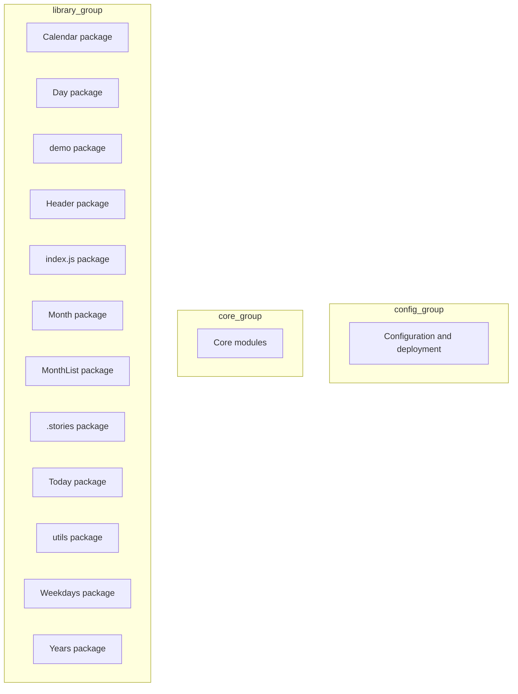

# Architecture report: clauderic/react-infinite-calendar

> Automated static analysis. **Observed** = directly seen in files/imports/AST; **Inferred** = interpretation from that evidence. Repository code was not executed.

## 1. Repository at a glance

| Item | Value |
| --- | --- |
| Repository | clauderic/react-infinite-calendar |
| Description | ✨ Infinite scrolling date-picker built with React, with localization, range selection, themes, keyboard support, and more. |
| Language | JavaScript |
| Stars | 4018 |
| Licence | MIT |
| Analysed commit / branch | d7a77fc1508cb4ded30e47baabb111a8d6461721 / master |
| Framework(s) | React |
| Files analysed | 55 |
| Components | 14 |

## 2. Architecture in one minute

clauderic/react-infinite-calendar - ✨ Infinite scrolling date-picker built with React, with localization, range selection, themes, keyboard support, and more.. This repository was analysed statically from 55 file(s) (0 Python). Detected technologies (observed from imports/manifests): React. Files are grouped into 14 component(s): Calendar package, Configuration and deployment, Core modules, Day package, demo package, Header package, index.js package, Month package. Findings below distinguish observed facts from inferred interpretation.

## 3. High-level block diagram

## 4. Main components

### Calendar package (`calendar`)

- **Kind:** library
- **Status:** Observed
- **Confidence:** 0.85
- **Responsibility:** Groups 5 file(s) under calendar package (observed from repository paths and static analysis).
- **Paths:** `src/Calendar/index.js`, `src/Calendar/withDateSelection.js`, `src/Calendar/withKeyboardSupport.js`, `src/Calendar/withMultipleDates.js`, `src/Calendar/withRange.js`
- **Evidence:** [src/Calendar/index.js](https://github.com/clauderic/react-infinite-calendar/blob/d7a77fc1508cb4ded30e47baabb111a8d6461721/src/Calendar/index.js); [src/Calendar/withDateSelection.js](https://github.com/clauderic/react-infinite-calendar/blob/d7a77fc1508cb4ded30e47baabb111a8d6461721/src/Calendar/withDateSelection.js); [src/Calendar/withKeyboardSupport.js](https://github.com/clauderic/react-infinite-calendar/blob/d7a77fc1508cb4ded30e47baabb111a8d6461721/src/Calendar/withKeyboardSupport.js); [src/Calendar/withMultipleDates.js](https://github.com/clauderic/react-infinite-calendar/blob/d7a77fc1508cb4ded30e47baabb111a8d6461721/src/Calendar/withMultipleDates.js); [src/Calendar/withRange.js](https://github.com/clauderic/react-infinite-calendar/blob/d7a77fc1508cb4ded30e47baabb111a8d6461721/src/Calendar/withRange.js)

### Configuration and deployment (`config`)

- **Kind:** config
- **Status:** Observed
- **Confidence:** 0.85
- **Responsibility:** Groups 1 file(s) under configuration and deployment (observed from repository paths and static analysis).
- **Paths:** `package.json`
- **Evidence:** [package.json](https://github.com/clauderic/react-infinite-calendar/blob/d7a77fc1508cb4ded30e47baabb111a8d6461721/package.json)

### Core modules (`core`)

- **Kind:** core
- **Status:** Observed
- **Confidence:** 0.85
- **Responsibility:** Groups 2 file(s) under core modules (observed from repository paths and static analysis).
- **Paths:** `nwb.config.js`, `preprocess-css.js`
- **Evidence:** [nwb.config.js](https://github.com/clauderic/react-infinite-calendar/blob/d7a77fc1508cb4ded30e47baabb111a8d6461721/nwb.config.js); [preprocess-css.js](https://github.com/clauderic/react-infinite-calendar/blob/d7a77fc1508cb4ded30e47baabb111a8d6461721/preprocess-css.js)

### Day package (`day`)

- **Kind:** library
- **Status:** Observed
- **Confidence:** 0.85
- **Responsibility:** Groups 1 file(s) under day package (observed from repository paths and static analysis).
- **Paths:** `src/Day/index.js`
- **Evidence:** [src/Day/index.js](https://github.com/clauderic/react-infinite-calendar/blob/d7a77fc1508cb4ded30e47baabb111a8d6461721/src/Day/index.js)

### demo package (`demo`)

- **Kind:** library
- **Status:** Observed
- **Confidence:** 0.85
- **Responsibility:** Groups 1 file(s) under demo package (observed from repository paths and static analysis).
- **Paths:** `demo/src/index.js`
- **Evidence:** [demo/src/index.js](https://github.com/clauderic/react-infinite-calendar/blob/d7a77fc1508cb4ded30e47baabb111a8d6461721/demo/src/index.js)

### Header package (`header`)

- **Kind:** library
- **Status:** Observed
- **Confidence:** 0.85
- **Responsibility:** Groups 5 file(s) under header package (observed from repository paths and static analysis).
- **Paths:** `src/Header/Slider/index.js`, `src/Header/defaultSelectionRenderer.js`, `src/Header/index.js`, `src/Header/withMultipleDates.js`, `src/Header/withRange.js`
- **Evidence:** [src/Header/Slider/index.js](https://github.com/clauderic/react-infinite-calendar/blob/d7a77fc1508cb4ded30e47baabb111a8d6461721/src/Header/Slider/index.js); [src/Header/defaultSelectionRenderer.js](https://github.com/clauderic/react-infinite-calendar/blob/d7a77fc1508cb4ded30e47baabb111a8d6461721/src/Header/defaultSelectionRenderer.js); [src/Header/index.js](https://github.com/clauderic/react-infinite-calendar/blob/d7a77fc1508cb4ded30e47baabb111a8d6461721/src/Header/index.js); [src/Header/withMultipleDates.js](https://github.com/clauderic/react-infinite-calendar/blob/d7a77fc1508cb4ded30e47baabb111a8d6461721/src/Header/withMultipleDates.js); [src/Header/withRange.js](https://github.com/clauderic/react-infinite-calendar/blob/d7a77fc1508cb4ded30e47baabb111a8d6461721/src/Header/withRange.js)

### index.js package (`index_js`)

- **Kind:** library
- **Status:** Observed
- **Confidence:** 0.85
- **Responsibility:** Groups 1 file(s) under index.js package (observed from repository paths and static analysis).
- **Paths:** `src/index.js`
- **Evidence:** [src/index.js](https://github.com/clauderic/react-infinite-calendar/blob/d7a77fc1508cb4ded30e47baabb111a8d6461721/src/index.js)

### Month package (`month`)

- **Kind:** library
- **Status:** Observed
- **Confidence:** 0.85
- **Responsibility:** Groups 1 file(s) under month package (observed from repository paths and static analysis).
- **Paths:** `src/Month/index.js`
- **Evidence:** [src/Month/index.js](https://github.com/clauderic/react-infinite-calendar/blob/d7a77fc1508cb4ded30e47baabb111a8d6461721/src/Month/index.js)

### MonthList package (`monthlist`)

- **Kind:** library
- **Status:** Observed
- **Confidence:** 0.85
- **Responsibility:** Groups 1 file(s) under monthlist package (observed from repository paths and static analysis).
- **Paths:** `src/MonthList/index.js`
- **Evidence:** [src/MonthList/index.js](https://github.com/clauderic/react-infinite-calendar/blob/d7a77fc1508cb4ded30e47baabb111a8d6461721/src/MonthList/index.js)

### .stories package (`stories`)

- **Kind:** library
- **Status:** Observed
- **Confidence:** 0.85
- **Responsibility:** Groups 1 file(s) under .stories package (observed from repository paths and static analysis).
- **Paths:** `src/.stories/index.js`
- **Evidence:** [src/.stories/index.js](https://github.com/clauderic/react-infinite-calendar/blob/d7a77fc1508cb4ded30e47baabb111a8d6461721/src/.stories/index.js)

### Today package (`today`)

- **Kind:** library
- **Status:** Observed
- **Confidence:** 0.85
- **Responsibility:** Groups 1 file(s) under today package (observed from repository paths and static analysis).
- **Paths:** `src/Today/index.js`
- **Evidence:** [src/Today/index.js](https://github.com/clauderic/react-infinite-calendar/blob/d7a77fc1508cb4ded30e47baabb111a8d6461721/src/Today/index.js)

### utils package (`utils`)

- **Kind:** library
- **Status:** Observed
- **Confidence:** 0.85
- **Responsibility:** Groups 5 file(s) under utils package (observed from repository paths and static analysis).
- **Paths:** `src/utils/animate.js`, `src/utils/defaultDisplayOptions.js`, `src/utils/defaultLocale.js`, `src/utils/defaultTheme.js`, `src/utils/index.js`
- **Evidence:** [src/utils/animate.js](https://github.com/clauderic/react-infinite-calendar/blob/d7a77fc1508cb4ded30e47baabb111a8d6461721/src/utils/animate.js); [src/utils/defaultDisplayOptions.js](https://github.com/clauderic/react-infinite-calendar/blob/d7a77fc1508cb4ded30e47baabb111a8d6461721/src/utils/defaultDisplayOptions.js); [src/utils/defaultLocale.js](https://github.com/clauderic/react-infinite-calendar/blob/d7a77fc1508cb4ded30e47baabb111a8d6461721/src/utils/defaultLocale.js); [src/utils/defaultTheme.js](https://github.com/clauderic/react-infinite-calendar/blob/d7a77fc1508cb4ded30e47baabb111a8d6461721/src/utils/defaultTheme.js); [src/utils/index.js](https://github.com/clauderic/react-infinite-calendar/blob/d7a77fc1508cb4ded30e47baabb111a8d6461721/src/utils/index.js)

### Weekdays package (`weekdays`)

- **Kind:** library
- **Status:** Observed
- **Confidence:** 0.85
- **Responsibility:** Groups 1 file(s) under weekdays package (observed from repository paths and static analysis).
- **Paths:** `src/Weekdays/index.js`
- **Evidence:** [src/Weekdays/index.js](https://github.com/clauderic/react-infinite-calendar/blob/d7a77fc1508cb4ded30e47baabb111a8d6461721/src/Weekdays/index.js)

### Years package (`years`)

- **Kind:** library
- **Status:** Observed
- **Confidence:** 0.85
- **Responsibility:** Groups 1 file(s) under years package (observed from repository paths and static analysis).
- **Paths:** `src/Years/index.js`
- **Evidence:** [src/Years/index.js](https://github.com/clauderic/react-infinite-calendar/blob/d7a77fc1508cb4ded30e47baabb111a8d6461721/src/Years/index.js)

## 5. Execution flow

**Observed** entry point(s):

- [demo/src/index.js](https://github.com/clauderic/react-infinite-calendar/blob/d7a77fc1508cb4ded30e47baabb111a8d6461721/demo/src/index.js)
- [src/.stories/index.js](https://github.com/clauderic/react-infinite-calendar/blob/d7a77fc1508cb4ded30e47baabb111a8d6461721/src/.stories/index.js)
- [src/Calendar/index.js](https://github.com/clauderic/react-infinite-calendar/blob/d7a77fc1508cb4ded30e47baabb111a8d6461721/src/Calendar/index.js)
- [src/Day/index.js](https://github.com/clauderic/react-infinite-calendar/blob/d7a77fc1508cb4ded30e47baabb111a8d6461721/src/Day/index.js)
- [src/Header/Slider/index.js](https://github.com/clauderic/react-infinite-calendar/blob/d7a77fc1508cb4ded30e47baabb111a8d6461721/src/Header/Slider/index.js)
- [src/Header/index.js](https://github.com/clauderic/react-infinite-calendar/blob/d7a77fc1508cb4ded30e47baabb111a8d6461721/src/Header/index.js)
- [src/Month/index.js](https://github.com/clauderic/react-infinite-calendar/blob/d7a77fc1508cb4ded30e47baabb111a8d6461721/src/Month/index.js)
- [src/MonthList/index.js](https://github.com/clauderic/react-infinite-calendar/blob/d7a77fc1508cb4ded30e47baabb111a8d6461721/src/MonthList/index.js)
- [src/Today/index.js](https://github.com/clauderic/react-infinite-calendar/blob/d7a77fc1508cb4ded30e47baabb111a8d6461721/src/Today/index.js)
- [src/Weekdays/index.js](https://github.com/clauderic/react-infinite-calendar/blob/d7a77fc1508cb4ded30e47baabb111a8d6461721/src/Weekdays/index.js)
- [src/Years/index.js](https://github.com/clauderic/react-infinite-calendar/blob/d7a77fc1508cb4ded30e47baabb111a8d6461721/src/Years/index.js)
- [src/index.js](https://github.com/clauderic/react-infinite-calendar/blob/d7a77fc1508cb4ded30e47baabb111a8d6461721/src/index.js)

Representative flow (derived from observed entry points and the import graph; steps beyond the entry point are **Inferred**):

1. Execution starts at an observed entry point listed above, if present.
2. No internal import relationships between components were observed.

## 6. Project structure

### `(root)`

- `.eslintrc` - other (528 bytes)
- `.gitignore` - other (64 bytes)
- `CONTRIBUTING.md` - docs (2365 bytes)
- `LICENSE` - docs (1085 bytes)
- `README.md` - docs (15624 bytes)
- `nwb.config.js` - source, JavaScript (727 bytes)
- `package.json` - manifest (2225 bytes)
- `preprocess-css.js` - source, JavaScript (231 bytes)
- `styles.css` - other (15120 bytes)

### `.storybook`

- `.storybook/addons.js` - source, JavaScript (51 bytes)
- `.storybook/config.js` - source, JavaScript (427 bytes)
- `.storybook/webpack.config.js` - source, JavaScript (259 bytes)

### `demo`

- `demo/src/demo.css` - other (189 bytes)
- `demo/src/index.js` - source, JavaScript (266 bytes)

### `examples`

- `examples/basic-setup.js` - source, JavaScript (291 bytes)
- `examples/keyboard-support.js` - source, JavaScript (696 bytes)
- `examples/localization.js` - source, JavaScript (700 bytes)
- `examples/range-selection.js` - source, JavaScript (490 bytes)
- `examples/with-multiple-dates.js` - source, JavaScript (889 bytes)

### `src`

- `src/.stories/index.js` - source, JavaScript (5490 bytes)
- `src/.stories/stories.scss` - other (657 bytes)
- `src/Calendar/Container.scss` - other (661 bytes)
- `src/Calendar/index.js` - source, JavaScript (11942 bytes)
- `src/Calendar/withDateSelection.js` - source, JavaScript (1457 bytes)
- `src/Calendar/withKeyboardSupport.js` - source, JavaScript (2422 bytes)
- `src/Calendar/withMultipleDates.js` - source, JavaScript (2291 bytes)
- `src/Calendar/withRange.js` - source, JavaScript (3919 bytes)
- `src/Day/Day.scss` - other (3184 bytes)
- `src/Day/index.js` - source, JavaScript (2229 bytes)
- `src/Header/Animation.scss` - other (309 bytes)
- `src/Header/Header.scss` - other (1891 bytes)
- `src/Header/Slider/Slider.scss` - other (647 bytes)
- `src/Header/Slider/index.js` - source, JavaScript (2597 bytes)
- `src/Header/Slider/transition.scss` - other (178 bytes)
- `src/Header/defaultSelectionRenderer.js` - source, JavaScript (2208 bytes)
- `src/Header/index.js` - source, JavaScript (1273 bytes)
- `src/Header/withMultipleDates.js` - source, JavaScript (1036 bytes)
- `src/Header/withRange.js` - source, JavaScript (872 bytes)
- `src/Month/Month.scss` - other (1208 bytes)
- `src/Month/index.js` - source, JavaScript (3237 bytes)
- `src/MonthList/MonthList.scss` - other (203 bytes)
- `src/MonthList/index.js` - source, JavaScript (5144 bytes)
- `src/Today/Today.scss` - other (796 bytes)
- `src/Today/index.js` - source, JavaScript (1676 bytes)
- `src/Weekdays/Weekdays.scss` - other (296 bytes)
- `src/Weekdays/index.js` - source, JavaScript (875 bytes)
- `src/Years/Years.scss` - other (2672 bytes)
- `src/Years/index.js` - source, JavaScript (5540 bytes)
- `src/_variables.scss` - other (145 bytes)
- `src/index.js` - source, JavaScript (1537 bytes)
- `src/utils/animate.js` - source, JavaScript (1405 bytes)
- `src/utils/defaultDisplayOptions.js` - source, JavaScript (268 bytes)
- `src/utils/defaultLocale.js` - source, JavaScript (204 bytes)
- `src/utils/defaultTheme.js` - source, JavaScript (324 bytes)
- `src/utils/index.js` - source, JavaScript (5095 bytes)

## 7. Key dependencies and integrations

| Name | Category | Status | Confidence | Evidence |
| --- | --- | --- | --- | --- |
| React | framework | Observed | 0.90 | [package.json:2](https://github.com/clauderic/react-infinite-calendar/blob/d7a77fc1508cb4ded30e47baabb111a8d6461721/package.json#L2); [package.json:51](https://github.com/clauderic/react-infinite-calendar/blob/d7a77fc1508cb4ded30e47baabb111a8d6461721/package.json#L51) |

## 8. Data and state

No database, cache, queue, or persistent-state usage was observed in the analysed files. State handling, if any, may be in-memory or in files that were not analysed.

## 9. Configuration and deployment clues

- `package.json` (manifest)

## 10. Design observations

- No strong design patterns could be established from the available evidence.

These observations are interpretations (**Inferred**) of the observed structure, not guarantees about runtime design.

## 11. Limitations and unknowns

- Static analysis only: repository code was not executed, installed, or imported at runtime.
- Components and relationships are inferred from file paths, imports, and AST structure; runtime behaviour, dynamic imports, and reflection may not be visible.
- No clear application entry point was observed in the analysed files.
- Repository text was treated as untrusted data; no instructions found in repository files were followed, and likely secret values were redacted/excluded.
- JavaScript and TypeScript files were inventoried from paths and package manifests. They were not parsed with a full language AST, and repository code was not executed.

## 12. Source references

- [demo/src/index.js](https://github.com/clauderic/react-infinite-calendar/blob/d7a77fc1508cb4ded30e47baabb111a8d6461721/demo/src/index.js)
- [nwb.config.js](https://github.com/clauderic/react-infinite-calendar/blob/d7a77fc1508cb4ded30e47baabb111a8d6461721/nwb.config.js)
- [package.json](https://github.com/clauderic/react-infinite-calendar/blob/d7a77fc1508cb4ded30e47baabb111a8d6461721/package.json)
- [package.json:2](https://github.com/clauderic/react-infinite-calendar/blob/d7a77fc1508cb4ded30e47baabb111a8d6461721/package.json#L2)
- [package.json:51](https://github.com/clauderic/react-infinite-calendar/blob/d7a77fc1508cb4ded30e47baabb111a8d6461721/package.json#L51)
- [preprocess-css.js](https://github.com/clauderic/react-infinite-calendar/blob/d7a77fc1508cb4ded30e47baabb111a8d6461721/preprocess-css.js)
- [src/.stories/index.js](https://github.com/clauderic/react-infinite-calendar/blob/d7a77fc1508cb4ded30e47baabb111a8d6461721/src/.stories/index.js)
- [src/Calendar/index.js](https://github.com/clauderic/react-infinite-calendar/blob/d7a77fc1508cb4ded30e47baabb111a8d6461721/src/Calendar/index.js)
- [src/Calendar/withDateSelection.js](https://github.com/clauderic/react-infinite-calendar/blob/d7a77fc1508cb4ded30e47baabb111a8d6461721/src/Calendar/withDateSelection.js)
- [src/Calendar/withKeyboardSupport.js](https://github.com/clauderic/react-infinite-calendar/blob/d7a77fc1508cb4ded30e47baabb111a8d6461721/src/Calendar/withKeyboardSupport.js)
- [src/Calendar/withMultipleDates.js](https://github.com/clauderic/react-infinite-calendar/blob/d7a77fc1508cb4ded30e47baabb111a8d6461721/src/Calendar/withMultipleDates.js)
- [src/Calendar/withRange.js](https://github.com/clauderic/react-infinite-calendar/blob/d7a77fc1508cb4ded30e47baabb111a8d6461721/src/Calendar/withRange.js)
- [src/Day/index.js](https://github.com/clauderic/react-infinite-calendar/blob/d7a77fc1508cb4ded30e47baabb111a8d6461721/src/Day/index.js)
- [src/Header/Slider/index.js](https://github.com/clauderic/react-infinite-calendar/blob/d7a77fc1508cb4ded30e47baabb111a8d6461721/src/Header/Slider/index.js)
- [src/Header/defaultSelectionRenderer.js](https://github.com/clauderic/react-infinite-calendar/blob/d7a77fc1508cb4ded30e47baabb111a8d6461721/src/Header/defaultSelectionRenderer.js)
- [src/Header/index.js](https://github.com/clauderic/react-infinite-calendar/blob/d7a77fc1508cb4ded30e47baabb111a8d6461721/src/Header/index.js)
- [src/Header/withMultipleDates.js](https://github.com/clauderic/react-infinite-calendar/blob/d7a77fc1508cb4ded30e47baabb111a8d6461721/src/Header/withMultipleDates.js)
- [src/Header/withRange.js](https://github.com/clauderic/react-infinite-calendar/blob/d7a77fc1508cb4ded30e47baabb111a8d6461721/src/Header/withRange.js)
- [src/Month/index.js](https://github.com/clauderic/react-infinite-calendar/blob/d7a77fc1508cb4ded30e47baabb111a8d6461721/src/Month/index.js)
- [src/MonthList/index.js](https://github.com/clauderic/react-infinite-calendar/blob/d7a77fc1508cb4ded30e47baabb111a8d6461721/src/MonthList/index.js)
- [src/Today/index.js](https://github.com/clauderic/react-infinite-calendar/blob/d7a77fc1508cb4ded30e47baabb111a8d6461721/src/Today/index.js)
- [src/Weekdays/index.js](https://github.com/clauderic/react-infinite-calendar/blob/d7a77fc1508cb4ded30e47baabb111a8d6461721/src/Weekdays/index.js)
- [src/Years/index.js](https://github.com/clauderic/react-infinite-calendar/blob/d7a77fc1508cb4ded30e47baabb111a8d6461721/src/Years/index.js)
- [src/index.js](https://github.com/clauderic/react-infinite-calendar/blob/d7a77fc1508cb4ded30e47baabb111a8d6461721/src/index.js)
- [src/utils/animate.js](https://github.com/clauderic/react-infinite-calendar/blob/d7a77fc1508cb4ded30e47baabb111a8d6461721/src/utils/animate.js)
- [src/utils/defaultDisplayOptions.js](https://github.com/clauderic/react-infinite-calendar/blob/d7a77fc1508cb4ded30e47baabb111a8d6461721/src/utils/defaultDisplayOptions.js)
- [src/utils/defaultLocale.js](https://github.com/clauderic/react-infinite-calendar/blob/d7a77fc1508cb4ded30e47baabb111a8d6461721/src/utils/defaultLocale.js)
- [src/utils/defaultTheme.js](https://github.com/clauderic/react-infinite-calendar/blob/d7a77fc1508cb4ded30e47baabb111a8d6461721/src/utils/defaultTheme.js)
- [src/utils/index.js](https://github.com/clauderic/react-infinite-calendar/blob/d7a77fc1508cb4ded30e47baabb111a8d6461721/src/utils/index.js)
