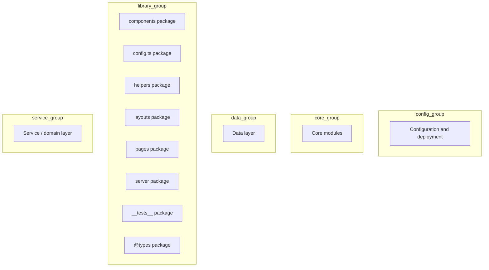

# Architecture report: clintonwoo/hackernews-react-graphql

> Automated static analysis. **Observed** = directly seen in files/imports/AST; **Inferred** = interpretation from that evidence. Repository code was not executed.

## 1. Repository at a glance

| Item | Value |
| --- | --- |
| Repository | clintonwoo/hackernews-react-graphql |
| Description | Hacker News clone rewritten with universal JavaScript, using React and GraphQL. |
| Language | TypeScript |
| Stars | 4444 |
| Licence | MIT |
| Analysed commit / branch | 6875c7233c2e0d82a910f8427c8d230f0858d048 / master |
| Framework(s) | Express, Next.js, React |
| Files analysed | 154 |
| Components | 12 |

## 2. Architecture in one minute

clintonwoo/hackernews-react-graphql - Hacker News clone rewritten with universal JavaScript, using React and GraphQL.. This repository was analysed statically from 154 file(s) (0 Python). Detected technologies (observed from imports/manifests): Express, Next.js, React, Docker, Jest, TypeScript. Files are grouped into 12 component(s): components package, Configuration and deployment, config.ts package, Core modules, Data layer, helpers package, layouts package, pages package. Findings below distinguish observed facts from inferred interpretation.

## 3. High-level block diagram

## 4. Main components

### components package (`components`)

- **Kind:** library
- **Status:** Observed
- **Confidence:** 0.85
- **Responsibility:** Groups 16 file(s) under components package (observed from repository paths and static analysis).
- **Paths:** `src/components/comment-box.spec.tsx`, `src/components/comment-box.tsx`, `src/components/comment.spec.tsx`, `src/components/comment.tsx`, `src/components/comments.tsx`, `src/components/footer.tsx`, `src/components/header-nav.tsx`, `src/components/header.tsx`, `src/components/loading-spinner.tsx`, `src/components/news-detail.spec.tsx`, `src/components/news-detail.tsx`, `src/components/news-feed.spec.tsx`, `src/components/news-feed.tsx`, `src/components/news-item-with-comments.tsx`, `src/components/news-title.spec.tsx`, `src/components/news-title.tsx`
- **Evidence:** [src/components/comment-box.spec.tsx](https://github.com/clintonwoo/hackernews-react-graphql/blob/6875c7233c2e0d82a910f8427c8d230f0858d048/src/components/comment-box.spec.tsx); [src/components/comment-box.tsx](https://github.com/clintonwoo/hackernews-react-graphql/blob/6875c7233c2e0d82a910f8427c8d230f0858d048/src/components/comment-box.tsx); [src/components/comment.spec.tsx](https://github.com/clintonwoo/hackernews-react-graphql/blob/6875c7233c2e0d82a910f8427c8d230f0858d048/src/components/comment.spec.tsx); [src/components/comment.tsx](https://github.com/clintonwoo/hackernews-react-graphql/blob/6875c7233c2e0d82a910f8427c8d230f0858d048/src/components/comment.tsx); [src/components/comments.tsx](https://github.com/clintonwoo/hackernews-react-graphql/blob/6875c7233c2e0d82a910f8427c8d230f0858d048/src/components/comments.tsx); [src/components/footer.tsx](https://github.com/clintonwoo/hackernews-react-graphql/blob/6875c7233c2e0d82a910f8427c8d230f0858d048/src/components/footer.tsx); [src/components/header-nav.tsx](https://github.com/clintonwoo/hackernews-react-graphql/blob/6875c7233c2e0d82a910f8427c8d230f0858d048/src/components/header-nav.tsx); [src/components/header.tsx](https://github.com/clintonwoo/hackernews-react-graphql/blob/6875c7233c2e0d82a910f8427c8d230f0858d048/src/components/header.tsx)

### Configuration and deployment (`config`)

- **Kind:** config
- **Status:** Observed
- **Confidence:** 0.85
- **Responsibility:** Groups 5 file(s) under configuration and deployment (observed from repository paths and static analysis).
- **Paths:** `Dockerfile`, `nodemon.json`, `package.json`, `tsconfig-server.json`, `tsconfig.json`
- **Evidence:** [Dockerfile](https://github.com/clintonwoo/hackernews-react-graphql/blob/6875c7233c2e0d82a910f8427c8d230f0858d048/Dockerfile); [nodemon.json](https://github.com/clintonwoo/hackernews-react-graphql/blob/6875c7233c2e0d82a910f8427c8d230f0858d048/nodemon.json); [package.json](https://github.com/clintonwoo/hackernews-react-graphql/blob/6875c7233c2e0d82a910f8427c8d230f0858d048/package.json); [tsconfig-server.json](https://github.com/clintonwoo/hackernews-react-graphql/blob/6875c7233c2e0d82a910f8427c8d230f0858d048/tsconfig-server.json); [tsconfig.json](https://github.com/clintonwoo/hackernews-react-graphql/blob/6875c7233c2e0d82a910f8427c8d230f0858d048/tsconfig.json)

### config.ts package (`config_ts`)

- **Kind:** library
- **Status:** Observed
- **Confidence:** 0.85
- **Responsibility:** Groups 1 file(s) under config.ts package (observed from repository paths and static analysis).
- **Paths:** `src/config.ts`
- **Evidence:** [src/config.ts](https://github.com/clintonwoo/hackernews-react-graphql/blob/6875c7233c2e0d82a910f8427c8d230f0858d048/src/config.ts)

### Core modules (`core`)

- **Kind:** core
- **Status:** Observed
- **Confidence:** 0.85
- **Responsibility:** Groups 7 file(s) under core modules (observed from repository paths and static analysis).
- **Paths:** `babel.config.js`, `healthcheck.js`, `jest-setup.js`, `jest.config.js`, `next-env.d.ts`, `next.config.js`, `prettier.config.js`
- **Evidence:** [babel.config.js](https://github.com/clintonwoo/hackernews-react-graphql/blob/6875c7233c2e0d82a910f8427c8d230f0858d048/babel.config.js); [healthcheck.js](https://github.com/clintonwoo/hackernews-react-graphql/blob/6875c7233c2e0d82a910f8427c8d230f0858d048/healthcheck.js); [jest-setup.js](https://github.com/clintonwoo/hackernews-react-graphql/blob/6875c7233c2e0d82a910f8427c8d230f0858d048/jest-setup.js); [jest.config.js](https://github.com/clintonwoo/hackernews-react-graphql/blob/6875c7233c2e0d82a910f8427c8d230f0858d048/jest.config.js); [next-env.d.ts](https://github.com/clintonwoo/hackernews-react-graphql/blob/6875c7233c2e0d82a910f8427c8d230f0858d048/next-env.d.ts); [next.config.js](https://github.com/clintonwoo/hackernews-react-graphql/blob/6875c7233c2e0d82a910f8427c8d230f0858d048/next.config.js); [prettier.config.js](https://github.com/clintonwoo/hackernews-react-graphql/blob/6875c7233c2e0d82a910f8427c8d230f0858d048/prettier.config.js)

### Data layer (`data_layer`)

- **Kind:** data
- **Status:** Observed
- **Confidence:** 0.85
- **Responsibility:** Groups 15 file(s) under data layer (observed from repository paths and static analysis).
- **Paths:** `server/database/cache-warmer.ts`, `server/database/cache.ts`, `server/database/database.ts`, `src/data/models/comment-model.ts`, `src/data/models/feed.ts`, `src/data/models/index.ts`, `src/data/models/news-item-model.ts`, `src/data/models/user-model.ts`, `src/data/mutations/hide-news-item-mutation.ts`, `src/data/mutations/submit-news-item-mutation.ts`, `src/data/mutations/upvote-news-item-mutation.ts`, `src/data/queries/me-query.ts`, `src/data/sample-data.ts`, `src/data/validation/user.ts`, `src/data/validation/validation-error.ts`
- **Evidence:** [server/database/cache-warmer.ts](https://github.com/clintonwoo/hackernews-react-graphql/blob/6875c7233c2e0d82a910f8427c8d230f0858d048/server/database/cache-warmer.ts); [server/database/cache.ts](https://github.com/clintonwoo/hackernews-react-graphql/blob/6875c7233c2e0d82a910f8427c8d230f0858d048/server/database/cache.ts); [server/database/database.ts](https://github.com/clintonwoo/hackernews-react-graphql/blob/6875c7233c2e0d82a910f8427c8d230f0858d048/server/database/database.ts); [src/data/models/comment-model.ts](https://github.com/clintonwoo/hackernews-react-graphql/blob/6875c7233c2e0d82a910f8427c8d230f0858d048/src/data/models/comment-model.ts); [src/data/models/feed.ts](https://github.com/clintonwoo/hackernews-react-graphql/blob/6875c7233c2e0d82a910f8427c8d230f0858d048/src/data/models/feed.ts); [src/data/models/index.ts](https://github.com/clintonwoo/hackernews-react-graphql/blob/6875c7233c2e0d82a910f8427c8d230f0858d048/src/data/models/index.ts); [src/data/models/news-item-model.ts](https://github.com/clintonwoo/hackernews-react-graphql/blob/6875c7233c2e0d82a910f8427c8d230f0858d048/src/data/models/news-item-model.ts); [src/data/models/user-model.ts](https://github.com/clintonwoo/hackernews-react-graphql/blob/6875c7233c2e0d82a910f8427c8d230f0858d048/src/data/models/user-model.ts)

### helpers package (`helpers`)

- **Kind:** library
- **Status:** Observed
- **Confidence:** 0.85
- **Responsibility:** Groups 7 file(s) under helpers package (observed from repository paths and static analysis).
- **Paths:** `src/helpers/convert-number-to-time-ago.spec.ts`, `src/helpers/convert-number-to-time-ago.ts`, `src/helpers/hash-password.ts`, `src/helpers/init-apollo.tsx`, `src/helpers/is-valid-url.ts`, `src/helpers/user-login-error-code.ts`, `src/helpers/with-data.tsx`
- **Evidence:** [src/helpers/convert-number-to-time-ago.spec.ts](https://github.com/clintonwoo/hackernews-react-graphql/blob/6875c7233c2e0d82a910f8427c8d230f0858d048/src/helpers/convert-number-to-time-ago.spec.ts); [src/helpers/convert-number-to-time-ago.ts](https://github.com/clintonwoo/hackernews-react-graphql/blob/6875c7233c2e0d82a910f8427c8d230f0858d048/src/helpers/convert-number-to-time-ago.ts); [src/helpers/hash-password.ts](https://github.com/clintonwoo/hackernews-react-graphql/blob/6875c7233c2e0d82a910f8427c8d230f0858d048/src/helpers/hash-password.ts); [src/helpers/init-apollo.tsx](https://github.com/clintonwoo/hackernews-react-graphql/blob/6875c7233c2e0d82a910f8427c8d230f0858d048/src/helpers/init-apollo.tsx); [src/helpers/is-valid-url.ts](https://github.com/clintonwoo/hackernews-react-graphql/blob/6875c7233c2e0d82a910f8427c8d230f0858d048/src/helpers/is-valid-url.ts); [src/helpers/user-login-error-code.ts](https://github.com/clintonwoo/hackernews-react-graphql/blob/6875c7233c2e0d82a910f8427c8d230f0858d048/src/helpers/user-login-error-code.ts); [src/helpers/with-data.tsx](https://github.com/clintonwoo/hackernews-react-graphql/blob/6875c7233c2e0d82a910f8427c8d230f0858d048/src/helpers/with-data.tsx)

### layouts package (`layouts`)

- **Kind:** library
- **Status:** Observed
- **Confidence:** 0.85
- **Responsibility:** Groups 3 file(s) under layouts package (observed from repository paths and static analysis).
- **Paths:** `src/layouts/blank-layout.tsx`, `src/layouts/main-layout.tsx`, `src/layouts/notice-layout.tsx`
- **Evidence:** [src/layouts/blank-layout.tsx](https://github.com/clintonwoo/hackernews-react-graphql/blob/6875c7233c2e0d82a910f8427c8d230f0858d048/src/layouts/blank-layout.tsx); [src/layouts/main-layout.tsx](https://github.com/clintonwoo/hackernews-react-graphql/blob/6875c7233c2e0d82a910f8427c8d230f0858d048/src/layouts/main-layout.tsx); [src/layouts/notice-layout.tsx](https://github.com/clintonwoo/hackernews-react-graphql/blob/6875c7233c2e0d82a910f8427c8d230f0858d048/src/layouts/notice-layout.tsx)

### pages package (`pages`)

- **Kind:** library
- **Status:** Observed
- **Confidence:** 0.85
- **Responsibility:** Groups 37 file(s) under pages package (observed from repository paths and static analysis).
- **Paths:** `pages/active.tsx`, `pages/ask.tsx`, `pages/best.tsx`, `pages/bestcomments.tsx`, `pages/bookmarklet.tsx`, `pages/changepw.tsx`, `pages/dmca.tsx`, `pages/favorites.tsx`, `pages/forgot.tsx`, `pages/formatdoc.tsx`, `pages/front.tsx`, `pages/hidden.tsx`, `pages/index.tsx`, `pages/item.tsx`, `pages/jobs.tsx`, `pages/leaders.tsx`, `pages/lists.tsx`, `pages/login.tsx`, `pages/newcomments.tsx`, `pages/newest.tsx`, `pages/newpoll.tsx`, `pages/newsfaq.tsx`, `pages/newsguidelines.tsx`, `pages/newswelcome.tsx`, `pages/noobcomments.tsx`, `pages/noobstories.tsx`, `pages/reply.tsx`, `pages/security.tsx`, `pages/show.tsx`, `pages/showhn.tsx`, `pages/shownew.tsx`, `pages/submit.tsx`, `pages/submitted.tsx`, `pages/threads.tsx`, `pages/upvoted.tsx`, `pages/user.tsx`, `pages/x.tsx`
- **Evidence:** [pages/active.tsx](https://github.com/clintonwoo/hackernews-react-graphql/blob/6875c7233c2e0d82a910f8427c8d230f0858d048/pages/active.tsx); [pages/ask.tsx](https://github.com/clintonwoo/hackernews-react-graphql/blob/6875c7233c2e0d82a910f8427c8d230f0858d048/pages/ask.tsx); [pages/best.tsx](https://github.com/clintonwoo/hackernews-react-graphql/blob/6875c7233c2e0d82a910f8427c8d230f0858d048/pages/best.tsx); [pages/bestcomments.tsx](https://github.com/clintonwoo/hackernews-react-graphql/blob/6875c7233c2e0d82a910f8427c8d230f0858d048/pages/bestcomments.tsx); [pages/bookmarklet.tsx](https://github.com/clintonwoo/hackernews-react-graphql/blob/6875c7233c2e0d82a910f8427c8d230f0858d048/pages/bookmarklet.tsx); [pages/changepw.tsx](https://github.com/clintonwoo/hackernews-react-graphql/blob/6875c7233c2e0d82a910f8427c8d230f0858d048/pages/changepw.tsx); [pages/dmca.tsx](https://github.com/clintonwoo/hackernews-react-graphql/blob/6875c7233c2e0d82a910f8427c8d230f0858d048/pages/dmca.tsx); [pages/favorites.tsx](https://github.com/clintonwoo/hackernews-react-graphql/blob/6875c7233c2e0d82a910f8427c8d230f0858d048/pages/favorites.tsx)

### server package (`server`)

- **Kind:** library
- **Status:** Observed
- **Confidence:** 0.85
- **Responsibility:** Groups 4 file(s) under server package (observed from repository paths and static analysis).
- **Paths:** `server/graphql-resolvers.spec.ts`, `server/graphql-resolvers.ts`, `server/graphql-schema.ts`, `server/server.ts`
- **Evidence:** [server/graphql-resolvers.spec.ts](https://github.com/clintonwoo/hackernews-react-graphql/blob/6875c7233c2e0d82a910f8427c8d230f0858d048/server/graphql-resolvers.spec.ts); [server/graphql-resolvers.ts](https://github.com/clintonwoo/hackernews-react-graphql/blob/6875c7233c2e0d82a910f8427c8d230f0858d048/server/graphql-resolvers.ts); [server/graphql-schema.ts](https://github.com/clintonwoo/hackernews-react-graphql/blob/6875c7233c2e0d82a910f8427c8d230f0858d048/server/graphql-schema.ts); [server/server.ts](https://github.com/clintonwoo/hackernews-react-graphql/blob/6875c7233c2e0d82a910f8427c8d230f0858d048/server/server.ts)

### Service / domain layer (`service_layer`)

- **Kind:** service
- **Status:** Observed
- **Confidence:** 0.85
- **Responsibility:** Groups 6 file(s) under service / domain layer (observed from repository paths and static analysis).
- **Paths:** `server/services/comment-service.spec.ts`, `server/services/comment-service.ts`, `server/services/feed-service.ts`, `server/services/news-item-service.spec.ts`, `server/services/news-item-service.ts`, `server/services/user-service.ts`
- **Evidence:** [server/services/comment-service.spec.ts](https://github.com/clintonwoo/hackernews-react-graphql/blob/6875c7233c2e0d82a910f8427c8d230f0858d048/server/services/comment-service.spec.ts); [server/services/comment-service.ts](https://github.com/clintonwoo/hackernews-react-graphql/blob/6875c7233c2e0d82a910f8427c8d230f0858d048/server/services/comment-service.ts); [server/services/feed-service.ts](https://github.com/clintonwoo/hackernews-react-graphql/blob/6875c7233c2e0d82a910f8427c8d230f0858d048/server/services/feed-service.ts); [server/services/news-item-service.spec.ts](https://github.com/clintonwoo/hackernews-react-graphql/blob/6875c7233c2e0d82a910f8427c8d230f0858d048/server/services/news-item-service.spec.ts); [server/services/news-item-service.ts](https://github.com/clintonwoo/hackernews-react-graphql/blob/6875c7233c2e0d82a910f8427c8d230f0858d048/server/services/news-item-service.ts); [server/services/user-service.ts](https://github.com/clintonwoo/hackernews-react-graphql/blob/6875c7233c2e0d82a910f8427c8d230f0858d048/server/services/user-service.ts)

### __tests__ package (`tests`)

- **Kind:** library
- **Status:** Observed
- **Confidence:** 0.85
- **Responsibility:** Groups 33 file(s) under __tests__ package (observed from repository paths and static analysis).
- **Paths:** `src/__tests__/active.spec.tsx`, `src/__tests__/ask.spec.tsx`, `src/__tests__/best.spec.tsx`, `src/__tests__/bestcomments.spec.tsx`, `src/__tests__/bookmarklet.spec.tsx`, `src/__tests__/changepw.spec.tsx`, `src/__tests__/dmca.spec.tsx`, `src/__tests__/formatdoc.spec.tsx`, `src/__tests__/front.spec.tsx`, `src/__tests__/hidden.spec.tsx`, `src/__tests__/index.spec.tsx`, `src/__tests__/item.spec.tsx`, `src/__tests__/jobs.spec.tsx`, `src/__tests__/leaders.spec.tsx`, `src/__tests__/lists.spec.tsx`, `src/__tests__/login.spec.tsx`, `src/__tests__/newcomments.spec.tsx`, `src/__tests__/newest.spec.tsx`, `src/__tests__/newpoll.spec.tsx`, `src/__tests__/newsfaq.spec.tsx`, `src/__tests__/newsguidelines.spec.tsx`, `src/__tests__/newswelcome.spec.tsx`, `src/__tests__/noobcomments.spec.tsx`, `src/__tests__/noobstories.spec.tsx`, `src/__tests__/reply.spec.tsx`, `src/__tests__/security.spec.tsx`, `src/__tests__/show.spec.tsx`, `src/__tests__/showhn.spec.tsx`, `src/__tests__/shownew.spec.tsx`, `src/__tests__/submit.spec.tsx`, `src/__tests__/submitted.spec.tsx`, `src/__tests__/threads.spec.tsx`, `src/__tests__/user.spec.tsx`
- **Evidence:** [src/__tests__/active.spec.tsx](https://github.com/clintonwoo/hackernews-react-graphql/blob/6875c7233c2e0d82a910f8427c8d230f0858d048/src/__tests__/active.spec.tsx); [src/__tests__/ask.spec.tsx](https://github.com/clintonwoo/hackernews-react-graphql/blob/6875c7233c2e0d82a910f8427c8d230f0858d048/src/__tests__/ask.spec.tsx); [src/__tests__/best.spec.tsx](https://github.com/clintonwoo/hackernews-react-graphql/blob/6875c7233c2e0d82a910f8427c8d230f0858d048/src/__tests__/best.spec.tsx); [src/__tests__/bestcomments.spec.tsx](https://github.com/clintonwoo/hackernews-react-graphql/blob/6875c7233c2e0d82a910f8427c8d230f0858d048/src/__tests__/bestcomments.spec.tsx); [src/__tests__/bookmarklet.spec.tsx](https://github.com/clintonwoo/hackernews-react-graphql/blob/6875c7233c2e0d82a910f8427c8d230f0858d048/src/__tests__/bookmarklet.spec.tsx); [src/__tests__/changepw.spec.tsx](https://github.com/clintonwoo/hackernews-react-graphql/blob/6875c7233c2e0d82a910f8427c8d230f0858d048/src/__tests__/changepw.spec.tsx); [src/__tests__/dmca.spec.tsx](https://github.com/clintonwoo/hackernews-react-graphql/blob/6875c7233c2e0d82a910f8427c8d230f0858d048/src/__tests__/dmca.spec.tsx); [src/__tests__/formatdoc.spec.tsx](https://github.com/clintonwoo/hackernews-react-graphql/blob/6875c7233c2e0d82a910f8427c8d230f0858d048/src/__tests__/formatdoc.spec.tsx)

### @types package (`types`)

- **Kind:** library
- **Status:** Observed
- **Confidence:** 0.85
- **Responsibility:** Groups 1 file(s) under @types package (observed from repository paths and static analysis).
- **Paths:** `src/@types/global.ts`
- **Evidence:** [src/@types/global.ts](https://github.com/clintonwoo/hackernews-react-graphql/blob/6875c7233c2e0d82a910f8427c8d230f0858d048/src/%40types/global.ts)

## 5. Execution flow

**Observed** entry point(s):

- [pages/index.tsx](https://github.com/clintonwoo/hackernews-react-graphql/blob/6875c7233c2e0d82a910f8427c8d230f0858d048/pages/index.tsx)
- [server/server.ts](https://github.com/clintonwoo/hackernews-react-graphql/blob/6875c7233c2e0d82a910f8427c8d230f0858d048/server/server.ts)
- [src/data/models/index.ts](https://github.com/clintonwoo/hackernews-react-graphql/blob/6875c7233c2e0d82a910f8427c8d230f0858d048/src/data/models/index.ts)

Representative flow (derived from observed entry points and the import graph; steps beyond the entry point are **Inferred**):

1. Execution starts at an observed entry point listed above, if present.
2. No internal import relationships between components were observed.

## 6. Project structure

### `(root)`

- `.dockerignore` - container (54 bytes)
- `.eslintrc.js` - source, JavaScript (2949 bytes)
- `.gitattributes` - other (18 bytes)
- `.gitignore` - other (95 bytes)
- `.prettierignore` - other (24 bytes)
- `Dockerfile` - container (1113 bytes)
- `LICENSE` - docs (1084 bytes)
- `README.md` - docs (5623 bytes)
- `babel.config.js` - source, JavaScript (211 bytes)
- `healthcheck.js` - source, JavaScript (467 bytes)
- `jest-setup.js` - source, JavaScript (100 bytes)
- `jest.config.js` - source, JavaScript (332 bytes)
- `next-env.d.ts` - source, TypeScript (201 bytes)
- `next.config.js` - source, JavaScript (157 bytes)
- `nodemon.json` - config (129 bytes)
- `package.json` - manifest (3640 bytes)
- `prettier.config.js` - source, JavaScript (62 bytes)
- `tsconfig-server.json` - config (346 bytes)
- `tsconfig.json` - config (876 bytes)

### `docs`

- `docs/README.md` - docs (63 bytes)

### `pages`

- `pages/active.tsx` - source, TypeScript (692 bytes)
- `pages/ask.tsx` - source, TypeScript (1234 bytes)
- `pages/best.tsx` - source, TypeScript (1244 bytes)
- `pages/bestcomments.tsx` - source, TypeScript (705 bytes)
- `pages/bookmarklet.tsx` - source, TypeScript (1522 bytes)
- `pages/changepw.tsx` - source, TypeScript (401 bytes)
- `pages/dmca.tsx` - source, TypeScript (8450 bytes)
- `pages/favorites.tsx` - source, TypeScript (1255 bytes)
- `pages/forgot.tsx` - source, TypeScript (983 bytes)
- `pages/formatdoc.tsx` - source, TypeScript (1573 bytes)
- `pages/front.tsx` - source, TypeScript (382 bytes)
- `pages/hidden.tsx` - source, TypeScript (693 bytes)
- `pages/index.tsx` - source, TypeScript (1243 bytes)
- `pages/item.tsx` - source, TypeScript (1440 bytes)
- `pages/jobs.tsx` - source, TypeScript (2200 bytes)
- `pages/leaders.tsx` - source, TypeScript (387 bytes)
- `pages/lists.tsx` - source, TypeScript (2388 bytes)
- `pages/login.tsx` - source, TypeScript (4610 bytes)
- `pages/newcomments.tsx` - source, TypeScript (703 bytes)
- `pages/newest.tsx` - source, TypeScript (1246 bytes)
- `pages/newpoll.tsx` - source, TypeScript (695 bytes)
- `pages/newsfaq.tsx` - source, TypeScript (6958 bytes)
- `pages/newsguidelines.tsx` - source, TypeScript (5268 bytes)
- `pages/newswelcome.tsx` - source, TypeScript (3935 bytes)
- `pages/noobcomments.tsx` - source, TypeScript (705 bytes)
- `pages/noobstories.tsx` - source, TypeScript (703 bytes)
- `pages/reply.tsx` - source, TypeScript (4868 bytes)
- `pages/security.tsx` - source, TypeScript (6288 bytes)
- `pages/show.tsx` - source, TypeScript (2050 bytes)
- `pages/showhn.tsx` - source, TypeScript (2528 bytes)
- `pages/shownew.tsx` - source, TypeScript (2053 bytes)
- `pages/submit.tsx` - source, TypeScript (4387 bytes)
- `pages/submitted.tsx` - source, TypeScript (699 bytes)
- `pages/threads.tsx` - source, TypeScript (764 bytes)
- `pages/upvoted.tsx` - source, TypeScript (1252 bytes)
- `pages/user.tsx` - source, TypeScript (9983 bytes)
- `pages/x.tsx` - source, TypeScript (1155 bytes)

### `public`

- `public/robots.txt` - docs (82 bytes)
- `public/static/README.md` - docs (54 bytes)
- `public/static/dmca.css` - other (1088 bytes)
- `public/static/news.css` - other (11062 bytes)
- `public/static/yc.css` - other (589 bytes)

### `server`

- `server/database/cache-warmer.ts` - source, TypeScript (1905 bytes)
- `server/database/cache.ts` - source, TypeScript (2988 bytes)
- `server/database/database.ts` - source, TypeScript (6480 bytes)
- `server/graphql-resolvers.spec.ts` - source, TypeScript (1464 bytes)
- `server/graphql-resolvers.ts` - source, TypeScript (5318 bytes)
- `server/graphql-schema.ts` - source, TypeScript (3080 bytes)
- `server/server.ts` - source, TypeScript (6808 bytes)
- `server/services/comment-service.spec.ts` - source, TypeScript (412 bytes)
- `server/services/comment-service.ts` - source, TypeScript (1001 bytes)
- `server/services/feed-service.ts` - source, TypeScript (1758 bytes)
- `server/services/news-item-service.spec.ts` - source, TypeScript (925 bytes)
- `server/services/news-item-service.ts` - source, TypeScript (1525 bytes)
- `server/services/user-service.ts` - source, TypeScript (1733 bytes)

### `src`

- `src/@types/global.ts` - source, TypeScript (11 bytes)
- `src/README.md` - docs (667 bytes)
- `src/__tests__/active.spec.tsx` - source, TypeScript (181 bytes)
- `src/__tests__/ask.spec.tsx` - source, TypeScript (184 bytes)
- `src/__tests__/best.spec.tsx` - source, TypeScript (183 bytes)
- `src/__tests__/bestcomments.spec.tsx` - source, TypeScript (194 bytes)
- `src/__tests__/bookmarklet.spec.tsx` - source, TypeScript (191 bytes)
- `src/__tests__/changepw.spec.tsx` - source, TypeScript (192 bytes)
- `src/__tests__/dmca.spec.tsx` - source, TypeScript (177 bytes)
- `src/__tests__/formatdoc.spec.tsx` - source, TypeScript (188 bytes)
- `src/__tests__/front.spec.tsx` - source, TypeScript (179 bytes)
- `src/__tests__/hidden.spec.tsx` - source, TypeScript (187 bytes)
- `src/__tests__/index.spec.tsx` - source, TypeScript (178 bytes)
- `src/__tests__/item.spec.tsx` - source, TypeScript (182 bytes)
- `src/__tests__/jobs.spec.tsx` - source, TypeScript (177 bytes)
- `src/__tests__/leaders.spec.tsx` - source, TypeScript (183 bytes)
- `src/__tests__/lists.spec.tsx` - source, TypeScript (179 bytes)
- `src/__tests__/login.spec.tsx` - source, TypeScript (179 bytes)
- `src/__tests__/newcomments.spec.tsx` - source, TypeScript (192 bytes)
- `src/__tests__/newest.spec.tsx` - source, TypeScript (187 bytes)
- `src/__tests__/newpoll.spec.tsx` - source, TypeScript (184 bytes)
- `src/__tests__/newsfaq.spec.tsx` - source, TypeScript (179 bytes)
- `src/__tests__/newsguidelines.spec.tsx` - source, TypeScript (193 bytes)
- `src/__tests__/newswelcome.spec.tsx` - source, TypeScript (187 bytes)
- `src/__tests__/noobcomments.spec.tsx` - source, TypeScript (194 bytes)
- `src/__tests__/noobstories.spec.tsx` - source, TypeScript (191 bytes)
- `src/__tests__/reply.spec.tsx` - source, TypeScript (179 bytes)
- `src/__tests__/security.spec.tsx` - source, TypeScript (185 bytes)
- `src/__tests__/show.spec.tsx` - source, TypeScript (177 bytes)
- `src/__tests__/showhn.spec.tsx` - source, TypeScript (182 bytes)
- `src/__tests__/shownew.spec.tsx` - source, TypeScript (184 bytes)
- `src/__tests__/submit.spec.tsx` - source, TypeScript (181 bytes)
- `src/__tests__/submitted.spec.tsx` - source, TypeScript (193 bytes)
- `src/__tests__/threads.spec.tsx` - source, TypeScript (183 bytes)
- `src/__tests__/user.spec.tsx` - source, TypeScript (177 bytes)
- `src/components/__snapshots__/comment-box.spec.tsx.snap` - other (917 bytes)
- `src/components/__snapshots__/comment.spec.tsx.snap` - other (3541 bytes)
- `src/components/__snapshots__/news-detail.spec.tsx.snap` - other (841 bytes)
- `src/components/__snapshots__/news-feed.spec.tsx.snap` - other (86411 bytes)
- `src/components/__snapshots__/news-title.spec.tsx.snap` - other (1466 bytes)
- `src/components/comment-box.spec.tsx` - source, TypeScript (455 bytes)
- `src/components/comment-box.tsx` - source, TypeScript (597 bytes)
- `src/components/comment.spec.tsx` - source, TypeScript (614 bytes)
- `src/components/comment.tsx` - source, TypeScript (3449 bytes)
- `src/components/comments.tsx` - source, TypeScript (1809 bytes)
- `src/components/footer.tsx` - source, TypeScript (1899 bytes)
- `src/components/header-nav.tsx` - source, TypeScript (1831 bytes)
- `src/components/header.tsx` - source, TypeScript (2236 bytes)
- `src/components/loading-spinner.tsx` - source, TypeScript (795 bytes)
- `src/components/news-detail.spec.tsx` - source, TypeScript (787 bytes)
- `src/components/news-detail.tsx` - source, TypeScript (3014 bytes)
- `src/components/news-feed.spec.tsx` - source, TypeScript (658 bytes)
- `src/components/news-feed.tsx` - source, TypeScript (3721 bytes)
- `src/components/news-item-with-comments.tsx` - source, TypeScript (1516 bytes)
- `src/components/news-title.spec.tsx` - source, TypeScript (655 bytes)
- `src/components/news-title.tsx` - source, TypeScript (1944 bytes)
- `src/config.ts` - source, TypeScript (1144 bytes)
- `src/data/models/comment-model.ts` - source, TypeScript (1070 bytes)
- `src/data/models/feed.ts` - source, TypeScript (119 bytes)
- `src/data/models/index.ts` - source, TypeScript (184 bytes)
- `src/data/models/news-item-model.ts` - source, TypeScript (1991 bytes)
- `src/data/models/user-model.ts` - source, TypeScript (1305 bytes)
- `src/data/mutations/hide-news-item-mutation.ts` - source, TypeScript (176 bytes)
- `src/data/mutations/submit-news-item-mutation.ts` - source, TypeScript (439 bytes)
- `src/data/mutations/upvote-news-item-mutation.ts` - source, TypeScript (201 bytes)
- `src/data/queries/me-query.ts` - source, TypeScript (198 bytes)
- `src/data/sample-data.ts` - source, TypeScript (24459 bytes)
- `src/data/validation/user.ts` - source, TypeScript (781 bytes)
- `src/data/validation/validation-error.ts` - source, TypeScript (272 bytes)
- `src/helpers/convert-number-to-time-ago.spec.ts` - source, TypeScript (2758 bytes)
- `src/helpers/convert-number-to-time-ago.ts` - source, TypeScript (1393 bytes)
- `src/helpers/hash-password.ts` - source, TypeScript (580 bytes)
- `src/helpers/init-apollo.tsx` - source, TypeScript (1427 bytes)
- `src/helpers/is-valid-url.ts` - source, TypeScript (1363 bytes)
- `src/helpers/user-login-error-code.ts` - source, TypeScript (853 bytes)
- `src/helpers/with-data.tsx` - source, TypeScript (3949 bytes)
- `src/layouts/blank-layout.tsx` - source, TypeScript (488 bytes)
- `src/layouts/main-layout.tsx` - source, TypeScript (1705 bytes)
- `src/layouts/notice-layout.tsx` - source, TypeScript (1027 bytes)

## 7. Key dependencies and integrations

| Name | Category | Status | Confidence | Evidence |
| --- | --- | --- | --- | --- |
| Express | framework | Observed | 0.85 | [package.json:37](https://github.com/clintonwoo/hackernews-react-graphql/blob/6875c7233c2e0d82a910f8427c8d230f0858d048/package.json#L37) |
| Next.js | framework | Observed | 0.85 | [package.json:9](https://github.com/clintonwoo/hackernews-react-graphql/blob/6875c7233c2e0d82a910f8427c8d230f0858d048/package.json#L9) |
| React | framework | Observed | 0.90 | [package.json:4](https://github.com/clintonwoo/hackernews-react-graphql/blob/6875c7233c2e0d82a910f8427c8d230f0858d048/package.json#L4); [package.json:56](https://github.com/clintonwoo/hackernews-react-graphql/blob/6875c7233c2e0d82a910f8427c8d230f0858d048/package.json#L56) |
| Docker | tooling | Observed | 0.85 | [Dockerfile](https://github.com/clintonwoo/hackernews-react-graphql/blob/6875c7233c2e0d82a910f8427c8d230f0858d048/Dockerfile) |
| Jest | tooling | Observed | 0.85 | [package.json:21](https://github.com/clintonwoo/hackernews-react-graphql/blob/6875c7233c2e0d82a910f8427c8d230f0858d048/package.json#L21) |
| TypeScript | tooling | Observed | 0.85 | [package.json:77](https://github.com/clintonwoo/hackernews-react-graphql/blob/6875c7233c2e0d82a910f8427c8d230f0858d048/package.json#L77) |

## 8. Data and state

- Data component `data_layer` (Observed): Groups 15 file(s) under data layer (observed from repository paths and static analysis).

## 9. Configuration and deployment clues

- `.dockerignore` (container)
- `Dockerfile` (container)
- `nodemon.json` (config)
- `package.json` (manifest)
- `tsconfig-server.json` (config)
- `tsconfig.json` (config)

## 10. Design observations

- Data-related code is grouped separately, suggesting a data-layer boundary (Inferred).
- Service/domain code is distinct from entry and data code, suggesting layered separation (Inferred).

These observations are interpretations (**Inferred**) of the observed structure, not guarantees about runtime design.

## 11. Limitations and unknowns

- Static analysis only: repository code was not executed, installed, or imported at runtime.
- Components and relationships are inferred from file paths, imports, and AST structure; runtime behaviour, dynamic imports, and reflection may not be visible.
- No clear application entry point was observed in the analysed files.
- Repository text was treated as untrusted data; no instructions found in repository files were followed, and likely secret values were redacted/excluded.
- JavaScript and TypeScript files were inventoried from paths and package manifests. They were not parsed with a full language AST, and repository code was not executed.

## 12. Source references

- [Dockerfile](https://github.com/clintonwoo/hackernews-react-graphql/blob/6875c7233c2e0d82a910f8427c8d230f0858d048/Dockerfile)
- [babel.config.js](https://github.com/clintonwoo/hackernews-react-graphql/blob/6875c7233c2e0d82a910f8427c8d230f0858d048/babel.config.js)
- [healthcheck.js](https://github.com/clintonwoo/hackernews-react-graphql/blob/6875c7233c2e0d82a910f8427c8d230f0858d048/healthcheck.js)
- [jest-setup.js](https://github.com/clintonwoo/hackernews-react-graphql/blob/6875c7233c2e0d82a910f8427c8d230f0858d048/jest-setup.js)
- [jest.config.js](https://github.com/clintonwoo/hackernews-react-graphql/blob/6875c7233c2e0d82a910f8427c8d230f0858d048/jest.config.js)
- [next-env.d.ts](https://github.com/clintonwoo/hackernews-react-graphql/blob/6875c7233c2e0d82a910f8427c8d230f0858d048/next-env.d.ts)
- [next.config.js](https://github.com/clintonwoo/hackernews-react-graphql/blob/6875c7233c2e0d82a910f8427c8d230f0858d048/next.config.js)
- [nodemon.json](https://github.com/clintonwoo/hackernews-react-graphql/blob/6875c7233c2e0d82a910f8427c8d230f0858d048/nodemon.json)
- [package.json](https://github.com/clintonwoo/hackernews-react-graphql/blob/6875c7233c2e0d82a910f8427c8d230f0858d048/package.json)
- [package.json:4](https://github.com/clintonwoo/hackernews-react-graphql/blob/6875c7233c2e0d82a910f8427c8d230f0858d048/package.json#L4)
- [package.json:9](https://github.com/clintonwoo/hackernews-react-graphql/blob/6875c7233c2e0d82a910f8427c8d230f0858d048/package.json#L9)
- [package.json:21](https://github.com/clintonwoo/hackernews-react-graphql/blob/6875c7233c2e0d82a910f8427c8d230f0858d048/package.json#L21)
- [package.json:37](https://github.com/clintonwoo/hackernews-react-graphql/blob/6875c7233c2e0d82a910f8427c8d230f0858d048/package.json#L37)
- [package.json:56](https://github.com/clintonwoo/hackernews-react-graphql/blob/6875c7233c2e0d82a910f8427c8d230f0858d048/package.json#L56)
- [package.json:77](https://github.com/clintonwoo/hackernews-react-graphql/blob/6875c7233c2e0d82a910f8427c8d230f0858d048/package.json#L77)
- [pages/active.tsx](https://github.com/clintonwoo/hackernews-react-graphql/blob/6875c7233c2e0d82a910f8427c8d230f0858d048/pages/active.tsx)
- [pages/ask.tsx](https://github.com/clintonwoo/hackernews-react-graphql/blob/6875c7233c2e0d82a910f8427c8d230f0858d048/pages/ask.tsx)
- [pages/best.tsx](https://github.com/clintonwoo/hackernews-react-graphql/blob/6875c7233c2e0d82a910f8427c8d230f0858d048/pages/best.tsx)
- [pages/bestcomments.tsx](https://github.com/clintonwoo/hackernews-react-graphql/blob/6875c7233c2e0d82a910f8427c8d230f0858d048/pages/bestcomments.tsx)
- [pages/bookmarklet.tsx](https://github.com/clintonwoo/hackernews-react-graphql/blob/6875c7233c2e0d82a910f8427c8d230f0858d048/pages/bookmarklet.tsx)
- [pages/changepw.tsx](https://github.com/clintonwoo/hackernews-react-graphql/blob/6875c7233c2e0d82a910f8427c8d230f0858d048/pages/changepw.tsx)
- [pages/dmca.tsx](https://github.com/clintonwoo/hackernews-react-graphql/blob/6875c7233c2e0d82a910f8427c8d230f0858d048/pages/dmca.tsx)
- [pages/favorites.tsx](https://github.com/clintonwoo/hackernews-react-graphql/blob/6875c7233c2e0d82a910f8427c8d230f0858d048/pages/favorites.tsx)
- [pages/index.tsx](https://github.com/clintonwoo/hackernews-react-graphql/blob/6875c7233c2e0d82a910f8427c8d230f0858d048/pages/index.tsx)
- [prettier.config.js](https://github.com/clintonwoo/hackernews-react-graphql/blob/6875c7233c2e0d82a910f8427c8d230f0858d048/prettier.config.js)
- [server/database/cache-warmer.ts](https://github.com/clintonwoo/hackernews-react-graphql/blob/6875c7233c2e0d82a910f8427c8d230f0858d048/server/database/cache-warmer.ts)
- [server/database/cache.ts](https://github.com/clintonwoo/hackernews-react-graphql/blob/6875c7233c2e0d82a910f8427c8d230f0858d048/server/database/cache.ts)
- [server/database/database.ts](https://github.com/clintonwoo/hackernews-react-graphql/blob/6875c7233c2e0d82a910f8427c8d230f0858d048/server/database/database.ts)
- [server/graphql-resolvers.spec.ts](https://github.com/clintonwoo/hackernews-react-graphql/blob/6875c7233c2e0d82a910f8427c8d230f0858d048/server/graphql-resolvers.spec.ts)
- [server/graphql-resolvers.ts](https://github.com/clintonwoo/hackernews-react-graphql/blob/6875c7233c2e0d82a910f8427c8d230f0858d048/server/graphql-resolvers.ts)
- [server/graphql-schema.ts](https://github.com/clintonwoo/hackernews-react-graphql/blob/6875c7233c2e0d82a910f8427c8d230f0858d048/server/graphql-schema.ts)
- [server/server.ts](https://github.com/clintonwoo/hackernews-react-graphql/blob/6875c7233c2e0d82a910f8427c8d230f0858d048/server/server.ts)
- [server/services/comment-service.spec.ts](https://github.com/clintonwoo/hackernews-react-graphql/blob/6875c7233c2e0d82a910f8427c8d230f0858d048/server/services/comment-service.spec.ts)
- [server/services/comment-service.ts](https://github.com/clintonwoo/hackernews-react-graphql/blob/6875c7233c2e0d82a910f8427c8d230f0858d048/server/services/comment-service.ts)
- [server/services/feed-service.ts](https://github.com/clintonwoo/hackernews-react-graphql/blob/6875c7233c2e0d82a910f8427c8d230f0858d048/server/services/feed-service.ts)
- [server/services/news-item-service.spec.ts](https://github.com/clintonwoo/hackernews-react-graphql/blob/6875c7233c2e0d82a910f8427c8d230f0858d048/server/services/news-item-service.spec.ts)
- [server/services/news-item-service.ts](https://github.com/clintonwoo/hackernews-react-graphql/blob/6875c7233c2e0d82a910f8427c8d230f0858d048/server/services/news-item-service.ts)
- [server/services/user-service.ts](https://github.com/clintonwoo/hackernews-react-graphql/blob/6875c7233c2e0d82a910f8427c8d230f0858d048/server/services/user-service.ts)
- [src/@types/global.ts](https://github.com/clintonwoo/hackernews-react-graphql/blob/6875c7233c2e0d82a910f8427c8d230f0858d048/src/%40types/global.ts)
- [src/__tests__/active.spec.tsx](https://github.com/clintonwoo/hackernews-react-graphql/blob/6875c7233c2e0d82a910f8427c8d230f0858d048/src/__tests__/active.spec.tsx)
- [src/__tests__/ask.spec.tsx](https://github.com/clintonwoo/hackernews-react-graphql/blob/6875c7233c2e0d82a910f8427c8d230f0858d048/src/__tests__/ask.spec.tsx)
- [src/__tests__/best.spec.tsx](https://github.com/clintonwoo/hackernews-react-graphql/blob/6875c7233c2e0d82a910f8427c8d230f0858d048/src/__tests__/best.spec.tsx)
- [src/__tests__/bestcomments.spec.tsx](https://github.com/clintonwoo/hackernews-react-graphql/blob/6875c7233c2e0d82a910f8427c8d230f0858d048/src/__tests__/bestcomments.spec.tsx)
- [src/__tests__/bookmarklet.spec.tsx](https://github.com/clintonwoo/hackernews-react-graphql/blob/6875c7233c2e0d82a910f8427c8d230f0858d048/src/__tests__/bookmarklet.spec.tsx)
- [src/__tests__/changepw.spec.tsx](https://github.com/clintonwoo/hackernews-react-graphql/blob/6875c7233c2e0d82a910f8427c8d230f0858d048/src/__tests__/changepw.spec.tsx)
- [src/__tests__/dmca.spec.tsx](https://github.com/clintonwoo/hackernews-react-graphql/blob/6875c7233c2e0d82a910f8427c8d230f0858d048/src/__tests__/dmca.spec.tsx)
- [src/__tests__/formatdoc.spec.tsx](https://github.com/clintonwoo/hackernews-react-graphql/blob/6875c7233c2e0d82a910f8427c8d230f0858d048/src/__tests__/formatdoc.spec.tsx)
- [src/components/comment-box.spec.tsx](https://github.com/clintonwoo/hackernews-react-graphql/blob/6875c7233c2e0d82a910f8427c8d230f0858d048/src/components/comment-box.spec.tsx)
- [src/components/comment-box.tsx](https://github.com/clintonwoo/hackernews-react-graphql/blob/6875c7233c2e0d82a910f8427c8d230f0858d048/src/components/comment-box.tsx)
- [src/components/comment.spec.tsx](https://github.com/clintonwoo/hackernews-react-graphql/blob/6875c7233c2e0d82a910f8427c8d230f0858d048/src/components/comment.spec.tsx)
- [src/components/comment.tsx](https://github.com/clintonwoo/hackernews-react-graphql/blob/6875c7233c2e0d82a910f8427c8d230f0858d048/src/components/comment.tsx)
- [src/components/comments.tsx](https://github.com/clintonwoo/hackernews-react-graphql/blob/6875c7233c2e0d82a910f8427c8d230f0858d048/src/components/comments.tsx)
- [src/components/footer.tsx](https://github.com/clintonwoo/hackernews-react-graphql/blob/6875c7233c2e0d82a910f8427c8d230f0858d048/src/components/footer.tsx)
- [src/components/header-nav.tsx](https://github.com/clintonwoo/hackernews-react-graphql/blob/6875c7233c2e0d82a910f8427c8d230f0858d048/src/components/header-nav.tsx)
- [src/components/header.tsx](https://github.com/clintonwoo/hackernews-react-graphql/blob/6875c7233c2e0d82a910f8427c8d230f0858d048/src/components/header.tsx)
- [src/config.ts](https://github.com/clintonwoo/hackernews-react-graphql/blob/6875c7233c2e0d82a910f8427c8d230f0858d048/src/config.ts)
- [src/data/models/comment-model.ts](https://github.com/clintonwoo/hackernews-react-graphql/blob/6875c7233c2e0d82a910f8427c8d230f0858d048/src/data/models/comment-model.ts)
- [src/data/models/feed.ts](https://github.com/clintonwoo/hackernews-react-graphql/blob/6875c7233c2e0d82a910f8427c8d230f0858d048/src/data/models/feed.ts)
- [src/data/models/index.ts](https://github.com/clintonwoo/hackernews-react-graphql/blob/6875c7233c2e0d82a910f8427c8d230f0858d048/src/data/models/index.ts)
- [src/data/models/news-item-model.ts](https://github.com/clintonwoo/hackernews-react-graphql/blob/6875c7233c2e0d82a910f8427c8d230f0858d048/src/data/models/news-item-model.ts)
- [src/data/models/user-model.ts](https://github.com/clintonwoo/hackernews-react-graphql/blob/6875c7233c2e0d82a910f8427c8d230f0858d048/src/data/models/user-model.ts)
- [src/helpers/convert-number-to-time-ago.spec.ts](https://github.com/clintonwoo/hackernews-react-graphql/blob/6875c7233c2e0d82a910f8427c8d230f0858d048/src/helpers/convert-number-to-time-ago.spec.ts)
- [src/helpers/convert-number-to-time-ago.ts](https://github.com/clintonwoo/hackernews-react-graphql/blob/6875c7233c2e0d82a910f8427c8d230f0858d048/src/helpers/convert-number-to-time-ago.ts)
- [src/helpers/hash-password.ts](https://github.com/clintonwoo/hackernews-react-graphql/blob/6875c7233c2e0d82a910f8427c8d230f0858d048/src/helpers/hash-password.ts)
- [src/helpers/init-apollo.tsx](https://github.com/clintonwoo/hackernews-react-graphql/blob/6875c7233c2e0d82a910f8427c8d230f0858d048/src/helpers/init-apollo.tsx)
- [src/helpers/is-valid-url.ts](https://github.com/clintonwoo/hackernews-react-graphql/blob/6875c7233c2e0d82a910f8427c8d230f0858d048/src/helpers/is-valid-url.ts)
- [src/helpers/user-login-error-code.ts](https://github.com/clintonwoo/hackernews-react-graphql/blob/6875c7233c2e0d82a910f8427c8d230f0858d048/src/helpers/user-login-error-code.ts)
- [src/helpers/with-data.tsx](https://github.com/clintonwoo/hackernews-react-graphql/blob/6875c7233c2e0d82a910f8427c8d230f0858d048/src/helpers/with-data.tsx)
- [src/layouts/blank-layout.tsx](https://github.com/clintonwoo/hackernews-react-graphql/blob/6875c7233c2e0d82a910f8427c8d230f0858d048/src/layouts/blank-layout.tsx)
- [src/layouts/main-layout.tsx](https://github.com/clintonwoo/hackernews-react-graphql/blob/6875c7233c2e0d82a910f8427c8d230f0858d048/src/layouts/main-layout.tsx)
- [src/layouts/notice-layout.tsx](https://github.com/clintonwoo/hackernews-react-graphql/blob/6875c7233c2e0d82a910f8427c8d230f0858d048/src/layouts/notice-layout.tsx)
- [tsconfig-server.json](https://github.com/clintonwoo/hackernews-react-graphql/blob/6875c7233c2e0d82a910f8427c8d230f0858d048/tsconfig-server.json)
- [tsconfig.json](https://github.com/clintonwoo/hackernews-react-graphql/blob/6875c7233c2e0d82a910f8427c8d230f0858d048/tsconfig.json)
