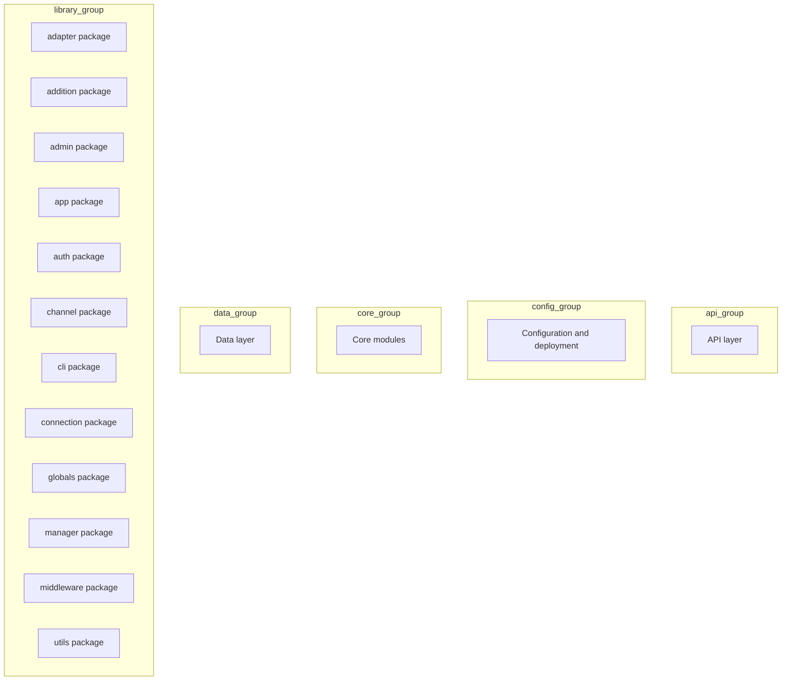

# Architecture report: coaidev/coai

> Automated static analysis. **Observed** = directly seen in files/imports/AST; **Inferred** = interpretation from that evidence. Repository code was not executed.

## 1. Repository at a glance

| Item | Value |
| --- | --- |
| Repository | coaidev/coai |
| Description | 🚀 Next Gen Multi-tenant AI One-Stop Solution. Builtin Admin & Billing System. Enterprise-Grade Unified LLM Gateway Support for 200+ Models And 35+ Providers, Load Balacing w/ Priority-base Routing, Cost Management, Chat Share, Cloud Sync, Credit/Subscription Billing, All File Parsing, Web Search, B… |
| Language | TypeScript |
| Stars | 9347 |
| Licence | Apache-2.0 |
| Analysed commit / branch | 3048a493eedcfe75de4d59afd5139847ad3195ed / main |
| Framework(s) | React |
| Files analysed | 533 |
| Components | 16 |

## 2. Architecture in one minute

coaidev/coai - 🚀 Next Gen Multi-tenant AI One-Stop Solution. Builtin Admin & Billing System. Enterprise-Grade Unified LLM Gateway Support for 200+ Models And 35+ Providers, Load Balacing w/ Priority-base Routing, C…. This repository was analysed statically from 533 file(s) (0 Python). Detected technologies (observed from imports/manifests): GitHub Actions, MySQL, Redis, React, axios, React Router. Files are grouped into 16 component(s): adapter package, addition package, admin package, API layer, app package, auth package, channel package, cli package. Findings below distinguish observed facts from inferred interpretation.

## 3. High-level block diagram

## 4. Main components

### adapter package (`adapter`)

- **Kind:** library
- **Status:** Observed
- **Confidence:** 0.85
- **Responsibility:** Groups 68 file(s) under adapter package (observed from repository paths and static analysis).
- **Paths:** `adapter/adapter.go`, `adapter/azure/chat.go`, `adapter/azure/image.go`, `adapter/azure/processor.go`, `adapter/azure/struct.go`, `adapter/azure/types.go`, `adapter/baichuan/chat.go`, `adapter/baichuan/processor.go`, `adapter/baichuan/struct.go`, `adapter/baichuan/types.go`, `adapter/bing/chat.go`, `adapter/bing/struct.go`, `adapter/bing/types.go`, `adapter/claude/chat.go`, `adapter/claude/struct.go`, `adapter/claude/types.go`, `adapter/common/interface.go`, `adapter/common/types.go`, `adapter/coze/chat.go`, `adapter/coze/processor.go`, `adapter/coze/struct.go`, `adapter/dashscope/chat.go`, `adapter/dashscope/struct.go`, `adapter/dashscope/types.go`, `adapter/deepseek/chat.go`, `adapter/deepseek/struct.go`, `adapter/dify/chat.go`, `adapter/dify/processor.go`, `adapter/dify/struct.go`, `adapter/hunyuan/chat.go`, `adapter/hunyuan/sdk.go`, `adapter/hunyuan/struct.go`, `adapter/midjourney/api.go`, `adapter/midjourney/chat.go`, `adapter/midjourney/expose.go`, `adapter/midjourney/handler.go`, `adapter/midjourney/storage.go`, `adapter/midjourney/struct.go`, `adapter/midjourney/types.go`, `adapter/openai/chat.go`, `adapter/openai/image.go`, `adapter/openai/processor.go`, `adapter/openai/struct.go`, `adapter/openai/types.go`, `adapter/openai/videos.go`, `adapter/palm2/chat.go`, `adapter/palm2/formatter.go`, `adapter/palm2/image.go`, `adapter/palm2/struct.go`, `adapter/palm2/types.go`, `adapter/request.go`, `adapter/router.go`, `adapter/skylark/chat.go`, `adapter/skylark/formatter.go`, `adapter/skylark/struct.go`, `adapter/slack/chat.go`, `adapter/slack/struct.go`, `adapter/sparkdesk/chat.go`, `adapter/sparkdesk/struct.go`, `adapter/sparkdesk/types.go`, `adapter/zhinao/chat.go`, `adapter/zhinao/processor.go`, `adapter/zhinao/struct.go`, `adapter/zhinao/types.go`, `adapter/zhipuai/chat.go`, `adapter/zhipuai/processor.go`, `adapter/zhipuai/struct.go`, `adapter/zhipuai/types.go`
- **Evidence:** [adapter/adapter.go](https://github.com/coaidev/coai/blob/3048a493eedcfe75de4d59afd5139847ad3195ed/adapter/adapter.go); [adapter/azure/chat.go](https://github.com/coaidev/coai/blob/3048a493eedcfe75de4d59afd5139847ad3195ed/adapter/azure/chat.go); [adapter/azure/image.go](https://github.com/coaidev/coai/blob/3048a493eedcfe75de4d59afd5139847ad3195ed/adapter/azure/image.go); [adapter/azure/processor.go](https://github.com/coaidev/coai/blob/3048a493eedcfe75de4d59afd5139847ad3195ed/adapter/azure/processor.go); [adapter/azure/struct.go](https://github.com/coaidev/coai/blob/3048a493eedcfe75de4d59afd5139847ad3195ed/adapter/azure/struct.go); [adapter/azure/types.go](https://github.com/coaidev/coai/blob/3048a493eedcfe75de4d59afd5139847ad3195ed/adapter/azure/types.go); [adapter/baichuan/chat.go](https://github.com/coaidev/coai/blob/3048a493eedcfe75de4d59afd5139847ad3195ed/adapter/baichuan/chat.go); [adapter/baichuan/processor.go](https://github.com/coaidev/coai/blob/3048a493eedcfe75de4d59afd5139847ad3195ed/adapter/baichuan/processor.go)

### addition package (`addition`)

- **Kind:** library
- **Status:** Observed
- **Confidence:** 0.85
- **Responsibility:** Groups 14 file(s) under addition package (observed from repository paths and static analysis).
- **Paths:** `addition/article/api.go`, `addition/article/generate.go`, `addition/article/utils.go`, `addition/card/card.go`, `addition/card/card.php`, `addition/card/error.php`, `addition/card/utils.php`, `addition/generation/api.go`, `addition/generation/build.go`, `addition/generation/generate.go`, `addition/generation/prompt.go`, `addition/router.go`, `addition/web/call.go`, `addition/web/search.go`
- **Evidence:** [addition/article/api.go](https://github.com/coaidev/coai/blob/3048a493eedcfe75de4d59afd5139847ad3195ed/addition/article/api.go); [addition/article/generate.go](https://github.com/coaidev/coai/blob/3048a493eedcfe75de4d59afd5139847ad3195ed/addition/article/generate.go); [addition/article/utils.go](https://github.com/coaidev/coai/blob/3048a493eedcfe75de4d59afd5139847ad3195ed/addition/article/utils.go); [addition/card/card.go](https://github.com/coaidev/coai/blob/3048a493eedcfe75de4d59afd5139847ad3195ed/addition/card/card.go); [addition/card/card.php](https://github.com/coaidev/coai/blob/3048a493eedcfe75de4d59afd5139847ad3195ed/addition/card/card.php); [addition/card/error.php](https://github.com/coaidev/coai/blob/3048a493eedcfe75de4d59afd5139847ad3195ed/addition/card/error.php); [addition/card/utils.php](https://github.com/coaidev/coai/blob/3048a493eedcfe75de4d59afd5139847ad3195ed/addition/card/utils.php); [addition/generation/api.go](https://github.com/coaidev/coai/blob/3048a493eedcfe75de4d59afd5139847ad3195ed/addition/generation/api.go)

### admin package (`admin`)

- **Kind:** library
- **Status:** Observed
- **Confidence:** 0.85
- **Responsibility:** Groups 16 file(s) under admin package (observed from repository paths and static analysis).
- **Paths:** `admin/analysis/analysis.go`, `admin/analysis/format.go`, `admin/analysis/reflect.go`, `admin/analysis/statistic.go`, `admin/analysis/types.go`, `admin/controller.go`, `admin/format.go`, `admin/instance.go`, `admin/invitation.go`, `admin/logger.go`, `admin/market.go`, `admin/redeem.go`, `admin/router.go`, `admin/statistic.go`, `admin/types.go`, `admin/user.go`
- **Evidence:** [admin/analysis/analysis.go](https://github.com/coaidev/coai/blob/3048a493eedcfe75de4d59afd5139847ad3195ed/admin/analysis/analysis.go); [admin/analysis/format.go](https://github.com/coaidev/coai/blob/3048a493eedcfe75de4d59afd5139847ad3195ed/admin/analysis/format.go); [admin/analysis/reflect.go](https://github.com/coaidev/coai/blob/3048a493eedcfe75de4d59afd5139847ad3195ed/admin/analysis/reflect.go); [admin/analysis/statistic.go](https://github.com/coaidev/coai/blob/3048a493eedcfe75de4d59afd5139847ad3195ed/admin/analysis/statistic.go); [admin/analysis/types.go](https://github.com/coaidev/coai/blob/3048a493eedcfe75de4d59afd5139847ad3195ed/admin/analysis/types.go); [admin/controller.go](https://github.com/coaidev/coai/blob/3048a493eedcfe75de4d59afd5139847ad3195ed/admin/controller.go); [admin/format.go](https://github.com/coaidev/coai/blob/3048a493eedcfe75de4d59afd5139847ad3195ed/admin/format.go); [admin/instance.go](https://github.com/coaidev/coai/blob/3048a493eedcfe75de4d59afd5139847ad3195ed/admin/instance.go)

### API layer (`api_layer`)

- **Kind:** api
- **Status:** Observed
- **Confidence:** 0.85
- **Responsibility:** Groups 51 file(s) under api layer (observed from repository paths and static analysis).
- **Paths:** `app/src/admin/api/channel.ts`, `app/src/admin/api/charge.ts`, `app/src/admin/api/chart.ts`, `app/src/admin/api/info.ts`, `app/src/admin/api/logger.ts`, `app/src/admin/api/market.ts`, `app/src/admin/api/plan.ts`, `app/src/admin/api/system.ts`, `app/src/api/addition.ts`, `app/src/api/auth.ts`, `app/src/api/broadcast.ts`, `app/src/api/common.ts`, `app/src/api/connection.ts`, `app/src/api/file.ts`, `app/src/api/generation.ts`, `app/src/api/history.ts`, `app/src/api/mask.ts`, `app/src/api/plugin.ts`, `app/src/api/quota.ts`, `app/src/api/record.ts`, `app/src/api/redeem.ts`, `app/src/api/sharing.ts`, `app/src/api/types.tsx`, `app/src/api/v1.ts`, `app/src/routes/Account.tsx`, `app/src/routes/Admin.tsx`, `app/src/routes/Article.tsx`, `app/src/routes/Auth.tsx`, `app/src/routes/Forgot.tsx`, `app/src/routes/Generation.tsx`, `app/src/routes/Home.tsx`, `app/src/routes/Index.tsx`, `app/src/routes/Model.tsx`, `app/src/routes/NotFound.tsx`, `app/src/routes/Register.tsx`, `app/src/routes/Sharing.tsx`, `app/src/routes/Wallet.tsx`, `app/src/routes/admin/Broadcast.tsx`, `app/src/routes/admin/Channel.tsx`, `app/src/routes/admin/Charge.tsx`, `app/src/routes/admin/DashBoard.tsx`, `app/src/routes/admin/License.tsx`, `app/src/routes/admin/Logger.tsx`, `app/src/routes/admin/Market.tsx`, `app/src/routes/admin/Notification.tsx`, `app/src/routes/admin/Subscription.tsx`, `app/src/routes/admin/System.tsx`, `app/src/routes/admin/Users.tsx`, `app/src/routes/admin/common/CommonAdminPage.tsx`, `app/src/routes/wallet/AmountItem.tsx`, `app/src/routes/wallet/WalletQuotaBox.tsx`
- **Evidence:** [app/src/admin/api/channel.ts](https://github.com/coaidev/coai/blob/3048a493eedcfe75de4d59afd5139847ad3195ed/app/src/admin/api/channel.ts); [app/src/admin/api/charge.ts](https://github.com/coaidev/coai/blob/3048a493eedcfe75de4d59afd5139847ad3195ed/app/src/admin/api/charge.ts); [app/src/admin/api/chart.ts](https://github.com/coaidev/coai/blob/3048a493eedcfe75de4d59afd5139847ad3195ed/app/src/admin/api/chart.ts); [app/src/admin/api/info.ts](https://github.com/coaidev/coai/blob/3048a493eedcfe75de4d59afd5139847ad3195ed/app/src/admin/api/info.ts); [app/src/admin/api/logger.ts](https://github.com/coaidev/coai/blob/3048a493eedcfe75de4d59afd5139847ad3195ed/app/src/admin/api/logger.ts); [app/src/admin/api/market.ts](https://github.com/coaidev/coai/blob/3048a493eedcfe75de4d59afd5139847ad3195ed/app/src/admin/api/market.ts); [app/src/admin/api/plan.ts](https://github.com/coaidev/coai/blob/3048a493eedcfe75de4d59afd5139847ad3195ed/app/src/admin/api/plan.ts); [app/src/admin/api/system.ts](https://github.com/coaidev/coai/blob/3048a493eedcfe75de4d59afd5139847ad3195ed/app/src/admin/api/system.ts)

### app package (`app`)

- **Kind:** library
- **Status:** Observed
- **Confidence:** 0.85
- **Responsibility:** Groups 192 file(s) under app package (observed from repository paths and static analysis).
- **Paths:** `app/.eslintrc.cjs`, `app/postcss.config.js`, `app/public/service.js`, `app/public/workbox.js`, `app/src-tauri/build.rs`, `app/src-tauri/src/main.rs`, `app/src/App.tsx`, `app/src/admin/channel.ts`, `app/src/admin/charge.ts`, `app/src/admin/colors.ts`, `app/src/admin/datasets/charge.ts`, `app/src/admin/hook.tsx`, `app/src/admin/market.ts`, `app/src/admin/types.ts`, `app/src/components/Avatar.tsx`, `app/src/components/EditorProvider.tsx`, `app/src/components/Emoji.tsx`, `app/src/components/ErrorBoundary.tsx`, `app/src/components/FileProvider.tsx`, `app/src/components/FileViewer.tsx`, `app/src/components/I18nProvider.tsx`, `app/src/components/Loader.tsx`, `app/src/components/MCPResultDebug.tsx`, `app/src/components/MCPResultPanel.tsx`, `app/src/components/Markdown.tsx`, `app/src/components/Message.tsx`, `app/src/components/ModelAvatar.tsx`, `app/src/components/OperationAction.tsx`, `app/src/components/Paragraph.tsx`, `app/src/components/PopupDialog.tsx`, `app/src/components/ProjectLink.tsx`, `app/src/components/ReloadService.tsx`, `app/src/components/Require.tsx`, `app/src/components/SelectGroup.tsx`, `app/src/components/ThemeProvider.tsx`, `app/src/components/ThinkContent.tsx`, `app/src/components/TickButton.tsx`, `app/src/components/Tips.tsx`, `app/src/components/TrendBadge.tsx`, `app/src/components/VoiceProvider.tsx`, `app/src/components/WarningButton.tsx`, `app/src/components/admin/ChannelSettings.tsx`, `app/src/components/admin/ChargeWidget.tsx`, `app/src/components/admin/ChartBox.tsx`, `app/src/components/admin/InfoBox.tsx`, `app/src/components/admin/InvitationTable.tsx`, `app/src/components/admin/MenuBar.tsx`, `app/src/components/admin/RedeemTable.tsx`, `app/src/components/admin/UserTable.tsx`, `app/src/components/admin/assemblies/BillingChart.tsx`, `app/src/components/admin/assemblies/BroadcastTable.tsx`, `app/src/components/admin/assemblies/ChannelEditor.tsx`, `app/src/components/admin/assemblies/ChannelTable.tsx`, `app/src/components/admin/assemblies/ErrorChart.tsx`, `app/src/components/admin/assemblies/ModelChart.tsx`, `app/src/components/admin/assemblies/ModelUsageChart.tsx`, `app/src/components/admin/assemblies/RequestChart.tsx`, `app/src/components/admin/assemblies/UserTypeChart.tsx`, `app/src/components/admin/common/StateBadge.tsx`, `app/src/components/app/Announcement.tsx`, `app/src/components/app/AppProvider.tsx`, `app/src/components/app/Contact.tsx`, `app/src/components/app/MenuBar.tsx`, `app/src/components/app/NavBar.tsx`, `app/src/components/home/ChatInterface.tsx`, `app/src/components/home/ChatSpace.tsx`, `app/src/components/home/ChatWrapper.tsx`, `app/src/components/home/ConversationItem.tsx`, `app/src/components/home/MaskEditor.tsx`, `app/src/components/home/ModelArea.tsx`, `app/src/components/home/SideBar.tsx`, `app/src/components/home/assemblies/ActionButton.tsx`, `app/src/components/home/assemblies/ChatAction.tsx`, `app/src/components/home/assemblies/ChatInput.tsx`, `app/src/components/home/assemblies/ScrollAction.tsx`, `app/src/components/home/subscription/SubscriptionUsage.tsx`, `app/src/components/home/subscription/UpgradePlan.tsx`, `app/src/components/markdown/Code.tsx`, `app/src/components/markdown/Image.tsx`, `app/src/components/markdown/Label.tsx`, `app/src/components/markdown/Link.tsx`, `app/src/components/markdown/Reference.tsx`, `app/src/components/markdown/Video.tsx`, `app/src/components/markdown/VirtualMessage.tsx`, `app/src/components/plugins/file.tsx`, `app/src/components/plugins/mermaid.tsx`, `app/src/components/plugins/progress.tsx`, `app/src/components/ui/accordion.tsx`, `app/src/components/ui/alert-dialog.tsx`, `app/src/components/ui/alert.tsx`, `app/src/components/ui/badge.tsx`, `app/src/components/ui/button.tsx`, `app/src/components/ui/calendar.tsx`, `app/src/components/ui/card.tsx`, `app/src/components/ui/checkbox.tsx`, `app/src/components/ui/clickable.tsx`, `app/src/components/ui/combo-box.tsx`, `app/src/components/ui/command.tsx`, `app/src/components/ui/context-menu.tsx`, `app/src/components/ui/date-picker.tsx`, `app/src/components/ui/dialog.tsx`, `app/src/components/ui/drawer.tsx`, `app/src/components/ui/dropdown-menu.tsx`, `app/src/components/ui/icons/Github.tsx`, `app/src/components/ui/icons/Send.tsx`, `app/src/components/ui/input.tsx`, `app/src/components/ui/label.tsx`, `app/src/components/ui/lib/utils.ts`, `app/src/components/ui/multi-combobox.tsx`, `app/src/components/ui/number-input.tsx`, `app/src/components/ui/pagination.tsx`, `app/src/components/ui/popover.tsx`, `app/src/components/ui/progress.tsx`, `app/src/components/ui/radio-box.tsx`, `app/src/components/ui/radio-group.tsx`, `app/src/components/ui/scroll-area.tsx`, `app/src/components/ui/select.tsx`, `app/src/components/ui/separator.tsx`, `app/src/components/ui/sheet.tsx`, `app/src/components/ui/skeleton.tsx`, `app/src/components/ui/slider.tsx`, `app/src/components/ui/sonner.tsx`, `app/src/components/ui/step.tsx`, `app/src/components/ui/switch.tsx`, `app/src/components/ui/table.tsx`, `app/src/components/ui/tabs.tsx`, `app/src/components/ui/textarea.tsx`, `app/src/components/ui/toast.tsx`, `app/src/components/ui/toaster.tsx`, `app/src/components/ui/toggle-group.tsx`, `app/src/components/ui/toggle.tsx`, `app/src/components/ui/tooltip.tsx`, `app/src/components/ui/use-toast.ts`, `app/src/components/utils/Icon.tsx`, `app/src/dialogs/SettingsDialog.tsx`, `app/src/dialogs/index.tsx`, `app/src/events/blob.ts`, `app/src/events/info.ts`, `app/src/events/model.ts`, `app/src/events/spinner.ts`, `app/src/events/struct.ts`, `app/src/events/theme.ts`, `app/src/i18n.ts`, `app/src/main.tsx`, `app/src/masks/prompts.ts`, `app/src/masks/types.ts`, `app/src/payment/icons.tsx`, `app/src/payment/request.ts`, `app/src/payment/utils.ts`, `app/src/plugin/types.ts`, `app/src/router.tsx`, `app/src/spinner.tsx`, `app/src/store/api.ts`, `app/src/store/auth.ts`, `app/src/store/avatar.ts`, `app/src/store/chat.ts`, `app/src/store/globals.ts`, `app/src/store/index.ts`, `app/src/store/info.ts`, `app/src/store/menu.ts`, `app/src/store/package.ts`, `app/src/store/quota.ts`, `app/src/store/record.ts`, `app/src/store/settings.ts`, `app/src/store/sharing.ts`, `app/src/store/subscription.ts`, `app/src/store/utils.ts`, `app/src/translator/adapter.ts`, `app/src/translator/index.ts`, `app/src/translator/io.ts`, `app/src/translator/translator.ts`, `app/src/types/performance.d.ts`, `app/src/types/service.d.ts`, `app/src/types/ui.d.ts`, `app/src/utils/analytics.ts`, `app/src/utils/app.ts`, `app/src/utils/base.ts`, `app/src/utils/date.ts`, `app/src/utils/desktop.ts`, `app/src/utils/dev.ts`, `app/src/utils/device.ts`, `app/src/utils/dom.ts`, `app/src/utils/form.ts`, `app/src/utils/groups.ts`, `app/src/utils/hook.ts`, `app/src/utils/loader.tsx`, `app/src/utils/memory.ts`, `app/src/utils/path.ts`, `app/src/utils/processor.ts`, `app/src/vite-env.d.ts`, `app/tailwind.config.js`, `app/vite.config.ts`
- **Evidence:** [app/.eslintrc.cjs](https://github.com/coaidev/coai/blob/3048a493eedcfe75de4d59afd5139847ad3195ed/app/.eslintrc.cjs); [app/postcss.config.js](https://github.com/coaidev/coai/blob/3048a493eedcfe75de4d59afd5139847ad3195ed/app/postcss.config.js); [app/public/service.js](https://github.com/coaidev/coai/blob/3048a493eedcfe75de4d59afd5139847ad3195ed/app/public/service.js); [app/public/workbox.js](https://github.com/coaidev/coai/blob/3048a493eedcfe75de4d59afd5139847ad3195ed/app/public/workbox.js); [app/src-tauri/build.rs](https://github.com/coaidev/coai/blob/3048a493eedcfe75de4d59afd5139847ad3195ed/app/src-tauri/build.rs); [app/src-tauri/src/main.rs](https://github.com/coaidev/coai/blob/3048a493eedcfe75de4d59afd5139847ad3195ed/app/src-tauri/src/main.rs); [app/src/App.tsx](https://github.com/coaidev/coai/blob/3048a493eedcfe75de4d59afd5139847ad3195ed/app/src/App.tsx); [app/src/admin/channel.ts](https://github.com/coaidev/coai/blob/3048a493eedcfe75de4d59afd5139847ad3195ed/app/src/admin/channel.ts)

### auth package (`auth`)

- **Kind:** library
- **Status:** Observed
- **Confidence:** 0.85
- **Responsibility:** Groups 17 file(s) under auth package (observed from repository paths and static analysis).
- **Paths:** `auth/analysis.go`, `auth/apikey.go`, `auth/auth.go`, `auth/call.go`, `auth/cert.go`, `auth/controller.go`, `auth/invitation.go`, `auth/package.go`, `auth/payment.go`, `auth/quota.go`, `auth/redeem.go`, `auth/router.go`, `auth/rule.go`, `auth/struct.go`, `auth/subscription.go`, `auth/usage.go`, `auth/validators.go`
- **Evidence:** [auth/analysis.go](https://github.com/coaidev/coai/blob/3048a493eedcfe75de4d59afd5139847ad3195ed/auth/analysis.go); [auth/apikey.go](https://github.com/coaidev/coai/blob/3048a493eedcfe75de4d59afd5139847ad3195ed/auth/apikey.go); [auth/auth.go](https://github.com/coaidev/coai/blob/3048a493eedcfe75de4d59afd5139847ad3195ed/auth/auth.go); [auth/call.go](https://github.com/coaidev/coai/blob/3048a493eedcfe75de4d59afd5139847ad3195ed/auth/call.go); [auth/cert.go](https://github.com/coaidev/coai/blob/3048a493eedcfe75de4d59afd5139847ad3195ed/auth/cert.go); [auth/controller.go](https://github.com/coaidev/coai/blob/3048a493eedcfe75de4d59afd5139847ad3195ed/auth/controller.go); [auth/invitation.go](https://github.com/coaidev/coai/blob/3048a493eedcfe75de4d59afd5139847ad3195ed/auth/invitation.go); [auth/package.go](https://github.com/coaidev/coai/blob/3048a493eedcfe75de4d59afd5139847ad3195ed/auth/package.go)

### channel package (`channel`)

- **Kind:** library
- **Status:** Observed
- **Confidence:** 0.85
- **Responsibility:** Groups 11 file(s) under channel package (observed from repository paths and static analysis).
- **Paths:** `channel/channel.go`, `channel/charge.go`, `channel/controller.go`, `channel/manager.go`, `channel/plan.go`, `channel/router.go`, `channel/sequence.go`, `channel/system.go`, `channel/ticker.go`, `channel/types.go`, `channel/worker.go`
- **Evidence:** [channel/channel.go](https://github.com/coaidev/coai/blob/3048a493eedcfe75de4d59afd5139847ad3195ed/channel/channel.go); [channel/charge.go](https://github.com/coaidev/coai/blob/3048a493eedcfe75de4d59afd5139847ad3195ed/channel/charge.go); [channel/controller.go](https://github.com/coaidev/coai/blob/3048a493eedcfe75de4d59afd5139847ad3195ed/channel/controller.go); [channel/manager.go](https://github.com/coaidev/coai/blob/3048a493eedcfe75de4d59afd5139847ad3195ed/channel/manager.go); [channel/plan.go](https://github.com/coaidev/coai/blob/3048a493eedcfe75de4d59afd5139847ad3195ed/channel/plan.go); [channel/router.go](https://github.com/coaidev/coai/blob/3048a493eedcfe75de4d59afd5139847ad3195ed/channel/router.go); [channel/sequence.go](https://github.com/coaidev/coai/blob/3048a493eedcfe75de4d59afd5139847ad3195ed/channel/sequence.go); [channel/system.go](https://github.com/coaidev/coai/blob/3048a493eedcfe75de4d59afd5139847ad3195ed/channel/system.go)

### cli package (`cli`)

- **Kind:** library
- **Status:** Observed
- **Confidence:** 0.85
- **Responsibility:** Groups 6 file(s) under cli package (observed from repository paths and static analysis).
- **Paths:** `cli/admin.go`, `cli/exec.go`, `cli/help.go`, `cli/invite.go`, `cli/parser.go`, `cli/token.go`
- **Evidence:** [cli/admin.go](https://github.com/coaidev/coai/blob/3048a493eedcfe75de4d59afd5139847ad3195ed/cli/admin.go); [cli/exec.go](https://github.com/coaidev/coai/blob/3048a493eedcfe75de4d59afd5139847ad3195ed/cli/exec.go); [cli/help.go](https://github.com/coaidev/coai/blob/3048a493eedcfe75de4d59afd5139847ad3195ed/cli/help.go); [cli/invite.go](https://github.com/coaidev/coai/blob/3048a493eedcfe75de4d59afd5139847ad3195ed/cli/invite.go); [cli/parser.go](https://github.com/coaidev/coai/blob/3048a493eedcfe75de4d59afd5139847ad3195ed/cli/parser.go); [cli/token.go](https://github.com/coaidev/coai/blob/3048a493eedcfe75de4d59afd5139847ad3195ed/cli/token.go)

### Configuration and deployment (`config`)

- **Kind:** config
- **Status:** Observed
- **Confidence:** 0.85
- **Responsibility:** Groups 29 file(s) under configuration and deployment (observed from repository paths and static analysis).
- **Paths:** `Dockerfile`, `app/.prettierrc.json`, `app/components.json`, `app/package.json`, `app/public/manifest.json`, `app/qodana.yaml`, `app/src-tauri/Cargo.toml`, `app/src-tauri/tauri.conf.json`, `app/src/conf/api.ts`, `app/src/conf/bootstrap.ts`, `app/src/conf/deeptrain.tsx`, `app/src/conf/env.ts`, `app/src/conf/model.ts`, `app/src/conf/storage.ts`, `app/src/conf/subscription.tsx`, `app/src/conf/version.json`, `app/src/resources/i18n/cn.json`, `app/src/resources/i18n/en.json`, `app/src/resources/i18n/ja.json`, `app/src/resources/i18n/ru.json`, `app/src/resources/i18n/tw.json`, `app/tsconfig.json`, `app/tsconfig.node.json`, `config.example.yaml`, `docker-compose.stable.yaml`, `docker-compose.watch.yaml`, `docker-compose.yaml`, `go.mod`, `zeabur.yaml`
- **Evidence:** [Dockerfile](https://github.com/coaidev/coai/blob/3048a493eedcfe75de4d59afd5139847ad3195ed/Dockerfile); [app/.prettierrc.json](https://github.com/coaidev/coai/blob/3048a493eedcfe75de4d59afd5139847ad3195ed/app/.prettierrc.json); [app/components.json](https://github.com/coaidev/coai/blob/3048a493eedcfe75de4d59afd5139847ad3195ed/app/components.json); [app/package.json](https://github.com/coaidev/coai/blob/3048a493eedcfe75de4d59afd5139847ad3195ed/app/package.json); [app/public/manifest.json](https://github.com/coaidev/coai/blob/3048a493eedcfe75de4d59afd5139847ad3195ed/app/public/manifest.json); [app/qodana.yaml](https://github.com/coaidev/coai/blob/3048a493eedcfe75de4d59afd5139847ad3195ed/app/qodana.yaml); [app/src-tauri/Cargo.toml](https://github.com/coaidev/coai/blob/3048a493eedcfe75de4d59afd5139847ad3195ed/app/src-tauri/Cargo.toml); [app/src-tauri/tauri.conf.json](https://github.com/coaidev/coai/blob/3048a493eedcfe75de4d59afd5139847ad3195ed/app/src-tauri/tauri.conf.json)

### connection package (`connection`)

- **Kind:** library
- **Status:** Observed
- **Confidence:** 0.85
- **Responsibility:** Groups 4 file(s) under connection package (observed from repository paths and static analysis).
- **Paths:** `connection/cache.go`, `connection/database.go`, `connection/db_migration.go`, `connection/worker.go`
- **Evidence:** [connection/cache.go](https://github.com/coaidev/coai/blob/3048a493eedcfe75de4d59afd5139847ad3195ed/connection/cache.go); [connection/database.go](https://github.com/coaidev/coai/blob/3048a493eedcfe75de4d59afd5139847ad3195ed/connection/database.go); [connection/db_migration.go](https://github.com/coaidev/coai/blob/3048a493eedcfe75de4d59afd5139847ad3195ed/connection/db_migration.go); [connection/worker.go](https://github.com/coaidev/coai/blob/3048a493eedcfe75de4d59afd5139847ad3195ed/connection/worker.go)

### Core modules (`core`)

- **Kind:** core
- **Status:** Observed
- **Confidence:** 0.85
- **Responsibility:** Groups 1 file(s) under core modules (observed from repository paths and static analysis).
- **Paths:** `main.go`
- **Evidence:** [main.go](https://github.com/coaidev/coai/blob/3048a493eedcfe75de4d59afd5139847ad3195ed/main.go)

### Data layer (`data_layer`)

- **Kind:** data
- **Status:** Inferred
- **Confidence:** 0.70
- **Responsibility:** Groups 0 file(s) under data layer (observed from repository paths and static analysis).
- **Evidence:** [docker-compose.yaml:3](https://github.com/coaidev/coai/blob/3048a493eedcfe75de4d59afd5139847ad3195ed/docker-compose.yaml#L3); [docker-compose.yaml:20](https://github.com/coaidev/coai/blob/3048a493eedcfe75de4d59afd5139847ad3195ed/docker-compose.yaml#L20)

### globals package (`globals`)

- **Kind:** library
- **Status:** Observed
- **Confidence:** 0.85
- **Responsibility:** Groups 10 file(s) under globals package (observed from repository paths and static analysis).
- **Paths:** `globals/constant.go`, `globals/interface.go`, `globals/logger.go`, `globals/method.go`, `globals/params.go`, `globals/sql.go`, `globals/tools.go`, `globals/types.go`, `globals/usage.go`, `globals/variables.go`
- **Evidence:** [globals/constant.go](https://github.com/coaidev/coai/blob/3048a493eedcfe75de4d59afd5139847ad3195ed/globals/constant.go); [globals/interface.go](https://github.com/coaidev/coai/blob/3048a493eedcfe75de4d59afd5139847ad3195ed/globals/interface.go); [globals/logger.go](https://github.com/coaidev/coai/blob/3048a493eedcfe75de4d59afd5139847ad3195ed/globals/logger.go); [globals/method.go](https://github.com/coaidev/coai/blob/3048a493eedcfe75de4d59afd5139847ad3195ed/globals/method.go); [globals/params.go](https://github.com/coaidev/coai/blob/3048a493eedcfe75de4d59afd5139847ad3195ed/globals/params.go); [globals/sql.go](https://github.com/coaidev/coai/blob/3048a493eedcfe75de4d59afd5139847ad3195ed/globals/sql.go); [globals/tools.go](https://github.com/coaidev/coai/blob/3048a493eedcfe75de4d59afd5139847ad3195ed/globals/tools.go); [globals/types.go](https://github.com/coaidev/coai/blob/3048a493eedcfe75de4d59afd5139847ad3195ed/globals/types.go)

### manager package (`manager`)

- **Kind:** library
- **Status:** Observed
- **Confidence:** 0.85
- **Responsibility:** Groups 22 file(s) under manager package (observed from repository paths and static analysis).
- **Paths:** `manager/broadcast/controller.go`, `manager/broadcast/manage.go`, `manager/broadcast/router.go`, `manager/broadcast/types.go`, `manager/broadcast/view.go`, `manager/chat.go`, `manager/chat_completions.go`, `manager/completions.go`, `manager/connection.go`, `manager/conversation/api.go`, `manager/conversation/conversation.go`, `manager/conversation/mask.go`, `manager/conversation/router.go`, `manager/conversation/shared.go`, `manager/conversation/storage.go`, `manager/images.go`, `manager/manager.go`, `manager/relay.go`, `manager/router.go`, `manager/types.go`, `manager/usage.go`, `manager/videos.go`
- **Evidence:** [manager/broadcast/controller.go](https://github.com/coaidev/coai/blob/3048a493eedcfe75de4d59afd5139847ad3195ed/manager/broadcast/controller.go); [manager/broadcast/manage.go](https://github.com/coaidev/coai/blob/3048a493eedcfe75de4d59afd5139847ad3195ed/manager/broadcast/manage.go); [manager/broadcast/router.go](https://github.com/coaidev/coai/blob/3048a493eedcfe75de4d59afd5139847ad3195ed/manager/broadcast/router.go); [manager/broadcast/types.go](https://github.com/coaidev/coai/blob/3048a493eedcfe75de4d59afd5139847ad3195ed/manager/broadcast/types.go); [manager/broadcast/view.go](https://github.com/coaidev/coai/blob/3048a493eedcfe75de4d59afd5139847ad3195ed/manager/broadcast/view.go); [manager/chat.go](https://github.com/coaidev/coai/blob/3048a493eedcfe75de4d59afd5139847ad3195ed/manager/chat.go); [manager/chat_completions.go](https://github.com/coaidev/coai/blob/3048a493eedcfe75de4d59afd5139847ad3195ed/manager/chat_completions.go); [manager/completions.go](https://github.com/coaidev/coai/blob/3048a493eedcfe75de4d59afd5139847ad3195ed/manager/completions.go)

### middleware package (`middleware`)

- **Kind:** library
- **Status:** Observed
- **Confidence:** 0.85
- **Responsibility:** Groups 5 file(s) under middleware package (observed from repository paths and static analysis).
- **Paths:** `middleware/auth.go`, `middleware/builtins.go`, `middleware/cors.go`, `middleware/middleware.go`, `middleware/throttle.go`
- **Evidence:** [middleware/auth.go](https://github.com/coaidev/coai/blob/3048a493eedcfe75de4d59afd5139847ad3195ed/middleware/auth.go); [middleware/builtins.go](https://github.com/coaidev/coai/blob/3048a493eedcfe75de4d59afd5139847ad3195ed/middleware/builtins.go); [middleware/cors.go](https://github.com/coaidev/coai/blob/3048a493eedcfe75de4d59afd5139847ad3195ed/middleware/cors.go); [middleware/middleware.go](https://github.com/coaidev/coai/blob/3048a493eedcfe75de4d59afd5139847ad3195ed/middleware/middleware.go); [middleware/throttle.go](https://github.com/coaidev/coai/blob/3048a493eedcfe75de4d59afd5139847ad3195ed/middleware/throttle.go)

### utils package (`utils`)

- **Kind:** library
- **Status:** Observed
- **Confidence:** 0.85
- **Responsibility:** Groups 17 file(s) under utils package (observed from repository paths and static analysis).
- **Paths:** `utils/base.go`, `utils/bootstrap.go`, `utils/buffer.go`, `utils/cache.go`, `utils/char.go`, `utils/compress.go`, `utils/config.go`, `utils/ctx.go`, `utils/encrypt.go`, `utils/fs.go`, `utils/image.go`, `utils/net.go`, `utils/scanner.go`, `utils/smtp.go`, `utils/sse.go`, `utils/tokenizer.go`, `utils/websocket.go`
- **Evidence:** [utils/base.go](https://github.com/coaidev/coai/blob/3048a493eedcfe75de4d59afd5139847ad3195ed/utils/base.go); [utils/bootstrap.go](https://github.com/coaidev/coai/blob/3048a493eedcfe75de4d59afd5139847ad3195ed/utils/bootstrap.go); [utils/buffer.go](https://github.com/coaidev/coai/blob/3048a493eedcfe75de4d59afd5139847ad3195ed/utils/buffer.go); [utils/cache.go](https://github.com/coaidev/coai/blob/3048a493eedcfe75de4d59afd5139847ad3195ed/utils/cache.go); [utils/char.go](https://github.com/coaidev/coai/blob/3048a493eedcfe75de4d59afd5139847ad3195ed/utils/char.go); [utils/compress.go](https://github.com/coaidev/coai/blob/3048a493eedcfe75de4d59afd5139847ad3195ed/utils/compress.go); [utils/config.go](https://github.com/coaidev/coai/blob/3048a493eedcfe75de4d59afd5139847ad3195ed/utils/config.go); [utils/ctx.go](https://github.com/coaidev/coai/blob/3048a493eedcfe75de4d59afd5139847ad3195ed/utils/ctx.go)

## 5. Execution flow

**Observed** entry point(s):

- [app/src/App.tsx](https://github.com/coaidev/coai/blob/3048a493eedcfe75de4d59afd5139847ad3195ed/app/src/App.tsx)
- [app/src/dialogs/index.tsx](https://github.com/coaidev/coai/blob/3048a493eedcfe75de4d59afd5139847ad3195ed/app/src/dialogs/index.tsx)
- [app/src/main.tsx](https://github.com/coaidev/coai/blob/3048a493eedcfe75de4d59afd5139847ad3195ed/app/src/main.tsx)
- [app/src/routes/Index.tsx](https://github.com/coaidev/coai/blob/3048a493eedcfe75de4d59afd5139847ad3195ed/app/src/routes/Index.tsx)
- [app/src/store/index.ts](https://github.com/coaidev/coai/blob/3048a493eedcfe75de4d59afd5139847ad3195ed/app/src/store/index.ts)
- [app/src/translator/index.ts](https://github.com/coaidev/coai/blob/3048a493eedcfe75de4d59afd5139847ad3195ed/app/src/translator/index.ts)
- [app/src/utils/app.ts](https://github.com/coaidev/coai/blob/3048a493eedcfe75de4d59afd5139847ad3195ed/app/src/utils/app.ts)

Representative flow (derived from observed entry points and the import graph; steps beyond the entry point are **Inferred**):

1. Execution starts at an observed entry point listed above, if present.
2. No internal import relationships between components were observed.

## 6. Project structure

### `(root)`

- `.dockerignore` - container (476 bytes)
- `.gitignore` - other (372 bytes)
- `Dockerfile` - container (1493 bytes)
- `LICENSE` - docs (11357 bytes)
- `README.md` - docs (18502 bytes)
- `README_ja-JP.md` - docs (19555 bytes)
- `README_zh-CN.md` - docs (23868 bytes)
- `config.example.yaml` - config (412 bytes)
- `docker-compose.stable.yaml` - config (1246 bytes)
- `docker-compose.watch.yaml` - config (1488 bytes)
- `docker-compose.yaml` - container (1332 bytes)
- `go.mod` - manifest (3564 bytes)
- `go.sum` - other (103507 bytes)
- `main.go` - source, Go (1354 bytes)
- `nginx.conf` - other (1305 bytes)
- `zeabur.yaml` - config (18739 bytes)

### `.github`

- `.github/ISSUE_TEMPLATE/bug_report.md` - docs (873 bytes)
- `.github/ISSUE_TEMPLATE/channel_update.md` - docs (1049 bytes)
- `.github/ISSUE_TEMPLATE/config.yml` - config (135 bytes)
- `.github/ISSUE_TEMPLATE/feature_request.md` - docs (836 bytes)
- `.github/workflows/app.yaml` - ci, YAML (3202 bytes)
- `.github/workflows/build.yaml` - ci, YAML (851 bytes)
- `.github/workflows/docker-cd.yaml` - ci, YAML (682 bytes)
- `.github/workflows/docker-ci.yaml` - ci, YAML (1243 bytes)
- `.github/workflows/issue-translator.yaml` - ci, YAML (358 bytes)

### `adapter`

- `adapter/adapter.go` - source, Go (2930 bytes)
- `adapter/azure/chat.go` - source, Go (3418 bytes)
- `adapter/azure/image.go` - source, Go (2009 bytes)
- `adapter/azure/processor.go` - source, Go (3606 bytes)
- `adapter/azure/struct.go` - source, Go (875 bytes)
- `adapter/azure/types.go` - source, Go (4208 bytes)
- `adapter/baichuan/chat.go` - source, Go (2332 bytes)
- `adapter/baichuan/processor.go` - source, Go (1101 bytes)
- `adapter/baichuan/struct.go` - source, Go (755 bytes)
- `adapter/baichuan/types.go` - source, Go (1409 bytes)
- `adapter/bing/chat.go` - source, Go (979 bytes)
- `adapter/bing/struct.go` - source, Go (524 bytes)
- `adapter/bing/types.go` - source, Go (265 bytes)
- `adapter/claude/chat.go` - source, Go (5429 bytes)
- `adapter/claude/struct.go` - source, Go (559 bytes)
- `adapter/claude/types.go` - source, Go (1188 bytes)
- `adapter/common/interface.go` - source, Go (300 bytes)
- `adapter/common/types.go` - source, Go (1796 bytes)
- `adapter/coze/chat.go` - source, Go (4534 bytes)
- `adapter/coze/processor.go` - source, Go (4087 bytes)
- `adapter/coze/struct.go` - source, Go (3244 bytes)
- `adapter/dashscope/chat.go` - source, Go (3572 bytes)
- `adapter/dashscope/struct.go` - source, Go (569 bytes)
- `adapter/dashscope/types.go` - source, Go (1178 bytes)
- `adapter/deepseek/chat.go` - source, Go (4758 bytes)
- `adapter/deepseek/struct.go` - source, Go (1773 bytes)
- `adapter/dify/chat.go` - source, Go (3520 bytes)
- `adapter/dify/processor.go` - source, Go (1840 bytes)
- `adapter/dify/struct.go` - source, Go (2711 bytes)
- `adapter/hunyuan/chat.go` - source, Go (1508 bytes)
- `adapter/hunyuan/sdk.go` - source, Go (7910 bytes)
- `adapter/hunyuan/struct.go` - source, Go (878 bytes)
- `adapter/midjourney/api.go` - source, Go (1502 bytes)
- `adapter/midjourney/chat.go` - source, Go (4042 bytes)
- `adapter/midjourney/expose.go` - source, Go (1414 bytes)
- `adapter/midjourney/handler.go` - source, Go (3513 bytes)
- `adapter/midjourney/storage.go` - source, Go (418 bytes)
- `adapter/midjourney/struct.go` - source, Go (1128 bytes)
- `adapter/midjourney/types.go` - source, Go (1763 bytes)
- `adapter/openai/chat.go` - source, Go (4095 bytes)
- `adapter/openai/image.go` - source, Go (1911 bytes)
- `adapter/openai/processor.go` - source, Go (3597 bytes)
- `adapter/openai/struct.go` - source, Go (753 bytes)
- `adapter/openai/types.go` - source, Go (4022 bytes)
- `adapter/openai/videos.go` - source, Go (3798 bytes)
- `adapter/palm2/chat.go` - source, Go (5766 bytes)
- `adapter/palm2/formatter.go` - source, Go (2450 bytes)
- `adapter/palm2/image.go` - source, Go (1942 bytes)
- `adapter/palm2/struct.go` - source, Go (565 bytes)
- `adapter/palm2/types.go` - source, Go (2663 bytes)
- `adapter/request.go` - source, Go (2791 bytes)
- `adapter/router.go` - source, Go (170 bytes)
- `adapter/skylark/chat.go` - source, Go (4561 bytes)
- `adapter/skylark/formatter.go` - source, Go (1974 bytes)
- `adapter/skylark/struct.go` - source, Go (736 bytes)
- `adapter/slack/chat.go` - source, Go (448 bytes)
- `adapter/slack/struct.go` - source, Go (1755 bytes)
- `adapter/sparkdesk/chat.go` - source, Go (3852 bytes)
- `adapter/sparkdesk/struct.go` - source, Go (2325 bytes)
- `adapter/sparkdesk/types.go` - source, Go (1835 bytes)
- `adapter/zhinao/chat.go` - source, Go (2578 bytes)
- `adapter/zhinao/processor.go` - source, Go (2180 bytes)
- `adapter/zhinao/struct.go` - source, Go (753 bytes)
- `adapter/zhinao/types.go` - source, Go (1591 bytes)
- `adapter/zhipuai/chat.go` - source, Go (3798 bytes)
- `adapter/zhipuai/processor.go` - source, Go (3724 bytes)
- `adapter/zhipuai/struct.go` - source, Go (1540 bytes)
- `adapter/zhipuai/types.go` - source, Go (4020 bytes)

### `addition`

- `addition/article/api.go` - source, Go (1648 bytes)
- `addition/article/data/.gitkeep` - other (0 bytes)
- `addition/article/generate.go` - source, Go (2304 bytes)
- `addition/article/utils.go` - source, Go (818 bytes)
- `addition/card/.gitignore` - other (14 bytes)
- `addition/card/card.go` - source, Go (1668 bytes)
- `addition/card/card.php` - source, PHP (5593 bytes)
- `addition/card/error.php` - source, PHP (1552 bytes)
- `addition/card/utils.php` - source, PHP (929 bytes)
- `addition/generation/api.go` - source, Go (2340 bytes)
- `addition/generation/build.go` - source, Go (741 bytes)
- `addition/generation/data/.gitkeep` - other (0 bytes)
- `addition/generation/generate.go` - source, Go (739 bytes)
- `addition/generation/prompt.go` - source, Go (5348 bytes)
- `addition/router.go` - source, Go (600 bytes)
- `addition/web/call.go` - source, Go (1160 bytes)
- `addition/web/search.go` - source, Go (3221 bytes)

### `admin`

- `admin/analysis/analysis.go` - source, Go (4915 bytes)
- `admin/analysis/format.go` - source, Go (1287 bytes)
- `admin/analysis/reflect.go` - source, Go (279 bytes)
- `admin/analysis/statistic.go` - source, Go (1683 bytes)
- `admin/analysis/types.go` - source, Go (487 bytes)
- `admin/controller.go` - source, Go (10192 bytes)
- `admin/format.go` - source, Go (865 bytes)
- `admin/instance.go` - source, Go (97 bytes)
- `admin/invitation.go` - source, Go (2661 bytes)
- `admin/logger.go` - source, Go (862 bytes)
- `admin/market.go` - source, Go (1411 bytes)
- `admin/redeem.go` - source, Go (2160 bytes)
- `admin/router.go` - source, Go (1612 bytes)
- `admin/statistic.go` - source, Go (1013 bytes)
- `admin/types.go` - source, Go (2314 bytes)
- `admin/user.go` - source, Go (6350 bytes)

### `app`

- `app/.eslintrc.cjs` - source, JavaScript (436 bytes)
- `app/.gitignore` - other (274 bytes)
- `app/.prettierrc.json` - config (3 bytes)
- `app/components.json` - config (341 bytes)
- `app/index.html` - other (3097 bytes)
- `app/package.json` - manifest (3838 bytes)
- `app/postcss.config.js` - source, JavaScript (80 bytes)
- `app/public/manifest.json` - config (63975 bytes)
- `app/public/robots.txt` - docs (41 bytes)
- `app/public/service.js` - source, JavaScript (532 bytes)
- `app/public/site.webmanifest` - other (434 bytes)
- `app/public/workbox.js` - source, JavaScript (379 bytes)
- `app/qodana.yaml` - config (988 bytes)
- `app/src-tauri/.gitignore` - other (73 bytes)
- `app/src-tauri/Cargo.toml` - manifest (915 bytes)
- `app/src-tauri/build.rs` - source, Rust (37 bytes)
- `app/src-tauri/src/main.rs` - source, Rust (278 bytes)
- `app/src-tauri/tauri.conf.json` - config (1873 bytes)
- `app/src/App.tsx` - source, TypeScript (556 bytes)
- `app/src/admin/api/channel.ts` - source, TypeScript (2315 bytes)
- `app/src/admin/api/charge.ts` - source, TypeScript (2039 bytes)
- `app/src/admin/api/chart.ts` - source, TypeScript (7839 bytes)
- `app/src/admin/api/info.ts` - source, TypeScript (1820 bytes)
- `app/src/admin/api/logger.ts` - source, TypeScript (1512 bytes)
- `app/src/admin/api/market.ts` - source, TypeScript (460 bytes)
- `app/src/admin/api/plan.ts` - source, TypeScript (1256 bytes)
- `app/src/admin/api/system.ts` - source, TypeScript (10310 bytes)
- `app/src/admin/channel.ts` - source, TypeScript (11415 bytes)
- `app/src/admin/charge.ts` - source, TypeScript (496 bytes)
- `app/src/admin/colors.ts` - source, TypeScript (2232 bytes)
- `app/src/admin/datasets/charge.ts` - source, TypeScript (6231 bytes)
- `app/src/admin/hook.tsx` - source, TypeScript (1515 bytes)
- `app/src/admin/market.ts` - source, TypeScript (700 bytes)
- `app/src/admin/types.ts` - source, TypeScript (2082 bytes)
- `app/src/api/addition.ts` - source, TypeScript (2905 bytes)
- `app/src/api/auth.ts` - source, TypeScript (3416 bytes)
- `app/src/api/broadcast.ts` - source, TypeScript (2571 bytes)
- `app/src/api/common.ts` - source, TypeScript (575 bytes)
- `app/src/api/connection.ts` - source, TypeScript (8172 bytes)
- `app/src/api/file.ts` - source, TypeScript (4219 bytes)
- `app/src/api/generation.ts` - source, TypeScript (3054 bytes)
- `app/src/api/history.ts` - source, TypeScript (4648 bytes)
- `app/src/api/mask.ts` - source, TypeScript (1120 bytes)
- `app/src/api/plugin.ts` - source, TypeScript (3660 bytes)
- `app/src/api/quota.ts` - source, TypeScript (277 bytes)
- `app/src/api/record.ts` - source, TypeScript (1944 bytes)
- `app/src/api/redeem.ts` - source, TypeScript (500 bytes)
- `app/src/api/sharing.ts` - source, TypeScript (1983 bytes)
- `app/src/api/types.tsx` - source, TypeScript (2704 bytes)
- `app/src/api/v1.ts` - source, TypeScript (6020 bytes)
- `app/src/assets/admin/all.less` - other (1615 bytes)
- `app/src/assets/admin/broadcast.less` - other (323 bytes)
- `app/src/assets/admin/channel.less` - other (2411 bytes)
- `app/src/assets/admin/charge.less` - other (1196 bytes)
- `app/src/assets/admin/dashboard.less` - other (3042 bytes)
- `app/src/assets/admin/logger.less` - other (1896 bytes)
- `app/src/assets/admin/management.less` - other (1163 bytes)
- `app/src/assets/admin/market.less` - other (4029 bytes)
- `app/src/assets/admin/menu.less` - other (1970 bytes)
- `app/src/assets/admin/subscription.less` - other (2855 bytes)
- `app/src/assets/admin/system.less` - other (189 bytes)
- `app/src/assets/common/404.less` - other (492 bytes)
- `app/src/assets/common/editor.less` - other (1808 bytes)
- `app/src/assets/common/file.less` - other (2126 bytes)
- `app/src/assets/common/loader.less` - other (1516 bytes)
- `app/src/assets/common/plugin.less` - other (13429 bytes)
- `app/src/assets/fonts/all.less` - other (34 bytes)
- `app/src/assets/fonts/common.less` - other (85 bytes)
- `app/src/assets/fonts/katex.less` - other (29461 bytes)
- `app/src/assets/globals.less` - other (3877 bytes)
- `app/src/assets/main.less` - other (5637 bytes)
- `app/src/assets/markdown/all.less` - other (2768 bytes)
- `app/src/assets/markdown/highlight.less` - other (1519 bytes)
- `app/src/assets/markdown/style.less` - other (6136 bytes)
- `app/src/assets/markdown/theme.less` - other (25763 bytes)
- `app/src/assets/pages/api.less` - other (377 bytes)
- `app/src/assets/pages/article.less` - other (805 bytes)
- `app/src/assets/pages/auth.less` - other (1403 bytes)
- `app/src/assets/pages/chat.less` - other (19853 bytes)
- `app/src/assets/pages/generation.less` - other (3584 bytes)
- `app/src/assets/pages/home.less` - other (17791 bytes)
- `app/src/assets/pages/navbar.less` - other (1175 bytes)
- `app/src/assets/pages/notify.less` - other (122 bytes)
- `app/src/assets/pages/package.less` - other (497 bytes)
- `app/src/assets/pages/preset.less` - other (5209 bytes)
- `app/src/assets/pages/quota.less` - other (3449 bytes)
- `app/src/assets/pages/record.less` - other (1007 bytes)
- `app/src/assets/pages/settings.less` - other (1873 bytes)
- `app/src/assets/pages/share-manager.less` - other (55 bytes)
- `app/src/assets/pages/sharing.less` - other (0 bytes)
- `app/src/assets/pages/subscription.less` - other (2950 bytes)
- `app/src/assets/ui.less` - other (6619 bytes)
- `app/src/components/Avatar.tsx` - source, TypeScript (4033 bytes)
- `app/src/components/EditorProvider.tsx` - source, TypeScript (6675 bytes)
- `app/src/components/Emoji.tsx` - source, TypeScript (480 bytes)
- `app/src/components/ErrorBoundary.tsx` - source, TypeScript (2416 bytes)
- `app/src/components/FileProvider.tsx` - source, TypeScript (16496 bytes)
- `app/src/components/FileViewer.tsx` - source, TypeScript (2433 bytes)
- `app/src/components/I18nProvider.tsx` - source, TypeScript (1043 bytes)
- `app/src/components/Loader.tsx` - source, TypeScript (321 bytes)
- `app/src/components/MCPResultDebug.tsx` - source, TypeScript (4630 bytes)
- `app/src/components/MCPResultPanel.tsx` - source, TypeScript (6630 bytes)
- `app/src/components/Markdown.tsx` - source, TypeScript (3066 bytes)
- `app/src/components/Message.tsx` - source, TypeScript (10813 bytes)
- `app/src/components/ModelAvatar.tsx` - source, TypeScript (4065 bytes)
- `app/src/components/OperationAction.tsx` - source, TypeScript (2082 bytes)
- `app/src/components/Paragraph.tsx` - source, TypeScript (2589 bytes)
- `app/src/components/PopupDialog.tsx` - source, TypeScript (11031 bytes)
- `app/src/components/ProjectLink.tsx` - source, TypeScript (932 bytes)
- `app/src/components/ReloadService.tsx` - source, TypeScript (987 bytes)
- `app/src/components/Require.tsx` - source, TypeScript (2083 bytes)
- `app/src/components/SelectGroup.tsx` - source, TypeScript (7542 bytes)
- `app/src/components/ThemeProvider.tsx` - source, TypeScript (3580 bytes)
- `app/src/components/ThinkContent.tsx` - source, TypeScript (1967 bytes)
- `app/src/components/TickButton.tsx` - source, TypeScript (2160 bytes)
- `app/src/components/Tips.tsx` - source, TypeScript (2912 bytes)
- `app/src/components/TrendBadge.tsx` - source, TypeScript (1040 bytes)
- `app/src/components/VoiceProvider.tsx` - source, TypeScript (432 bytes)
- `app/src/components/WarningButton.tsx` - source, TypeScript (2152 bytes)
- `app/src/components/admin/ChannelSettings.tsx` - source, TypeScript (5450 bytes)
- `app/src/components/admin/ChargeWidget.tsx` - source, TypeScript (24196 bytes)
- `app/src/components/admin/ChartBox.tsx` - source, TypeScript (2412 bytes)
- `app/src/components/admin/InfoBox.tsx` - source, TypeScript (2949 bytes)
- `app/src/components/admin/InvitationTable.tsx` - source, TypeScript (8339 bytes)
- `app/src/components/admin/MenuBar.tsx` - source, TypeScript (3258 bytes)
- `app/src/components/admin/RedeemTable.tsx` - source, TypeScript (7817 bytes)
- `app/src/components/admin/UserTable.tsx` - source, TypeScript (20125 bytes)
- `app/src/components/admin/assemblies/BillingChart.tsx` - source, TypeScript (1493 bytes)
- `app/src/components/admin/assemblies/BroadcastTable.tsx` - source, TypeScript (9402 bytes)
- `app/src/components/admin/assemblies/ChannelEditor.tsx` - source, TypeScript (21529 bytes)
- `app/src/components/admin/assemblies/ChannelTable.tsx` - source, TypeScript (17946 bytes)
- `app/src/components/admin/assemblies/ErrorChart.tsx` - source, TypeScript (1136 bytes)
- `app/src/components/admin/assemblies/ModelChart.tsx` - source, TypeScript (2620 bytes)
- `app/src/components/admin/assemblies/ModelUsageChart.tsx` - source, TypeScript (3624 bytes)
- `app/src/components/admin/assemblies/RequestChart.tsx` - source, TypeScript (1475 bytes)
- `app/src/components/admin/assemblies/UserTypeChart.tsx` - source, TypeScript (3398 bytes)
- `app/src/components/admin/common/StateBadge.tsx` - source, TypeScript (326 bytes)
- `app/src/components/app/Announcement.tsx` - source, TypeScript (7031 bytes)
- `app/src/components/app/AppProvider.tsx` - source, TypeScript (1302 bytes)
- `app/src/components/app/Contact.tsx` - source, TypeScript (1357 bytes)
- `app/src/components/app/MenuBar.tsx` - source, TypeScript (3131 bytes)
- `app/src/components/app/NavBar.tsx` - source, TypeScript (3240 bytes)
- `app/src/components/home/ChatInterface.tsx` - source, TypeScript (2988 bytes)
- `app/src/components/home/ChatSpace.tsx` - source, TypeScript (2881 bytes)
- `app/src/components/home/ChatWrapper.tsx` - source, TypeScript (8413 bytes)
- `app/src/components/home/ConversationItem.tsx` - source, TypeScript (5230 bytes)
- `app/src/components/home/MaskEditor.tsx` - source, TypeScript (12487 bytes)
- `app/src/components/home/ModelArea.tsx` - source, TypeScript (8778 bytes)
- `app/src/components/home/SideBar.tsx` - source, TypeScript (14196 bytes)
- `app/src/components/home/assemblies/ActionButton.tsx` - source, TypeScript (3358 bytes)
- `app/src/components/home/assemblies/ChatAction.tsx` - source, TypeScript (4955 bytes)
- `app/src/components/home/assemblies/ChatInput.tsx` - source, TypeScript (2917 bytes)
- `app/src/components/home/assemblies/ScrollAction.tsx` - source, TypeScript (1439 bytes)
- `app/src/components/home/subscription/SubscriptionUsage.tsx` - source, TypeScript (1069 bytes)
- `app/src/components/home/subscription/UpgradePlan.tsx` - source, TypeScript (10734 bytes)
- `app/src/components/markdown/Code.tsx` - source, TypeScript (2686 bytes)
- `app/src/components/markdown/Image.tsx` - source, TypeScript (5610 bytes)
- `app/src/components/markdown/Label.tsx` - source, TypeScript (4422 bytes)
- `app/src/components/markdown/Link.tsx` - source, TypeScript (1535 bytes)
- `app/src/components/markdown/Reference.tsx` - source, TypeScript (839 bytes)
- `app/src/components/markdown/Video.tsx` - source, TypeScript (6152 bytes)
- `app/src/components/markdown/VirtualMessage.tsx` - source, TypeScript (6696 bytes)
- `app/src/components/plugins/file.tsx` - source, TypeScript (2774 bytes)
- `app/src/components/plugins/mermaid.tsx` - source, TypeScript (2550 bytes)
- `app/src/components/plugins/progress.tsx` - source, TypeScript (1609 bytes)
- `app/src/components/ui/accordion.tsx` - source, TypeScript (1988 bytes)
- `app/src/components/ui/alert-dialog.tsx` - source, TypeScript (5070 bytes)
- `app/src/components/ui/alert.tsx` - source, TypeScript (1596 bytes)
- `app/src/components/ui/badge.tsx` - source, TypeScript (1380 bytes)
- `app/src/components/ui/button.tsx` - source, TypeScript (6447 bytes)
- `app/src/components/ui/calendar.tsx` - source, TypeScript (2915 bytes)
- `app/src/components/ui/card.tsx` - source, TypeScript (1932 bytes)
- `app/src/components/ui/checkbox.tsx` - source, TypeScript (1620 bytes)
- `app/src/components/ui/clickable.tsx` - source, TypeScript (863 bytes)
- `app/src/components/ui/combo-box.tsx` - source, TypeScript (3077 bytes)
- `app/src/components/ui/command.tsx` - source, TypeScript (5381 bytes)
- `app/src/components/ui/context-menu.tsx` - source, TypeScript (7287 bytes)
- `app/src/components/ui/date-picker.tsx` - source, TypeScript (3425 bytes)
- `app/src/components/ui/dialog.tsx` - source, TypeScript (6058 bytes)
- `app/src/components/ui/drawer.tsx` - source, TypeScript (3057 bytes)
- `app/src/components/ui/dropdown-menu.tsx` - source, TypeScript (7417 bytes)
- `app/src/components/ui/icons/Github.tsx` - source, TypeScript (2371 bytes)
- `app/src/components/ui/icons/Send.tsx` - source, TypeScript (492 bytes)
- `app/src/components/ui/input.tsx` - source, TypeScript (2128 bytes)
- `app/src/components/ui/label.tsx` - source, TypeScript (719 bytes)
- `app/src/components/ui/lib/utils.ts` - source, TypeScript (169 bytes)
- `app/src/components/ui/multi-combobox.tsx` - source, TypeScript (3827 bytes)
- `app/src/components/ui/number-input.tsx` - source, TypeScript (2953 bytes)
- `app/src/components/ui/pagination.tsx` - source, TypeScript (5026 bytes)
- `app/src/components/ui/popover.tsx` - source, TypeScript (1253 bytes)
- `app/src/components/ui/progress.tsx` - source, TypeScript (1351 bytes)
- `app/src/components/ui/radio-box.tsx` - source, TypeScript (2170 bytes)
- `app/src/components/ui/radio-group.tsx` - source, TypeScript (1547 bytes)
- `app/src/components/ui/scroll-area.tsx` - source, TypeScript (2022 bytes)
- `app/src/components/ui/select.tsx` - source, TypeScript (6341 bytes)
- `app/src/components/ui/separator.tsx` - source, TypeScript (765 bytes)
- `app/src/components/ui/sheet.tsx` - source, TypeScript (4308 bytes)
- `app/src/components/ui/skeleton.tsx` - source, TypeScript (305 bytes)
- `app/src/components/ui/slider.tsx` - source, TypeScript (1278 bytes)
- `app/src/components/ui/sonner.tsx` - source, TypeScript (982 bytes)
- `app/src/components/ui/step.tsx` - source, TypeScript (1532 bytes)
- `app/src/components/ui/switch.tsx` - source, TypeScript (1156 bytes)
- `app/src/components/ui/table.tsx` - source, TypeScript (5564 bytes)
- `app/src/components/ui/tabs.tsx` - source, TypeScript (1954 bytes)
- `app/src/components/ui/textarea.tsx` - source, TypeScript (1668 bytes)
- `app/src/components/ui/toast.tsx` - source, TypeScript (4821 bytes)
- `app/src/components/ui/toaster.tsx` - source, TypeScript (910 bytes)
- `app/src/components/ui/toggle-group.tsx` - source, TypeScript (1762 bytes)
- `app/src/components/ui/toggle.tsx` - source, TypeScript (1494 bytes)
- `app/src/components/ui/tooltip.tsx` - source, TypeScript (1178 bytes)
- `app/src/components/ui/use-toast.ts` - source, TypeScript (4507 bytes)
- `app/src/components/utils/Icon.tsx` - source, TypeScript (372 bytes)
- `app/src/conf/api.ts` - source, TypeScript (381 bytes)
- `app/src/conf/bootstrap.ts` - source, TypeScript (868 bytes)
- `app/src/conf/deeptrain.tsx` - source, TypeScript (626 bytes)
- `app/src/conf/env.ts` - source, TypeScript (3306 bytes)
- `app/src/conf/model.ts` - source, TypeScript (337 bytes)
- `app/src/conf/storage.ts` - source, TypeScript (2594 bytes)
- `app/src/conf/subscription.tsx` - source, TypeScript (850 bytes)
- `app/src/conf/version.json` - config (26 bytes)
- `app/src/dialogs/SettingsDialog.tsx` - source, TypeScript (17709 bytes)
- `app/src/dialogs/index.tsx` - source, TypeScript (249 bytes)
- `app/src/events/blob.ts` - source, TypeScript (135 bytes)
- `app/src/events/info.ts` - source, TypeScript (178 bytes)
- `app/src/events/model.ts` - source, TypeScript (123 bytes)
- `app/src/events/spinner.ts` - source, TypeScript (281 bytes)
- `app/src/events/struct.ts` - source, TypeScript (1204 bytes)
- `app/src/events/theme.ts` - source, TypeScript (130 bytes)
- `app/src/i18n.ts` - source, TypeScript (1941 bytes)
- `app/src/main.tsx` - source, TypeScript (283 bytes)
- `app/src/masks/prompts.ts` - source, TypeScript (544 bytes)
- `app/src/masks/types.ts` - source, TypeScript (467 bytes)
- `app/src/payment/icons.tsx` - source, TypeScript (9637 bytes)
- `app/src/payment/request.ts` - source, TypeScript (3121 bytes)
- `app/src/payment/utils.ts` - source, TypeScript (615 bytes)
- `app/src/plugin/types.ts` - source, TypeScript (1549 bytes)
- `app/src/resources/i18n/cn.json` - config (81519 bytes)
- `app/src/resources/i18n/en.json` - config (90554 bytes)
- `app/src/resources/i18n/ja.json` - config (115096 bytes)
- `app/src/resources/i18n/ru.json` - config (145199 bytes)
- `app/src/resources/i18n/tw.json` - config (82885 bytes)
- `app/src/router.tsx` - source, TypeScript (9068 bytes)
- `app/src/routes/Account.tsx` - source, TypeScript (17297 bytes)
- `app/src/routes/Admin.tsx` - source, TypeScript (818 bytes)
- `app/src/routes/Article.tsx` - source, TypeScript (6846 bytes)
- `app/src/routes/Auth.tsx` - source, TypeScript (6674 bytes)
- `app/src/routes/Forgot.tsx` - source, TypeScript (6031 bytes)
- `app/src/routes/Generation.tsx` - source, TypeScript (5247 bytes)
- `app/src/routes/Home.tsx` - source, TypeScript (313 bytes)
- `app/src/routes/Index.tsx` - source, TypeScript (3955 bytes)
- `app/src/routes/Model.tsx` - source, TypeScript (21262 bytes)
- `app/src/routes/NotFound.tsx` - source, TypeScript (523 bytes)
- `app/src/routes/Register.tsx` - source, TypeScript (7433 bytes)
- `app/src/routes/Sharing.tsx` - source, TypeScript (10225 bytes)
- `app/src/routes/Wallet.tsx` - source, TypeScript (14941 bytes)
- `app/src/routes/admin/Broadcast.tsx` - source, TypeScript (635 bytes)
- `app/src/routes/admin/Channel.tsx` - source, TypeScript (618 bytes)
- `app/src/routes/admin/Charge.tsx` - source, TypeScript (603 bytes)
- `app/src/routes/admin/DashBoard.tsx` - source, TypeScript (342 bytes)
- `app/src/routes/admin/License.tsx` - source, TypeScript (5803 bytes)
- `app/src/routes/admin/Logger.tsx` - source, TypeScript (6512 bytes)
- `app/src/routes/admin/Market.tsx` - source, TypeScript (32973 bytes)
- `app/src/routes/admin/Notification.tsx` - source, TypeScript (88 bytes)
- `app/src/routes/admin/Subscription.tsx` - source, TypeScript (26474 bytes)
- `app/src/routes/admin/System.tsx` - source, TypeScript (33121 bytes)
- `app/src/routes/admin/Users.tsx` - source, TypeScript (1779 bytes)
- `app/src/routes/admin/common/CommonAdminPage.tsx` - source, TypeScript (964 bytes)
- `app/src/routes/wallet/AmountItem.tsx` - source, TypeScript (4272 bytes)
- `app/src/routes/wallet/WalletQuotaBox.tsx` - source, TypeScript (6395 bytes)
- `app/src/spinner.tsx` - source, TypeScript (1122 bytes)
- `app/src/store/api.ts` - source, TypeScript (1007 bytes)
- `app/src/store/auth.ts` - source, TypeScript (3324 bytes)
- `app/src/store/avatar.ts` - source, TypeScript (551 bytes)
- `app/src/store/chat.ts` - source, TypeScript (19158 bytes)
- `app/src/store/globals.ts` - source, TypeScript (1190 bytes)
- `app/src/store/index.ts` - source, TypeScript (1546 bytes)
- `app/src/store/info.ts` - source, TypeScript (5481 bytes)
- `app/src/store/menu.ts` - source, TypeScript (694 bytes)
- `app/src/store/package.ts` - source, TypeScript (830 bytes)
- `app/src/store/quota.ts` - source, TypeScript (894 bytes)
- `app/src/store/record.ts` - source, TypeScript (1112 bytes)
- `app/src/store/settings.ts` - source, TypeScript (7783 bytes)
- `app/src/store/sharing.ts` - source, TypeScript (1268 bytes)
- `app/src/store/subscription.ts` - source, TypeScript (1877 bytes)
- `app/src/store/utils.ts` - source, TypeScript (412 bytes)
- `app/src/translator/adapter.ts` - source, TypeScript (1127 bytes)
- `app/src/translator/index.ts` - source, TypeScript (552 bytes)
- `app/src/translator/io.ts` - source, TypeScript (2086 bytes)
- `app/src/translator/translator.ts` - source, TypeScript (1793 bytes)
- `app/src/types/performance.d.ts` - source, TypeScript (386 bytes)
- `app/src/types/service.d.ts` - source, TypeScript (883 bytes)
- `app/src/types/ui.d.ts` - source, TypeScript (679 bytes)
- `app/src/utils/analytics.ts` - source, TypeScript (160 bytes)
- `app/src/utils/app.ts` - source, TypeScript (1577 bytes)
- `app/src/utils/base.ts` - source, TypeScript (5541 bytes)
- `app/src/utils/date.ts` - source, TypeScript (274 bytes)
- `app/src/utils/desktop.ts` - source, TypeScript (80 bytes)
- `app/src/utils/dev.ts` - source, TypeScript (163 bytes)
- `app/src/utils/device.ts` - source, TypeScript (2776 bytes)
- `app/src/utils/dom.ts` - source, TypeScript (10089 bytes)
- `app/src/utils/form.ts` - source, TypeScript (1325 bytes)
- `app/src/utils/groups.ts` - source, TypeScript (1354 bytes)
- `app/src/utils/hook.ts` - source, TypeScript (1535 bytes)
- `app/src/utils/loader.tsx` - source, TypeScript (1122 bytes)
- `app/src/utils/memory.ts` - source, TypeScript (1282 bytes)
- `app/src/utils/path.ts` - source, TypeScript (1619 bytes)
- `app/src/utils/processor.ts` - source, TypeScript (1932 bytes)
- `app/src/vite-env.d.ts` - source, TypeScript (38 bytes)
- `app/tailwind.config.js` - source, JavaScript (7950 bytes)
- `app/tsconfig.json` - config (693 bytes)
- `app/tsconfig.node.json` - config (213 bytes)
- `app/vite.config.ts` - source, TypeScript (1110 bytes)

### `auth`

- `auth/analysis.go` - source, Go (677 bytes)
- `auth/apikey.go` - source, Go (925 bytes)
- `auth/auth.go` - source, Go (8882 bytes)
- `auth/call.go` - source, Go (994 bytes)
- `auth/cert.go` - source, Go (767 bytes)
- `auth/controller.go` - source, Go (10031 bytes)
- `auth/invitation.go` - source, Go (2780 bytes)
- `auth/package.go` - source, Go (1647 bytes)
- `auth/payment.go` - source, Go (2502 bytes)
- `auth/quota.go` - source, Go (2532 bytes)
- `auth/redeem.go` - source, Go (2615 bytes)
- `auth/router.go` - source, Go (601 bytes)
- `auth/rule.go` - source, Go (1856 bytes)
- `auth/struct.go` - source, Go (5045 bytes)
- `auth/subscription.go` - source, Go (5369 bytes)
- `auth/usage.go` - source, Go (945 bytes)
- `auth/validators.go` - source, Go (726 bytes)

### `channel`

- `channel/channel.go` - source, Go (4306 bytes)
- `channel/charge.go` - source, Go (5817 bytes)
- `channel/controller.go` - source, Go (4226 bytes)
- `channel/manager.go` - source, Go (3923 bytes)
- `channel/plan.go` - source, Go (7215 bytes)
- `channel/router.go` - source, Go (910 bytes)
- `channel/sequence.go` - source, Go (468 bytes)
- `channel/system.go` - source, Go (8342 bytes)
- `channel/ticker.go` - source, Go (1947 bytes)
- `channel/types.go` - source, Go (2159 bytes)
- `channel/worker.go` - source, Go (4388 bytes)

### `cli`

- `cli/admin.go` - source, Go (469 bytes)
- `cli/exec.go` - source, Go (327 bytes)
- `cli/help.go` - source, Go (188 bytes)
- `cli/invite.go` - source, Go (490 bytes)
- `cli/parser.go` - source, Go (1516 bytes)
- `cli/token.go` - source, Go (379 bytes)

### `connection`

- `connection/cache.go` - source, Go (1141 bytes)
- `connection/database.go` - source, Go (7808 bytes)
- `connection/db_migration.go` - source, Go (1722 bytes)
- `connection/worker.go` - source, Go (624 bytes)

### `globals`

- `globals/constant.go` - source, Go (1324 bytes)
- `globals/interface.go` - source, Go (367 bytes)
- `globals/logger.go` - source, Go (1289 bytes)
- `globals/method.go` - source, Go (126 bytes)
- `globals/params.go` - source, Go (72 bytes)
- `globals/sql.go` - source, Go (2920 bytes)
- `globals/tools.go` - source, Go (3622 bytes)
- `globals/types.go` - source, Go (1797 bytes)
- `globals/usage.go` - source, Go (141 bytes)
- `globals/variables.go` - source, Go (6826 bytes)

### `manager`

- `manager/broadcast/controller.go` - source, Go (953 bytes)
- `manager/broadcast/manage.go` - source, Go (1205 bytes)
- `manager/broadcast/router.go` - source, Go (240 bytes)
- `manager/broadcast/types.go` - source, Go (485 bytes)
- `manager/broadcast/view.go` - source, Go (734 bytes)
- `manager/chat.go` - source, Go (8564 bytes)
- `manager/chat_completions.go` - source, Go (7421 bytes)
- `manager/completions.go` - source, Go (1469 bytes)
- `manager/connection.go` - source, Go (3424 bytes)
- `manager/conversation/api.go` - source, Go (7507 bytes)
- `manager/conversation/conversation.go` - source, Go (10342 bytes)
- `manager/conversation/mask.go` - source, Go (2013 bytes)
- `manager/conversation/router.go` - source, Go (603 bytes)
- `manager/conversation/shared.go` - source, Go (4837 bytes)
- `manager/conversation/storage.go` - source, Go (3421 bytes)
- `manager/images.go` - source, Go (3392 bytes)
- `manager/manager.go` - source, Go (2576 bytes)
- `manager/relay.go` - source, Go (919 bytes)
- `manager/router.go` - source, Go (622 bytes)
- `manager/types.go` - source, Go (5612 bytes)
- `manager/usage.go` - source, Go (1397 bytes)
- `manager/videos.go` - source, Go (6730 bytes)

### `middleware`

- `middleware/auth.go` - source, Go (2085 bytes)
- `middleware/builtins.go` - source, Go (271 bytes)
- `middleware/cors.go` - source, Go (924 bytes)
- `middleware/middleware.go` - source, Go (377 bytes)
- `middleware/throttle.go` - source, Go (2258 bytes)

### `migration`

- `migration/3.6.sql` - data, SQL (433 bytes)
- `migration/3.8.sql` - data, SQL (107 bytes)

### `utils`

- `utils/base.go` - source, Go (5991 bytes)
- `utils/bootstrap.go` - source, Go (1278 bytes)
- `utils/buffer.go` - source, Go (7538 bytes)
- `utils/cache.go` - source, Go (3094 bytes)
- `utils/char.go` - source, Go (9116 bytes)
- `utils/compress.go` - source, Go (3059 bytes)
- `utils/config.go` - source, Go (4290 bytes)
- `utils/ctx.go` - source, Go (551 bytes)
- `utils/encrypt.go` - source, Go (2093 bytes)
- `utils/fs.go` - source, Go (3997 bytes)
- `utils/image.go` - source, Go (4763 bytes)
- `utils/net.go` - source, Go (10370 bytes)
- `utils/scanner.go` - source, Go (5011 bytes)
- `utils/smtp.go` - source, Go (1856 bytes)
- `utils/sse.go` - source, Go (1520 bytes)
- `utils/templates/code.html` - other (1194 bytes)
- `utils/tokenizer.go` - source, Go (3963 bytes)
- `utils/websocket.go` - source, Go (4525 bytes)

## 7. Key dependencies and integrations

| Name | Category | Status | Confidence | Evidence |
| --- | --- | --- | --- | --- |
| GitHub Actions | ci | Observed | 0.90 | [.github/workflows/app.yaml](https://github.com/coaidev/coai/blob/3048a493eedcfe75de4d59afd5139847ad3195ed/.github/workflows/app.yaml); [.github/workflows/build.yaml](https://github.com/coaidev/coai/blob/3048a493eedcfe75de4d59afd5139847ad3195ed/.github/workflows/build.yaml); [.github/workflows/docker-cd.yaml](https://github.com/coaidev/coai/blob/3048a493eedcfe75de4d59afd5139847ad3195ed/.github/workflows/docker-cd.yaml); [.github/workflows/docker-ci.yaml](https://github.com/coaidev/coai/blob/3048a493eedcfe75de4d59afd5139847ad3195ed/.github/workflows/docker-ci.yaml) |
| MySQL | database | Observed | 0.80 | [docker-compose.yaml:3](https://github.com/coaidev/coai/blob/3048a493eedcfe75de4d59afd5139847ad3195ed/docker-compose.yaml#L3) |
| Redis | database | Observed | 0.80 | [docker-compose.yaml:20](https://github.com/coaidev/coai/blob/3048a493eedcfe75de4d59afd5139847ad3195ed/docker-compose.yaml#L20) |
| React | framework | Observed | 0.90 | [app/package.json:17](https://github.com/coaidev/coai/blob/3048a493eedcfe75de4d59afd5139847ad3195ed/app/package.json#L17); [app/package.json:65](https://github.com/coaidev/coai/blob/3048a493eedcfe75de4d59afd5139847ad3195ed/app/package.json#L65) |
| axios | library | Observed | 0.85 | [app/package.json:45](https://github.com/coaidev/coai/blob/3048a493eedcfe75de4d59afd5139847ad3195ed/app/package.json#L45) |
| React Router | library | Observed | 0.85 | [app/package.json:71](https://github.com/coaidev/coai/blob/3048a493eedcfe75de4d59afd5139847ad3195ed/app/package.json#L71) |
| Redux Toolkit | library | Observed | 0.85 | [app/package.json:41](https://github.com/coaidev/coai/blob/3048a493eedcfe75de4d59afd5139847ad3195ed/app/package.json#L41) |
| Tailwind CSS | library | Observed | 0.85 | [app/package.json:18](https://github.com/coaidev/coai/blob/3048a493eedcfe75de4d59afd5139847ad3195ed/app/package.json#L18) |
| Docker | tooling | Observed | 0.90 | [.github/workflows/docker-cd.yaml:1](https://github.com/coaidev/coai/blob/3048a493eedcfe75de4d59afd5139847ad3195ed/.github/workflows/docker-cd.yaml#L1); [.github/workflows/docker-ci.yaml:1](https://github.com/coaidev/coai/blob/3048a493eedcfe75de4d59afd5139847ad3195ed/.github/workflows/docker-ci.yaml#L1); [Dockerfile](https://github.com/coaidev/coai/blob/3048a493eedcfe75de4d59afd5139847ad3195ed/Dockerfile) |
| Docker Compose | tooling | Observed | 0.85 | [docker-compose.yaml](https://github.com/coaidev/coai/blob/3048a493eedcfe75de4d59afd5139847ad3195ed/docker-compose.yaml) |
| TypeScript | tooling | Observed | 0.85 | [app/package.json:96](https://github.com/coaidev/coai/blob/3048a493eedcfe75de4d59afd5139847ad3195ed/app/package.json#L96) |
| Vite | tooling | Observed | 0.85 | [app/package.json:7](https://github.com/coaidev/coai/blob/3048a493eedcfe75de4d59afd5139847ad3195ed/app/package.json#L7) |

## 8. Data and state

- **MySQL** (Observed, confidence 0.80) - evidence: [docker-compose.yaml:3](https://github.com/coaidev/coai/blob/3048a493eedcfe75de4d59afd5139847ad3195ed/docker-compose.yaml#L3)
- **Redis** (Observed, confidence 0.80) - evidence: [docker-compose.yaml:20](https://github.com/coaidev/coai/blob/3048a493eedcfe75de4d59afd5139847ad3195ed/docker-compose.yaml#L20)
- Data component `data_layer` (Inferred): Groups 0 file(s) under data layer (observed from repository paths and static analysis).

## 9. Configuration and deployment clues

- `.dockerignore` (container)
- `.github/ISSUE_TEMPLATE/config.yml` (config)
- `.github/workflows/app.yaml` (ci)
- `.github/workflows/build.yaml` (ci)
- `.github/workflows/docker-cd.yaml` (ci)
- `.github/workflows/docker-ci.yaml` (ci)
- `.github/workflows/issue-translator.yaml` (ci)
- `Dockerfile` (container)
- `app/.prettierrc.json` (config)
- `app/components.json` (config)
- `app/package.json` (manifest)
- `app/public/manifest.json` (config)
- `app/qodana.yaml` (config)
- `app/src-tauri/Cargo.toml` (manifest)
- `app/src-tauri/tauri.conf.json` (config)
- `app/src/conf/version.json` (config)
- `app/src/resources/i18n/cn.json` (config)
- `app/src/resources/i18n/en.json` (config)
- `app/src/resources/i18n/ja.json` (config)
- `app/src/resources/i18n/ru.json` (config)
- `app/src/resources/i18n/tw.json` (config)
- `app/tsconfig.json` (config)
- `app/tsconfig.node.json` (config)
- `config.example.yaml` (config)
- `docker-compose.stable.yaml` (config)
- `docker-compose.watch.yaml` (config)
- `docker-compose.yaml` (container)
- `go.mod` (manifest)
- `zeabur.yaml` (config)

## 10. Design observations

- An entry/API layer is separated from other code (Inferred from paths and decorators).
- Data-related code is grouped separately, suggesting a data-layer boundary (Inferred).

These observations are interpretations (**Inferred**) of the observed structure, not guarantees about runtime design.

## 11. Limitations and unknowns

- Static analysis only: repository code was not executed, installed, or imported at runtime.
- Components and relationships are inferred from file paths, imports, and AST structure; runtime behaviour, dynamic imports, and reflection may not be visible.
- 2 file(s) were skipped during inventory (1 x likely secret file excluded; 1 x lockfile excluded).
- No clear application entry point was observed in the analysed files.
- Repository text was treated as untrusted data; no instructions found in repository files were followed, and likely secret values were redacted/excluded.
- JavaScript and TypeScript files were inventoried from paths and package manifests. They were not parsed with a full language AST, and repository code was not executed.

## 12. Source references

- [.github/workflows/app.yaml](https://github.com/coaidev/coai/blob/3048a493eedcfe75de4d59afd5139847ad3195ed/.github/workflows/app.yaml)
- [.github/workflows/build.yaml](https://github.com/coaidev/coai/blob/3048a493eedcfe75de4d59afd5139847ad3195ed/.github/workflows/build.yaml)
- [.github/workflows/docker-cd.yaml](https://github.com/coaidev/coai/blob/3048a493eedcfe75de4d59afd5139847ad3195ed/.github/workflows/docker-cd.yaml)
- [.github/workflows/docker-cd.yaml:1](https://github.com/coaidev/coai/blob/3048a493eedcfe75de4d59afd5139847ad3195ed/.github/workflows/docker-cd.yaml#L1)
- [.github/workflows/docker-ci.yaml](https://github.com/coaidev/coai/blob/3048a493eedcfe75de4d59afd5139847ad3195ed/.github/workflows/docker-ci.yaml)
- [.github/workflows/docker-ci.yaml:1](https://github.com/coaidev/coai/blob/3048a493eedcfe75de4d59afd5139847ad3195ed/.github/workflows/docker-ci.yaml#L1)
- [.github/workflows/issue-translator.yaml](https://github.com/coaidev/coai/blob/3048a493eedcfe75de4d59afd5139847ad3195ed/.github/workflows/issue-translator.yaml)
- [Dockerfile](https://github.com/coaidev/coai/blob/3048a493eedcfe75de4d59afd5139847ad3195ed/Dockerfile)
- [adapter/adapter.go](https://github.com/coaidev/coai/blob/3048a493eedcfe75de4d59afd5139847ad3195ed/adapter/adapter.go)
- [adapter/azure/chat.go](https://github.com/coaidev/coai/blob/3048a493eedcfe75de4d59afd5139847ad3195ed/adapter/azure/chat.go)
- [adapter/azure/image.go](https://github.com/coaidev/coai/blob/3048a493eedcfe75de4d59afd5139847ad3195ed/adapter/azure/image.go)
- [adapter/azure/processor.go](https://github.com/coaidev/coai/blob/3048a493eedcfe75de4d59afd5139847ad3195ed/adapter/azure/processor.go)
- [adapter/azure/struct.go](https://github.com/coaidev/coai/blob/3048a493eedcfe75de4d59afd5139847ad3195ed/adapter/azure/struct.go)
- [adapter/azure/types.go](https://github.com/coaidev/coai/blob/3048a493eedcfe75de4d59afd5139847ad3195ed/adapter/azure/types.go)
- [adapter/baichuan/chat.go](https://github.com/coaidev/coai/blob/3048a493eedcfe75de4d59afd5139847ad3195ed/adapter/baichuan/chat.go)
- [adapter/baichuan/processor.go](https://github.com/coaidev/coai/blob/3048a493eedcfe75de4d59afd5139847ad3195ed/adapter/baichuan/processor.go)
- [addition/article/api.go](https://github.com/coaidev/coai/blob/3048a493eedcfe75de4d59afd5139847ad3195ed/addition/article/api.go)
- [addition/article/generate.go](https://github.com/coaidev/coai/blob/3048a493eedcfe75de4d59afd5139847ad3195ed/addition/article/generate.go)
- [addition/article/utils.go](https://github.com/coaidev/coai/blob/3048a493eedcfe75de4d59afd5139847ad3195ed/addition/article/utils.go)
- [addition/card/card.go](https://github.com/coaidev/coai/blob/3048a493eedcfe75de4d59afd5139847ad3195ed/addition/card/card.go)
- [addition/card/card.php](https://github.com/coaidev/coai/blob/3048a493eedcfe75de4d59afd5139847ad3195ed/addition/card/card.php)
- [addition/card/error.php](https://github.com/coaidev/coai/blob/3048a493eedcfe75de4d59afd5139847ad3195ed/addition/card/error.php)
- [addition/card/utils.php](https://github.com/coaidev/coai/blob/3048a493eedcfe75de4d59afd5139847ad3195ed/addition/card/utils.php)
- [addition/generation/api.go](https://github.com/coaidev/coai/blob/3048a493eedcfe75de4d59afd5139847ad3195ed/addition/generation/api.go)
- [admin/analysis/analysis.go](https://github.com/coaidev/coai/blob/3048a493eedcfe75de4d59afd5139847ad3195ed/admin/analysis/analysis.go)
- [admin/analysis/format.go](https://github.com/coaidev/coai/blob/3048a493eedcfe75de4d59afd5139847ad3195ed/admin/analysis/format.go)
- [admin/analysis/reflect.go](https://github.com/coaidev/coai/blob/3048a493eedcfe75de4d59afd5139847ad3195ed/admin/analysis/reflect.go)
- [admin/analysis/statistic.go](https://github.com/coaidev/coai/blob/3048a493eedcfe75de4d59afd5139847ad3195ed/admin/analysis/statistic.go)
- [admin/analysis/types.go](https://github.com/coaidev/coai/blob/3048a493eedcfe75de4d59afd5139847ad3195ed/admin/analysis/types.go)
- [admin/controller.go](https://github.com/coaidev/coai/blob/3048a493eedcfe75de4d59afd5139847ad3195ed/admin/controller.go)
- [admin/format.go](https://github.com/coaidev/coai/blob/3048a493eedcfe75de4d59afd5139847ad3195ed/admin/format.go)
- [admin/instance.go](https://github.com/coaidev/coai/blob/3048a493eedcfe75de4d59afd5139847ad3195ed/admin/instance.go)
- [app/.eslintrc.cjs](https://github.com/coaidev/coai/blob/3048a493eedcfe75de4d59afd5139847ad3195ed/app/.eslintrc.cjs)
- [app/.prettierrc.json](https://github.com/coaidev/coai/blob/3048a493eedcfe75de4d59afd5139847ad3195ed/app/.prettierrc.json)
- [app/components.json](https://github.com/coaidev/coai/blob/3048a493eedcfe75de4d59afd5139847ad3195ed/app/components.json)
- [app/package.json](https://github.com/coaidev/coai/blob/3048a493eedcfe75de4d59afd5139847ad3195ed/app/package.json)
- [app/package.json:7](https://github.com/coaidev/coai/blob/3048a493eedcfe75de4d59afd5139847ad3195ed/app/package.json#L7)
- [app/package.json:17](https://github.com/coaidev/coai/blob/3048a493eedcfe75de4d59afd5139847ad3195ed/app/package.json#L17)
- [app/package.json:18](https://github.com/coaidev/coai/blob/3048a493eedcfe75de4d59afd5139847ad3195ed/app/package.json#L18)
- [app/package.json:41](https://github.com/coaidev/coai/blob/3048a493eedcfe75de4d59afd5139847ad3195ed/app/package.json#L41)
- [app/package.json:45](https://github.com/coaidev/coai/blob/3048a493eedcfe75de4d59afd5139847ad3195ed/app/package.json#L45)
- [app/package.json:65](https://github.com/coaidev/coai/blob/3048a493eedcfe75de4d59afd5139847ad3195ed/app/package.json#L65)
- [app/package.json:71](https://github.com/coaidev/coai/blob/3048a493eedcfe75de4d59afd5139847ad3195ed/app/package.json#L71)
- [app/package.json:96](https://github.com/coaidev/coai/blob/3048a493eedcfe75de4d59afd5139847ad3195ed/app/package.json#L96)
- [app/postcss.config.js](https://github.com/coaidev/coai/blob/3048a493eedcfe75de4d59afd5139847ad3195ed/app/postcss.config.js)
- [app/public/manifest.json](https://github.com/coaidev/coai/blob/3048a493eedcfe75de4d59afd5139847ad3195ed/app/public/manifest.json)
- [app/public/service.js](https://github.com/coaidev/coai/blob/3048a493eedcfe75de4d59afd5139847ad3195ed/app/public/service.js)
- [app/public/workbox.js](https://github.com/coaidev/coai/blob/3048a493eedcfe75de4d59afd5139847ad3195ed/app/public/workbox.js)
- [app/qodana.yaml](https://github.com/coaidev/coai/blob/3048a493eedcfe75de4d59afd5139847ad3195ed/app/qodana.yaml)
- [app/src-tauri/Cargo.toml](https://github.com/coaidev/coai/blob/3048a493eedcfe75de4d59afd5139847ad3195ed/app/src-tauri/Cargo.toml)
- [app/src-tauri/build.rs](https://github.com/coaidev/coai/blob/3048a493eedcfe75de4d59afd5139847ad3195ed/app/src-tauri/build.rs)
- [app/src-tauri/src/main.rs](https://github.com/coaidev/coai/blob/3048a493eedcfe75de4d59afd5139847ad3195ed/app/src-tauri/src/main.rs)
- [app/src-tauri/tauri.conf.json](https://github.com/coaidev/coai/blob/3048a493eedcfe75de4d59afd5139847ad3195ed/app/src-tauri/tauri.conf.json)
- [app/src/App.tsx](https://github.com/coaidev/coai/blob/3048a493eedcfe75de4d59afd5139847ad3195ed/app/src/App.tsx)
- [app/src/admin/api/channel.ts](https://github.com/coaidev/coai/blob/3048a493eedcfe75de4d59afd5139847ad3195ed/app/src/admin/api/channel.ts)
- [app/src/admin/api/charge.ts](https://github.com/coaidev/coai/blob/3048a493eedcfe75de4d59afd5139847ad3195ed/app/src/admin/api/charge.ts)
- [app/src/admin/api/chart.ts](https://github.com/coaidev/coai/blob/3048a493eedcfe75de4d59afd5139847ad3195ed/app/src/admin/api/chart.ts)
- [app/src/admin/api/info.ts](https://github.com/coaidev/coai/blob/3048a493eedcfe75de4d59afd5139847ad3195ed/app/src/admin/api/info.ts)
- [app/src/admin/api/logger.ts](https://github.com/coaidev/coai/blob/3048a493eedcfe75de4d59afd5139847ad3195ed/app/src/admin/api/logger.ts)
- [app/src/admin/api/market.ts](https://github.com/coaidev/coai/blob/3048a493eedcfe75de4d59afd5139847ad3195ed/app/src/admin/api/market.ts)
- [app/src/admin/api/plan.ts](https://github.com/coaidev/coai/blob/3048a493eedcfe75de4d59afd5139847ad3195ed/app/src/admin/api/plan.ts)
- [app/src/admin/api/system.ts](https://github.com/coaidev/coai/blob/3048a493eedcfe75de4d59afd5139847ad3195ed/app/src/admin/api/system.ts)
- [app/src/admin/channel.ts](https://github.com/coaidev/coai/blob/3048a493eedcfe75de4d59afd5139847ad3195ed/app/src/admin/channel.ts)
- [app/src/dialogs/index.tsx](https://github.com/coaidev/coai/blob/3048a493eedcfe75de4d59afd5139847ad3195ed/app/src/dialogs/index.tsx)
- [app/src/main.tsx](https://github.com/coaidev/coai/blob/3048a493eedcfe75de4d59afd5139847ad3195ed/app/src/main.tsx)
- [app/src/routes/Index.tsx](https://github.com/coaidev/coai/blob/3048a493eedcfe75de4d59afd5139847ad3195ed/app/src/routes/Index.tsx)
- [app/src/store/index.ts](https://github.com/coaidev/coai/blob/3048a493eedcfe75de4d59afd5139847ad3195ed/app/src/store/index.ts)
- [app/src/translator/index.ts](https://github.com/coaidev/coai/blob/3048a493eedcfe75de4d59afd5139847ad3195ed/app/src/translator/index.ts)
- [app/src/utils/app.ts](https://github.com/coaidev/coai/blob/3048a493eedcfe75de4d59afd5139847ad3195ed/app/src/utils/app.ts)
- [auth/analysis.go](https://github.com/coaidev/coai/blob/3048a493eedcfe75de4d59afd5139847ad3195ed/auth/analysis.go)
- [auth/apikey.go](https://github.com/coaidev/coai/blob/3048a493eedcfe75de4d59afd5139847ad3195ed/auth/apikey.go)
- [auth/auth.go](https://github.com/coaidev/coai/blob/3048a493eedcfe75de4d59afd5139847ad3195ed/auth/auth.go)
- [auth/call.go](https://github.com/coaidev/coai/blob/3048a493eedcfe75de4d59afd5139847ad3195ed/auth/call.go)
- [auth/cert.go](https://github.com/coaidev/coai/blob/3048a493eedcfe75de4d59afd5139847ad3195ed/auth/cert.go)
- [auth/controller.go](https://github.com/coaidev/coai/blob/3048a493eedcfe75de4d59afd5139847ad3195ed/auth/controller.go)
- [auth/invitation.go](https://github.com/coaidev/coai/blob/3048a493eedcfe75de4d59afd5139847ad3195ed/auth/invitation.go)
- [auth/package.go](https://github.com/coaidev/coai/blob/3048a493eedcfe75de4d59afd5139847ad3195ed/auth/package.go)
- [channel/channel.go](https://github.com/coaidev/coai/blob/3048a493eedcfe75de4d59afd5139847ad3195ed/channel/channel.go)
- [channel/charge.go](https://github.com/coaidev/coai/blob/3048a493eedcfe75de4d59afd5139847ad3195ed/channel/charge.go)
- [channel/controller.go](https://github.com/coaidev/coai/blob/3048a493eedcfe75de4d59afd5139847ad3195ed/channel/controller.go)
- [channel/manager.go](https://github.com/coaidev/coai/blob/3048a493eedcfe75de4d59afd5139847ad3195ed/channel/manager.go)
- [channel/plan.go](https://github.com/coaidev/coai/blob/3048a493eedcfe75de4d59afd5139847ad3195ed/channel/plan.go)
- [channel/router.go](https://github.com/coaidev/coai/blob/3048a493eedcfe75de4d59afd5139847ad3195ed/channel/router.go)
- [channel/sequence.go](https://github.com/coaidev/coai/blob/3048a493eedcfe75de4d59afd5139847ad3195ed/channel/sequence.go)
- [channel/system.go](https://github.com/coaidev/coai/blob/3048a493eedcfe75de4d59afd5139847ad3195ed/channel/system.go)
- [cli/admin.go](https://github.com/coaidev/coai/blob/3048a493eedcfe75de4d59afd5139847ad3195ed/cli/admin.go)
- [cli/exec.go](https://github.com/coaidev/coai/blob/3048a493eedcfe75de4d59afd5139847ad3195ed/cli/exec.go)
- [cli/help.go](https://github.com/coaidev/coai/blob/3048a493eedcfe75de4d59afd5139847ad3195ed/cli/help.go)
- [cli/invite.go](https://github.com/coaidev/coai/blob/3048a493eedcfe75de4d59afd5139847ad3195ed/cli/invite.go)
- [cli/parser.go](https://github.com/coaidev/coai/blob/3048a493eedcfe75de4d59afd5139847ad3195ed/cli/parser.go)
- [cli/token.go](https://github.com/coaidev/coai/blob/3048a493eedcfe75de4d59afd5139847ad3195ed/cli/token.go)
- [connection/cache.go](https://github.com/coaidev/coai/blob/3048a493eedcfe75de4d59afd5139847ad3195ed/connection/cache.go)
- [connection/database.go](https://github.com/coaidev/coai/blob/3048a493eedcfe75de4d59afd5139847ad3195ed/connection/database.go)
- [connection/db_migration.go](https://github.com/coaidev/coai/blob/3048a493eedcfe75de4d59afd5139847ad3195ed/connection/db_migration.go)
- [connection/worker.go](https://github.com/coaidev/coai/blob/3048a493eedcfe75de4d59afd5139847ad3195ed/connection/worker.go)
- [docker-compose.yaml](https://github.com/coaidev/coai/blob/3048a493eedcfe75de4d59afd5139847ad3195ed/docker-compose.yaml)
- [docker-compose.yaml:3](https://github.com/coaidev/coai/blob/3048a493eedcfe75de4d59afd5139847ad3195ed/docker-compose.yaml#L3)
- [docker-compose.yaml:20](https://github.com/coaidev/coai/blob/3048a493eedcfe75de4d59afd5139847ad3195ed/docker-compose.yaml#L20)
- [globals/constant.go](https://github.com/coaidev/coai/blob/3048a493eedcfe75de4d59afd5139847ad3195ed/globals/constant.go)
- [globals/interface.go](https://github.com/coaidev/coai/blob/3048a493eedcfe75de4d59afd5139847ad3195ed/globals/interface.go)
- [globals/logger.go](https://github.com/coaidev/coai/blob/3048a493eedcfe75de4d59afd5139847ad3195ed/globals/logger.go)
- [globals/method.go](https://github.com/coaidev/coai/blob/3048a493eedcfe75de4d59afd5139847ad3195ed/globals/method.go)
- [globals/params.go](https://github.com/coaidev/coai/blob/3048a493eedcfe75de4d59afd5139847ad3195ed/globals/params.go)
- [globals/sql.go](https://github.com/coaidev/coai/blob/3048a493eedcfe75de4d59afd5139847ad3195ed/globals/sql.go)
- [globals/tools.go](https://github.com/coaidev/coai/blob/3048a493eedcfe75de4d59afd5139847ad3195ed/globals/tools.go)
- [globals/types.go](https://github.com/coaidev/coai/blob/3048a493eedcfe75de4d59afd5139847ad3195ed/globals/types.go)
- [main.go](https://github.com/coaidev/coai/blob/3048a493eedcfe75de4d59afd5139847ad3195ed/main.go)
- [manager/broadcast/controller.go](https://github.com/coaidev/coai/blob/3048a493eedcfe75de4d59afd5139847ad3195ed/manager/broadcast/controller.go)
- [manager/broadcast/manage.go](https://github.com/coaidev/coai/blob/3048a493eedcfe75de4d59afd5139847ad3195ed/manager/broadcast/manage.go)
- [manager/broadcast/router.go](https://github.com/coaidev/coai/blob/3048a493eedcfe75de4d59afd5139847ad3195ed/manager/broadcast/router.go)
- [manager/broadcast/types.go](https://github.com/coaidev/coai/blob/3048a493eedcfe75de4d59afd5139847ad3195ed/manager/broadcast/types.go)
- [manager/broadcast/view.go](https://github.com/coaidev/coai/blob/3048a493eedcfe75de4d59afd5139847ad3195ed/manager/broadcast/view.go)
- [manager/chat.go](https://github.com/coaidev/coai/blob/3048a493eedcfe75de4d59afd5139847ad3195ed/manager/chat.go)
- [manager/chat_completions.go](https://github.com/coaidev/coai/blob/3048a493eedcfe75de4d59afd5139847ad3195ed/manager/chat_completions.go)
- [manager/completions.go](https://github.com/coaidev/coai/blob/3048a493eedcfe75de4d59afd5139847ad3195ed/manager/completions.go)
- [middleware/auth.go](https://github.com/coaidev/coai/blob/3048a493eedcfe75de4d59afd5139847ad3195ed/middleware/auth.go)
- [middleware/builtins.go](https://github.com/coaidev/coai/blob/3048a493eedcfe75de4d59afd5139847ad3195ed/middleware/builtins.go)
- [middleware/cors.go](https://github.com/coaidev/coai/blob/3048a493eedcfe75de4d59afd5139847ad3195ed/middleware/cors.go)
- [middleware/middleware.go](https://github.com/coaidev/coai/blob/3048a493eedcfe75de4d59afd5139847ad3195ed/middleware/middleware.go)
- [middleware/throttle.go](https://github.com/coaidev/coai/blob/3048a493eedcfe75de4d59afd5139847ad3195ed/middleware/throttle.go)
- [utils/base.go](https://github.com/coaidev/coai/blob/3048a493eedcfe75de4d59afd5139847ad3195ed/utils/base.go)
- [utils/bootstrap.go](https://github.com/coaidev/coai/blob/3048a493eedcfe75de4d59afd5139847ad3195ed/utils/bootstrap.go)
- [utils/buffer.go](https://github.com/coaidev/coai/blob/3048a493eedcfe75de4d59afd5139847ad3195ed/utils/buffer.go)
- [utils/cache.go](https://github.com/coaidev/coai/blob/3048a493eedcfe75de4d59afd5139847ad3195ed/utils/cache.go)
- [utils/char.go](https://github.com/coaidev/coai/blob/3048a493eedcfe75de4d59afd5139847ad3195ed/utils/char.go)
- [utils/compress.go](https://github.com/coaidev/coai/blob/3048a493eedcfe75de4d59afd5139847ad3195ed/utils/compress.go)
- [utils/config.go](https://github.com/coaidev/coai/blob/3048a493eedcfe75de4d59afd5139847ad3195ed/utils/config.go)
- [utils/ctx.go](https://github.com/coaidev/coai/blob/3048a493eedcfe75de4d59afd5139847ad3195ed/utils/ctx.go)
