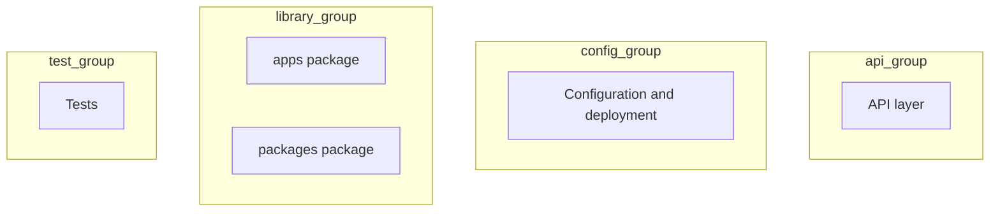

# Architecture report: code-hike/codehike

> Automated static analysis. **Observed** = directly seen in files/imports/AST; **Inferred** = interpretation from that evidence. Repository code was not executed.

## 1. Repository at a glance

| Item | Value |
| --- | --- |
| Repository | code-hike/codehike |
| Description | Build rich content websites with Markdown and React |
| Language | TypeScript |
| Stars | 5399 |
| Licence | MIT |
| Analysed commit / branch | cd81d8af1c503b699cbf0458d504e4578bcb9c74 / next |
| Framework(s) | Next.js, React |
| Files analysed | 409 |
| Components | 5 |

## 2. Architecture in one minute

code-hike/codehike - Build rich content websites with Markdown and React. This repository was analysed statically from 409 file(s) (1 Python). Detected technologies (observed from imports/manifests): GitHub Actions, Next.js, React, Tailwind CSS, TypeScript, Vitest. Files are grouped into 5 component(s): API layer, apps package, Configuration and deployment, packages package, Tests. Findings below distinguish observed facts from inferred interpretation.

## 3. High-level block diagram

## 4. Main components

### API layer (`api_layer`)

- **Kind:** api
- **Status:** Observed
- **Confidence:** 0.85
- **Responsibility:** Groups 3 file(s) under api layer (observed from repository paths and static analysis).
- **Paths:** `apps/web/app/api/revalidate/sponsors/route.ts`, `apps/web/app/api/search/route.ts`, `apps/web/app/api/sponsors/latest/route.ts`
- **Evidence:** [apps/web/app/api/revalidate/sponsors/route.ts](https://github.com/code-hike/codehike/blob/cd81d8af1c503b699cbf0458d504e4578bcb9c74/apps/web/app/api/revalidate/sponsors/route.ts); [apps/web/app/api/search/route.ts](https://github.com/code-hike/codehike/blob/cd81d8af1c503b699cbf0458d504e4578bcb9c74/apps/web/app/api/search/route.ts); [apps/web/app/api/sponsors/latest/route.ts](https://github.com/code-hike/codehike/blob/cd81d8af1c503b699cbf0458d504e4578bcb9c74/apps/web/app/api/sponsors/latest/route.ts)

### apps package (`apps`)

- **Kind:** library
- **Status:** Observed
- **Confidence:** 0.85
- **Responsibility:** Groups 130 file(s) under apps package (observed from repository paths and static analysis).
- **Paths:** `apps/web/app/blog/[slug]/page.tsx`, `apps/web/app/blog/feed.xml/route.ts`, `apps/web/app/blog/layout.tsx`, `apps/web/app/blog/og/page.tsx`, `apps/web/app/blog/page.tsx`, `apps/web/app/demo/client.tsx`, `apps/web/app/demo/page.tsx`, `apps/web/app/landing/boxes.tsx`, `apps/web/app/landing/demo.tsx`, `apps/web/app/landing/download.tsx`, `apps/web/app/landing/sponsors.tsx`, `apps/web/app/landing/sponsors/csv.js`, `apps/web/app/landing/sponsors/gh-sponsors.js`, `apps/web/app/landing/sponsors/oc-sponsors.js`, `apps/web/app/landing/sponsors/update.js`, `apps/web/app/layout.tsx`, `apps/web/app/not-found.tsx`, `apps/web/app/page.tsx`, `apps/web/app/play/page.tsx`, `apps/web/app/source.ts`, `apps/web/app/top-sponsors.png/route.tsx`, `apps/web/components/all-code-demos.tsx`, `apps/web/components/annotations/callout.tsx`, `apps/web/components/annotations/collapse.tsx`, `apps/web/components/annotations/diff.tsx`, `apps/web/components/annotations/focus.client.tsx`, `apps/web/components/annotations/focus.tsx`, `apps/web/components/annotations/fold.client.tsx`, `apps/web/components/annotations/fold.tsx`, `apps/web/components/annotations/icons.tsx`, `apps/web/components/annotations/line-numbers.tsx`, `apps/web/components/annotations/link.tsx`, `apps/web/components/annotations/mark.tsx`, `apps/web/components/annotations/pill.tsx`, `apps/web/components/annotations/ruler.tsx`, `apps/web/components/annotations/token-transitions.client.tsx`, `apps/web/components/annotations/token-transitions.tsx`, `apps/web/components/annotations/tooltip.tsx`, `apps/web/components/annotations/word-wrap.tsx`, `apps/web/components/blocks-to-context.tsx`, `apps/web/components/code.tsx`, `apps/web/components/code/blocks-demo.tsx`, `apps/web/components/code/code-with-notes.tsx`, `apps/web/components/code/side-by-side.tsx`, `apps/web/components/component-pack-link.tsx`, `apps/web/components/copy-button.tsx`, `apps/web/components/demo.tsx`, `apps/web/components/layout-demo.tsx`, `apps/web/components/smooth-pre.tsx`, `apps/web/components/time-ago.tsx`, `apps/web/components/ui/collapsible.tsx`, `apps/web/components/ui/dropdown-menu.tsx`, `apps/web/components/ui/hover-card.tsx`, `apps/web/components/ui/resizable.tsx`, `apps/web/components/ui/select.tsx`, `apps/web/components/ui/tabs.tsx`, `apps/web/components/ui/tooltip.tsx`, `apps/web/content/blog/build-time-components.tsx`, `apps/web/content/blog/content-presentation-gap.tsx`, `apps/web/content/blog/fine-grained/code.tsx`, `apps/web/content/blog/fine-grained/scrolly.tsx`, `apps/web/content/blog/remotion/00.jsx`, `apps/web/content/blog/remotion/01.jsx`, `apps/web/content/blog/remotion/02.jsx`, `apps/web/content/blog/remotion/03.jsx`, `apps/web/content/blog/remotion/04.jsx`, `apps/web/content/blog/remotion/05.jsx`, `apps/web/content/blog/remotion/06.jsx`, `apps/web/content/blog/remotion/code.tsx`, `apps/web/content/blog/the-curse-of-markdown.steps.tsx`, `apps/web/content/blog/the-curse-of-markdown.tsx`, `apps/web/content/blog/v1.tsx`, `apps/web/content/components/api-reference/api-reference.tsx`, `apps/web/content/components/api-reference/collapsible.tsx`, `apps/web/content/components/slideshow/slides.tsx`, `apps/web/content/components/slideshow/slideshow.tsx`, `apps/web/demos/annotations/basic/page.tsx`, `apps/web/demos/annotations/groups/page.tsx`, `apps/web/demos/annotations/mark/page.tsx`, `apps/web/demos/annotations/query/page.tsx`, `apps/web/demos/annotations/regex/page.tsx`, `apps/web/demos/annotations/start-end/page.tsx`, `apps/web/demos/api-reference/page.tsx`, `apps/web/demos/autolink/page.tsx`, `apps/web/demos/callout/page.tsx`, `apps/web/demos/classname/page.tsx`, `apps/web/demos/collapse/page.tsx`, `apps/web/demos/copy-button/button.tsx`, `apps/web/demos/copy-button/page.tsx`, `apps/web/demos/diff/page.tsx`, `apps/web/demos/filename/page.tsx`, `apps/web/demos/focus/code.tsx`, `apps/web/demos/focus/focus.client.tsx`, `apps/web/demos/focus/focus.tsx`, `apps/web/demos/focus/page.tsx`, `apps/web/demos/fold/annotations.tsx`, `apps/web/demos/fold/page.tsx`, `apps/web/demos/footnotes/page.tsx`, `apps/web/demos/hover/page.tsx`, `apps/web/demos/language-switcher/multi-code.tsx`, `apps/web/demos/language-switcher/page.tsx`, `apps/web/demos/line-numbers/page.tsx`, `apps/web/demos/link/page.tsx`, `apps/web/demos/mark/page.tsx`, `apps/web/demos/occurrences/code.tsx`, `apps/web/demos/occurrences/page.tsx`, `apps/web/demos/scrollycoding/page.tsx`, `apps/web/demos/slideshow/controls.tsx`, `apps/web/demos/slideshow/page.tsx`, `apps/web/demos/spotlight/page.tsx`, `apps/web/demos/tabs/page.tsx`, `apps/web/demos/token-transitions/code.tsx`, `apps/web/demos/token-transitions/page.tsx`, `apps/web/demos/tooltip/page.tsx`, `apps/web/demos/transpile/page.tsx`, `apps/web/demos/twoslash/page.tsx`, `apps/web/demos/word-wrap/page.tsx`, `apps/web/lib/utils.ts`, `apps/web/mdx-components.tsx`, `apps/web/next.config.mjs`, `apps/web/postcss.config.js`, `apps/web/tailwind.config.ts`, `apps/web/theme.mjs`, `apps/web/ui/dependency-terminal.tsx`, `apps/web/ui/example-tabs.tsx`, `apps/web/ui/nav.tsx`, `apps/web/ui/tabs-toggle.tsx`, `apps/web/ui/tabs.tsx`, `apps/web/ui/toggle-group.tsx`, `apps/web/ui/toggle.tsx`
- **Evidence:** [apps/web/app/blog/[slug]/page.tsx](https://github.com/code-hike/codehike/blob/cd81d8af1c503b699cbf0458d504e4578bcb9c74/apps/web/app/blog/%5Bslug%5D/page.tsx); [apps/web/app/blog/feed.xml/route.ts](https://github.com/code-hike/codehike/blob/cd81d8af1c503b699cbf0458d504e4578bcb9c74/apps/web/app/blog/feed.xml/route.ts); [apps/web/app/blog/layout.tsx](https://github.com/code-hike/codehike/blob/cd81d8af1c503b699cbf0458d504e4578bcb9c74/apps/web/app/blog/layout.tsx); [apps/web/app/blog/og/page.tsx](https://github.com/code-hike/codehike/blob/cd81d8af1c503b699cbf0458d504e4578bcb9c74/apps/web/app/blog/og/page.tsx); [apps/web/app/blog/page.tsx](https://github.com/code-hike/codehike/blob/cd81d8af1c503b699cbf0458d504e4578bcb9c74/apps/web/app/blog/page.tsx); [apps/web/app/demo/client.tsx](https://github.com/code-hike/codehike/blob/cd81d8af1c503b699cbf0458d504e4578bcb9c74/apps/web/app/demo/client.tsx); [apps/web/app/demo/page.tsx](https://github.com/code-hike/codehike/blob/cd81d8af1c503b699cbf0458d504e4578bcb9c74/apps/web/app/demo/page.tsx); [apps/web/app/landing/boxes.tsx](https://github.com/code-hike/codehike/blob/cd81d8af1c503b699cbf0458d504e4578bcb9c74/apps/web/app/landing/boxes.tsx)

### Configuration and deployment (`config`)

- **Kind:** config
- **Status:** Observed
- **Confidence:** 0.85
- **Responsibility:** Groups 12 file(s) under configuration and deployment (observed from repository paths and static analysis).
- **Paths:** `apps/web/app/landing/sponsors.json`, `apps/web/components.json`, `apps/web/content/docs/meta.json`, `apps/web/package.json`, `apps/web/tsconfig.json`, `package.json`, `packages/codehike/package.json`, `packages/codehike/tsconfig.json`, `packages/recma/package.json`, `packages/remark/package.json`, `pnpm-workspace.yaml`, `turbo.json`
- **Evidence:** [apps/web/app/landing/sponsors.json](https://github.com/code-hike/codehike/blob/cd81d8af1c503b699cbf0458d504e4578bcb9c74/apps/web/app/landing/sponsors.json); [apps/web/components.json](https://github.com/code-hike/codehike/blob/cd81d8af1c503b699cbf0458d504e4578bcb9c74/apps/web/components.json); [apps/web/content/docs/meta.json](https://github.com/code-hike/codehike/blob/cd81d8af1c503b699cbf0458d504e4578bcb9c74/apps/web/content/docs/meta.json); [apps/web/package.json](https://github.com/code-hike/codehike/blob/cd81d8af1c503b699cbf0458d504e4578bcb9c74/apps/web/package.json); [apps/web/tsconfig.json](https://github.com/code-hike/codehike/blob/cd81d8af1c503b699cbf0458d504e4578bcb9c74/apps/web/tsconfig.json); [package.json](https://github.com/code-hike/codehike/blob/cd81d8af1c503b699cbf0458d504e4578bcb9c74/package.json); [packages/codehike/package.json](https://github.com/code-hike/codehike/blob/cd81d8af1c503b699cbf0458d504e4578bcb9c74/packages/codehike/package.json); [packages/codehike/tsconfig.json](https://github.com/code-hike/codehike/blob/cd81d8af1c503b699cbf0458d504e4578bcb9c74/packages/codehike/tsconfig.json)

### packages package (`packages`)

- **Kind:** library
- **Status:** Observed
- **Confidence:** 0.85
- **Responsibility:** Groups 31 file(s) under packages package (observed from repository paths and static analysis).
- **Paths:** `packages/codehike/src/blocks.ts`, `packages/codehike/src/code.tsx`, `packages/codehike/src/code/block.tsx`, `packages/codehike/src/code/extract-annotations.test.ts`, `packages/codehike/src/code/extract-annotations.tsx`, `packages/codehike/src/code/highlight.ts`, `packages/codehike/src/code/inline.tsx`, `packages/codehike/src/code/inner.tsx`, `packages/codehike/src/code/lines.tsx`, `packages/codehike/src/code/merge-props.ts`, `packages/codehike/src/code/pre-ref.tsx`, `packages/codehike/src/code/pre.tsx`, `packages/codehike/src/code/tokens.tsx`, `packages/codehike/src/code/types.ts`, `packages/codehike/src/index.ts`, `packages/codehike/src/mdx.ts`, `packages/codehike/src/mdx/0.import-code-from-path.ts`, `packages/codehike/src/mdx/1.0.transform-hikes.ts`, `packages/codehike/src/mdx/1.1.remark-list-to-section.ts`, `packages/codehike/src/mdx/1.2.remark-section-to-attribute.ts`, `packages/codehike/src/mdx/2.transform-code.ts`, `packages/codehike/src/mdx/3.transform-hike-props.ts`, `packages/codehike/src/mdx/config.ts`, `packages/codehike/src/mdx/estree.ts`, `packages/codehike/src/utils.tsx`, `packages/codehike/src/utils/scroller.tsx`, `packages/codehike/src/utils/selection.tsx`, `packages/codehike/src/utils/static-fallback.tsx`, `packages/codehike/src/utils/token-transitions.tsx`, `packages/recma/index.js`, `packages/remark/index.js`
- **Evidence:** [packages/codehike/src/blocks.ts](https://github.com/code-hike/codehike/blob/cd81d8af1c503b699cbf0458d504e4578bcb9c74/packages/codehike/src/blocks.ts); [packages/codehike/src/code.tsx](https://github.com/code-hike/codehike/blob/cd81d8af1c503b699cbf0458d504e4578bcb9c74/packages/codehike/src/code.tsx); [packages/codehike/src/code/block.tsx](https://github.com/code-hike/codehike/blob/cd81d8af1c503b699cbf0458d504e4578bcb9c74/packages/codehike/src/code/block.tsx); [packages/codehike/src/code/extract-annotations.test.ts](https://github.com/code-hike/codehike/blob/cd81d8af1c503b699cbf0458d504e4578bcb9c74/packages/codehike/src/code/extract-annotations.test.ts); [packages/codehike/src/code/extract-annotations.tsx](https://github.com/code-hike/codehike/blob/cd81d8af1c503b699cbf0458d504e4578bcb9c74/packages/codehike/src/code/extract-annotations.tsx); [packages/codehike/src/code/highlight.ts](https://github.com/code-hike/codehike/blob/cd81d8af1c503b699cbf0458d504e4578bcb9c74/packages/codehike/src/code/highlight.ts); [packages/codehike/src/code/inline.tsx](https://github.com/code-hike/codehike/blob/cd81d8af1c503b699cbf0458d504e4578bcb9c74/packages/codehike/src/code/inline.tsx); [packages/codehike/src/code/inner.tsx](https://github.com/code-hike/codehike/blob/cd81d8af1c503b699cbf0458d504e4578bcb9c74/packages/codehike/src/code/inner.tsx)

### Tests (`tests`)

- **Kind:** test
- **Status:** Observed
- **Confidence:** 0.85
- **Responsibility:** Groups 94 file(s) under tests (observed from repository paths and static analysis).
- **Paths:** `apps/web/app/api/revalidate/test/route.ts`, `apps/web/app/test/client.tsx`, `apps/web/app/test/content.md`, `apps/web/app/test/page.tsx`, `packages/codehike/tests/md-suite/_readme.md`, `packages/codehike/tests/md-suite/annotation.0.mdx`, `packages/codehike/tests/md-suite/annotation.0.render.tsx`, `packages/codehike/tests/md-suite/annotation.9.rendered.html`, `packages/codehike/tests/md-suite/assets/test.py`, `packages/codehike/tests/md-suite/basic.0.mdx`, `packages/codehike/tests/md-suite/basic.2.before-remark.json`, `packages/codehike/tests/md-suite/basic.3.after-remark.json`, `packages/codehike/tests/md-suite/basic.4.after-rehype.json`, `packages/codehike/tests/md-suite/basic.5.before-recma-compiled-function.jsx`, `packages/codehike/tests/md-suite/basic.5.before-recma-compiled-js.js`, `packages/codehike/tests/md-suite/basic.5.before-recma-compiled-jsx.jsx`, `packages/codehike/tests/md-suite/basic.5.before-recma-js-dev.json`, `packages/codehike/tests/md-suite/basic.5.before-recma-js.json`, `packages/codehike/tests/md-suite/basic.5.before-recma-jsx.json`, `packages/codehike/tests/md-suite/basic.6.after-recma-js-dev.json`, `packages/codehike/tests/md-suite/basic.6.after-recma-js.json`, `packages/codehike/tests/md-suite/basic.6.after-recma-jsx.json`, `packages/codehike/tests/md-suite/basic.7.compiled-function.jsx`, `packages/codehike/tests/md-suite/basic.7.compiled-js-dev.js`, `packages/codehike/tests/md-suite/basic.7.compiled-js.js`, `packages/codehike/tests/md-suite/basic.7.compiled-jsx.jsx`, `packages/codehike/tests/md-suite/basic.8.parsed-jsx.jsx`, `packages/codehike/tests/md-suite/basic.9.rendered-dev.html`, `packages/codehike/tests/md-suite/basic.9.rendered.html`, `packages/codehike/tests/md-suite/code-empty.0.mdx`, `packages/codehike/tests/md-suite/code-empty.7.compiled-jsx.jsx`, `packages/codehike/tests/md-suite/code-empty.9.rendered.html`, `packages/codehike/tests/md-suite/code.0.mdx`, `packages/codehike/tests/md-suite/code.7.compiled-jsx.jsx`, `packages/codehike/tests/md-suite/code.9.rendered.html`, `packages/codehike/tests/md-suite/empty-block.0.mdx`, `packages/codehike/tests/md-suite/empty-block.8.parsed-jsx.jsx`, `packages/codehike/tests/md-suite/empty-children-and-import.0.mdx`, `packages/codehike/tests/md-suite/empty-children-and-import.7.compiled-jsx.jsx`, `packages/codehike/tests/md-suite/empty-line.0.mdx`, `packages/codehike/tests/md-suite/empty-line.7.compiled-jsx.jsx`, `packages/codehike/tests/md-suite/empty-line.9.rendered.html`, `packages/codehike/tests/md-suite/ignore-codeblock.0.mdx`, `packages/codehike/tests/md-suite/ignore-codeblock.7.compiled-jsx.jsx`, `packages/codehike/tests/md-suite/import-code.0.mdx`, `packages/codehike/tests/md-suite/import-code.0.render.tsx`, `packages/codehike/tests/md-suite/import-code.7.compiled-jsx.jsx`, `packages/codehike/tests/md-suite/import-code.9.rendered.html`, `packages/codehike/tests/md-suite/indentation.0.mdx`, `packages/codehike/tests/md-suite/indentation.0.render.tsx`, `packages/codehike/tests/md-suite/indentation.9.rendered.html`, `packages/codehike/tests/md-suite/inline-code-highlighted.0.mdx`, `packages/codehike/tests/md-suite/inline-code-highlighted.2.before-remark.json`, `packages/codehike/tests/md-suite/inline-code-highlighted.7.compiled-jsx.jsx`, `packages/codehike/tests/md-suite/inline-code-highlighted.9.rendered.html`, `packages/codehike/tests/md-suite/inline-code.0.mdx`, `packages/codehike/tests/md-suite/inline-code.2.before-remark.json`, `packages/codehike/tests/md-suite/inline-code.7.compiled-jsx.jsx`, `packages/codehike/tests/md-suite/inline-code.9.rendered.html`, `packages/codehike/tests/md-suite/nested-blocks.0.mdx`, `packages/codehike/tests/md-suite/nested-blocks.8.parsed-jsx.jsx`, `packages/codehike/tests/md-suite/no-hike.0.mdx`, `packages/codehike/tests/md-suite/no-hike.7.compiled-jsx.jsx`, `packages/codehike/tests/md-suite/only-if-annotated.0.mdx`, `packages/codehike/tests/md-suite/only-if-annotated.0.render.tsx`, `packages/codehike/tests/md-suite/only-if-annotated.9.rendered.html`, `packages/codehike/tests/md-suite/regex-range.0.mdx`, `packages/codehike/tests/md-suite/regex-range.0.render.tsx`, `packages/codehike/tests/md-suite/regex-range.9.rendered.html`, `packages/codehike/tests/md-suite/stacked-line.0.mdx`, `packages/codehike/tests/md-suite/stacked-line.0.render.tsx`, `packages/codehike/tests/md-suite/stacked-line.9.rendered.html`, `packages/codehike/tests/md-suite/stacked-token.0.mdx`, `packages/codehike/tests/md-suite/stacked-token.0.render.tsx`, `packages/codehike/tests/md-suite/stacked-token.9.rendered.html`, `packages/codehike/tests/md-suite/static-children.0.mdx`, `packages/codehike/tests/md-suite/static-children.5.before-recma-compiled-js.js`, `packages/codehike/tests/md-suite/static-children.5.before-recma-js-dev.json`, `packages/codehike/tests/md-suite/static-children.5.before-recma-js.json`, `packages/codehike/tests/md-suite/static-children.6.after-recma-js-dev.json`, `packages/codehike/tests/md-suite/static-children.6.after-recma-js.json`, `packages/codehike/tests/md-suite/static-children.7.compiled-js-dev.js`, `packages/codehike/tests/md-suite/static-children.7.compiled-js.js`, `packages/codehike/tests/md-suite/static-children.9.rendered-dev.html`, `packages/codehike/tests/md-suite/syntax-highlight.0.mdx`, `packages/codehike/tests/md-suite/syntax-highlight.7.compiled-jsx.jsx`, `packages/codehike/tests/md-suite/two-ps.0.mdx`, `packages/codehike/tests/md-suite/two-ps.2.before-remark.json`, `packages/codehike/tests/md-suite/two-ps.8.parsed-jsx.jsx`, `packages/codehike/tests/md-suite/unknown-lang.0.mdx`, `packages/codehike/tests/md-suite/unknown-lang.9.rendered.html`, `packages/codehike/tests/md.test.tsx`, `packages/codehike/tests/utils.ast.tsx`, `packages/codehike/tests/utils.suite.tsx`
- **Evidence:** [apps/web/app/api/revalidate/test/route.ts](https://github.com/code-hike/codehike/blob/cd81d8af1c503b699cbf0458d504e4578bcb9c74/apps/web/app/api/revalidate/test/route.ts); [apps/web/app/test/client.tsx](https://github.com/code-hike/codehike/blob/cd81d8af1c503b699cbf0458d504e4578bcb9c74/apps/web/app/test/client.tsx); [apps/web/app/test/content.md](https://github.com/code-hike/codehike/blob/cd81d8af1c503b699cbf0458d504e4578bcb9c74/apps/web/app/test/content.md); [apps/web/app/test/page.tsx](https://github.com/code-hike/codehike/blob/cd81d8af1c503b699cbf0458d504e4578bcb9c74/apps/web/app/test/page.tsx); [packages/codehike/tests/md-suite/_readme.md](https://github.com/code-hike/codehike/blob/cd81d8af1c503b699cbf0458d504e4578bcb9c74/packages/codehike/tests/md-suite/_readme.md); [packages/codehike/tests/md-suite/annotation.0.mdx](https://github.com/code-hike/codehike/blob/cd81d8af1c503b699cbf0458d504e4578bcb9c74/packages/codehike/tests/md-suite/annotation.0.mdx); [packages/codehike/tests/md-suite/annotation.0.render.tsx](https://github.com/code-hike/codehike/blob/cd81d8af1c503b699cbf0458d504e4578bcb9c74/packages/codehike/tests/md-suite/annotation.0.render.tsx); [packages/codehike/tests/md-suite/annotation.9.rendered.html](https://github.com/code-hike/codehike/blob/cd81d8af1c503b699cbf0458d504e4578bcb9c74/packages/codehike/tests/md-suite/annotation.9.rendered.html)

## 5. Execution flow

**Observed** entry point(s):

- [apps/web/app/page.tsx](https://github.com/code-hike/codehike/blob/cd81d8af1c503b699cbf0458d504e4578bcb9c74/apps/web/app/page.tsx)
- [packages/codehike/src/index.ts](https://github.com/code-hike/codehike/blob/cd81d8af1c503b699cbf0458d504e4578bcb9c74/packages/codehike/src/index.ts)
- [packages/recma/index.js](https://github.com/code-hike/codehike/blob/cd81d8af1c503b699cbf0458d504e4578bcb9c74/packages/recma/index.js)
- [packages/remark/index.js](https://github.com/code-hike/codehike/blob/cd81d8af1c503b699cbf0458d504e4578bcb9c74/packages/remark/index.js)

Representative flow (derived from observed entry points and the import graph; steps beyond the entry point are **Inferred**):

1. Execution starts at an observed entry point listed above, if present.
2. No internal import relationships between components were observed.

## 6. Project structure

### `(root)`

- `.gitignore` - other (2199 bytes)
- `.prettierrc` - other (46 bytes)
- `CHANGELOG.md` - docs (40680 bytes)
- `license` - docs (1066 bytes)
- `package.json` - manifest (1192 bytes)
- `pnpm-workspace.yaml` - config (40 bytes)
- `readme.md` - docs (3904 bytes)
- `turbo.json` - config (415 bytes)

### `.changeset`

- `.changeset/README.md` - docs (510 bytes)
- `.changeset/config.json` - config (331 bytes)

### `.github`

- `.github/scripts/git-utils.mjs` - source, JavaScript (1320 bytes)
- `.github/scripts/md-utils.mjs` - source, JavaScript (1414 bytes)
- `.github/scripts/params.mjs` - source, JavaScript (316 bytes)
- `.github/scripts/pr-merged.mjs` - source, JavaScript (1346 bytes)
- `.github/scripts/pr-updated.mjs` - source, JavaScript (2735 bytes)
- `.github/scripts/prepare-release.mjs` - source, JavaScript (2623 bytes)
- `.github/scripts/readme.md` - docs (1503 bytes)
- `.github/scripts/release.mjs` - source, JavaScript (2833 bytes)
- `.github/scripts/website-pr.mjs` - source, JavaScript (848 bytes)
- `.github/workflows/pr-build.yml` - ci, YAML (773 bytes)
- `.github/workflows/pr-comment.yml` - ci, YAML (1238 bytes)
- `.github/workflows/pr-merged.yml` - ci, YAML (926 bytes)
- `.github/workflows/push-to-next.yml` - ci, YAML (1553 bytes)
- `.github/workflows/release-pr-merged.yml` - ci, YAML (934 bytes)

### `.vscode`

- `.vscode/settings.json` - config (184 bytes)

### `apps`

- `apps/web/.gitignore` - other (254 bytes)
- `apps/web/app/api/revalidate/sponsors/route.ts` - source, TypeScript (391 bytes)
- `apps/web/app/api/revalidate/test/route.ts` - test, TypeScript (395 bytes)
- `apps/web/app/api/search/route.ts` - source, TypeScript (326 bytes)
- `apps/web/app/api/sponsors/latest/route.ts` - source, TypeScript (332 bytes)
- `apps/web/app/blog/[slug]/page.tsx` - source, TypeScript (3510 bytes)
- `apps/web/app/blog/feed.xml/route.ts` - source, TypeScript (949 bytes)
- `apps/web/app/blog/layout.tsx` - source, TypeScript (147 bytes)
- `apps/web/app/blog/og/page.tsx` - source, TypeScript (1527 bytes)
- `apps/web/app/blog/page.tsx` - source, TypeScript (2115 bytes)
- `apps/web/app/demo/client.tsx` - source, TypeScript (1450 bytes)
- `apps/web/app/demo/content.mdx` - other (899 bytes)
- `apps/web/app/demo/page.tsx` - source, TypeScript (4460 bytes)
- `apps/web/app/docs/[[...slug]]/code-example.tsx` - docs (498 bytes)
- `apps/web/app/docs/[[...slug]]/layout-example.tsx` - docs (2294 bytes)
- `apps/web/app/docs/[[...slug]]/page.tsx` - docs (2083 bytes)
- `apps/web/app/docs/[[...slug]]/preview-implementation.tsx` - docs (681 bytes)
- `apps/web/app/docs/layout.tsx` - docs (415 bytes)
- `apps/web/app/global.css` - other (1806 bytes)
- `apps/web/app/landing/boxes.tsx` - source, TypeScript (2239 bytes)
- `apps/web/app/landing/demo.md` - docs (831 bytes)
- `apps/web/app/landing/demo.tsx` - source, TypeScript (9013 bytes)
- `apps/web/app/landing/download.tsx` - source, TypeScript (579 bytes)
- `apps/web/app/landing/logo.speakeasy.svg` - other (6878 bytes)
- `apps/web/app/landing/logo.uidev.svg` - other (784 bytes)
- `apps/web/app/landing/profile.md` - docs (834 bytes)
- `apps/web/app/landing/sponsors.json` - config (6821 bytes)
- `apps/web/app/landing/sponsors.tsx` - source, TypeScript (24116 bytes)
- `apps/web/app/landing/sponsors/codehike-transactions.csv` - data (9022 bytes)
- `apps/web/app/landing/sponsors/csv.js` - source, JavaScript (2027 bytes)
- `apps/web/app/landing/sponsors/gh-sponsors.js` - source, JavaScript (1457 bytes)
- `apps/web/app/landing/sponsors/oc-sponsors.js` - source, JavaScript (642 bytes)
- `apps/web/app/landing/sponsors/update.js` - source, JavaScript (1313 bytes)
- `apps/web/app/layout.tsx` - source, TypeScript (1486 bytes)
- `apps/web/app/not-found.tsx` - source, TypeScript (510 bytes)
- `apps/web/app/page.tsx` - source, TypeScript (3598 bytes)
- `apps/web/app/play/page.tsx` - source, TypeScript (159 bytes)
- `apps/web/app/source.ts` - source, TypeScript (782 bytes)
- `apps/web/app/test/client.tsx` - test, TypeScript (1450 bytes)
- `apps/web/app/test/content.md` - test (1380 bytes)
- `apps/web/app/test/page.tsx` - test, TypeScript (327 bytes)
- `apps/web/app/top-sponsors.png/route.tsx` - source, TypeScript (388 bytes)
- `apps/web/components.json` - config (341 bytes)
- `apps/web/components/all-code-demos.tsx` - source, TypeScript (938 bytes)
- `apps/web/components/annotations/callout.tsx` - source, TypeScript (1464 bytes)
- `apps/web/components/annotations/collapse.tsx` - source, TypeScript (1864 bytes)
- `apps/web/components/annotations/diff.tsx` - source, TypeScript (564 bytes)
- `apps/web/components/annotations/focus.client.tsx` - source, TypeScript (1364 bytes)
- `apps/web/components/annotations/focus.tsx` - source, TypeScript (416 bytes)
- `apps/web/components/annotations/fold.client.tsx` - source, TypeScript (497 bytes)
- `apps/web/components/annotations/fold.tsx` - source, TypeScript (175 bytes)
- `apps/web/components/annotations/icons.tsx` - source, TypeScript (1175 bytes)
- `apps/web/components/annotations/line-numbers.tsx` - source, TypeScript (463 bytes)
- `apps/web/components/annotations/link.tsx` - source, TypeScript (320 bytes)
- `apps/web/components/annotations/mark.tsx` - source, TypeScript (1171 bytes)
- `apps/web/components/annotations/pill.tsx` - source, TypeScript (818 bytes)
- `apps/web/components/annotations/ruler.tsx` - source, TypeScript (915 bytes)
- `apps/web/components/annotations/token-transitions.client.tsx` - source, TypeScript (1388 bytes)
- `apps/web/components/annotations/token-transitions.tsx` - source, TypeScript (313 bytes)
- `apps/web/components/annotations/tooltip.tsx` - source, TypeScript (852 bytes)
- `apps/web/components/annotations/word-wrap.tsx` - source, TypeScript (570 bytes)
- `apps/web/components/blocks-to-context.tsx` - source, TypeScript (1133 bytes)
- `apps/web/components/code.tsx` - source, TypeScript (4220 bytes)
- `apps/web/components/code/blocks-demo.tsx` - source, TypeScript (2186 bytes)
- `apps/web/components/code/code-with-notes.tsx` - source, TypeScript (1240 bytes)
- `apps/web/components/code/side-by-side.tsx` - source, TypeScript (207 bytes)
- `apps/web/components/component-pack-link.tsx` - source, TypeScript (674 bytes)
- `apps/web/components/copy-button.tsx` - source, TypeScript (679 bytes)
- `apps/web/components/demo.tsx` - source, TypeScript (1221 bytes)
- `apps/web/components/layout-demo.tsx` - source, TypeScript (1028 bytes)
- `apps/web/components/smooth-pre.tsx` - source, TypeScript (1776 bytes)
- `apps/web/components/time-ago.tsx` - source, TypeScript (1101 bytes)
- `apps/web/components/ui/collapsible.tsx` - source, TypeScript (329 bytes)
- `apps/web/components/ui/dropdown-menu.tsx` - source, TypeScript (7631 bytes)
- `apps/web/components/ui/hover-card.tsx` - source, TypeScript (1258 bytes)
- `apps/web/components/ui/resizable.tsx` - source, TypeScript (1835 bytes)
- `apps/web/components/ui/select.tsx` - source, TypeScript (5858 bytes)
- `apps/web/components/ui/tabs.tsx` - source, TypeScript (2116 bytes)
- `apps/web/components/ui/tooltip.tsx` - source, TypeScript (1290 bytes)
- `apps/web/content/blog/.prettierrc` - other (333 bytes)
- `apps/web/content/blog/bestiary.mdx` - other (199 bytes)
- `apps/web/content/blog/build-time-components.mdx` - other (14396 bytes)
- `apps/web/content/blog/build-time-components.tsx` - source, TypeScript (4378 bytes)
- `apps/web/content/blog/codeblocks.mdx` - other (681 bytes)
- `apps/web/content/blog/content-presentation-gap.mdx` - other (3435 bytes)
- `apps/web/content/blog/content-presentation-gap.tsx` - source, TypeScript (2397 bytes)
- `apps/web/content/blog/fine-grained-markdown.mdx` - other (6316 bytes)
- `apps/web/content/blog/fine-grained/code.tsx` - source, TypeScript (798 bytes)
- `apps/web/content/blog/fine-grained/scrolly.tsx` - source, TypeScript (6408 bytes)
- `apps/web/content/blog/headless-codeblocks.md` - docs (122 bytes)
- `apps/web/content/blog/hello-server.mdx` - other (146 bytes)
- `apps/web/content/blog/known-keys.mdx` - other (747 bytes)
- `apps/web/content/blog/markdown.mdx` - other (735 bytes)
- `apps/web/content/blog/migrate-to-ch.mdx` - other (159 bytes)
- `apps/web/content/blog/participation.mdx` - other (160 bytes)
- `apps/web/content/blog/power-of-the-web.mdx` - other (198 bytes)
- `apps/web/content/blog/remotion.mdx` - other (5656 bytes)
- `apps/web/content/blog/remotion/.prettierrc` - other (181 bytes)
- `apps/web/content/blog/remotion/00.jsx` - source, JavaScript (1034 bytes)
- `apps/web/content/blog/remotion/01.jsx` - source, JavaScript (962 bytes)
- `apps/web/content/blog/remotion/02.jsx` - source, JavaScript (1067 bytes)
- `apps/web/content/blog/remotion/03.jsx` - source, JavaScript (1235 bytes)
- `apps/web/content/blog/remotion/04.jsx` - source, JavaScript (1461 bytes)
- `apps/web/content/blog/remotion/05.jsx` - source, JavaScript (1493 bytes)
- `apps/web/content/blog/remotion/06.jsx` - source, JavaScript (1788 bytes)
- `apps/web/content/blog/remotion/code.tsx` - source, TypeScript (2169 bytes)
- `apps/web/content/blog/rich-content-websites.mdx` - other (2152 bytes)
- `apps/web/content/blog/rsc-and-css.mdx` - other (154 bytes)
- `apps/web/content/blog/test.mdx` - other (108 bytes)
- `apps/web/content/blog/the-curse-of-markdown.mdx` - other (4960 bytes)
- `apps/web/content/blog/the-curse-of-markdown.steps.tsx` - source, TypeScript (7028 bytes)
- `apps/web/content/blog/the-curse-of-markdown.tsx` - source, TypeScript (8188 bytes)
- `apps/web/content/blog/three-component-problem.mdx` - other (7374 bytes)
- `apps/web/content/blog/type-safe-markdown.mdx` - other (117 bytes)
- `apps/web/content/blog/v1-migration.mdx` - other (6848 bytes)
- `apps/web/content/blog/v1.mdx` - other (9012 bytes)
- `apps/web/content/blog/v1.tsx` - source, TypeScript (2136 bytes)
- `apps/web/content/components/.prettierrc` - other (295 bytes)
- `apps/web/content/components/api-reference/api-reference.tsx` - source, TypeScript (4227 bytes)
- `apps/web/content/components/api-reference/collapsible.tsx` - source, TypeScript (337 bytes)
- `apps/web/content/components/api-reference/source.mdx` - other (1689 bytes)
- `apps/web/content/components/slideshow/slides.tsx` - source, TypeScript (1357 bytes)
- `apps/web/content/components/slideshow/slideshow.tsx` - source, TypeScript (707 bytes)
- `apps/web/content/components/slideshow/source.mdx` - other (3915 bytes)
- `apps/web/content/docs/api.mdx` - docs (4211 bytes)
- `apps/web/content/docs/api.tsx` - docs (668 bytes)
- `apps/web/content/docs/code/callout.mdx` - docs (2198 bytes)
- `apps/web/content/docs/code/classname.mdx` - docs (915 bytes)
- `apps/web/content/docs/code/code-mentions.mdx` - docs (2197 bytes)
- `apps/web/content/docs/code/collapse.mdx` - docs (2742 bytes)
- `apps/web/content/docs/code/copy-button.mdx` - docs (1349 bytes)
- `apps/web/content/docs/code/diff.mdx` - docs (1384 bytes)
- `apps/web/content/docs/code/filename.mdx` - docs (662 bytes)
- `apps/web/content/docs/code/focus.mdx` - docs (2432 bytes)
- `apps/web/content/docs/code/fold.mdx` - docs (1034 bytes)
- `apps/web/content/docs/code/footnotes.mdx` - docs (1617 bytes)
- `apps/web/content/docs/code/index.mdx` - docs (323 bytes)
- `apps/web/content/docs/code/language-switcher.mdx` - docs (2641 bytes)
- `apps/web/content/docs/code/line-numbers.mdx` - docs (1158 bytes)
- `apps/web/content/docs/code/link.mdx` - docs (802 bytes)
- `apps/web/content/docs/code/mark.mdx` - docs (1804 bytes)
- `apps/web/content/docs/code/tabs.mdx` - docs (1540 bytes)
- `apps/web/content/docs/code/token-transitions.mdx` - docs (2682 bytes)
- `apps/web/content/docs/code/tooltip.mdx` - docs (2517 bytes)
- `apps/web/content/docs/code/transpile.mdx` - docs (1493 bytes)
- `apps/web/content/docs/code/twoslash.mdx` - docs (3755 bytes)
- `apps/web/content/docs/code/word-wrap.mdx` - docs (1377 bytes)
- `apps/web/content/docs/concepts/annotations.mdx` - docs (7306 bytes)
- `apps/web/content/docs/concepts/assets/index.js` - docs (23 bytes)
- `apps/web/content/docs/concepts/blocks.mdx` - docs (8241 bytes)
- `apps/web/content/docs/concepts/code.mdx` - docs (6704 bytes)
- `apps/web/content/docs/concepts/theme-picker.tsx` - docs (2050 bytes)
- `apps/web/content/docs/concepts/utils.mdx` - docs (2666 bytes)
- `apps/web/content/docs/examples.mdx` - docs (1097 bytes)
- `apps/web/content/docs/examples.tsx` - docs (1079 bytes)
- `apps/web/content/docs/index.mdx` - docs (5577 bytes)
- `apps/web/content/docs/layouts/scrollycoding.mdx` - docs (2025 bytes)
- `apps/web/content/docs/layouts/slideshow.mdx` - docs (2340 bytes)
- `apps/web/content/docs/layouts/spotlight.mdx` - docs (2115 bytes)
- `apps/web/content/docs/meta.json` - config (211 bytes)
- `apps/web/content/docs/test.mdx` - docs (415 bytes)
- `apps/web/demos/annotations/basic/content.md` - docs (144 bytes)
- `apps/web/demos/annotations/basic/page.tsx` - source, TypeScript (823 bytes)
- `apps/web/demos/annotations/groups/content.md` - docs (181 bytes)
- `apps/web/demos/annotations/groups/page.tsx` - source, TypeScript (726 bytes)
- `apps/web/demos/annotations/mark/content.md` - docs (129 bytes)
- `apps/web/demos/annotations/mark/page.tsx` - source, TypeScript (789 bytes)
- `apps/web/demos/annotations/query/content.md` - docs (160 bytes)
- `apps/web/demos/annotations/query/page.tsx` - source, TypeScript (938 bytes)
- `apps/web/demos/annotations/regex/content.md` - docs (321 bytes)
- `apps/web/demos/annotations/regex/page.tsx` - source, TypeScript (726 bytes)
- `apps/web/demos/annotations/start-end/content.md` - docs (190 bytes)
- `apps/web/demos/annotations/start-end/page.tsx` - source, TypeScript (649 bytes)
- `apps/web/demos/api-reference/.prettierrc` - other (294 bytes)
- `apps/web/demos/api-reference/content.md` - docs (1617 bytes)
- `apps/web/demos/api-reference/page.tsx` - source, TypeScript (1968 bytes)
- `apps/web/demos/autolink/content.md` - docs (211 bytes)
- `apps/web/demos/autolink/page.tsx` - source, TypeScript (587 bytes)
- `apps/web/demos/callout/content.md` - docs (186 bytes)
- `apps/web/demos/callout/page.tsx` - source, TypeScript (1436 bytes)
- `apps/web/demos/classname/content.md` - docs (237 bytes)
- `apps/web/demos/classname/page.tsx` - source, TypeScript (707 bytes)
- `apps/web/demos/collapse/content.md` - docs (337 bytes)
- `apps/web/demos/collapse/page.tsx` - source, TypeScript (2216 bytes)
- `apps/web/demos/copy-button/button.tsx` - source, TypeScript (639 bytes)
- `apps/web/demos/copy-button/content.md` - docs (158 bytes)
- `apps/web/demos/copy-button/page.tsx` - source, TypeScript (508 bytes)
- `apps/web/demos/diff/content.md` - docs (206 bytes)
- `apps/web/demos/diff/page.tsx` - source, TypeScript (1535 bytes)
- `apps/web/demos/filename/content.md` - docs (159 bytes)
- `apps/web/demos/filename/page.tsx` - source, TypeScript (551 bytes)
- `apps/web/demos/focus/code.tsx` - source, TypeScript (1486 bytes)
- `apps/web/demos/focus/content.md` - docs (375 bytes)
- `apps/web/demos/focus/focus.client.tsx` - source, TypeScript (1371 bytes)
- `apps/web/demos/focus/focus.tsx` - source, TypeScript (480 bytes)
- `apps/web/demos/focus/page.tsx` - source, TypeScript (364 bytes)
- `apps/web/demos/fold/annotations.tsx` - source, TypeScript (366 bytes)
- `apps/web/demos/fold/content.md` - docs (173 bytes)
- `apps/web/demos/fold/page.tsx` - source, TypeScript (514 bytes)
- `apps/web/demos/footnotes/content.md` - docs (104 bytes)
- `apps/web/demos/footnotes/page.tsx` - source, TypeScript (1510 bytes)
- `apps/web/demos/hover/content.mdx` - other (281 bytes)
- `apps/web/demos/hover/page.tsx` - source, TypeScript (1290 bytes)
- `apps/web/demos/hover/styles.css` - other (189 bytes)
- `apps/web/demos/language-switcher/content.mdx` - other (1402 bytes)
- `apps/web/demos/language-switcher/multi-code.tsx` - source, TypeScript (1368 bytes)
- `apps/web/demos/language-switcher/page.tsx` - source, TypeScript (433 bytes)
- `apps/web/demos/line-numbers/content.md` - docs (150 bytes)
- `apps/web/demos/line-numbers/page.tsx` - source, TypeScript (904 bytes)
- `apps/web/demos/link/content.md` - docs (198 bytes)
- `apps/web/demos/link/page.tsx` - source, TypeScript (587 bytes)
- `apps/web/demos/mark/content.md` - docs (266 bytes)
- `apps/web/demos/mark/page.tsx` - source, TypeScript (1322 bytes)
- `apps/web/demos/occurrences/code.tsx` - source, TypeScript (1136 bytes)
- `apps/web/demos/occurrences/content.md` - docs (724 bytes)
- `apps/web/demos/occurrences/page.tsx` - source, TypeScript (381 bytes)
- `apps/web/demos/scrollycoding/.prettierrc` - other (294 bytes)
- `apps/web/demos/scrollycoding/content.md` - docs (3833 bytes)
- `apps/web/demos/scrollycoding/page.tsx` - source, TypeScript (1656 bytes)
- `apps/web/demos/slideshow/.prettierrc` - other (294 bytes)
- `apps/web/demos/slideshow/content.md` - docs (1268 bytes)
- `apps/web/demos/slideshow/controls.tsx` - source, TypeScript (938 bytes)
- `apps/web/demos/slideshow/page.tsx` - source, TypeScript (1195 bytes)
- `apps/web/demos/spotlight/.prettierrc` - other (294 bytes)
- `apps/web/demos/spotlight/content.md` - docs (1482 bytes)
- `apps/web/demos/spotlight/page.tsx` - source, TypeScript (1755 bytes)
- `apps/web/demos/tabs/content.mdx` - other (272 bytes)
- `apps/web/demos/tabs/page.tsx` - source, TypeScript (1239 bytes)
- `apps/web/demos/token-transitions/code.tsx` - source, TypeScript (901 bytes)
- `apps/web/demos/token-transitions/content.md` - docs (263 bytes)
- `apps/web/demos/token-transitions/content.mdx` - other (269 bytes)
- `apps/web/demos/token-transitions/page.tsx` - source, TypeScript (490 bytes)
- `apps/web/demos/tooltip/content.mdx` - other (507 bytes)
- `apps/web/demos/tooltip/page.tsx` - source, TypeScript (1897 bytes)
- `apps/web/demos/transpile/content.md` - docs (122 bytes)
- `apps/web/demos/transpile/page.tsx` - source, TypeScript (776 bytes)
- `apps/web/demos/twoslash/content.md` - docs (93 bytes)
- `apps/web/demos/twoslash/page.tsx` - source, TypeScript (3350 bytes)
- `apps/web/demos/word-wrap/content.md` - docs (192 bytes)
- `apps/web/demos/word-wrap/page.tsx` - source, TypeScript (1971 bytes)
- `apps/web/lib/utils.ts` - source, TypeScript (166 bytes)
- `apps/web/mdx-components.tsx` - source, TypeScript (323 bytes)
- `apps/web/next.config.mjs` - source, JavaScript (1482 bytes)
- `apps/web/package.json` - manifest (1607 bytes)
- `apps/web/postcss.config.js` - source, JavaScript (83 bytes)
- `apps/web/public/dark-grid.svg` - other (169 bytes)
- `apps/web/public/grid.svg` - other (169 bytes)
- `apps/web/tailwind.config.ts` - source, TypeScript (1723 bytes)
- `apps/web/theme.mjs` - source, JavaScript (7439 bytes)
- `apps/web/tsconfig.json` - config (595 bytes)
- `apps/web/ui/dependency-terminal.tsx` - source, TypeScript (1261 bytes)
- `apps/web/ui/example-tabs.tsx` - source, TypeScript (2353 bytes)
- `apps/web/ui/nav.tsx` - source, TypeScript (6045 bytes)
- `apps/web/ui/tabs-toggle.tsx` - source, TypeScript (1415 bytes)
- `apps/web/ui/tabs.tsx` - source, TypeScript (2112 bytes)
- `apps/web/ui/toggle-group.tsx` - source, TypeScript (1745 bytes)
- `apps/web/ui/toggle.tsx` - source, TypeScript (1574 bytes)

### `packages`

- `packages/codehike/CHANGELOG.md` - docs (2955 bytes)
- `packages/codehike/package.json` - manifest (2140 bytes)
- `packages/codehike/readme.md` - docs (371 bytes)
- `packages/codehike/src/blocks.ts` - source, TypeScript (2312 bytes)
- `packages/codehike/src/code.tsx` - source, TypeScript (959 bytes)
- `packages/codehike/src/code/block.tsx` - source, TypeScript (3168 bytes)
- `packages/codehike/src/code/extract-annotations.test.ts` - source, TypeScript (8056 bytes)
- `packages/codehike/src/code/extract-annotations.tsx` - source, TypeScript (3886 bytes)
- `packages/codehike/src/code/highlight.ts` - source, TypeScript (4393 bytes)
- `packages/codehike/src/code/inline.tsx` - source, TypeScript (2328 bytes)
- `packages/codehike/src/code/inner.tsx` - source, TypeScript (1742 bytes)
- `packages/codehike/src/code/lines.tsx` - source, TypeScript (3685 bytes)
- `packages/codehike/src/code/merge-props.ts` - source, TypeScript (2271 bytes)
- `packages/codehike/src/code/pre-ref.tsx` - source, TypeScript (316 bytes)
- `packages/codehike/src/code/pre.tsx` - source, TypeScript (2664 bytes)
- `packages/codehike/src/code/tokens.tsx` - source, TypeScript (2715 bytes)
- `packages/codehike/src/code/types.ts` - source, TypeScript (5602 bytes)
- `packages/codehike/src/index.ts` - source, TypeScript (221 bytes)
- `packages/codehike/src/mdx.ts` - source, TypeScript (1009 bytes)
- `packages/codehike/src/mdx/0.import-code-from-path.ts` - source, TypeScript (2855 bytes)
- `packages/codehike/src/mdx/1.0.transform-hikes.ts` - source, TypeScript (1435 bytes)
- `packages/codehike/src/mdx/1.1.remark-list-to-section.ts` - source, TypeScript (7677 bytes)
- `packages/codehike/src/mdx/1.2.remark-section-to-attribute.ts` - source, TypeScript (3928 bytes)
- `packages/codehike/src/mdx/2.transform-code.ts` - source, TypeScript (2683 bytes)
- `packages/codehike/src/mdx/3.transform-hike-props.ts` - source, TypeScript (8343 bytes)
- `packages/codehike/src/mdx/config.ts` - source, TypeScript (384 bytes)
- `packages/codehike/src/mdx/estree.ts` - source, TypeScript (1960 bytes)
- `packages/codehike/src/utils.tsx` - source, TypeScript (2329 bytes)
- `packages/codehike/src/utils/scroller.tsx` - source, TypeScript (3990 bytes)
- `packages/codehike/src/utils/selection.tsx` - source, TypeScript (2002 bytes)
- `packages/codehike/src/utils/static-fallback.tsx` - source, TypeScript (4279 bytes)
- `packages/codehike/src/utils/token-transitions.tsx` - source, TypeScript (6200 bytes)
- `packages/codehike/tests/md-suite/_readme.md` - test (927 bytes)
- `packages/codehike/tests/md-suite/annotation.0.mdx` - test (76 bytes)
- `packages/codehike/tests/md-suite/annotation.0.render.tsx` - test, TypeScript (657 bytes)
- `packages/codehike/tests/md-suite/annotation.9.rendered.html` - test (499 bytes)
- `packages/codehike/tests/md-suite/assets/test.py` - test, Python (41 bytes)
- `packages/codehike/tests/md-suite/basic.0.mdx` - test (435 bytes)
- `packages/codehike/tests/md-suite/basic.2.before-remark.json` - test (258 bytes)
- `packages/codehike/tests/md-suite/basic.3.after-remark.json` - test (4050 bytes)
- `packages/codehike/tests/md-suite/basic.4.after-rehype.json` - test (4087 bytes)
- `packages/codehike/tests/md-suite/basic.5.before-recma-compiled-function.jsx` - test, JavaScript (775 bytes)
- `packages/codehike/tests/md-suite/basic.5.before-recma-compiled-js.js` - test, JavaScript (757 bytes)
- `packages/codehike/tests/md-suite/basic.5.before-recma-compiled-jsx.jsx` - test, JavaScript (743 bytes)
- `packages/codehike/tests/md-suite/basic.5.before-recma-js-dev.json` - test (23133 bytes)
- `packages/codehike/tests/md-suite/basic.5.before-recma-js.json` - test (15806 bytes)
- `packages/codehike/tests/md-suite/basic.5.before-recma-jsx.json` - test (13625 bytes)
- `packages/codehike/tests/md-suite/basic.6.after-recma-js-dev.json` - test (16697 bytes)
- `packages/codehike/tests/md-suite/basic.6.after-recma-js.json` - test (12174 bytes)
- `packages/codehike/tests/md-suite/basic.6.after-recma-jsx.json` - test (11707 bytes)
- `packages/codehike/tests/md-suite/basic.7.compiled-function.jsx` - test, JavaScript (691 bytes)
- `packages/codehike/tests/md-suite/basic.7.compiled-js-dev.js` - test, JavaScript (1405 bytes)
- `packages/codehike/tests/md-suite/basic.7.compiled-js.js` - test, JavaScript (700 bytes)
- `packages/codehike/tests/md-suite/basic.7.compiled-jsx.jsx` - test, JavaScript (659 bytes)
- `packages/codehike/tests/md-suite/basic.8.parsed-jsx.jsx` - test, JavaScript (124 bytes)
- `packages/codehike/tests/md-suite/basic.9.rendered-dev.html` - test (15 bytes)
- `packages/codehike/tests/md-suite/basic.9.rendered.html` - test (15 bytes)
- `packages/codehike/tests/md-suite/code-empty.0.mdx` - test (82 bytes)
- `packages/codehike/tests/md-suite/code-empty.7.compiled-jsx.jsx` - test, JavaScript (794 bytes)
- `packages/codehike/tests/md-suite/code-empty.9.rendered.html` - test (72 bytes)
- `packages/codehike/tests/md-suite/code.0.mdx` - test (75 bytes)
- `packages/codehike/tests/md-suite/code.7.compiled-jsx.jsx` - test, JavaScript (805 bytes)
- `packages/codehike/tests/md-suite/code.9.rendered.html` - test (305 bytes)
- `packages/codehike/tests/md-suite/empty-block.0.mdx` - test (63 bytes)
- `packages/codehike/tests/md-suite/empty-block.8.parsed-jsx.jsx` - test, JavaScript (298 bytes)
- `packages/codehike/tests/md-suite/empty-children-and-import.0.mdx` - test (140 bytes)
- `packages/codehike/tests/md-suite/empty-children-and-import.7.compiled-jsx.jsx` - test, JavaScript (854 bytes)
- `packages/codehike/tests/md-suite/empty-line.0.mdx` - test (120 bytes)
- `packages/codehike/tests/md-suite/empty-line.7.compiled-jsx.jsx` - test, JavaScript (839 bytes)
- `packages/codehike/tests/md-suite/empty-line.9.rendered.html` - test (474 bytes)
- `packages/codehike/tests/md-suite/ignore-codeblock.0.mdx` - test (150 bytes)
- `packages/codehike/tests/md-suite/ignore-codeblock.7.compiled-jsx.jsx` - test, JavaScript (1247 bytes)
- `packages/codehike/tests/md-suite/import-code.0.mdx` - test (232 bytes)
- `packages/codehike/tests/md-suite/import-code.0.render.tsx` - test, TypeScript (648 bytes)
- `packages/codehike/tests/md-suite/import-code.7.compiled-jsx.jsx` - test, JavaScript (1597 bytes)
- `packages/codehike/tests/md-suite/import-code.9.rendered.html` - test (1477 bytes)
- `packages/codehike/tests/md-suite/indentation.0.mdx` - test (155 bytes)
- `packages/codehike/tests/md-suite/indentation.0.render.tsx` - test, TypeScript (647 bytes)
- `packages/codehike/tests/md-suite/indentation.9.rendered.html` - test (869 bytes)
- `packages/codehike/tests/md-suite/inline-code-highlighted.0.mdx` - test (262 bytes)
- `packages/codehike/tests/md-suite/inline-code-highlighted.2.before-remark.json` - test (1531 bytes)
- `packages/codehike/tests/md-suite/inline-code-highlighted.7.compiled-jsx.jsx` - test, JavaScript (4055 bytes)
- `packages/codehike/tests/md-suite/inline-code-highlighted.9.rendered.html` - test (1513 bytes)
- `packages/codehike/tests/md-suite/inline-code.0.mdx` - test (233 bytes)
- `packages/codehike/tests/md-suite/inline-code.2.before-remark.json` - test (1531 bytes)
- `packages/codehike/tests/md-suite/inline-code.7.compiled-jsx.jsx` - test, JavaScript (1871 bytes)
- `packages/codehike/tests/md-suite/inline-code.9.rendered.html` - test (1513 bytes)
- `packages/codehike/tests/md-suite/nested-blocks.0.mdx` - test (164 bytes)
- `packages/codehike/tests/md-suite/nested-blocks.8.parsed-jsx.jsx` - test, JavaScript (1150 bytes)
- `packages/codehike/tests/md-suite/no-hike.0.mdx` - test (84 bytes)
- `packages/codehike/tests/md-suite/no-hike.7.compiled-jsx.jsx` - test, JavaScript (576 bytes)
- `packages/codehike/tests/md-suite/only-if-annotated.0.mdx` - test (71 bytes)
- `packages/codehike/tests/md-suite/only-if-annotated.0.render.tsx` - test, TypeScript (598 bytes)
- `packages/codehike/tests/md-suite/only-if-annotated.9.rendered.html` - test (466 bytes)
- `packages/codehike/tests/md-suite/regex-range.0.mdx` - test (185 bytes)
- `packages/codehike/tests/md-suite/regex-range.0.render.tsx` - test, TypeScript (703 bytes)
- `packages/codehike/tests/md-suite/regex-range.9.rendered.html` - test (2107 bytes)
- `packages/codehike/tests/md-suite/stacked-line.0.mdx` - test (106 bytes)
- `packages/codehike/tests/md-suite/stacked-line.0.render.tsx` - test, TypeScript (714 bytes)
- `packages/codehike/tests/md-suite/stacked-line.9.rendered.html` - test (743 bytes)
- `packages/codehike/tests/md-suite/stacked-token.0.mdx` - test (106 bytes)
- `packages/codehike/tests/md-suite/stacked-token.0.render.tsx` - test, TypeScript (731 bytes)
- `packages/codehike/tests/md-suite/stacked-token.9.rendered.html` - test (1008 bytes)
- `packages/codehike/tests/md-suite/static-children.0.mdx` - test (314 bytes)
- `packages/codehike/tests/md-suite/static-children.5.before-recma-compiled-js.js` - test, JavaScript (1646 bytes)
- `packages/codehike/tests/md-suite/static-children.5.before-recma-js-dev.json` - test (81788 bytes)
- `packages/codehike/tests/md-suite/static-children.5.before-recma-js.json` - test (44625 bytes)
- `packages/codehike/tests/md-suite/static-children.6.after-recma-js-dev.json` - test (63713 bytes)
- `packages/codehike/tests/md-suite/static-children.6.after-recma-js.json` - test (33132 bytes)
- `packages/codehike/tests/md-suite/static-children.7.compiled-js-dev.js` - test, JavaScript (4937 bytes)
- `packages/codehike/tests/md-suite/static-children.7.compiled-js.js` - test, JavaScript (1321 bytes)
- `packages/codehike/tests/md-suite/static-children.9.rendered-dev.html` - test (140 bytes)
- `packages/codehike/tests/md-suite/syntax-highlight.0.mdx` - test (162 bytes)
- `packages/codehike/tests/md-suite/syntax-highlight.7.compiled-jsx.jsx` - test, JavaScript (2296 bytes)
- `packages/codehike/tests/md-suite/two-ps.0.mdx` - test (448 bytes)
- `packages/codehike/tests/md-suite/two-ps.2.before-remark.json` - test (2783 bytes)
- `packages/codehike/tests/md-suite/two-ps.8.parsed-jsx.jsx` - test, JavaScript (1475 bytes)
- `packages/codehike/tests/md-suite/unknown-lang.0.mdx` - test (64 bytes)
- `packages/codehike/tests/md-suite/unknown-lang.9.rendered.html` - test (126 bytes)
- `packages/codehike/tests/md.test.tsx` - test, TypeScript (6938 bytes)
- `packages/codehike/tests/utils.ast.tsx` - test, TypeScript (3111 bytes)
- `packages/codehike/tests/utils.suite.tsx` - test, TypeScript (1490 bytes)
- `packages/codehike/tsconfig.json` - config (679 bytes)
- `packages/recma/index.js` - source, JavaScript (74 bytes)
- `packages/recma/package.json` - manifest (222 bytes)
- `packages/remark/index.js` - source, JavaScript (76 bytes)
- `packages/remark/package.json` - manifest (223 bytes)

## 7. Key dependencies and integrations

| Name | Category | Status | Confidence | Evidence |
| --- | --- | --- | --- | --- |
| GitHub Actions | ci | Observed | 0.90 | [.github/workflows/pr-build.yml](https://github.com/code-hike/codehike/blob/cd81d8af1c503b699cbf0458d504e4578bcb9c74/.github/workflows/pr-build.yml); [.github/workflows/pr-comment.yml](https://github.com/code-hike/codehike/blob/cd81d8af1c503b699cbf0458d504e4578bcb9c74/.github/workflows/pr-comment.yml); [.github/workflows/pr-merged.yml](https://github.com/code-hike/codehike/blob/cd81d8af1c503b699cbf0458d504e4578bcb9c74/.github/workflows/pr-merged.yml); [.github/workflows/push-to-next.yml](https://github.com/code-hike/codehike/blob/cd81d8af1c503b699cbf0458d504e4578bcb9c74/.github/workflows/push-to-next.yml) |
| Next.js | framework | Observed | 0.85 | [apps/web/package.json:6](https://github.com/code-hike/codehike/blob/cd81d8af1c503b699cbf0458d504e4578bcb9c74/apps/web/package.json#L6) |
| React | framework | Observed | 0.90 | [apps/web/package.json:13](https://github.com/code-hike/codehike/blob/cd81d8af1c503b699cbf0458d504e4578bcb9c74/apps/web/package.json#L13); [apps/web/package.json:36](https://github.com/code-hike/codehike/blob/cd81d8af1c503b699cbf0458d504e4578bcb9c74/apps/web/package.json#L36); [packages/codehike/package.json:4](https://github.com/code-hike/codehike/blob/cd81d8af1c503b699cbf0458d504e4578bcb9c74/packages/codehike/package.json#L4); [packages/codehike/package.json:70](https://github.com/code-hike/codehike/blob/cd81d8af1c503b699cbf0458d504e4578bcb9c74/packages/codehike/package.json#L70) |
| Tailwind CSS | library | Observed | 0.85 | [apps/web/package.json:42](https://github.com/code-hike/codehike/blob/cd81d8af1c503b699cbf0458d504e4578bcb9c74/apps/web/package.json#L42) |
| TypeScript | tooling | Observed | 0.90 | [apps/web/package.json:55](https://github.com/code-hike/codehike/blob/cd81d8af1c503b699cbf0458d504e4578bcb9c74/apps/web/package.json#L55); [packages/codehike/package.json:76](https://github.com/code-hike/codehike/blob/cd81d8af1c503b699cbf0458d504e4578bcb9c74/packages/codehike/package.json#L76) |
| Vitest | tooling | Observed | 0.85 | [packages/codehike/package.json:50](https://github.com/code-hike/codehike/blob/cd81d8af1c503b699cbf0458d504e4578bcb9c74/packages/codehike/package.json#L50) |

## 8. Data and state

No database, cache, queue, or persistent-state usage was observed in the analysed files. State handling, if any, may be in-memory or in files that were not analysed.

## 9. Configuration and deployment clues

- `.changeset/config.json` (config)
- `.github/workflows/pr-build.yml` (ci)
- `.github/workflows/pr-comment.yml` (ci)
- `.github/workflows/pr-merged.yml` (ci)
- `.github/workflows/push-to-next.yml` (ci)
- `.github/workflows/release-pr-merged.yml` (ci)
- `.vscode/settings.json` (config)
- `apps/web/app/landing/sponsors.json` (config)
- `apps/web/components.json` (config)
- `apps/web/content/docs/meta.json` (config)
- `apps/web/package.json` (manifest)
- `apps/web/tsconfig.json` (config)
- `package.json` (manifest)
- `packages/codehike/package.json` (manifest)
- `packages/codehike/tsconfig.json` (config)
- `packages/recma/package.json` (manifest)
- `packages/remark/package.json` (manifest)
- `pnpm-workspace.yaml` (config)
- `turbo.json` (config)

## 10. Design observations

- An entry/API layer is separated from other code (Inferred from paths and decorators).
- Tests are present alongside source code (Observed from test file paths).

These observations are interpretations (**Inferred**) of the observed structure, not guarantees about runtime design.

## 11. Limitations and unknowns

- Static analysis only: repository code was not executed, installed, or imported at runtime.
- Components and relationships are inferred from file paths, imports, and AST structure; runtime behaviour, dynamic imports, and reflection may not be visible.
- No clear application entry point was observed in the analysed files.
- Repository text was treated as untrusted data; no instructions found in repository files were followed, and likely secret values were redacted/excluded.

## 12. Source references

- [.github/workflows/pr-build.yml](https://github.com/code-hike/codehike/blob/cd81d8af1c503b699cbf0458d504e4578bcb9c74/.github/workflows/pr-build.yml)
- [.github/workflows/pr-comment.yml](https://github.com/code-hike/codehike/blob/cd81d8af1c503b699cbf0458d504e4578bcb9c74/.github/workflows/pr-comment.yml)
- [.github/workflows/pr-merged.yml](https://github.com/code-hike/codehike/blob/cd81d8af1c503b699cbf0458d504e4578bcb9c74/.github/workflows/pr-merged.yml)
- [.github/workflows/push-to-next.yml](https://github.com/code-hike/codehike/blob/cd81d8af1c503b699cbf0458d504e4578bcb9c74/.github/workflows/push-to-next.yml)
- [.github/workflows/release-pr-merged.yml](https://github.com/code-hike/codehike/blob/cd81d8af1c503b699cbf0458d504e4578bcb9c74/.github/workflows/release-pr-merged.yml)
- [apps/web/app/api/revalidate/sponsors/route.ts](https://github.com/code-hike/codehike/blob/cd81d8af1c503b699cbf0458d504e4578bcb9c74/apps/web/app/api/revalidate/sponsors/route.ts)
- [apps/web/app/api/revalidate/test/route.ts](https://github.com/code-hike/codehike/blob/cd81d8af1c503b699cbf0458d504e4578bcb9c74/apps/web/app/api/revalidate/test/route.ts)
- [apps/web/app/api/search/route.ts](https://github.com/code-hike/codehike/blob/cd81d8af1c503b699cbf0458d504e4578bcb9c74/apps/web/app/api/search/route.ts)
- [apps/web/app/api/sponsors/latest/route.ts](https://github.com/code-hike/codehike/blob/cd81d8af1c503b699cbf0458d504e4578bcb9c74/apps/web/app/api/sponsors/latest/route.ts)
- [apps/web/app/blog/[slug]/page.tsx](https://github.com/code-hike/codehike/blob/cd81d8af1c503b699cbf0458d504e4578bcb9c74/apps/web/app/blog/%5Bslug%5D/page.tsx)
- [apps/web/app/blog/feed.xml/route.ts](https://github.com/code-hike/codehike/blob/cd81d8af1c503b699cbf0458d504e4578bcb9c74/apps/web/app/blog/feed.xml/route.ts)
- [apps/web/app/blog/layout.tsx](https://github.com/code-hike/codehike/blob/cd81d8af1c503b699cbf0458d504e4578bcb9c74/apps/web/app/blog/layout.tsx)
- [apps/web/app/blog/og/page.tsx](https://github.com/code-hike/codehike/blob/cd81d8af1c503b699cbf0458d504e4578bcb9c74/apps/web/app/blog/og/page.tsx)
- [apps/web/app/blog/page.tsx](https://github.com/code-hike/codehike/blob/cd81d8af1c503b699cbf0458d504e4578bcb9c74/apps/web/app/blog/page.tsx)
- [apps/web/app/demo/client.tsx](https://github.com/code-hike/codehike/blob/cd81d8af1c503b699cbf0458d504e4578bcb9c74/apps/web/app/demo/client.tsx)
- [apps/web/app/demo/page.tsx](https://github.com/code-hike/codehike/blob/cd81d8af1c503b699cbf0458d504e4578bcb9c74/apps/web/app/demo/page.tsx)
- [apps/web/app/landing/boxes.tsx](https://github.com/code-hike/codehike/blob/cd81d8af1c503b699cbf0458d504e4578bcb9c74/apps/web/app/landing/boxes.tsx)
- [apps/web/app/landing/sponsors.json](https://github.com/code-hike/codehike/blob/cd81d8af1c503b699cbf0458d504e4578bcb9c74/apps/web/app/landing/sponsors.json)
- [apps/web/app/page.tsx](https://github.com/code-hike/codehike/blob/cd81d8af1c503b699cbf0458d504e4578bcb9c74/apps/web/app/page.tsx)
- [apps/web/app/test/client.tsx](https://github.com/code-hike/codehike/blob/cd81d8af1c503b699cbf0458d504e4578bcb9c74/apps/web/app/test/client.tsx)
- [apps/web/app/test/content.md](https://github.com/code-hike/codehike/blob/cd81d8af1c503b699cbf0458d504e4578bcb9c74/apps/web/app/test/content.md)
- [apps/web/app/test/page.tsx](https://github.com/code-hike/codehike/blob/cd81d8af1c503b699cbf0458d504e4578bcb9c74/apps/web/app/test/page.tsx)
- [apps/web/components.json](https://github.com/code-hike/codehike/blob/cd81d8af1c503b699cbf0458d504e4578bcb9c74/apps/web/components.json)
- [apps/web/content/docs/meta.json](https://github.com/code-hike/codehike/blob/cd81d8af1c503b699cbf0458d504e4578bcb9c74/apps/web/content/docs/meta.json)
- [apps/web/package.json](https://github.com/code-hike/codehike/blob/cd81d8af1c503b699cbf0458d504e4578bcb9c74/apps/web/package.json)
- [apps/web/package.json:6](https://github.com/code-hike/codehike/blob/cd81d8af1c503b699cbf0458d504e4578bcb9c74/apps/web/package.json#L6)
- [apps/web/package.json:13](https://github.com/code-hike/codehike/blob/cd81d8af1c503b699cbf0458d504e4578bcb9c74/apps/web/package.json#L13)
- [apps/web/package.json:36](https://github.com/code-hike/codehike/blob/cd81d8af1c503b699cbf0458d504e4578bcb9c74/apps/web/package.json#L36)
- [apps/web/package.json:42](https://github.com/code-hike/codehike/blob/cd81d8af1c503b699cbf0458d504e4578bcb9c74/apps/web/package.json#L42)
- [apps/web/package.json:55](https://github.com/code-hike/codehike/blob/cd81d8af1c503b699cbf0458d504e4578bcb9c74/apps/web/package.json#L55)
- [apps/web/tsconfig.json](https://github.com/code-hike/codehike/blob/cd81d8af1c503b699cbf0458d504e4578bcb9c74/apps/web/tsconfig.json)
- [package.json](https://github.com/code-hike/codehike/blob/cd81d8af1c503b699cbf0458d504e4578bcb9c74/package.json)
- [packages/codehike/package.json](https://github.com/code-hike/codehike/blob/cd81d8af1c503b699cbf0458d504e4578bcb9c74/packages/codehike/package.json)
- [packages/codehike/package.json:4](https://github.com/code-hike/codehike/blob/cd81d8af1c503b699cbf0458d504e4578bcb9c74/packages/codehike/package.json#L4)
- [packages/codehike/package.json:50](https://github.com/code-hike/codehike/blob/cd81d8af1c503b699cbf0458d504e4578bcb9c74/packages/codehike/package.json#L50)
- [packages/codehike/package.json:70](https://github.com/code-hike/codehike/blob/cd81d8af1c503b699cbf0458d504e4578bcb9c74/packages/codehike/package.json#L70)
- [packages/codehike/package.json:76](https://github.com/code-hike/codehike/blob/cd81d8af1c503b699cbf0458d504e4578bcb9c74/packages/codehike/package.json#L76)
- [packages/codehike/src/blocks.ts](https://github.com/code-hike/codehike/blob/cd81d8af1c503b699cbf0458d504e4578bcb9c74/packages/codehike/src/blocks.ts)
- [packages/codehike/src/code.tsx](https://github.com/code-hike/codehike/blob/cd81d8af1c503b699cbf0458d504e4578bcb9c74/packages/codehike/src/code.tsx)
- [packages/codehike/src/code/block.tsx](https://github.com/code-hike/codehike/blob/cd81d8af1c503b699cbf0458d504e4578bcb9c74/packages/codehike/src/code/block.tsx)
- [packages/codehike/src/code/extract-annotations.test.ts](https://github.com/code-hike/codehike/blob/cd81d8af1c503b699cbf0458d504e4578bcb9c74/packages/codehike/src/code/extract-annotations.test.ts)
- [packages/codehike/src/code/extract-annotations.tsx](https://github.com/code-hike/codehike/blob/cd81d8af1c503b699cbf0458d504e4578bcb9c74/packages/codehike/src/code/extract-annotations.tsx)
- [packages/codehike/src/code/highlight.ts](https://github.com/code-hike/codehike/blob/cd81d8af1c503b699cbf0458d504e4578bcb9c74/packages/codehike/src/code/highlight.ts)
- [packages/codehike/src/code/inline.tsx](https://github.com/code-hike/codehike/blob/cd81d8af1c503b699cbf0458d504e4578bcb9c74/packages/codehike/src/code/inline.tsx)
- [packages/codehike/src/code/inner.tsx](https://github.com/code-hike/codehike/blob/cd81d8af1c503b699cbf0458d504e4578bcb9c74/packages/codehike/src/code/inner.tsx)
- [packages/codehike/src/index.ts](https://github.com/code-hike/codehike/blob/cd81d8af1c503b699cbf0458d504e4578bcb9c74/packages/codehike/src/index.ts)
- [packages/codehike/tests/md-suite/_readme.md](https://github.com/code-hike/codehike/blob/cd81d8af1c503b699cbf0458d504e4578bcb9c74/packages/codehike/tests/md-suite/_readme.md)
- [packages/codehike/tests/md-suite/annotation.0.mdx](https://github.com/code-hike/codehike/blob/cd81d8af1c503b699cbf0458d504e4578bcb9c74/packages/codehike/tests/md-suite/annotation.0.mdx)
- [packages/codehike/tests/md-suite/annotation.0.render.tsx](https://github.com/code-hike/codehike/blob/cd81d8af1c503b699cbf0458d504e4578bcb9c74/packages/codehike/tests/md-suite/annotation.0.render.tsx)
- [packages/codehike/tests/md-suite/annotation.9.rendered.html](https://github.com/code-hike/codehike/blob/cd81d8af1c503b699cbf0458d504e4578bcb9c74/packages/codehike/tests/md-suite/annotation.9.rendered.html)
- [packages/codehike/tsconfig.json](https://github.com/code-hike/codehike/blob/cd81d8af1c503b699cbf0458d504e4578bcb9c74/packages/codehike/tsconfig.json)
- [packages/recma/index.js](https://github.com/code-hike/codehike/blob/cd81d8af1c503b699cbf0458d504e4578bcb9c74/packages/recma/index.js)
- [packages/remark/index.js](https://github.com/code-hike/codehike/blob/cd81d8af1c503b699cbf0458d504e4578bcb9c74/packages/remark/index.js)
