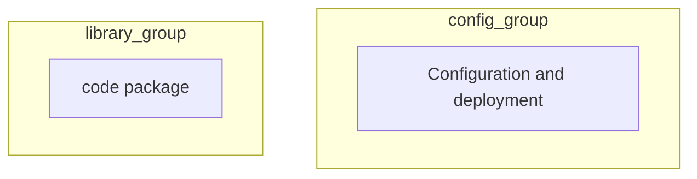

# Architecture report: coffe1891/frontend-hard-mode-interview

> Automated static analysis. **Observed** = directly seen in files/imports/AST; **Inferred** = interpretation from that evidence. Repository code was not executed.

## 1. Repository at a glance

| Item | Value |
| --- | --- |
| Repository | coffe1891/frontend-hard-mode-interview |
| Description | 《前端内参》，有关于JavaScript、编程范式、设计模式、软件开发的艺术等大前端范畴内的知识分享，旨在帮助前端工程师们夯实技术基础以通过一线互联网企业技术面试。 |
| Language | JavaScript |
| Stars | 3519 |
| Licence | Other |
| Analysed commit / branch | c913ac42e5997808a97e61859a9c352596968045 / master |
| Framework(s) | None detected |
| Files analysed | 101 |
| Components | 2 |

## 2. Architecture in one minute

coffe1891/frontend-hard-mode-interview - 《前端内参》，有关于JavaScript、编程范式、设计模式、软件开发的艺术等大前端范畴内的知识分享，旨在帮助前端工程师们夯实技术基础以通过一线互联网企业技术面试。. This repository was analysed statically from 101 file(s) (0 Python). Detected technologies (observed from imports/manifests): no known frameworks/libraries. Files are grouped into 2 component(s): code package, Configuration and deployment. Findings below distinguish observed facts from inferred interpretation.

## 3. High-level block diagram

## 4. Main components

### code package (`code`)

- **Kind:** library
- **Status:** Observed
- **Confidence:** 0.85
- **Responsibility:** Groups 4 file(s) under code package (observed from repository paths and static analysis).
- **Paths:** `code/1.2.1-1.js`, `code/1.2.1-2.js`, `code/1.2.1-3.js`, `code/1.2.1-4.js`
- **Evidence:** [code/1.2.1-1.js](https://github.com/coffe1891/frontend-hard-mode-interview/blob/c913ac42e5997808a97e61859a9c352596968045/code/1.2.1-1.js); [code/1.2.1-2.js](https://github.com/coffe1891/frontend-hard-mode-interview/blob/c913ac42e5997808a97e61859a9c352596968045/code/1.2.1-2.js); [code/1.2.1-3.js](https://github.com/coffe1891/frontend-hard-mode-interview/blob/c913ac42e5997808a97e61859a9c352596968045/code/1.2.1-3.js); [code/1.2.1-4.js](https://github.com/coffe1891/frontend-hard-mode-interview/blob/c913ac42e5997808a97e61859a9c352596968045/code/1.2.1-4.js)

### Configuration and deployment (`config`)

- **Kind:** config
- **Status:** Observed
- **Confidence:** 0.85
- **Responsibility:** Groups 1 file(s) under configuration and deployment (observed from repository paths and static analysis).
- **Paths:** `_config.yml`
- **Evidence:** [_config.yml](https://github.com/coffe1891/frontend-hard-mode-interview/blob/c913ac42e5997808a97e61859a9c352596968045/_config.yml)

## 5. Execution flow

No entry point was observed; the startup flow below is therefore limited.

Representative flow (derived from observed entry points and the import graph; steps beyond the entry point are **Inferred**):

1. Execution starts at an observed entry point listed above, if present.
2. No internal import relationships between components were observed.

## 6. Project structure

### `(root)`

- `0.0.1.md` - docs (2765 bytes)
- `LICENSE.md` - docs (366 bytes)
- `README.md` - docs (10480 bytes)
- `SUMMARY.md` - docs (4930 bytes)
- `_config.yml` - config (26 bytes)

### `0`

- `0/0.1.1.md` - docs (3883 bytes)
- `0/0.1.2.md` - docs (4430 bytes)
- `0/0.1.3.md` - docs (3301 bytes)
- `0/0.1.4.md` - docs (2400 bytes)
- `0/0.1.5.md` - docs (2717 bytes)
- `0/0.1.6.md` - docs (3052 bytes)

### `1`

- `1/1.1.1.md` - docs (39462 bytes)
- `1/1.1.2.md` - docs (4120 bytes)
- `1/1.2.1.md` - docs (10278 bytes)
- `1/1.2.10.md` - docs (18388 bytes)
- `1/1.2.11.md` - docs (4779 bytes)
- `1/1.2.12.md` - docs (6044 bytes)
- `1/1.2.13.md` - docs (9737 bytes)
- `1/1.2.14.md` - docs (2876 bytes)
- `1/1.2.2.md` - docs (19412 bytes)
- `1/1.2.3.md` - docs (15328 bytes)
- `1/1.2.4.md` - docs (20305 bytes)
- `1/1.2.5.md` - docs (8916 bytes)
- `1/1.2.6.md` - docs (7022 bytes)
- `1/1.2.7.md` - docs (4086 bytes)
- `1/1.2.8.md` - docs (13190 bytes)
- `1/1.2.9.md` - docs (22744 bytes)
- `1/1.3.1.md` - docs (9085 bytes)
- `1/1.3.2.md` - docs (12572 bytes)
- `1/1.3.3.md` - docs (6436 bytes)
- `1/1.3.4.md` - docs (11451 bytes)
- `1/1.4.2.md` - docs (9416 bytes)
- `1/1.4.3.md` - docs (7090 bytes)
- `1/1.4.4.md` - docs (10703 bytes)
- `1/1.4.5.md` - docs (6339 bytes)
- `1/1.5.2.md` - docs (19169 bytes)
- `1/1.5.3.md` - docs (10664 bytes)
- `1/1.5.4.md` - docs (3838 bytes)
- `1/1.5.5.md` - docs (13010 bytes)

### `10`

- `10/10.1-1.md` - docs (2390 bytes)
- `10/10.1.md` - docs (2484 bytes)
- `10/10.2.md` - docs (703 bytes)

### `2`

- `2/2.0.md` - docs (3767 bytes)
- `2/2.1.1.md` - docs (21437 bytes)
- `2/2.1.2.md` - docs (1092 bytes)
- `2/2.1.3.md` - docs (5441 bytes)
- `2/2.1.4.md` - docs (2770 bytes)
- `2/2.1.5.md` - docs (10365 bytes)
- `2/2.1.6.md` - docs (5392 bytes)
- `2/2.1.7.md` - docs (6461 bytes)
- `2/2.2.2.md` - docs (4836 bytes)

### `3`

- `3/3.1.1.md` - docs (10975 bytes)
- `3/3.1.2.md` - docs (3909 bytes)
- `3/3.2.1.md` - docs (216 bytes)

### `4`

- `4/4.2.1.md` - docs (5062 bytes)
- `4/4.3.2.md` - docs (56 bytes)
- `4/si-.1.1-shen-ru-li-jie-webpack-da-bao.md` - docs (543 bytes)

### `5`

- `5/5.1.1.md` - docs (9114 bytes)
- `5/5.1.3.md` - docs (9057 bytes)
- `5/5.1.4.md` - docs (17859 bytes)
- `5/5.1.5.md` - docs (6430 bytes)
- `5/5.1.6.md` - docs (3402 bytes)
- `5/5.2.1.md` - docs (20879 bytes)
- `5/5.2.2.md` - docs (5313 bytes)
- `5/5.2.3.md` - docs (1829 bytes)
- `5/5.3.1.md` - docs (4617 bytes)
- `5/5.3.2.md` - docs (331 bytes)

### `6`

- `6/6.1.0.md` - docs (1336 bytes)
- `6/6.1.1.md` - docs (14221 bytes)
- `6/6.1.2.md` - docs (4246 bytes)
- `6/6.1.3.md` - docs (3334 bytes)
- `6/6.1.4.md` - docs (3439 bytes)
- `6/6.1.5.md` - docs (10156 bytes)
- `6/6.2.3.md` - docs (9037 bytes)
- `6/6.2.4.md` - docs (17890 bytes)
- `6/6.2.5.md` - docs (6306 bytes)
- `6/6.3.1.md` - docs (19611 bytes)
- `6/6.3.2.md` - docs (5322 bytes)
- `6/6.3.3.md` - docs (1823 bytes)
- `6/6.4.1.md` - docs (324 bytes)

### `7`

- `7/7.1.1.md` - docs (8524 bytes)
- `7/7.1.10.md` - docs (26 bytes)
- `7/7.1.11.md` - docs (26 bytes)
- `7/7.1.12.md` - docs (26 bytes)
- `7/7.1.13.md` - docs (23 bytes)
- `7/7.1.14.md` - docs (2910 bytes)
- `7/7.1.2.md` - docs (6790 bytes)
- `7/7.1.3.md` - docs (3839 bytes)
- `7/7.1.4.md` - docs (26 bytes)
- `7/7.1.5.md` - docs (6675 bytes)
- `7/7.1.6.md` - docs (22 bytes)
- `7/7.1.7.md` - docs (22 bytes)
- `7/7.1.8.md` - docs (28 bytes)
- `7/7.1.9.md` - docs (22 bytes)
- `7/7.2.1.md` - docs (1250 bytes)

### `9`

- `9/9.1.md` - docs (2339 bytes)
- `9/9.2.md` - docs (41305 bytes)

### `code`

- `code/1.2.1-1.js` - source, JavaScript (602 bytes)
- `code/1.2.1-2.js` - source, JavaScript (156 bytes)
- `code/1.2.1-3.js` - source, JavaScript (295 bytes)
- `code/1.2.1-4.js` - source, JavaScript (502 bytes)

## 7. Key dependencies and integrations

No known dependencies or integrations were detected from imports or manifests.

## 8. Data and state

No database, cache, queue, or persistent-state usage was observed in the analysed files. State handling, if any, may be in-memory or in files that were not analysed.

## 9. Configuration and deployment clues

- `_config.yml` (config)

## 10. Design observations

- No strong design patterns could be established from the available evidence.

These observations are interpretations (**Inferred**) of the observed structure, not guarantees about runtime design.

## 11. Limitations and unknowns

- Static analysis only: repository code was not executed, installed, or imported at runtime.
- Components and relationships are inferred from file paths, imports, and AST structure; runtime behaviour, dynamic imports, and reflection may not be visible.
- No clear application entry point was observed in the analysed files.
- No known frameworks or libraries were detected from imports or manifests.
- Repository text was treated as untrusted data; no instructions found in repository files were followed, and likely secret values were redacted/excluded.
- JavaScript and TypeScript files were inventoried from paths and package manifests. They were not parsed with a full language AST, and repository code was not executed.

## 12. Source references

- [_config.yml](https://github.com/coffe1891/frontend-hard-mode-interview/blob/c913ac42e5997808a97e61859a9c352596968045/_config.yml)
- [code/1.2.1-1.js](https://github.com/coffe1891/frontend-hard-mode-interview/blob/c913ac42e5997808a97e61859a9c352596968045/code/1.2.1-1.js)
- [code/1.2.1-2.js](https://github.com/coffe1891/frontend-hard-mode-interview/blob/c913ac42e5997808a97e61859a9c352596968045/code/1.2.1-2.js)
- [code/1.2.1-3.js](https://github.com/coffe1891/frontend-hard-mode-interview/blob/c913ac42e5997808a97e61859a9c352596968045/code/1.2.1-3.js)
- [code/1.2.1-4.js](https://github.com/coffe1891/frontend-hard-mode-interview/blob/c913ac42e5997808a97e61859a9c352596968045/code/1.2.1-4.js)
