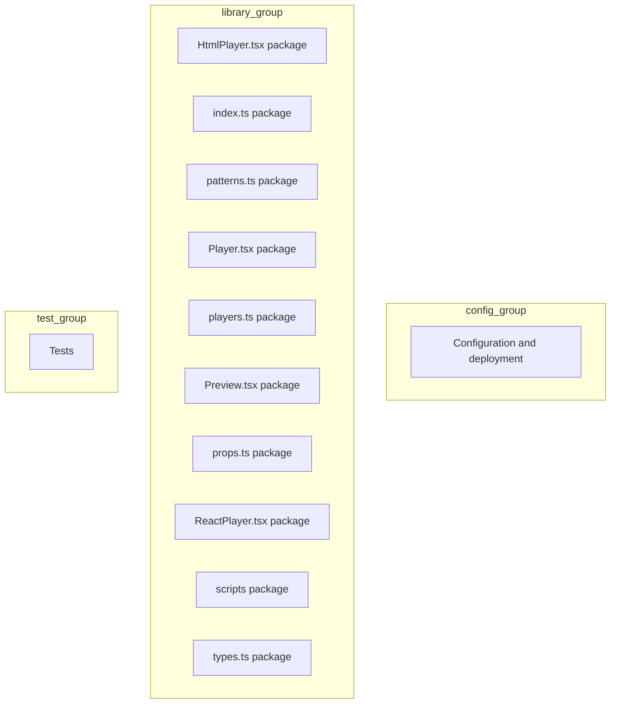

# Architecture report: cookpete/react-player

> Automated static analysis. **Observed** = directly seen in files/imports/AST; **Inferred** = interpretation from that evidence. Repository code was not executed.

## 1. Repository at a glance

| Item | Value |
| --- | --- |
| Repository | cookpete/react-player |
| Description | A React component for playing a variety of URLs, including file paths, YouTube, Facebook, Twitch, SoundCloud, Streamable, Vimeo, Wistia and DailyMotion |
| Language | TypeScript |
| Stars | 10291 |
| Licence | MIT |
| Analysed commit / branch | 258fce939638a295f6a429ad683935254d1bfda2 / master |
| Framework(s) | React |
| Files analysed | 44 |
| Components | 12 |

## 2. Architecture in one minute

cookpete/react-player - A React component for playing a variety of URLs, including file paths, YouTube, Facebook, Twitch, SoundCloud, Streamable, Vimeo, Wistia and DailyMotion. This repository was analysed statically from 44 file(s) (0 Python). Detected technologies (observed from imports/manifests): GitHub Actions, React, TypeScript. Files are grouped into 12 component(s): Configuration and deployment, HtmlPlayer.tsx package, index.ts package, patterns.ts package, Player.tsx package, players.ts package, Preview.tsx package, props.ts package. Findings below distinguish observed facts from inferred interpretation.

## 3. High-level block diagram

## 4. Main components

### Configuration and deployment (`config`)

- **Kind:** config
- **Status:** Observed
- **Confidence:** 0.85
- **Responsibility:** Groups 6 file(s) under configuration and deployment (observed from repository paths and static analysis).
- **Paths:** `biome.json`, `codecov.yml`, `package.json`, `scripts/builder/package.json`, `scripts/tester/package.json`, `tsconfig.json`
- **Evidence:** [biome.json](https://github.com/cookpete/react-player/blob/258fce939638a295f6a429ad683935254d1bfda2/biome.json); [codecov.yml](https://github.com/cookpete/react-player/blob/258fce939638a295f6a429ad683935254d1bfda2/codecov.yml); [package.json](https://github.com/cookpete/react-player/blob/258fce939638a295f6a429ad683935254d1bfda2/package.json); [scripts/builder/package.json](https://github.com/cookpete/react-player/blob/258fce939638a295f6a429ad683935254d1bfda2/scripts/builder/package.json); [scripts/tester/package.json](https://github.com/cookpete/react-player/blob/258fce939638a295f6a429ad683935254d1bfda2/scripts/tester/package.json); [tsconfig.json](https://github.com/cookpete/react-player/blob/258fce939638a295f6a429ad683935254d1bfda2/tsconfig.json)

### HtmlPlayer.tsx package (`htmlplayer_tsx`)

- **Kind:** library
- **Status:** Observed
- **Confidence:** 0.85
- **Responsibility:** Groups 1 file(s) under htmlplayer.tsx package (observed from repository paths and static analysis).
- **Paths:** `src/HtmlPlayer.tsx`
- **Evidence:** [src/HtmlPlayer.tsx](https://github.com/cookpete/react-player/blob/258fce939638a295f6a429ad683935254d1bfda2/src/HtmlPlayer.tsx)

### index.ts package (`index_ts`)

- **Kind:** library
- **Status:** Observed
- **Confidence:** 0.85
- **Responsibility:** Groups 1 file(s) under index.ts package (observed from repository paths and static analysis).
- **Paths:** `src/index.ts`
- **Evidence:** [src/index.ts](https://github.com/cookpete/react-player/blob/258fce939638a295f6a429ad683935254d1bfda2/src/index.ts)

### patterns.ts package (`patterns_ts`)

- **Kind:** library
- **Status:** Observed
- **Confidence:** 0.85
- **Responsibility:** Groups 1 file(s) under patterns.ts package (observed from repository paths and static analysis).
- **Paths:** `src/patterns.ts`
- **Evidence:** [src/patterns.ts](https://github.com/cookpete/react-player/blob/258fce939638a295f6a429ad683935254d1bfda2/src/patterns.ts)

### Player.tsx package (`player_tsx`)

- **Kind:** library
- **Status:** Observed
- **Confidence:** 0.85
- **Responsibility:** Groups 1 file(s) under player.tsx package (observed from repository paths and static analysis).
- **Paths:** `src/Player.tsx`
- **Evidence:** [src/Player.tsx](https://github.com/cookpete/react-player/blob/258fce939638a295f6a429ad683935254d1bfda2/src/Player.tsx)

### players.ts package (`players_ts`)

- **Kind:** library
- **Status:** Observed
- **Confidence:** 0.85
- **Responsibility:** Groups 1 file(s) under players.ts package (observed from repository paths and static analysis).
- **Paths:** `src/players.ts`
- **Evidence:** [src/players.ts](https://github.com/cookpete/react-player/blob/258fce939638a295f6a429ad683935254d1bfda2/src/players.ts)

### Preview.tsx package (`preview_tsx`)

- **Kind:** library
- **Status:** Observed
- **Confidence:** 0.85
- **Responsibility:** Groups 1 file(s) under preview.tsx package (observed from repository paths and static analysis).
- **Paths:** `src/Preview.tsx`
- **Evidence:** [src/Preview.tsx](https://github.com/cookpete/react-player/blob/258fce939638a295f6a429ad683935254d1bfda2/src/Preview.tsx)

### props.ts package (`props_ts`)

- **Kind:** library
- **Status:** Observed
- **Confidence:** 0.85
- **Responsibility:** Groups 1 file(s) under props.ts package (observed from repository paths and static analysis).
- **Paths:** `src/props.ts`
- **Evidence:** [src/props.ts](https://github.com/cookpete/react-player/blob/258fce939638a295f6a429ad683935254d1bfda2/src/props.ts)

### ReactPlayer.tsx package (`reactplayer_tsx`)

- **Kind:** library
- **Status:** Observed
- **Confidence:** 0.85
- **Responsibility:** Groups 1 file(s) under reactplayer.tsx package (observed from repository paths and static analysis).
- **Paths:** `src/ReactPlayer.tsx`
- **Evidence:** [src/ReactPlayer.tsx](https://github.com/cookpete/react-player/blob/258fce939638a295f6a429ad683935254d1bfda2/src/ReactPlayer.tsx)

### scripts package (`scripts`)

- **Kind:** library
- **Status:** Observed
- **Confidence:** 0.85
- **Responsibility:** Groups 2 file(s) under scripts package (observed from repository paths and static analysis).
- **Paths:** `scripts/builder/builder.js`, `scripts/tester/tester.js`
- **Evidence:** [scripts/builder/builder.js](https://github.com/cookpete/react-player/blob/258fce939638a295f6a429ad683935254d1bfda2/scripts/builder/builder.js); [scripts/tester/tester.js](https://github.com/cookpete/react-player/blob/258fce939638a295f6a429ad683935254d1bfda2/scripts/tester/tester.js)

### Tests (`tests`)

- **Kind:** test
- **Status:** Observed
- **Confidence:** 0.85
- **Responsibility:** Groups 9 file(s) under tests (observed from repository paths and static analysis).
- **Paths:** `test/Player.test.tsx`, `test/Player.tsx`, `test/ReactPlayer/instanceMethods.js`, `test/ReactPlayer/props.tsx`, `test/ReactPlayer/render.js`, `test/ReactPlayer/staticMethods.js`, `test/helpers/helpers.tsx`, `test/helpers/server-safe-globals.js`, `test/react-player-tests.tsx`
- **Evidence:** [test/Player.test.tsx](https://github.com/cookpete/react-player/blob/258fce939638a295f6a429ad683935254d1bfda2/test/Player.test.tsx); [test/Player.tsx](https://github.com/cookpete/react-player/blob/258fce939638a295f6a429ad683935254d1bfda2/test/Player.tsx); [test/ReactPlayer/instanceMethods.js](https://github.com/cookpete/react-player/blob/258fce939638a295f6a429ad683935254d1bfda2/test/ReactPlayer/instanceMethods.js); [test/ReactPlayer/props.tsx](https://github.com/cookpete/react-player/blob/258fce939638a295f6a429ad683935254d1bfda2/test/ReactPlayer/props.tsx); [test/ReactPlayer/render.js](https://github.com/cookpete/react-player/blob/258fce939638a295f6a429ad683935254d1bfda2/test/ReactPlayer/render.js); [test/ReactPlayer/staticMethods.js](https://github.com/cookpete/react-player/blob/258fce939638a295f6a429ad683935254d1bfda2/test/ReactPlayer/staticMethods.js); [test/helpers/helpers.tsx](https://github.com/cookpete/react-player/blob/258fce939638a295f6a429ad683935254d1bfda2/test/helpers/helpers.tsx); [test/helpers/server-safe-globals.js](https://github.com/cookpete/react-player/blob/258fce939638a295f6a429ad683935254d1bfda2/test/helpers/server-safe-globals.js)

### types.ts package (`types_ts`)

- **Kind:** library
- **Status:** Observed
- **Confidence:** 0.85
- **Responsibility:** Groups 1 file(s) under types.ts package (observed from repository paths and static analysis).
- **Paths:** `src/types.ts`
- **Evidence:** [src/types.ts](https://github.com/cookpete/react-player/blob/258fce939638a295f6a429ad683935254d1bfda2/src/types.ts)

## 5. Execution flow

**Observed** entry point(s):

- [scripts/builder/builder.js](https://github.com/cookpete/react-player/blob/258fce939638a295f6a429ad683935254d1bfda2/scripts/builder/builder.js)
- [scripts/tester/tester.js](https://github.com/cookpete/react-player/blob/258fce939638a295f6a429ad683935254d1bfda2/scripts/tester/tester.js)
- [src/index.ts](https://github.com/cookpete/react-player/blob/258fce939638a295f6a429ad683935254d1bfda2/src/index.ts)

Representative flow (derived from observed entry points and the import graph; steps beyond the entry point are **Inferred**):

1. Execution starts at an observed entry point listed above, if present.
2. No internal import relationships between components were observed.

## 6. Project structure

### `(root)`

- `.gitignore` - other (139 bytes)
- `CHANGELOG.md` - docs (99528 bytes)
- `CONTRIBUTING.md` - docs (1167 bytes)
- `LICENSE.md` - docs (1084 bytes)
- `MIGRATING.md` - docs (5373 bytes)
- `README.md` - docs (15377 bytes)
- `biome.json` - config (175 bytes)
- `codecov.yml` - config (189 bytes)
- `package.json` - manifest (3399 bytes)
- `tsconfig.json` - config (554 bytes)

### `.github`

- `.github/FUNDING.yml` - config (679 bytes)
- `.github/issue_template.md` - docs (504 bytes)
- `.github/workflows/cd.yml` - ci, YAML (2024 bytes)
- `.github/workflows/ci.yml` - ci, YAML (2170 bytes)

### `examples`

- `examples/react/public/App.css` - other (537 bytes)
- `examples/react/public/defaults.css` - other (2150 bytes)
- `examples/react/public/index.html` - other (627 bytes)
- `examples/react/public/range.css` - other (2668 bytes)
- `examples/react/public/reset.css` - other (1099 bytes)
- `examples/react/src/App.tsx` - source, TypeScript (17711 bytes)
- `examples/react/src/Duration.tsx` - source, TypeScript (595 bytes)
- `examples/react/src/index.tsx` - source, TypeScript (223 bytes)

### `scripts`

- `scripts/builder/builder.js` - source, JavaScript (3233 bytes)
- `scripts/builder/package.json` - manifest (157 bytes)
- `scripts/tester/package.json` - manifest (153 bytes)
- `scripts/tester/tester.js` - source, JavaScript (1692 bytes)

### `src`

- `src/HtmlPlayer.tsx` - source, TypeScript (415 bytes)
- `src/Player.tsx` - source, TypeScript (3302 bytes)
- `src/Preview.tsx` - source, TypeScript (2940 bytes)
- `src/ReactPlayer.tsx` - source, TypeScript (4119 bytes)
- `src/index.ts` - source, TypeScript (266 bytes)
- `src/patterns.ts` - source, TypeScript (2272 bytes)
- `src/players.ts` - source, TypeScript (3172 bytes)
- `src/props.ts` - source, TypeScript (685 bytes)
- `src/types.ts` - source, TypeScript (2110 bytes)

### `test`

- `test/Player.test.tsx` - test, TypeScript (1529 bytes)
- `test/Player.tsx` - test, TypeScript (3849 bytes)
- `test/ReactPlayer/instanceMethods.js` - test, JavaScript (1870 bytes)
- `test/ReactPlayer/props.tsx` - test, TypeScript (905 bytes)
- `test/ReactPlayer/render.js` - test, JavaScript (708 bytes)
- `test/ReactPlayer/staticMethods.js` - test, JavaScript (1398 bytes)
- `test/helpers/helpers.tsx` - test, TypeScript (1225 bytes)
- `test/helpers/server-safe-globals.js` - test, JavaScript (2233 bytes)
- `test/react-player-tests.tsx` - test, TypeScript (7283 bytes)

## 7. Key dependencies and integrations

| Name | Category | Status | Confidence | Evidence |
| --- | --- | --- | --- | --- |
| GitHub Actions | ci | Observed | 0.90 | [.github/workflows/cd.yml](https://github.com/cookpete/react-player/blob/258fce939638a295f6a429ad683935254d1bfda2/.github/workflows/cd.yml); [.github/workflows/ci.yml](https://github.com/cookpete/react-player/blob/258fce939638a295f6a429ad683935254d1bfda2/.github/workflows/ci.yml) |
| React | framework | Observed | 0.90 | [package.json:2](https://github.com/cookpete/react-player/blob/258fce939638a295f6a429ad683935254d1bfda2/package.json#L2); [package.json:50](https://github.com/cookpete/react-player/blob/258fce939638a295f6a429ad683935254d1bfda2/package.json#L50) |
| TypeScript | tooling | Observed | 0.85 | [package.json:84](https://github.com/cookpete/react-player/blob/258fce939638a295f6a429ad683935254d1bfda2/package.json#L84) |

## 8. Data and state

No database, cache, queue, or persistent-state usage was observed in the analysed files. State handling, if any, may be in-memory or in files that were not analysed.

## 9. Configuration and deployment clues

- `.github/FUNDING.yml` (config)
- `.github/workflows/cd.yml` (ci)
- `.github/workflows/ci.yml` (ci)
- `biome.json` (config)
- `codecov.yml` (config)
- `package.json` (manifest)
- `scripts/builder/package.json` (manifest)
- `scripts/tester/package.json` (manifest)
- `tsconfig.json` (config)

## 10. Design observations

- Tests are present alongside source code (Observed from test file paths).

These observations are interpretations (**Inferred**) of the observed structure, not guarantees about runtime design.

## 11. Limitations and unknowns

- Static analysis only: repository code was not executed, installed, or imported at runtime.
- Components and relationships are inferred from file paths, imports, and AST structure; runtime behaviour, dynamic imports, and reflection may not be visible.
- 1 file(s) were skipped during inventory (1 x lockfile excluded).
- No clear application entry point was observed in the analysed files.
- Repository text was treated as untrusted data; no instructions found in repository files were followed, and likely secret values were redacted/excluded.
- JavaScript and TypeScript files were inventoried from paths and package manifests. They were not parsed with a full language AST, and repository code was not executed.

## 12. Source references

- [.github/workflows/cd.yml](https://github.com/cookpete/react-player/blob/258fce939638a295f6a429ad683935254d1bfda2/.github/workflows/cd.yml)
- [.github/workflows/ci.yml](https://github.com/cookpete/react-player/blob/258fce939638a295f6a429ad683935254d1bfda2/.github/workflows/ci.yml)
- [biome.json](https://github.com/cookpete/react-player/blob/258fce939638a295f6a429ad683935254d1bfda2/biome.json)
- [codecov.yml](https://github.com/cookpete/react-player/blob/258fce939638a295f6a429ad683935254d1bfda2/codecov.yml)
- [package.json](https://github.com/cookpete/react-player/blob/258fce939638a295f6a429ad683935254d1bfda2/package.json)
- [package.json:2](https://github.com/cookpete/react-player/blob/258fce939638a295f6a429ad683935254d1bfda2/package.json#L2)
- [package.json:50](https://github.com/cookpete/react-player/blob/258fce939638a295f6a429ad683935254d1bfda2/package.json#L50)
- [package.json:84](https://github.com/cookpete/react-player/blob/258fce939638a295f6a429ad683935254d1bfda2/package.json#L84)
- [scripts/builder/builder.js](https://github.com/cookpete/react-player/blob/258fce939638a295f6a429ad683935254d1bfda2/scripts/builder/builder.js)
- [scripts/builder/package.json](https://github.com/cookpete/react-player/blob/258fce939638a295f6a429ad683935254d1bfda2/scripts/builder/package.json)
- [scripts/tester/package.json](https://github.com/cookpete/react-player/blob/258fce939638a295f6a429ad683935254d1bfda2/scripts/tester/package.json)
- [scripts/tester/tester.js](https://github.com/cookpete/react-player/blob/258fce939638a295f6a429ad683935254d1bfda2/scripts/tester/tester.js)
- [src/HtmlPlayer.tsx](https://github.com/cookpete/react-player/blob/258fce939638a295f6a429ad683935254d1bfda2/src/HtmlPlayer.tsx)
- [src/Player.tsx](https://github.com/cookpete/react-player/blob/258fce939638a295f6a429ad683935254d1bfda2/src/Player.tsx)
- [src/Preview.tsx](https://github.com/cookpete/react-player/blob/258fce939638a295f6a429ad683935254d1bfda2/src/Preview.tsx)
- [src/ReactPlayer.tsx](https://github.com/cookpete/react-player/blob/258fce939638a295f6a429ad683935254d1bfda2/src/ReactPlayer.tsx)
- [src/index.ts](https://github.com/cookpete/react-player/blob/258fce939638a295f6a429ad683935254d1bfda2/src/index.ts)
- [src/patterns.ts](https://github.com/cookpete/react-player/blob/258fce939638a295f6a429ad683935254d1bfda2/src/patterns.ts)
- [src/players.ts](https://github.com/cookpete/react-player/blob/258fce939638a295f6a429ad683935254d1bfda2/src/players.ts)
- [src/props.ts](https://github.com/cookpete/react-player/blob/258fce939638a295f6a429ad683935254d1bfda2/src/props.ts)
- [src/types.ts](https://github.com/cookpete/react-player/blob/258fce939638a295f6a429ad683935254d1bfda2/src/types.ts)
- [test/Player.test.tsx](https://github.com/cookpete/react-player/blob/258fce939638a295f6a429ad683935254d1bfda2/test/Player.test.tsx)
- [test/Player.tsx](https://github.com/cookpete/react-player/blob/258fce939638a295f6a429ad683935254d1bfda2/test/Player.tsx)
- [test/ReactPlayer/instanceMethods.js](https://github.com/cookpete/react-player/blob/258fce939638a295f6a429ad683935254d1bfda2/test/ReactPlayer/instanceMethods.js)
- [test/ReactPlayer/props.tsx](https://github.com/cookpete/react-player/blob/258fce939638a295f6a429ad683935254d1bfda2/test/ReactPlayer/props.tsx)
- [test/ReactPlayer/render.js](https://github.com/cookpete/react-player/blob/258fce939638a295f6a429ad683935254d1bfda2/test/ReactPlayer/render.js)
- [test/ReactPlayer/staticMethods.js](https://github.com/cookpete/react-player/blob/258fce939638a295f6a429ad683935254d1bfda2/test/ReactPlayer/staticMethods.js)
- [test/helpers/helpers.tsx](https://github.com/cookpete/react-player/blob/258fce939638a295f6a429ad683935254d1bfda2/test/helpers/helpers.tsx)
- [test/helpers/server-safe-globals.js](https://github.com/cookpete/react-player/blob/258fce939638a295f6a429ad683935254d1bfda2/test/helpers/server-safe-globals.js)
- [tsconfig.json](https://github.com/cookpete/react-player/blob/258fce939638a295f6a429ad683935254d1bfda2/tsconfig.json)
