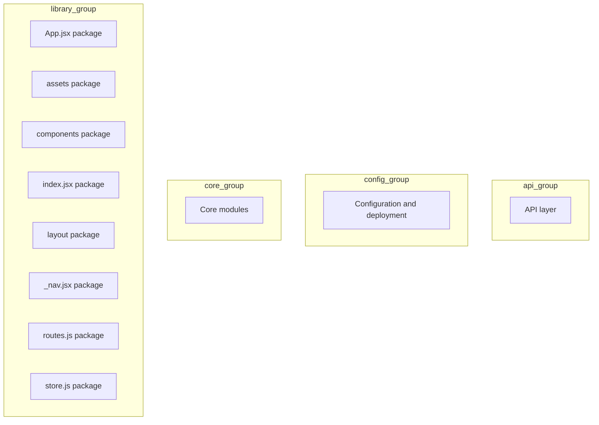

# Architecture report: coreui/coreui-free-react-admin-template

> Automated static analysis. **Observed** = directly seen in files/imports/AST; **Inferred** = interpretation from that evidence. Repository code was not executed.

## 1. Repository at a glance

| Item | Value |
| --- | --- |
| Repository | coreui/coreui-free-react-admin-template |
| Description | Free React Admin & Dashboard Template Built for AI-Assisted Development |
| Language | JavaScript |
| Stars | 4970 |
| Licence | MIT |
| Analysed commit / branch | 2609f5995035973e00c16ec723165a5fff87cceb / main |
| Framework(s) | React |
| Files analysed | 108 |
| Components | 11 |

## 2. Architecture in one minute

coreui/coreui-free-react-admin-template - Free React Admin & Dashboard Template Built for AI-Assisted Development. This repository was analysed statically from 108 file(s) (0 Python). Detected technologies (observed from imports/manifests): GitHub Actions, React, React Router, Redux, Vite. Files are grouped into 11 component(s): API layer, App.jsx package, assets package, components package, Configuration and deployment, Core modules, index.jsx package, layout package. Findings below distinguish observed facts from inferred interpretation.

## 3. High-level block diagram

## 4. Main components

### API layer (`api_layer`)

- **Kind:** api
- **Status:** Observed
- **Confidence:** 0.85
- **Responsibility:** Groups 53 file(s) under api layer (observed from repository paths and static analysis).
- **Paths:** `src/views/authentication/change-password/ChangePassword.jsx`, `src/views/authentication/check-email/CheckEmail.jsx`, `src/views/authentication/login/Login.jsx`, `src/views/authentication/password-changed/PasswordChanged.jsx`, `src/views/authentication/register/Register.jsx`, `src/views/authentication/reset-password/ResetPassword.jsx`, `src/views/charts/Charts.jsx`, `src/views/components/accordion/Accordion.jsx`, `src/views/components/alerts/Alerts.jsx`, `src/views/components/badge/Badge.jsx`, `src/views/components/breadcrumb/Breadcrumb.jsx`, `src/views/components/button-group/ButtonGroup.jsx`, `src/views/components/buttons/Buttons.jsx`, `src/views/components/cards/Cards.jsx`, `src/views/components/carousel/Carousel.jsx`, `src/views/components/chip-set/ChipSet.jsx`, `src/views/components/chip/Chip.jsx`, `src/views/components/collapse/Collapse.jsx`, `src/views/components/dropdowns/Dropdowns.jsx`, `src/views/components/list-group/ListGroup.jsx`, `src/views/components/modals/Modals.jsx`, `src/views/components/navs-tabs/NavsTabs.jsx`, `src/views/components/pagination/Pagination.jsx`, `src/views/components/placeholders/Placeholders.jsx`, `src/views/components/popovers/Popovers.jsx`, `src/views/components/progress/Progress.jsx`, `src/views/components/search-button/SearchButton.jsx`, `src/views/components/spinners/Spinners.jsx`, `src/views/components/tables/Tables.jsx`, `src/views/components/tabs/Tabs.jsx`, `src/views/components/toasts/Toasts.jsx`, `src/views/components/tooltips/Tooltips.jsx`, `src/views/dashboard/Dashboard.jsx`, `src/views/dashboard/DashboardBrand.jsx`, `src/views/dashboard/MainChart.jsx`, `src/views/error-pages/page404/Page404.jsx`, `src/views/error-pages/page500/Page500.jsx`, `src/views/forms/checks-radios/ChecksRadios.jsx`, `src/views/forms/chip-input/ChipInput.jsx`, `src/views/forms/floating-labels/FloatingLabels.jsx`, `src/views/forms/form-control/FormControl.jsx`, `src/views/forms/input-group/InputGroup.jsx`, `src/views/forms/layout/Layout.jsx`, `src/views/forms/range/Range.jsx`, `src/views/forms/select/Select.jsx`, `src/views/forms/validation/Validation.jsx`, `src/views/icons/brands/Brands.jsx`, `src/views/icons/coreui-icons/CoreUIIcons.jsx`, `src/views/icons/flags/Flags.jsx`, `src/views/icons/index.js`, `src/views/widgets/Widgets.jsx`, `src/views/widgets/WidgetsBrand.jsx`, `src/views/widgets/WidgetsDropdown.jsx`
- **Evidence:** [src/views/authentication/change-password/ChangePassword.jsx](https://github.com/coreui/coreui-free-react-admin-template/blob/2609f5995035973e00c16ec723165a5fff87cceb/src/views/authentication/change-password/ChangePassword.jsx); [src/views/authentication/check-email/CheckEmail.jsx](https://github.com/coreui/coreui-free-react-admin-template/blob/2609f5995035973e00c16ec723165a5fff87cceb/src/views/authentication/check-email/CheckEmail.jsx); [src/views/authentication/login/Login.jsx](https://github.com/coreui/coreui-free-react-admin-template/blob/2609f5995035973e00c16ec723165a5fff87cceb/src/views/authentication/login/Login.jsx); [src/views/authentication/password-changed/PasswordChanged.jsx](https://github.com/coreui/coreui-free-react-admin-template/blob/2609f5995035973e00c16ec723165a5fff87cceb/src/views/authentication/password-changed/PasswordChanged.jsx); [src/views/authentication/register/Register.jsx](https://github.com/coreui/coreui-free-react-admin-template/blob/2609f5995035973e00c16ec723165a5fff87cceb/src/views/authentication/register/Register.jsx); [src/views/authentication/reset-password/ResetPassword.jsx](https://github.com/coreui/coreui-free-react-admin-template/blob/2609f5995035973e00c16ec723165a5fff87cceb/src/views/authentication/reset-password/ResetPassword.jsx); [src/views/charts/Charts.jsx](https://github.com/coreui/coreui-free-react-admin-template/blob/2609f5995035973e00c16ec723165a5fff87cceb/src/views/charts/Charts.jsx); [src/views/components/accordion/Accordion.jsx](https://github.com/coreui/coreui-free-react-admin-template/blob/2609f5995035973e00c16ec723165a5fff87cceb/src/views/components/accordion/Accordion.jsx)

### App.jsx package (`app_jsx`)

- **Kind:** library
- **Status:** Observed
- **Confidence:** 0.85
- **Responsibility:** Groups 1 file(s) under app.jsx package (observed from repository paths and static analysis).
- **Paths:** `src/App.jsx`
- **Evidence:** [src/App.jsx](https://github.com/coreui/coreui-free-react-admin-template/blob/2609f5995035973e00c16ec723165a5fff87cceb/src/App.jsx)

### assets package (`assets`)

- **Kind:** library
- **Status:** Observed
- **Confidence:** 0.85
- **Responsibility:** Groups 8 file(s) under assets package (observed from repository paths and static analysis).
- **Paths:** `src/assets/brand/apple.jsx`, `src/assets/brand/chatgpt.jsx`, `src/assets/brand/google.jsx`, `src/assets/brand/linkedin-badge.jsx`, `src/assets/brand/logo.jsx`, `src/assets/brand/sygnet.jsx`, `src/assets/brand/twitter-x.jsx`, `src/assets/icons/eye.jsx`
- **Evidence:** [src/assets/brand/apple.jsx](https://github.com/coreui/coreui-free-react-admin-template/blob/2609f5995035973e00c16ec723165a5fff87cceb/src/assets/brand/apple.jsx); [src/assets/brand/chatgpt.jsx](https://github.com/coreui/coreui-free-react-admin-template/blob/2609f5995035973e00c16ec723165a5fff87cceb/src/assets/brand/chatgpt.jsx); [src/assets/brand/google.jsx](https://github.com/coreui/coreui-free-react-admin-template/blob/2609f5995035973e00c16ec723165a5fff87cceb/src/assets/brand/google.jsx); [src/assets/brand/linkedin-badge.jsx](https://github.com/coreui/coreui-free-react-admin-template/blob/2609f5995035973e00c16ec723165a5fff87cceb/src/assets/brand/linkedin-badge.jsx); [src/assets/brand/logo.jsx](https://github.com/coreui/coreui-free-react-admin-template/blob/2609f5995035973e00c16ec723165a5fff87cceb/src/assets/brand/logo.jsx); [src/assets/brand/sygnet.jsx](https://github.com/coreui/coreui-free-react-admin-template/blob/2609f5995035973e00c16ec723165a5fff87cceb/src/assets/brand/sygnet.jsx); [src/assets/brand/twitter-x.jsx](https://github.com/coreui/coreui-free-react-admin-template/blob/2609f5995035973e00c16ec723165a5fff87cceb/src/assets/brand/twitter-x.jsx); [src/assets/icons/eye.jsx](https://github.com/coreui/coreui-free-react-admin-template/blob/2609f5995035973e00c16ec723165a5fff87cceb/src/assets/icons/eye.jsx)

### components package (`components`)

- **Kind:** library
- **Status:** Observed
- **Confidence:** 0.85
- **Responsibility:** Groups 13 file(s) under components package (observed from repository paths and static analysis).
- **Paths:** `src/components/AppBreadcrumb.jsx`, `src/components/AppContent.jsx`, `src/components/AppFooter.jsx`, `src/components/AppHeader.jsx`, `src/components/AppSidebar.jsx`, `src/components/AppSidebarNav.jsx`, `src/components/DocsComponents.jsx`, `src/components/DocsExample.jsx`, `src/components/DocsIcons.jsx`, `src/components/DocsLink.jsx`, `src/components/header/AppHeaderDropdown.jsx`, `src/components/header/index.js`, `src/components/index.js`
- **Evidence:** [src/components/AppBreadcrumb.jsx](https://github.com/coreui/coreui-free-react-admin-template/blob/2609f5995035973e00c16ec723165a5fff87cceb/src/components/AppBreadcrumb.jsx); [src/components/AppContent.jsx](https://github.com/coreui/coreui-free-react-admin-template/blob/2609f5995035973e00c16ec723165a5fff87cceb/src/components/AppContent.jsx); [src/components/AppFooter.jsx](https://github.com/coreui/coreui-free-react-admin-template/blob/2609f5995035973e00c16ec723165a5fff87cceb/src/components/AppFooter.jsx); [src/components/AppHeader.jsx](https://github.com/coreui/coreui-free-react-admin-template/blob/2609f5995035973e00c16ec723165a5fff87cceb/src/components/AppHeader.jsx); [src/components/AppSidebar.jsx](https://github.com/coreui/coreui-free-react-admin-template/blob/2609f5995035973e00c16ec723165a5fff87cceb/src/components/AppSidebar.jsx); [src/components/AppSidebarNav.jsx](https://github.com/coreui/coreui-free-react-admin-template/blob/2609f5995035973e00c16ec723165a5fff87cceb/src/components/AppSidebarNav.jsx); [src/components/DocsComponents.jsx](https://github.com/coreui/coreui-free-react-admin-template/blob/2609f5995035973e00c16ec723165a5fff87cceb/src/components/DocsComponents.jsx); [src/components/DocsExample.jsx](https://github.com/coreui/coreui-free-react-admin-template/blob/2609f5995035973e00c16ec723165a5fff87cceb/src/components/DocsExample.jsx)

### Configuration and deployment (`config`)

- **Kind:** config
- **Status:** Observed
- **Confidence:** 0.85
- **Responsibility:** Groups 2 file(s) under configuration and deployment (observed from repository paths and static analysis).
- **Paths:** `package.json`, `public/manifest.json`
- **Evidence:** [package.json](https://github.com/coreui/coreui-free-react-admin-template/blob/2609f5995035973e00c16ec723165a5fff87cceb/package.json); [public/manifest.json](https://github.com/coreui/coreui-free-react-admin-template/blob/2609f5995035973e00c16ec723165a5fff87cceb/public/manifest.json)

### Core modules (`core`)

- **Kind:** core
- **Status:** Observed
- **Confidence:** 0.85
- **Responsibility:** Groups 2 file(s) under core modules (observed from repository paths and static analysis).
- **Paths:** `eslint.config.mjs`, `vite.config.mjs`
- **Evidence:** [eslint.config.mjs](https://github.com/coreui/coreui-free-react-admin-template/blob/2609f5995035973e00c16ec723165a5fff87cceb/eslint.config.mjs); [vite.config.mjs](https://github.com/coreui/coreui-free-react-admin-template/blob/2609f5995035973e00c16ec723165a5fff87cceb/vite.config.mjs)

### index.jsx package (`index_jsx`)

- **Kind:** library
- **Status:** Observed
- **Confidence:** 0.85
- **Responsibility:** Groups 1 file(s) under index.jsx package (observed from repository paths and static analysis).
- **Paths:** `src/index.jsx`
- **Evidence:** [src/index.jsx](https://github.com/coreui/coreui-free-react-admin-template/blob/2609f5995035973e00c16ec723165a5fff87cceb/src/index.jsx)

### layout package (`layout`)

- **Kind:** library
- **Status:** Observed
- **Confidence:** 0.85
- **Responsibility:** Groups 1 file(s) under layout package (observed from repository paths and static analysis).
- **Paths:** `src/layout/DefaultLayout.jsx`
- **Evidence:** [src/layout/DefaultLayout.jsx](https://github.com/coreui/coreui-free-react-admin-template/blob/2609f5995035973e00c16ec723165a5fff87cceb/src/layout/DefaultLayout.jsx)

### _nav.jsx package (`nav_jsx`)

- **Kind:** library
- **Status:** Observed
- **Confidence:** 0.85
- **Responsibility:** Groups 1 file(s) under _nav.jsx package (observed from repository paths and static analysis).
- **Paths:** `src/_nav.jsx`
- **Evidence:** [src/_nav.jsx](https://github.com/coreui/coreui-free-react-admin-template/blob/2609f5995035973e00c16ec723165a5fff87cceb/src/_nav.jsx)

### routes.js package (`routes_js`)

- **Kind:** library
- **Status:** Observed
- **Confidence:** 0.85
- **Responsibility:** Groups 1 file(s) under routes.js package (observed from repository paths and static analysis).
- **Paths:** `src/routes.js`
- **Evidence:** [src/routes.js](https://github.com/coreui/coreui-free-react-admin-template/blob/2609f5995035973e00c16ec723165a5fff87cceb/src/routes.js)

### store.js package (`store_js`)

- **Kind:** library
- **Status:** Observed
- **Confidence:** 0.85
- **Responsibility:** Groups 1 file(s) under store.js package (observed from repository paths and static analysis).
- **Paths:** `src/store.js`
- **Evidence:** [src/store.js](https://github.com/coreui/coreui-free-react-admin-template/blob/2609f5995035973e00c16ec723165a5fff87cceb/src/store.js)

## 5. Execution flow

**Observed** entry point(s):

- [src/App.jsx](https://github.com/coreui/coreui-free-react-admin-template/blob/2609f5995035973e00c16ec723165a5fff87cceb/src/App.jsx)
- [src/components/header/index.js](https://github.com/coreui/coreui-free-react-admin-template/blob/2609f5995035973e00c16ec723165a5fff87cceb/src/components/header/index.js)
- [src/components/index.js](https://github.com/coreui/coreui-free-react-admin-template/blob/2609f5995035973e00c16ec723165a5fff87cceb/src/components/index.js)
- [src/index.jsx](https://github.com/coreui/coreui-free-react-admin-template/blob/2609f5995035973e00c16ec723165a5fff87cceb/src/index.jsx)
- [src/views/icons/index.js](https://github.com/coreui/coreui-free-react-admin-template/blob/2609f5995035973e00c16ec723165a5fff87cceb/src/views/icons/index.js)

Representative flow (derived from observed entry points and the import graph; steps beyond the entry point are **Inferred**):

1. Execution starts at an observed entry point listed above, if present.
2. No internal import relationships between components were observed.

## 6. Project structure

### `(root)`

- `.browserslistrc` - other (181 bytes)
- `.cursorrules` - other (10768 bytes)
- `.editorconfig` - config (262 bytes)
- `.gitattributes` - other (43 bytes)
- `.gitignore` - other (323 bytes)
- `.prettierignore` - other (7 bytes)
- `.prettierrc.js` - source, JavaScript (115 bytes)
- `ARCHITECTURE.md` - docs (22011 bytes)
- `DEVELOPMENT.md` - docs (25960 bytes)
- `LICENSE` - docs (1097 bytes)
- `README.md` - docs (14960 bytes)
- `eslint.config.mjs` - source, JavaScript (966 bytes)
- `index.html` - other (1154 bytes)
- `package.json` - manifest (1549 bytes)
- `vite.config.mjs` - source, JavaScript (759 bytes)

### `.github`

- `.github/CODE_OF_CONDUCT.md` - docs (3196 bytes)
- `.github/COMMIT_CONVENTION.md` - docs (2756 bytes)
- `.github/CONTRIBUTING.md` - docs (7931 bytes)
- `.github/FUNDING.yml` - config (121 bytes)
- `.github/ISSUE_TEMPLATE/bug_report.md` - docs (845 bytes)
- `.github/ISSUE_TEMPLATE/feature_request.md` - docs (632 bytes)
- `.github/SUPPORT.md` - docs (292 bytes)
- `.github/workflows/npm.yml` - ci, YAML (641 bytes)
- `.github/workflows/stale.yml` - ci, YAML (1011 bytes)

### `public`

- `public/manifest.json` - config (299 bytes)

### `src`

- `src/App.jsx` - source, JavaScript (4303 bytes)
- `src/_nav.jsx` - source, JavaScript (13973 bytes)
- `src/assets/brand/apple.jsx` - source, JavaScript (856 bytes)
- `src/assets/brand/chatgpt.jsx` - source, JavaScript (1549 bytes)
- `src/assets/brand/google.jsx` - source, JavaScript (991 bytes)
- `src/assets/brand/linkedin-badge.jsx` - source, JavaScript (747 bytes)
- `src/assets/brand/logo.jsx` - source, JavaScript (6159 bytes)
- `src/assets/brand/sygnet.jsx` - source, JavaScript (847 bytes)
- `src/assets/brand/twitter-x.jsx` - source, JavaScript (355 bytes)
- `src/assets/icons/eye.jsx` - source, JavaScript (608 bytes)
- `src/components/AppBreadcrumb.jsx` - source, JavaScript (1434 bytes)
- `src/components/AppContent.jsx` - source, JavaScript (1758 bytes)
- `src/components/AppFooter.jsx` - source, JavaScript (638 bytes)
- `src/components/AppHeader.jsx` - source, JavaScript (7020 bytes)
- `src/components/AppSidebar.jsx` - source, JavaScript (2469 bytes)
- `src/components/AppSidebarNav.jsx` - source, JavaScript (2000 bytes)
- `src/components/DocsComponents.jsx` - source, JavaScript (1880 bytes)
- `src/components/DocsExample.jsx` - source, JavaScript (1229 bytes)
- `src/components/DocsIcons.jsx` - source, JavaScript (1210 bytes)
- `src/components/DocsLink.jsx` - source, JavaScript (703 bytes)
- `src/components/header/AppHeaderDropdown.jsx` - source, JavaScript (2761 bytes)
- `src/components/header/index.js` - source, JavaScript (82 bytes)
- `src/components/index.js` - source, JavaScript (569 bytes)
- `src/index.jsx` - source, JavaScript (290 bytes)
- `src/layout/DefaultLayout.jsx` - source, JavaScript (1401 bytes)
- `src/routes.js` - source, JavaScript (7450 bytes)
- `src/scss/examples.scss` - other (1888 bytes)
- `src/scss/style.scss` - other (1339 bytes)
- `src/scss/vendors/simplebar.scss` - other (86 bytes)
- `src/store.js` - source, JavaScript (1492 bytes)
- `src/views/authentication/change-password/ChangePassword.jsx` - source, JavaScript (1783 bytes)
- `src/views/authentication/check-email/CheckEmail.jsx` - source, JavaScript (1306 bytes)
- `src/views/authentication/login/Login.jsx` - source, JavaScript (4317 bytes)
- `src/views/authentication/password-changed/PasswordChanged.jsx` - source, JavaScript (1138 bytes)
- `src/views/authentication/register/Register.jsx` - source, JavaScript (4737 bytes)
- `src/views/authentication/reset-password/ResetPassword.jsx` - source, JavaScript (1467 bytes)
- `src/views/charts/Charts.jsx` - source, JavaScript (5905 bytes)
- `src/views/components/accordion/Accordion.jsx` - source, JavaScript (9922 bytes)
- `src/views/components/alerts/Alerts.jsx` - source, JavaScript (5966 bytes)
- `src/views/components/badge/Badge.jsx` - source, JavaScript (4761 bytes)
- `src/views/components/breadcrumb/Breadcrumb.jsx` - source, JavaScript (2472 bytes)
- `src/views/components/button-group/ButtonGroup.jsx` - source, JavaScript (17939 bytes)
- `src/views/components/buttons/Buttons.jsx` - source, JavaScript (15764 bytes)
- `src/views/components/cards/Cards.jsx` - source, JavaScript (40270 bytes)
- `src/views/components/carousel/Carousel.jsx` - source, JavaScript (10762 bytes)
- `src/views/components/chip-set/ChipSet.jsx` - source, JavaScript (4924 bytes)
- `src/views/components/chip/Chip.jsx` - source, JavaScript (7120 bytes)
- `src/views/components/collapse/Collapse.jsx` - source, JavaScript (5255 bytes)
- `src/views/components/dropdowns/Dropdowns.jsx` - source, JavaScript (15320 bytes)
- `src/views/components/list-group/ListGroup.jsx` - source, JavaScript (14740 bytes)
- `src/views/components/modals/Modals.jsx` - source, JavaScript (28439 bytes)
- `src/views/components/navs-tabs/NavsTabs.jsx` - source, JavaScript (14782 bytes)
- `src/views/components/pagination/Pagination.jsx` - source, JavaScript (7919 bytes)
- `src/views/components/placeholders/Placeholders.jsx` - source, JavaScript (7501 bytes)
- `src/views/components/popovers/Popovers.jsx` - source, JavaScript (2588 bytes)
- `src/views/components/progress/Progress.jsx` - source, JavaScript (7517 bytes)
- `src/views/components/search-button/SearchButton.jsx` - source, JavaScript (5975 bytes)
- `src/views/components/spinners/Spinners.jsx` - source, JavaScript (4921 bytes)
- `src/views/components/tables/Tables.jsx` - source, JavaScript (45622 bytes)
- `src/views/components/tabs/Tabs.jsx` - source, JavaScript (8963 bytes)
- `src/views/components/toasts/Toasts.jsx` - source, JavaScript (9938 bytes)
- `src/views/components/tooltips/Tooltips.jsx` - source, JavaScript (3319 bytes)
- `src/views/dashboard/Dashboard.jsx` - source, JavaScript (14343 bytes)
- `src/views/dashboard/DashboardBrand.jsx` - source, JavaScript (1553 bytes)
- `src/views/dashboard/MainChart.jsx` - source, JavaScript (4014 bytes)
- `src/views/error-pages/page404/Page404.jsx` - source, JavaScript (1205 bytes)
- `src/views/error-pages/page500/Page500.jsx` - source, JavaScript (1225 bytes)
- `src/views/forms/checks-radios/ChecksRadios.jsx` - source, JavaScript (13921 bytes)
- `src/views/forms/chip-input/ChipInput.jsx` - source, JavaScript (6996 bytes)
- `src/views/forms/floating-labels/FloatingLabels.jsx` - source, JavaScript (7151 bytes)
- `src/views/forms/form-control/FormControl.jsx` - source, JavaScript (8986 bytes)
- `src/views/forms/input-group/InputGroup.jsx` - source, JavaScript (20901 bytes)
- `src/views/forms/layout/Layout.jsx` - source, JavaScript (17522 bytes)
- `src/views/forms/range/Range.jsx` - source, JavaScript (3424 bytes)
- `src/views/forms/select/Select.jsx` - source, JavaScript (3967 bytes)
- `src/views/forms/validation/Validation.jsx` - source, JavaScript (19242 bytes)
- `src/views/icons/brands/Brands.jsx` - source, JavaScript (914 bytes)
- `src/views/icons/coreui-icons/CoreUIIcons.jsx` - source, JavaScript (542 bytes)
- `src/views/icons/flags/Flags.jsx` - source, JavaScript (542 bytes)
- `src/views/icons/index.js` - source, JavaScript (138 bytes)
- `src/views/widgets/Widgets.jsx` - source, JavaScript (26611 bytes)
- `src/views/widgets/WidgetsBrand.jsx` - source, JavaScript (5571 bytes)
- `src/views/widgets/WidgetsDropdown.jsx` - source, JavaScript (12231 bytes)

## 7. Key dependencies and integrations

| Name | Category | Status | Confidence | Evidence |
| --- | --- | --- | --- | --- |
| GitHub Actions | ci | Observed | 0.90 | [.github/workflows/npm.yml](https://github.com/coreui/coreui-free-react-admin-template/blob/2609f5995035973e00c16ec723165a5fff87cceb/.github/workflows/npm.yml); [.github/workflows/stale.yml](https://github.com/coreui/coreui-free-react-admin-template/blob/2609f5995035973e00c16ec723165a5fff87cceb/.github/workflows/stale.yml) |
| React | framework | Observed | 0.90 | [package.json:2](https://github.com/coreui/coreui-free-react-admin-template/blob/2609f5995035973e00c16ec723165a5fff87cceb/package.json#L2); [package.json:35](https://github.com/coreui/coreui-free-react-admin-template/blob/2609f5995035973e00c16ec723165a5fff87cceb/package.json#L35) |
| React Router | library | Observed | 0.85 | [package.json:37](https://github.com/coreui/coreui-free-react-admin-template/blob/2609f5995035973e00c16ec723165a5fff87cceb/package.json#L37) |
| Redux | library | Observed | 0.85 | [package.json:36](https://github.com/coreui/coreui-free-react-admin-template/blob/2609f5995035973e00c16ec723165a5fff87cceb/package.json#L36) |
| Vite | tooling | Observed | 0.85 | [package.json:16](https://github.com/coreui/coreui-free-react-admin-template/blob/2609f5995035973e00c16ec723165a5fff87cceb/package.json#L16) |

## 8. Data and state

No database, cache, queue, or persistent-state usage was observed in the analysed files. State handling, if any, may be in-memory or in files that were not analysed.

## 9. Configuration and deployment clues

- `.editorconfig` (config)
- `.github/FUNDING.yml` (config)
- `.github/workflows/npm.yml` (ci)
- `.github/workflows/stale.yml` (ci)
- `package.json` (manifest)
- `public/manifest.json` (config)

## 10. Design observations

- An entry/API layer is separated from other code (Inferred from paths and decorators).

These observations are interpretations (**Inferred**) of the observed structure, not guarantees about runtime design.

## 11. Limitations and unknowns

- Static analysis only: repository code was not executed, installed, or imported at runtime.
- Components and relationships are inferred from file paths, imports, and AST structure; runtime behaviour, dynamic imports, and reflection may not be visible.
- 1 file(s) were skipped during inventory (1 x lockfile excluded).
- No clear application entry point was observed in the analysed files.
- Repository text was treated as untrusted data; no instructions found in repository files were followed, and likely secret values were redacted/excluded.
- JavaScript and TypeScript files were inventoried from paths and package manifests. They were not parsed with a full language AST, and repository code was not executed.

## 12. Source references

- [.github/workflows/npm.yml](https://github.com/coreui/coreui-free-react-admin-template/blob/2609f5995035973e00c16ec723165a5fff87cceb/.github/workflows/npm.yml)
- [.github/workflows/stale.yml](https://github.com/coreui/coreui-free-react-admin-template/blob/2609f5995035973e00c16ec723165a5fff87cceb/.github/workflows/stale.yml)
- [eslint.config.mjs](https://github.com/coreui/coreui-free-react-admin-template/blob/2609f5995035973e00c16ec723165a5fff87cceb/eslint.config.mjs)
- [package.json](https://github.com/coreui/coreui-free-react-admin-template/blob/2609f5995035973e00c16ec723165a5fff87cceb/package.json)
- [package.json:2](https://github.com/coreui/coreui-free-react-admin-template/blob/2609f5995035973e00c16ec723165a5fff87cceb/package.json#L2)
- [package.json:16](https://github.com/coreui/coreui-free-react-admin-template/blob/2609f5995035973e00c16ec723165a5fff87cceb/package.json#L16)
- [package.json:35](https://github.com/coreui/coreui-free-react-admin-template/blob/2609f5995035973e00c16ec723165a5fff87cceb/package.json#L35)
- [package.json:36](https://github.com/coreui/coreui-free-react-admin-template/blob/2609f5995035973e00c16ec723165a5fff87cceb/package.json#L36)
- [package.json:37](https://github.com/coreui/coreui-free-react-admin-template/blob/2609f5995035973e00c16ec723165a5fff87cceb/package.json#L37)
- [public/manifest.json](https://github.com/coreui/coreui-free-react-admin-template/blob/2609f5995035973e00c16ec723165a5fff87cceb/public/manifest.json)
- [src/App.jsx](https://github.com/coreui/coreui-free-react-admin-template/blob/2609f5995035973e00c16ec723165a5fff87cceb/src/App.jsx)
- [src/_nav.jsx](https://github.com/coreui/coreui-free-react-admin-template/blob/2609f5995035973e00c16ec723165a5fff87cceb/src/_nav.jsx)
- [src/assets/brand/apple.jsx](https://github.com/coreui/coreui-free-react-admin-template/blob/2609f5995035973e00c16ec723165a5fff87cceb/src/assets/brand/apple.jsx)
- [src/assets/brand/chatgpt.jsx](https://github.com/coreui/coreui-free-react-admin-template/blob/2609f5995035973e00c16ec723165a5fff87cceb/src/assets/brand/chatgpt.jsx)
- [src/assets/brand/google.jsx](https://github.com/coreui/coreui-free-react-admin-template/blob/2609f5995035973e00c16ec723165a5fff87cceb/src/assets/brand/google.jsx)
- [src/assets/brand/linkedin-badge.jsx](https://github.com/coreui/coreui-free-react-admin-template/blob/2609f5995035973e00c16ec723165a5fff87cceb/src/assets/brand/linkedin-badge.jsx)
- [src/assets/brand/logo.jsx](https://github.com/coreui/coreui-free-react-admin-template/blob/2609f5995035973e00c16ec723165a5fff87cceb/src/assets/brand/logo.jsx)
- [src/assets/brand/sygnet.jsx](https://github.com/coreui/coreui-free-react-admin-template/blob/2609f5995035973e00c16ec723165a5fff87cceb/src/assets/brand/sygnet.jsx)
- [src/assets/brand/twitter-x.jsx](https://github.com/coreui/coreui-free-react-admin-template/blob/2609f5995035973e00c16ec723165a5fff87cceb/src/assets/brand/twitter-x.jsx)
- [src/assets/icons/eye.jsx](https://github.com/coreui/coreui-free-react-admin-template/blob/2609f5995035973e00c16ec723165a5fff87cceb/src/assets/icons/eye.jsx)
- [src/components/AppBreadcrumb.jsx](https://github.com/coreui/coreui-free-react-admin-template/blob/2609f5995035973e00c16ec723165a5fff87cceb/src/components/AppBreadcrumb.jsx)
- [src/components/AppContent.jsx](https://github.com/coreui/coreui-free-react-admin-template/blob/2609f5995035973e00c16ec723165a5fff87cceb/src/components/AppContent.jsx)
- [src/components/AppFooter.jsx](https://github.com/coreui/coreui-free-react-admin-template/blob/2609f5995035973e00c16ec723165a5fff87cceb/src/components/AppFooter.jsx)
- [src/components/AppHeader.jsx](https://github.com/coreui/coreui-free-react-admin-template/blob/2609f5995035973e00c16ec723165a5fff87cceb/src/components/AppHeader.jsx)
- [src/components/AppSidebar.jsx](https://github.com/coreui/coreui-free-react-admin-template/blob/2609f5995035973e00c16ec723165a5fff87cceb/src/components/AppSidebar.jsx)
- [src/components/AppSidebarNav.jsx](https://github.com/coreui/coreui-free-react-admin-template/blob/2609f5995035973e00c16ec723165a5fff87cceb/src/components/AppSidebarNav.jsx)
- [src/components/DocsComponents.jsx](https://github.com/coreui/coreui-free-react-admin-template/blob/2609f5995035973e00c16ec723165a5fff87cceb/src/components/DocsComponents.jsx)
- [src/components/DocsExample.jsx](https://github.com/coreui/coreui-free-react-admin-template/blob/2609f5995035973e00c16ec723165a5fff87cceb/src/components/DocsExample.jsx)
- [src/components/header/index.js](https://github.com/coreui/coreui-free-react-admin-template/blob/2609f5995035973e00c16ec723165a5fff87cceb/src/components/header/index.js)
- [src/components/index.js](https://github.com/coreui/coreui-free-react-admin-template/blob/2609f5995035973e00c16ec723165a5fff87cceb/src/components/index.js)
- [src/index.jsx](https://github.com/coreui/coreui-free-react-admin-template/blob/2609f5995035973e00c16ec723165a5fff87cceb/src/index.jsx)
- [src/layout/DefaultLayout.jsx](https://github.com/coreui/coreui-free-react-admin-template/blob/2609f5995035973e00c16ec723165a5fff87cceb/src/layout/DefaultLayout.jsx)
- [src/routes.js](https://github.com/coreui/coreui-free-react-admin-template/blob/2609f5995035973e00c16ec723165a5fff87cceb/src/routes.js)
- [src/store.js](https://github.com/coreui/coreui-free-react-admin-template/blob/2609f5995035973e00c16ec723165a5fff87cceb/src/store.js)
- [src/views/authentication/change-password/ChangePassword.jsx](https://github.com/coreui/coreui-free-react-admin-template/blob/2609f5995035973e00c16ec723165a5fff87cceb/src/views/authentication/change-password/ChangePassword.jsx)
- [src/views/authentication/check-email/CheckEmail.jsx](https://github.com/coreui/coreui-free-react-admin-template/blob/2609f5995035973e00c16ec723165a5fff87cceb/src/views/authentication/check-email/CheckEmail.jsx)
- [src/views/authentication/login/Login.jsx](https://github.com/coreui/coreui-free-react-admin-template/blob/2609f5995035973e00c16ec723165a5fff87cceb/src/views/authentication/login/Login.jsx)
- [src/views/authentication/password-changed/PasswordChanged.jsx](https://github.com/coreui/coreui-free-react-admin-template/blob/2609f5995035973e00c16ec723165a5fff87cceb/src/views/authentication/password-changed/PasswordChanged.jsx)
- [src/views/authentication/register/Register.jsx](https://github.com/coreui/coreui-free-react-admin-template/blob/2609f5995035973e00c16ec723165a5fff87cceb/src/views/authentication/register/Register.jsx)
- [src/views/authentication/reset-password/ResetPassword.jsx](https://github.com/coreui/coreui-free-react-admin-template/blob/2609f5995035973e00c16ec723165a5fff87cceb/src/views/authentication/reset-password/ResetPassword.jsx)
- [src/views/charts/Charts.jsx](https://github.com/coreui/coreui-free-react-admin-template/blob/2609f5995035973e00c16ec723165a5fff87cceb/src/views/charts/Charts.jsx)
- [src/views/components/accordion/Accordion.jsx](https://github.com/coreui/coreui-free-react-admin-template/blob/2609f5995035973e00c16ec723165a5fff87cceb/src/views/components/accordion/Accordion.jsx)
- [src/views/icons/index.js](https://github.com/coreui/coreui-free-react-admin-template/blob/2609f5995035973e00c16ec723165a5fff87cceb/src/views/icons/index.js)
- [vite.config.mjs](https://github.com/coreui/coreui-free-react-admin-template/blob/2609f5995035973e00c16ec723165a5fff87cceb/vite.config.mjs)
